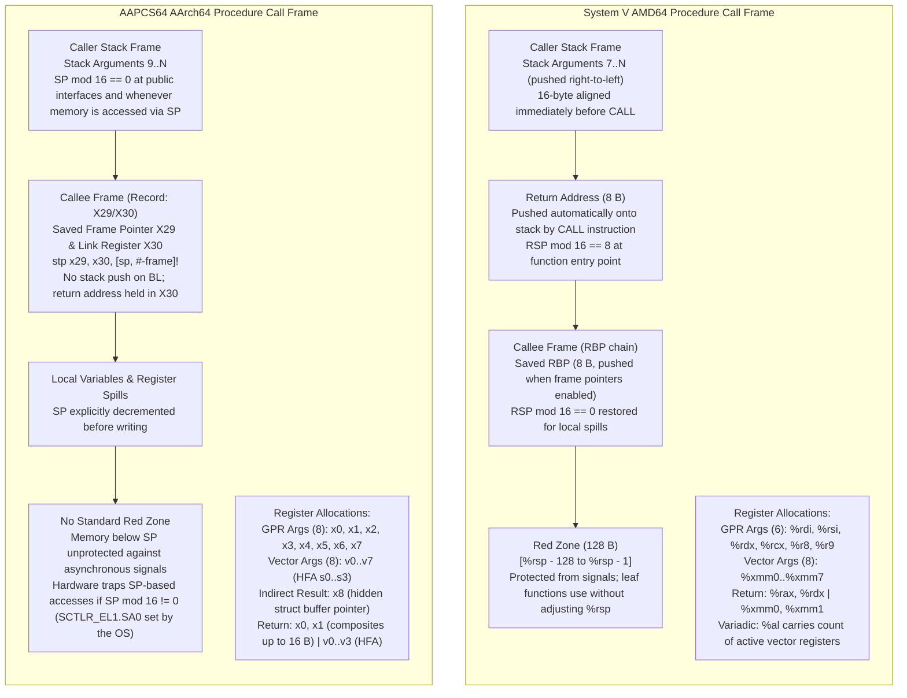

# Calling Conventions: System V AMD64 and AAPCS64

> [!summary] Claim:
> A procedure call standard is a hardware-grounded contract governing register allocation, stack frame geometry, aggregate classification, and vector lowering across compilation units.
> System V AMD64 marshals arguments across six integer registers and eight vector registers, preserves a 128-byte red zone below the stack pointer for leaf optimizations, and enforces a strict 16-byte stack alignment invariant at function entry.
> AAPCS64 expands register capacity to eight general-purpose registers and eight SIMD/FP registers, eliminates the standard red zone in favor of explicit hardware-enforced stack alignment checks, and introduces Homogeneous Floating-point Aggregates that map directly across vector registers without memory round-trips.
> Understanding the low-level mechanics of these calling conventions separates engineers who treat compiler output as magic from those who can diagnose boundary corruption, optimize cross-language foreign function interfaces, and build high-performance runtimes.



## The Mechanism

Every high-level function invocation in C, C++, Rust, or Swift eventually lowers into machine instructions that execute across an architectural boundary.
Because independent compilers, shared objects, and kernel runtimes must interoperate without access to each other's intermediate representations, the operating system defines a Procedure Call Standard (PCS) as part of its Processor Supplement Application Binary Interface (psABI).
The two dominant 64-bit conventions in modern computing are the System V AMD64 ABI (governing Linux, BSD, and macOS on x86-64) and the AAPCS64 (governing Linux, BSD, and Android on 64-bit ARM, with Darwin ARM64 sharing most core register assignments).
These conventions define which CPU registers hold arguments, how complex aggregate structures are decomposed and classified, who preserves register state across calls, and how the hardware stack must be aligned.

Adjacent notes own adjacent responsibilities:
[[ELF-Mach-O-and-PE-Object-Formats]] owns the physical header layout and binary container structures.
[[Symbols-Relocations-and-Static-Linking]] owns symbol table binding and relocation record application.
[[Dynamic-Linking-PLT-GOT-and-Loaders]] owns procedure linkage table thunks and runtime library resolution.
[[Cpp-Itanium-ABI-Object-Model-Vtables-and-RTTI]] owns C++ virtual table dispatch, RTTI structures, and name mangling.
[[Stack-Unwinding-CFI-and-Exception-ABI]] owns Call Frame Information (CFI) opcodes, DWARF `.eh_frame` tables, and personality routines.
[[Hardware-Security-ABIs-PAC-BTI-CET-and-RELRO]] owns hardware security modifications including Pointer Authentication (PAC) and Branch Target Identification (BTI).
This note owns the procedure call conventions and calling sequence mechanics for x86-64 and AArch64.

### 1. Register Taxonomy and Preservation Invariants

At a function call boundary, hardware registers are partitioned into two fundamental categories: caller-saved (volatile or scratch) and callee-saved (non-volatile or preserved).
A caller must assume that any value residing in a caller-saved register is destroyed across a subroutine call.
Conversely, a callee must restore any callee-saved register to its exact entry value prior to returning control to the caller.

In the System V AMD64 psABI (Draft Version 1.0, Section 3.2), the general-purpose registers are categorized as follows:
- **Caller-Saved (Volatile / Scratch):** `%rax`, `%rcx`, `%rdx`, `%rsi`, `%rdi`, `%r8`, `%r9`, `%r10`, `%r11` (and the APX registers `%r16`-`%r31`, listed as temporaries in the psABI 1.0 register table).
  The caller must spill these registers to its stack frame if their values are needed across a `call`.
- **Callee-Saved (Preserved):** `%rbx`, `%rsp`, `%rbp`, `%r12`, `%r13`, `%r14`, `%r15`.
  The callee must push these registers or preserve them in its local frame before overwriting them.
- **Floating-Point and Vector:** `%xmm0` through `%xmm15` (and extended `%ymm0`-`%ymm15`, `%zmm0`-`%zmm31` under AVX/AVX-512) are all caller-saved.
  No vector registers are preserved across calls in standard System V AMD64; the AVX-512 opmask registers `%k0`-`%k7` are also temporaries.

In AAPCS64 (Release 2026Q3, Section 6.1), the 64-bit ARM architecture provides 31 general-purpose registers (`x0` through `x30`), a dedicated stack pointer (`SP`), and 32 vector registers (`v0` through `v31`):
- **Caller-Saved (Volatile / Parameter / Scratch):** `x0` through `x7` (argument passing and return values), `x9` through `x15` (temporary scratch registers).
- **Intra-Procedure-Call Corruptible Registers:** `x16` and `x17` (also designated `IP0` and `IP1`).
  These registers are explicitly reserved for linker-generated veneers, PLT stubs, and dynamic linker thunks.
- **Platform Register:** `x18`.
  AAPCS64 says a platform that needs a dedicated register for inter-procedural state should use `x18`, and a platform without such a need should treat it as an additional caller-saved register; Linux user space treats it as caller-saved, Apple documents "The platforms reserve register x18. Don't use this register.", and Android uses it for ShadowCallStack: "SCS assumes that the `x18` register is reserved to store the address of the ShadowCallStack" (Android docs, and the Clang ShadowCallStack docs say the same for the AArch64 runtime in bionic).
- **Callee-Saved (Preserved):** `x19` through `x29` and `SP` (AAPCS64 6.1.1: "Registers r19-r29 and SP are Callee-saved").
  The callee must preserve these registers across execution.
- **Frame Pointer and Link Register:** `x29` serves as the Frame Pointer (`FP`) and is in the callee-saved set; `x30` serves as the Link Register (`LR`).
  `x30` is not in the callee-saved list: it holds the return address written by the branch-and-link instruction (`BL`), so a non-leaf callee must save it before making nested calls in order to return.
- **SIMD and Floating-Point Registers:** `v0` through `v7` are caller-saved argument and return registers.
  Registers `v16` through `v31` are caller-saved scratch registers.
  Registers `v8` through `v15` are callee-saved, but with a critical architectural nuance: only their low 64 bits (`d8` through `d15`) are preserved across calls.
  The upper 64 bits of `v8` through `v15` are volatile caller-saved scratch bytes.

```text
System V AMD64 Register Roles:
  %rdi, %rsi, %rdx, %rcx, %r8, %r9 : Arguments 1 to 6 (INTEGER class)
  %xmm0 .. %xmm7                   : Arguments 1 to 8 (SSE class)
  %rax                             : Primary Return Value / Variadic Vector Count (%al)
  %rdx                             : Secondary Return Value (upper 64 bits of 16-byte structs)
  %rsp                             : Stack Pointer (16-byte aligned before call)
  %rbp                             : Frame Pointer (callee-saved base of frame)
  %rbx, %r12, %r13, %r14, %r15     : Callee-saved general-purpose registers

AAPCS64 AArch64 Register Roles:
  x0 .. x7                         : Arguments 1 to 8 / Primary Return Values
  x8                               : Indirect Result Location Register (hidden struct return pointer)
  x9 .. x15                        : Temporary caller-saved scratch registers
  x16, x17 (IP0, IP1)              : Intra-procedure scratch registers (PLT veneers and dynamic linker)
  x18                              : Platform register (reserved on Apple; caller-saved where unused)
  x19 .. x28                       : Callee-saved general-purpose registers
  x29 (FP)                         : Frame Pointer (callee-saved frame chain; r19-r29 are callee-saved)
  x30 (LR)                         : Link Register (hardware return address set by BL)
  SP                               : Stack Pointer (hardware alignment checked; quad-word aligned)
  v0 .. v7 (s0..s7, d0..d7)        : Floating-point / SIMD arguments 1 to 8 and return values
  v8 .. v15 (low 64-bit d8..d15)   : Callee-saved floating-point registers
```

### 2. Argument Passing and Aggregate Classification

When an argument list is lowered to machine code, each parameter must be assigned to a general-purpose register, a vector register, or the memory stack.
Scalar primitives map directly to hardware registers.
Composite types (C structs, C++ classes, and arrays), however, require a rigorous classification algorithm to determine whether they can be packed into registers or must be spilled into stack memory.

#### System V AMD64 Classification Algorithm

The System V AMD64 psABI (Section 3.2.3) evaluates parameter types by decomposing aggregates into contiguous 8-byte units called "eightbytes".
Each eightbyte is assigned one of the following classes:
1. `INTEGER`: Types that fit into general-purpose registers (pointers, integers, booleans, enums).
2. `SSE`: Types that fit into vector registers (`float`, `double`, `_Float16`).
3. `SSEUP`: Upper 64-bit chunks of vector types occupying more than one eightbyte (such as 128-bit `__m128`, 256-bit `__m256`, or 512-bit `__m512`).
4. `X87` and `X87UP`: 80-bit x87 floating-point types (`long double`).
5. `COMPLEX_X87`: Complex numbers composed of `long double` elements.
6. `NO_CLASS`: Padding bytes, empty structures, or unallocated tail space.
7. `MEMORY`: Types that must be passed via the memory stack.

The classification rules for composite aggregates proceed sequentially:
- **Step 1 (Size Check):** If the size of an aggregate exceeds eight eightbytes (64 bytes), or if it contains unaligned fields, it is classified immediately as `MEMORY`.
- **Step 2 (Recursive Inspection):** Each eightbyte is classified based on the types of the fields it contains.
  If an eightbyte contains only `INTEGER` fields, it is classified as `INTEGER`.
  If it contains only floating-point fields, it is classified as `SSE`.
- **Step 3 (Merge Rules):** If a single eightbyte contains mixed types:
  - If any field is `MEMORY`, the entire eightbyte becomes `MEMORY`.
  - If any field is `INTEGER`, the entire eightbyte becomes `INTEGER`.
  - If any field is `X87`, `X87UP`, or `COMPLEX_X87`, it becomes `MEMORY`.
  - Otherwise, the eightbyte becomes `SSE`.
- **Step 4 (Post-Merge Sizing):** If the aggregate exceeds two eightbytes (16 bytes), and the first eightbyte is not `SSE` or any subsequent eightbyte is not `SSEUP`, the entire aggregate is classified as `MEMORY`.

Once classified, parameters are assigned to available hardware registers in order:
- Up to six `INTEGER` eightbytes are assigned to `%rdi`, `%rsi`, `%rdx`, `%rcx`, `%r8`, and `%r9`.
- Up to eight `SSE` eightbytes are assigned to `%xmm0` through `%xmm7`.
- Once register capacity is exhausted, or if an argument is classified as `MEMORY`, it is pushed onto the caller's stack frame.
Stack arguments are aligned to 8-byte boundaries (or 16/32/64 bytes if vector alignment dictates) and pushed in reversed (right-to-left) order, so the first stack argument sits at the lowest address; argument evaluation order is a language matter, not part of the ABI.

#### AAPCS64 Parameter Lowering: Stages A, B, and C

AAPCS64 (Section 6.8) conceptualizes parameter passing through three formal stages:
- **Stage A (Initialization):** The Next General-purpose Register Number (`NGRN`) is set to 0 (`x0`), the Next SIMD/Floating-point Register Number (`NSRN`) is set to 0 (`v0`), and the Next Stacking Argument Address (`NSAA`) is initialized to the base of the stack argument area.
- **Stage B (Pre-padding and Type Adjustment):**
  - If an argument is a composite type whose size cannot be statically determined, it is copied to memory and replaced by a pointer.
  - If an argument is a composite type larger than 16 bytes (and is not an HFA or HVA), it is copied to memory allocated by the caller, and the argument is replaced by a pointer to that copy.
- **Stage C (Assignment to Registers or Stack):**
  - Scalar integers and small composite types ($\le 16$ bytes) consume general-purpose registers starting at `NGRN`.
    A struct between 9 and 16 bytes consumes two GPRs (e.g., `x0` and `x1`).
    If `NGRN + required_gprs > 8`, the argument cannot be partially split across registers; `NGRN` is marked as exhausted (set to 8), and the entire argument is pushed to the stack at `NSAA`.
  - Scalar floats consume vector registers starting at `NSRN`.

#### Homogeneous Floating-point Aggregates (HFA)

A defining feature of AAPCS64 is the Homogeneous Floating-point Aggregate (HFA).
An HFA is a composite struct or array containing between 1 and 4 identical fundamental floating-point elements (`float`, `double`, 128-bit quad precision, `__fp16`, or `__bf16`; AAPCS64 says "at most four uniquely addressable members", and the half-precision formats share one fundamental type).
Nested structs and arrays that flatten into 1 to 4 identical floating-point primitives qualify as HFAs.
Under AAPCS64:
- If `NSRN + num_elements <= 8`, each member of the HFA is assigned its own independent vector register (`s0`-`s3` or `d0`-`d3`).
- This design completely eliminates the packing and unpacking overhead inherent in x86-64 System V, where a struct of four 32-bit floats is packed into two 64-bit SSE eightbytes (`%xmm0` and `%xmm1`), requiring costly vector shuffle instructions (`shufps`) to extract individual members.
- If insufficient vector registers remain (`NSRN + num_elements > 8`), the entire HFA spills to the stack; it is never split across registers and memory, nor does it spill into general-purpose registers.

### 3. Return Value Conventions and Indirect Buffers

Return values follow an inverted mirror of the parameter passing classification rules, but with architectural divergences regarding large composite structures.

In System V AMD64:
- Primitive integers, pointers, and structures up to 16 bytes classified as `INTEGER` are returned in `%rax` (low eightbyte) and `%rdx` (high eightbyte).
- Floating-point scalars and structures up to 16 bytes classified as `SSE` are returned in `%xmm0` and `%xmm1`.
- If a return value is classified as `MEMORY` (exceeding 16 bytes, containing unaligned fields, or representing a C++ class with a non-trivial copy constructor or destructor under the Itanium ABI):
  - The caller must allocate a memory buffer in its own stack frame capable of holding the structure.
  - The caller passes the address of this buffer as a hidden, implicit first argument in `%rdi`.
  - All explicit user arguments are shifted right by one register position (the first explicit integer argument moves to `%rsi`, the second to `%rdx`, and so on).
  - The callee populates the buffer and returns the same buffer pointer in `%rax`.

In AAPCS64:
- Primitive integers and composite structures up to 16 bytes are returned in `x0` and `x1`.
- Single-precision and double-precision scalars and HFAs up to 4 elements are returned in vector registers `v0` through `v3`.
- If the return value cannot be passed in registers (exceeding 16 bytes and not qualifying as an HFA or HVA):
  - The caller allocates space on its stack frame to hold the returned value.
  - The caller passes the address of this buffer in register `x8` (the dedicated Indirect Result Location Register).
  - Crucially, unlike System V AMD64, `x8` is decoupled from the parameter passing registers.
  - User arguments are not shifted; the first argument still enters in `x0`, the second in `x1`, preserving a clean 8-register argument capacity regardless of whether an indirect return buffer is present.
  - The callee writes the result directly into memory at `[x8]` and executes `RET`.

### 4. Stack Alignment and the Hardware Fault Boundary

Stack alignment is an invariant required for performance and correctness.
Modern CPU microarchitectures rely on aligned memory accesses to prevent cache-line splits and enable single-cycle vector loads.

#### System V AMD64 16-Byte Invariant

Under System V AMD64 (Section 3.2.2), the end of the input argument area must be aligned on a 16-byte boundary immediately before a `call` instruction is executed.
When the CPU executes the x86 `call` instruction, hardware pushes the 8-byte return address onto the stack.
Consequently, upon entry to the called function's prologue:

$$\text{RSP} \pmod{16} == 8$$

To restore 16-byte alignment before making any subsequent nested subroutine calls, the function prologue must adjust `%rsp` by an odd multiple of 8 bytes:
```nasm
pushq   %rbp            ; RSP mod 16 becomes 0 (8 - 8 = 0)
movq    %rsp, %rbp      ; Establish frame pointer
subq    $16, %rsp       ; Allocate local space; RSP mod 16 remains 0
```
If an omitted adjustment leaves `%rsp` misaligned, any subsequent execution of SSE instructions that require 16-byte aligned addresses (such as `movaps` or `movdqa`) triggers a General Protection Fault (`#GP`, delivered to user space as `SIGSEGV`).
When AVX-256 or AVX-512 vector types (`__m256`, `__m512`) are passed on the stack, the alignment requirement expands to 32 bytes or 64 bytes, respectively.

#### AAPCS64 Hardware-Enforced Quad-Word Alignment

In AAPCS64 (Sections 6.4.5.1 and 6.4.5.2), the stack pointer (`SP`) must be aligned to a quad-word (16-byte boundary, `SP mod 16 == 0`) at all public interfaces, and the universal constraints add that "at any point at which memory is accessed via SP, the hardware requires that SP mod 16 = 0".
Furthermore, the ARMv8-A hardware architecture incorporates a stack alignment check controlled by `SCTLR_EL1.SA0` (for EL0 user space) and `SCTLR_EL1.SA` (for EL1 kernel space); the OS turns it on, and Linux sets both bits in `INIT_SCTLR_EL1_MMU_ON` (`arch/arm64/include/asm/sysreg.h`).
Whenever the stack pointer register `SP` is used as the base register in a load or store instruction:
- If `SP mod 16 != 0`, the processor hardware generates a synchronous SP alignment fault exception.
- The Linux kernel handles it in `do_sp_pc_abort` (`arch/arm64/mm/fault.c`) and delivers `SIGBUS` with `si_code` `BUS_ADRALN`; macOS on Apple silicon also delivers `SIGBUS` with `BUS_ADRALN` (measured on the lab host, `sig=10 code=1`).
- In practice compilers adjust `sp` only in multiples of 16 bytes (`sub sp, sp, #imm` / `add sp, sp, #imm`), because any SP-based access made while `SP` is misaligned traps.

### 5. The 128-Byte Red Zone and Kernel Hazards

The red zone is an optimization mechanism that eliminates stack pointer manipulation in leaf functions (functions that do not invoke any other subroutines).

#### System V AMD64 Red Zone

System V AMD64 defines a 128-byte region immediately below the stack pointer:

$$\text{Red Zone} = [\%rsp - 128, \; \%rsp - 1]$$

The specification guarantees that user-space operating system signal handlers, interrupts, and asynchronous kernel events will not corrupt this 128-byte area.
When an asynchronous signal arrives on Linux (and no alternate signal stack is in use), `get_sigframe` in `arch/x86/kernel/signal.c`, called from the 64-bit `setup_rt_frame` path, calculates the signal frame position by explicitly skipping 128 bytes beyond the current `%rsp` (`/* redzone */ sp -= 128;`), then reserving the FPU/XSAVE area and the frame, then rounding down and subtracting 8 so the handler sees a normal post-`call` entry alignment:

$$\text{Signal SP} = \text{round\_down}(\text{RSP} - 128 - \text{XSaveSize} - \text{FrameSize},\; 16) - 8$$

Because this memory is protected, an optimizing compiler can store local variables and intermediate spill data for a leaf function directly into the red zone using negative offsets (`-8(%rsp)`, `-16(%rsp)`) without emitting `subq $N, %rsp` in the prologue or `addq $N, %rsp` in the epilogue.
This saves the two stack-pointer adjustment instructions (the `subq`/`addq` pair) per invocation; neither is a branch.

#### The Kernel Space Hazard and `-mno-red-zone`

The red zone is strictly a user-space abstraction.
When the CPU runs in Ring 0 (kernel space) and a hardware interrupt occurs, the x86 CPU hardware itself pushes the interrupt frame (saved `SS`, `RSP`, `RFLAGS`, `CS`, `RIP`, and error code) directly onto the current stack without adjusting for a red zone.
If kernel code was compiled with red zone optimizations enabled, the hardware interrupt handler immediately overwrites the local variables residing in `[%rsp - 128, %rsp - 1]`.
Consequently, operating system kernels, bootloaders, hypervisors, and interrupt service routines must be compiled with the `-mno-red-zone` compiler flag.

#### AAPCS64 Red Zone Omission

Standard AAPCS64 (governing Linux and BSD on AArch64) does not specify a red zone.
The region below `SP` is an inactive memory region that user code must never write to.
If user code stores data below `SP`, an asynchronous Linux signal handler immediately overwrites the memory, causing silent data corruption.
Apple's Darwin ARM64 ABI represents a platform divergence: Apple documents that "The ARM64 red zone consists of the 128 bytes immediately below the stack pointer. Apple platforms don't modify these bytes during exceptions."
Apple Clang does not use it by default, though: for `arm64-apple-macos`, `leaf_stack_buffer` still emits `sub sp, sp, #0x10`, `-mred-zone` changes nothing, and only the hidden backend option `-mllvm -aarch64-redzone` (LLVM `AArch64FrameLowering::canUseRedZone`) produces `stur x0, [sp, #-0x8]` (measured with Apple LLVM 21.0.0, as of 2026-11, macOS).

### 6. Variadic Argument Lowering and va_list Structures

Functions accepting variable arguments (`...`) present a challenge: the callee cannot know at compile time which registers were populated with arguments and which arguments spilled onto the stack.

#### System V AMD64 Vector Register Optimization (`%al`)

To optimize variadic function entry on x86-64, the caller must set `%al` (the lowest byte of `%rax`) to an upper bound on the number of vector registers (`%xmm0`-`%xmm7`) used to pass arguments; the psABI says it "is in the range 0--8 inclusive" and need not be exact.
The callee's prologue spills the argument registers into a 176-byte register save area on the stack, and `va_start` points `reg_save_area` at it; the area contains:
- 48 bytes for the 6 general-purpose argument registers (`%rdi`, `%rsi`, `%rdx`, `%rcx`, `%r8`, `%r9`).
- 128 bytes for the 8 vector registers (`%xmm0`-`%xmm7`).

By checking `%al`, the callee's prologue avoids saving the 128 bytes of SSE registers when `%al == 0`:
```nasm
testb   %al, %al
je      .Lskip_sse_save
movaps  %xmm0, 48(%rsp)
movaps  %xmm1, 64(%rsp)
...
.Lskip_sse_save:
```
The `va_list` type on System V AMD64 is defined as a one-element array of a structure containing:
```c
typedef struct {
    unsigned int gp_offset;      /* Offset from reg_save_area to next GP argument */
    unsigned int fp_offset;      /* Offset from reg_save_area to next FP argument */
    void *overflow_arg_area;     /* Pointer to next stack-passed argument */
    void *reg_save_area;         /* Base pointer to spilled register dump */
} va_list[1];
```
When `gp_offset >= 48`, general-purpose registers are exhausted, and arguments are retrieved from `overflow_arg_area`.
When `fp_offset >= 176`, vector registers are exhausted, and floats are pulled from `overflow_arg_area`.

#### AAPCS64 Variadic Lowering and Platform Divergence

Under standard AAPCS64 on Linux, named arguments consume registers `x0`-`x7` and `v0`-`v7`.
Unnamed variadic arguments continue consuming the remaining available registers until `x7` and `v7` are exhausted, after which they spill onto the stack.
The callee's `va_start` dumps unconsumed argument registers into a register save area, and `va_list` is defined as:
```c
typedef struct __va_list {
    void *__stack;    /* Next argument on stack */
    void *__gr_top;   /* End of GP register save area */
    void *__vr_top;   /* End of FP register save area */
    int   __gr_offs;  /* Negative byte offset from __gr_top to next GP arg */
    int   __vr_offs;  /* Negative byte offset from __vr_top to next FP arg */
} __va_list;
```
`__gr_offs` initializes to a negative offset: $-(8 - \text{named\_gprs}) \times 8$.
As arguments are fetched, `__gr_offs` increments toward zero.
Once it reaches zero, subsequent arguments are pulled from `__stack`.

In contrast, Apple's Darwin ARM64 ABI departs from AAPCS64: all variadic arguments are passed exclusively on the stack.
No registers are allocated for anonymous parameters.
Consequently, on macOS and iOS on ARM64, `va_list` is a simple single scalar pointer (`char *`), simplifying foreign function interfaces and eliminating register save areas entirely.

### 7. Vector Extensions: AVX-512 and Arm SVE

Vector extensions expand CPU registers beyond standard 128-bit boundaries, introducing ABI considerations for state preservation and register transition penalties.

#### AVX-512 and the AVX-SSE Transition Penalty

The System V AMD64 psABI incorporates AVX-512 extensions:
- `__m512` arguments are passed in `%zmm0` through `%zmm7` (512-bit vector registers), one eightbyte classified SSE followed by seven SSEUP.
- An `__m512` return value occupies `%zmm0`.
- All of `%zmm0` through `%zmm31` are caller-saved scratch registers.
- The opmask registers `%k0`-`%k7` are not argument or return registers: the psABI register table lists them as "temporary registers", and mask types such as `__mmask16` are ordinary integer types passed in general-purpose registers.

On Intel microarchitectures, executing legacy (non-VEX) 128-bit SSE instructions while the upper halves of `%ymm` or `%zmm` registers contain dirty state causes a microarchitectural penalty (the AVX-SSE transition penalty).
Before Skylake, the processor saves and restores the upper vector register state on each state transition, a stall of several tens of cycles (this note asserts no exact figure: the often-quoted 70 cycles appears only in Intel community posts, not in a primary Intel page that could be fetched); from Skylake on, the one-time transition is replaced by a false dependency and blend on every non-VEX instruction while the upper state is dirty.
To eliminate this penalty, compilers targeting AVX emit the `vzeroupper` instruction before leaving an AVX function or calling a foreign ABI boundary:
```nasm
vzeroupper      ; Zeroes bits 128 and up of YMM/ZMM0-15; ZMM16-31 are not modified
ret
```

#### Arm Scalable Vector Extension (SVE) Calling Conventions

Arm SVE and SVE2 introduce scalable vector registers (`z0`-`z31`) whose physical bit-width is determined by hardware at runtime, ranging from 128 bits to 2048 bits; Arm retrospectively removed non-power-of-two lengths (known issue C215 against DDI0487I.a), so the permitted lengths are 128, 256, 512, 1024, and 2048 bits.
Because the vector length is unknown at compile time, the base AAPCS64 standard defines:
- Standard C functions preserve only the lower 64 bits (`d8`-`d15`) of vector registers across calls.
  All upper bits of `z0`-`z31` and all predicate registers (`p0`-`p15`) are treated as volatile scratch state.
- For functions that take or return scalable vectors or predicates (or that opt in with `__attribute__((aarch64_sve_pcs))`), AAPCS64 applies the SVE rules:
  - Parameters pass in `z0` through `z7` (vectors) and `p0` through `p3` (predicates).
  - Return values occupy `z0`-`z7` and `p0`-`p3` (AAPCS64 6.1.3 and 6.1.4).
  - Callee-saved registers include `z8` through `z23` (full scalable vector width preserved) and predicate registers `p4` through `p15`.
  - Compilers emit special dynamic stack allocation instructions (`ADDVL`, `STR Zt, [sp]`) to dynamically size stack frames based on the runtime vector length.

### 8. AMD64 Code Models and Addressing Modes

The System V AMD64 psABI (Section 3.5) defines memory code models that determine how instructions address static code and data symbols across the 64-bit virtual address space.
Because 64-bit absolute immediate operands (`movabsq`) cost 10 bytes and consume significant instruction cache footprint, code models restrict virtual address ranges to allow compact 32-bit sign-extended PC-relative displacements.

1. **Small Code Model (`-mcmodel=small`, default):**
   - Assumes that all virtual memory addresses for code and static data reside within the lowest 2 GiB of virtual address space; the psABI range is $[0, 2^{31} - 2^{24} - 1]$ (`0x00000000` to `0x7effffff`), which leaves room for 16 MiB displacements from a symbol.
   - Allows compilers to reference all functions and data using 32-bit signed displacements relative to the instruction pointer (`%rip + disp32`).
2. **Medium Code Model (`-mcmodel=medium`):**
   - Assumes that code and small data reside within the lowest 2 GiB, but large data sections (`.ldata`, `.lbss`, `.lrodata`) can exceed 2 GiB.
   - Code continues using compact `%rip`-relative addressing, but large arrays require full 64-bit absolute pointer references.
3. **Large Code Model (`-mcmodel=large`):**
   - Makes no assumptions about virtual address locations; code and data may be scattered anywhere across the entire 64-bit address space.
   - All addresses must be materialized via 64-bit absolute instructions (`movabsq $symbol, %rax`) and indirect jumps (`jmpq *%rax`), incurring code size and branch prediction overhead.
4. **Kernel Code Model (`-mcmodel=kernel`):**
   - Assumes that all code and data reside in the top 2 GiB of virtual address space; the psABI range is $[2^{64} - 2^{31}, 2^{64} - 2^{24}]$ (`0xffffffff80000000` to `0xffffffffff000000`).
   - Displacements can be sign-extended from 32-bit constants to reach kernel space while keeping instruction sizes small.
5. **Position-Independent Code Models (`-fpic`, `-fPIC`):**
   - Required for shared libraries and Position-Independent Executables (PIE).
   - All references to internal DSO symbols use `%rip`-relative addressing.
   - External symbol references are redirected through the Global Offset Table (`.got`), owned by [[Dynamic-Linking-PLT-GOT-and-Loaders]].

## Commands and Numbers to Know

Every calling convention contract relies on fixed hardware register counts, stack alignments, and compiler flags stamped `(as of 2026-11)`.

| Metric / Parameter | System V AMD64 (x86-64) | AAPCS64 (AArch64) | Target Platform | Scope and Standard Citation |
| :--- | :--- | :--- | :--- | :--- |
| Integer Argument Registers | 6 (`%rdi, %rsi, %rdx, %rcx, %r8, %r9`) | 8 (`x0, x1, x2, x3, x4, x5, x6, x7`) | Both (as of 2026-11) | Standard GPR argument passing capacity |
| Vector / FP Argument Registers | 8 (`%xmm0` through `%xmm7`) | 8 (`v0` through `v7`, `s0..s7`, `d0..d7`) | Both (as of 2026-11) | Vector / floating-point argument passing capacity |
| Integer Return Registers | 2 (`%rax`, `%rdx` for $\le 16$ B structs) | 2 (`x0`, `x1` for $\le 16$ B structs) | Both (as of 2026-11) | Primary and secondary scalar return channels |
| Vector / FP Return Registers | 2 (`%xmm0`, `%xmm1` for $\le 16$ B structs) | 4 (`v0`-`v3` for scalars and HFAs of up to 4 members) | Both (as of 2026-11) | Vector and HFA return capacity |
| Indirect Result Register | Implicit 1st arg (`%rdi`, shifts args) | Dedicated `x8` (no argument shifting) | Both (as of 2026-11) | Struct return memory pointer for $> 16$ B |
| Stack Alignment Invariant | 16 bytes (`(%rsp + 8) % 16 == 0` at entry) | 16 bytes (`SP % 16 == 0` at public interfaces) | Both (as of 2026-11) | Invariant checked at function call boundaries |
| Hardware Alignment Trap | No stack-pointer check; `#GP` only from alignment-requiring instructions such as `movaps` | SP alignment fault when `SCTLR_EL1.SA0` is set (Linux and macOS: `SIGBUS`, `BUS_ADRALN`) | Both (as of 2026-11) | CPU trap behavior when misaligned stack accessed |
| Red Zone Size | 128 bytes below `%rsp` | 0 bytes (Linux standard) / 128 bytes (Apple Darwin) | Both (as of 2026-11) | Memory area below stack pointer safe from signals |
| Variadic Vector Indicator | Register `%al` (holds active vector count 0-8) | None (registers saved based on static types) | Both (as of 2026-11) | Variadic function vector register spill indicator |
| Callee-Saved GPR Count | 6 (`%rbx, %rbp, %r12, %r13, %r14, %r15`), plus `%rsp` | 11 (`x19` through `x29`), plus `SP`; `x30` LR is not callee-saved | Both (as of 2026-11) | Non-volatile registers preserved across calls |
| Callee-Saved Vector State | 0 registers preserved | 8 registers (`d8`-`d15` low 64 bits only) | Both (as of 2026-11) | Non-volatile SIMD/FP register capacity |
| Compiler Red Zone Flag | `-mred-zone` / `-mno-red-zone` | N/A (Linux); on Darwin Apple Clang ignores `-mred-zone` and only `-mllvm -aarch64-redzone` enables it (measured, Apple LLVM 21.0.0) | Both (as of 2026-11) | Flag controlling red zone generation in compilers |
| Frame Pointer Flag | `-fno-omit-frame-pointer` | `-fno-omit-frame-pointer` | Both (as of 2026-11) | Preserves `%rbp` / `x29` call frame records |
| Vector Clean Exit Flag | `-mvzeroupper` / `-mno-vzeroupper` (Clang inserts `vzeroupper` by default with `-mavx`, measured; GCC docs state no default) | N/A (AArch64 does not exhibit AVX-SSE penalty) | Both (as of 2026-11) | Flag emitting `vzeroupper` at function exits |

## Multi-Language Comparison: C / C++ / Python / Rust

Foreign function interfaces (FFI) and cross-language calling sequences must reconcile distinct language object models against the underlying platform ABI.

| Language / Domain | Small Structs ($\le 16$ B) | Large Structs ($> 16$ B) | Non-Trivial C++ / Destruction | Variadic Function Calls | Vector Primitives |
| :--- | :--- | :--- | :--- | :--- | :--- |
| **C (C11 / C23)** | Passed in argument registers (`%rdi:%rsi` or `x0:x1` when first) and returned in `%rax:%rdx` or `x0:x1`, according to field classification | Passed on stack (x86) or via pointer copy (ARM); returned via hidden buffer | Not applicable (all C structures are plain POD aggregates) | Standard `va_list`; caller zeroes `%al` on x86-64 when no vector arguments | Intrinsics (`__m128`, `float32x4_t`) map directly to vector argument registers |
| **C++ (Itanium ABI)** | Passed in registers only if not "non-trivial for the purposes of calls" (no non-trivial copy/move constructor or destructor) | Passed via hidden reference / caller memory buffer | [[Cpp-Itanium-ABI-Object-Model-Vtables-and-RTTI\|Classes with non-trivial copy/dtor]] forced to pass by address | Inherited from C; C++ variadic templates expand to concrete typed signatures | Maps to vector registers; operator overloads compile to native SIMD instructions |
| **Rust (`repr(C)`)** | Structs marked `#[repr(C)]` map identically to platform C classification | Structs $> 16$ B lowered to platform C indirect pointer buffer semantics | A `#[repr(C)]` type with `Drop` compiles as an `extern "C"` parameter with no warning, and the Rust callee drops its parameter at the end of the function (measured, rustc 1.99.0, as of 2026-11); a C callee never runs Rust destructors, so ownership handed to C must be released explicitly | Calling: `extern "C" { fn printf(fmt: *const c_char, ...) -> c_int; }`; defining: `unsafe extern "C" fn f(n: i32, mut args: ...)` with `core::ffi::VaList::next_arg`, which compiles on stable rustc 1.99.0 with no feature gate or crate (measured, as of 2026-11) | `core::arch::x86_64` and `core::arch::aarch64` types pass directly in registers |
| **Python (`ctypes` / CFFI)** | Small `Structure` types passed in registers via `libffi` bridges | Allocates stack memory copy before invoking C entry point | Cannot directly marshal non-trivial C++ classes without C wrapper shims | Set `argtypes` for the fixed arguments; the ctypes docs say this is required on ARM64 Apple platforms, where variadics use a different convention, and advise it everywhere | Passed as arrays or pointers; cannot pass raw vector types by value |

## Worked Lab Example

The companion lab located at `code/00-Program-Execution/calling_convention_abi/` verifies the procedure call standards for both System V AMD64 and AAPCS64.
The lab executes a two-phase test suite:
1. A native harness (`harness_native.c`) that runs only on an Apple arm64 Mac and calls callees written in assembly, so the C compiler cannot specialize them away.
   Each probe records the raw registers and stack slots it was handed: `x0`-`x7` and `[sp]` for nine integer arguments, `d0`-`d7` and `[sp]` for nine doubles, `s0`-`s3` for a four-float HFA, `x8` as the indirect-result pointer for a 24-byte struct with `x0`-`x2` left unshifted, `x0:x1` for a 16-byte struct return, `[sp]` for the variadic arguments, and the entry `SP`.
   A static assertion checks that `va_list` is `char *`, and the misaligned-`SP` store must raise `SIGBUS` with `BUS_ADRALN` while an aligned store does not.
   Because the probes read the registers directly, a convention that placed any of these elsewhere makes the harness fail.
2. A cross-target ABI disassembler (`cross_abi_disasm.py`) that uses LLVM's multi-target compiler backends to compile identical C snippets to both `elf64-x86-64` and `elf64-littleaarch64`, parsing the generated instructions to verify register binding, stack-argument offsets, leaf function red zone utilization, vector shuffle overhead, indirect-return registers, and variadic `%al` lowering.
   The lab declares `# requires: macos` because it needs Apple's `objdump` with Clang's cross targets and the native harness probes the Apple arm64 convention; it was verified on `darwin-arm64` (as of 2026-11).

### Step 1: Run the Lab Verification Harness

Execute the lab verification harness directly from the command line:

```bash
cd code && python3 -m _harness.verify 00-Program-Execution/calling_convention_abi/
```

### Step 2: Inspect Golden Verification Output

The following deterministic output was captured on macOS (`darwin-arm64`):

```text
=== Native Calling Convention Verification (Host: Apple arm64) ===
[PASS] Integer argument passing: probe saw args 1-8 in x0-x7 and arg 9 at [sp]
[PASS] Floating-point argument passing: probe saw args 1-8 in d0-d7 and arg 9 at [sp]; integer and FP counters are independent
[PASS] Homogeneous Floating-point Aggregate (HFA): probe saw the 4 floats in s0-s3
[PASS] Small composite return (16B): a callee that only sets x0 and x1 returns the struct
[PASS] Large composite return (24B): a callee that writes through x8 fills the buffer and still sees its 3 arguments in x0-x2
[PASS] Stack alignment invariant: SP is 16-byte aligned at callee entry; a store through a misaligned SP raises SIGBUS with BUS_ADRALN, an aligned one does not
[PASS] Variadic argument handling: the 3 variadic arguments sit at [sp], [sp+8], [sp+16] and va_list is a char *
=== Cross-Target ABI Inspection (System V AMD64 vs AAPCS64) ===
[PASS] GPR Argument Allocation:
       x86-64 System V : 6 GPRs (%rdi, %rsi, %rdx, %rcx, %r8, %r9); args 7-9 read from stack
       AAPCS64 AArch64 : 8 GPRs (x0-x7); arg 9 read from stack
[PASS] Leaf Function Red Zone:
       x86-64 System V : 128-byte Red Zone utilized; %rsp unchanged (no subq %rsp)
       AAPCS64 AArch64 : No standard Red Zone; sp decremented (sub sp, sp, #imm)
[PASS] Homogeneous Floating-point Aggregates (HFA):
       x86-64 System V : Struct packed into two SSE eightbytes (%xmm0, %xmm1); requires shufps
       AAPCS64 AArch64 : Direct binding to scalar registers s0-s3; zero unpack overhead
[PASS] Composite Return Value Classification:
       <=16B Struct    : x86-64 uses %rax:%rdx; AAPCS64 uses x0:x1
       >16B Struct     : x86-64 passes buffer in %rdi; AAPCS64 passes buffer in dedicated x8
[PASS] Variadic Vector Register Count (%al):
       Integer varargs : %al set to 0 (xorl %eax, %eax) to skip vector register save
       FP varargs      : %al set to 1 (movb $0x1, %al) signaling one active vector register
       AAPCS64 Linux   : no count register; the count and the variadic int travel in w0-w1 and nothing like %al is set
```

### Step 3: Analysis of the Disassembly Evidence

The cross-target disassembly generated by `cross_abi_disasm.py` highlights the architectural differences:

1. In `leaf_stack_buffer`, the x86-64 compiler emits:
   ```nasm
   movq    %rdi, -0x18(%rsp)
   addq    $0x2a, %rdi
   movq    %rdi, -0x8(%rsp)
   movq    -0x18(%rsp), %rax
   addq    -0x8(%rsp), %rax
   retq
   ```
   The compiler emits zero stack adjustments; `%rsp` remains completely untouched, operating entirely within the 128-byte red zone.
   In contrast, the AArch64 compiler emits:
   ```nasm
   sub     sp, sp, #0x10
   add     x8, x0, #0x2a
   str     x0, [sp, #0x8]
   str     x8, [sp]
   ldr     x8, [sp, #0x8]
   ldr     x9, [sp], #0x10
   add     x0, x9, x8
   ret
   ```
   The AArch64 compiler must explicitly decrement and restore `sp` by 16 bytes because standard AAPCS64 does not guarantee a red zone.
   Compiling the same snippet for `arm64-apple-macos` emits the same `sub sp, sp, #0x10`, so Apple's documented red zone does not change default code generation (measured, Apple LLVM 21.0.0, as of 2026-11).

2. In `sum_hfa`, passing a struct of four 32-bit floats on x86-64 requires `shufps $0x55, %xmm0, %xmm2` to extract the second float from `%xmm0`, and another shuffle to unpack `%xmm1`.
   On AArch64, the four floats bind directly to registers `s0`, `s1`, `s2`, and `s3`, compiling into three direct `fadd` instructions with zero vector shuffle overhead.

## Pitfalls

> [!warning] Pitfalls:
> 
> **1. Stack Misalignment `#GP` Crash on x86-64 SSE Moves:**
> Hand-written assembly routines or trampolines that invoke C library functions without ensuring `RSP mod 16 == 8` at function entry crash with `SIGSEGV` inside libc.
> Modern libc implementations (e.g., `vfprintf`, `memcpy`, `puts`) frequently use `movaps %xmm0, (%rsp)` to spill vector registers, which triggers a hardware General Protection Fault if the stack is misaligned by 8 bytes.
> 
> **2. Variadic Call Corruption from Uninitialized `%al`:**
> When calling a variadic C function (such as `printf` or a logging function) from assembly or JIT-compiled code on x86-64, programmers must zero `%al` (`xorl %eax, %eax`) if no floating-point arguments are passed.
> If `%al` contains leftover garbage (e.g., from a preceding calculation), the callee's prologue executes up to 8 unnecessary 128-bit `movaps` instructions, or branches into invalid stack addresses, corrupting the call frame.
> 
> **3. Red Zone Stack Corruption in Kernel and Interrupt Handlers:**
> Compiling operating system kernel modules, device drivers, or bare-metal firmware without `-mno-red-zone` on x86-64 causes nondeterministic crashes.
> When a hardware interrupt fires, the CPU pushes return state directly onto the current stack, silently overwriting the 128 bytes below `%rsp` that active leaf functions were using for local variables.
> 
> **4. Assuming Structs Under 16 Bytes Always Pass in Registers:**
> Under the Itanium C++ ABI, if a struct contains a non-trivial copy constructor, move constructor, or destructor, it is classified as `MEMORY` regardless of its size.
> Even a 4-byte class `class IntBox { int val; ~IntBox(); };` is passed by invisible reference via a stack-allocated pointer, rather than in register `%rdi` or `x0`.
> 
> **5. Disregarding AAPCS64 Upper Vector Register Volatility:**
> In AAPCS64, callee-saved vector registers `v8` through `v15` preserve only their low 64 bits (`d8`-`d15`).
> If a developer uses NEON vector intrinsics assuming that the upper 64 bits of `v8`-`v15` (`q8`-`q15`) remain intact across function calls, the upper 64 bits will be silently destroyed by called subroutines.
> 
> **6. AVX-SSE Transition Pipeline Stalls:**
> Calling older 128-bit SSE library code from functions optimized with 256-bit or 512-bit AVX without executing `vzeroupper` causes microarchitectural stalls on Intel processors (several tens of cycles per transition before Skylake; no exact cycle count is asserted here).
> Since Skylake the cost is a per-instruction false dependency rather than a one-time stall, but it is still worth avoiding.
Compilers manage this automatically under `-mvzeroupper`, but hand-written assembly or inline assembly blocks must manually include `vzeroupper`.
> 
> **7. Conflating Apple Darwin ARM64 with Standard Linux AAPCS64 Variadics:**
> Assuming that `va_list` has the same memory layout across all 64-bit ARM platforms breaks cross-platform FFI bridges.
> Linux AAPCS64 uses a 5-member struct with negative offsets (`__stack`, `__gr_top`, `__vr_top`, `__gr_offs`, `__vr_offs`), whereas Apple Darwin ARM64 passes all variadic arguments on the stack, reducing `va_list` to a simple `char *`.

## At Scale

At enterprise scale (fleets of 1,000 to 50,000 servers running millions of microservices), procedure call conventions directly govern CPU efficiency, observability overhead, and software binary compatibility.

### 1. The Frame Pointer Trade-off: Observability vs Throughput

A recurring architectural debate centers on compiling production binaries with `-fno-omit-frame-pointer` versus `-fomit-frame-pointer`.
- Omitting frame pointers frees `%rbp` (x86-64) or `x29` (AArch64) for general-purpose register allocation, reducing memory spills and yielding a workload-dependent throughput gain: the Fedora change proposal reports GCC compiling the kernel 2.4% slower and a Blender frame 2% slower with frame pointers, CPython benchmarks 1-10% slower, and no significant impact on openssl, botan, zstd, or Redis, while Brendan Gregg reports Netflix overhead usually under 1% with one 10% exception (as of 2026-11, Linux).
- However, omitting frame pointers prevents continuous CPU profilers (such as Linux `perf`, eBPF profilers, and Google Wide Profiling) from walking the call stack using single-instruction pointer chasing.
- Profilers must instead fall back to DWARF CFI stack unwinding, owned by [[Stack-Unwinding-CFI-and-Exception-ABI]], which requires page-table lookups, binary inspection, and significant overhead that cannot run safely within eBPF kernel probes.
- **Enterprise Decision Rule:** Fedora Linux 38 added `-fno-omit-frame-pointer` and `-mno-omit-leaf-frame-pointer` to its default C and C++ flags, and Ubuntu 24.04 LTS enables frame pointers by default on 64-bit architectures; Brendan Gregg reports that Meta and Google hinted they had enabled frame pointers for everything years earlier, which is a report and not a published policy (as of 2026-11, Linux).
  A cost of a few percent is outweighed by the ability to obtain 24/7 continuous CPU profiling and instant crash diagnostics without symbol server dependencies.

### 2. ABI Compatibility and Shared Object Boundaries

In large-scale microservice architectures deploying C, C++, and Rust shared libraries (`.so` / `.dylib`), breaking ABI contracts causes subtle production outages.
- Changing an existing function signature from passing a struct by value (`struct Metrics`) to passing a primitive integer alters register allocation across all callers.
- If a struct grows from 16 bytes to 24 bytes, its classification transitions abruptly from `INTEGER` (passed in `%rdi:%rsi` or `x0:x1`) to `MEMORY` (passed on the stack or via hidden pointer in `x8`).
- If caller and callee are not recompiled simultaneously, the callee reads random stack garbage instead of the intended struct parameters.
- **Enterprise Decision Rule:** Continuous integration pipelines must employ automated ABI compliance linters, such as `libabigail` (`abipkgdiff`, `abicompat`), to inspect ELF symbol tables and DWARF types, automatically rejecting commits that alter ABI calling sequences for public shared libraries.

### 3. FFI Serialization and Memory Copy Tax

When languages with managed runtimes (Python, Java, Node.js) call native C/C++ libraries across Foreign Function Interfaces, marshalling composite structs $> 16$ bytes incurs a hidden performance penalty.
- Because both System V AMD64 and AAPCS64 require allocating a stack buffer and copying large structs to memory, high-frequency FFI calls suffer significant L1 cache and memory bus contention.
- **Enterprise Decision Rule:** High-performance FFI interfaces (such as quant trading libraries and deep learning runtimes) must avoid passing aggregate structures by value across language boundaries.
  All inter-language signatures must pass explicitly aligned 64-bit pointers (`const Struct *`) or pack primitive parameters into scalar registers, maintaining zero-copy register calling sequences.

## Practice Drill

> [!tip] Practice Drill:
> 
> Build and debug a manual assembly bridge that demonstrates the calling convention contracts:
> 
> 1. **Write an Assembly Trampoline:** Create a standalone assembly file (`trampoline.s`) that intercepts a C function call with 8 integer arguments:
>    `uint64_t bridge(uint64_t a1, uint64_t a2, uint64_t a3, uint64_t a4, uint64_t a5, uint64_t a6, uint64_t a7, uint64_t a8);`
> 2. **Inject Stack Misalignment (x86-64):** In the trampoline, subtract 8 bytes from `%rsp` before calling a C function that allocates a 16-byte aligned vector local variable (`__m128`).
>    Observe the immediate `#GP` fault and verify in GDB that `(%rsp + 8) % 16 != 0`.
> 3. **Fix the Invariant:** Correct the prologue by aligning `%rsp` to 16 bytes prior to the `call` instruction.
> 4. **Extract Arguments on AArch64:** Re-implement the trampoline on ARM64.
>    Demonstrate that arguments `a1` through `a8` reside in `x0` through `x7`, and verify that extracting a 9th argument requires reading `[sp]`.
> 5. **Observe Hardware Fault on ARM64:** Attempt to read memory using an unaligned stack pointer (`sub sp, sp, #8` followed by `ldr x0, [sp]`).
>    Capture the resulting `SIGBUS` / `SIGSEGV` signal using a custom signal handler and confirm that hardware stack alignment enforcement is active.

## Interview Questions

> [!question] L5: How do integer parameter passing capacities differ between System V AMD64 and AAPCS64, and what determines when an argument spills to memory?
>
> > [!success]- Answer
> > System V AMD64 provides six general-purpose integer argument registers: `%rdi`, `%rsi`, `%rdx`, `%rcx`, `%r8`, and `%r9`.
> > AAPCS64 provides eight general-purpose integer argument registers: `x0` through `x7`.
> > In both conventions, scalar integer arguments are assigned sequentially to available registers until capacity is exhausted.
> > Under System V AMD64, once the six registers are occupied, all subsequent integer parameters are pushed onto the caller's stack frame in right-to-left order, aligned to 8-byte boundaries.
> > Under AAPCS64, once the eight `x0`-`x7` registers are occupied, subsequent parameters spill to the stack at the Next Stacking Argument Address (`NSAA`).
> > Furthermore, composite structures spill to memory if their size exceeds the platform register capacity (16 bytes under both ABIs, unless classified as an HFA or vector type), or if insufficient consecutive registers remain to hold the entire structure without splitting.

> [!question] L5: Why does calling `printf` from x86-64 assembly require setting `%al`, and what happens if `%al` contains an uninitialized value?
>
> > [!success]- Answer
> > Under the System V AMD64 ABI, register `%al` (the lowest byte of `%rax`) serves as a hidden input parameter for variadic functions, giving an upper bound on the number of vector/SSE registers (`%xmm0`-`%xmm7`) used to pass floating-point arguments (a value from 0 to 8 inclusive; it need not be exact).
> > The callee's `va_start` prologue reads `%al` to determine how many vector registers must be saved to the 176-byte register save area on the stack.
> > If `%al` is zero, the callee executes an early branch that skips saving all eight 128-bit `%xmm` registers, saving roughly 8 memory stores and pipeline stalls.
> > If a caller leaves `%al` uninitialized with a garbage value greater than 8, or with arbitrary high bits, the callee's prologue may execute out-of-bounds register spills, attempt to execute unaligned vector moves, or corrupt the local call frame, resulting in an undefined crash (`SIGSEGV`).

> [!question] L6: Consider two functions passing a 16-byte struct of four 32-bit floats on x86-64 System V and AArch64 AAPCS64; what assembly instructions does each target emit to evaluate the sum of its fields?
>
> > [!success]- Answer
> > Under System V AMD64, a 16-byte struct containing four 32-bit floats is classified as two 8-byte SSE units.
> > The first two floats (bytes 0-7) are packed together into the low 64 bits of `%xmm0`, and the last two floats (bytes 8-15) are packed into `%xmm1`.
> > To compute the sum, the compiler cannot add the registers directly; it must emit vector shuffle instructions to unpack the individual floats:
> > ```nasm
> > movaps  %xmm0, %xmm2
> > shufps  $0x55, %xmm0, %xmm2     ; Extract float 1 from %xmm0
> > addss   %xmm2, %xmm0            ; Add float 1 + float 0
> > addss   %xmm1, %xmm0            ; Add float 2 from low 32 bits of %xmm1
> > shufps  $0x55, %xmm1, %xmm1     ; Extract float 3 from %xmm1
> > addss   %xmm1, %xmm0            ; Add float 3
> > retq
> > ```
> > Under AAPCS64, the struct qualifies as a Homogeneous Floating-point Aggregate (HFA) of four single-precision floats.
> > AAPCS64 maps each float directly to its own independent hardware register: `s0`, `s1`, `s2`, and `s3`.
> > The callee evaluates the sum with zero unpacking instructions:
> > ```nasm
> > fadd    s0, s0, s1              ; Add float 0 + float 1
> > fadd    s0, s2, s0              ; Add float 2
> > fadd    s0, s3, s0              ; Add float 3
> > ret
> > ```
> > This highlights how AAPCS64's HFA rules eliminate vector shuffling and memory round-trips for multi-dimensional mathematical structures.

> [!question] L6: Why does an asynchronous signal handler corrupt leaf function state if compiled without `-mno-red-zone` inside an operating system kernel or interrupt service routine?
>
> > [!success]- Answer
> > The 128-byte red zone (`[%rsp - 128, %rsp - 1]`) is a software convention established by the System V AMD64 user-space ABI.
> > In user space, the Linux kernel's signal delivery code explicitly honors this convention: when an asynchronous signal is dispatched without an alternate signal stack, `get_sigframe` (called from the `setup_rt_frame` path) places the FPU state, `ucontext`, and signal frame starting 128 bytes below the process's current `%rsp`.
> > In Ring 0 kernel space, however, hardware interrupts are handled directly by CPU microcode, not by an operating system signal wrapper.
> > When a hardware interrupt fires, the x86 CPU automatically pushes the interrupt stack frame (`SS`, `RSP`, `RFLAGS`, `CS`, `RIP`) directly onto the current stack starting at the exact address pointed to by `%rsp`.
> > If a kernel leaf function was compiled without `-mno-red-zone`, it stores its local variables in `[%rsp - 128, %rsp - 1]` without moving `%rsp`.
> > The CPU hardware interrupt frame immediately overwrites these local variables with interrupt state, causing silent data corruption and kernel panics upon returning from the interrupt handler.

> [!question] L6: A high-frequency trading application crashes with a segmentation fault (`SIGSEGV`) inside an SSE math routine immediately after an assembly-optimized function call; GDB shows the faulting instruction is `movaps %xmm0, (%rsp)`, yet `%rsp` points to valid mapped heap/stack memory.
> Diagnose the root cause and provide the fix.
>
> > [!success]- Answer
> > The root cause is a violation of the 16-byte stack alignment invariant required by the System V AMD64 ABI.
> > The `movaps` (Move Aligned Packed Single-Precision) instruction requires that its memory operand be strictly aligned to a 16-byte boundary (`address % 16 == 0`).
> > Under the ABI, immediately before a `call` instruction is executed, `%rsp` must be 16-byte aligned.
> > The `call` instruction pushes an 8-byte return address, so upon entry to the called function, `RSP mod 16 == 8`.
> > The called function's prologue normally executes `subq $8, %rsp` (or pushes `%rbp`) to restore 16-byte alignment (`RSP mod 16 == 0`) before spilling `%xmm` registers via `movaps`.
> > If the assembly-optimized caller jumped or called into the routine while its own `%rsp` was offset by an odd 8 bytes, the callee enters with `RSP mod 16 == 0`.
> > The callee's prologue adjusts `%rsp` by 8 or 24 bytes, resulting in `RSP mod 16 == 8`.
> > When `movaps %xmm0, (%rsp)` executes, the target address is misaligned by 8 bytes, triggering an architectural General Protection Fault (`#GP`), which the Linux kernel translates into `SIGSEGV`.
> > The fix requires ensuring that the calling assembly routine adjusts its stack pointer prior to the `call` instruction so that `%rsp` is an exact multiple of 16 bytes.

> [!question] L7: How does returning a 24-byte composite structure differ between System V AMD64 and AAPCS64, and how does this affect register availability for subsequent arguments?
>
> > [!success]- Answer
> > A 24-byte composite structure exceeds the 16-byte register return capacity on both architectures and is not an HFA, requiring return via memory.
> > Under System V AMD64:
> > 1. The structure is classified as `MEMORY`.
> > 2. The caller allocates a 24-byte buffer in its stack frame and passes the address of this buffer as an implicit first argument in register `%rdi`.
> > 3. This consumes one general-purpose argument register, shifting all subsequent user parameters: the first explicit argument moves to `%rsi`, the second to `%rdx`, and so on, reducing the available integer argument registers for explicit parameters from 6 to 5.
> > 4. The callee populates the buffer and returns the same buffer pointer in `%rax`.
> > 
> > Under AAPCS64:
> > 1. The caller allocates a 24-byte buffer in its stack frame and passes the address in register `x8` (the dedicated Indirect Result Location Register).
> > 2. Register `x8` is decoupled from the parameter passing registers `x0` through `x7`.
> > 3. User arguments are not shifted; the first argument still enters in `x0`, the second in `x1`, preserving the full 8-register capacity for user arguments.
> > 4. The callee writes the return data to `[x8]` and returns without returning a pointer in `x0`.

> [!question] L7: Walk through the mathematical resolution of `va_arg` on AArch64 Linux AAPCS64 versus Apple Darwin ARM64, and explain why `va_list` can be a single scalar pointer on macOS but requires a 5-field structure on Linux.
>
> > [!success]- Answer
> > Under AArch64 Linux AAPCS64, unnamed variadic arguments continue to consume unallocated general-purpose registers (`x0`-`x7`) and vector registers (`v0`-`v7`) until each bank is exhausted, after which arguments spill to the stack.
> > Consequently, an argument fetched by `va_arg` might reside in the general-purpose save area, the vector save area, or the stack overflow area.
> > `va_list` is therefore structured as:
> > `struct __va_list { void *__stack; void *__gr_top; void *__vr_top; int __gr_offs; int __vr_offs; };`
> > To fetch an integer argument:
> > 1. If `__gr_offs < 0`, the argument is in the register save area at address `__gr_top + __gr_offs`.
> > 2. The offset is incremented: `__gr_offs += 8`.
> > 3. If `__gr_offs >= 0`, the register save area is exhausted; the argument is loaded from `__stack`, and `__stack` is advanced by 8 bytes.
> > 
> > Under Apple Darwin ARM64, Apple's ABI explicitly specifies that all variadic arguments (`...`) must be passed exclusively on the stack.
> > Anonymous parameters never consume hardware registers `x0`-`x7` or `v0`-`v7`.
> > Because all variadic arguments are guaranteed to reside contiguously in memory on the caller's stack frame, the callee has no need for register save areas, top pointers, or offset calculations.
> > `va_list` collapses into a single pointer `char *` that simply advances through the stack memory sequentially, drastically reducing prologue overhead and simplifying foreign function interface bindings.

> [!question] L8+: Explain the microarchitectural cost of the AVX-SSE transition penalty on x86-64, when `vzeroupper` must be emitted by the compiler, and how modern compilers handle ABI boundaries between AVX-512 and scalar code.
>
> > [!success]- Answer
> > On Intel microarchitectures from Sandy Bridge up to (but not including) Skylake, vector execution units dynamically manage the upper 128 or 384 bits of `%ymm` and `%zmm` registers.
> > When a program executes a 256-bit AVX instruction, the CPU transitions from "Clean" state (where upper register halves are unallocated) to "Modified" or "Dirty" state.
> > If the program subsequently executes a legacy 128-bit SSE instruction (which does not zero the upper bits, unlike VEX-encoded instructions), the CPU hardware must preserve the upper bits of the `%ymm` register.
> > On those cores the processor saves the upper vector state on each transition, a stall of several tens of cycles (no exact cycle count is asserted here).
> > From Skylake on, the one-time transition is gone; instead every non-VEX SSE instruction executed while the upper state is dirty carries a false dependency on the full register and a blend, which can slow SSE loops several-fold.
> > The System V AMD64 psABI does not mention `vzeroupper`; it is a compiler convention: GCC documents `-mvzeroupper` as emitting `vzeroupper` "before a transfer of control flow out of the function", and Clang inserts it by default when AVX is enabled (measured: one `vzeroupper` before an external call with `-mavx`, none with `-mno-vzeroupper`).
> > `vzeroupper` clears bits 128 and up of `%ymm0`-`%ymm15` / `%zmm0`-`%zmm15` (not `%zmm16`-`%zmm31`), resetting the internal CPU state to Clean without incurring a transition stall.
> > Compilers insert it at external call sites and return points when the upper state may be dirty; LLVM's `X86VZeroUpper` pass skips functions that touch no `ymm0`-`ymm15` or `zmm0`-`zmm15` register, treats a call whose register mask does not clobber all of them as a user of those registers, and places `vzeroupper` only before a call or return reached with the upper state dirty (measured with Apple Clang 21 `-mavx2`: a function that returns a `__m256` value gets none, since the upper state is the live return value).

> [!question] L8+: In Arm Scalable Vector Extension (SVE), how does the procedure call standard (`aarch64_sve_pcs`) handle register preservation when the hardware vector register length is unknown at compile time?
>
> > [!success]- Answer
> > In Arm SVE, the vector register width is scalable and dynamically chosen by hardware implementations from 128 bits up to 2048 bits.
> > Because the compiler cannot know the byte width of a vector register at compile time, standard AAPCS64 treats all scalable vector bits beyond the lowest 64 bits as volatile caller-saved scratch space; a standard C call preserves only `d8`-`d15` (64 bits each).
> > For functions that operate directly on scalable vectors across subroutine boundaries, compilers use the SVE Procedure Call Standard (`aarch64_sve_pcs` attribute).
> > Under `aarch64_sve_pcs`:
> > 1. Vector registers `z8` through `z23` and predicate registers `p4` through `p15` are designated as callee-saved for their full, scalable lengths.
> > 2. To allocate stack space for saving these variable-sized registers, the compiler cannot emit fixed immediate offsets like `sub sp, sp, #128`.
> > 3. Instead, the compiler queries the hardware vector length at runtime using SVE instructions such as `ADDVL sp, sp, #-N` (Add Vector Length, which decrements `SP` by $N \times \text{VectorLengthInBytes}$).
> > 4. The callee saves the scalable vector state using scalable vector store instructions (`STR Zt, [sp, #mul, MUL VL]`).
> > 5. In the function epilogue, the scalable registers are restored, and `SP` is unwound by adding back the runtime vector length (`ADDVL sp, sp, #N`), maintaining complete ABI correctness across arbitrary microarchitectural hardware widths.

## Further Reading

- H.J. Lu et al., *System V Application Binary Interface: AMD64 Architecture Processor Supplement (Draft Version 1.0)*: The normative specification defining x86-64 register classifications, red zone guarantees, code models, and stack alignment rules.
- Arm Limited, *Procedure Call Standard for the Arm 64-bit Architecture (AAPCS64)*: The authoritative standard governing register assignments, composite type decomposition, HFA vector lowering, and indirect return mechanics on AArch64.
- Apple Inc., *Writing ARM64 Code for Apple Platforms*: Documents Apple's deliberate departures from AAPCS64, including the 128-byte Darwin red zone and stack-only variadic argument lowering.
- Intel Corporation, *Intel 64 and IA-32 Architectures Software Developer's Manual (Volume 1 & 2)*: Detailed microarchitectural reference for the x86 `CALL`/`RET` instructions, `#GP` alignment faults, and AVX-SSE transition penalties.
- Arm Limited, *Arm Architecture Reference Manual Armv8, for Armv8-A architecture profile*: Hardware architectural specification defining hardware stack alignment checking (`SCTLR_EL1.SA0`) and SVE vector scalability.
- LLVM Project, *Clang Target ABI and Calling Conventions Implementation (`TargetInfo.cpp`, `CallingConv.h`)*: Production compiler source demonstrating real-world lowering of aggregates, HFAs, and vector extensions across targets.

## Related

- Prerequisites: [[ELF-Mach-O-and-PE-Object-Formats]]
- Next: [[Cpp-Itanium-ABI-Object-Model-Vtables-and-RTTI]]
- See also: [[02-Programming-Languages/C++/CPP_Zero_to_Godhood/Volume_09_Specialized_Mastery/Chapter_111_Interoperability/Chapter_111_Interoperability_and_the_Stable_C_ABI|Chapter_111_Interoperability_and_the_Stable_C_ABI]], [[02-Programming-Languages/C++/CPP_Zero_to_Godhood/Volume_08_Advanced_Systems/Chapter_89_Reading_the_Compilers_Output/Chapter_89_Reading_the_Compilers_Output|Chapter_89_Reading_the_Compilers_Output]]
- Lab: `code/00-Program-Execution/calling_convention_abi/` (requires: macos)
