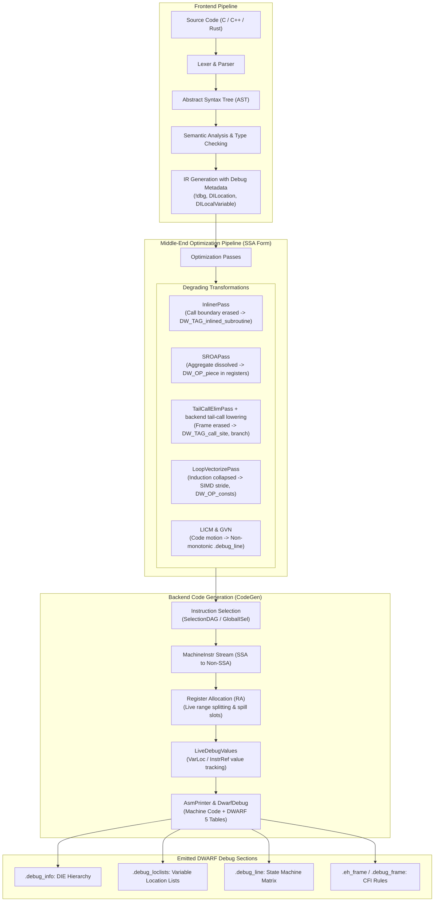

# Compiler Pipeline and Debuggability

> [!summary] Claim:
> Compilers optimize execution speed by destroying the static correspondence between source code statements and machine state.
> Middle-end transformations like inlining, Scalar Replacement of Aggregates (SROA), tail call elimination, and loop vectorization eliminate function boundaries, dissolve stack structures into disparate physical registers, discard call frames, and collapse iteration counters.
> Debug information serves as a non-binding passenger through this pipeline: when optimization passes move or kill values, the DWARF location lists and line tables emit synthetic frames, composite register slices (`DW_OP_piece`), entry value expressions (`DW_OP_entry_value`), or `<optimized out>` placeholders.
> Debugging optimized binaries requires reverse-mapping the compiler's transformation pipeline rather than trusting the illusion of sequential source execution.



## The Mechanism

The compiler's ultimate mandate is to preserve observable program semantics according to the "as-if" rule while maximizing runtime throughput.
Debuggability is not protected by the as-if rule: the ISO C, C++, and Rust standards place no requirement on the compiler to preserve local variable lifetimes, function call boundaries, or statement evaluation order for external inspection.
Debug information format specifications such as [[DWARF-Debug-Information-and-Symbol-Bundles]] define containers to describe machine state, but middle-end passes routinely mutate or discard that state.
Understanding why a debugger prints `<optimized out>` or why a single-step jumps backwards requires analyzing the journey of code and metadata through each compilation phase.

### 1. The Transformation Pipeline: From AST to Machine Code

A modern optimizing compiler (such as Clang/LLVM or GCC) divides compilation into three decoupled stages: the frontend, the middle-end optimizer, and the backend code generator.

#### Frontend and IR Construction

The frontend parses source text into an Abstract Syntax Tree (AST) and validates language type rules.
During Intermediate Representation (IR) generation, the frontend constructs Static Single Assignment (SSA) form.
In SSA form, every variable is assigned exactly once, and values flow across basic blocks connected by control flow graph (CFG) edges.

To preserve source attribution, the frontend attaches debug metadata to IR constructs:
- Source scopes: In LLVM IR, `!DISubprogram` and `!DILexicalBlock` describe function boundaries and lexical scopes.
- Source locations: Instructions carry `!dbg` attachments referencing `!DILocation(line: 42, column: 8, scope: !12)`.
- Source variables: Local variables and formal parameters are declared via `!DILocalVariable`.

Historically, compilers tracked variable values using debug intrinsics placed in the instruction stream:
- `llvm.dbg.declare`: Binds an address (such as an unoptimized stack allocation) to a source variable.
- `llvm.dbg.value`: Binds an SSA value to a source variable at a specific point in execution.
- `llvm.dbg.assign`: Tracks assignments for memory locations to bridge SSA values and stack slots.

#### The GCC Parallel: GENERIC, GIMPLE, and RTL

In GCC, the frontend lowers source code to GENERIC trees, which are simplified into GIMPLE tuples.
GIMPLE operations run in SSA form through the `tree-ssa` optimization pipeline.
GCC attaches `gimple_debug_bind` statements to track source variables across GIMPLE transformations.
After GIMPLE optimization, the middle-end lowers the CFG to Register Transfer Language (RTL), a hardware-specific pseudo-assembly representation.
In RTL, `NOTE_INSN_VAR_LOCATION` notes track variable placements through hardware instruction scheduling and register allocation until `dwarf2out.cc` generates binary DWARF records.

#### The Middle-End Pass Pipeline

Middle-end optimizations transform the IR through a pipeline of analysis and mutation passes.
In LLVM, passes are scheduled by the PassManager.
Transformations run in tightly coupled loops:
1. Simplification and scalar cleaning: SROA, EarlyCSE, and InstCombine dismantle aggregates and propagate expressions.
2. Inlining and interprocedural analysis: The Call Graph SCC (Strongly Connected Component) pass manager inlines function bodies.
3. Loop optimizations: Loop Invariant Code Motion (LICM), loop unrolling, and loop vectorization restructure control flow.
4. Global optimizations: Global Value Numbering (GVN), Dead Code Elimination (DCE), and Tail Call Elimination (TCE) purge redundant operations.

By design, debug metadata must not alter optimization decisions: LLVM states that debug information "should have very little impact on the rest of the compiler" and "does not prevent optimizations from happening" (Source Level Debugging with LLVM).
The goal is identical machine code whether `-g` is present or omitted; GCC checks this property with `-fcompare-debug`.
If an optimization pass cannot preserve a variable's value, LLVM's pass-author guide asks it to salvage the location into a `DIExpression` or, failing that, make it undefined, which a debugger shows as `<optimized out>` (How to Update Debug Info).
This is a goal, not a guarantee: the companion lab's vectorized loop counter `i` carries a location that reports a wrong value.

### 2. Debug Information as a Passenger: The RemoveDIs Overhaul

Because debug metadata instructions historically lived directly inside the IR instruction stream, optimization passes faced a difficult architectural conflict.
An instruction like `llvm.dbg.value` or `gimple_debug_bind` was treated as an instruction during iterator traversal, but had to be ignored by peephole optimizers and cost models.
Pass authors frequently deleted or misordered debug intrinsics when rewriting basic blocks, inadvertently destroying debug info or causing subtle compilation differences between `-g` and non-`-g` builds.

#### The LLVM RemoveDIs Architecture

To solve this overhead and fragility, LLVM developed the **RemoveDIs** project, which became active by default in LLVM 19 (released September 2024): its release notes state that LLVM switched to debug records by default both internally and in textual IR.
RemoveDIs removes debug intrinsics from the instruction stream entirely.
Instead of subclassing `llvm::Instruction`, debug tracking is handled by dedicated C++ objects derived from `llvm::DbgRecord`:
- `llvm::DbgVariableRecord`: Replaces `llvm.dbg.value`, `llvm.dbg.declare`, and `llvm.dbg.assign`.
- `llvm::DbgLabelRecord`: Replaces `llvm.dbg.label`.

These records do not occupy positions in the basic block instruction list.
Instead, they are stored in a dedicated container attached directly to the standard instruction that immediately follows them:

```cpp
// In LLVM 19+, instructions hold a pointer to attached DbgMarker records
class Instruction : public User {
  DbgMarker *DebugMarker = nullptr;
  // ...
};
```

In textual LLVM IR, RemoveDIs displays non-instruction syntax:
```llvm
; Traditional intrinsic format (LLVM <= 18):
call void @llvm.dbg.value(metadata i32 %val, metadata !15, metadata !DIExpression()), !dbg !16

; Modern RemoveDIs record format (LLVM 19+ default):
#dbg_value(i32 %val, !15, !DIExpression(), !16)
```

By decoupling debug records from the instruction list, middle-end passes no longer have to skip them as instructions; the LLVM documentation motivates the change by calling debug intrinsics "slow, unwieldy and can confuse optimisation passes" (RemoveDIs documentation), and publishes no measured speedup.

#### Backend Tracking: VarLoc vs. InstrRef LiveDebugValues

Once the middle-end finishes, the backend lowers IR to `MachineInstr` (MI) representations, executes register allocation, and generates machine code.
Register allocation maps infinite virtual SSA registers to a finite set of hardware registers (such as `RAX`, `RDX`, `R0`, `R8`), spilling excess variables into stack slots.

Tracking variable locations across basic block boundaries in machine code is the responsibility of the `LiveDebugValues` backend pass:
1. **VarLocBasedLDV (`VarLocBasedImpl.cpp`):** The legacy approach, which "explicitly tracks locations" such as registers and spill slots.
   It tracks physical locations directly (for example, "variable `x` is in register `RBX`").
   When register allocation or copy propagation moves a value between registers or spills it to memory, VarLoc often loses track of the value, leaving "live-range holes" where the variable is reported as `<optimized out>`.
2. **InstrRefBasedLDV (`InstrRefBasedImpl.cpp`):** The modern instruction-referencing engine.
   Instead of tracking physical registers, it tracks the *instruction that computed the value* via `DBG_INSTR_REF`.
   Even if the register allocator moves the value across five different registers and three stack spill slots, `InstrRefBasedLDV` tracks the value flow across the CFG, only translating the abstract value back to concrete machine registers at final emission.
   This lets variable locations survive register allocation and optimization (Instruction Referencing for Debug Info).

### 3. Inlining and the Virtual Call Stack

Inlining (`InlinerPass` in `llvm/lib/Transforms/IPO/Inliner.cpp`) is widely regarded as one of the most impactful optimizations in modern compilers.
It eliminates the overhead of call instructions, argument register setup, and prologue/epilogue generation by copying the callee function body directly into the caller.
More importantly, inlining exposes the callee code to caller-specific constant propagation, CSE, and dead code elimination.

#### DWARF Representation: DW_TAG_inlined_subroutine

When a function is inlined, its physical stack frame is destroyed.
To allow debuggers to present a coherent stack trace, the compiler emits a `DW_TAG_inlined_subroutine` Debug Information Entry (DIE) nested inside the caller's `DW_TAG_subprogram` (DWARF 5 Section 3.3.8):

```text
0x00000029: DW_TAG_subprogram
              DW_AT_name ("compute_distance_sq")
              DW_AT_inline (DW_INL_inlined)
              ...
0x0000005d: DW_TAG_subprogram
              DW_AT_name ("transform_point")
              DW_AT_low_pc (0x00000000)
              DW_AT_high_pc (0x00000014)
              ...
0x00000091:   DW_TAG_inlined_subroutine
                DW_AT_abstract_origin (0x00000029 "compute_distance_sq")
                DW_AT_low_pc (0x00000008)
                DW_AT_high_pc (0x00000010)
                DW_AT_call_file ("pipeline_demo.c")
                DW_AT_call_line (26)
                DW_AT_call_column (19)
```

The `DW_TAG_inlined_subroutine` DIE links back to the out-of-line declaration via `DW_AT_abstract_origin`.
It explicitly records:
- The source location where the call took place (`DW_AT_call_file`, `DW_AT_call_line`, `DW_AT_call_column`).
- The machine instruction address range spanned by the inlined instructions (`DW_AT_low_pc` / `DW_AT_high_pc` or non-contiguous `DW_AT_ranges`).

#### Debugger Virtual Frames and Failure Modes

Debuggers like GDB and LLDB parse these entries to synthesize "virtual frames" or "inlined frames" on the call stack.
Apple LLDB, stopped inside the inlined body of the lab's `-O2` object linked with a small `-O0` driver `main.c` (as of 2026-11, macOS):
```text
(lldb) bt
* frame #0: 0x0000000100000418 demo`compute_distance_sq(p=Point @ 0x...) at pipeline_demo.c:17:22 [opt] [inlined]
  frame #1: 0x0000000100000414 demo`transform_point(base_x=10, base_y=20) at pipeline_demo.c:26:19 [opt]
  frame #2: 0x00000001000003fc demo`main at main.c:4:50
```

However, optimization introduces critical debuggability failures:
- **Disjoint address ranges:** If the compiler schedules instructions from the caller and callee together to optimize CPU pipeline utilization, the inlined code is fragmented into non-contiguous slices.
  Single-stepping through the code causes the debugger execution line to bounce between caller and callee source files unpredictably.
- **Argument evaporation:** If an argument passed to the inlined function is constant-propagated, the compiler never creates a register or memory location for the formal parameter.
  The parameter DIE either carries a static `DW_AT_const_value` or is marked `<optimized out>`.
- **Breakpoint inflation:** Setting a breakpoint on an inlined function requires the debugger to scan all compilation units and insert breakpoints at every single address range where the function was inlined.
  In a template-heavy C++ or Rust codebase, a single inlined helper function may resolve to a very large number of distinct machine code breakpoint locations, one per inlined copy.

### 4. Scalar Replacement of Aggregates (SROA) and Location Holes

Aggregates such as C structs, C++ classes, and Rust tuples are naturally laid out as contiguous blocks of memory on the stack frame.
If a function allocates `Point pt;`, an unoptimized build creates a stack slot referenced via the frame pointer (`DW_OP_fbreg -16` or `DW_OP_breg31 WSP+16`).

#### The SROA Decomposition

The middle-end pass `SROAPass` (in LLVM) or `tree-sra` (in GCC) identifies aggregates that never have their address leaked outside the function.
SROA dismantles the aggregate completely:
- The memory allocation is erased.
- Each struct field is converted into an independent scalar SSA value (for example, `pt.x` and `pt.y` become separate `%pt.sroa.*` scalars).
- Downstream register allocation assigns these scalar variables to hardware registers or folds them into arithmetic instructions.

The struct as a unified entity ceases to exist in memory.

#### Composite Location Descriptions: DW_OP_piece

To describe a variable whose sub-components reside in different physical locations, DWARF 5 defines composite location expressions using `DW_OP_piece` and `DW_OP_bit_piece` (Section 2.6.1.2, Composite Location Descriptions):

$$\text{Location}(\text{pt}) = \left\{ \text{Offset } 0..3 \rightarrow \text{Register } R_a, \quad \text{Offset } 4..7 \rightarrow \text{Register } R_b \right\}$$

In the object file's `.debug_loclists` section, the compiler emits a location list entry:
```text
[0x00000004, 0x00000008): DW_OP_reg8 W8, DW_OP_piece 0x4
[0x00000008, 0x0000000c): DW_OP_reg8 W8, DW_OP_piece 0x4, DW_OP_reg9 W9, DW_OP_piece 0x4
[0x0000000c, 0x00000014): DW_OP_piece 0x4, DW_OP_reg9 W9, DW_OP_piece 0x4
```

This output reveals the life cycle of the aggregate across instruction addresses:
1. In `[0x04, 0x08)`: `pt.x` has been computed and lives in register `W8` (`DW_OP_piece 0x4`).
   `pt.y` has not been evaluated yet, so the second 4 bytes have no location.
2. In `[0x08, 0x0c)`: Both fields exist simultaneously.
   `pt.x` is in `W8` and `pt.y` is in `W9`.
3. In `[0x0c, 0x14)`: Register `W8` is clobbered by an arithmetic multiplication (`mul w8, w8, w8`).
   The compiler emits an empty `DW_OP_piece 0x4` followed by `DW_OP_reg9 W9, DW_OP_piece 0x4`.
   The `x` field is destroyed, while the `y` field remains visible.

#### Why Debuggers Print `<optimized out>`

When an engineer inspects `pt` at address `0x0c`, the debugger reads the composite location expression.
Because the first piece has no storage location, the debugger cannot reconstruct the whole struct.
Apple LLDB, stopped at that PC with `base_x=10, base_y=20`, does not flag the hole; it fills the empty piece with zero and prints a plausible but wrong value (as of 2026-11, macOS):
```text
(lldb) frame variable pt
(Point) pt = {
  x = 0
  y = 40
}
(lldb) expression &pt
(Point *) $0 = 0x000000010001c030
```
The real `pt.x` is 13, and the address LLDB returns points at memory LLDB materialized for the expression, not at program storage.
GDB's own testsuite (`gdb.dwarf2/pieces.exp`, empty `DW_OP_piece` case) expects `print a` to give `{i = 7, j = 8, q = <optimized out>}`, so GDB marks only the empty piece; GDB was not run on this macOS host.
The variable possesses no memory address, because it lives only in two CPU integer registers.

### 5. Tail Call Elimination and Frame Destruction

Tail Call Elimination applies when a function's final operation is a call to another function.
In LLVM, `TailCallElimPass` (`llvm/lib/Transforms/Scalar/TailRecursionElimination.cpp`) turns self-recursion into loops and marks eligible calls `tail`; the jump to a different function is emitted by the backend's call lowering.
In GCC, `-foptimize-sibling-calls` controls the transformation:

```c
int process(int val) {
    int next = step(val);
    return external_sink(next); // Tail call
}
```

#### Calling Convention Transformation

Under standard System V AMD64 and ARM AAPCS64 calling conventions (detailed in [[Calling-Conventions-System-V-AMD64-and-AAPCS64]]), a normal function call executes:
1. Pass arguments in registers (`RDI`, `RSI` / `X0`, `X1`).
2. Execute `call` (x86-64, which pushes the return address onto the stack) or `bl` (AArch64, which writes it to the link register `X30`; a non-leaf callee saves it on the stack).
3. Callee allocates stack space, executes, tears down stack, and executes `ret`.
4. Caller tears down its own stack frame and returns to its caller.

TCE optimizes this sequence by recognizing that `process` has completed all local computation.
Instead of allocating a new stack frame, the compiler:
1. Re-populates the argument registers.
2. Deallocates `process`'s local stack frame *before* the call.
3. Emits an unconditional branch (`jmp external_sink` or `b external_sink`).

When `external_sink` finishes, its `ret` instruction returns directly to `process`'s caller, skipping `process` entirely.

#### The Debuggability Collapse: Missing Call Frames

The hardware consequence of a tail call is that the return address pointing back into `process` is never saved on the stack.
If `external_sink` crashes or encounters a breakpoint, walking the stack frame chain (via frame pointers or DWARF Call Frame Information, covered in [[Stack-Unwinding-CFI-and-Exception-ABI]]) yields:
```text
#0  external_sink (...) at sink.c:10
#1  main (...) at main.c:45
```
`process` has completely vanished from the backtrace.
In high-throughput distributed systems, intermediate routing, logging, or RPC dispatch functions frequently disappear from crash core dumps due to tail calls, frustrating root-cause analysis.

#### DWARF 5 Recovery: DW_TAG_call_site

To combat call stack amnesia, DWARF 5 standardized call site records (Section 3.4, Call Site Entries and Parameters).
When compiling with `-O2 -g`, the compiler emits a `DW_TAG_call_site` entry marking the tail call:

```text
0x000000a5: DW_TAG_call_site
              DW_AT_call_origin (0x000000ac "external_sink")
              DW_AT_call_tail_call (true)
              DW_AT_call_pc (0x00000010)
```

The `DW_AT_call_tail_call (true)` attribute informs the debugger that the transition from `process` to `external_sink` occurred via a tail call.
Using this entry, modern debuggers synthesize virtual tail-call frames, but only when the caller also carries call site information that makes the chain unambiguous.
For the lab's `transform_point`, which ends in the same kind of tail call, Apple LLDB with an `-O2` driver `main.c` prints (as of 2026-11, macOS):
```text
(lldb) bt
* frame #0: 0x0000000100000508 demo2`external_sink(val=1769) at sink.c:2:69
  frame #1: 0x0000000100000410 demo2`transform_point(base_x=<unavailable>, base_y=<unavailable>) at pipeline_demo.c:27:12 [opt] [artificial]
  frame #2: 0x00000001000003f4 demo2`main at main.c:4:50 [opt]
```
With the driver built at `-O0`, which emits no call site entries, the same breakpoint shows `external_sink` directly under `main` and `transform_point` is gone.
GDB lists such a frame as an ordinary frame in `bt` and marks it `tail call frame` in `info frame`; it omits frames it cannot resolve unambiguously (GDB manual, Tail Call Frames).
However, because `transform_point`'s stack frame was physically deallocated, its locals have no location: LLDB reports `base_x`, `base_y`, `pt`, and `dist_sq` all as not available in frame `#1`.

### 6. Loop Vectorization, Unrolling, and Induction Variable Tracking

Modern CPU architectures (such as x86-64 with AVX2/AVX-512 and ARM64 with NEON/SVE) rely on Single Instruction, Multiple Data (SIMD) execution to process multiple data points in a single clock cycle.

#### Vector Transformation Mechanics

When `LoopVectorizePass` targets a loop:
```c
for (int i = 0; i < count; i++) {
    out[i] = a[i] + b[i];
}
```
The compiler transforms the scalar loop into distinct CFG regions; the lab's `-O2` build on Apple clang 21 (arm64) has three:
1. Main vector loop: loads 4 floats per 128-bit register (`q0` on AArch64, `%xmm0` on x86-64; 8 per 256-bit `%ymm0`), executes SIMD addition (`fadd.4s` or `vaddps`), and stores the result vector.
   The lab's loop is interleaved 4x (`ldp q0, q1` pairs and four `fadd.4s`), processing 16 elements per iteration with pointers advanced by 64 bytes.
2. Vector epilogue: a single-register 4-wide loop (`ldr q0, [x13], #16`) handles a remaining multiple of 4.
3. Scalar remainder: a scalar loop handles the last elements when `count % 4 != 0`.

#### Induction Variable Dissolution

During vectorization, the compiler strips the scalar induction variable `i` from the main loop execution path.
The hardware registers do not increment `i` by 1; they increment base memory pointers by 16 or 64 bytes (`ldr q0, [x13], #16`).
Consequently, the variable `i` does not exist as an active register value during the execution of the vectorized loop.

In the lab's `-O2` object, the compiler emits a constant stack value expression for `i` across the address range of both vector loops and the entry of the scalar remainder:
```text
DW_TAG_variable
  DW_AT_location ([0x0000000000000014, 0x00000000000000e4): DW_OP_consts +0, DW_OP_stack_value)
  DW_AT_name ("i")
```
This is a stale location, the value `i` had on loop entry, not a deliberate summary; LLVM's own guidance is to make such a location undefined rather than wrong.

If an engineer sets a breakpoint inside the vectorized loop and prints `i` (Apple LLDB, as of 2026-11, macOS):
```text
(lldb) frame variable i
(int) i = 0
```
The debugger reports `i = 0` throughout the execution of the loop, whether the loop is on iteration 16, 64, or 128; at the lab's stop the element counter register held `0x40`.
Furthermore, setting a line breakpoint on `out[i] = a[i] + b[i]` triggers once per vector chunk, not once per element.
Single-stepping advances execution in jumps of 4 to 16 iterations at a time.

### 7. The DWARF Line Table State Machine and Statement Frontiers

The `.debug_line` section maps machine code instruction addresses to source file names, line numbers, and column offsets.
Rather than storing a redundant table containing every address, DWARF encodes this mapping as a bytecode program executed by an abstract state machine (DWARF 5 Section 6.2).

#### The Line Number State Machine Registers

The line table state machine registers (DWARF 5 Section 6.2.2) include the following; the specification also defines `op_index`, `end_sequence`, `isa`, and `discriminator`:
- `address`: The program counter (PC) corresponding to machine instructions.
- `file`: The source file index.
- `line`: The current source line number.
- `column`: The current source column number.
- `is_stmt`: A boolean indicating whether the current instruction marks the beginning of a source statement.
- `basic_block`: A boolean indicating the start of a basic block.
- `prologue_end`: Marks the end of function prologue setup.
- `epilogue_begin`: Marks the start of function epilogue teardown.

Bytecode opcodes manipulate these registers:
- `DW_LNS_advance_pc`: Increments `address` by a scaled offset.
- `DW_LNS_advance_line`: Adds a signed offset to `line`.
- `DW_LNS_copy`: Appends a row to the line matrix using current register values.
- Special opcodes: Combine `advance_pc` and `advance_line` into a single byte to compress table size.

#### Non-Monotonicity and Code Motion

In an unoptimized (`-O0`) build, the line table state machine outputs instructions that advance monotonically through source line numbers:

```text
Address             Line   Flags
0x0000000000000000    22   is_stmt
0x0000000000000014    24   is_stmt prologue_end
0x0000000000000020    25   is_stmt
0x000000000000002c    26   is_stmt
0x0000000000000038    27   is_stmt
```

Under `-O2` optimization, instruction scheduling, Loop Invariant Code Motion (LICM), and common subexpression elimination reorder machine instructions to eliminate CPU pipeline stalls and hide memory latency.
As a result, machine instructions derived from different lines are interleaved:

```text
Address             Line   Flags
0x0000000000000000    24   is_stmt prologue_end
0x0000000000000004    25   is_stmt
0x0000000000000008    17   is_stmt  <-- Backwards jump to inlined function
0x0000000000000010    27   is_stmt  <-- Forwards jump to tail call
```

The execution flow jumps: Line 24 $\rightarrow$ Line 25 $\rightarrow$ Line 17 $\rightarrow$ Line 27.
Notice that Line 26 (`int dist_sq = compute_distance_sq(pt);`) is completely purged from the line matrix.
A debugger can still break on line 26 through the inlined subroutine's `DW_AT_call_line`: Apple LLDB resolves `breakpoint set -f pipeline_demo.c -l 26` to `transform_point + 8 [inlined] compute_distance_sq at pipeline_demo.c:26:19` (as of 2026-11, macOS).
When single-stepping through this code in GDB or LLDB with `step` or `next`, the source code cursor jumps backward to line 17 before jumping forward to line 27, creating an erratic stepping experience.

#### Statement Frontiers: -gstatement-frontiers

To prevent single-stepping from landing in the middle of half-evaluated sub-expressions, GCC implements **statement frontiers** (`-gstatement-frontiers`, on by default when compiling with optimization and DWARF at the normal level, per the GCC manual); Apple clang 21 rejects the flag as an unknown argument.
Statement frontiers inject explicit marker notes at the start of each user statement.
When instructions are scheduled, the compiler ensures that the `is_stmt` flag is asserted only on machine instructions that establish a true semantic boundary.
This ensures debuggers pause only when an entire statement has settled its side effects.

### 8. The Optimization Spectrum: From -O0 to -Og and -O2

Developers choose optimization flags to strike a balance between compilation speed, binary runtime throughput, and debug accuracy.

```text
Debug Accuracy:  [-O0 -g]  >  [-Og -g]  >>  [-O1 -g]  >  [-O2 -g]  >  [-O3 -flto -g]
Execution Speed: [-O0 -g]  <  [-Og -g]  <<  [-O1 -g]  <  [-O2 -g]  <= [-O3 -flto -g]
```

#### -O0: No Optimization

- All variables reside in stack memory slots; frame pointer chaining is strictly preserved.
- No inlining, no SROA, no tail call elimination, no loop vectorization.
- Clean, monotonic single-stepping.
- **Drawbacks:** Code is slower than `-O2` by a workload-dependent factor that you should measure on your own binary.
  Stack frames are bloated.
  Importantly, `-O0` disables middle-end analyses, which means flow-sensitive warning diagnostics (such as GCC's `-Wmaybe-uninitialized`) are less effective; sanitizers still work at `-O0`, though the Clang AddressSanitizer docs recommend `-O1` or higher for reasonable performance.
  Furthermore, GCC at `-O0` does not run Variable Tracking at Assignments (VTA), and neither GCC nor Clang builds location lists for locals, which stay in stack slots (the lab's `-O0` object has none).

#### -Og: Optimize for Debugging

Introduced in GCC 4.8 (GCC 4.8 release notes), `-Og` "should be the optimization level of choice for the standard edit-compile-debug cycle" (GCC manual).
The two compilers mean different things by it:
- GCC enables all `-O1` flags except those "known to greatly interfere with debugging": `-fbranch-count-reg`, `-fdelayed-branch`, `-fdse`, `-fif-conversion`, `-fif-conversion2`, `-finline-functions-called-once`, `-fmove-loop-invariants`, `-fmove-loop-stores`, `-fssa-phiopt`, `-ftree-bit-ccp`, `-ftree-dse`, `-ftree-pta`, and `-ftree-sra`.
  - Inlining beyond small and `always_inline` functions stays off, because `-finline-functions` and `-finline-small-functions` belong to `-O2`.
  - Sibling and tail call optimization stays off, because `-foptimize-sibling-calls` is enabled only at `-O2`, `-O3`, and `-Os`.
  - Frame pointers are not preserved: `-fomit-frame-pointer` is "enabled by default at `-O1` and higher" and is not on the `-Og` exclusion list, so pass `-fno-omit-frame-pointer` explicitly.
  - `-O2` instruction scheduling stays off.
  - In contrast to `-O0`, it enables `-fvar-tracking` and `-fvar-tracking-assignments`.
- Clang treats `-Og` as `-O1` plus `-fextend-variable-liveness` (Clang command guide); with Apple clang 21 the lab source at `-Og` still inlines `compute_distance_sq` and still tail-calls `external_sink`.
- The GCC manual positions it as the level for the edit-compile-debug cycle; the speedup over `-O0` is workload-dependent and should be measured.

#### -O2 / -O3: Production Optimization

- Full optimization suite enabled: aggressive inlining, SROA, tail call elimination, loop vectorization, SLP vectorization, GVN, and interprocedural optimizations.
- Variables are tracked using DWARF 5 location lists (`.debug_loclists`) and entry values (`DW_OP_entry_value`).
- Variable live ranges contain frequent gaps (`<optimized out>`).
- Virtual inlined frames replace physical stack frames.
- Instruction scheduling causes non-monotonic line table stepping.

## Commands and Numbers to Know

Every compiler flag, threshold, and operational metric governing the optimization-debuggability trade-off has direct consequences on build time, binary size, and debugging fidelity.

| Flag / Metric / File | Default / Scope | Platform | Operational Purpose and Debugging Impact |
| :--- | :--- | :--- | :--- |
| `-O0` | Default compiler level | Both | Disables all optimization. Variables kept in stack slots; no location lists generated (as of 2026-11, Both). |
| `-Og` | Opt-in debug optimization | Both | GCC: `-O1` minus debug-hostile passes, no `-O2` inlining, tail calls, or scheduling. Clang: `-O1` plus `-fextend-variable-liveness`, still inlines and tail-calls (as of 2026-11, Both). |
| `-O2` | Production optimization | Both | Enables inlining, SROA, tail calls, and vectorization. Emits `.debug_loclists` with `<optimized out>` gaps (as of 2026-11, Both). |
| `-fno-omit-frame-pointer` | Opt-in; GCC enables `-fomit-frame-pointer` at `-O1` and higher, including `-Og` | Both | Retains `RBP`/`FP` chaining. Enables cheap frame-pointer stack unwinding for perf and eBPF profilers (as of 2026-11, Both). |
| `-fvar-tracking-assignments` | On by default in GCC with optimization and `-g`, together with `-fvar-tracking` | Linux | Emits debug bind notes to track SSA values across register allocation into DWARF location lists (as of 2026-11, Linux). |
| `-foptimize-sibling-calls` | GCC: enabled at `-O2`, `-O3`, `-Os`; not at `-Og` | Both | Replaces tail calls with jumps. Destroys caller stack frame in backtraces unless recovered by DWARF 5. Clang `-Og` still tail-calls (as of 2026-11, Both). |
| `-gstatement-frontiers` | GCC only; on by default with optimization and `-g` | Linux | Emits explicit statement boundary markers to ensure `is_stmt` reflects logical source frontiers. Clang rejects the flag (as of 2026-11, Linux). |
| `-gsplit-dwarf` | Opt-in Split DWARF | Linux | Separates DWARF debug info into `.dwo` files, reducing link-time memory and binary size (as of 2026-11, Linux). |
| `DW_OP_piece` | DWARF expression opcode (`0x93`) | Both | Encodes byte size of an aggregate slice residing in a register or memory location (as of 2026-11, Both). |
| `DW_OP_entry_value` | DWARF expression opcode (`0xa3`) | Both | Directs debugger to evaluate register value at function entry point to recover clobbered parameters (as of 2026-11, Both). |
| `DW_TAG_inlined_subroutine` | DWARF tag (`0x1d`) | Both | Encodes inlined call instance with `DW_AT_abstract_origin` and `DW_AT_call_line` attributes (as of 2026-11, Both). |
| `DW_TAG_call_site` | DWARF tag (`0x48`) | Both | Standardized in DWARF 5. Encodes call site and tail-call status (`DW_AT_call_tail_call`) (as of 2026-11, Both). |
| `llvm-dwarfdump --statistics` | Diagnostics CLI; macOS `dwarfdump` is `llvm-dwarfdump`, Linux `dwarfdump` is the unrelated libdwarf tool | Both | Emits JSON metrics detailing variable scope coverage bytes and buckets (as of 2026-11, Both). |
| `RemoveDIs` | Default since LLVM 19 | Both | Replaces `llvm.dbg.*` instructions with `llvm::DbgRecord` (as of 2026-11, Both). |

## Multi-Language Comparison: C++ / Python / Rust

Compiler optimization pipelines impact debuggability across compiled and interpreted language runtimes.
While native compiled languages rely on DWARF, interpreted and JIT-compiled languages enforce distinct debugging contracts.

| Feature / Dimension | C++ (Clang / GCC) | Rust (`rustc` / LLVM) | Python (CPython 3.13+) |
| :--- | :--- | :--- | :--- |
| **Intermediate Representations** | AST $\rightarrow$ GIMPLE / LLVM IR $\rightarrow$ RTL / MI | AST $\rightarrow$ HIR $\rightarrow$ THIR $\rightarrow$ MIR $\rightarrow$ LLVM IR | AST $\rightarrow$ Bytecode (16-bit wordcode) $\rightarrow$ Tier 2 Micro-ops (experimental, 3.13+, only in builds configured with `--enable-experimental-jit`) |
| **Inlining Mechanism** | Middle-end `InlinerPass` guided by heuristics and `inline` | MIR inlining + LLVM `InlinerPass` across monomorphized generics | Bytecode specialization (PEP 659); no function inlining is claimed here |
| **Inlined Call Stack Display** | DWARF `DW_TAG_inlined_subroutine` parsed as virtual frames | DWARF `DW_TAG_inlined_subroutine` parsed as virtual frames | Traceback objects synthesize Python frames; hidden JIT frames |
| **Aggregate Decomposition** | SROA breaks structs/classes into `DW_OP_piece` registers | MIR SROA and LLVM SROA decompose tuples, structs, and enums | No aggregate decomposition: debuggers see ordinary frame locals |
| **Tail Call Optimization** | Replaces calls with jumps at `-O2`; emits `DW_TAG_call_site` | LLVM sibling call optimization; no guaranteed tail calls on stable, `become` requires the nightly-only, incomplete `explicit_tail_calls` feature (Rust std docs, as of 2026-11) | No tail call optimization; strict recursion depth limit enforced |
| **Induction Variable Tracking** | Vectorized loops emit constant or clobbered induction DIEs | Vectorized iterators collapse index variables in LLVM backend | No collapse: the loop variable is an ordinary frame local rebound on each `FOR_ITER` step |
| **Recommended Debug Profile** | `-Og -g` for development; `-O2 -g -fno-omit-frame-pointer` in prod | `[profile.dev]` (`opt-level = 0`); `split-debuginfo = "packed"` | Unoptimized bytecode execution; JIT disabled with `PYTHON_JIT=0` (3.13+, JIT-enabled builds only) |
| **Variable `<optimized out>` Source** | Register clobbering, live-range holes, and dead stores | Early value drop, MIR optimization passes, and SROA | Variable unbound or deleted from the frame's `localsplus` array |

## Worked Lab Example

The companion lab in `code/00-Program-Execution/compiler_opt_debug/` compiles a representative C program under unoptimized (`-O0 -g`) and optimized (`-O2 -g`) compiler pipelines.
It executes `analyze.py`, which uses `dwarfdump` to mechanically extract and compare the emitted DWARF 5 debug records, location lists, and line table state machine entries.

### Verified output

Recorded on `darwin-arm64` using Apple clang version 21.0.0 (clang-2100.4.1.1):

```text
=== Compiler Pipeline Optimization and Debuggability Lab ===

1. Inlining (Call Boundary Dissolution):
  - O0 inlined subroutine DIE present: False
  - O0 compute_distance_sq has its own address range: True
  - O2 inlined subroutine DIE present: True
  - O2 inlined subroutine sits inside transform_point and originates from compute_distance_sq: True
  - O2 inlined call site recorded: line 26
  - Debugger symptom: stepping enters inlined body without physical call frame

2. SROA (Aggregate Decomposition into Registers):
  - O0 'pt' location expression: DW_OP_breg31 WSP+16 (contiguous stack storage)
  - O2 'pt' uses DW_OP_piece composite locations: True
  - O2 piecewise variable location slices:
      [ADDR_RANGE]: DW_OP_reg8 W8, DW_OP_piece 0x4
      [ADDR_RANGE]: DW_OP_reg8 W8, DW_OP_piece 0x4, DW_OP_reg9 W9, DW_OP_piece 0x4
      [ADDR_RANGE]: DW_OP_piece 0x4, DW_OP_reg9 W9, DW_OP_piece 0x4
  - O2 'pt' has a range where piece 0 (x) has no location: True
  - Debugger symptom: inspecting struct yields <optimized out> or partial fields

3. Tail Call Elimination (Frame Destruction):
  - O0 DW_AT_call_tail_call attribute in transform_point: False
  - O2 DW_AT_call_tail_call attribute in transform_point: True
  - O0 transform_point reaches external_sink with: bl
  - O2 transform_point reaches external_sink with: b
  - Debugger symptom: caller frame vanishes from call stack during tail call

4. Line Table and Statement Progression (.debug_line):
  - O0 transform_point statement line sequence: [22, 24, 25, 26, 27]
  - O0 compute_distance_sq statement line sequence: [16, 17]
  - O2 transform_point statement line sequence: [24, 25, 17, 27]
  - O0 transform_point non-monotonic: False
  - O2 transform_point non-monotonic (backwards line jump): True
  - O2 transform_point has a statement row for line 26: False
  - Debugger symptom: single-stepping cursor jumps backward and skips intermediate lines

5. Loop Vectorization Induction Variable Tracking:
  - O0 induction variable 'i' tracked in stack frame: True
  - O0 vector_sum contains fadd.4s: False
  - O2 vector_sum contains fadd.4s: True
  - O2 induction variable 'i' collapsed to constant value: True
  - O2 bytes of vector_sum where 'i' is the constant 0: 208 of 236
  - Debugger symptom: inspecting 'i' inside vectorized loop prints constant 0

6. Quantitative DWARF Quality Metrics (dwarfdump --statistics):
  - O0 local variables with 100% scope coverage: 3
  - O0 local variable location coverage: 240 of 240 scope bytes (100.0%)
  - O2 local variables with 100% scope coverage: 0
  - O2 local variable location coverage: 228 of 272 scope bytes (83.8%)
  - O2 covered bytes that are the constant-0 location of 'i': 208 of 228
```

### Reading the result

The lab output proves how compiler optimization passes degrade debuggability:

1. **Inlining:** At `-O0`, `compute_distance_sq` is generated as an independent function.
   At `-O2`, middle-end inlining dissolves the function call boundary, creating a `DW_TAG_inlined_subroutine` entry that records the original call at line 26.
   When debugging, stepping into line 26 enters the inlined body without allocating a stack frame.

2. **SROA:** In the unoptimized build, `pt` resides on the stack at `DW_OP_breg31 WSP+16`.
   Under `-O2`, SROA decomposes `pt` into registers `W8` and `W9`.
   The emitted location list uses `DW_OP_piece 0x4` to describe each 4-byte slice.
   Crucially, in the third address slice, register `W8` is clobbered by multiplication, leaving an empty `DW_OP_piece 0x4` for `pt.x`.
   At this PC `y` remains readable while `x` has no location: Apple LLDB prints `x = 0` instead of flagging it, whereas GDB's testsuite expects `<optimized out>` for the empty piece (GDB not run here).

3. **Tail Call Elimination:** At `-O0`, the call to `external_sink` emits a `bl` branch-with-link instruction and saves the return address.
   At `-O2`, the call is transformed into an unconditional branch `b`, omitting the caller stack frame; the lab reads both mnemonics from `objdump -d -r` by the relocation that names `_external_sink`.
   The compiler records this via `DW_AT_call_tail_call = true` on the `DW_TAG_call_site` inside `transform_point`.
   If `external_sink` crashes, `transform_point` is missing from the physical hardware call stack.

4. **Line Table Non-Monotonicity:** The unoptimized `transform_point` line sequence advances monotonically through lines `[22, 24, 25, 26, 27]`; the out-of-line `compute_distance_sq` has its own `[16, 17]`.
   Under `-O2`, `transform_point` executes `[24, 25, 17, 27]`.
   The instruction pointer jumps backward from line 25 to line 17 (the inlined function body), and line 26 is completely purged.
   Single-stepping in a debugger causes the source cursor to jump backward and skip statements.

5. **Vectorization Induction Collapse:** In the scalar `-O0` loop, `i` is stored on the stack (`DW_OP_fbreg`) and incremented on every iteration.
   Under `-O2`, SIMD vectorization unrolls the loop using 128-bit `fadd.4s` instructions (present in the `-O2` `vector_sum`, absent at `-O0`).
   The scalar variable `i` is collapsed to a static constant expression `DW_OP_consts +0, DW_OP_stack_value`, which covers 208 of the function's 236 bytes.
   Inspecting `i` inside the loop always evaluates to 0, which is wrong rather than `<optimized out>`.

6. **Quantitative Degradation:** `dwarfdump --statistics` reveals that while 100% of local variables in `-O0` have complete location coverage across their entire parent scope, exactly 0 local variables achieve 100% coverage under `-O2`.
   The lab reports coverage as a fraction of scope bytes, because the two objects have scopes of different sizes: coverage falls from 240 of 240 (100.0%) to 228 of 272 (83.8%).
   Even that overstates quality: 208 of the 228 covered `-O2` bytes are `i`'s constant-0 location, so the statistic counts a wrong location as coverage.

## Pitfalls

> [!warning] Pitfall: setting breakpoints on optimized lines and assuming single execution per iteration
> In vectorized loops, the compiler merges multiple iterations into single SIMD instructions.
> A breakpoint placed on a vectorized loop statement triggers once per vector stride (e.g. every 4 or 8 elements), not once per logical loop iteration.
> Furthermore, loop unrolling duplicates the statement body, meaning a breakpoint may trigger multiple times per assembly loop or skip iterations entirely during single-stepping.

> [!warning] Pitfall: misinterpreting `<optimized out>` as a program bug
> Developers frequently assume that a debugger displaying `<optimized out>` indicates uninitialized memory, null pointer dereferences, or data corruption.
> In reality, `<optimized out>` simply means the compiler was able to prove that the variable's value does not need to be retained in any hardware register or memory address at that exact program counter.
> The value may have been folded into an immediate operand, clobbered after its last read, or eliminated as dead code.

> [!warning] Pitfall: triaging production crashes without accounting for tail call elimination
> When analyzing core dumps from services compiled at `-O2` or `-O3`, intermediate caller frames are frequently absent from the stack trace because the compiler converted trailing calls into direct jumps.
> If an engineer examines only the raw frame pointer or CFI backtrace, they will conclude that the crash occurred through an impossible call path.
> Engineers must inspect DWARF 5 `DW_TAG_call_site` entries or disassemble the call site to determine if a sibling call branch (`jmp` / `b`) eliminated the missing frame.

> [!warning] Pitfall: trusting single-stepping order under -O2 for causal analysis
> Instruction scheduling and code motion (LICM, GVN) routinely hoist instructions out of loops and move evaluations before the conditions that guard them.
> Single-stepping through optimized code creates the optical illusion that statements executed in an impossible order or that branches were taken before conditions were checked.
> Causal verification in optimized binaries must be performed by inspecting assembly instructions and register contents, as taught in [[Reading-Assembly-and-Optimization-Remarks]], rather than following source line highlights.

> [!warning] Pitfall: stripping frame pointers in production while expecting eBPF profilers to unwind
> Omitting the frame pointer (`-fomit-frame-pointer`) frees a general-purpose register (`RBP` / `X29`) for register allocation, offering a performance gain that depends on the workload and should be measured.
> However, asynchronous sampling profilers (such as Linux `perf` or eBPF-based profilers) cannot afford the overhead of parsing DWARF Call Frame Information (.eh_frame) in the kernel at sample time.
> Stripping frame pointers breaks the in-kernel unwinding of user-space stacks that `perf`'s default frame-pointer call graphs and eBPF stack helpers rely on, rendering continuous production profiling blind unless frame pointers are explicitly retained via `-fno-omit-frame-pointer`; `perf record --call-graph dwarf` avoids this by copying stack bytes and unwinding later, at much higher overhead.

## At Scale

Operational engineering trade-offs between execution performance and debug fidelity shift dramatically as an organization grows from a single engineer to tens of thousands of hosts.

### 1 to 50 Engineers: The Local Development Cycle

- **Paved road:** Standardize local development builds on `-Og -g` for GCC and Clang, or `opt-level = 0` for Rust.
- **Decision rule:** Never allow developers to debug complex algorithmic issues on `-O0` if third-party template libraries (such as C++ `std::vector` or `boost`) make `-O0` too slow to reproduce the problem.
  `-Og` preserves clean single-stepping while optimizing away abstraction penalties.
- **Stack traces:** Force `-fno-omit-frame-pointer` in all debug and test configurations to guarantee fast, zero-overhead crash traces in test runners.

### 50 to 1,000 Engineers: Continuous Integration and Staging Triage

- **Paved road:** Compile staging and canary builds with production optimization (`-O2 -g`), but separate debug symbols using Split DWARF (`-gsplit-dwarf`).
- **Storage economics:** Full debug binaries in large C++ codebases are much larger than the stripped binary; measure your own ratio before choosing a storage budget.
  Split DWARF leaves `.dwo` files (or a packaged `.dwp`) beside the build; the linked binary keeps only skeleton compile units that name them, and a debugger or `debuginfod` client fetches the full data when needed.
- **Profiling readiness:** Mandate `-fno-omit-frame-pointer` across all production binaries.
  The throughput penalty (measure it on your own services) is typically outweighed by the ability to capture fleet-wide CPU flame graphs without unwinding crashes.

### 1,000 to 50,000 Engineers: Fleet-Scale Fleet Observability and Post-Link Optimization

- **Paved road:** Production services run under `-O3 -flto` with Profile-Guided Optimization (PGO) and BOLT (as detailed in [[Linkers-LTO-PGO-AutoFDO-and-BOLT]]).
- **Symbol infrastructure:** Executables deployed to fleet hosts are completely stripped of debug symbols and `.comment` sections.
  Build systems upload detached ELF debug files and `.dwp` packages to centralized `debuginfod` servers indexed by GNU Build ID; macOS `.dSYM` bundles are keyed by the Mach-O `LC_UUID` instead.
- **Crash symbolication:** When an unhandled exception or SIGSEGV occurs, automated core dump collection services (such as systemd-coredump or an in-house collector) extract the Build ID, query `debuginfod`, and reconstruct virtual inlined frames and tail call sites asynchronously.
- **Observability boundaries:** Recognize that local variable inspection in core dumps from `-O3 -flto` binaries is inherently lossy.
  Production telemetry must rely on structured distributed tracing, wide events, and eBPF kernel probes rather than expecting interactive debugger variable inspection.

## Practice Drill

> [!tip] Practice Drill:
> Compile the companion lab program `code/00-Program-Execution/compiler_opt_debug/pipeline_demo.c` manually under three optimization configurations:
> 1. `cc -g -O0 -c pipeline_demo.c -o demo_o0.o`
> 2. `cc -g -Og -c pipeline_demo.c -o demo_og.o` (if using GCC) or `cc -g -O1 -c pipeline_demo.c -o demo_o1.o`
> 3. `cc -g -O2 -c pipeline_demo.c -o demo_o2.o`
>
> Run `dwarfdump --statistics demo_o0.o` and `dwarfdump --statistics demo_o2.o`.
> On Linux, use `llvm-dwarfdump`; the libdwarf `dwarfdump` there is a different tool.
> Divide `sum_all_local_vars(#bytes in parent scope covered by DW_AT_location)` by `sum_all_local_vars(#bytes in parent scope)` for each object and calculate the exact percentage of debug variable coverage lost to optimization.
> Next, disassemble `demo_o2.o` using `objdump -d demo_o2.o`.
> Locate the branch instruction for `external_sink`.
> Identify whether it is a call (`bl` / `callq`) or a direct branch (`b` / `jmp`).
> Then inspect the `.debug_info` section with `dwarfdump --debug-info demo_o2.o` and find the matching `DW_TAG_call_site` entry confirming that the compiler marked it with `DW_AT_call_tail_call`.

## Interview Questions

> [!question] L5: Why does a debugger display `<optimized out>` when you attempt to print a local variable during an active function call?
>
> > [!success]- Answer
> > The debugger prints `<optimized out>` because the current program counter (PC) falls within an address range where no valid DWARF location expression covers the variable.
> > Under `-O2` optimization, the compiler does not maintain dedicated stack memory for local variables; instead, it holds values in CPU registers.
> > Once a variable's value is no longer needed for subsequent calculations, the register allocator reassigns that hardware register to another value.
> > The compiler terminates the variable's location list entry at that instruction, creating a live-range hole.
> > Even though the function has not yet returned, the variable's physical value has been destroyed or overwritten.

> [!question] L5: How does the `-Og` compiler flag differ from `-O0`, and why is `-Og` recommended for daily development cycles?
>
> > [!success]- Answer
> > `-O0` disables all compiler optimizations, which causes abstraction-heavy C++ and Rust code to execute much slower (by a workload-dependent factor) and bloats stack frames.
> > In contrast, GCC's `-Og` enables the `-O1` scalar optimizations, constant folding, and dead code elimination while excluding passes that degrade debugging, such as `-ftree-sra`, `-ftree-dse`, and `-finline-functions-called-once`.
> > Because `-finline-functions` and `-foptimize-sibling-calls` belong to `-O2`, GCC `-Og` does no aggressive inlining or sibling call optimization and no `-O2` instruction scheduling; it does still omit the frame pointer, so add `-fno-omit-frame-pointer` explicitly.
> > Furthermore, `-Og` enables Variable Tracking at Assignments (`-fvar-tracking-assignments`), which `-O0` disables, resulting in more accurate DWARF location lists across function prologues and epilogues.
> > Clang differs: its `-Og` is `-O1` plus `-fextend-variable-liveness`, and it still inlines and tail-calls, as the lab source shows with Apple clang 21.

> [!question] L6: Predict-the-output: Given a tail-recursive function compiled at `-O2`, what does the call stack look like at the base case, and how does DWARF 5 assist the debugger?
>
> > [!success]- Answer
> > At the base case, the hardware call stack contains only the base case frame and the original caller of the recursive function; all intermediate recursive frames are physically absent.
> > This occurs because Tail Call Elimination transforms the recursive call into an unconditional jump to the function entry, reusing the existing stack frame and never pushing new return addresses.
> > DWARF 5 helps only partially.
> > Self-recursion converted into a loop leaves no call instruction, so there is no `DW_TAG_call_site` to record and no way to encode how many iterations ran; the debugger shows one frame for the function.
> > For tail calls to other functions, the compiler emits `DW_TAG_call_site` DIEs with `DW_AT_call_tail_call` set to true, and debuggers synthesize virtual frames when the chain is unambiguous: LLDB labels them `[artificial]`, GDB lists them as ordinary frames and marks them `tail call frame` in `info frame`.
> > Locals in those synthesized frames are generally unavailable.

> [!question] L6: How does Scalar Replacement of Aggregates (SROA) decompose a C struct, and how does DWARF describe the resulting variable?
>
> > [!success]- Answer
> > SROA identifies local aggregate variables (structs, arrays, tuples) that do not escape to memory and completely dissolves their memory allocation.
> > Each struct member is converted into an independent scalar SSA value, which the register allocator assigns to separate hardware registers or spills independently.
> > Because the struct no longer exists as a contiguous block in memory, the compiler emits a DWARF composite location description using `DW_OP_piece` or `DW_OP_bit_piece`.
> > Each piece expression specifies the hardware register or memory offset holding that specific byte or bit slice of the variable.
> > If any piece is clobbered or eliminated, that piece is left empty; GDB's testsuite expects the field to print as `<optimized out>` (`pieces.exp`), while Apple LLDB in the companion lab prints the missing field as 0, a silently wrong value.

> [!question] L7: Debug-this: While single-stepping through an optimized financial pricing routine, the debugger jumps from line 104 backward to line 92 before moving to line 105, so what compiler pass caused this and what is happening?
>
> > [!success]- Answer
> > This behavior is caused by instruction scheduling and Loop Invariant Code Motion (LICM) or inlining.
> > Line 92 represents either an inlined function body or a loop-invariant computation that the middle-end hoisted or delayed to hide pipeline latency.
> > When the backend schedules machine instructions to maximize Instruction-Level Parallelism (ILP), it places the instruction derived from line 92 after the instructions for line 104.
> > Because each machine instruction retains its original source line debug metadata (`DILocation`), the line table state machine emits a sequence of addresses where source line numbers jump backward.
> > The processor executes instructions linearly in memory, but the debugger translates those program counters into non-monotonic source line jumps.

> [!question] L7: Why does inspecting a loop induction variable (e.g. `i`) inside an auto-vectorized loop frequently report `0` or garbage in an interactive debugger?
>
> > [!success]- Answer
> > Auto-vectorization transforms scalar loops into SIMD vector operations that process 4, 8, or 16 elements simultaneously.
> > In the vectorized loop kernel, the scalar variable `i` is not incremented element-by-element; instead, memory pointers are advanced by vector byte strides (e.g. `stride = 16`).
> > Because `i` is not needed for the vector calculation, its scalar value is not maintained in any CPU register during the vectorized body.
> > The compiler either emits an empty location expression (`<optimized out>`) or, as in the companion lab, leaves a stale static stack value expression (`DW_OP_consts +0, DW_OP_stack_value`) from the loop's entry state, which is a debug-info accuracy bug rather than a summary.
> > In the lab's Apple clang 21 build that constant range covers both vector loops and the entry of the scalar remainder, after which `i` has no location at all, so even the remainder loop does not show the real counter.

> [!question] L8+: For an infrastructure fleet of 50,000 hosts running binaries compiled under `-O3 -flto`, design the toolchain and observability architecture to support automated production crash triage.
>
> > [!success]- Answer
> > The architecture must decouple runtime execution efficiency from offline symbolication infrastructure.
> > First, compile all production services with `-O3 -flto -g -fno-omit-frame-pointer`.
> > Retaining frame pointers costs some throughput (measure it per service) but guarantees that asynchronous sampling profilers (eBPF and Linux `perf`) can collect kernel-context call graphs without DWARF unwinding overhead.
> > Second, use Split DWARF (`-gsplit-dwarf`) or detached symbol packages (`objcopy --only-keep-debug` / `dsymutil`) during the build.
> > Strip all debug sections from deployed production binaries, injecting a unique GNU Build ID (`--build-id=sha1`).
> > Third, deploy centralized `debuginfod` symbol servers that store stripped `.debug` or `.dwo` files indexed by Build ID.
> > When a service crashes, the host core dump handler extracts the crash PC, registers, and Build ID, uploading a lightweight minidump to an automated triage service.
> > The triage worker queries `debuginfod`, retrieves DWARF 5 DIEs, parses `DW_TAG_inlined_subroutine` to reconstruct virtual frames, reads `DW_TAG_call_site` to reconstruct tail calls, and symbolizes the crash trace without manual engineer intervention.

> [!question] L8+: Explain LLVM's architectural motivation for transitioning from debug intrinsics (`llvm.dbg.value`) to instruction-referencing debug info (`InstrRefBasedLDV`) and debug records (`RemoveDIs`).
>
> > [!success]- Answer
> > The transition solved two core compiler limitations: optimization fragility and register allocation tracking holes.
> > Historically, debug intrinsics were regular instructions inside the IR stream, forcing every pass to explicitly skip them; the LLVM documentation calls them "slow, unwieldy and can confuse optimisation passes".
> > RemoveDIs solved this by replacing intrinsics with non-instruction `llvm::DbgRecord` objects attached directly to instructions, eliminating iterator clutter and preventing accidental instruction deletion.
> > At the backend level, legacy `VarLocBasedLDV` tracked physical locations directly (e.g. "x is in RAX"), which broke whenever register allocation split live ranges, coalesced registers, or inserted stack spills.
> > `InstrRefBasedLDV` switched to tracking abstract values defined by instruction numbers (`DBG_INSTR_REF`).
> > It tracks the dataflow of the computed value itself across the CFG regardless of physical register churn, translating values back to concrete registers only at final emission, which lets variable locations survive register allocation (Instruction Referencing for Debug Info).

## Further Reading

- DWARF Debugging Information Format Specification Version 5.0 (2017): Normative definition of location lists, composite expressions (`DW_OP_piece`), entry values, inlined subroutines, call site records, and the `.debug_line` state machine.
- LLVM Project, "Source Level Debugging with LLVM" (2026): The official reference manual detailing LLVM debug metadata representation, scopes, and variable descriptors.
- LLVM Project, "Debug Info Migration: From Intrinsics to Records (RemoveDIs)" (2026): Authoritative architectural guide for LLVM 19+'s non-instruction debug records overhaul.
- Alexandre Oliva, "The Quest for Cheaper Variable Tracking in GCC" (GNU Tools Cauldron, 2012): Slides on the design and cost of GCC's variable tracking, the system behind `-fvar-tracking-assignments`.
- LLVM Project, "Instruction Referencing for Debug Info" (2026): Reference for `DBG_INSTR_REF`, which names the instruction and operand that define a value instead of a virtual register.
- GCC Online Documentation, "Options That Control Optimization" (Free Software Foundation, 2026): Normative manual for GCC optimization levels (`-O0`, `-Og`, `-O2`, `-O3`) and specific pass control flags.

## Related

- Prerequisites: [[Calling-Conventions-System-V-AMD64-and-AAPCS64]], [[DWARF-Debug-Information-and-Symbol-Bundles]]
- Next: [[Reading-Assembly-and-Optimization-Remarks]]
- See also: [[01-CS-Foundations/Computer-Science-Canon/Compilers-and-SSA|Compilers and SSA]]
- Lab: `code/00-Program-Execution/compiler_opt_debug/` (requires: macos)
