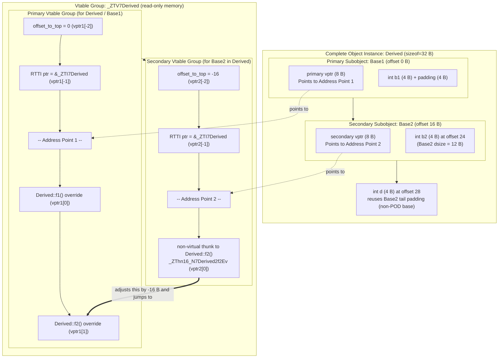
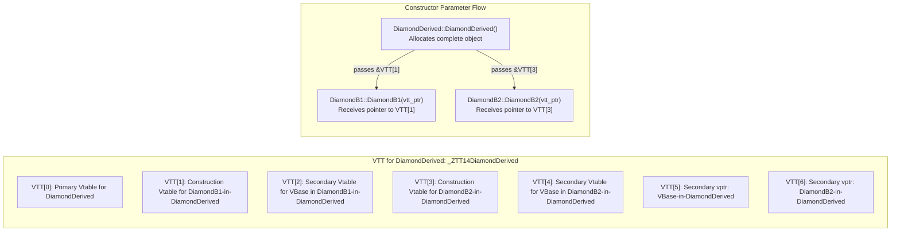

# C++ Itanium ABI: Object Model, Vtables, and RTTI

> [!summary] Claim:
> The Itanium C++ ABI governs object layout, dynamic dispatch tables, and runtime introspection across Linux, macOS, iOS, Android, and BSD toolchains.
> An object's vptr points to an address point within a vtable group, preceding virtual method pointers with negative offset fields for offset-to-top, complete object RTTI, and virtual base offsets.
> Multiple inheritance allocates distinct vptrs for secondary subobjects and resolves cross-subobject calls through compiler-generated adjustor thunks that shift the this pointer before entering target implementations.
> Virtual diamond inheritance resolves shared base addresses dynamically through negative vbase offsets and orchestrates constructor dispatch using virtual table tables (VTTs) and construction vtables.
> Link-time duplication of vague linkage entities is resolved through ELF COMDAT groups or Mach-O weak definitions, with vtable emission anchored to the translation unit containing the class key function.



## The Mechanism

The Itanium C++ ABI was originally developed for the Intel IA-64 architecture by an informal industry coalition of CodeSourcery, Compaq, EDG, HP, IBM, Intel, Red Hat, and SGI (spec Acknowledgements); it is now maintained as an open-source project with no revision number.
While IA-64 itself faded from production datacenters, the software specification became the common foundation for C++ implementations across non-Windows platforms, including System V AMD64 Linux, AArch64 Linux, Apple Darwin (macOS and iOS), Android, and WebAssembly.
GCC (libstdc++ and libsupc++) and LLVM Clang (libc++ and libc++abi) follow the Itanium C++ ABI on these platforms, but with documented per-target variants: Clang's `TargetCXXABI.def` lists GenericItanium, GenericARM, iOS, AppleARM64, WatchOS, GenericAArch64, GenericMIPS, WebAssembly, Fuchsia, and XL, which differ in details such as array cookies, guard variables, and RTTI uniqueness (as of 2026-11).
The Microsoft Visual C++ ABI (MSVC) remains the only major divergent implementation in industrial use.

### 1. Object Model and Subobject Layout

Under the Itanium ABI, class data layout balances memory density, cache alignment, member access speed, and compatibility with the ISO C memory model.

#### Non-polymorphic struct layout and POD compatibility

A class with no virtual functions, no virtual base classes, and only standard-layout members follows the host processor supplement ABI, such as [[Calling-Conventions-System-V-AMD64-and-AAPCS64]].
Non-static data members are allocated sequentially in declaration order.
Each member is aligned to an offset that is an integer multiple of its required natural alignment, introducing interior padding where needed.
The total structure size is rounded up to the nearest multiple of the structure's strictest member alignment, creating tail padding.

#### Primary base class selection

When a class introduces virtual functions or inherits from polymorphic bases, the compiler assigns an internal pointer to a virtual method table, known as the `vptr`.
To prevent pointer bloat, the Itanium ABI defines a primary base class optimization.
If a class inherits from one or more base classes that already possess a virtual table, the compiler selects the first non-virtual polymorphic (dynamic) base class in declaration order as the primary base class; if none exists, a nearly empty virtual base can become primary (spec Section 2.4).
The derived class shares the primary base class's `vptr` at byte offset 0.
The primary base subobject is placed at offset 0 of the derived object.
Any virtual functions introduced by the derived class that do not override base functions are appended to the primary vtable rather than allocating a separate dispatch table.

#### Multiple inheritance and secondary vptrs

When a class inherits from multiple base classes that possess virtual functions, only the primary base class can reside at offset 0.
Non-primary base classes, known as secondary base classes, are allocated at subsequent non-zero offsets determined by their size and alignment requirements.
Each secondary base class retains its own distinct `vptr`.
Consequently, a complete object with multiple non-virtual polymorphic base classes contains multiple `vptr` fields embedded throughout its memory layout.
A pointer to a derived class pointing to offset 0 cannot be used directly as a pointer to a secondary base without a pointer adjustment.
Converting a derived pointer `Derived*` to a secondary base pointer `Base2*` adds the secondary base offset to the pointer value.
Converting `Base2*` back to `Derived*` subtracts that offset.

#### Empty Base Optimization and tail padding reuse

C++ guarantees that two distinct objects of the same type cannot share the same memory address.
Therefore, a standalone empty class instance must have a `sizeof` of at least 1 byte.
However, under the Empty Base Optimization (EBO), an empty base class subobject contributes 0 bytes to the size of a derived class, provided no other subobject of the exact same type is already positioned at offset 0.
In C++20, the `[[no_unique_address]]` attribute extends this optimization to non-static member variables.

The Itanium ABI defines the data size (`dsize`) of an object as its size without tail padding, and the non-virtual size (`nvsize`) as its size without virtual bases (spec Section 1.1).
If a base class has tail padding (`sizeof(Base) > dsize(Base)`), a derived class is permitted to allocate its own non-static data members inside the base class's tail padding.
However, this tail padding reuse does not happen if the base class is POD for the purpose of layout, because the layout algorithm treats a POD's `dsize` as its full `sizeof`; the ABI uses the C++03 (TC1) definition of POD by default (spec Section 1.1).
In C, copying a POD struct via `memcpy` or struct assignment copies all `sizeof(Base)` bytes.
If a derived class were permitted to place its members in the tail padding of a POD base class, any C-compatible copy operation targeting the base subobject would overwrite the derived class's member data.
For non-POD classes, copy constructors and copy assignment operators perform memberwise copying rather than raw memory block copying, making tail padding reuse safe.

#### Virtual base class layout (diamond inheritance)

Virtual base classes resolve the diamond inheritance problem, ensuring that only a single instance of a shared base class exists within a complete object.
In the Itanium ABI, all non-virtual base classes and direct members constitute the non-virtual subobject.
Virtual base classes are allocated outside this non-virtual subobject, typically at the end of the complete object layout in inheritance hierarchy order.
Because the relative offset between a derived class and its virtual base varies depending on the final most-derived class that instantiates it, subobjects cannot access virtual base members using fixed compile-time constant offsets.
Instead, virtual base offsets are stored dynamically inside the virtual table and read at runtime.

### 2. Virtual Table Layout and Negative Offsets

A virtual table is an array of pointer-sized words generated in relocated-then-read-only data sections (`.data.rel.ro` in position-independent ELF, made read-only by RELRO; `__DATA_CONST,__const` in Mach-O), as `readelf -S` under GCC 13.3 and `nm -m` under Apple clang 21 show (as of 2026-11).
In the Itanium ABI, an object's embedded `vptr` does not point to the beginning of the vtable allocation.
Instead, it points to an address point within the vtable group.
Virtual function pointers reside at non-negative array indices relative to the address point (`vptr[0]`, `vptr[1]`, ...).
Metadata used for runtime type identification, casting, and virtual base navigation resides at negative array indices relative to the address point (`vptr[-1]`, `vptr[-2]`, ...).

```
Vtable Memory Representation:
[ Low Address ]
  vptr[-3] : Virtual base offset (vbase_offset) or virtual call offset (vcall_offset)
  vptr[-2] : Offset-to-top (signed ptrdiff_t distance to complete object)
  vptr[-1] : Pointer to complete object's std::type_info descriptor (_ZTI...)
  vptr[ 0] : First virtual function pointer (Address Point)
  vptr[ 1] : Second virtual function pointer
  vptr[ 2] : Complete object destructor (D1)
  vptr[ 3] : Deleting destructor (D0)
[ High Address ]
```

#### Offset-to-top

The word located at `vptr[-2]` contains the signed offset from the subobject holding this `vptr` to the beginning of the complete most-derived object instance.
For the primary base class and the most-derived class, `offset-to-top` is always 0.
For a secondary base class allocated at byte offset 16 within `Derived`, its `offset-to-top` entry contains `-16`.
This value provides a constant-time mechanism for evaluating `dynamic_cast<void*>(ptr)`.
To find the start of the complete object given a polymorphic pointer to any subobject, the runtime reads `vptr[-2]` and adds that signed integer to the pointer value.

#### RTTI pointer

The word located at `vptr[-1]` contains an absolute address pointing to the `std::type_info` descriptor of the complete most-derived class (`_ZTI...`).
Regardless of whether a vtable belongs to a primary base, secondary base, or virtual base, the `vptr[-1]` entry in every vtable of the complete object's vtable group points to the `std::type_info` descriptor representing the most-derived type.
Construction vtables are the exception: for a construction vtable of B-in-D, "the RTTI pointers point to B's RTTI" (spec Section 2.6.4), as `-fdump-vtable-layouts` confirms for `DiamondB1`-in-`DiamondDerived` in the lab.
Evaluating the `typeid(*ptr)` operator on a polymorphic type fetches `vptr[-1]` and returns a reference to that `std::type_info` structure.

#### Virtual base and virtual call offsets

When a class inherits from a virtual base, entries preceding `offset-to-top` (`vptr[-3]`, `vptr[-4]`, ...) hold `vbase_offset` values.
Each `vbase_offset` is a signed integer specifying the distance from the subobject containing the `vptr` to the corresponding virtual base subobject.
The vtable of a virtual base subobject also carries `vcall_offset` entries, one per virtual function of that base, which virtual thunks read to adjust `this` when an override is invoked through a virtual base pointer.
In the lab's `DiamondDerived`, Clang's `-fdump-vtable-layouts` shows the `VBase`-in-`DiamondDerived` vtable with `vcall_offset (0)` and `vcall_offset (-32)` placed before its `offset_to_top (-32)`.

#### Complete and deleting destructors

A virtual destructor generates two distinct entries in the virtual table:
- Complete object destructor (D1, mangled `_ZN...D1Ev`): Invokes the destructor logic for the complete class and all subobjects, but does not deallocate heap storage.
- Deleting destructor (D0, mangled `_ZN...D0Ev`): Invokes the complete destructor logic and then invokes `operator delete(this)` to return dynamic storage to the memory allocator.

A third destructor variant, the base object destructor (D2, mangled `_ZN...D2Ev`), destroys non-virtual base subobjects and fields without touching virtual bases.
It is invoked directly by derived-class destructors (and by derived constructors' exception cleanup paths) rather than through vtable dispatch.

### 3. Adjustor Thunks and Virtual Function Dispatch

When a derived class overrides a virtual function declared in a secondary base class, an address mismatch occurs during virtual dispatch.
Consider a class `Derived` inheriting from `Base1` (offset 0) and `Base2` (offset 16), overriding `Base2::f2()`.
A caller holding a pointer `Base2* pb2 = &derived;` invokes the method via `pb2->f2()`.
According to [[Calling-Conventions-System-V-AMD64-and-AAPCS64]], the caller passes `pb2` (which holds address `&derived + 16`) as the hidden first argument (`this` pointer) in register `%rdi` on x86-64 or register `x0` on AArch64.
However, the compiled implementation `Derived::f2()` expects the `this` pointer to address the complete `Derived` instance at offset 0.
If `Derived::f2()` directly received `pb2`, any access to derived fields would read from corrupted memory offsets.

```
Caller passes Base2* (address = 0x1010) in %rdi / x0
                    |
                    v
Secondary Vtable for Base2 contains pointer to Adjustor Thunk:
__ZThn16_N7Derived2f2Ev:
    sub $16, %rdi           ; Shift this pointer back to complete Derived (0x1000)
    jmp Derived::f2()       ; Tail call to canonical method implementation
                    |
                    v
Derived::f2() executes with %rdi = 0x1000 (correct Derived* this)
```

The Itanium ABI resolves this discrepancy using an **adjustor thunk**.
Instead of placing the raw address of `Derived::f2()` into `Base2`'s secondary vtable, the compiler generates a specialized assembly stub called a non-virtual thunk, mangled as `_ZThn16_N7Derived2f2Ev`.
The thunk adjusts the incoming `this` register by subtracting 16 bytes and immediately executes an unconditional tail jump to `Derived::f2()`.
Because the thunk uses a tail jump (`jmp` on x86-64, `b` on AArch64), it preserves the caller's return address and creates zero overhead for the subsequent `ret` instruction.
With optimization the compiler may instead inline the target into the thunk: at `-O0` Apple clang 21 emits `__ZThn16_N12MultiDerived2f2Ev` for the lab as `subs x0, x8, #0x10` followed by `b __ZN12MultiDerived2f2Ev`, while at `-O2` the same thunk is `sub x0, x0, #0x10; ret` because `f2()` only returns `this` (as of 2026-11, macOS).

When virtual inheritance is involved, the required adjustment distance cannot be known at compile time because the relative position of the virtual base varies across derived types.
In this scenario, the compiler emits a **virtual thunk**, mangled as `_ZTv0_n24_N7Derived5vfuncEv`.
A virtual thunk dereferences the incoming `this` pointer's `vptr`, reads the dynamic adjustment from a negative `vcall_offset` entry in the vtable, adds that dynamic offset to `this`, and tail-calls the target implementation.

Covariant return types introduce a symmetrical requirement.
If an overriding virtual function returns a derived pointer `Derived*` while the base interface returns `Base2*`, invoking the function through a base pointer requires adjusting the returned pointer value before passing it back to the caller.
The compiler emits a covariant return thunk that calls the derived function, adds the offset to the returned pointer in the accumulator register (`%rax` or `x0`), and returns to the caller.

### 4. Virtual Table Tables (VTT) and Construction Vtables

During object creation and destruction, dynamic dispatch behavior must reflect the dynamic type currently being initialized, rather than the final derived type.
According to the C++ standard, invoking a virtual function inside `Base1`'s constructor must execute `Base1`'s version of the function, even if `Derived` overrides it.
In single and simple multiple inheritance, the constructor achieves this by writing the base class's static vtable pointer into the object's `vptr` before executing the constructor body.

However, in virtual diamond inheritance, a fundamental conflict arises:
- While `DiamondB1`'s constructor executes, virtual dispatch must resolve to `DiamondB1`'s overrides, requiring a vtable reflecting `DiamondB1`.
- Simultaneously, `DiamondB1`'s constructor must locate the shared virtual base `VBase` using `vbase_offset` entries in the vtable.
- In a standalone `DiamondB1` instance, `VBase` might reside at offset 16, but in a complete `DiamondDerived` instance, `VBase` resides at offset 32.



The Itanium ABI resolves this via **Construction Virtual Tables** and **Virtual Table Tables (VTTs)**.
A construction vtable (`_ZTC...`) is a specialized, temporary vtable active exclusively while a subobject constructor or destructor executes.
It contains the function pointers appropriate for the subobject type being constructed, but pairs them with the dynamic `vbase_offset` values reflecting the complete object layout.

To supply these construction vtables to base constructors, the compiler emits a VTT array (`_ZTT...`) ordered as primary virtual pointer, sub-VTTs for each non-virtual base that needs one, then secondary virtual pointers in inheritance graph preorder (spec Section 2.6.2).
For the lab's `DiamondDerived`, Apple clang 21 emits a 7-entry `_ZTT14DiamondDerived`, matching the diagram (as of 2026-11, macOS).
The complete object constructor passes a pointer to the relevant entry in its static VTT array as an implicit hidden parameter to each base constructor.
The base constructor reads this pointer and installs the corresponding construction vtable pointer into its `vptr`.
Once all base constructors complete, the complete object constructor overwrites all `vptr`s with the final, canonical vtables of the complete type.

### 5. Runtime Type Information (RTTI) and dynamic_cast

The Itanium ABI implements C++ RTTI through a family of internal descriptor classes rooted at `std::type_info` inside namespace `__cxxabiv1`.
These classes are defined in the runtime library (`libc++abi.dylib` on Darwin; on GNU/Linux, libsupc++, which ships as the static `libsupc++.a` and is linked into `libstdc++.so`) and declared in the specification (Section 2.9.4, RTTI Layout):

```cpp
namespace __cxxabiv1 {
  // Base descriptor for all types lacking base classes
  class __class_type_info : public std::type_info {};

  // Descriptor for classes with a single public, non-virtual base at offset 0
  class __si_class_type_info : public __class_type_info {
  public:
    const __class_type_info *__base_type;
  };

  // Base description structure within __vmi_class_type_info
  struct __base_class_type_info {
    const __class_type_info *__base_type;
    long __offset_flags; // Bits 0..7: flags; Bits 8..63: signed offset
    enum __offset_flags_masks {
      __virtual_mask = 0x1,
      __public_mask = 0x2,
      __offset_shift = 8
    };
  };

  // Descriptor for classes with multiple inheritance or virtual bases
  class __vmi_class_type_info : public __class_type_info {
  public:
    unsigned int __flags;
    unsigned int __base_count;
    __base_class_type_info __base_info[1];
  };
}
```

The `__dynamic_cast` runtime function implements the dynamic cast operator:
```cpp
extern "C" void* __dynamic_cast(
    const void *sub,                 // Pointer to source subobject
    const __class_type_info *src,    // Static type_info of source pointer
    const __class_type_info *dst,    // Target type_info
    ptrdiff_t src2dst_offset         // Hint: -1 no hint, -2 src not a public base of dst, -3 multiple public base never virtual, >= 0 unique public non-virtual base offset
);
```

The algorithm executes as follows (spec Sections 2.9.6 and 2.9.7):
- `dynamic_cast<void*>`: The compiler emits inline code that reads `vptr[-2]` (`offset-to-top`) from the operand and adds it; `__dynamic_cast` is not called.
This operation is constant time $O(1)$ and executes without consulting type descriptors.
- Upcasting (`Derived*` to `Base*`): Resolved statically by the compiler at compile time via constant pointer arithmetic; `__dynamic_cast` is never called.
- Downcasting and cross-casting: The runtime extracts `vptr[-1]` from `sub` to obtain the complete object's dynamic type descriptor.
If the complete type's descriptor is an `__si_class_type_info`, the runtime walks a linear pointer chain through `__base_type` until finding `dst`.
If the complete type's descriptor is a `__vmi_class_type_info`, the runtime performs a directed acyclic graph (DAG) search over `__base_info` arrays, verifying public accessibility and ambiguity rules.
If an unambiguous, publicly accessible path from the dynamic complete object to `dst` exists that encompasses `sub`, the adjusted pointer is returned; otherwise, it returns `nullptr`.

### 6. Guard Variables for Thread-Safe Static Initialization

The C++11 standard mandates that function-local static variables with dynamic initializers must be initialized thread-safely exactly once.
The Itanium ABI defines a low-overhead protocol using a 64-bit guard variable, mangled with prefix `_ZGV` (Section 2.8 and 3.3.3).
The spec fixes only byte 0 ("0 prior to initialization ... and 1 after initialization is complete"); "usage of the other bytes of the guard variable is implementation-defined" (Section 2.8).

```
Guard Variable Byte Layout (64 bits), as used by upstream libc++abi (cxa_guard_impl.h):
[ Byte 0 ] : Guard byte, fixed by the ABI (0 = uninitialized, 1 = initialized)
[ Byte 1 ] : Init byte: PENDING, WAITING, and COMPLETE bits (implementation-defined)
[ Bytes 4..7 ] : Thread id of the initializing thread, used to detect recursive init (implementation-defined)
libstdc++ instead packs guard, pending, and waiting bits into the first 32-bit word, which is also its futex word on Linux (guard.cc).
```

When code accesses a function-local static, the compiler emits an inline fast-path check:
```cpp
// Fast path: single atomic load with acquire memory ordering
if ((reinterpret_cast<const char*>(&_ZGV_static_var))[0] == 0) {
    // Slow path: enter ABI runtime library
    if (__cxa_guard_acquire(&_ZGV_static_var)) {
        try {
            // Invoke constructor
            new (&static_var) Type();
            __cxa_guard_release(&_ZGV_static_var);
        } catch (...) {
            __cxa_guard_abort(&_ZGV_static_var);
            throw;
        }
    }
}
```

The `__cxa_guard_acquire` function tests the pending state.
If another thread is currently initializing the object, the calling thread blocks: libstdc++ on Linux waits on a `SYS_futex` word (`_GLIBCXX_USE_FUTEX`), while upstream libc++abi defaults to a global mutex and condition variable on every platform and uses a futex only when built with `_LIBCXXABI_USE_FUTEX` (cxa_guard_impl.h, as of 2026-11).
When initialization completes, `__cxa_guard_release` writes `1` into byte 0 with release memory ordering, unlocks the guard, and wakes all waiting threads.
If the constructor throws an exception, `__cxa_guard_abort` resets the lock byte to 0 and wakes waiters, permitting subsequent invocations to retry initialization.

### 7. Symbol Mangling Grammar and Compression

C++ supports function overloading, namespaces, templates, and member methods, requiring unique symbol identifiers in ELF and Mach-O symbol tables.
The Itanium mangling grammar (Chapter 5) encodes entity hierarchies deterministically using standard ASCII strings prefixed with `_Z`.

#### Basic name grammar

```
<mangled-name>    ::= _Z <encoding>
<encoding>        ::= <function-name> <bare-function-type> | <data-name>
<name>            ::= <nested-name> | <unscoped-name>
<nested-name>     ::= N [<CV-qualifiers>] <prefix> <unqualified-name> E
<unqualified-name> ::= <operator-name> | <ctor-dtor-name> | <source-name>
<source-name>     ::= <length-number> <identifier>
```

For example, `Engine::start(int)` is encoded as:
- Prefix: `_Z`
- Nested scope: `N`
- Namespace/class: `6Engine` (6 characters)
- Method name: `5start` (5 characters)
- Scope terminator: `E`
- Argument type: `i` (signed int)
- Result: `_ZN6Engine5startEi`

#### Type encodings

| Code | C++ Type | Code | C++ Type | Code | Qualifier |
| :--- | :--- | :--- | :--- | :--- | :--- |
| `v` | `void` | `i` | `int` | `P` | Pointer (`*`) |
| `b` | `bool` | `l` | `long` | `R` | Lvalue reference (`&`) |
| `c` | `char` | `m` | `unsigned long` | `O` | Rvalue reference (`&&`) |
| `f` | `float` | `x` | `long long` | `K` | `const` |
| `d` | `double` | `y` | `unsigned long long` | `V` | `volatile` |

#### Special entity encodings

The Itanium ABI reserves two-letter prefixes following `_Z` for ABI runtime structures:
- `_ZTV<type>`: Virtual table (`vtable`)
- `_ZTT<type>`: Virtual table table (`VTT`)
- `_ZTI<type>`: Typeinfo descriptor (`typeinfo`)
- `_ZTS<type>`: Typeinfo name string (`typeinfo name`)
- `_ZThn<offset>_<name>`: Non-virtual adjustor thunk with negative byte offset
- `_ZTv<offset>_n<vcall-offset>_<name>`: Virtual adjustor thunk
- `_ZTC<derived><offset>_<base>`: Construction vtable
- `_ZGV<var>`: Guard variable for local static initialization

#### Substitution dictionary compression

To prevent mangled symbol lengths from exploding in heavily templated code, the ABI uses a compression dictionary.
Every non-trivial type, namespace, template, or compound name encountered during mangling is entered into a 0-indexed substitution table.
Subsequent occurrences are replaced with `S_` (for entry 0), `S0_` (entry 1), `S1_` (entry 2), through `SN_` in base-36 encoding.
Additionally, the ABI provides standard hardcoded substitutions for common standard library types:
- `St`: `::std`
- `Sa`: `::std::allocator`
- `Sb`: `::std::basic_string`
- `Ss`: `::std::string` (`std::basic_string<char, std::char_traits<char>, std::allocator<char> >`)
- `Si`: `::std::istream`
- `So`: `::std::ostream`
- `Sd`: `::std::iostream`

### 8. Vague Linkage, COMDAT Groups, and the Key Function Rule

Entities such as inline virtual functions, template instantiations, virtual tables, and RTTI structures must be emitted by the compiler even when no distinct source file uniquely owns them.
This challenge is known as vague linkage.

Under ELF systems, compilers emit vague linkage symbols into COMDAT section groups (e.g., `.data.rel.ro._ZTV7Derived` inside the COMDAT group `[_ZTV7Derived]`, as `readelf -g` shows for GCC 13.3 `-fPIC` output, as of 2026-11).
During static linking as governed by [[Symbols-Relocations-and-Static-Linking]], the static linker retains exactly one copy of each duplicate COMDAT group and discards the rest.
Under Mach-O on Darwin, vague linkage symbols are marked with the `N_WEAK_DEF` bit in symbol table entries; the static linker coalesces duplicates within one image, and `dyld` can coalesce exported weak definitions across distinct dynamic shared objects (DSOs) at runtime.

#### The Key Function heuristic

If every translation unit that included a class header emitted a copy of its vtable and RTTI structures, link times, memory consumption, and binary sizes would balloon catastrophically.
To prevent this, the Itanium ABI establishes the **Key Function rule** (Section 5.2.3):
If a non-template class has at least one virtual member function that is neither pure nor inline at the point of class definition, the compiler designates the first such function declared in the class definition as the key function.
The compiler emits the virtual table, the VTT, and all associated RTTI structures solely in the translation unit that contains the out-of-line definition of the key function ("This is unique if the key function is not inline", spec Section 5.2.3).
Tables for templated classes are always emitted in every object that references them, and tables for a class attached to a C++20 module are emitted in that module's unit (Section 5.2.3).

If a class does not define any non-inline virtual functions (for instance, all virtual methods are defined inline in the header, or all are pure virtual functions), the class has no key function.
In this case, the compiler is forced to emit the vtable and RTTI structures with vague linkage (COMDAT) in every translation unit that references the class.

## Commands and Numbers to Know

| Parameter or command | Default / reference value | Unit | Platform | Purpose and failure mode |
| :--- | :--- | :--- | :--- | :--- |
| Pointer size (`sizeof(vptr)`) | 8 | Bytes | Both (as of 2026-11) | Width of vtable pointers and address table entries on 64-bit architectures. |
| `offset-to-top` location | `-2 * sizeof(void*)` (-16 B) | Bytes | Both (as of 2026-11) | Location relative to vptr address point; computes `dynamic_cast<void*>`. |
| `type_info` pointer location | `-1 * sizeof(void*)` (-8 B) | Bytes | Both (as of 2026-11) | Location relative to vptr address point; returns pointer to `_ZTI...`. |
| Static guard variable width | 64 | Bits | Both (as of 2026-11) | Size of `_ZGV` variable (spec Section 2.8); byte 0 indicates completed thread-safe initialization. |
| Array `new[]` cookie size | 8 on Linux x86-64 and AArch64 (generic rule `max(sizeof(size_t), alignof(T))`); 16 on Apple arm64 | Bytes | Linux / macOS (as of 2026-11) | Prepended allocation prefix recording element count for non-trivial destructors; Apple arm64 uses the ARM cookie (element size plus count), measured as 16 B under Apple clang 21 and 8 B under GCC 13.3 on linux-aarch64. |
| Non-virtual thunk prefix | `_ZThn<offset>_` | Text | Both (as of 2026-11) | Mangled symbol prefix for adjustor thunk shifting `this` by fixed negative byte offset. |
| Virtual thunk prefix | `_ZTv<off>_n<vcall>_` | Text | Both (as of 2026-11) | Mangled symbol prefix for adjustor thunk reading dynamic offset from vtable. |
| `-Xclang -fdump-vtable-layouts` | Off | Flag | Both (as of 2026-11) | Clang cc1 flag (passed through `-Xclang`) dumping vtables, construction vtables, thunks, and offsets; needs code generation (`-c`), not `-fsyntax-only`. |
| `-Xclang -fdump-record-layouts` | Off | Flag | Both (as of 2026-11) | Clang cc1 flag (passed through `-Xclang`) dumping field offsets plus `sizeof`, `dsize`, and `nvsize`; works with `-fsyntax-only`. |
| `-Wweak-vtables` | Off (not in `-Wall`) | Flag | Both (as of 2026-11) | Clang warning flagging classes lacking a key function, emitting vague vtables. |
| `c++filt` | System default | Tool | Both (as of 2026-11) | Demangles Itanium symbol names, thunks, vtables, and typeinfo strings. |

## Multi-Language Comparison: Dynamic Dispatch, Type Information, and Memory Layout

| Architectural Concern | C++ (Itanium C++ ABI) | Rust (Trait Objects) | Python (CPython Object Model) |
| :--- | :--- | :--- | :--- |
| Dynamic dispatch mechanism | Embedded `vptr` inside object instance pointing to shared vtable in `.rodata`. | Fat pointer (`&dyn Trait`) storing two 8-byte words: data pointer and vtable pointer. | Pointer to a `PyTypeObject` (`ob_type`, statically allocated for built-in types, heap-allocated for classes) in `PyObject_HEAD`. |
| Dispatch table contents | Negative metadata offsets (`offset-to-top`, RTTI, vbase) plus virtual function pointers. | Size, alignment, drop glue function pointer, and trait method function pointers. | Type flag bitmasks, slot function pointers (`tp_as_number`), and attribute dictionaries. |
| Multiple inheritance model | Multiple embedded `vptrs` with subobject shifts and adjustor thunks (`_ZTh`). | Multiple trait inheritance supported via multiple traits; no multiple struct inheritance. | C3 Linearization algorithm generating a linear Method Resolution Order (`tp_mro`). |
| In-object memory overhead | 8 bytes for the primary `vptr` plus 8 bytes per secondary polymorphic base subobject; 0 bytes for non-polymorphic structs. | 0 bytes embedded in struct memory; 16 bytes per fat pointer reference (`&dyn Trait`). | 16 bytes minimum per object (`ob_refcnt` + `ob_type`), plus dictionary storage. |
| Tail padding reuse | Permitted for non-POD base classes; strictly forbidden for POD base classes. | `repr(Rust)` leaves field order unspecified, and the compiler may reorder fields to reduce padding. | No tail padding reuse; heap objects allocated via specialized pymalloc pools. |
| Downcasting / RTTI resolution | Runtime traversal of `__cxxabiv1::__vmi_class_type_info` directed acyclic graphs. | `Any::downcast_ref` compares 64-bit or 128-bit compile-time `TypeId` hash values. | `isinstance(obj, cls)` checks pointer membership along the `tp_mro` tuple. |
| Local static thread safety | 64-bit guard variable (`_ZGV`) with atomic acquire fast-path and a runtime-specific blocking slow-path (futex in libstdc++ on Linux; global mutex and condition variable in default libc++abi). | Standard library `std::sync::OnceLock<T>` built on `std::sync::Once`, an atomic state word with blocking waiters: futex-based on Linux, Android, FreeBSD, OpenBSD, Dragonfly, Fuchsia, Hermit and non-Win7 Windows, and a lock-free waiter queue that parks threads (`thread::park`) on other Unix targets such as macOS (rust-lang/rust `library/std/src/sys/sync/once/`, `mod.rs` selection, main branch, as of 2026-11). | Global Interpreter Lock (GIL) or per-object lock serialization in free-threaded runtimes. |

## Worked Lab Example

The companion lab `code/00-Program-Execution/vtable_layout_thunk/` checks the layout mechanisms of the Itanium C++ ABI directly against compiled binary execution.
It exercises multiple inheritance subobject offsetting, Empty Base Optimization, non-POD tail padding reuse versus POD tail padding preservation, negative vtable offsets (`offset-to-top` and RTTI), adjustor thunk pointer adjustments, diamond virtual base offsets, a virtual thunk, construction vtables observed from a base constructor, a covariant-return thunk, `__vmi_class_type_info` introspection, and the guard variable protocol under eight racing threads.
It also checks, with `nm` on an `-O0` object, that the mangled names `_ZTV`, `_ZTI`, `_ZTS`, `_ZTh`, `_ZTT`, `_ZTC`, `_ZTv`, and `_ZTc` exist and that the `-O2` binary imports `__cxa_guard_acquire` and `__cxa_guard_release`.
It does not read the VTT contents or the vtable slots of a construction vtable; the 7-entry VTT for `DiamondDerived` comes from the Practice Drill commands.

Every check was mutation-tested: removing the mechanism (a member in `EmptyTag`, a POD or non-POD flip, a dropped `override`, a removed virtual base, `-fno-threadsafe-statics`, a constant-initialized static, a swapped expected value) turns `python3 -m _harness.verify` into a failure.

Executing the lab driver script on macOS ARM64 (Apple clang 21.0.0) produces the following verification output, copied byte for byte from `expected/darwin-arm64.txt`.
GCC 13.3 and clang 18.1.3 on linux-aarch64 print the identical text, recorded in `expected/linux-aarch64.txt`.

```text
=== Itanium C++ ABI Object Model and Vtable Inspection ===
[Layout] MultiDerived sizeof: 32
[Layout] Empty base optimization active (0 extra bytes): PASS
[Layout] Non-POD tail padding reuse (sizeof=16): PASS
[Layout] POD tail padding preserved (sizeof=24): PASS
[Layout] Base1 primary subobject offset: 0
[Layout] Base2 secondary subobject offset: 16
[Layout] EmptyTag base shares the complete object address: PASS
[Vtable] Primary vtable offset-to-top: 0
[Vtable] Secondary vtable offset-to-top: -16
[Vtable] Primary RTTI demangled: MultiDerived
[Vtable] Secondary RTTI matches primary pointer: PASS
[Vtable] dynamic_cast<void*> matches subobject + offset-to-top: PASS
[Thunk] Call via Base1* this matches complete object: PASS
[Thunk] Call via Base2* this adjusted from +16 to complete object: PASS
[Thunk] Raw thunk call adjusted pointer: PASS
[VBase] Primary vbase_offset value: 32
[VBase] Primary vbase_offset matches (VBase - Diamond): PASS
[VBase] Secondary vbase_offset value: 16
[VBase] Secondary vbase_offset matches (VBase - DiamondB2): PASS
[VThunk] Call via VBase* this adjusted to complete object: PASS
[CtorVtable] vptr seen during base construction differs from final vptr: PASS
[CtorVtable] RTTI in construction vtable names the base: PASS
[CtorVtable] RTTI in final vtable names the complete type: PASS
[CovThunk] Return pointer adjusted to RetB subobject: PASS
[RTTI] Resolved RTTI metadata class symbol: vtable for __cxxabiv1::__vmi_class_type_info
[RTTI] Direct base count: 3
[RTTI] Base 0: name=EmptyTag, offset=0, public=true, virtual=false
[RTTI] Base 1: name=Base1, offset=0, public=true, virtual=false
[RTTI] Base 2: name=Base2, offset=16, public=true, virtual=false
[Guard] Initializer ran exactly once across 8 racing threads: PASS
[Guard] Every thread observed the initialized value: PASS
[Symbol] vtable        : _ZTV12MultiDerived
[Symbol] typeinfo      : _ZTI12MultiDerived
[Symbol] typeinfo name : _ZTS12MultiDerived
[Symbol] adjustor thunk: _ZThn16_N12MultiDerived2f2Ev
[Symbol] VTT           : _ZTT14DiamondDerived
[Symbol] ctor vtable   : _ZTC14DiamondDerived0_9DiamondB1
[Symbol] ctor vtable   : _ZTC14DiamondDerived16_9DiamondB2
[Symbol] virtual thunk : _ZTv0_n40_N14DiamondDerived5vthisEv
[Symbol] covariant thnk: _ZTch0_h16_N10CovDerived3getEv
[Symbol] guard acquire : __cxa_guard_acquire
[Symbol] guard release : __cxa_guard_release
```
*(Recorded on darwin-arm64; identical on linux-aarch64)*

### Mechanism walkthrough

In Section 1, `MultiDerived` inherits from `EmptyTag`, `Base1`, and `Base2`.
Because `EmptyTag` is empty, Empty Base Optimization places it at offset 0 without increasing object size.
The lab proves this with a probe type: `EboProbe : EmptyTag { int x; }` has `sizeof` 4 (equal to `sizeof(int)`) while `sizeof(EmptyTag)` is 1, and the `[RTTI] Base 0: name=EmptyTag, offset=0` line shows the empty base at offset 0.
The `sizeof(MultiDerived) == 32` value alone would not prove EBO, because a 1-byte `EmptyTag` at offset 12 would still fit before `Base2` at offset 16; giving `EmptyTag` a member makes the probe check fail and moves the base to offset 12.
`Base1` is chosen as the primary base class and shares offset 0.
`Base2` is placed at offset 16 to accommodate `Base1`'s 8-byte `vptr` and 4-byte `int b1` padded to 8-byte alignment.
`DerivedTailReuse` inherits from `NonPodBase` (`sizeof` 16, `dsize` 12 per `-fdump-record-layouts`).
Because `NonPodBase` has a user-defined constructor and destructor, it is not POD under the C++03 definition, so the compiler stores `int b` at offset 12 in its 4 bytes of tail padding, maintaining `sizeof(DerivedTailReuse) == 16`.
In contrast, `DerivedPodNoReuse` inherits from `PodBase`, a POD whose `dsize` equals its `sizeof` of 16.
The Itanium ABI therefore places `int b` at offset 16, after all of `PodBase`, and alignment rounds `sizeof(DerivedPodNoReuse)` up to 24 bytes (`dsize` 20).

In Section 2, the lab accesses `vptr_primary` and `vptr_secondary`.
Reading index `-2` from `vptr_primary` returns `0`, confirming the primary subobject is at the top of the object.
Reading index `-2` from `vptr_secondary` returns `-16`, exactly matching the byte distance to the complete object.
Evaluating `dynamic_cast<void*>(b2)` yields the identical address computed by `reinterpret_cast<void*>(uintptr_t(b2) + vptr_secondary[-2])`.
Reading index `-1` from both tables yields the exact same address pointing to `typeid(MultiDerived)`.

In Section 3, calling `b2->f2()` dispatches through the adjustor thunk `_ZThn16_N12MultiDerived2f2Ev` (`__ZThn16_N12MultiDerived2f2Ev` in the Mach-O symbol table).
The thunk subtracts 16 from the incoming `Base2*` pointer and enters `MultiDerived::f2()`.
Inside `f2()`, returning `reinterpret_cast<uintptr_t>(this)` returns the address of the complete object, verifying that `this` was cleanly shifted back by 16 bytes.
Directly invoking the function pointer stored at `vptr_secondary[2]` (slots 0 and 1 are the complete and deleting destructor thunks) passes `b2` and receives the complete object pointer, confirming the thunk's standalone execution.

In Section 4, `DiamondDerived` inherits virtually from `VBase` through `DiamondB1` and `DiamondB2`.
Reading `vptr_diam_b1[-3]` returns `32`, while reading `vptr_diam_b2[-3]` returns `16`.
Adding these values to the respective subobject addresses resolves the shared `VBase` instance at byte offset 32.

In Section 5, extracting the vtable pointer from the `std::type_info` descriptor and passing it to `dladdr` resolves `vtable for __cxxabiv1::__vmi_class_type_info`.
Casting the descriptor to `itanium_abi::__vmi_class_type_info` reads `__base_count == 3` and extracts the three base records: `EmptyTag` at offset 0, `Base1` at offset 0, and `Base2` at offset 16.
In the `[VThunk]` line, `DiamondDerived` overrides `VBase::vthis`, so the `VBase` vtable slot holds a virtual thunk (`_ZTv0_n40_N14DiamondDerived5vthisEv`) that reads a vcall offset from the vtable and adjusts `this` back to the complete object; the call through `VBase*` returns the address of `diam`, not of the `VBase` subobject at offset 32.
In the `[CtorVtable]` lines, `DiamondB1`'s constructor saves its own `vptr` while it runs as a base subobject of `DiamondDerived`.
That `vptr` differs from the final one and its RTTI slot names `DiamondB1`, while the final vtable names `DiamondDerived`, which is the construction vtable behavior (`_ZTC14DiamondDerived0_9DiamondB1`).
In the `[CovThunk]` line, `CovDerived::get` returns `RetD*` where `CovBase::get` returns `RetB*`, and `RetB` sits at offset 16 inside `RetD`, so the slot holds a covariant thunk (`_ZTch0_h16_N10CovDerived3getEv`) that adds 16 to the returned pointer.
The `[Guard]` lines use a dynamically initialized function-local static whose initializer sleeps 50 ms: eight threads released together must run the initializer exactly once and all read 42, which is what `__cxa_guard_acquire` and `__cxa_guard_release` guarantee.
A constant-initialized `static int x = 42;` would not do, because the compiler then emits no `_ZGV` guard at all, and `-fno-threadsafe-statics` makes the lab report `FAIL` for the racing threads.
The `[Symbol]` lines come from `nm`: the VTT, construction vtables, and covariant thunk are inlined away at `-O2`, so the script compiles an `-O0` object for them and normalizes Mach-O names (extra leading underscore) to the ELF spelling.

## Pitfalls

> [!warning] Pitfall 1: Undefined reference to vtable linker errors from missing key functions
> If a class's key function (its first non-pure, non-inline virtual member function) is declared in a header but the engineer forgets to define it in a source file, the compiler never emits the class's vtable or RTTI structures.
> The linker fails with an unresolved symbol error like ``undefined reference to `vtable for ClassName'`` (GNU ld) rather than naming the missing member function.
> This failure confuses engineers unfamiliar with the Itanium ABI Key Function rule.

> [!warning] Pitfall 2: Memory corruption from slicing and memcpy on polymorphic types
> Copying polymorphic classes using `memcpy` or `memmove` corrupts object integrity.
> If a derived object is partially copied into a base buffer, `memcpy` overwrites the base object's `vptr` with the derived class's vtable address.
> Subsequent virtual method calls on the base instance execute derived methods on unallocated memory, causing memory corruption or segmentation faults.

> [!warning] Pitfall 3: Cross-DSO RTTI and dynamic_cast failures under hidden visibility
> When shared libraries are compiled with `-fvisibility=hidden`, duplicate `std::type_info` records for the same type may exist across different DSOs without being merged by dynamic loaders.
> If the C++ runtime uses pointer equality (`&typeid(T) == &typeid(U)`) instead of string comparison, `dynamic_cast` returns `nullptr`.
> Furthermore, `catch` blocks fail to intercept thrown exceptions across library boundaries as detailed in [[Drill-Program-Execution-Cross-DSO-Exception-and-RTTI-Failure]].

> [!warning] Pitfall 4: Pure virtual method calls during object construction or destruction
> Invoking a virtual function from a base class constructor or destructor dispatches to the base class implementation because derived vtables are not yet installed.
> If the base function is pure virtual (`= 0`), the vtable slot contains `__cxa_pure_virtual`.
> Executing this call aborts the process: libstdc++ prints `pure virtual method called` and calls `std::terminate`, while libc++abi prints `libc++abi: Pure virtual function called!` (both observed with exit status 134, as of 2026-11, on linux-aarch64 GCC 13.3 and macOS Apple clang 21).

> [!warning] Pitfall 5: Violating the One Definition Rule across compiler versions or alignment flags
> Altering struct definitions, member order, or alignment flags such as `-fpack-struct` across compilation units changes subobject offsets and vtable layouts.
> Linking object files compiled with mismatched ABI parameters results in silent, catastrophic memory corruption.

## At Scale

As engineering organizations grow from dozens of developers to thousands of contributors managing tens of millions of lines of C++ code, the operational trade-offs surrounding the Itanium ABI shift dramatically.

```
Fleet Scaling Progression:
Small Team (10-50 devs)    --> Enable -Wweak-vtables, anchor key functions in .cpp files.
Medium Org (100-1,000 devs) --> Enforce -fvisibility=hidden with explicit export macros.
Large Fleet (10,000+ devs) --> Deploy ThinLTO Whole Program Devirtualization (WPD) and Control Flow Integrity (CFI).
```

### Vtable bloat and link-time scalability

In large codebases, polymorphic classes lacking a key function emit vague linkage vtables, VTTs, and RTTI descriptors into every translation unit that includes their headers.
In a system with 5,000 translation units that all use it, an unkeyed class produces up to 5,000 identical copies of its vtables in intermediate object files (`.o`).
While the static linker eventually eliminates duplicate COMDAT groups, parsing, relocating, and discarding gigabytes of redundant vtable records dramatically inflates incremental link times and memory pressure on build farms.
To eliminate this bloat, sophisticated toolchains enforce Clang's `-Wweak-vtables` warning as an error in continuous integration.
Engineers must explicitly declare at least one out-of-line virtual method (such as an out-of-line virtual destructor) to anchor vtable emission to a single translation unit.

### Whole Program Devirtualization and Control Flow Integrity

Virtual dispatch incurs pipeline overhead: reading `vptr`, reading `vptr[N]`, and executing an indirect call (`call *%rax` or `blr x8`).
Indirect calls cannot be branch-predicted as effectively as direct calls and prevent the compiler optimizer from inlining the callee.
At hyper-scale, organizations deploy Whole Program Devirtualization (WPD) through LLVM LTO or ThinLTO (`-flto=thin -fwhole-program-vtables`, plus `-fsplit-lto-unit` for ThinLTO); Clang documents `-fwhole-program-vtables` as applying "for classes with hidden LTO visibility" and as requiring `-flto` (as of 2026-11).
During cross-module optimization as detailed in [[Linkers-LTO-PGO-AutoFDO-and-BOLT]], the compiler analyzes the class hierarchy across every module in the LTO link, not across separately linked DSOs, which is why the classes must have hidden LTO visibility (typically `-fvisibility=hidden`).
If a virtual function has a single implementation across the LTO unit, the compiler devirtualizes the indirect call into a direct branch or inlines the method body entirely, eliminating vtable lookups from hot execution paths.

Simultaneously, Control Flow Integrity (CFI, `-fsanitize=cfi-vcall`, which needs `-flto` and a `-fvisibility=` flag such as `-fvisibility=hidden`) uses Itanium vtable layouts to protect against vtable hijacking exploits as explored in [[Hardware-Security-ABIs-PAC-BTI-CET-and-RELRO]].
The compiler arranges all valid vtables for a class hierarchy into a contiguous array in memory and inserts a bitmask range check prior to every virtual call, guaranteeing that the target address resides within an authorized, compiler-generated vtable.

### Stable C ABI boundaries

Large enterprises strictly ban exposing C++ polymorphic classes across shared library boundaries.
Because adding a virtual function, reordering methods, or introducing a base class alters vtable offsets and object layout, upgrading an internal DSO breaks binary compatibility with all dependent binaries.
Organizations enforce strict ABI boundaries using pure C interfaces (`extern "C"`) or non-virtual PIMPL idioms, as explored in [[02-Programming-Languages/C++/CPP_Zero_to_Godhood/Volume_09_Specialized_Mastery/Chapter_111_Interoperability/Chapter_111_Interoperability_and_the_Stable_C_ABI|Chapter_111_Interoperability_and_the_Stable_C_ABI]].

## Practice Drill

> [!tip] Practice Drill:
> Inspect the binary layout of a compiled polymorphic executable using command-line toolchain utilities:
> Compile `code/00-Program-Execution/vtable_layout_thunk/main.cpp` using Clang with `c++ -std=c++17 -c -Xclang -fdump-vtable-layouts main.cpp` to inspect raw vtable groupings, construction vtables, and thunk offsets.
> Build it (`c++ -std=c++17 -O0 main.cpp`) and use `nm` to list all emitted vtables, typeinfo records, and thunks: `nm -C a.out | grep -E "vtable|typeinfo|thunk"`.
> Disassemble the generated non-virtual thunk using `objdump -d --disassemble-symbols=__ZThn16_N12MultiDerived2f2Ev a.out` on macOS (drop the leading extra underscore on Linux) to inspect the pointer arithmetic instruction shifting the `this` register before the tail call; build at `-O0`, because at `-O2` the target is inlined into the thunk.
> To diagnose and resolve dynamic linker symbol visibility failures where `dynamic_cast` fails across DSO boundaries, execute the diagnostic workflow in [[Drill-Program-Execution-Cross-DSO-Exception-and-RTTI-Failure]].

## Interview Questions

### Level 5 (Junior / Mid-level)

#### Question 1: Predict the output
Consider the following 64-bit C++ program compiled under GCC or Clang on Linux or macOS:

```cpp
#include <iostream>

struct Base1 {
    virtual void f1() {}
    int b1 = 1;
};

struct Base2 {
    virtual void f2() {}
    int b2 = 2;
};

struct Derived : Base1, Base2 {
    void f1() override {}
    void f2() override {}
    int d = 3;
};

int main() {
    Derived obj;
    Base1* p1 = &obj;
    Base2* p2 = &obj;

    std::cout << sizeof(Derived) << "\n";
    std::cout << ((void*)p1 == (void*)&obj) << "\n";
    std::cout << ((void*)p2 == (void*)&obj) << "\n";
    std::cout << ((char*)p2 - (char*)p1) << "\n";
    return 0;
}
```

Predict the exact output printed to the terminal, and explain the memory layout governing these numbers.

> [!success]- Answer
> Output:
> ```text
> 32
> 1
> 0
> 16
> ```
> Explanation:
> `Derived` inherits from `Base1` and `Base2`.
> `Base1` is chosen as the primary base and is placed at offset 0, sharing its 8-byte `vptr` with `Derived`.
> `Base1::b1` (4 bytes) is placed at offset 8, followed by 4 bytes of alignment padding to reach an 8-byte boundary (offset 16).
> `Base2` is a secondary polymorphic base.
> It requires its own 8-byte `vptr`, allocated at offset 16.
> `Base2::b2` (4 bytes) is allocated at offset 24.
> `Derived::d` (4 bytes) is allocated at offset 28.
> The entire structure occupies 32 bytes (offset 0 to 32), with no trailing tail padding.
> `p1` points to `Base1` at offset 0, so `(void*)p1 == (void*)&obj` evaluates to `1` (true).
> `p2` points to `Base2` at offset 16, so `(void*)p2 == (void*)&obj` evaluates to `0` (false).
> The pointer difference `(char*)p2 - (char*)p1` evaluates to exactly `16`.

#### Question 2: The Key Function heuristic
What is a class "key function" under the Itanium C++ ABI?
If an engineer declares `virtual void process();` in a class definition inside `Widget.h` but forgets to provide the definition `void Widget::process() {}` in `Widget.cpp`, what exact error does the linker report when building the project, and why?

> [!success]- Answer
> Under the Itanium C++ ABI (Section 5.2.3), the key function is the first non-pure, non-inline virtual member function declared in the class definition.
> The ABI mandates that the compiler emit the class's virtual table (`_ZTV...`), VTT (`_ZTT...`), and RTTI descriptors (`_ZTI...`) exclusively in the translation unit where the key function is defined.
> If the key function is declared but never defined, the compiler will not emit the virtual table in any translation unit.
> Consequently, when other translation units instantiate `Widget`, they emit external references to `_ZTV6Widget`.
> During the final link step, the linker fails with an unresolved external symbol error:
> ``undefined reference to `vtable for Widget'`` (GNU ld 2.42), the same undefined-vtable error plus the hint "the vtable symbol may be undefined because the class is missing its key function" (lld, per its Missing Key Function page), or `Undefined symbols for architecture arm64: "vtable for Widget", referenced from: Widget::Widget()` followed by "NOTE: a missing vtable usually means the first non-inline virtual member function has no definition." (Apple ld, as of 2026-11).
> The linker never names `Widget::process()` if nothing else calls it directly, because its only reference would have come from the vtable, which was never produced.

### Level 6 (Senior Engineer)

#### Question 3: Debug this: Pure virtual call during construction
An engineer observes a production crash in a multi-threaded service.
The core dump stack trace shows:
```text
#0  0x00007ffff7a2300b in raise () from /lib64/libc.so.6
#1  0x00007ffff7a0c855 in abort () from /lib64/libc.so.6
#2  0x00007ffff7ec8b89 in __cxa_pure_virtual () from /lib64/libstdc++.so.6
#3  0x0000000000401150 in Base::init (this=0x7fffffffe310) at service.cpp:8
#4  0x000000000040112c in Base::Base (this=0x7fffffffe310) at service.cpp:12
#5  0x0000000000401185 in Derived::Derived (this=0x7fffffffe310) at service.cpp:16
```
Examine `service.cpp`:
```cpp
struct Base {
    Base() { init(); }
    void init() { do_work(); }
    virtual void do_work() = 0;
};
struct Derived : Base {
    void do_work() override {}
};
```
Explain the exact runtime mechanism causing `__cxa_pure_virtual` to be invoked, and why virtual dispatch does not execute `Derived::do_work()`.

> [!success]- Answer
> In C++, an object's dynamic type evolves throughout construction.
> When `Derived::Derived()` is invoked on already-allocated storage, the constructor first delegates to `Base::Base()`.
> Before `Base::Base()` executes its constructor body, the compiler emits code that writes the address of `Base`'s virtual table into the object's `vptr`.
> At this point in time, `Derived`'s fields and constructors have not executed, so treating the object as an instance of `Derived` would violate class invariants.
> In `Base`'s vtable, the slot corresponding to `do_work()` is populated with a pointer to the ABI runtime error handler `__cxa_pure_virtual`, because `Base::do_work()` has no implementation.
> When `Base::Base()` calls `init()`, and `init()` calls `do_work()`, the call is dispatched virtually through the current `vptr`.
> Since the current `vptr` addresses `Base`'s vtable, the processor indirect-calls `__cxa_pure_virtual()`.
> The `__cxa_pure_virtual` function prints `pure virtual method called` and calls `std::terminate()` / `abort()`, crashing the program.
> `Derived::do_work()` is not invoked because `Derived`'s vtable is not installed into `vptr` until `Base`'s constructor completes.

#### Question 4: Mechanism of dynamic_cast<void*>
How does `dynamic_cast<void*>(ptr)` compute the starting address of the most-derived complete object in $O(1)$ constant time?
Why does this operation fail to compile if the operand is a pointer to a non-polymorphic class?

> [!success]- Answer
> Under the Itanium C++ ABI, every virtual table contains a signed integer entry called `offset-to-top` at index `-2` relative to the vtable address point (`vptr[-2]`).
> The `offset-to-top` entry records the exact byte distance from the subobject holding the `vptr` to the beginning of the complete most-derived object instance.
> To evaluate `dynamic_cast<void*>(ptr)`, the compiler executes the following sequence:
> 1. Check if `ptr` is null; if null, return null.
> 2. Dereference `ptr` to extract its `vptr`: `void** vtable = *reinterpret_cast<void***>(ptr);`.
> 3. Read the `offset-to-top` entry at index `-2`: `ptrdiff_t offset = reinterpret_cast<ptrdiff_t>(vtable[-2]);`.
> 4. Add the offset to the pointer: `return reinterpret_cast<void*>(reinterpret_cast<char*>(ptr) + offset);`.
> This computation requires only two memory dereferences and one addition, executing in $O(1)$ time without examining type descriptors or walking class hierarchies.
> If the class is non-polymorphic, it has no `vptr` embedded in its memory layout.
> Without a `vptr`, there is no virtual table, no `offset-to-top` metadata, and no mechanism to locate the complete object at runtime.
> Therefore, ISO C++ requires the operand of `dynamic_cast<void*>` to be a pointer to a polymorphic type, and the compiler rejects non-polymorphic types with a compilation error.

### Level 7 (Staff / Principal Engineer)

#### Question 5: Assembly mechanics of adjustor thunks
Explain how non-virtual adjustor thunks work at the register and machine instruction level on AMD64 and AAPCS64.
Why does the compiler emit a thunk instead of having the caller adjust the pointer prior to the indirect call?

> [!success]- Answer
> When a caller invokes a virtual function through a base pointer `Base2* pb2`, the static type is `Base2`.
> The caller has no knowledge of the dynamic complete type of the object; it could be an instance of `Base2`, `Derived`, `MoreDerived`, or a completely unrelated class.
> Therefore, the caller cannot determine at compile time what offset adjustment (if any) is required.
> The caller strictly follows the platform calling convention:
> 1. Pass `pb2` as the `this` pointer in register `%rdi` (System V AMD64) or register `x0` (AAPCS64).
> 2. Read `vptr` from `pb2` (`mov (%rdi), %rax` or `ldr x16, [x0]`).
> 3. Call the function pointer at index `N` (`call *8N(%rax)` with the byte offset `8*N` as the displacement, or `ldr x16, [x16, #8*N]; blr x16`).
>
> If the dynamic object is `Derived` and `Derived` overrides `Base2`'s method, the target implementation expects `this` to point to `Derived` (offset 0), not `Base2` (offset 16).
> The vtable entry in `Base2`'s secondary vtable within `Derived` contains the address of an adjustor thunk (`_ZThn16_N7Derived2f2Ev`).
> On System V AMD64, the thunk executes:
> ```asm
> sub $16, %rdi
> jmp Derived::f2()
> ```
> On AAPCS64, the thunk executes (Apple clang 21 at `-O0` emits the equivalent `subs x0, x8, #0x10; b __ZN12MultiDerived2f2Ev` for the lab):
> ```asm
> sub x0, x0, #16
> b   Derived::f2()
> ```
> The thunk shifts the `this` register by the exact subobject offset and performs an unconditional tail jump (`jmp` / `b`) to the canonical implementation.
> Emitting a thunk preserves the uniform calling convention: the caller always passes its own pointer unchanged, and the dynamic dispatch table routes execution through an adjusting adapter only when an adjustment is dynamically required.

#### Question 6: Tail padding reuse and the POD barrier
Under the Itanium ABI, a derived class may place its non-static data members inside the tail padding of an inherited base class, provided the base class is not a POD (Plain Old Data) type.
Explain the exact memory corruption mechanism that would occur if the ABI allowed derived classes to reuse the tail padding of a POD base class.

> [!success]- Answer
> In ISO C and C++, POD (and standard-layout) types must maintain layout and operational equivalence with C `struct`s.
> This requirement includes byte-for-byte block copy operations using `memcpy`, `memmove`, or C assignment operators:
> ```c
> struct PodBase {
>     void* ptr; // 8 bytes
>     int a;     // 4 bytes
>     // 4 bytes tail padding to satisfy 8-byte alignment
> };
> ```
> If a derived class `struct Derived : PodBase { int b; };` were permitted to allocate `int b` inside `PodBase`'s 4 bytes of tail padding, `sizeof(Derived)` would remain 16 bytes.
> Now consider code interacting with a `Derived` instance through a `PodBase` reference or C API:
> ```cpp
> Derived d;
> d.b = 42; // Resides at offset 12 in d
> PodBase source{nullptr, 100};
>
> // C-style struct copy or memcpy targeting the base subobject
> *static_cast<PodBase*>(&d) = source;
> // or: memcpy(static_cast<PodBase*>(&d), &source, sizeof(PodBase));
> ```
> Because `sizeof(PodBase)` is 16 bytes, `memcpy` writes 16 contiguous bytes starting at `&d`.
> This operation copies `source.ptr` (8 bytes), `source.a` (4 bytes), and `source`'s uninitialized tail padding (4 bytes).
> The write of the 4 tail padding bytes overwrites byte offsets 12..15 of `d`, completely obliterating `d.b`.
> For non-POD classes, C++ specifies that assignment and copying execute memberwise copy constructors or copy assignment operators, which copy only declared members (`ptr` and `a`) and never overwrite tail padding bytes.
> Thus, the Itanium ABI strictly prohibits tail padding reuse for POD bases to guarantee that legacy C block-copy semantics remain safe.

### Level 8+ (Distinguished / Fellow Architect)

#### Question 7: Cross-DSO RTTI failure and visibility design
A large distributed system composed of dozens of dynamic shared objects (DSOs) linked with `-fvisibility=hidden` crashes in production because `dynamic_cast<PluginInterface*>(ptr)` returns `nullptr`, despite `ptr` pointing to an object implementing `PluginInterface`.
Explain the root cause under the Itanium ABI, how dynamic loaders handle type uniqueness, and how modern toolchains and runtimes mitigate this failure.

> [!success]- Answer
> Root Cause:
> Under the Itanium ABI, RTTI comparison during `dynamic_cast` or exception handling (`catch`) can rely on pointer comparison of `std::type_info` descriptors (`&typeid(T) == &typeid(U)`), which is libc++'s default "Unique" `type_info` comparison on ELF targets (as of 2026-11).
> For pointer comparison to work across shared libraries, the symbols `_ZTI...` (typeinfo) and `_ZTS...` (typeinfo name) must have default symbol visibility.
> When symbols have default visibility, the dynamic linker ([[Dynamic-Linking-PLT-GOT-and-Loaders]]) merges duplicate vague linkage symbols across all loaded DSOs at runtime, ensuring that every DSO references a single global address for `typeid(PluginInterface)`.
>
> When libraries are compiled with `-fvisibility=hidden`, symbols without explicit visibility attributes become local to each DSO (`STV_HIDDEN` in ELF).
> The dynamic linker cannot interpose or merge hidden symbols.
> Consequently, DSO A (which defined the object) and DSO B (which performs the cast) each contain an isolated, private copy of `_ZTI15PluginInterface` at different virtual memory addresses.
> When `__dynamic_cast` executes, it compares the target typeinfo pointer against the object's typeinfo pointer.
> Because the addresses differ, pointer comparison fails, and `dynamic_cast` returns `nullptr`.
>
> Mitigation and Runtime Evolution:
> 1. Library Interface Attributes: Class interfaces exposed across DSO boundaries must be annotated with explicit public visibility macros:
> `#define API_EXPORT __attribute__((visibility("default")))`.
> Applying this to `class API_EXPORT PluginInterface` forces the compiler to emit `_ZTI` and `_ZTS` with default visibility, enabling dynamic linker coalescing.
> 2. Runtime Fallback Comparison: the runtimes differ (as of 2026-11).
> libstdc++ defaults to `__GXX_MERGED_TYPEINFO_NAMES == 0`, so `type_info::operator==` falls back to `strcmp` of the mangled names unless the name starts with `*` (its marker for names that must compare by address); its source comments that pointer comparison broke "when objects are loaded with RTLD_LOCAL, so now we always use strcmp by default".
> libc++ selects Unique (pointer) comparison on ELF, NonUnique (`strcmp`) on Windows and AIX, and NonUniqueARMRTTIBit on Apple arm64, where Clang marks hidden-visibility RTTI as non-unique with a high bit in the name pointer (`AppleARM64CXXABI::shouldRTTIBeUnique()` returns false) and only those names are compared by `strcmp`.
> libc++abi's `__dynamic_cast` additionally has an opt-in `_LIBCXXABI_FORGIVING_DYNAMIC_CAST` build mode, off by default, that retries with `strcmp` when it detects inconsistent hidden typeinfos (private_typeinfo.cpp).
> The `strcmp` path resolves the failure but costs a string comparison per mismatched type check in high-frequency casting paths.
> 3. Darwin: because of the NonUniqueARMRTTIBit scheme, a hidden-visibility class defined in both an executable and a dlopen-ed dylib succeeds: a two-dylib test on Apple clang 21.0.0 darwin-arm64 returned a non-null `dynamic_cast<B*>` for a library object cast in the executable, for the same object cast in the library, and for an executable object cast in the library (measured 2026-11-07).
> The same test with GCC 13.3 and clang 18.1.3 (libstdc++) on linux-aarch64 also succeeded, as the `strcmp` default described above predicts.
> The pointer-comparison failure in the Root Cause therefore needs a runtime that compares by address, such as libc++ on ELF; it was not reproduced here because the lab container has no libc++.

#### Question 8: Architectural strategy: Vague linkage and Whole Program Devirtualization
You are the Chief Systems Architect for an ultra-low-latency financial trading platform where execution latency is measured in single-digit nanoseconds.
The codebase suffers from two critical architectural defects:
1. Debug and development link times take over 25 minutes due to tens of gigabytes of duplicate vague linkage vtables and RTTI data across 8,000 translation units.
2. In the critical market-data matching path, indirect virtual function calls incur severe branch misprediction penalties and defeat compiler inlining.
Formulate a comprehensive architectural and toolchain roadmap to resolve both problems.

> [!success]- Answer
> Comprehensive Architectural Roadmap:
>
> Phase 1: Vague Linkage Elimination and Link Time Reduction
> 1. Enforce Key Functions via Compiler Warnings:
> Enable Clang's `-Wweak-vtables` across the build system, treating violations as errors.
> This forces engineers to define at least one non-inline virtual member function (typically an out-of-line virtual destructor: `virtual ~Widget();` in the header, `Widget::~Widget() = default;` in `Widget.cpp`).
> This eliminates redundant COMDAT vtable emission across 8,000 translation units, anchoring each vtable to a single object file; measure the link-time gain on your own build before and after, because the saving depends on how much of the input is duplicate vtables and RTTI.
> Templated polymorphic classes cannot be anchored this way, because their tables are always emitted with vague linkage (spec Section 5.2.3).
> 2. Disable Unnecessary RTTI:
> Compile performance-critical modules with `-fno-rtti`.
> This eliminates `_ZTI` and `_ZTS` descriptors for polymorphic classes (the vtable's RTTI slot is still present but null), reducing binary size; it also disables `dynamic_cast` and `typeid` on those types, and thrown types still get typeinfo for exception matching.
>
> Phase 2: Whole Program Devirtualization (WPD) in Production Builds
> 1. Deploy ThinLTO with Split LTO Units:
> Configure production builds with Clang ThinLTO:
> `-flto=thin -fwhole-program-vtables -fsplit-lto-unit`.
> During link-time optimization ([[Linkers-LTO-PGO-AutoFDO-and-BOLT]]), LLVM performs Whole Program Devirtualization.
> It analyzes the complete binary class hierarchy.
> Where a class has only a single implementation, it converts the indirect virtual call (`call *%rax`) into a direct branch (`call Class::method`).
> 2. Inlining and Dead Code Elimination:
> Devirtualized direct calls allow the LLVM inliner to inline polymorphic methods directly into the market-data hot path, eliminating the function call overhead, stack frame manipulation, and register spilling entirely.
>
> Phase 3: Hardware and Microarchitectural Optimization
> 1. Profile-Guided Optimization (PGO):
> Combine WPD with PGO (`-fprofile-generate` / `-fprofile-use`).
> Where multiple derived classes exist, PGO identifies the dominant call target (e.g., 99.5% of market ticks are `EquityOrder`) and indirect call promotion emits a speculative devirtualization check on the loaded function pointer:
> `if (fnptr == &EquityOrder::process) EquityOrder::process(); else fnptr();`.
> The branch predictor predicts the direct branch with near 100% accuracy.
> 2. Stable Boundaries:
> Isolate the trading engine core from external infrastructure using strict C ABI interfaces or CRTP (Curiously Recurring Template Pattern) compile-time polymorphism, reserving runtime virtual tables exclusively for non-latency-critical configuration and control-plane planes.

## Further Reading

- Codesourcery, Compaq, EDG, HP, IBM, Intel, Red Hat, and SGI, *Itanium C++ ABI Specification*, 2026, `https://itanium-cxx-abi.github.io/cxx-abi/abi.html` - The foundational industry specification defining object layout, virtual tables, VTTs, RTTI, name mangling, and guard variables.
- John R. Levine, *Linkers and Loaders*, Morgan Kaufmann, 1999 - Seminal reference on link-time symbol resolution, COMDAT section folding, and vague linkage mechanics.
- Bjarne Stroustrup, *The Design and Evolution of C++*, Addison-Wesley, 1994 - Detailed rationale from the language creator explaining multiple inheritance, virtual base pointer trade-offs, and thunk design.
- LLVM Project Contributors, *libcxxabi: C++ Standard Library Support*, 2026, `https://github.com/llvm/llvm-project/tree/main/libcxxabi` - Authoritative open-source implementation of the Itanium C++ ABI runtime routines, `__dynamic_cast`, and guard variables.
- Free Software Foundation, *GCC libsupc++ Implementation and ABI Policy*, 2026, `https://gcc.gnu.org/onlinedocs/libstdc++/manual/abi.html` - Comprehensive GNU implementation reference documenting ABI stability guarantees and mangling conventions.
- Clang Documentation, *Clang Compiler User's Manual: -fwhole-program-vtables*, main-branch docs (accessed 2026-11-07), `https://clang.llvm.org/docs/UsersManual.html` - Documents that whole-program vtable optimization applies to classes with hidden LTO visibility and requires `-flto`.

## Related

- Prerequisites: [[Calling-Conventions-System-V-AMD64-and-AAPCS64]], [[Symbols-Relocations-and-Static-Linking]]
- Next: [[Stack-Unwinding-CFI-and-Exception-ABI]]
- See also: [[02-Programming-Languages/C++/CPP_Zero_to_Godhood/Volume_08_Advanced_Systems/Chapter_102_Linking_Loading_ABI/Chapter_102_Linking_Loading_ABI_and_WPO|Chapter_102_Linking_Loading_ABI_and_WPO]], [[02-Programming-Languages/C++/CPP_Zero_to_Godhood/Volume_09_Specialized_Mastery/Chapter_111_Interoperability/Chapter_111_Interoperability_and_the_Stable_C_ABI|Chapter_111_Interoperability_and_the_Stable_C_ABI]]
- Lab: `code/00-Program-Execution/vtable_layout_thunk/`
