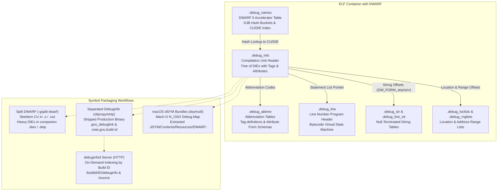

# DWARF Debug Information and Symbol Bundles

> [!summary] Claim:
> DWARF represents program structure as an attributed tree of Debugging Information Entries (DIEs) decoded through schema tables in `.debug_abbrev`, and maps machine instructions to source coordinates via a bytecode virtual state machine in `.debug_line`.
> To prevent debug metadata from overwhelming linkers and deployment artifacts, modern toolchains separate heavy type and location payloads into non-relocated companion files (`.dwo`/`.dwp`), stripped separate debug files indexed by cryptographic build IDs, or macOS `.dSYM` bundles extracted from object file debug maps.
> Standardized accelerated lookup tables (`.debug_names`) replace linear section scans with DJB hash lookups, while network services like `debuginfod` deliver debug symbols and source listings over HTTP without local package installation.



## The Mechanism

The Executable and Linkable Format ([[ELF-Mach-O-and-PE-Object-Formats]]) and Mach-O define containers for executable instructions and symbols, but say nothing about how machine instructions relate to high-level source files, lexical scopes, local variables, or type layouts.
DWARF (Debugging With Attributed Record Formats) supplies this structural model.
Every format fact below is grounded in the DWARF 4 and DWARF 5 specifications, GCC 14, Clang 18, LLVM 18, and macOS Xcode toolchains (as of 2026-11).

### 1. Low-Level Representation: DIEs, Abbreviations, and Forms

At the core of DWARF lies the Debugging Information Entry (DIE).
A program is modeled as a directed tree of DIEs stored in the `.debug_info` section.
Each DIE represents a program construct: a compilation unit, a function, an inlined subroutine, a lexical block, a formal parameter, a local variable, or a type definition.

A DIE consists of three contiguous components:
- An unsigned LEB128 (ULEB128) abbreviation code.
- A sequence of attribute values whose representations are determined by the abbreviation code.
- An optional sequence of child DIEs, terminated by an abbreviation code of zero (`0x00`).

To avoid repeating schema metadata (attribute names and encodings) across millions of DIEs, DWARF decouples schema definitions into a separate `.debug_abbrev` section.
The abbreviation code at the head of each DIE acts as a key into the abbreviation table for that compilation unit.

```text
.debug_info:                              .debug_abbrev:
+-----------------------------------+     +-----------------------------------+
| Abbrev Code: 1 (ULEB128)          |---->| Code: 1                           |
| Attribute 1 Value                 |     | Tag: DW_TAG_subprogram            |
| Attribute 2 Value                 |     | Children: DW_CHILDREN_yes         |
| ...                               |     | Attr 1: DW_AT_name [DW_FORM_strp] |
+-----------------------------------+     | Attr 2: DW_AT_low_pc [DW_FORM_addr|
| Child DIEs ...                    |     | Attr 3: 0, 0 (terminator)         |
| Terminator: 0x00                  |     +-----------------------------------+
+-----------------------------------+
```

Each entry in `.debug_abbrev` declares:
- The abbreviation number (a positive ULEB128 integer).
- The DIE tag (e.g., `DW_TAG_compile_unit`, `DW_TAG_subprogram`, `DW_TAG_variable`).
- A children flag: `DW_CHILDREN_yes` (`0x01`) indicating child DIEs follow immediately, or `DW_CHILDREN_no` (`0x00`) indicating the DIE has no children.
- A list of attribute specifications, each consisting of an attribute name (e.g., `DW_AT_name`, `DW_AT_low_pc`, `DW_AT_type`) and an attribute form code (e.g., `DW_FORM_strp`, `DW_FORM_addr`, `DW_FORM_data4`), terminated by a pair of zeros (`0, 0`).

An abbreviation code of zero in `.debug_info` marks the end of a list of sibling DIEs.
This grammar allows a DWARF consumer to parse and traverse the entire DIE tree without prior knowledge of the high-level programming language or compiler implementation.

#### Integer Encoding: LEB128

DWARF stores integers using Little Endian Base 128 (LEB128), a variable-length encoding that packs values into 7 bits per byte.
The most significant bit (bit 7) of each byte serves as a continuation flag: 1 means another byte follows, and 0 marks the final byte.

- **Unsigned LEB128 (ULEB128):** Bits 0 through 6 of each byte represent chunks of the value, least significant group first.
- **Signed LEB128 (SLEB128):** Encodes two's complement signed values.
  The consumer examines bit 6 (the sign bit) of the final byte: if set, the unpacked integer must be sign-extended to the target register width (e.g., 64 bits).

```text
Encoding unsigned value 624485 (0x98765):
Binary: 1001 1000 0111 0110 0101
7-bit groups: [0100110] [0001110] [1100101]
Add continuation bits:
  Byte 0: 11100101 (0xE5)  (bit 7=1, low 7 bits = 1100101)
  Byte 1: 10001110 (0x8E)  (bit 7=1, mid 7 bits = 0001110)
  Byte 2: 00100110 (0x26)  (bit 7=0, high 7 bits = 0100110)
Encoded sequence: E5 8E 26 (3 bytes vs 4 or 8 bytes)
```

#### Attribute Form Evolution: Direct vs. Indexed Forms

In DWARF 4, string attributes referenced global strings using `DW_FORM_strp`, which embeds a 4-byte or 8-byte relocation into `.debug_str`.
For large programs, `.debug_info` contained millions of relocations that the static linker ([[Symbols-Relocations-and-Static-Linking]]) had to resolve during link time.

DWARF 5 resolved this bottleneck by introducing indexed attribute forms:
- `DW_FORM_strx`, `DW_FORM_strx1`..`DW_FORM_strx4`: Store a small integer index into a `.debug_str_offsets` table.
  The compilation unit DIE carries a single `DW_AT_str_offsets_base` attribute (DWARF 5 Section 3.1.1), so one relocation replaces the per-attribute relocation records.
- `DW_FORM_addrx`, `DW_FORM_addrx1`..`DW_FORM_addrx4`: Store an index into a `.debug_addr` table, replacing direct address relocations with an offset against `DW_AT_addr_base`.
- `DW_FORM_rnglistx` and `DW_FORM_loclistx`: Index into `.debug_rnglists` and `.debug_loclists`, replacing raw section offsets.

#### Compilation Unit Headers: DWARF 4 vs. DWARF 5

In DWARF 4, every compilation unit in `.debug_info` begins with an 11-byte header (for standard 32-bit DWARF format):
- `unit_length` (4 bytes): Size of the CU excluding this field.
- `version` (2 bytes): Value `4`.
- `debug_abbrev_offset` (4 bytes): Byte offset of this CU's abbreviation table in `.debug_abbrev`.
- `address_size` (1 byte): Pointer size on the target architecture (e.g., 8 for x86-64 and AArch64).

DWARF 5 restructured the unit header to support multiple unit categories without creating separate ELF sections:
- `unit_length` (4 bytes).
- `version` (2 bytes): Value `5`.
- `unit_type` (1 byte): Explicit unit category (`DW_UT_compile` = 1, `DW_UT_type` = 2, `DW_UT_partial` = 3, `DW_UT_skeleton` = 4, `DW_UT_split_compile` = 5, `DW_UT_split_type` = 6).
- `address_size` (1 byte).
- `debug_abbrev_offset` (4 bytes).
- For type units (`DW_UT_type` / `DW_UT_split_type`), an 8-byte `type_signature` and 4-byte `type_offset` follow immediately.
- For skeleton and split units (`DW_UT_skeleton` / `DW_UT_split_compile`), an 8-byte `dwo_id` matches the skeleton to its companion `.dwo` file.

### 2. The Line Number Program Virtual State Machine (`.debug_line`)

Source-level debuggers require a mapping between target machine code addresses and source code positions (filename, line number, column).
A naive lookup table mapping every instruction address to a filename and line number would consume gigabytes of memory.
DWARF solves this by encoding line information as an interpreted bytecode program that drives a virtual state machine.

#### State Machine Registers

The state machine maintains twelve registers while executing a line number program (DWARF 4 and DWARF 5 Section 6.2.2):
1. `address`: The program-counter instruction address.
2. `op_index`: Operation index within a VLIW instruction bundle (always 0 on non-VLIW architectures like x86-64 and AArch64).
3. `file`: Unsigned integer index into the file table.
4. `line`: Unsigned integer representing the 1-based source line.
5. `column`: Unsigned integer representing the 1-based source column (0 means the statement begins at the left edge of the line).
6. `is_stmt`: Boolean flag indicating whether the current address is a recommended breakpoint location (the start of a statement).
7. `basic_block`: Boolean flag indicating whether the address begins a basic block.
8. `end_sequence`: Boolean flag indicating that the address is the first byte after the end of a sequence of target instructions.
9. `prologue_end`: Boolean flag indicating the end of a function prologue.
10. `epilogue_begin`: Boolean flag indicating the start of a function epilogue.
11. `isa`: Unsigned integer encoding the instruction set architecture of the current instruction.
12. `discriminator`: Unsigned integer identifying the block to which the current instruction belongs, so several blocks on one source line can be told apart.

#### Line Program Header Parameters

Every line program begins with a header defining parameters that parameterize the state machine arithmetic:
- `line_base` (signed byte, e.g., -5): The minimum line adjustment that a single-byte special opcode can encode.
  The values -5, 14, and 13 are producer choices made by GNU as and LLVM, not values fixed by the specification; the lab's GCC object records exactly these three.
- `line_range` (unsigned byte, e.g., 14): The range of line adjustments covered by special opcodes.
- `opcode_base` (unsigned byte, e.g., 13): The first opcode value reserved for special opcodes.
  Opcodes 1 through `opcode_base - 1` are standard opcodes.
- `minimum_instruction_length` (unsigned byte): Minimum instruction alignment (1 on x86-64; 4 on AArch64 with GCC and GNU as, as the lab records).
- `maximum_operations_per_instruction` (unsigned byte, introduced in DWARF 4): Maximum operations in an instruction bundle (1 on standard RISC/CISC).
- `default_is_stmt` (unsigned byte): Initial value for the `is_stmt` register (typically 1).

In DWARF 5, the line table header explicitly includes `address_size` (1 byte) and `segment_selector_size` (1 byte), and moves directory and file entries into structured descriptor arrays that reference `.debug_line_str`.

#### Bytecode Instruction Opcodes

Line program bytecode instructions belong to three categories:

1. **Standard Opcodes (1 to `opcode_base - 1`):**
   - `DW_LNS_copy` (1): Appends a row containing the current register values to the line table matrix, then resets `basic_block`, `prologue_end`, and `epilogue_begin` to false, and `discriminator` to 0.
   - `DW_LNS_advance_pc` (2): Reads a ULEB128 operand and advances `address` by `operand * minimum_instruction_length`.
   - `DW_LNS_advance_line` (3): Reads an SLEB128 operand and adds it to `line`.
   - `DW_LNS_set_file` (4): Reads a ULEB128 operand and sets `file`.
   - `DW_LNS_set_column` (5): Reads a ULEB128 operand and sets `column`.
   - `DW_LNS_negate_stmt` (6): Toggles `is_stmt = !is_stmt`.
   - `DW_LNS_set_basic_block` (7): Sets `basic_block = true`.
   - `DW_LNS_const_add_pc` (8): Advances `address` by the address delta corresponding to special opcode 255 without emitting a matrix row.
     This permits large address increments across functions without multi-byte operands.
   - `DW_LNS_fixed_advance_pc` (9): Reads a 2-byte constant integer and adds it to `address` without scaling by instruction length.
   - `DW_LNS_set_prologue_end` (10): Sets `prologue_end = true`.
   - `DW_LNS_set_epilogue_begin` (11): Sets `epilogue_begin = true`.
   - `DW_LNS_set_isa` (12): Sets the instruction set architecture register.

2. **Extended Opcodes:**
   Prefixed by a single zero byte (`0x00`), followed by a ULEB128 length, followed by the extended opcode byte:
   - `DW_LNE_end_sequence` (1): Sets `end_sequence = true`, emits a row into the matrix, and resets all state machine registers to their default initialization state.
   - `DW_LNE_set_address` (2): Reads an unaligned target pointer (4 or 8 bytes) and sets `address`.
     In relocatable object files (`.o`) on x86-64 and AArch64, this is normally the only line instruction carrying a relocation against `.text`: the lab's GCC DWARF 4 object has exactly one entry in `.rela.debug_line`, `R_AARCH64_ABS64 .text + 0` on the `DW_LNE_set_address` operand (`readelf -r` in container `toolchain-labs:f39efe0ff57b`).
   - `DW_LNE_define_file` (3): Dynamically appends an entry to the file table (deprecated in DWARF 5).
   - `DW_LNE_set_discriminator` (4): Reads a ULEB128 operand and sets `discriminator`.

3. **Special Opcodes (`opcode_base` to 255):**
   A single-byte special opcode simultaneously advances both `line` and `address`, and emits a matrix row.
   In the lab's object, 12 of the 14 matrix rows come from single-byte special opcodes; the other two come from `DW_LNS_copy` and `DW_LNE_end_sequence`.
   The decoder evaluates:

$$\text{adjusted} = \text{opcode} - \text{opcode\_base}$$

$$\text{line\_delta} = \text{line\_base} + (\text{adjusted} \pmod{\text{line\_range}})$$

$$\text{address\_delta} = \left(\left\lfloor \frac{\text{adjusted}}{\text{line\_range}} \right\rfloor\right) \times \text{minimum\_instruction\_length}$$

$$\text{line} \leftarrow \text{line} + \text{line\_delta}, \quad \text{address} \leftarrow \text{address} + \text{address\_delta}$$

After updating `line` and `address`, the state machine emits a row into the matrix and clears `basic_block`, `prologue_end`, `epilogue_begin`, and `discriminator`.

### 3. Location Descriptions and Expression Stacks

Debuggers must locate variable values in memory or CPU registers at runtime.
DWARF defines a stack-based virtual machine to compute object locations.
DWARF 5 Section 2.6.1.1 defines four kinds of single location description, and composite descriptions assemble pieces of them:
- **Empty location description:** The object is present in the source but has no value (optimized away).
- **Memory location description:** A target memory address where the value resides.
- **Register location description:** A CPU register holding the value.
- **Implicit location description:** An immediate value or piece-wise reconstructed object not backed by memory or registers (common with constants and optimized code).

Common DWARF expression operations include:
- `DW_OP_reg0` through `DW_OP_reg31` / `DW_OP_regx`: Object lives in the specified hardware register.
- `DW_OP_fbreg`: Adds an SLEB128 byte offset to the base address computed by the enclosing function's `DW_AT_frame_base` expression (typically the stack frame pointer).
- `DW_OP_breg0`..`DW_OP_breg31` / `DW_OP_bregx`: Reads the specified register, adds an SLEB128 offset, and pushes the resulting memory address.
- `DW_OP_addr`: Pushes a literal target machine address.
- `DW_OP_piece` / `DW_OP_bit_piece`: Concatenates sub-objects across disparate locations.
  For example, a 16-byte integer or SIMD value might hold its low 8 bytes in register `rax` and high 8 bytes in register `rdx`.

#### Location Lists: `.debug_loc` vs. `.debug_loclists`

When a compiler optimizes code, register allocators reuse registers across different basic blocks.
A local variable might reside in `rdi` on function entry, move to `rbx` after a call, spill to stack slot `[rbp - 24]`, and be dead in the epilogue.
A single static location expression cannot capture this lifecycle.

DWARF solves this using location lists.
In DWARF 4, location lists lived in `.debug_loc` as sequences of pairs: `(begin_offset, end_offset)` specifying PC bounds relative to the CU base address, followed by an expression byte count and the location expression bytes.
Pairs of `(0xFFFFFFFFFFFFFFFF, base_address)` reset the base address.

DWARF 5 replaced `.debug_loc` with `.debug_loclists`, introducing indexed entry encodings:
- `DW_LLE_startx_length`: Selects a base address from `.debug_addr` using an index and specifies an integer length.
- `DW_LLE_offset_pair`: Specifies start and end offsets relative to the CU base address using ULEB128.
- `DW_LLE_base_address`: Explicitly sets the base address.
- `DW_LLE_end_of_list`: Terminates the location list.

These indexed encodings keep addresses out of the location lists, so the lists in a companion file need no relocations; no compression ratio is claimed.

### 4. Accelerated Lookup Tables: `.debug_names`

When a user sets a breakpoint by symbol name (`break calculate_total`) or queries a type, the debugger must locate the matching DIE.
Without a usable index, debuggers must parse all of `.debug_info` on startup, which stalls on multi-gigabyte binaries.
DWARF 2 already defined an optional `.debug_pubnames` section and DWARF 3 added `.debug_pubtypes` (DWARF 5 Appendix B section version table), but consumers could not rely on producers to make them complete, so GDB introduced the vendor-specific `.gdb_index`.

DWARF 5 replaced both pub sections with `.debug_names` (Section 6.1.1), providing a cross-platform, multi-CU accelerator table based on open-addressing hash lookup.

```text
.debug_names Header:
+-----------------------------------------------------------------------+
| unit_length (4B) | version=5 (2B) | padding (2B)                      |
| comp_unit_count (4B) | local_type_unit_count (4B) | foreign_tu_cnt (4B)|
| bucket_count (4B)    | name_count (4B)            | abbrev_size (4B)  |
| augmentation_string_size (4B) | augmentation_string ("LLVM0700\0")    |
+-----------------------------------------------------------------------+
| Compilation Unit List: comp_unit_count x 4B/8B section offsets        |
| Type Unit List: local_type_unit_count x 4B/8B section offsets         |
| Foreign Type Unit List: foreign_type_unit_count x 8B type signatures  |
| Hash Buckets: bucket_count x 4B (1-based index into Name Table)       |
| Hash Values: name_count x 4B (32-bit DJB hash values)                 |
| String Offsets: name_count x 4B/8B (offsets into .debug_str)          |
| Entry Offsets: name_count x 4B/8B (offsets into Entry Pool)           |
| Abbreviations Table: abbrev_size bytes (tag + DW_IDX_* attribute list)|
| Entry Pool: Abbreviation-driven DIE offsets and Tag records           |
+-----------------------------------------------------------------------+
```

#### Hash Lookup Algorithm

The DWARF 5 name table uses the DJB hash algorithm (seed 5381, multiplier 33; DWARF 5 Section 7.33, Figure 7.1).
Before hashing, each name is folded with Unicode simple case folding (DWARF 5 Section 6.1.1.4.5), so the function below matches the specification only when applied to the case-folded name:

```c
uint32_t dwarf5_djb_hash(const unsigned char *str) {
    uint32_t h = 5381;
    while (*str) {
        h = (h * 33) + *str++;
    }
    return h;
}
```

To resolve a symbol name:
1. Compute `h = dwarf5_djb_hash(name)`.
2. Compute bucket index `bucket = h % bucket_count`.
3. Read `first_name_idx = hash_buckets[bucket]`.
   If `first_name_idx == 0`, the bucket is empty; the symbol is absent.
4. Iterate from `idx = first_name_idx - 1` in `hash_values`.
   For every entry where `hash_values[idx] % bucket_count == bucket`:
   - If `hash_values[idx] == h`: dereference `string_offsets[idx]` in `.debug_str`.
   - If strings match byte-for-byte, read `entry_offsets[idx]` into the Entry Pool.
   - The Entry Pool record carries `DW_IDX_compile_unit` (the index of the CU) and `DW_IDX_die_offset` (the offset of the DIE within that CU or TU) (DWARF 5 Section 6.1.1.4.7).
5. Lookup completes in $O(1)$ expected time without touching `.debug_info`.

### 5. Split DWARF (`.dwo` and `.dwp`)

In large C++ and Rust codebases, static linkers spend much of their time merging DWARF sections and applying debug relocations; measure the share on your own link before budgeting for it.
Split DWARF (originally Debug Fission, standardized in DWARF 5) splits debug information into two distinct artifacts:
- **Skeleton object file (`.o`):** Contains compiled machine code (`.text`, `.data`), symbol tables, line table address records, and a skeleton compilation unit (`DW_UT_skeleton`).
  The skeleton CU (tag `DW_TAG_skeleton_unit`, no children) carries `DW_AT_dwo_name` (path to the `.dwo`) and optionally `DW_AT_comp_dir`, `DW_AT_low_pc`/`DW_AT_high_pc` or `DW_AT_ranges`, `DW_AT_stmt_list`, `DW_AT_use_UTF8`, `DW_AT_str_offsets_base`, and `DW_AT_addr_base` (DWARF 5 Section 3.1.2).
  The 8-byte `dwo_id` lives in the unit header, not in an attribute; pre-standard GNU Fission carried it as `DW_AT_GNU_dwo_id`.
- **DWARF Object file (`.dwo`):** Written alongside `.o` during compilation.
  Holds all heavy DIEs (`DW_UT_split_compile`), type declarations, variable locations, inlined subroutines, and macro tables in sections suffixed `.dwo` (`.debug_info.dwo`, `.debug_loclists.dwo`, `.debug_str.dwo`).

Crucially, `.dwo` files contain **zero relocations**.
All cross-references use index tables (`.debug_str_offsets.dwo`, `.debug_addr`).
When the linker links thousands of `.o` files into the final executable, it ignores the `.dwo` files completely.
Linker time and memory shrink with the amount of DWARF kept out of the link; the size of the saving is workload-specific, so measure it on your own tree.

#### DWARF Package Files (`.dwp`)

Leaving thousands of individual `.dwo` files on build farms creates file descriptor exhaustion and backup overhead.
The `llvm-dwp` and GNU `dwp` tools bundle `.dwo` files into a single `.dwp` container.
The `.dwp` file includes two index sections:
- `.debug_cu_index`: Hash table mapping 64-bit `dwo_id` values to section contribution offsets inside `.dwp`.
- `.debug_tu_index`: Hash table mapping 64-bit type signatures to section contributions.

A debugger reading a split binary reads the `dwo_id` from the header of the executable's skeleton unit, queries `.debug_cu_index` in the `.dwp` via hash lookup, and retrieves the compilation unit's DIE tree instantly.

### 6. Symbol Stripping, Build IDs, and `debuginfod`

Shipping debug information to production servers or end-user devices wastes disk space, increases container image transfer time, and exposes internal source paths.

#### Stripping Mechanics: `.symtab` vs. `.dynsym`

An ELF binary contains two distinct symbol tables:
- `.symtab`: The full symbol table containing all local, static, and global symbols used during linking and offline debugging.
  Not marked `SHF_ALLOC`; never loaded into memory.
- `.dynsym`: The dynamic symbol table required by `ld.so` ([[Dynamic-Linking-PLT-GOT-and-Loaders]]) for runtime relocations, PLT resolution, and `dlsym()`.
  Marked `SHF_ALLOC`; loaded into the process memory image.

Running `strip --strip-debug <binary>` removes "all debugging symbols & sections" (GNU strip 2.42 `--help`): the `.debug_*` sections go, `.symtab` stays.
Running `strip --strip-unneeded <binary>` removes "all symbols not needed by relocations", which is the usual choice for shared libraries.
Running `strip -s` (`--strip-all`) removes "all symbol and relocation information", so `.symtab` disappears from any ELF file.
None of the three removes `.dynsym`: it is an `SHF_ALLOC` section the loader needs.

#### Separated Debug Files and `.gnu_debuglink`

To retain debugging capability while deploying stripped binaries, toolchains separate debug symbols using `objcopy`:

```bash
# 1. Extract pure DWARF sections into a debug file
objcopy --only-keep-debug app.bin app.bin.debug

# 2. Strip debug sections from the deployable executable
strip --strip-debug app.bin

# 3. Add .gnu_debuglink section containing filename and CRC32
objcopy --add-gnu-debuglink=app.bin.debug app.bin
```

The `.gnu_debuglink` section holds a null-terminated filename string, padded with zero bytes to a 4-byte boundary, followed by a 4-byte CRC32 checksum over the full contents of the separate debug file.
In the Practice Drill, `readelf -x .gnu_debuglink` shows `drill.debug\0` (12 bytes, already 4-aligned) followed directly by the 4-byte CRC.

#### Cryptographic Build IDs

Because file names and CRCs can collide or diverge across rebuilds, linkers embed an identifier when given `-Wl,--build-id`; Ubuntu 24.04's GCC passes `--build-id` by default (a plain `gcc -g` link in container `toolchain-labs:f39efe0ff57b` carries a Build ID note).
The linker generates an ELF note section `.note.gnu.build-id`; a bare `--build-id` means `sha1` (160-bit) in both GNU ld and lld, and both also offer `md5`, `uuid`, and `0x<hex>`, plus `xx` (GNU ld) and `fast` (lld).
The hash styles are computed from the linked output's contents, so identical outputs get identical IDs.

Debuggers locate matching separate debug files using the canonical directory hierarchy:

```text
/usr/lib/debug/.build-id/ab/cdef1234567890abcdef1234567890abcdef12.debug
                         ^^  ^^^^^^^^^^^^^^^^^^^^^^^^^^^^^^^^^^^^^^^^^^
                         |   Trailing 38 hexadecimal digits + .debug
                         First 2 hex digits (directory)
```

#### `debuginfod`: Networked Symbol Retrieval

Prior to `debuginfod`, engineers triaging core dumps were forced to locate and install exact distro `*-debuginfo` RPM or DEB packages matching every library in the trace.
Introduced in `elfutils 0.178` (2019-11), `debuginfod` is an HTTP client/server daemon that delivers debuginfo, stripped binaries, and source code on demand.

The daemon indexes directories containing ELF/DWARF files, RPMs (`-R`), and DEBs (`-U`) into an SQLite database (debuginfod(8) man page: "stores its index in an sqlite database"; scanning of plain ELF/DWARF files is enabled with `-F`).
Clients issue standardized HTTP GET requests:
- `GET /buildid/{build_id}/debuginfo`: Returns unstripped DWARF debuginfo.
- `GET /buildid/{build_id}/executable`: Returns the original binary image.
- `GET /buildid/{build_id}/source/{path}`: Returns the original source file text for that build ID.

The client library in elfutils 0.190 recognizes these three URL shapes (`/buildid/<hex>/debuginfo`, `/executable`, `/source...`) and also exports `debuginfod_find_section`.
When the environment variable `DEBUGINFOD_URLS` is set (e.g., `export DEBUGINFOD_URLS="https://debuginfod.elfutils.org/"`), GDB 10.1+, LLDB 18+ (LLVM 18 release notes), binutils 2.34+, Valgrind 3.17.0+, `perf` (Linux 5.10+), and elfutils' own tools query the network server automatically (elfutils Debuginfod clients table).
Retrieved files are cached under `$XDG_CACHE_HOME/debuginfod_client`, normally `~/.cache/debuginfod_client`, overridable with `DEBUGINFOD_CACHE_PATH`; older clients used `~/.debuginfod_client_cache` (both paths appear in `libdebuginfod-0.190.so`).

### 7. macOS Symbol Mechanics: Mach-O Debug Maps and `.dSYM` Bundles

The macOS Darwin toolchain ([[macOS-vs-Linux-Toolchain-Mechanics]]) handles debug symbols fundamentally differently from Linux ELF toolchains.

#### The Debug Map Architecture

Apple's linker (`ld64` / `ld_prime`) does **not** copy DWARF debug sections from input `.o` files into the linked Mach-O executable.
Instead, the linker creates a "Debug Map" stored as STABS symbol entries in the executable's symbol table:
- `N_OSO` entries: Specify the absolute filesystem path and file modification timestamp of each contributing `.o` object file.
- `N_FUN` / `N_GSYM` entries: Map function and global variable addresses in the linked binary back to their symbol definitions in the object file.

When a developer runs `lldb ./a.out` on their local machine, LLDB reads the `N_OSO` records from `a.out`, opens the original `.o` files on disk, and parses their DWARF sections on the fly.
This design makes macOS local link times exceptionally fast.

However, this architecture creates a common failure mode.
A one-step `clang -g main.c -o main` is safe: the driver compiles to a temporary object under `/var/folders/.../T/`, links, and then runs `dsymutil` itself, so `main.dSYM` appears next to `main` (Apple clang 21 on macOS 27: `clang -###` lists a `dsymutil` job, and the debug map's `N_OSO` entry names the deleted temporary).
The failure comes with separate compile and link steps: after `clang -g -c main.c -o main.o && clang main.o -o main`, deleting or moving `main.o` leaves the debug map pointing to a missing file.
`dsymutil main` then prints `warning: (arm64) .../main.o unable to open object file: No such file or directory` and `warning: no debug symbols in executable (-arch arm64)`, and `dwarfdump --debug-info main` shows an empty `.debug_info`.

#### `dsymutil` and `.dSYM` Bundles

To distribute software or archive symbols for crash triage, the macOS toolchain provides `dsymutil`.
`dsymutil` resolves the debug map:
1. Opens the linked Mach-O binary and scans for `N_OSO` entries.
2. Locates and opens each `.o` file, verifying timestamps.
3. Extracts, deduplicates, and optimizes the DWARF DIE trees.
4. Updates all memory addresses to reflect the final linked binary layout.
5. Emits a structured directory bundle:

```text
app.dSYM/
+-- Contents/
    +-- Info.plist
    \-- Resources/
        \-- DWARF/
            \-- app   (Mach-O companion container holding DWARF sections)
```

#### UUID Validation

Every Mach-O executable and library linked by `ld64` / `ld_prime` contains an `LC_UUID` load command holding a 16-byte UUID.
When `dsymutil` creates a `.dSYM` bundle, it copies the exact same UUID into the DWARF container's `LC_UUID` header.
LLDB and Apple CrashReporter match crash logs to `.dSYM` bundles by UUID; check a pair by hand with `dwarfdump --uuid app app.dSYM`, which prints the same UUID for `app` and for `app.dSYM/Contents/Resources/DWARF/app` when they match.
If the UUIDs differ by even a single bit, the debugger refuses to load the symbols.

## Commands and Numbers to Know

Reference metrics, flag defaults, and operational parameters for DWARF and symbol bundles (as of 2026-11).

| Parameter / Entity | Value / Default | Mechanism & Operational Context | Platform | Status & Version |
| :--- | :--- | :--- | :--- | :--- |
| Default DWARF Version | DWARF 5 | Default debug format generated by GCC and Clang when `-g` is passed | Linux | Stable (GCC 11+, Clang 14+, per their release notes) (as of 2026-11) |
| macOS Default DWARF | DWARF 5 for deployment targets macOS 15+ / iOS 18+; DWARF 4 for macOS 10.11-14; DWARF 2 before 10.11 | Chosen by `DarwinClang::GetDefaultDwarfVersion` from the deployment target, not the Xcode version; Apple clang 21 emits version 5 | macOS | Stable (upstream clang `Darwin.cpp`) (as of 2026-11) |
| Special Opcode Line Base | -5 (typical) | Minimum line delta encodable in a single-byte special opcode (`line_base`) | Both | Producer choice (GNU as, LLVM); the lab records it (as of 2026-11) |
| Special Opcode Line Range | 14 (typical) | Span of line deltas encodable in single-byte special opcodes (`line_range`) | Both | Producer choice (GNU as, LLVM); the lab records it (as of 2026-11) |
| Standard Opcode Base | 13 (typical) | First opcode number reserved for special opcodes (`opcode_base`); 13 means the 12 standard opcodes of DWARF 3 and later | Both | Producer choice (GNU as, LLVM); the lab records it (as of 2026-11) |
| DJB Hash Seed Value | 5381 (`0x1505`) | Initial accumulator value for `.debug_names` table hashing algorithm | Both | DWARF 5 Section 7.33 |
| DJB Hash Multiplier | 33 | Multiplier constant for `.debug_names` hashing: `h = h * 33 + c` | Both | DWARF 5 Section 7.33 |
| DWARF 5 Skeleton Unit Type | `DW_UT_skeleton` (0x04) | Header unit type identifying skeleton CUs referencing companion `.dwo` files | Both | DWARF 5 Section 7.5.1 |
| Split DWARF Object Flag | `-gsplit-dwarf` | Emits skeleton in `.o` and non-relocated DWARF in companion `.dwo` | Linux | Stable; accepted by the container's GCC 13.3 (as of 2026-11) |
| DWARF Compression Flag | `-gz=zstd` | Compresses `.debug_*` sections with Zstandard; requires binutils 2.40+ (binutils 2.40 NEWS: gas gains `--compress-debug-sections=zstd`) | Linux | Stable (GCC 13+ per GCC 13 changes; the Clang 15 and 16 command-line references describe `-gz=<arg>` only as a compression type, so no Clang version is claimed) (as of 2026-11) |
| Build ID Section | `.note.gnu.build-id` | ELF note section holding 160-bit SHA-1 or 128-bit MD5 binary digest | Linux | Standard (`-Wl,--build-id`) |
| Build ID Default Algorithm | SHA-1 (160-bit, 20B) | Style used by a bare `--build-id` in GNU `ld` and `lld` (both manuals: sha1) | Linux | Stable (binutils 2.18+; ld NEWS "Changes in 2.18": new `--build-id` option) (as of 2026-11) |
| `debuginfod` Environment | `DEBUGINFOD_URLS` | Space-separated HTTP URLs queried by GDB/LLDB/perf for missing symbols (separator per the elfutils Debuginfod page and debuginfod-client-config(7)) | Linux | Stable (elfutils 0.178+) (as of 2026-11) |
| `debuginfod` Cache Path | `$XDG_CACHE_HOME/debuginfod_client`, normally `~/.cache/debuginfod_client` | Local client cache; `DEBUGINFOD_CACHE_PATH` overrides it, older clients used `~/.debuginfod_client_cache` | Linux | Stable (elfutils 0.190 library strings) (as of 2026-11) |
| `debuginfod` Client Timeout | 90 seconds | Default `DEBUGINFOD_TIMEOUT` for each server connection (debuginfod-client-config(7): download commencing timeout in seconds, zero or negative disables it) | Linux | elfutils (as of 2026-11) |
| Mach-O Debug Map STABS | `N_OSO` (`0x66`) | Symbol table entry pointing to contributing `.o` file paths on disk; `n_value` holds the `.o` mtime (SDK `mach-o/stab.h`) | macOS | Darwin ABI (as of 2026-11) |
| Mach-O UUID Header | `LC_UUID` (`0x1b`) | 16-byte UUID load command binding Mach-O binary to matching `.dSYM` bundle (SDK `mach-o/loader.h`) | macOS | Darwin ABI (as of 2026-11) |
| DWARF 6 Language Attribute | `DW_AT_language_name` (0x90 in LLVM `Dwarf.def`; the issue text proposed 0x8d) | Attribute separating language identification from version codes | Both | Accepted for DWARF 6 (Issue 210419.1, closed 2022-06-13); DWARF 6 unreleased (as of 2026-11) |
| DWARF 6 Version Attribute | `DW_AT_language_version` (0x91 in LLVM `Dwarf.def`; the issue text proposed 0x8e) | Integer attribute encoding the language version as YYYYMM (e.g., 202002 for C++20) | Both | Accepted for DWARF 6 (Issue 210419.1); DWARF 6 unreleased (as of 2026-11) |

## Multi-Language Comparison

DWARF serves as the universal debugging format across compiled and interpreted languages, but language runtimes interact with DWARF through distinct abstractions.

| Dimension | C++ (GCC / Clang) | Rust (rustc) | Python (CPython) |
| :--- | :--- | :--- | :--- |
| **Default Format & Emission** | DWARF 5 by default on Linux; on macOS DWARF 5 for macOS 15+ deployment targets and DWARF 4 below. | DWARF 4 / 5 emitted via LLVM backend (`-C debuginfo=2`). | CPython interpreter binary carries DWARF; pure Python scripts do not. |
| **Symbol & Type Representation** | `DW_TAG_class_type`, `DW_TAG_structure_type`, namespaces, and Itanium ABI mangled names. | `DW_TAG_structure_type` for structs; enums represented as discriminated unions with variants. | C structs (`PyObject`, `PyTypeObject`) documented; Python classes exist only in runtime heap. |
| **Generics & Inlining** | Template instantiations generate distinct DIE subprograms with concrete types. | Generic functions monomorphized; each monomorphization produces a unique DIE tree. | No monomorphization; duck typing evaluated at runtime through `tp_call` / vectorcall. |
| **Optimization Impact** | Heavy inlining creates deep `DW_TAG_inlined_subroutine` chains; variables tracked via loclists. | Inlined closures and combinators generate nested scopes; SROA fragments structs into pieces. | Python bytecode eval loop (`_PyEval_EvalFrameDefault`) obscures Python-level call stacks. |
| **Separate Symbols & Bundles** | Full support for `-gsplit-dwarf` (`.dwo`/`.dwp`), `.debug_names`, and `objcopy` debuglinks. | Supports `-C split-debuginfo=packed` (`.dwp` on Linux, `.dSYM` on macOS). | Debug packages (`python3-dbg` / `python3-debuginfo`) provide C-level symbols for core dump triage. |
| **Debugger Inspection** | Native expression parsers evaluate C++ expressions, operator overloads, and vtables. | GDB and LLDB use Rust language plugins to format slices, `Option`, `Result`, and strings. | Requires Python GDB extensions (`libpython.py`) or external sampling profilers (`py-spy`). |

## Worked Lab Example

The companion lab `code/00-Program-Execution/dwarf_line_parser/` implements a complete DWARF `.debug_line` parser and virtual state machine in Python without external dependencies.

### Lab Implementation Architecture

1. **Test Program Compilation:**
   `test_program.c` contains two functions (`compute` and `main`) containing arithmetic, branch conditions, and local variable assignments.
   `run.sh` compiles it twice with `${CC:-gcc} -O0 -c`: once with `-gdwarf-4` into `test_program_v4.o` and once with `-gdwarf-5` into `test_program_v5.o`.
   Compiling as an unlinked object file (`-c`) keeps every address relative to `.text` offset zero: the `DW_LNE_set_address` operand is left for a relocation the static linker would resolve, so the line table does not depend on link layout.

2. **ELF Container Parsing (`parser.py`):**
   `parse_elf()` validates the 4-byte ELF magic (`\x7fELF`), accepts only little-endian ELF64 (anything else raises `ValueError`), reads the section header table (`e_shoff`, `e_shentsize`, `e_shnum`), and extracts `.shstrtab`.
   It indexes every section by name and also reads `.rela.debug_line`.
   A relocatable object stores zero where a RELA relocation will later write a value, so the DWARF 5 `DW_FORM_line_strp` offsets in the file table are zero in the section bytes and the real offsets are the relocation addends (`R_AARCH64_ABS32 .debug_line_str + 9`, and so on, from `readelf -r`).
   The parser adds the addend to the stored value before reading the name from `.debug_line_str`.

3. **Line Header Decoding:**
   `parse_debug_line()` reads `unit_length`, accepts `version` 2 through 5, reads the DWARF 5 `address_size` and `segment_selector_size` bytes when present, reads `header_length`, and parses the state machine parameters:
   `min_inst_len`, `max_ops`, `default_is_stmt`, `line_base`, `line_range`, `opcode_base`, and `standard_opcode_lengths`.
   For versions 2 to 4 it reads the null-terminated directory and file tables; for version 5 it reads the entry-format descriptions (content type and form pairs) and then the directory and file entries.
   It then requires the tables to end exactly at the byte that `header_length` names, and rejects 64-bit DWARF, `max_ops` other than 1, and unknown forms rather than guessing.

4. **Virtual State Machine Execution:**
   Starting at `header_end`, the parser initializes the virtual registers:
   `address = 0`, `file = 1`, `line = 1`, `column = 0`, `is_stmt = default_is_stmt`, `basic_block = false`, `discriminator = 0`.
   It steps through the bytecode stream:
   - Evaluates extended opcodes (`DW_LNE_set_address`, `DW_LNE_end_sequence`, `DW_LNE_set_discriminator`; others are skipped by length).
   - Evaluates all twelve standard opcodes; this object exercises `DW_LNS_copy`, `DW_LNS_advance_pc`, and `DW_LNS_set_column`.
   - Evaluates special opcodes using the exact modular arithmetic formulas:
     $\text{line\_delta} = \text{line\_base} + ((\text{op} - \text{opcode\_base}) \pmod{\text{line\_range}})$
     $\text{addr\_delta} = \lfloor (\text{op} - \text{opcode\_base}) / \text{line\_range} \rfloor \times \text{min\_inst\_len}$
   - Emits a structured row for every matrix transition, and requires the program to end exactly at the end of the unit.

5. **Cross-Tool Verification:**
   The lab runs `readelf --debug-dump=decodedline` on each object via `subprocess` and parses its table into `(file, line, address, is_stmt)` tuples; the end-of-sequence row prints `-` as its line.
   It builds the same tuples from the Python matrix (file name resolved through the version-specific file table index) and compares them row by row, so a wrong address, line, statement flag, or file name in any row fails the check.
   The check also fails if the two row counts differ.

6. **Integrity and Negative Testing:**
   `run_negative_tests()` mutates the raw bytes and requires `ValueError` with a specific message for each case; any other exception type, or no exception, is a failure:
   - a section truncated below the header size;
   - `line_range` set to `0`, which would otherwise divide by zero in the first special opcode;
   - `unit_length` pointing past the end of the section;
   - an unknown `version` (9);
   - `max_ops` set to 2;
   - `header_length` one byte too large, which the table-end check catches;
   - a corrupted ELF magic, a 32-bit ELF class byte, and a big-endian data byte.
   The final `Verification Result:` line is `PASS` only when every check passed, and `parser.py` exits with status 1 otherwise, which makes `run.sh` and `make verify` fail.

The ELF32 and big-endian paths are not implemented, only rejected, because the lab has no such object to run them against.

```bash
cd code/00-Program-Execution/dwarf_line_parser
bash run.sh
```

### Verified Output

Recorded by the harness in container `toolchain-labs:f39efe0ff57b` on `linux-aarch64`; the canonical file is `code/00-Program-Execution/dwarf_line_parser/expected/linux-aarch64.txt`.

```text
=== DWARF Line Table Parser Verification ===
--- Object file: test_program_v4.o ---
ELF section: .debug_line (size: 99 bytes)
Header:
  DWARF Version: 4
  Prologue length: 38
  Min instruction length: 4
  Max ops per instruction: 1
  Default is_stmt: 1
  Line base: -5
  Line range: 14
  Opcode base: 13
  Standard opcode lengths: [0, 1, 1, 1, 1, 0, 0, 0, 1, 0, 0, 1]
  Directories: 0 entries
  Files: 1 entries
    [1] test_program.c (dir=0)
State Machine Execution:
  Decoded instructions: 27
  Emitted matrix rows: 14
  Address range: 0x0 - 0x7c (124 bytes)
  Line span: 1 - 16
Matrix Row Spot Checks:
  Row  0: addr=0x00 line= 1 col=22 is_stmt=1
  Row  1: addr=0x08 line= 2 col= 9 is_stmt=1
  Row  3: addr=0x20 line= 4 col= 8 is_stmt=1
  Row  6: addr=0x48 line= 9 col=12 is_stmt=1
  Row 13: addr=0x7c line=16 col= 1 is_stmt=1 end_seq=1
Cross-Tool Verification:
  GNU readelf decoded rows: 14
  Rows equal on (file, line, address, is_stmt): 14 of 14
Integrity and Error Checks:
  Rejects truncated header: PASS
  Rejects zero line_range: PASS
  Rejects unit_length past section: PASS
  Rejects unknown version: PASS
  Rejects VLIW max_ops: PASS
  Rejects header_length off by one: PASS
  Rejects bad ELF magic: PASS
  Rejects 32-bit ELF: PASS
  Rejects big-endian ELF: PASS
--- Object file: test_program_v5.o ---
ELF section: .debug_line (size: 105 bytes)
Header:
  DWARF Version: 5
  Prologue length: 42
  Min instruction length: 4
  Max ops per instruction: 1
  Default is_stmt: 1
  Line base: -5
  Line range: 14
  Opcode base: 13
  Standard opcode lengths: [0, 1, 1, 1, 1, 0, 0, 0, 1, 0, 0, 1]
  Directories: 1 entries
  Files: 2 entries
    [0] test_program.c (dir=0)
    [1] test_program.c (dir=0)
State Machine Execution:
  Decoded instructions: 27
  Emitted matrix rows: 14
  Address range: 0x0 - 0x7c (124 bytes)
  Line span: 1 - 16
Matrix Row Spot Checks:
  Row  0: addr=0x00 line= 1 col=22 is_stmt=1
  Row  1: addr=0x08 line= 2 col= 9 is_stmt=1
  Row  3: addr=0x20 line= 4 col= 8 is_stmt=1
  Row  6: addr=0x48 line= 9 col=12 is_stmt=1
  Row 13: addr=0x7c line=16 col= 1 is_stmt=1 end_seq=1
Cross-Tool Verification:
  GNU readelf decoded rows: 14
  Rows equal on (file, line, address, is_stmt): 14 of 14
Integrity and Error Checks:
  Rejects truncated header: PASS
  Rejects zero line_range: PASS
  Rejects unit_length past section: PASS
  Rejects unknown version: PASS
  Rejects VLIW max_ops: PASS
  Rejects header_length off by one: PASS
  Rejects bad ELF magic: PASS
  Rejects 32-bit ELF: PASS
  Rejects big-endian ELF: PASS
Verification Result: PASS
```

### Reading the Result

- Both objects carry the same line program: 27 bytecode instructions, 14 matrix rows, and an address range of 0x0 to 0x7c, but the DWARF 5 section is 6 bytes longer (105 against 99) because its header carries two extra bytes (`address_size`, `segment_selector_size`), a longer prologue (42 against 38 bytes), and an extra file entry.
- In the DWARF 4 object the header length field says 38 bytes, so the bytecode starts at offset 4 + 2 + 4 + 38 = 48 (`0x30`) and runs to the end of the 99-byte section: 51 bytes of line program describe 124 bytes of machine instructions across 16 source lines.
- The DWARF 5 object has file entries `[0]` and `[1]` (both `test_program.c`, in directory 0) against the single 1-based entry of DWARF 4, which is the file-table indexing difference described under Pitfalls.
  The lab prints only the directory count for DWARF 5, because directory 0 is the compilation directory and its path would change with the build location.
- `Min instruction length: 4` reflects AArch64 fixed-width 32-bit instructions; every address increment is an exact multiple of 4 bytes.
- The state machine decoded 27 bytecode instructions to produce 14 matrix rows: 11 `DW_LNS_set_column`, 1 `DW_LNE_set_address`, 1 `DW_LNS_copy`, 12 special opcodes, 1 `DW_LNS_advance_pc`, and 1 `DW_LNE_end_sequence` (`readelf --debug-dump=line` in container `toolchain-labs:f39efe0ff57b`).
  The 12 special opcodes each spend one byte to advance both address and line and emit a row.
- Row 0 is emitted by `DW_LNS_copy` after `DW_LNE_set_address` sets address `0x00` and `DW_LNS_set_column` sets column 22.
- Row 1 advances to address `0x08` and line 2 via the special opcode byte `0x2f` (47):
  `adjusted = 47 - 13 = 34`, `line_delta = -5 + (34 % 14) = -5 + 6 = 1`, and `addr_delta = (34 // 14) * 4 = 2 * 4 = 8` bytes.
  `readelf` prints this instruction as `Special opcode 34`, because binutils prints the adjusted opcode, not the raw byte.
- Row 13 marks address `0x7c` with `end_seq=1`: `DW_LNS_advance_pc` (operand 2, times 4) moves from `0x74` to `0x7c`, the first byte after the sequence, and `DW_LNE_end_sequence` emits the terminating row.
- All 14 rows of each object equal the corresponding `readelf --debug-dump=decodedline` row on file, line, address, and statement flag, and all nine corruption cases raise the expected `ValueError`.

## Pitfalls

> [!warning] Pitfall: Stripping Dynamic Shared Libraries with `--strip-all`
> Running `strip -s` or `strip --strip-all` on an ELF shared object (`.so`) strips the `.symtab` symbol table, so profilers and crash symbolizers lose every local and static function name.
> GNU strip keeps `.dynsym` because it is an `SHF_ALLOC` section, and none of the `strip` modes removes it, so a tool that does remove dynamic symbols is not doing a normal GNU strip.
> Use `strip --strip-debug` or `strip --strip-unneeded` on shared libraries destined for production, and keep the full symbols in a separate debug file.
> Stripping `.dynsym` makes dynamic linking impossible, causing the dynamic loader (`ld.so`) to abort with symbol lookup errors on process launch.

> [!warning] Pitfall: macOS Debug Map Pointer Invalidation
> Because the Mach-O linker records only `N_OSO` path references to `.o` files instead of embedding DWARF sections, a linked binary's debug information lives in its object files until `dsymutil` runs.
> A one-step `clang -g main.cpp -o main` is covered: the driver runs `dsymutil` before deleting its temporary `/var/folders/.../T/main-xyz.o`, leaving `main.dSYM` beside `main`.
> Separate compile and link steps are not: once the build cleans or moves the `.o` files, the debug map points to missing files and `dsymutil main` reports `unable to open object file` and `no debug symbols in executable`.
> In automated builds, run `dsymutil main -o main.dSYM` right after linking, before deleting object files, and archive the `.dSYM` with the binary.

> [!warning] Pitfall: Orphaned Split DWARF Binaries
> Building with `-gsplit-dwarf` produces an executable whose `.debug_info` contains only skeleton CUs pointing to external `.dwo` files.
> If an SRE copies the executable or core dump from a production machine to a development laptop without transferring the matching `.dwo` files (or a bundled `.dwp` package), GDB and LLDB cannot inspect local variables or stack frames.
> The line table stays in the executable's `.debug_line`, so function names from `.symtab` and line numbers survive, but types, locals, and inlined frames are gone; GDB 15 warns `Could not find DWO CU ... referenced by CU at offset ...`.
> Deploy an internal `debuginfod` server or package symbols with `llvm-dwp` prior to deployment.

> [!warning] Pitfall: Build ID Mismatch in Core Dump Analysis
> When loading an offline core dump, GDB and LLDB verify that the build ID in the core dump's memory mappings matches the build ID in `.note.gnu.build-id` of the provided debug file.
> If a developer recompiles the source code with an identical git commit SHA but different compiler flags or embedded timestamps (`__DATE__`, `__TIME__`), the output bytes and therefore the build ID change.
> GDB 15 then prints `Build-id of ... does not match core file.` for the executable, and skips a candidate debug file with `File "..." has a different build-id, file skipped`; the similar `the debug information found in "..." does not match "..." (CRC mismatch).` comes from the `.gnu_debuglink` CRC check (message strings in the GDB 15.1 binary).
> Always archive release binaries and separate `.debug` files together indexed strictly by build ID.

> [!warning] Pitfall: Assuming Monotonic Line Table Addresses
> Compilers applying instruction scheduling, loop unrolling, and vectorization reorder instructions across basic blocks.
> In optimized code (`-O2` / `-O3`), sequential machine instruction addresses do not map monotonically to sequential source lines.
> A line table program may step from line 42 to line 18, then to line 43, and back to line 19.
> Hand-written line table parsers that assume line numbers monotonically increase fail when reading production binaries.

> [!warning] Pitfall: Index Off-by-One in DWARF 4 vs. DWARF 5 File Tables
> In DWARF 4, file table indices are 1-based: index 1 refers to the first file entry in the header, while directory index 0 implicitly represents the compilation directory.
> In DWARF 5, file table and directory table entries are 0-based: file entry 0 is the primary source file named by `DW_AT_name`, and directory entry 0 is the compilation directory (DWARF 5 Section 6.2.4).
> Parsers that do not branch on the header's `version` field will misattribute every statement in DWARF 5 binaries to the wrong source file.

## At Scale

At the scale of thousands of engineers and tens of millions of lines of code, DWARF debug information becomes a primary bottleneck across build latency, network infrastructure, and storage economics.

### The Scale Cliff

| Scale Tier | Typical Failure Mode | Architecture & Paved Road |
| :--- | :--- | :--- |
| **Single Dev (1-50)** | Slow link times on clean builds; lost macOS symbols. | Default toolchains; run `dsymutil` on macOS; use fast modern linkers (`mold`, `lld`). |
| **Team (50-500)** | CI out-of-memory errors during linking; multi-gigabyte build artifacts. | Enable `-gsplit-dwarf`; adopt Zstandard DWARF compression (`-gz=zstd`); strip CI artifacts. |
| **Enterprise (500-50,000)** | Network saturation from downloading gigabyte debug packages; missing symbols during incident triage. | Deploy centralized `debuginfod` clusters backed by S3/GCS; generate `.dwp` packages; automated build ID ingestion. |

### Decision Rules for Large Engineering Fleets

1. **Local Development Link Optimization:**
   Enable `-gsplit-dwarf` paired with `lld` or `mold` on Linux workstations.
   By avoiding the need to merge DWARF sections and resolve millions of string relocations, link time and memory fall; record the before and after numbers on your own build before rolling it out.
   On macOS, rely on the native debug map during local iteration, skipping `dsymutil` until packaging.

2. **Artifact Packaging and Strip Gate:**
   Never package unstripped binaries into production containers or VM images.
   In CI build pipelines, enforce a three-step strip rule:
   - Extract debug sections: `objcopy --only-keep-debug ${BIN} ${BIN}.debug`.
   - Strip the deployable artifact: `strip --strip-debug ${BIN}`.
   - Inject debuglink: `objcopy --add-gnu-debuglink=${BIN}.debug ${BIN}`.
   - Upload `${BIN}.debug` to an internal symbol store keyed by `.note.gnu.build-id`.

3. **Fleet-Wide `debuginfod` Deployment:**
   Deploy redundant `debuginfod` proxy instances in each production region.
   Configure `/etc/profile.d/debuginfod.sh` across all production servers:
   `export DEBUGINFOD_URLS="https://debuginfod.internal.net/"`.
   When an on-call engineer connects GDB to a crashing daemon or inspects a core dump, GDB retrieves the required debuginfo slices over HTTP in milliseconds without human package management.

4. **DWARF Compression Economics:**
   Standardize compiler flags on `-gz=zstd` (Zstandard compression for debug sections) on modern Linux distributions (GCC 13+, binutils 2.40+).
   Zstandard is designed to compress at a ratio comparable to zlib and decompress faster; measure section size and debugger cold-start time against `-gz=zlib` on your own binaries before standardizing.

5. **Type Unit Deduplication:**
   In large C++ projects with ubiquitous header inclusions, compile with `-fdebug-types-section` (DWARF 4) or ensure DWARF 5 type units are enabled.
   This lets the linker deduplicate identical struct and template definitions across translation units through COMDAT groups, which shrinks `.debug_info` by an amount that depends on how much of it is repeated type definitions.
   Measure first: the GCC manual warns that on some objects `-fdebug-types-section` produces larger debug information, and not every consumer reads `.debug_types`.

## Practice Drill

Build a reproducible test environment to observe the transition from an unstripped binary to a stripped binary, verify symbol failure in GDB, and restore symbolication using `.gnu_debuglink` and `.note.gnu.build-id`.
Run in container `toolchain-labs:f39efe0ff57b` (GCC 13, binutils 2.42, GDB 15.1), step 7 prints `No line number information available for address ... <main>` and step 9 prints `Line ... of "drill.c" starts at address ... <main>`.

```bash
# 1. Create isolated temporary workspace
DIR=$(mktemp -d) && cd "${DIR}"

# 2. Write test program with function calls and local variables
cat << "EOF" > drill.c
#include <stdio.h>

int compute_square(int n) {
    int result = n * n;
    return result;
}

int main(void) {
    int value = 7;
    int squared = compute_square(value);
    printf("Result: %d\n", squared);
    return 0;
}
EOF

# 3. Compile with full DWARF 5 debug information and cryptographic build ID
gcc -gdwarf-5 -O0 -Wl,--build-id=sha1 drill.c -o drill.bin

# 4. Verify build ID note in the binary
readelf -n drill.bin | grep -A 2 "Build ID"

# 5. Extract separate debug information
objcopy --only-keep-debug drill.bin drill.debug

# 6. Strip all debug symbols from deployable binary
strip --strip-debug drill.bin

# 7. Observe failure: GDB cannot read line numbers or function variables
gdb -batch -ex "file drill.bin" -ex "info line main"

# 8. Attach .gnu_debuglink pointing to drill.debug
objcopy --add-gnu-debuglink=drill.debug drill.bin

# 9. Verify success: GDB automatically locates drill.debug via debuglink
gdb -batch -ex "file drill.bin" -ex "info line main"

# 10. Clean up workspace
cd / && rm -rf "${DIR}"
```

## Interview Questions

> [!question] L5: Why are DWARF debug sections not loaded into memory when an ELF binary is executed by the Linux kernel?
>
> > [!success]- Answer
> > The Linux kernel program loader (`execve`) inspects ELF program headers (`Phdr`), not section headers (`Shdr`).
> > Only segments marked with the type `PT_LOAD` are mapped into the process virtual address space via `mmap()`.
> > In an ELF binary, DWARF sections (such as `.debug_info`, `.debug_line`, and `.debug_abbrev`) carry section header flags `sh_flags` without the `SHF_ALLOC` bit set.
> > Consequently, the static linker does not assign DWARF sections to any `PT_LOAD` segment.
> > They reside exclusively on disk within the ELF file container, consuming no physical RAM or virtual address space during program execution until an external debugger attaches and reads the file.

> [!question] L5: Predict the output: A DWARF 4 line table header specifies `opcode_base=13`, `line_base=-5`, `line_range=14`, and `minimum_instruction_length=4`.
> The state machine registers currently hold `address=0x1000` and `line=10`.
> The decoder reads a special opcode byte of value 48.
> What are the resulting `address` and `line` values, and what side effect occurs?
>
> > [!success]- Answer
> > The decoder evaluates:
> > 1. `adjusted = opcode - opcode_base = 48 - 13 = 35`.
> > 2. `line_delta = line_base + (adjusted % line_range) = -5 + (35 % 14) = -5 + 7 = +2`.
> > 3. `operation_advance = adjusted // line_range = 35 // 14 = 2`.
> > 4. `address_delta = operation_advance * minimum_instruction_length = 2 * 4 = 8`.
> > 5. Updating registers: `line = 10 + 2 = 12`, and `address = 0x1000 + 8 = 0x1008`.
> > 6. Side effect: The state machine appends a new row to the line table matrix with `address=0x1008` and `line=12`, and resets `basic_block`, `prologue_end`, and `epilogue_begin` to false.

> [!question] L6: Debug this: an engineer compiles a program on macOS with `clang -g main.c -o main` and deploys it to a teammate's machine.
> The teammate gets no source lines in `lldb ./main`, and `dsymutil ./main` prints `warning: no debug symbols in executable (-arch arm64)`.
> What caused this failure, and what is the exact fix?
>
> > [!success]- Answer
> > The macOS Mach-O linker does not copy DWARF debug sections into linked executables.
> > Instead, it records a "Debug Map" composed of `N_OSO` STABS entries pointing to the absolute paths of the intermediate `.o` object files on the build machine.
> > For a one-step `clang -g main.c -o main`, that object is a temporary under `/var/folders/.../T/` that the driver deletes, but only after running `dsymutil` itself, so the build machine already has `main.dSYM` next to `main`.
> > Only `main` was deployed: on the teammate's machine there is no `.dSYM` and the `N_OSO` path does not exist, so LLDB finds no debug symbols.
> > To fix this:
> > 1. Ship `main.dSYM` alongside `main` (or index it where LLDB and Spotlight can find it by UUID), and check the pair with `dwarfdump --uuid main main.dSYM`.
> > 2. In multi-step builds (`clang -g -c main.c -o main.o`, then link), run `dsymutil main -o main.dSYM` right after linking, before the build deletes the object files.

> [!question] L6: How does DWARF 5 `.debug_names` achieve faster debugger cold-start times compared to DWARF 4 `.debug_pubnames` and vendor `.gdb_index`?
>
> > [!success]- Answer
> > DWARF 4 `.debug_pubnames` was a flat array of string names and compilation unit offsets that required linear scanning or sorting by the debugger on launch, and lacked coverage of type units or static variables.
> > While `.gdb_index` provided a hash table, it was vendor-specific, fragile across toolchains, and tied to GDB internals.
> > DWARF 5 `.debug_names` standardizes a hash table using the DJB hash algorithm over case-folded names.
> > The header defines hash buckets that point directly into a contiguous table of hash values, string offsets, and an Entry Pool.
> > Debuggers locate symbols in $O(1)$ expected time by hashing the requested symbol, checking the bucket, and reading the CU index and CU-relative DIE offset from the Entry Pool.
> > Furthermore, `.debug_names` handles multi-CU binaries, local type units, and foreign type units within a single unified index.

> [!question] L6: Why does DWARF encode line number information as a bytecode virtual state machine instead of an address-to-line array, and what is the purpose of `DW_LNE_end_sequence`?
>
> > [!success]- Answer
> > An uncompressed array mapping every instruction address to a file, line, and column would grow with code size and repeat the same file and line for every instruction.
> > The state machine leverages spatial locality: adjacent machine instructions usually belong to the same source line or advance by small increments.
> > Single-byte special opcodes compress both address advances and line advances into a single byte; in the `dwarf_line_parser` lab, 51 bytes of bytecode describe 124 bytes of AArch64 code as 14 rows, 12 of them from special opcodes.
> > The `DW_LNE_end_sequence` extended opcode marks the first byte immediately following the end of a contiguous sequence of machine instructions.
> > This is essential for non-contiguous code layouts (e.g., functions split into hot and cold sections by the compiler with `-freorder-blocks-and-partition`) and signals to debuggers that stepping past that address cannot fall through into adjacent memory.
> > It also resets all state machine registers to their default state for the next sequence.

> [!question] L7: A variable is stored in register `rdi` at function entry, moved to stack slot `[rbp - 16]` after a spill, and later split across `rax` and `rdx`. How does DWARF represent this variable's location across its lifetime?
>
> > [!success]- Answer
> > DWARF represents non-static variable lifetimes using location lists stored in `.debug_loc` (DWARF 4) or `.debug_loclists` (DWARF 5).
> > The variable's DIE in `.debug_info` contains a `DW_AT_location` attribute with a form of `DW_FORM_sec_offset` or `DW_FORM_loclistx` pointing to an entry list in the location section.
> > The location list consists of address range pairs followed by expression bytecodes:
> > 1. Range `[start_pc, spill_pc)`: expression `DW_OP_reg5` (representing register `rdi`).
> > 2. Range `[spill_pc, split_pc)`: expression `DW_OP_fbreg -16` (stack offset relative to frame base, assuming `DW_AT_frame_base` is `DW_OP_reg6`, that is `rbp`; with `DW_OP_call_frame_cfa` the offset differs).
> > 3. Range `[split_pc, end_pc)`: composite expression using `DW_OP_reg0` (register `rax`), `DW_OP_piece 8`, followed by `DW_OP_reg1` (register `rdx`), `DW_OP_piece 8`.
> > When stepping through machine code, the debugger inspects the current PC, matches the active range in the location list, and evaluates the corresponding expression to retrieve the value.

> [!question] L7: Explain how Split DWARF (`-gsplit-dwarf`) eliminates linking bottlenecks in massive C++ codebases, and how `dwp` packages handle DWO ID collisions.
>
> > [!success]- Answer
> > In standard builds, the static linker must read, parse, relocate, and merge all `.debug_info`, `.debug_loc`, and `.debug_line` sections from every input `.o` file into the output binary, and its memory use grows with the total size of that DWARF.
> > Split DWARF moves all heavy DIEs, strings, and location lists into non-relocated companion files (`.dwo`), leaving only lightweight skeleton CUs (`DW_UT_skeleton`) in the `.o` files.
> > Because `.dwo` files contain zero relocations, the linker ignores them completely during linking, drastically reducing link times and memory overhead.
> > To bundle `.dwo` files, `dwp` merges them into a single `.dwp` file whose `.debug_cu_index` is keyed by the 64-bit `dwo_id` from each split unit header.
> > `llvm-dwp` treats CUs and type units differently (`llvm/lib/DWP/DWP.cpp`).
> > A second CU with an existing `dwo_id` is always an error, `duplicate DWO ID (...) in ...` naming both inputs, and no package is written.
> > A type unit whose signature is already present is silently skipped, because identical type signatures are meant to be shared, which is how type units deduplicate across translation units.

> [!question] L8+: You lead infrastructure for a fleet of 20,000 Linux microservices where release containers must remain minimal for fast deployment.
> Developers must still be able to debug live production crashes and offline core dumps with full source and symbol resolution.
> Design the end-to-end architecture.
>
> > [!success]- Answer
> > 1. **Compiler & Linker Pipeline:**
> >    Compile with `-gdwarf-5 -gz=zstd -Wl,--build-id=sha1`.
> >    Use `objcopy --only-keep-debug` to split symbols into separate `.debug` files, strip container binaries with `strip --strip-debug`, and inject `.gnu_debuglink`.
> > 2. **Symbol Storage & Indexing:**
> >    CI/CD uploads `.debug` files to regional object storage (S3/GCS) keyed by their 160-bit `.note.gnu.build-id` (`/buildid/{sha1}/debuginfo`).
> >    Source repositories are indexed to map file paths to exact commit trees.
> > 3. **Federated `debuginfod` Infrastructure:**
> >    Deploy regional `debuginfod` clusters backed by the symbol object store and source git mirrors.
> >    Configure `/etc/profile.d/debuginfod.sh` across all hosts and developer workstations with `DEBUGINFOD_URLS`.
> > 4. **Crash Dump & Telemetry Pipeline:**
> >    Kernel core dumps are intercepted by an agent that extracts the build IDs of all mapped DSO segments from the core note headers.
> >    Automated symbolication workers query `debuginfod` on demand, symbolize the stack trace down to exact line numbers and inlined frames, and generate incident reports without shipping raw debug binaries to production instances.

## Further Reading

- DWARF Debugging Information Format Committee, *DWARF Debugging Information Format Specification Version 5*: The authoritative specification defining DWARF 5 DIE structures, `.debug_names`, and state machine bytecode.
- Cary Coutant, *Split DWARF (Debug Fission)*: The original Google design document outlining the architecture and linker savings of `.dwo` and `.dwp` files.
- elfutils contributors, *debuginfod* project page (https://sourceware.org/elfutils/Debuginfod.html): The primary page for build-ID-indexed symbol servers, with the client list, server setup, and protocol.
- Apple Inc., *dsymutil Manual Page (Xcode Developer Tools)*: Documents Mach-O debug map extraction, DWARF optimization, and `.dSYM` bundle packaging on macOS.
- Michael J. Eager, *Introduction to the DWARF Debugging Format*: A gentle conceptual overview of DIE trees, attribute encodings, and line number state machines.

## Related

- Prerequisites: [[ELF-Mach-O-and-PE-Object-Formats]], [[Stack-Unwinding-CFI-and-Exception-ABI]]
- Next: [[Compiler-Pipeline-and-Debuggability]]
- See also: [[15-Technical-Whitepapers/01-Systems-Performance-and-Tracing/Linux-Tracing-and-Instrumentation|Linux Tracing and Instrumentation]]
- Lab: `code/00-Program-Execution/dwarf_line_parser/` (requires: linux)
