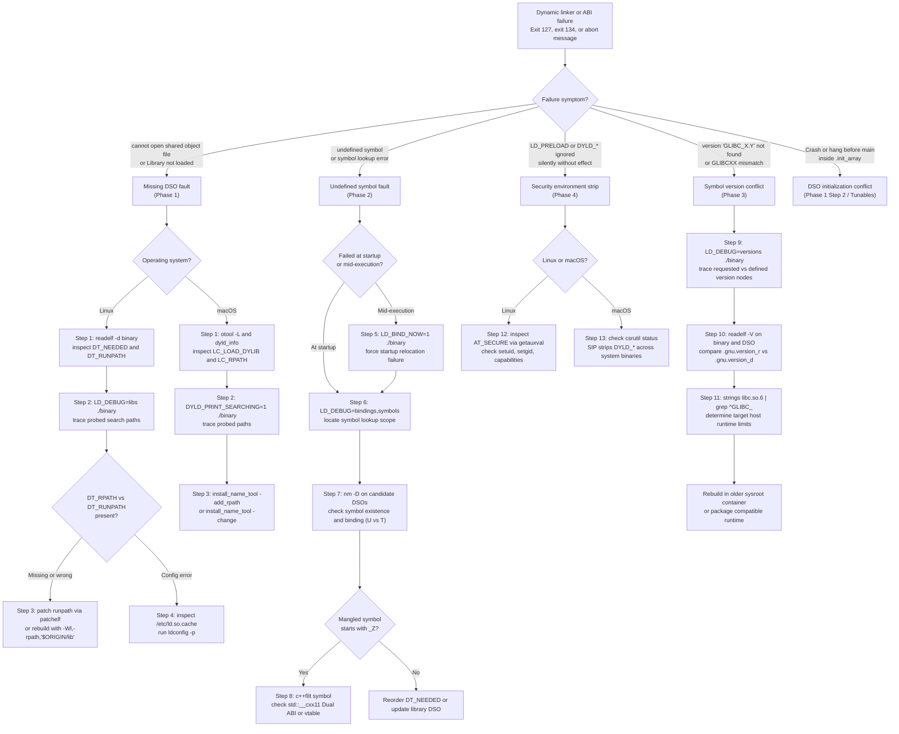
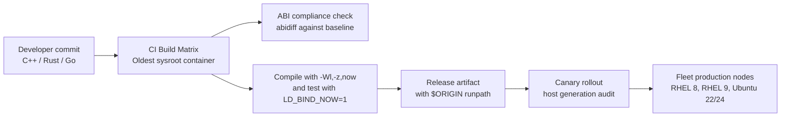

# Diagnose Dynamic Linker and ABI Failures

> [!summary] Claim:
> Dynamic linking and application binary interface (ABI) failures occur either during initial process loading or deferred at runtime during lazy procedure linkage table (PLT) binding.
> Every failure leaves deterministic structural evidence inside ELF dynamic tags (DT_NEEDED, DT_RPATH, DT_RUNPATH, DT_FLAGS_1), symbol version tables (.gnu.version_r, .gnu.version_d), or Darwin Mach-O load commands (LC_LOAD_DYLIB, LC_RPATH, LC_DYLD_CHAINED_FIXUPS).
> Triage requires systematic isolation of search paths, symbol tables, and ABI requirements using LD_DEBUG, readelf, and nm on Linux, and DYLD_PRINT_* and otool on macOS.
> Never guess by injecting ad hoc symlinks or unmeasured LD_PRELOAD shims; verify the missing symbol, the search order, and the version requirement before modifying binaries or fleet environments.

Static relocations and object binding are owned by [[Symbols-Relocations-and-Static-Linking]].
The dynamic linker runtime architecture, PLT/GOT trampolines, and loader internals are owned by [[Dynamic-Linking-PLT-GOT-and-Loaders]].
GNU symbol versioning mechanics and IFUNC resolvers are owned by [[Symbol-Versioning-IFUNC-and-Linker-Scripts]].
This playbook owns the operational runbook and triage workflows for diagnosing missing shared object faults, undefined symbol errors, GLIBC/GLIBCXX version mismatches, and broken RPATH/RUNPATH configurations across Linux and macOS.

## Trigger and Symptoms

Activate this playbook when an executable fails to start or crashes mid-execution due to dynamic loader errors, missing symbols, or runtime ABI mismatches.

- The shell or container entrypoint terminates immediately with exit status 127:
  `./app: error while loading shared libraries: libengine.so: cannot open shared object file: No such file or directory`
- On macOS, the process terminates with exit status 134 (SIGABRT) or generates an `.ips` crash report with `EXC_CRASH (SIGABRT)`:
  `dyld[41820]: Library not loaded: @rpath/libengine.dylib`
  `  Referenced from: <01234567-89AB-CDEF-0123-456789ABCDEF> /usr/local/bin/app`
  `  Reason: no LC_RPATH's found`
  When the binary carries an `LC_RPATH`, the `Reason:` line instead lists every expanded candidate as `tried: '<path>' (no such file), ...` (observed with Apple clang 21.0.0, as of 2026-11, macOS 27.2).
- An application aborts mid-flight when calling a rarely traversed function branch:
  `./app: symbol lookup error: /opt/app/lib/libworker.so: undefined symbol: compute_advanced_metric`
- A newly deployed binary fails to start on an older distribution host:
  `./app: /lib/x86_64-linux-gnu/libc.so.6: version 'GLIBC_2.38' not found (required by ./app)`
- A C++ binary compiled with modern GCC fails against a third-party library:
  `./app: /lib/x86_64-linux-gnu/libstdc++.so.6: version 'GLIBCXX_3.4.30' not found (required by ./app)`
  or fails with an undefined symbol referencing `std::__cxx11::basic_string` or `[abi:cxx11]`.
- An environment variable such as `LD_PRELOAD`, `LD_LIBRARY_PATH`, or `DYLD_INSERT_LIBRARIES` has no effect on binary behavior.
- The process hangs, deadlocks, or crashes inside static constructors or `.init_array` execution before `main()` begins.

## Decision Tree



## Prerequisites

Conduct diagnosis on a dedicated triage workstation or container with debugging utilities installed.
Never attempt live binary patching on production nodes under traffic.

### Linux Environment and Tooling

Verify that GNU Binutils, elfutils, and runtime diagnostic tools are available:

```bash
command -v readelf objdump nm ldd c++filt patchelf gdb
```

On Ubuntu and Debian systems, install the diagnostic package bundle:

```bash
sudo apt-get update && sudo apt-get install -y binutils elfutils patchelf gdb libc6-dev
```

On Fedora, Rocky Linux, or RHEL systems:

```bash
sudo dnf install -y binutils elfutils-libelf-devel gdb gcc-c++
sudo dnf install -y patchelf
```

On Rocky Linux and RHEL, `patchelf` comes from EPEL (the Fedora package index lists it for EPEL 8, 9, and 10 and says nothing about the base repositories), so enable EPEL first with `sudo dnf install -y epel-release` on Rocky, or the vendor EPEL setup on RHEL (as of 2026-11, Linux).

Verify standard dynamic linker utilities:
- Dynamic linker binary: `/lib64/ld-linux-x86-64.so.2` on x86_64, or `/lib/ld-linux-aarch64.so.1` on arm64 (as of 2026-11, Linux).
- Dynamic linker cache tool: `/sbin/ldconfig`.
- System cache file: `/etc/ld.so.cache`.

### macOS Environment and Tooling

On macOS systems, verify the Xcode Command Line Tools:

```bash
command -v otool install_name_tool dyld_info nm c++filt codesign
```

Install Command Line Tools if missing:

```bash
xcode-select --install
```

### Security Boundaries and Privilege Modes

- Dynamic loader debugging variables (`LD_DEBUG`, `DYLD_PRINT_*`) emit output to standard error (`stderr`) by default.
- If diagnosing background daemons where stderr is redirected to `/dev/null`, configure output files using `LD_DEBUG_OUTPUT=/tmp/ld_debug` on Linux or `DYLD_PRINT_TO_FILE=/tmp/dyld_debug.log` on macOS.
- On Linux, if the target process executes in secure-execution mode (`AT_SECURE != 0`), `LD_LIBRARY_PATH`, `LD_DEBUG_OUTPUT`, and `LD_SHOW_AUXV` are ignored, `LD_DEBUG` is ignored unless `/etc/suid-debug` exists, and `LD_PRELOAD` is restricted (ld.so(8)).
- On macOS, System Integrity Protection (SIP) purges `DYLD_*` environment variables when launching protected processes (Apple System Integrity Protection Guide), which includes binaries in `/bin`, `/sbin`, `/usr/bin`, and `/System`; Hardened Runtime binaries also ignore them unless signed with the `com.apple.security.cs.allow-dyld-environment-variables` entitlement.

## Step-by-Step Execution

### Phase 1: Diagnosing Missing Shared Object Failures

When a binary terminates with exit status 127 and reports `cannot open shared object file: No such file or directory` (Linux) or exit status 134 with `Library not loaded: @rpath/...` (macOS), execute the following steps.

#### Step 1: Identify Required DSOs and Sonames

Inspect the dynamic section to determine exactly which shared library names the binary expects.

On Linux:

```bash
readelf -d ./app | grep -E '\((NEEDED|SONAME)\)'
```

Expected output format:

```text
 0x0000000000000001 (NEEDED)             Shared library: [libengine.so]
 0x0000000000000001 (NEEDED)             Shared library: [libc.so.6]
```

On macOS:

```bash
otool -L ./app
```

Expected output format:

```text
./app:
	@rpath/libengine.dylib (compatibility version 1.0.0, current version 1.0.0)
	/usr/lib/libSystem.B.dylib (compatibility version 1.0.0, current version 1336.0.0)
```

Each `DT_NEEDED` entry (or `LC_LOAD_DYLIB`) specifies an exact SONAME or install name string.
If the string contains no directory slashes (for example `libengine.so`), the dynamic linker executes its search path algorithm.
If the string contains slashes (for example `./lib/libengine.so`), the dynamic linker attempts to load that exact relative or absolute filesystem path.

#### Step 2: Trace Loader Search Path Resolution

Trace every filesystem path probed by the dynamic linker during startup.

On Linux, run with `LD_DEBUG=libs`:

```bash
LD_DEBUG=libs ./app 2>&1 | head -n 40
```

On systems running systemd services or background daemons, direct the trace to a file:

```bash
LD_DEBUG=libs LD_DEBUG_OUTPUT=/tmp/ld_trace ./app
cat /tmp/ld_trace.*
```

The output reveals the exact search progression (glibc 2.39, Ubuntu 24.04, as of 2026-11; glibc 2.37 and later no longer probe `tls` subdirectories, per glibc NEWS):

```text
     41829:	find library=libengine.so [0]; searching
     41829:	 search path=/opt/app/lib		(RUNPATH from file ./app)
     41829:	  trying file=/opt/app/lib/libengine.so
     41829:	 search cache=/etc/ld.so.cache
     41829:	 search path=/lib/x86_64-linux-gnu:/usr/lib/x86_64-linux-gnu:/lib:/usr/lib		(system search path)
     41829:	  trying file=/lib/x86_64-linux-gnu/libengine.so
     41829:	  trying file=/usr/lib/x86_64-linux-gnu/libengine.so
     41829:	  trying file=/lib/libengine.so
     41829:	  trying file=/usr/lib/libengine.so
./app: error while loading shared libraries: libengine.so: cannot open shared object file: No such file or directory
```

On macOS, run with `DYLD_PRINT_SEARCHING=1`:

```bash
DYLD_PRINT_SEARCHING=1 ./app
```

Expected output format (observed on macOS 27.2, as of 2026-11, for a binary with `LC_RPATH /opt/app/lib`):

```text
dyld[41820]: find path "@rpath/libengine.dylib"
dyld[41820]:   LC_RPATH "/opt/app/lib" from "/usr/local/bin/app"
dyld[41820]:   possible path(@path expansion): "/opt/app/lib/libengine.dylib"
dyld[41820]:   possible path(@path expansion): "/System/Volumes/Preboot/Cryptexes/OS/opt/app/lib/libengine.dylib"
dyld[41820]:   not found: "@rpath/libengine.dylib"
dyld[41820]: Library not loaded: @rpath/libengine.dylib
```

#### Step 3: Validate RPATH, RUNPATH, and Token Expansion

The dynamic linker resolves shared library paths using a strict precedence order.
In ELF binaries, the two dynamic section tags `DT_RPATH` and `DT_RUNPATH` behave differently:
1. `DT_RPATH` is searched before `LD_LIBRARY_PATH`.
   If `DT_RUNPATH` exists, `DT_RPATH` is completely ignored.
2. `LD_LIBRARY_PATH` is searched after `DT_RPATH`, but before `DT_RUNPATH`.
3. `DT_RUNPATH` is searched after `LD_LIBRARY_PATH`.
4. The system cache `/etc/ld.so.cache` is searched after `DT_RUNPATH`.
5. Default trusted system paths (`/lib64`, `/usr/lib64`, or distribution multiarch paths) are searched last.

Inspect the binary for `DT_RPATH` and `DT_RUNPATH`:

```bash
readelf -d ./app | grep -E '\((RPATH|RUNPATH)\)'
```

GNU ld emits `DT_RUNPATH` only when `--enable-new-dtags` is in effect; the upstream ld manual states that by default the new dynamic tags are not created, so upstream ld emits `DT_RPATH`.
Ubuntu's GCC passes `--enable-new-dtags` by default (observed: a plain `-Wl,-rpath` link emits `RUNPATH` with GCC 13.2 and binutils 2.42 on Ubuntu 24.04, as of 2026-11, Linux).

Check dynamic string tokens:
- `$ORIGIN` (or `${ORIGIN}`): Expands to the directory containing the executable or DSO requesting the dependency.
- `$LIB`: Expands to system architecture library directory (`lib` or `lib64`).
- `$PLATFORM`: Expands to CPU platform string (for example `x86_64` or `aarch64`).

If `$ORIGIN` fails to resolve, verify whether the binary was linked with single quotes:
If compiled as `gcc main.c -Wl,-rpath,"$ORIGIN/lib"`, the shell prematurely expands `$ORIGIN` to an empty string at compile time.
Verify the raw string in the binary:

```bash
readelf -d ./app | grep RUNPATH
```

If it displays `Library runpath: [/lib]`, the shell consumed `$ORIGIN`.
Fix the binary using `patchelf`:

```bash
patchelf --set-rpath '$ORIGIN/lib' ./app
```

On macOS, verify `LC_RPATH` entries:

```bash
otool -l ./app | grep -A 2 LC_RPATH
```

If the `@rpath` entry is missing or points to an invalid directory, add the correct relative path:

```bash
install_name_tool -add_rpath '@executable_path/../lib' ./app
```

#### Step 4: Inspect System Cache and Configuration

If the library is installed in a system directory but `ld.so` fails to locate it, inspect the binary cache `/etc/ld.so.cache`.

Print all cached libraries matching the required SONAME:

```bash
/sbin/ldconfig -p | grep libengine
```

If the library does not appear in the cache:
1. Verify that the library directory exists in `/etc/ld.so.conf` or a file inside `/etc/ld.so.conf.d/*.conf`.
2. Ensure the library file permissions allow world read access (`chmod 0755 libengine.so.1.0`).
3. Ensure the SONAME symlink exists in the target directory (`ln -sf libengine.so.1.0 libengine.so.1`).
4. Rebuild the cache as root:

```bash
sudo /sbin/ldconfig
```

Verify that the cache was successfully updated:

```bash
/sbin/ldconfig -p | grep libengine
```

### Phase 2: Diagnosing Undefined Symbol Faults

When a binary fails with `symbol lookup error: undefined symbol: <name>`, execute the following steps to isolate symbol preemption, missing dependencies, or C++ name mangling conflicts.

#### Step 5: Force Immediate Load-Time Relocation Binding

By default, ELF dynamic linkers utilize lazy binding for functions in the Procedure Linkage Table (PLT).
Function symbols are resolved on first invocation rather than at startup.
This causes missing symbol crashes to occur hours or days after service launch when an uncommon error branch executes.

Reproduce the failure immediately at startup by setting `LD_BIND_NOW=1`:

```bash
LD_BIND_NOW=1 ./app
```

With `LD_BIND_NOW=1`, the dynamic linker processes all dynamic relocations (including `.rela.plt` entries) during initial image startup.
If any required symbol is missing from all loaded DSOs in the lookup scope, the loader aborts immediately before `main()` executes:

```text
./app: symbol lookup error: /opt/app/lib/libengine.so: undefined symbol: unresolved_kernel
```

On macOS there is no equivalent switch to set.
Binaries linked by the current toolchain carry `LC_DYLD_CHAINED_FIXUPS`, which dyld resolves when the image is loaded.
The old `DYLD_BIND_AT_LAUNCH` variable is gone: the string does not occur anywhere in `/usr/lib/dyld` on macOS 27.2, and the dyld(1) page does not list it (observed, as of 2026-11, macOS).
The linker flag `-bind_at_load` still links but prints `ld: warning: -bind_at_load is deprecated on macOS` (observed with Apple clang, as of 2026-11, macOS).

#### Step 6: Trace Symbol Lookup Scope and Resolution Order

Trace every symbol lookup query performed by the dynamic linker using `LD_DEBUG=symbols,bindings`:

```bash
LD_DEBUG=symbols,bindings LD_BIND_NOW=1 ./app 2>&1 | grep -A 10 'unresolved_kernel'
```

Expected trace output format:

```text
     41829:	symbol=unresolved_kernel;  lookup in file=./app [0]
     41829:	symbol=unresolved_kernel;  lookup in file=/opt/app/lib/libengine.so [0]
     41829:	symbol=unresolved_kernel;  lookup in file=/opt/app/lib/libcore.so [0]
     41829:	symbol=unresolved_kernel;  lookup in file=/lib/x86_64-linux-gnu/libc.so.6 [0]
     41829:	symbol=unresolved_kernel;  lookup in file=/lib64/ld-linux-x86-64.so.2 [0]
     41829:	/opt/app/lib/libengine.so: error: symbol lookup error: undefined symbol: unresolved_kernel (fatal)
```

The process then exits with status 127; the `(fatal)` suffix and the exit status were observed with glibc 2.39 (as of 2026-11, Linux).

The trace reveals:
1. The exact symbol name requested.
2. The search scope: the ordered sequence of DSOs examined by `ld.so`.
3. The candidate library where the search failed.

On macOS, trace symbol binding using `DYLD_PRINT_BINDINGS=1`:

```bash
DYLD_PRINT_BINDINGS=1 ./app 2>&1 | grep 'unresolved_kernel'
```

#### Step 7: Inspect Dynamic Symbol Tables

Check whether the symbol is actually exported by the provider library and whether the consumer library lists it as undefined.

Inspect undefined dynamic symbols in the consumer library:

```bash
nm -D --undefined-only /opt/app/lib/libengine.so | grep unresolved_kernel
```

Alternatively, use `readelf`:

```bash
readelf -W --dyn-syms /opt/app/lib/libengine.so | grep unresolved_kernel
```

Expected `nm -D` output (the `readelf` form shows the same symbol with `UND` in the `Ndx` column):

```text
                 U unresolved_kernel
```

Inspect defined dynamic symbols in the provider library:

```bash
nm -D --defined-only /opt/app/lib/libcore.so | grep unresolved_kernel
```

Possible outcomes:
- Symbol is absent: The provider library was built from source code that did not implement the function, or the object file was omitted during link.
- Symbol is absent from `nm -D` but plain `nm` (the static `.symtab`) shows it with type `t` (lowercase): The symbol has hidden visibility (`__attribute__((visibility("hidden")))`) or was declared `static`, so it is not exported in the `.dynsym` table (observed with binutils 2.42, as of 2026-11, Linux).
- Symbol is present with type `T` (uppercase): The symbol is exported globally.
  If the loader still cannot resolve it, the provider library is not loaded into the lookup scope (the executable's dependency tree, or the `dlopen` scope of the consumer), or the reference carries a version node the provider does not define.

#### Step 8: Demangle and Isolate C++ ABI Incompatibilities

If the missing symbol begins with `_Z`, it is a mangled C++ symbol.
Demangle it using `c++filt`:

```bash
c++filt _Z3getNSt7__cxx1112basic_stringIcSt11char_traitsIcESaIcEEE
```

Output:

```text
get(std::__cxx11::basic_string<char, std::char_traits<char>, std::allocator<char> >)
```

Two common C++ ABI pitfalls account for the vast majority of dynamic lookup errors:

1. GCC libstdc++ Dual ABI Mismatch:
In GCC 5.1 (2015), `libstdc++` introduced a new implementation of `std::string` and `std::list` to conform to C++11 memory and complexity requirements (eliminating copy-on-write reference counting).
The new types live in the inline namespace `std::__cxx11`.
If object code compiled with `_GLIBCXX_USE_CXX11_ABI=1` (the default since GCC 5.1 with default configure options; some distributions configured GCC 5 with a default of `0`, per the libstdc++ manual) links against a legacy library compiled with `_GLIBCXX_USE_CXX11_ABI=0`, symbol lookups fail:
- Modern caller expects: `_Z3fooNSt7__cxx1112basic_string...` (`foo(std::__cxx11::string)`)
- Legacy library exports: `_Z3fooSs` (`Ss` is the mangling abbreviation for the old `std::string`; GNU c++filt from binutils 2.42 prints it as `foo(std::basic_string<char, std::char_traits<char>, std::allocator<char> >)`, as of 2026-11)

Inspect the macro setting used across object files:

```bash
nm -D /opt/app/lib/libvendor.so | grep -E '(basic_string|__cxx11)'
```

If the vendor library exports `_Z...Ss` rather than `__cxx11`, recompile application code with `-D_GLIBCXX_USE_CXX11_ABI=0` or recompile the vendor library with GCC 5.1+.

2. Missing Vtable and Key Function Definition:
In the Itanium C++ ABI, a class's virtual table (`vtable`) is emitted exclusively in the translation unit that contains the definition of its *key function* (the first non-inline, non-pure virtual member function declared in the class header).
If a programmer declares a virtual method in a header but forgets to provide its definition in any `.cpp` file, compilation succeeds, but the linker cannot find the vtable:
`undefined reference to 'vtable for MyClass'` at link time, or `undefined symbol: _ZTV7MyClass` when a shared library that needs it is loaded.
The link-time form is reproduced by the lab (Stage 4, Step 4.4).
Demangle the symbol with `c++filt _ZTV7MyClass`.
Inspect the class definition in the header, identify the first non-inline virtual method, and verify that its body is compiled and linked.

### Phase 3: Diagnosing Symbol Versioning Conflicts

When a binary fails with `version 'GLIBC_X.Y' not found (required by ./app)` or `version 'GLIBCXX_X.Y.Z' not found`, execute the following steps to trace GNU symbol version dependencies.

#### Step 9: Trace Version Requirement Verification

Run the dynamic linker with `LD_DEBUG=versions`:

```bash
LD_DEBUG=versions ./app 2>&1 | head -n 30
```

Expected trace output format:

```text
     41829:	checking for version `GLIBC_2.38' in file /lib/x86_64-linux-gnu/libc.so.6 [0] required by file ./app [0]
     41829:	/lib/x86_64-linux-gnu/libc.so.6: error: version lookup error: version `GLIBC_2.38' not found (required by ./app) (continued)
     41829:	./app: /lib/x86_64-linux-gnu/libc.so.6: version `GLIBC_2.38' not found (required by ./app)
```

A version failure exits with status 1, unlike a missing library or an undefined symbol, which exit 127 (observed with glibc 2.39, as of 2026-11, Linux; lab Steps 3.2, 1.1, and 2.1).
The dynamic linker iterates over all version requirements declared in the binary's `.gnu.version_r` section and checks whether each version node exists in the corresponding dependency's `.gnu.version_d` section.

#### Step 10: Inspect Version Requirements and Definitions

Inspect the version requirements recorded in the executable:

```bash
readelf -V ./app
```

Locate the `Version needs section (.gnu.version_r)`:

```text
Version needs section '.gnu.version_r' contains 1 entry:
 Addr: 0x00000000000004c8  Offset: 0x000004c8  Link: 6 (.dynstr)
  000000: Version: 1  File: libc.so.6  Cnt: 2
  0x0010:   Name: GLIBC_2.34  Flags: none  Version: 3
  0x0020:   Name: GLIBC_2.38  Flags: none  Version: 4
```

This confirms that `./app` explicitly requires version nodes `GLIBC_2.34` and `GLIBC_2.38` from `libc.so.6`.

Inspect which specific symbols require `GLIBC_2.38`:

```bash
readelf -W --dyn-syms ./app | grep '@GLIBC_2.38'
```

Expected output:

```text
    12: 0000000000000000     0 FUNC    GLOBAL DEFAULT  UND __isoc23_strtol@GLIBC_2.38 (4)
```

The binary references `__isoc23_strtol`, a function introduced in glibc 2.38 (2023) as part of C23 compliance.

Inspect the version definitions exported by the host's `libc.so.6`:

```bash
readelf -V /lib/x86_64-linux-gnu/libc.so.6 | grep -A 2 'Name: GLIBC_'
```

If the highest version definition in the host libc is `GLIBC_2.35` (for example on Ubuntu 22.04), `ld.so` rejects the binary.

#### Step 11: Audit Runtime Library Version Capacities

Check supported GLIBC versions on the host:

```bash
strings /lib/x86_64-linux-gnu/libc.so.6 | grep -E '^GLIBC_[0-9]' | sort -V | tail -n 5
```

The `[0-9]` filter matters: a bare `^GLIBC_` pattern sorts `GLIBC_ABI_DT_RELR` and `GLIBC_PRIVATE` last and hides the highest numbered version (observed with glibc 2.39, as of 2026-11, Linux).

Check supported GCC `libstdc++` versions:

```bash
strings /usr/lib/x86_64-linux-gnu/libstdc++.so.6 | grep ^GLIBCXX_ | sort -V | tail -n 5
```

Glibc adheres to strict backwards compatibility: binaries compiled on older glibc run on newer glibc.
Glibc does NOT provide forward compatibility: binaries compiled on newer glibc cannot run on older glibc.
When building software for distribution across heterogeneous fleets, compile inside a container matching the oldest supported baseline (for example a `manylinux` or AlmaLinux 8 container).

### Phase 4: Diagnosing Secure-Execution and Environment Stripping

When dynamic linker environment variables such as `LD_PRELOAD`, `LD_LIBRARY_PATH`, or `DYLD_INSERT_LIBRARIES` appear to be ignored without printing any error message, execute the following steps.

#### Step 12: Detect Linux AT_SECURE Execution Mode

On Linux, the dynamic linker detects whether a binary must run in secure-execution mode by inspecting the auxiliary vector entry `AT_SECURE` passed by the kernel during `execve()`.

The kernel sets `AT_SECURE=1` when:
1. The process's real UID does not equal its effective UID (set-user-ID binary).
2. The process's real GID does not equal its effective GID (set-group-ID binary).
3. The file has Linux filesystem capabilities (`setcap cap_net_raw+ep ./app`).
4. A Linux Security Module (LSM) such as SELinux or AppArmor mandates secure execution.

When `AT_SECURE != 0`, the dynamic linker automatically suppresses:
- `LD_PRELOAD` (entries containing slashes are ignored; bare names are preloaded only from the standard search directories and only if the library file has its set-user-ID mode bit set, per ld.so(8), confirmed in the Ubuntu 24.04 container as of 2026-11).
- `LD_LIBRARY_PATH` (completely ignored).
- `LD_DEBUG` (ignored unless `/etc/suid-debug` exists) and `LD_DEBUG_OUTPUT` (ignored).
- `LD_SHOW_AUXV` (ignored since glibc 2.3.4).
- `$ORIGIN` expansions in the executable's `DT_RPATH` and `DT_RUNPATH` (the path is discarded unless `$ORIGIN` is its first element and the normalized result lies under a trusted system directory; `_dl_dst_substitute` in glibc `elf/dl-load.c`).

Check whether a binary has setuid/setgid bits or capabilities:

```bash
ls -l ./app
getcap ./app
```

Check `AT_SECURE` programmatically with `getauxval(AT_SECURE)`, or probe it with `LD_SHOW_AUXV=1`, which glibc ignores in secure-execution mode:

```bash
LD_SHOW_AUXV=1 ./app | grep AT_SECURE
```

Expected output for a normal process (the dump goes to stdout; glibc 2.39, as of 2026-11, Linux):

```text
AT_SECURE:            0
```

If the command prints nothing at all, the process is in secure-execution mode and dynamic linker environment variables cannot be used for debugging (confirmed with a set-user-ID root binary run as an unprivileged user in the Ubuntu 24.04 container).
To debug the binary, run it as an unprivileged user on a copy without setuid bits or capabilities:

```bash
cp ./app /tmp/app_debug
chmod 0755 /tmp/app_debug
setcap -r /tmp/app_debug 2>/dev/null || true
LD_DEBUG=libs /tmp/app_debug
```

#### Step 13: Detect macOS System Integrity Protection Environment Stripping

On macOS, System Integrity Protection (SIP) protects system directories and executables.
When a process executes a protected binary (any executable in `/bin`, `/sbin`, `/usr/bin`, `/System`, or one signed with a special system entitlement), all `DYLD_*` environment variables are purged at launch (Apple System Integrity Protection Guide, Runtime Protections).

Verify SIP status:

```bash
csrutil status
```

Output:

```text
System Integrity Protection status: enabled.
```

Common diagnostic trap:
An engineer runs:

```bash
DYLD_INSERT_LIBRARIES=/path/to/libhook.dylib ./test_script.sh
```

If `test_script.sh` begins with `#!/bin/bash` or `#!/bin/sh`, the kernel executes `/bin/bash` (a SIP-protected binary).
SIP purges `DYLD_INSERT_LIBRARIES` immediately.
When `bash` subsequently forks and executes `./my_app`, the environment variable is gone.

Remediation:
1. Invoke the non-system target executable directly:
   `DYLD_INSERT_LIBRARIES=/path/to/libhook.dylib ./my_app`
2. If driven by a shell script, run it with a non-Apple shell such as Homebrew's `/opt/homebrew/bin/bash` (or change the shebang to it), which kept `DYLD_*` variables in a test on macOS 27.2 (as of 2026-11).
   Do not copy `/bin/bash` elsewhere: on macOS 27.2 arm64 the copy was killed at launch with exit status 137 (SIGKILL).

## Verification

Validate dynamic linker health and ABI conformance by running an automated, reproducible verification suite.
The verification commands below are backed by the test harness in `code/00-Program-Execution/ld_debug_diagnosis/`.

### End-to-End Verification Pipeline

Execute verification using the harness:

```bash
cd code && python3 -m _harness.verify 00-Program-Execution/ld_debug_diagnosis/
```

Expected harness output:

```text
PASS  00-Program-Execution/ld_debug_diagnosis (in container toolchain-labs:f39efe0ff57b, linux-aarch64)
labs: 1 passed, 0 failed, 0 skipped, 0 unrecorded on darwin-arm64
```

### Worked Lab Golden Execution

The following deterministic output was measured and recorded directly inside the Ubuntu 24.04 Linux container (glibc 2.39, GCC 13.2, binutils 2.42, as of 2026-11, linux-aarch64).
The scrubber replaces PIDs and the sandbox path, rewrites the backtick that glibc prints before version names (`` `VER_2.0' ``) to a plain quote, and every `exit=` line is the status of the command above it:

```text
=== Stage 1: DSO Search Paths and RPATH vs RUNPATH ===
--- Step 1.1: Missing DSO failure without RPATH/RUNPATH ---
./app_norpath: error while loading shared libraries: libcalc.so: cannot open shared object file: No such file or directory
exit=127
--- Step 1.2: Diagnostic search trace via LD_DEBUG=libs ---
[PID] find library=libcalc.so [0]; searching
[PID] search cache=/etc/ld.so.cache
[PID] search path=/lib/aarch64-linux-gnu:/usr/lib/aarch64-linux-gnu:/lib:/usr/lib (system search path)
[PID] trying file=/lib/aarch64-linux-gnu/libcalc.so
[PID] trying file=/usr/lib/aarch64-linux-gnu/libcalc.so
[PID] trying file=/lib/libcalc.so
[PID] trying file=/usr/lib/libcalc.so
--- Step 1.3: Successful load via DT_RUNPATH ($ORIGIN/lib) ---
Result: 30
exit=0
--- Step 1.3b: The same trace for app_runpath shows the RUNPATH entry searched first ---
[PID] find library=libcalc.so [0]; searching
[PID] search path=[DIR]/lib (RUNPATH from file ./app_runpath)
[PID] trying file=[DIR]/lib/libcalc.so
--- Step 1.4: LD_LIBRARY_PATH override on DT_RUNPATH ---
Result: 999
exit=0
--- Step 1.5: DT_RPATH precedence over LD_LIBRARY_PATH ---
Result: 30
exit=0
--- Step 1.6: Dynamic tags inspection (readelf -d) ---
 0xTAG (NEEDED)             Shared library: [libcalc.so]
 0xTAG (NEEDED)             Shared library: [libc.so.6]
 0xTAG (RUNPATH)            Library runpath: [$ORIGIN/lib]
 0xTAG (NEEDED)             Shared library: [libcalc.so]
 0xTAG (NEEDED)             Shared library: [libc.so.6]
 0xTAG (RPATH)              Library rpath: [$ORIGIN/lib]
=== Stage 2: Undefined Symbols and Immediate Binding ===
--- Step 2.1: Default lazy binding deferred abort ---
Main started
Engine initialized (core=42)
Dispatching task...
./app_lazy: symbol lookup error: [DIR]/lib/libengine.so: undefined symbol: unresolved_kernel
exit=127
--- Step 2.2: Immediate binding via LD_BIND_NOW=1 ---
./app_lazy: symbol lookup error: [DIR]/lib/libengine.so: undefined symbol: unresolved_kernel
exit=127
--- Step 2.3: Dynamic symbol table inspection (nm -D) ---
T init_engine
U unresolved_kernel
=== Stage 3: Symbol Versioning and ABI Compatibility ===
--- Step 3.1: Execution with matching version definition ---
Score: 100
exit=0
--- Step 3.2: Version mismatch failure against v1 DSO ---
./app_v2: lib_v1/libscore.so: version 'VER_2.0' not found (required by ./app_v2)
exit=1
--- Step 3.3: Version requirement trace via LD_DEBUG=versions ---
[PID] checking for version 'VER_2.0' in file lib_v1/libscore.so [0] required by file ./app_v2 [0]
[PID] lib_v1/libscore.so: error: version lookup error: version 'VER_2.0' not found (required by ./app_v2) (continued)
--- Step 3.4: Binary version requirements (.gnu.version_r) ---
000000: Version: 1  File: libscore.so  Cnt: 1
0x0010:   Name: VER_2.0  Flags: none  Version: 4
0x0020: Version: 1  File: libc.so.6  Cnt: 2
--- Step 3.5: DSO version definitions (.gnu.version_d) ---
0x001c: Rev: 1  Flags: none  Index: 2  Cnt: 1  Name: VER_1.0
=== Stage 4: C++ ABI Mismatch and Symbol Visibility ===
--- Step 4.1: Exported names differ between the old and new std::string ABI ---
old: _Z10vendor_lenRKSs
new: _Z10vendor_lenRKNSt7__cxx1112basic_stringIcSt11char_traitsIcESaIcEEE
--- Step 4.2: Matching ABI runs ---
len=5
exit=0
--- Step 4.3: A new-ABI caller cannot link against the old-ABI library ---
abi_main.cpp:(.text+0xOFF): undefined reference to 'vendor_len(std::__cxx11::basic_string<char, std::char_traits<char>, std::allocator<char> > const&)'
exit=1
--- Step 4.4: Missing key function leaves the vtable undefined ---
exit=1
vt_main.cpp:(.text...): undefined reference to 'vtable for MyClass'
U _ZTV7MyClass
vtable for MyClass
--- Step 4.5: Hidden symbols never reach the dynamic symbol table ---
nm -D: T visible_fn
nm   : t hidden_fn
nm   : T visible_fn
```

## Rollback Procedure

When an operational workaround or binary modification fails during troubleshooting, execute the following clean rollback steps.

1. Revert `patchelf` binary header modifications:
   Before executing `patchelf --set-rpath` or `--replace-needed`, always create an archived copy:
   `cp -p ./app ./app.orig`
   To rollback:
   `mv ./app.orig ./app`

2. Clear diagnostic environment variables:
   Unset all tracing variables in the shell session to prevent performance degradation or leaking trace logs:
   `unset LD_DEBUG LD_DEBUG_OUTPUT LD_BIND_NOW LD_PRELOAD LD_LIBRARY_PATH`
   On macOS:
   `unset DYLD_PRINT_LIBRARIES DYLD_PRINT_SEARCHING DYLD_PRINT_BINDINGS DYLD_INSERT_LIBRARIES DYLD_LIBRARY_PATH`

3. Revert `/etc/ld.so.conf` changes:
   If temporary configuration fragments were placed in `/etc/ld.so.conf.d/`:
   `sudo rm -f /etc/ld.so.conf.d/temp_triage.conf`
   `sudo /sbin/ldconfig`
   Verify that the cache returns to its previous state:
   `/sbin/ldconfig -p | grep libengine`

4. Restore Darwin dylib install names:
   If `install_name_tool` was executed on a dylib, restore from backup:
   `cp -p libengine.dylib.orig libengine.dylib`
   Re-sign the binary if running on Apple Silicon (arm64 requires valid code signatures):
   `codesign -f -s - libengine.dylib`

## Failure Modes

| Symptom | Root Cause | Verification Command | Remediation |
| :--- | :--- | :--- | :--- |
| `cannot open shared object file: No such file or directory` | Missing `DT_RUNPATH` or library not present in searched directories | `readelf -d app \| grep RUNPATH` | Add `-Wl,-rpath,'$ORIGIN/lib'` at link time, or patch via `patchelf --set-rpath '$ORIGIN/lib' app` |
| `LD_LIBRARY_PATH` has no effect on library search | Binary contains legacy `DT_RPATH` without `DT_RUNPATH` | `readelf -d app \| grep -E '(RPATH\|RUNPATH)'` | Rebuild with `-Wl,--enable-new-dtags`, or convert in place with `patchelf --set-rpath "$(patchelf --print-rpath app)" app` (patchelf converts `DT_RPATH` to `DT_RUNPATH` unless `--force-rpath` is given) |
| `symbol lookup error: undefined symbol` occurs only during production peak | Lazy binding deferred symbol resolution; code branch calls missing symbol | Run with `LD_BIND_NOW=1 ./app` | Run canary testing with `LD_BIND_NOW=1` and link binaries with `-Wl,-z,now` |
| `version 'GLIBC_2.38' not found (required by ./app)` | Binary compiled on newer glibc host deployed to older glibc host | `readelf -V app` vs `strings libc.so.6 \| grep GLIBC_` | Rebuild application inside a container matching oldest target distribution |
| `undefined symbol: ...std::__cxx11...` | C++11 Dual ABI mismatch between GCC 5.1+ and legacy pre-C++11 library | `c++filt <sym> \| grep __cxx11` | Compile with `-D_GLIBCXX_USE_CXX11_ABI=0` or recompile third-party library |
| `undefined symbol: _ZTV7MyClass` (`vtable for MyClass`) | Missing implementation of the class's key virtual function | `c++filt _ZTV7MyClass` | Implement the first non-inline virtual member function in a compiled `.cpp` file |
| `LD_PRELOAD` or `LD_DEBUG` silently ignored | Binary executes in secure-execution mode (`AT_SECURE != 0`) due to setuid or capabilities | `LD_SHOW_AUXV=1 ./app` prints nothing (glibc ignores it in secure mode); confirm with `ls -l app` and `getcap app` | Debug on an unprivileged copy without setuid/capabilities (`chmod 0755`) |
| `DYLD_INSERT_LIBRARIES` ignored on macOS | SIP purges environment across `/bin/sh` or Apple-signed executables | `csrutil status` | Execute target binary directly without intermediate system shell wrappers |
| Process hangs or segfaults before `main()` executes | Static initialization deadlock or invalid DSO dependency initialization order | `LD_DEBUG=files,scopes ./app` | Resolve circular dependencies, or test `GLIBC_TUNABLES=glibc.rtld.dynamic_sort=1` |

## Pitfalls

> [!warning] Security Risk: Never Run ldd on Untrusted Binaries
> The glibc `ldd` utility is a shell script that runs a dynamic linker on the binary with `LD_TRACE_LOADED_OBJECTS=1`.
> The ldd(1) man page warns that some `ldd` versions obtain dependency information by executing the program directly, which can run the code of a custom ELF interpreter named in `.interp` and perhaps the program itself; upstream glibc `ldd` did this before glibc 2.27, although most distributions shipped a modified version that did not.
> Current glibc `ldd` invokes the system loader listed in its `RTLDLIST` instead (observed in glibc 2.39), but ldd(1) still says never to run it on an untrusted executable, because it remains a loader run over attacker-controlled input.
> Always use `readelf -d ./binary | grep NEEDED` or `objdump -p ./binary | grep NEEDED` to inspect dependencies statically and safely.

> [!warning] The DT_RPATH vs DT_RUNPATH Precedence Trap
> The System V ELF specification defines `DT_RPATH` as taking precedence over `LD_LIBRARY_PATH`.
> To provide operators with dynamic override capabilities, the ELF extensions introduced `DT_RUNPATH`, which is searched after `LD_LIBRARY_PATH`.
> Crucially, if an ELF dynamic section contains `DT_RUNPATH`, `ld.so` completely ignores `DT_RPATH` even if both tags are present.
> Toolchains configured with `--enable-new-dtags` emit `DT_RUNPATH`, allowing `LD_LIBRARY_PATH` to override bundled libraries.
> Toolchains configured with `--disable-new-dtags` emit only `DT_RPATH`, locking library resolution to the compiled paths regardless of `LD_LIBRARY_PATH`.

> [!warning] Lazy Binding Masks Missing Symbols in Production
> Under lazy binding (`-Wl,-z,lazy`, the upstream GNU ld behavior), dynamic linkers resolve function addresses on demand through PLT trampolines.
> Some distributions harden the default: Ubuntu 24.04 GCC 13.2 links with `BIND_NOW` unless `-Wl,-z,lazy` is passed (observed with `readelf -d`, as of 2026-11, Linux), so check the target's toolchain rather than assuming either default.
> If a shared library dependency is upgraded and drops a function that is only called in disaster recovery or alert pathways, the application will boot cleanly and run without issues for days.
> The crash occurs only when the disaster recovery path triggers, terminating the production service at the worst possible time.
> Always link production binaries with Full RELRO (`-Wl,-z,relro -Wl,-z,now`) and execute smoke test suites with `LD_BIND_NOW=1`.

> [!warning] Patching RPATH Can Invalidate Signatures and Corrupt Headers
> Modifying binary headers with `patchelf` requires expanding the `.dynstr` section.
> If there is insufficient padding between sections, `patchelf` rewrites program headers and moves sections, which can break tools that rely on static section offsets.
> On macOS, modifying a Mach-O binary with `install_name_tool` changes the bytes the code signature covers.
> On macOS 27.2 with Apple clang 21.0.0 (as of 2026-11), `install_name_tool -add_rpath` on an ad hoc, linker-signed binary left a signature that `codesign -v` accepted and the binary ran; a Developer ID or distribution signature is not re-created this way.
> On Apple Silicon (arm64), running an unsigned or invalidly signed Mach-O binary results in immediate kernel termination with `SIGKILL` (code signing violation).
> Always verify with `codesign -v <binary>` after modification and re-sign with `codesign -f -s - <binary>` (or your real identity) when it fails.

> [!warning] macOS System Integrity Protection Silently Drops DYLD Variables
> When debugging a dynamic linking issue on macOS using `DYLD_PRINT_LIBRARIES=1` or `DYLD_INSERT_LIBRARIES`, the variables are automatically stripped by the kernel if the execution passes through any Apple-signed binary (such as `/bin/sh`, `/bin/bash`, `/usr/bin/python3`, or `/usr/bin/env`).
> If a test wrapper script begins with `#!/bin/sh`, dyld logging will not appear for child processes.
> To retain `DYLD_*` variables across execution, execute the target user binary directly or point shebangs to homebrew-installed or user-compiled shells.

## At Scale

At scale across 1,000 to 50,000 hosts, dynamic linking failures shift from individual developer bugs to fleet reliability and binary deployment risks.



### Fleet-Wide ABI Compatibility Strategy

1. The Sysroot Baseline Invariant:
Binaries deployed across heterogeneous server fleets must be compiled against the oldest C runtime version present in the fleet.
Compiling on an Ubuntu 24.04 build worker (glibc 2.39) produces binaries that refuse to run on Ubuntu 22.04 (glibc 2.35) or RHEL 8 (glibc 2.28).
Enforce containerized build environments (such as `manylinux_2_28` or dedicated Debian/RHEL sysroot containers) in CI pipelines.
A binary compiled against glibc 2.28 runs smoothly on glibc 2.28, 2.35, and 2.39 by virtue of glibc's symbol versioning guarantee.

2. Static Linking and Hermetic Runtimes:
For Rust services, compile for the musl target (`x86_64-unknown-linux-musl`), which the Rust reference lists among the targets that link the C runtime statically by default.
`-C target-feature=-crt-static` turns that off, and the reference advises inspecting the resulting binary.
For Go services, build with `CGO_ENABLED=0`, which makes the go tool skip every file that imports `"C"`.
A hello-world built that way for `linux/arm64` with Go 1.27.3 has no `PT_INTERP` segment and no dynamic section, and `ldd` reports `not a dynamic executable` (observed, as of 2026-11, Linux).
Go does not use musl: its runtime issues system calls directly.
For C++ low-latency services requiring glibc, bundle non-system dependencies into an application-private `lib/` directory and bind them using relative runpaths:
`-Wl,-rpath,'$ORIGIN/../lib' -Wl,--enable-new-dtags`
Never deploy application shared libraries directly into global system directories (`/usr/local/lib` or `/usr/lib64`), which causes conflicting version overwrites during rolling deployments.

### CI/CD Gating with Immediate Binding and Automated ABI Diffing

1. Mandatory Full RELRO and Immediate Binding Gating:
Enforce `-Wl,-z,relro -Wl,-z,now` across all build configuration profiles.
In CI integration test suites, export `LD_BIND_NOW=1` across all test runner environments.
Any unresolved dynamic symbol will immediately fail the pull request build rather than slipping into production.

2. Automated ABI Regression Detection via libabigail:
Integrate `abidiff` (from the `libabigail` suite) into CI pipelines for shared libraries.
`abidiff` compares the DWARF debug information and ELF symbol tables of the newly built library against the previous release:

```bash
abidiff --headers-dir1 include-1.0 --headers-dir2 include-1.1 --drop-private-types libengine.so.1.0 libengine.so.1.1
```

Per the abidiff manual, `--drop-private-types` is meant to be used with the header options (`--headers-dir1` and `--headers-dir2`, or `--header-file1` and `--header-file2`).
It drops every type that the public headers do not define from the internal representation, instead of filtering those types out of the report afterwards, which saves memory on libraries with many types.

If a public virtual function is removed, a struct layout changes size, or a symbol version node disappears, `abidiff` reports the exact breaking change and fails the build.

### Decision Rules for Production Linking and Packaging

- Default to `DT_RUNPATH` (`-Wl,--enable-new-dtags`) for all distributed software packages to allow operational overrides via `LD_LIBRARY_PATH`.
- Use `DT_RPATH` (`-Wl,--disable-new-dtags`) only for locked appliance binaries where external environment interference must be strictly prevented.
- Never set global `/etc/ld.so.conf` entries pointing to user home directories or mutable NFS mounts.
- Require all third-party vendor C++ libraries to document their `_GLIBCXX_USE_CXX11_ABI` configuration before integration.
- For high-frequency trading and low-latency engines, pre-resolve all symbols at initialization using `dlopen(..., RTLD_NOW | RTLD_DEEPBIND)` to eliminate runtime PLT resolution jitter.

## Practice Drill

> [!tip] Practice Drill: Diagnose Broken Runpath and Missing Symbols
> Navigate to `code/00-Program-Execution/ld_debug_diagnosis/` on a Linux host (or inside the container environment).
> Execute `bash run.sh` and confirm that all stages pass cleanly against `expected/linux-aarch64.txt`.
> Then, execute the following progressive hands-on troubleshooting exercises:
> 1. In Stage 1, change the build flag of `app_runpath` from single quotes `-Wl,-rpath,'$ORIGIN/lib'` to unescaped double quotes `-Wl,-rpath,"$ORIGIN/lib"`.
>    Because `run.sh` uses `set -u`, the edited script aborts with `ORIGIN: unbound variable`; repeat the link by hand in an interactive shell where `ORIGIN` is unset.
>    Recompile and run `readelf -d app_runpath | grep RUNPATH`.
>    Observe how the shell prematurely expanded `$ORIGIN` to an empty string, creating `Library runpath: [/lib]`.
>    Repair the broken binary without recompiling by using `patchelf --set-rpath '$ORIGIN/lib' app_runpath` (patchelf is not in the lab image, and the container runs with `--network none`, so run this one on a Linux host where it is installed).
> 2. In Stage 2, inspect the ELF relocations in `lib/libengine.so` using `readelf -r lib/libengine.so`.
>    Identify the relocation type for `unresolved_kernel` (it appears in `.rela.plt` as `R_AARCH64_JUMP_SLOT` or `R_X86_64_JUMP_SLOT`).
>    Recompile `libengine.so` with `-Wl,-z,now` and run `readelf -d lib/libengine.so | grep FLAGS_1`.
>    Observe the appearance of `Flags: NOW`, confirming that Full RELRO forces immediate relocation processing.
> 3. In Stage 3, inspect `lib_v2/libscore.so` with `readelf -W --dyn-syms lib_v2/libscore.so | grep calculate_score` (without `-W`, binutils 2.42 truncates the name to `calcula[...]@@VER_2.0`).
>    Observe the symbol version annotation `calculate_score_v2@@VER_2.0`.
>    Explain the difference between a default version (`@@`) and a non-default version (`@`).
> 4. Repeat the exercise under [[Drill-Program-Execution-Broken-Rpath-and-Symbol-Interposition]] to master dynamic symbol preemption and interposition.

## Interview Questions

> [!question] L5
> A junior engineer runs `ldd ./app` and confirms that all shared library dependencies resolve to valid paths on disk.
> However, when executing `./app`, the process immediately aborts with:
> `./app: error while loading shared libraries: libcustom.so: cannot open shared object file: No such file or directory`.
> How can `ldd` succeed while direct execution fails?
>
> > [!success]- Answer
> > `ldd` is an external shell script that runs the dynamic linker with `LD_TRACE_LOADED_OBJECTS=1` in the context of the user's current shell environment.
> > Several mechanisms explain the disparity:
> > 1. `LD_LIBRARY_PATH` was set in the user's interactive shell where `ldd` ran, but the binary is launched by a service manager (such as systemd or a cron job) that strips or does not inherit that environment variable.
> > 2. The binary has the set-user-ID (SUID) or set-group-ID (SGID) bit set, or has Linux file capabilities, causing the kernel to set `AT_SECURE=1`.
> >    In secure-execution mode, `ld.so` purges `LD_LIBRARY_PATH`, while `ldd` (run as a regular user without executing the SUID image) still evaluates it.
> > 3. The binary uses `$ORIGIN` in its `DT_RUNPATH` and is reached through a symbolic link.
> >    Direct execution expands `$ORIGIN` to the directory of the symlink target, while `ldd` runs the loader on the path it was given and expands `$ORIGIN` to the directory of the symlink itself.
> >    Reproduced with glibc 2.39 (as of 2026-11, Linux): with `$ORIGIN/lib` in the binary and a `lib/` directory only beside the symlink, `ldd` resolves the library and direct execution exits 127.
> >    With `lib/` only beside the real binary, `ldd` prints `not found` while the binary runs.
> > 4. File or directory permissions: `libcustom.so` or its parent directory does not have read and execute permissions (`+rx`) for the user running `./app`.
> > To diagnose, run `readelf -d ./app | grep -E '(NEEDED|RUNPATH)'` and trace execution with `LD_DEBUG=libs ./app`.

> [!question] L5 (Predict-the-output)
> Binary `app_rpath` was linked with `-Wl,-rpath,/opt/v1 -Wl,--disable-new-dtags`.
> Binary `app_runpath` was linked with `-Wl,-rpath,/opt/v1 -Wl,--enable-new-dtags`.
> Both binaries depend on `libfoo.so`.
> Directory `/opt/v1/libfoo.so` prints `"Version 1"`.
> Directory `/opt/v2/libfoo.so` prints `"Version 2"`.
> Predict the exact output of running both binaries under the command:
> `LD_LIBRARY_PATH=/opt/v2 ./app_rpath`
> `LD_LIBRARY_PATH=/opt/v2 ./app_runpath`
> Explain the underlying mechanism.
>
> > [!success]- Answer
> > Output:
> > For `app_rpath`: `"Version 1"`
> > For `app_runpath`: `"Version 2"`
> > Mechanism:
> > When linked with `--disable-new-dtags`, the linker emits the legacy `DT_RPATH` dynamic section tag.
> > According to the System V ELF specification, `DT_RPATH` is evaluated before `LD_LIBRARY_PATH`.
> > Therefore, `ld.so` searches `/opt/v1` first and loads Version 1, completely ignoring `LD_LIBRARY_PATH`.
> > When linked with `--enable-new-dtags`, the linker emits `DT_RUNPATH`.
> > According to the modern ELF extension specification, `LD_LIBRARY_PATH` is evaluated before `DT_RUNPATH`.
> > Therefore, `ld.so` searches `/opt/v2` first and loads Version 2.
> > Furthermore, if `DT_RUNPATH` is present in a binary, `DT_RPATH` is completely ignored by the dynamic linker even if both tags exist.

> [!question] L6 (Debug-this)
> A mission-critical trading gateway runs continuously for 14 days without errors.
> Suddenly, during an exchange market emergency, an error handler executes and the entire process immediately terminates with:
> `./gateway: symbol lookup error: /opt/lib/librisk.so: undefined symbol: alert_circuit_breaker`.
> The symbol is referenced in `librisk.so`, and `librisk.so` was updated three weeks ago.
> Why did this error remain dormant for two weeks, why did standard unit tests fail to catch it, and what two distinct engineering solutions eliminate this failure mode?
>
> > [!success]- Answer
> > Root Cause:
> > The binary was linked with lazy binding (`-Wl,-z,lazy`, the upstream GNU ld behavior; some distributions such as Ubuntu default to `-z now`).
> > Under lazy binding, function symbols in the Procedure Linkage Table (PLT) are not resolved at process startup.
> > Instead, resolution is deferred until the exact function is invoked for the first time via the `_dl_runtime_resolve` trampoline.
> > Because `alert_circuit_breaker` is only invoked during rare market emergency events, the PLT entry was never traversed during standard operations or basic unit tests.
> > When the emergency event occurred, `ld.so` attempted to resolve the symbol, failed to find it in any loaded DSO, and aborted the process.
> > Solutions:
> > 1. Compile with Full RELRO: Link all executables and shared objects with `-Wl,-z,relro -Wl,-z,now`.
> > This sets the `DF_1_NOW` flag in `DT_FLAGS_1`, instructing `ld.so` to resolve all dynamic relocations (including PLT entries) immediately at startup.
> > If any symbol is missing, the application fails at launch during deployment.
> > 2. Test with Immediate Binding: In CI/CD and deployment smoke tests, execute the binary under `LD_BIND_NOW=1`.
> >    This forces immediate resolution across all DSOs regardless of link flags, exposing missing symbols before traffic is routed to the node.

> [!question] L6
> An engineer builds a backend service on Ubuntu 24.04 (glibc 2.39) and deploys the binary to a fleet host running Ubuntu 20.04 (glibc 2.31).
> The process immediately aborts with:
> `./app: /lib/x86_64-linux-gnu/libc.so.6: version 'GLIBC_2.38' not found (required by ./app)`.
> The engineer asks: "Since glibc is backward compatible, why doesn't my binary work?"
> Explain the difference between backward and forward compatibility in glibc, how symbol versioning enforces this, and describe three production-grade remediations.
>
> > [!success]- Answer
> > Explanation:
> > Glibc guarantees backward compatibility: binaries compiled against an older glibc will run on newer glibc versions because newer glibc libraries export all historical version nodes (`GLIBC_2.2.5`, `GLIBC_2.17`, etc.).
> > Glibc does not guarantee forward compatibility: binaries compiled against a newer glibc cannot run on an older glibc because the older library lacks the newer version definitions required by the binary.
> > When `./app` was linked on Ubuntu 24.04, the static linker bound functions (such as `__isoc23_strtol` or updated math routines) against version node `GLIBC_2.38` and recorded this requirement in the binary's `.gnu.version_r` section.
> > When `./app` starts on Ubuntu 20.04, `ld.so` checks the host's `libc.so.6` `.gnu.version_d` table.
> > Finding that the host libc only defines versions up to `GLIBC_2.31`, `ld.so` safely aborts to prevent executing code with incompatible semantics.
> > Remediations:
> > 1. Build inside an older sysroot: Compile the application inside a container running the oldest supported distribution (such as Ubuntu 20.04 or a `manylinux_2_28` container).
> > The resulting binary will bind to older version nodes and run on Ubuntu 20.04, 22.04, and 24.04.
> > 2. Static linking: Compile the application with a static libc, such as musl libc (`x86_64-unknown-linux-musl`), eliminating dynamic dependencies on the host C runtime.
> > 3. Bundled hermetic toolchain: Package a dedicated glibc and runtime loader in a private directory, invoking it via a custom interpreter path (`patchelf --set-interpreter /opt/my_runtime/lib/ld-linux-x86-64.so.2 --set-rpath /opt/my_runtime/lib app`).

> [!question] L6
> You are integrating a legacy closed-source vendor library `liblegacy.so` into a modern C++20 service compiled with GCC 13.
> Compilation succeeds, but dynamic loading fails with:
> `undefined symbol: _Z3getNSt7__cxx1112basic_stringIcSt11char_traitsIcESaIcEEE`.
> Inspecting `liblegacy.so` with `nm -D` shows:
> `0000000000001230 T _Z3getSs`.
> Demangle both symbols, explain the exact ABI incompatibility, and describe how to resolve it without modifying vendor source code.
>
> > [!success]- Answer
> > Demangling:
> > Caller expects: `get(std::__cxx11::basic_string<char, std::char_traits<char>, std::allocator<char>>)`
> > Vendor exports: `get(std::basic_string<char, std::char_traits<char>, std::allocator<char> >)` (GNU c++filt output for `_Z3getSs`; `Ss` is the abbreviation for the pre-C++11 `std::string`)
> > Mechanism:
> > GCC 5.1 introduced the C++11 Dual ABI to eliminate reference-counted copy-on-write (COW) strings and conform to C++11 constant-time `std::list::size()` requirements.
> > The new compliant types were placed in the inline namespace `std::__cxx11`, changing their mangled name from `_Z3getSs` to `_Z3getNSt7__cxx11...`.
> > Modern GCC defaults to `_GLIBCXX_USE_CXX11_ABI=1`.
> > The vendor library was compiled with GCC 4.x or with `_GLIBCXX_USE_CXX11_ABI=0`.
> > Resolution without vendor source code:
> > 1. Create an ABI translation bridge module: Compile a small wrapper library with `-D_GLIBCXX_USE_CXX11_ABI=0` that links against `liblegacy.so` and exposes a pure C interface (using `const char*` or raw buffers).
> > Compile the main application with the modern ABI (`_GLIBCXX_USE_CXX11_ABI=1`) and link against the C wrapper.
> > 2. Alternatively, compile the entire application with `-D_GLIBCXX_USE_CXX11_ABI=0`, reverting the application to the legacy COW string ABI.

> [!question] L6
> Why is running `ldd` on an untrusted binary considered an arbitrary code execution vulnerability on Linux, and what exact binutils commands must be used instead for static inspection?
>
> > [!success]- Answer
> > Why `ldd` is vulnerable:
> > `ldd` is not a standalone binary analyzer; it is a shell script.
> > For dynamically linked ELF binaries, `ldd` runs a dynamic linker over the file with the environment variable `LD_TRACE_LOADED_OBJECTS=1`.
> > The ldd(1) man page warns that some `ldd` versions, for example where the program names an ELF interpreter other than ld-linux.so, obtain the information by executing the program directly, which runs whatever code the program's `.interp` interpreter (for example `/tmp/malicious_exploit`) defines with the user's current permissions.
> > Upstream glibc `ldd` behaved this way before glibc 2.27, although most distributions shipped a modified version that did not; current glibc `ldd` uses the system loader from its `RTLDLIST`, but other `ldd` implementations and old hosts remain exposed, and ldd(1) still says never to use it on untrusted executables.
> > Safe Alternatives:
> > To safely inspect dynamic dependencies without executing code:
> > `readelf -d ./binary | grep NEEDED`
> > or
> > `objdump -p ./binary | grep NEEDED`
> > To safely inspect the interpreter without running it:
> > `readelf -l ./binary | grep -A 1 'program interpreter'`

> [!question] L7
> A security daemon runs with setuid root permissions (`chmod 4755 /usr/local/bin/sec_daemon`).
> The developers added `$ORIGIN/../lib` to the binary's `DT_RUNPATH` so it can find its private plugin `libplugin.so`.
> When executed by `root`, the daemon starts normally.
> When executed by an unprivileged user `alice`, the daemon immediately fails with:
> `error while loading shared libraries: libplugin.so: cannot open shared object file: No such file or directory`.
> Explain the kernel and dynamic linker mechanisms causing this disparity, and provide the secure production remediation.
>
> > [!success]- Answer
> > Mechanism:
> > When unprivileged user `alice` executes a setuid root binary, the Linux kernel detects that the real UID (`alice`) differs from the effective UID (`root`).
> > Consequently, the kernel sets the auxiliary vector flag `AT_SECURE=1` during the `execve()` system call.
> > In secure-execution mode (`AT_SECURE != 0`), glibc's dynamic linker enforces strict security policies to prevent privilege escalation:
> > 1. It purges untrusted environment variables (`LD_PRELOAD`, `LD_LIBRARY_PATH`, `LD_DEBUG`).
> > 2. It restricts `$ORIGIN` token expansion: `ld.so` discards an executable's `DT_RPATH` or `DT_RUNPATH` entry containing `$ORIGIN` unless `$ORIGIN` is the first path element and the normalized result lies under one of glibc's compiled-in trusted system directories (`_dl_dst_substitute` in `elf/dl-load.c`); root ownership of the directory is not enough (reproduced: `$ORIGIN/../lib` resolving to root-owned `/opt/sec/lib` fails with exit 127, while one resolving to `/usr/lib/aarch64-linux-gnu` loads).
> > If `$ORIGIN` points to an unprivileged or relative directory, allowing an attacker to hardlink the setuid binary into `/tmp/malicious/` would allow loading an attacker-controlled `libplugin.so`.
> > When `root` runs the binary, real UID equals effective UID (`0 == 0`), so `AT_SECURE` is 0, `$ORIGIN` expands normally, and the library loads.
> > Remediation:
> > Setuid binaries should avoid relative `$ORIGIN` runpaths.
> > 1. Hardcode an absolute, root-owned install path in `DT_RUNPATH`:
> >    `-Wl,-rpath,/usr/local/lib/sec_daemon -Wl,--enable-new-dtags`
> > 2. Place a configuration file in `/etc/ld.so.conf.d/sec_daemon.conf` pointing to `/usr/local/lib/sec_daemon` and run `ldconfig`.
> > 3. Drop setuid root entirely and grant minimal Linux capabilities instead (for example `setcap cap_net_admin+ep /usr/local/bin/sec_daemon`), though note that file capabilities also trigger `AT_SECURE=1`.

> [!question] L7
> On macOS, an engineer attempts to profile a native application using an interposition hook:
> `DYLD_INSERT_LIBRARIES=/opt/hooks/libperf.dylib ./run_test.sh`
> The script `run_test.sh` starts with `#!/bin/bash` and contains:
> `./target_binary --benchmark`
> Although `libperf.dylib` is a valid universal binary, the hook is completely ignored and never loads into `target_binary`.
> Explain the exact operating system mechanisms responsible for stripping the hook, and describe how to execute the test without disabling System Integrity Protection.
>
> > [!success]- Answer
> > Operating System Mechanism:
> > macOS enforces System Integrity Protection (SIP).
> > When a protected process is launched (any system binary located in `/bin`, `/sbin`, `/usr/bin`, `/System`, or one signed with a special system entitlement), all `DYLD_*` environment variables are purged to prevent code injection into system processes (Apple System Integrity Protection Guide).
> > In this scenario, `run_test.sh` has the shebang `#!/bin/bash`.
> > The kernel invokes `/bin/bash`, which is a SIP-protected system executable.
> > `DYLD_INSERT_LIBRARIES` is purged from the environment of that `bash` process (observed on macOS 27.2: a variable set before `/bin/sh -c` is absent in the child).
> > When `/bin/bash` subsequently parses the script and executes `./target_binary`, `DYLD_INSERT_LIBRARIES` no longer exists in the environment table.
> > Remediations:
> > 1. Execute the target binary directly from the terminal without going through a system shell script wrapper:
> >    `DYLD_INSERT_LIBRARIES=/opt/hooks/libperf.dylib ./target_binary --benchmark`
> > 2. If a script wrapper is required, run the script using a non-system shell outside SIP protection, such as Homebrew's `/opt/homebrew/bin/bash` (a copy of `/bin/bash` does not work: on macOS 27.2 arm64 it was killed at launch with SIGKILL):
> >    `DYLD_INSERT_LIBRARIES=/opt/hooks/libperf.dylib /opt/homebrew/bin/bash ./run_test.sh`
> > 3. Ensure `target_binary` itself is not signed with the Hardened Runtime, or if it is, that it carries the `com.apple.security.cs.allow-dyld-environment-variables` entitlement, without which dyld ignores `DYLD_*` variables.

> [!question] L8+
> Design an enterprise ABI governance and binary deployment architecture for an automated trading platform running 10,000 Linux nodes across mixed distribution generations (RHEL 8, RHEL 9, and Ubuntu 22.04 LTS).
> The architecture must eliminate runtime missing symbol crashes, guarantee zero load-time failure during rolling updates, and support dynamic plugin loading for high-frequency trading strategies.
>
> > [!success]- Answer
> > Architectural Blueprint:
> > 1. Build and Toolchain Pipeline:
> > - Sysroot Invariant: Enforce a containerized build matrix pinned to the oldest glibc in the fleet (RHEL 8 glibc 2.28).
> > Compiling against glibc 2.28 lets glibc's backward compatibility carry the binary across RHEL 9 (2.34) and Ubuntu 22.04 (2.35).
> > - Full RELRO Enforcement: Mandate `-Wl,-z,relro -Wl,-z,now` across all build targets.
> > This moves the GOT before the BSS and resolves all PLT entries at load time, eliminating deferred runtime symbol lookup errors.
> > - Isolated Relative Runpaths: Package private shared libraries in `$ORIGIN/../lib` using `-Wl,-rpath,'$ORIGIN/../lib' -Wl,--enable-new-dtags`.
> >   Never install application DSOs into global system directories.
> > 2. Continuous ABI Verification (CI Gate):
> > - Automated ABI Diffing: Integrate `libabigail` (`abidiff`) into CI to inspect exported DSOs against the baseline release.
> > Automatically fail PRs that alter struct layouts, remove virtual functions, or break symbol version definitions.
> > - Immediate Binding Test Harness: Run all automated unit and integration tests with `LD_BIND_NOW=1` to guarantee 100% symbol resolution across all execution paths before artifact publishing.
> > 3. Runtime Plugin Architecture (HFT Strategies):
> > - Pure C ABI Boundaries: Isolate dynamic strategy plugins behind an `extern "C"` interface.
> > Never pass C++ standard library containers (`std::string`, `std::vector`) across the plugin boundary to insulate against compiler version or Dual ABI drift.
> > - Deep Binding and Immediate Loading: Load plugins via `dlopen(path, RTLD_NOW | RTLD_LOCAL | RTLD_DEEPBIND)`. `RTLD_NOW` forces immediate symbol validation during loading; `RTLD_DEEPBIND` forces the plugin to resolve symbols against its own dependencies first, preventing symbol interposition and collision with the host engine.
> > 4. Fleet Pre-Flight Deployment Gate:
> > - Deploy an automated canary pre-flight hook: before restarting the trading process, execute the binary with `--verify` or run a smoke test under `LD_BIND_NOW=1 LD_DEBUG=versions ./app --version`.
> > - Verify that the host loader can satisfy all `.gnu.version_r` nodes.
> > If any version node is missing, the canary aborts rollout without affecting production traffic.

## Further Reading

- Michael Kerrisk et al., ld.so(8): dynamic linker/loader, Linux man-pages project, https://man7.org/linux/man-pages/man8/ld.so.8.html.
  The authoritative reference for shared library search rules, DT_RPATH vs DT_RUNPATH, and LD_DEBUG options.
- Michael Kerrisk et al., rtld-audit(7): auditing API for the dynamic linker, Linux man-pages project, https://man7.org/linux/man-pages/man7/rtld-audit.7.html.
  The specification for glibc runtime dynamic linker monitoring and tracing hooks via LD_AUDIT.
- Michael Kerrisk et al., getauxval(3): retrieve a value from the auxiliary vector, Linux man-pages project, https://man7.org/linux/man-pages/man3/getauxval.3.html.
  Details how the Linux kernel communicates AT_SECURE and execution environment parameters to user space.
- Free Software Foundation, The GNU C Library Reference Manual: Dynamic Linker Tunables, https://www.gnu.org/software/libc/manual/html_node/Tunables.html.
  Documentation of GLIBC_TUNABLES including glibc.rtld.dynamic_sort and memory tagging options.
- Free Software Foundation, The GNU C Library Reference Manual: Symbol Versioning, https://www.gnu.org/software/libc/manual/html_node/Symbol-Versioning.html.
  Covers the mechanics of GNU symbol versioning, default vs non-default versions, and version script syntax.
- GNU Binutils Project, GNU Binutils ld: Options, https://sourceware.org/binutils/docs/ld/Options.html.
  Authoritative options reference for -rpath, --enable-new-dtags, -z now, and dynamic tags.
- GNU Binutils Project, GNU Binutils readelf: Display Information About ELF Files, https://sourceware.org/binutils/docs/binutils/readelf.html.
  Guide to inspecting dynamic sections (-d), symbol tables (-s), and version requirements (-V).
- GCC Development Team, GNU libstdc++ Manual: Dual ABI and _GLIBCXX_USE_CXX11_ABI, https://gcc.gnu.org/onlinedocs/libstdc++/manual/using_dual_abi.html.
  Explains the C++11 std::__cxx11 inline namespace transition, copy-on-write string removal, and compatibility macros.
- GCC Development Team, GNU libstdc++ Manual: ABI Policy and Versioning, https://gcc.gnu.org/onlinedocs/libstdc++/manual/abi.html.
  Details the versioning policies governing libstdc++.so.6 and GLIBCXX version nodes.
- Apple Inc., dyld(1): the dynamic linker, Apple Developer Manual Pages, https://keith.github.io/xcode-man-pages/dyld.1.html.
  macOS reference for DYLD_* environment variables, framework paths, and fallback search behaviors.
- Apple Inc., dyld and Mach-O Runtime Architecture, Apple Open Source, https://github.com/apple-oss-distributions/dyld.
  Source code and design documentation for Apple's modern dynamic linker and PrebuiltLoader infrastructure.
- System V Application Binary Interface, Generic ABI (gABI) Edition 4.1, https://refspecs.linuxbase.org/elf/gabi4+/.
  Chapter 5 defines the dynamic linking model, program headers, dynamic section tags, and relocation handling.
- System V Application Binary Interface, AMD64 Architecture Processor Supplement, https://gitlab.com/x86-psABIs/x86-64-ABI.
  Low-level AMD64 processor specific dynamic relocations and Procedure Linkage Table (PLT) specifications.
- NixOS Project, patchelf: A small utility to modify the dynamic linker and RPATH of ELF executables, https://github.com/NixOS/patchelf.
  Reference and source for modifying ELF dynamic tags, RPATH/RUNPATH, and interpreter strings in existing binaries.
- Ulrich Drepper, How To Write Shared Libraries, Red Hat Inc., https://akkadia.org/drepper/dsohowto.pdf.
  Seminal reference on ELF symbol visibility, pic code generation, symbol versioning, and dynamic loader efficiency.
- John R. Levine, Linkers and Loaders, Morgan Kaufmann, 1999, https://www.iecc.com/linker/.
  Foundational textbook explaining symbol binding, relocations, dynamic linking, and shared object architecture.
- Itanium C++ ABI Consortium, Itanium C++ ABI: Virtual Table Layout and Dynamic Dispatch, https://itanium-cxx-abi.github.io/cxx-abi/abi.html.
  Defines the virtual table emission rule, key function definition, and C++ symbol name mangling grammar.
- GNU C Library Project, glibc Bug 17645: RFE: Improve performance of dynamic loader for deeply nested DSO dependencies, https://sourceware.org/bugzilla/show_bug.cgi?id=17645.
  The request behind the DFS-based topological sort that glibc 2.35 made the default (`glibc.rtld.dynamic_sort=2`).
- Libabigail Project, abidiff manual, https://sourceware.org/libabigail/manual/abidiff.html.
  Documents `--drop-private-types` and the header options it is meant to be used with.
- The Rust Project, The Rust Reference: Linkage, https://doc.rust-lang.org/reference/linkage.html.
  Lists the targets that link the C runtime statically by default and explains `crt-static`.
- The Go Authors, Command cgo, https://pkg.go.dev/cmd/cgo.
  Defines `CGO_ENABLED` and what the go tool skips when cgo is disabled.

## Related

- Prerequisites: [[Dynamic-Linking-PLT-GOT-and-Loaders]], [[Symbol-Versioning-IFUNC-and-Linker-Scripts]]
- Next: [[Drill-Program-Execution-Broken-Rpath-and-Symbol-Interposition]]
- See also: [[02-Programming-Languages/C++/CPP_Zero_to_Godhood/Volume_08_Advanced_Systems/Chapter_102_Linking_Loading_ABI/Chapter_102_Linking_Loading_ABI_and_WPO|Chapter_102_Linking_Loading_ABI_and_WPO]]
- Lab: `code/00-Program-Execution/ld_debug_diagnosis/` (requires: linux)
