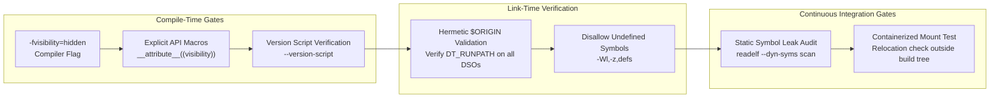

# Drill: Broken Rpath and Symbol Interposition

> [!summary] Scope
> Guided problem drill providing a broken dynamic plugin architecture exhibiting unexpected DT_RUNPATH transitive lookup failures and unintended global symbol interposition.
> Guides the engineer through reproducing the loader failure, inspecting ELF headers with readelf, identifying symbol preemption bugs, and restructuring rpath and symbol visibility.
> Reaches Debug and Use rungs, grounding Dynamic-Linking-PLT-GOT-and-Loaders.md in a runnable lab.

Dynamic linking mechanisms and Procedure Linkage Table resolution are owned by [[Dynamic-Linking-PLT-GOT-and-Loaders]].
Dynamic linker diagnostics and operational triage workflows are owned by [[Diagnose-Dynamic-Linker-and-ABI-Failures]].
This problem drill guides the engineer through isolating and repairing two intertwined failures common to modular C and C++ plugin architectures: broken transitive library search paths under modern ELF dynamic tags and silent calculation corruption caused by global symbol preemption.

```mermaid
flowchart TD
    subgraph APP["Host Application Execution"]
        HOST["host_app<br/>DT_RUNPATH = $ORIGIN/plugins:$ORIGIN/plugins/lib<br/>Defines: compute_hash() [STV_DEFAULT]"]
    end

    subgraph PLUGIN_DIR["plugins/ Directory"]
        PLUGIN["libplugin.so<br/>DT_NEEDED = libinternal_math.so<br/>Calls: internal_calc_checksum()"]
    end

    subgraph SUB_DIR["plugins/lib/ Sub-Directory"]
        SUBDEP["libinternal_math.so<br/>Defines: internal_calc_checksum()<br/>Defines: compute_hash() [STV_DEFAULT]"]
    end

    HOST -->|"1. DT_NEEDED: finds in plugins/"| PLUGIN
    PLUGIN -.->|"2. DT_NEEDED: FAILS to find in plugins/lib/<br/>(DT_RUNPATH is non-transitive)"| SUBDEP
    PLUGIN ==="3. When RUNPATH patched: calls compute_hash()<br/>RESOLVES TO HOST STUB (Preemption)"===> HOST
```

## 1. Reproduction

The reproduction environment models a high-performance modular analytics service.
The host application (`host_app`) loads an analytics worker plugin (`plugins/libplugin.so`).
The plugin depends upon a specialized calculation engine (`plugins/lib/libinternal_math.so`).
All source files and orchestration scripts are located in `code/00-Program-Execution/drill_broken_rpath/`.

The build script compiles the sub-dependency and the plugin as shared libraries (`-shared -fPIC`).
The engineer builds `host_app` with an embedded runtime path pointing to both plugin directories:
`-Wl,-rpath,'$ORIGIN/plugins:$ORIGIN/plugins/lib'`.
Because the lab's linker (Ubuntu 24.04 GNU ld 2.42) emits new dtags by default, the static linker writes `DT_RUNPATH` into `host_app` rather than legacy `DT_RPATH` (as of 2026-11).
Upstream GNU ld documents the opposite default ("By default, the new dynamic tags are not created"), LLD defaults to `--enable-new-dtags`, and neither the GCC nor the Clang driver passes the flag, so the tag you get depends on how your distribution built its linker; check with `readelf -d`.
The plugin `libplugin.so` is linked against `libinternal_math.so` using `-Lplugins/lib -linternal_math`, but without its own embedded runpath.

The lab compiles with `gcc` (pinned in `run.sh`, because another compiler may inline `compute_hash` and hide the interposition).
`host_app` exits 0 for the expected hash, 3 for the interposed value, and 4 for any other value, and `run.sh` aborts unless every stage ends the way it teaches (the bug reproduces in Stage 4, each fix succeeds in Stage 6).

To reproduce the failure sequence, execute the harness runner:

```bash
cd code && python3 -m _harness.verify 00-Program-Execution/drill_broken_rpath/
```

## 2. Observed Symptom

### Symptom 1: Loader Abort on Transitive Dependency Lookup

When launching the freshly linked application, the dynamic loader terminates execution before `main()` begins:

```text
(linux-aarch64)
=== Stage 1: Reproduce Transitive DT_RUNPATH Lookup Failure ===
[Execution] Launching host_app with unpatched plugin...
./host_app: error while loading shared libraries: libinternal_math.so: cannot open shared object file: No such file or directory
Exit status: 127
```

The developer is perplexed because `libinternal_math.so` exists directly inside `plugins/lib/`, and the host executable explicitly specified `$ORIGIN/plugins/lib` in its `-rpath` linker argument.

### Symptom 2: Silent Data Corruption via Symbol Preemption

After the developer attempts a naive fix by configuring `libplugin.so` to locate its library, the process starts without error.
However, transactional processing silently produces corrupted outputs:

```text
(linux-aarch64)
[Execution] Launching host_app with fixed plugin RUNPATH...
Host started: dispatching task to plugin...
Plugin received task payload: 'transaction_record_99'
Internal hash computed: 0xADDR (CORRUPTED)
Result: MISMATCH! Expected real hash, got host interposed 0xADDR
```

The plugin received input `'transaction_record_99'` and invoked `internal_calc_checksum()`, which delegates to `compute_hash()`.
Instead of computing the 32-bit FNV-1a hash (`0x043761a0`, pinned in `plugin.h` as `EXPECTED_HASH` and printed by the fixed builds before the harness masks it as `0xADDR`), the function returned `0x00001337`.
The return value matches a dummy token generator defined inside `host_app.c`.
The application did not crash, but transactional integrity is violated.

## 3. Progressive Hint Ladder

> [!tip]- Hint 1: Inspecting Dynamic Tags with readelf
> Examine the dynamic tags embedded in both the host executable and the shared objects using `readelf -d`.
> Look specifically for the presence of `(RPATH)` versus `(RUNPATH)` dynamic tags, as well as `(NEEDED)` entries.
> Notice whether `plugins/libplugin.so` contains any runpath tags of its own.

> [!tip]- Hint 2: Tracing Loader Search Decisions with LD_DEBUG
> Run the failing executable under dynamic linker diagnostic tracing: `LD_DEBUG=libs ./host_app`.
> Trace the sequence of directories that `ld.so` searches when resolving `libinternal_math.so`.
> Observe whose search lists are evaluated, and check whether `host_app`'s search directories are ever considered during that lookup.

> [!tip]- Hint 3: The Transitivity Contract of DT_RUNPATH
> In the ELF specification and glibc `elf/dl-load.c`, `DT_RPATH` and `DT_RUNPATH` have fundamentally different inheritance semantics.
> `DT_RPATH` is transitive: paths declared in the main binary apply to all transitive dependencies across the entire process image.
> `DT_RUNPATH` is strictly non-transitive: it applies only to the direct `DT_NEEDED` dependencies of the specific ELF object containing the tag.
> What directory must be embedded into `libplugin.so` so that it can resolve its own private dependencies without relying on the host?

> [!tip]- Hint 4: Tracing Dynamic Symbol Bindings
> Once the library loading failure is resolved, trace runtime symbol resolution using `LD_DEBUG=bindings ./host_app`.
> Filter the trace for the failing function: `grep "compute_hash"`.
> Which binary defined the version of `compute_hash` that the dynamic linker bound to the call site in `libinternal_math.so`?

> [!tip]- Hint 5: Symbol Visibility and Preemption Control
> Inspect the symbol tables of `host_app` and `libinternal_math.so` using `readelf --dyn-syms`.
> Check the binding (`GLOBAL`) and visibility (`DEFAULT`) of `compute_hash`.
> In the ELF System V ABI, global symbols in shared libraries are preemptible by definitions appearing earlier in the global symbol scope (`_ns_main_searchlist`).
> How can `libinternal_math.so` prevent internal helper routines from entering the global symbol table or allow internal calls to bind locally?

## 4. Model Solution

> [!success]- Solution: Root Cause Diagnosis and Complete Remediation
>
> ### Root Cause Analysis
>
> #### Defect 1: DT_RUNPATH Non-Transitivity
>
> Inspecting the dynamic sections of the binaries reveals the exact mechanism:
>
> ```text
> (linux-aarch64)
> === Stage 2: Inspect Dynamic Tags (DT_RPATH vs DT_RUNPATH) ===
> host_app dynamic tags:
> 0xADDR (NEEDED)             Shared library: [libplugin.so]
> 0xADDR (NEEDED)             Shared library: [libc.so.6]
> 0xADDR (NEEDED)             Shared library: [ld-linux-aarch64.so.1]
> 0xADDR (RUNPATH)            Library runpath: [$ORIGIN/plugins:$ORIGIN/plugins/lib]
> plugins/libplugin.so dynamic tags:
> 0xADDR (NEEDED)             Shared library: [libinternal_math.so]
> 0xADDR (NEEDED)             Shared library: [libc.so.6]
> ```
>
> The host binary contains `(RUNPATH)` rather than legacy `(RPATH)`.
> In glibc (`elf/dl-load.c`), when the dynamic linker loads a direct dependency declared by an object, it evaluates the `DT_RUNPATH` of that object.
> When loading `libplugin.so`, `ld.so` evaluates `host_app`'s `DT_RUNPATH`, expands `$ORIGIN/plugins`, and successfully maps `libplugin.so`.
>
> Next, `ld.so` resolves `libplugin.so`'s direct dependency: `libinternal_math.so`.
> Under the System V ABI specification, `DT_RUNPATH` is non-transitive.
> The dynamic linker consults the search path list belonging strictly to `libplugin.so`.
> Because `libplugin.so` contains no `DT_RUNPATH` or `DT_RPATH` tags, `ld.so` falls back directly to system cache and standard system library paths:
>
> ```text
> (linux-aarch64)
> === Stage 3: Trace Dynamic Linker Search Paths (LD_DEBUG=libs) ===
> Loader search trace for libinternal_math.so:
> find library=libinternal_math.so ; searching
> search cache=/etc/ld.so.cache
> search path=/lib/aarch64-linux-gnu:/usr/lib/aarch64-linux-gnu:/lib:/usr/lib		(system search path)
> trying file=/lib/aarch64-linux-gnu/libinternal_math.so
> trying file=/usr/lib/aarch64-linux-gnu/libinternal_math.so
> ```
>
> The dynamic linker never checks `$ORIGIN/plugins/lib` because `host_app`'s `DT_RUNPATH` does not propagate to dependencies loaded on behalf of `libplugin.so`.
>
> #### Defect 2: Global Symbol Interposition
>
> After relinking `libplugin.so` with `-Wl,-rpath,'$ORIGIN/lib'`, both shared libraries map into memory.
> However, `host_app` defines an internal function named `compute_hash()`.
> `host_app` is linked with `-rdynamic` (common in plugin hosts to expose host APIs to plugins), which exports all its global symbols to its dynamic symbol table (`.dynsym`).
> In this lab `-rdynamic` is not what exports `compute_hash`: GNU ld also exports an executable's symbol when a shared library seen during the link references it, and `libinternal_math.so`, found through `-Wl,-rpath-link`, does.
> Executed in the container (as of 2026-11): without `-rdynamic` the bug still reproduces; if the link cannot see `libinternal_math.so`, or the host's definition is `visibility("hidden")`, `compute_hash` is absent from the host's `.dynsym` and the output is correct.
>
> In `libinternal_math.so`, `compute_hash()` was declared with default visibility (`STV_DEFAULT`).
> In the ELF System V ABI, function calls within a shared object to `STV_DEFAULT` symbols route through the Procedure Linkage Table (`compute_hash@plt`) and Global Offset Table (`.got.plt`) to permit runtime preemption.
>
> During startup, glibc `ld.so` constructs a single flat search list (`_ns_main_searchlist`).
> The list starts with the main executable (`host_app`), followed by its dependencies (direct and indirect) in breadth-first order.
> When `ld.so` processes the `compute_hash` relocation in `libinternal_math.so`, it searches from the head of `_ns_main_searchlist`.
> On the lab's Ubuntu toolchain GCC passes `-z now` by default (`gcc -dumpspecs`, as of 2026-11), so this happens at load time; with lazy binding it would happen on the first call.
>
> Tracing bindings proves that `ld.so` preempts the library's definition:
>
> ```text
> (linux-aarch64)
> === Stage 5: Diagnose Symbol Preemption (LD_DEBUG=bindings) ===
> Symbol binding trace:
> binding file libinternal_math.so to ./host_app : normal symbol `compute_hash'
> compute_hash bindings resolved to host_app: 1
> Symbol visibility in host_app dynamic symbol table (.dynsym):
> FUNC GLOBAL DEFAULT compute_hash
> Symbol visibility in libinternal_math.so dynamic symbol table (.dynsym):
> FUNC GLOBAL DEFAULT compute_hash
> FUNC GLOBAL DEFAULT internal_calc_checksum
> ```
>
> The lab trims the referencing object to its basename, because the raw trace names it by absolute path (`binding file /tmp/lab/plugins/lib/libinternal_math.so [0] to ./host_app [0]`) and the harness masks absolute temp paths as `/TMP`.
> The binding line therefore reads: the reference inside `libinternal_math.so` was bound to `host_app`.
> The call inside `libinternal_math.so` jumped directly into `host_app`'s dummy implementation, returning `0x00001337` and corrupting the computation.
>
> ---
>
> ### Remediation Steps
>
> #### Fix 1: Establish Hermetic DSO Search Paths
>
> Rather than relying on the caller's environment or attempting to revive deprecated transitive `DT_RPATH` tags, every shared library must declare its own relative dependencies using `$ORIGIN`.
>
> Relink `libplugin.so` to specify where its private dependencies reside relative to its own location on disk:
>
> ```bash
> "$CC" -shared -fPIC -o plugins/libplugin.so plugin.c \
>     -Lplugins/lib -linternal_math \
>     -Wl,-rpath,'$ORIGIN/lib'
> ```
>
> Verifying dynamic tags confirms the presence of `(RUNPATH)`:
>
> ```text
> (linux-aarch64)
> === Stage 4: Fix 1 - Embed $ORIGIN/lib RUNPATH in libplugin.so ===
> [Build] Relinking libplugin.so with -Wl,-rpath,'$ORIGIN/lib'...
> plugins/libplugin.so updated dynamic tags:
> 0xADDR (NEEDED)             Shared library: [libinternal_math.so]
> 0xADDR (NEEDED)             Shared library: [libc.so.6]
> 0xADDR (RUNPATH)            Library runpath: [$ORIGIN/lib]
> ```
>
> #### Fix 2: Symbol Visibility and Direct Binding
>
> Three distinct engineering approaches permanently eliminate unintended symbol preemption.
>
> ##### Solution 2A: Compiler Visibility Attributes (Paved-Road Practice)
> Compile the library with `-fvisibility=hidden` so that all functions default to local DSO visibility.
> Explicitly annotate public interface entry points with `__attribute__((visibility("default")))`:
>
> ```c
> /* internal_math.h */
> #if defined(EXPORT_API)
>   #define MATH_API __attribute__((visibility("default")))
> #else
>   #define MATH_API
> #endif
>
> MATH_API uint32_t internal_calc_checksum(const char *payload);
> uint32_t compute_hash(const char *key); /* Automatically hidden */
> ```
>
> Compilation command:
> ```bash
> "$CC" -shared -fPIC -fvisibility=hidden -DEXPORT_API \
>     -o plugins/lib/libinternal_math.so internal_math.c
> ```
>
> Inspecting `.dynsym` (`readelf --dyn-syms --wide`) confirms that `compute_hash` is no longer exported while the public `internal_calc_checksum` still is; the lab aborts if the public entry point disappears.
> The binding count shows the loader no longer resolves any `compute_hash` reference to `host_app`:
>
> ```text
> (linux-aarch64)
> === Stage 6: Fix 2 - Restructure Symbol Visibility and Local Binding ===
> Applying Fix 2A: Compile libinternal_math with -fvisibility=hidden
> Dynamic symbols exported by updated libinternal_math.so (.dynsym):
> FUNC GLOBAL DEFAULT internal_calc_checksum
> compute_hash: not exported
> [Execution] Launching host_app with hidden visibility...
> Host started: dispatching task to plugin...
> Plugin received task payload: 'transaction_record_99'
> Internal hash computed: 0xADDR (CORRECT)
> Result: SUCCESS! Computation matches expected hash.
> compute_hash bindings resolved to host_app: 0
> ```
>
> ##### Solution 2B: Linker Version Scripts
> If third-party source code cannot be modified, restrict dynamic symbol export at link time using an explicit GNU version script:
>
> ```text
> /* version_script.map */
> INTERNAL_MATH_1.0 {
>     global:
>         internal_calc_checksum;
>     local:
>         *;
> };
> ```
>
> Link command:
> ```bash
> "$CC" -shared -fPIC -Wl,--version-script=version_script.map \
>     -o plugins/lib/libinternal_math.so internal_math.c
> ```
>
> Execution confirms identical protection:
>
> ```text
> (linux-aarch64)
> Applying Fix 2B: Rebuild with Linker Script (--version-script)
> Dynamic symbols exported with version script (.dynsym):
> FUNC GLOBAL DEFAULT internal_calc_checksum@@INTERNAL_MATH_1.0
> compute_hash: not exported
> [Execution] Launching host_app with version script DSO...
> Host started: dispatching task to plugin...
> Plugin received task payload: 'transaction_record_99'
> Internal hash computed: 0xADDR (CORRECT)
> Result: SUCCESS! Computation matches expected hash.
> compute_hash bindings resolved to host_app: 0
> ```
>
> ##### Solution 2C: Direct Function Binding (-Bsymbolic-functions)
> To instruct the static linker to bind all internal function calls directly to internal definitions within the shared object without modifying symbol export tables, pass `-Wl,-Bsymbolic-functions`:
>
> ```bash
> "$CC" -shared -fPIC -Wl,-Bsymbolic-functions \
>     -o plugins/lib/libinternal_math.so internal_math.c
> ```
>
> Execution verifies that internal calls bind locally.
> Unlike 2A and 2B, `compute_hash` stays exported (`GLOBAL DEFAULT`), so external callers can still bind to it; only the library's own calls skip the lookup:
>
> ```text
> (linux-aarch64)
> Applying Fix 2C: Rebuild with Direct Binding (-Wl,-Bsymbolic-functions)
> Dynamic symbols exported with -Bsymbolic-functions (.dynsym):
> FUNC GLOBAL DEFAULT compute_hash
> FUNC GLOBAL DEFAULT internal_calc_checksum
> compute_hash: exported
> [Execution] Launching host_app with -Bsymbolic-functions DSO...
> Host started: dispatching task to plugin...
> Plugin received task payload: 'transaction_record_99'
> Internal hash computed: 0xADDR (CORRECT)
> Result: SUCCESS! Computation matches expected hash.
> compute_hash bindings resolved to host_app: 0
> ```

## 5. Core Takeaway

The root failure in modular shared library architectures stems from an incorrect mental model of ELF dynamic linking: assuming that host runpaths inherit downward, and assuming that shared library function calls resolve internally by default.

Under modern ELF toolchains:
1. `DT_RUNPATH` replaces `DT_RPATH` to honor `LD_LIBRARY_PATH` overrides, but forfeits transitivity.
   Every shared library that requires sibling or child dependencies must embed its own `$ORIGIN`-relative `DT_RUNPATH`.
   Relying on the host executable to establish library paths for downstream plugins violates component modularity and guarantees deployment failures.
2. In the System V ABI, shared library symbols possess default (`STV_DEFAULT`) visibility unless explicitly configured otherwise.
   Under `-fPIC`, default visibility makes GCC route internal calls through the PLT (the lab's gcc 13.3 emits `bl f@plt` for a same-file call), allowing any earlier definition in the global symbol scope to intercept the call.
   Production-grade dynamic libraries must enforce `-fvisibility=hidden` as an organizational standard, exposing only designated API entry points.

For structural details on the Procedure Linkage Table, Global Offset Table, and dynamic loader resolution algorithms, consult [[Dynamic-Linking-PLT-GOT-and-Loaders]].
For systemic triage runbooks covering missing symbols, loader assertions, and version script debugging, consult [[Diagnose-Dynamic-Linker-and-ABI-Failures]].

## Technical Reference and Commands to Know

### ELF Dynamic Section Search Tags and Linker Controls

The static linker controls search path generation through explicit command-line flags.
Dynamic section tags dictate how `ld.so` handles search hierarchies:

| Dynamic Tag / Linker Flag | Purpose and Loader Semantics | Precedence vs LD_LIBRARY_PATH | Transitivity Across Graph | Platform / Default (as of 2026-11) |
|---|---|---|---|---|
| `DT_RPATH` | Legacy hardcoded directory list for shared library search. | Evaluated **before** `LD_LIBRARY_PATH`. | Transitive across all dependencies. | Linux; "superseded by DT_RUNPATH" in the gABI; emitted via `-Wl,--disable-new-dtags`. |
| `DT_RUNPATH` | Modern directory list for shared library search. | Evaluated **after** `LD_LIBRARY_PATH`. | Non-transitive; direct dependencies only. | Linux; default in LLD and in Ubuntu 24.04 GNU ld 2.42; not the upstream GNU ld default; the GCC and Clang drivers do not choose it. |
| `-Wl,-rpath,<dir>` | Instructs static linker to embed runtime search path. | Depends on dtags flag. | Depends on dtags flag. | Both Linux and macOS (`-rpath <dir>`). |
| `-Wl,--enable-new-dtags` | Instructs static linker to emit `DT_RUNPATH`. | Evaluated after `LD_LIBRARY_PATH`. | Non-transitive. | Linux; default in Ubuntu 24.04's GNU ld 2.42 (lab Stage 2); other distributions vary, so check with `readelf -d`. |
| `-Wl,--disable-new-dtags` | Instructs static linker to emit legacy `DT_RPATH`. | Overrides `LD_LIBRARY_PATH`. | Transitive across graph. | Linux; documented upstream GNU `ld` default. |
| `-Wl,-rpath-link,<dir>` | Specifies search directory for indirect dependencies at static link time only. | N/A (compile time only). | N/A (does not write dynamic tag). | Linux; prevents `ld: warning: ... needed by ... not found`. |
| `-Wl,-z,nodefaultlib` | Sets `DF_1_NODEFLIB`; glibc then skips default directories and `ld.so.cache` hits in them when loading this object's dependencies. | Ignores default paths. | Applied to declaring ELF object. | Linux; GNU ld ignores the misspelling `-z nodeflib` with only a warning. |
| `$ORIGIN` | Dynamic string token expanding to absolute directory of declaring ELF binary. | Same as enclosing tag. | Bound to declaring ELF object. | Linux (`$ORIGIN`) and Solaris; macOS uses `@loader_path`. |

### Symbol Visibility and Linker Binding Controls

Symbol visibility attributes govern whether a symbol appears in `.dynsym` and whether calls route through the PLT/GOT:

| Visibility / Flag | Symbol Table Representation | Preemptible at Runtime? | Emits PLT/GOT Relocation? | Architectural Application |
|---|---|---|---|---|
| `STV_DEFAULT` | `GLOBAL DEFAULT` | Yes; preemptible by earlier definition in search list. | Yes (`R_X86_64_JUMP_SLOT`, `R_AARCH64_JUMP_SLOT`). | Public interfaces across DSO boundaries. |
| `STV_HIDDEN` | `FUNC LOCAL` in the linked `.symtab` (omitted from `.dynsym`) | No; resolved directly within DSO. | No; emits PC-relative direct call (`call` / `bl`). | Private internal functions and implementation details. |
| `STV_PROTECTED` | `GLOBAL PROTECTED` | No; internal calls bind locally, but symbol is exported. | Toolchain-dependent; historical GOT address comparison bugs. | Exported APIs that must not be preempted internally. |
| `-fvisibility=hidden` | Sets default visibility of all declarations to `hidden`. | No (unless explicitly marked `default`). | No for unmarked symbols. | Universal compiler flag for shared libraries. |
| `-Wl,-Bsymbolic` | Forces local binding for all global data and function symbols within DSO. | No for internal references. | Binds internal references at link time. | Risky in C++: duplicated typeinfo and vague-linkage data lose address identity; fatal under address-only RTTI comparison (libc++ on ELF), masked by libstdc++'s name comparison. |
| `-Wl,-Bsymbolic-functions` | Forces local binding strictly for function symbols within DSO. | No for internal function calls. | Binds internal function calls at link time. | Safer alternative to `-Bsymbolic`; preserves global data sharing. |
| `--version-script=<map>` | Defines exact symbol version nodes and export lists. | Controlled per symbol node. | Hidden symbols eliminated from `.dynsym`. | Industry standard for ABI stabilization and symbol scoping. |

### Diagnostic Commands Quick Reference

```bash
# 1. Inspect dynamic tags for RPATH, RUNPATH, and direct dependencies
readelf -d binary_or_library | grep -E '(NEEDED|RPATH|RUNPATH|FLAGS)'

# 2. Inspect dynamic symbol exports and visibility
readelf --dyn-syms --wide library.so | grep -E '(GLOBAL|WEAK|DEFAULT|HIDDEN)'

# 3. Trace dynamic loader file search decisions in real time
LD_DEBUG=libs ./binary

# 4. Trace runtime dynamic symbol resolution and preemption bindings
LD_DEBUG=bindings ./binary

# 5. Trace symbol versioning matches and IFUNC resolutions
LD_DEBUG=versions,symbols ./binary

# 6. Verify static dependencies without executing target binary
ldd binary
```

## Pitfalls

> [!warning] Pitfall: Reverting to --disable-new-dtags as an Organizational Quick Fix
> When faced with `cannot open shared object file` on transitive sub-dependencies, engineers frequently pass `-Wl,--disable-new-dtags` to emit legacy `DT_RPATH`.
> While this restores transitivity and resolves the immediate crash, `DT_RPATH` takes absolute precedence over `LD_LIBRARY_PATH`.
> This strips developers and site reliability engineers of the ability to use `LD_LIBRARY_PATH` for hot-patching, profiling hooks, or testing candidate libraries in staging environments.
> The architecturally correct resolution is to embed `$ORIGIN`-relative `DT_RUNPATH` tags directly into the intermediate shared libraries.

> [!warning] Pitfall: C++ RTTI and Exception Slicing Under -Bsymbolic
> Passing `-Wl,-Bsymbolic` binds both functions and global data objects locally.
> In C++, the Itanium ABI requires unique type information structures (`typeinfo` for classes) across all DSOs to guarantee that `dynamic_cast` and `catch` clauses match.
> When `-Bsymbolic` is applied, each DSO binds its own references to its local copy of typeinfo for types emitted in several DSOs, so the copies no longer share one address.
> Whether that breaks `catch` and `dynamic_cast` depends on the runtime: libc++ on ELF compares `type_info` by address only (`_LIBCPP_TYPEINFO_COMPARISON_IMPLEMENTATION 1`), while libstdc++ falls back to `strcmp` of the mangled names (`__GXX_MERGED_TYPEINFO_NAMES 0`).
> Verified with g++ 13.3 on Ubuntu 24.04 (as of 2026-11): a `-Bsymbolic` DSO throwing a header-defined `MyErr : std::runtime_error` was caught in the host both as `const MyErr &` and as `const std::exception &`; `std::exception`'s own typeinfo lives in `libstdc++.so` and is never duplicated.
> libc++'s own `<typeinfo>` names `-Bsymbolic` as a reason a linker may fail to merge typeinfo copies, and its ELF default (implementation 1) assumes they were merged and compares by address.
The libc++ outcome is therefore read from its header (as of 2026-11); only the libstdc++ behavior above was executed.
> Cross-DSO RTTI and exception mechanics are analyzed in [[Drill-Program-Execution-Cross-DSO-Exception-and-RTTI-Failure]] and [[Cpp-Itanium-ABI-Object-Model-Vtables-and-RTTI]].

> [!warning] Pitfall: Contaminating Global Namespaces via dlopen(..., RTLD_GLOBAL)
> Plugin host architectures frequently load dynamic modules via `dlopen(3)`.
> If plugins are opened with `RTLD_GLOBAL` instead of `RTLD_LOCAL`, every symbol exported by the plugin enters `_ns_main_searchlist`.
> If two independent plugins define internal helper functions with identical names (such as `parse_config` or `format_buffer`), the first plugin loaded preempts the function for all subsequently loaded plugins.
> Plugins must be loaded with `RTLD_LOCAL` unless mutual symbol resolution is an explicit architectural requirement.

> [!warning] Pitfall: Assuming ldd Output Guarantees Successful Execution
> Running `ldd binary` executes the dynamic linker in simulation mode (`LD_TRACE_LOADED_OBJECTS=1`).
> In certain legacy environments, `ldd` evaluates dependencies using ambient environment variables or simulation search paths that differ from secure execution contexts (`AT_SECURE=1`).
> If a binary possesses elevated capabilities or setuid bits, `ld.so` disables `LD_LIBRARY_PATH` and restricts `$ORIGIN` expansion, causing the actual execution to abort even though `ldd` reported all dependencies satisfied.
> Auxiliary vectors and credential boundaries are detailed in [[Program-Startup-C-Runtime-Init-and-Auxiliary-Vectors]] and [[Proc-Filesystem-and-Process-Credentials]].

## At Scale: Enterprise DSO and Plugin Architecture

Across enterprise codebases spanning thousands of microservices and hundreds of dynamic plugins, dynamic linking failures represent a significant source of staging drift and production outages.
Distinguished engineers enforce three organizational guardrails:



### 1. The Paved-Road Visibility Rule

Enterprise build systems (such as Bazel and modern CMake) must enforce `-fvisibility=hidden` across all C and C++ library targets.
Engineers must not rely on manual visibility annotations on a function-by-function basis.
Instead, shared library targets generate dedicated export header macros:

```c
#if defined(BUILDING_ANALYTICS_DSO)
  #define ANALYTICS_API __attribute__((visibility("default")))
#else
  #define ANALYTICS_API
#endif
```

Any symbol lacking `ANALYTICS_API` is automatically private to the translation unit or DSO, eliminating symbol table bloat, reducing startup relocation processing time, and preventing accidental interposition.

### 2. Hermetic RPATH Packaging in Build Systems

In hermetic build systems like Bazel, test runners execute inside isolated sandboxes.
If a DSO relies on hardcoded absolute paths (e.g., `/home/jenkins/build/...`), relocating the binaries into a production Debian package or Docker container causes instant loader failures.
Build pipelines must configure linkers to emit relocatable runpaths relative to the binary's directory:
`-Wl,-rpath,'$ORIGIN/../lib'`.
Additionally, CI test suites must execute binaries from temporary mount namespaces outside the compilation workspace to verify that all dependencies resolve strictly through embedded `$ORIGIN` tokens rather than ambient build tree paths.

### 3. Automated Static Symbol Leak Auditing

CI pipelines must incorporate automated symbol leakage checks using `readelf` or `nm`:

```bash
# Verify that no internal helper symbols leak into .dynsym
! readelf --dyn-syms --wide libanalytics.so | grep 'GLOBAL' | grep -v -E '(analytics_init|analytics_process|analytics_shutdown)'
```

If an engineer introduces an un-namespaced global symbol without marking it hidden, the CI gate breaks before merge.
Linker optimization, Whole Program Optimization, and binary layout strategies are explored in [[Linkers-LTO-PGO-AutoFDO-and-BOLT]].
Architectural decisions balancing static linking against dynamic loading across multi-tenant fleets are codified in [[Program-Execution-Decision-Records]].

## Practice Drill

To build deep muscle memory for dynamic library debugging, perform this drill locally:

1. Clone or navigate to the lab directory:
   ```bash
   cd code/00-Program-Execution/drill_broken_rpath/
   ```
2. Inspect the reproduction script `run.sh` and identify how the initial build intentionally triggers the `DT_RUNPATH` transitivity failure.
3. Manually invoke the compile commands to build `libinternal_math.so`, `libplugin.so`, and `host_app`.
4. Run `readelf -d host_app` and notice the dynamic section tag values.
5. Use `patchelf --set-rpath '$ORIGIN/lib' plugins/libplugin.so` (patchelf is not in the lab image; or recompile with `-Wl,-rpath,'$ORIGIN/lib'`) to resolve the dynamic loader startup failure.
6. Run `host_app` and observe the corrupted calculation output.
7. Execute `LD_DEBUG=bindings ./host_app 2>&1 | grep compute_hash` to witness dynamic symbol preemption in action.
8. Recompile `libinternal_math.so` using each of the three remediation techniques (compiler hidden visibility, version script, and `-Bsymbolic-functions`), verifying output correctness after each modification.

## Interview Questions

### Level 5 (L5)

> [!question] L5: Explain why the ELF gABI introduced `DT_RUNPATH` (which glibc `ld.so` honors) to replace `DT_RPATH`, and describe the operational trade-off that resulted from this change.
>
> > [!success]- Answer
> > `DT_RPATH` was introduced in early System V ELF specifications as an embedded directory search path for dynamic libraries.
> > However, `DT_RPATH` takes absolute precedence over the `LD_LIBRARY_PATH` environment variable.
> > This made it impossible for developers, testers, or system administrators to temporarily redirect library lookups for testing, debugging, or emergency hot-patching without rewriting binary headers.
> >
> > To solve this, `DT_RUNPATH` was introduced.
> > The dynamic linker evaluates `DT_RUNPATH` **after** `LD_LIBRARY_PATH`, restoring the operator's ability to override search paths via the environment.
> >
> > The critical trade-off is transitivity: `DT_RPATH` is transitive across the entire process dependency tree (the executable's `DT_RPATH` applies to indirect dependencies loaded by libraries), whereas `DT_RUNPATH` is strictly non-transitive (it applies only to the direct `DT_NEEDED` dependencies of the ELF object containing the tag).
> > If an executable uses `DT_RUNPATH`, downstream dependencies must declare their own runpaths, or lookups for private nested libraries fail.

> [!question] L5: Predict the output:
> A Linux application is linked with `--enable-new-dtags -Wl,-rpath,'/opt/app/lib'`.
> A dependent library `libdata.so` exists in both `/opt/app/lib/` and `/tmp/test/`.
> The user executes: `LD_LIBRARY_PATH=/tmp/test ./app`.
> Which `libdata.so` is loaded?
> What would happen if the binary were linked with `--disable-new-dtags`?
>
> > [!success]- Answer
> > Under `--enable-new-dtags`, the static linker writes a `DT_RUNPATH` dynamic tag.
> > According to the glibc `ld.so` search order:
> > 1. `DT_RPATH` (ignored if `DT_RUNPATH` is present)
> > 2. `LD_LIBRARY_PATH`
> > 3. `DT_RUNPATH`
> > 4. System cache (`/etc/ld.so.cache`) and standard paths (`/lib64`, `/usr/lib64`).
> >
> > Because `LD_LIBRARY_PATH` is evaluated before `DT_RUNPATH`, the dynamic loader loads `/tmp/test/libdata.so`.
> >
> > If the binary had been linked with `--disable-new-dtags`, the linker would have emitted `DT_RPATH` instead.
> > Because `DT_RPATH` takes precedence over `LD_LIBRARY_PATH`, the dynamic loader would ignore `/tmp/test` and load `/opt/app/lib/libdata.so`.

> [!question] L5: What is the purpose of `$ORIGIN` in an ELF runpath, and what security restrictions does the Linux dynamic linker impose on its evaluation?
>
> > [!success]- Answer
> > `$ORIGIN` is a dynamic string token recognized by ELF dynamic loaders (including glibc `ld.so`).
> > At runtime, the loader expands `$ORIGIN` to the absolute canonical filesystem directory containing the ELF object (executable or DSO) that specified the token.
> > This allows applications and plugin directories to be relocatable anywhere on the filesystem without hardcoding absolute paths like `/usr/local/lib`.
> >
> > Security restrictions:
> > If an executable runs with elevated privileges (setuid, setgid, or POSIX file capabilities), the kernel marks the process execution as secure by setting `AT_SECURE=1` in the auxiliary vector.
> > In secure execution mode, glibc `ld.so` (`_dl_dst_substitute` in `elf/dl-load.c`) discards any `DT_RPATH`/`DT_RUNPATH` element that uses `$ORIGIN` anywhere but as its first path component; for the executable's own paths the expanded result must also lie under a trusted system directory.
> > `LD_LIBRARY_PATH` is ignored entirely in this mode (ld.so(8)).
> > This prevents an unprivileged user from hardlinking a setuid root binary into an attacker-controlled directory containing malicious surrogate shared objects.
> > Kernel credentials and process execution transitions are detailed in [[Proc-Filesystem-and-Process-Credentials]] and [[Program-Startup-C-Runtime-Init-and-Auxiliary-Vectors]].

### Level 6 (L6)

> [!question] L6: Debug this issue:
> A C++ plugin architecture uses `dlopen()` to load plugins at runtime.
> Standalone unit tests for `libplugin_auth.so` pass completely.
> However, when loaded into the production daemon `gateway_server`, the plugin crashes with SIGSEGV inside an internal call to `tokenize_string()`.
> GDB reveals that the instruction pointer is inside code belonging to `gateway_server`, not `libplugin_auth.so`.
>
> > [!success]- Answer
> > This is a classic manifestation of ELF global symbol preemption.
> >
> > 1. **Root Cause:** Both `gateway_server` and `libplugin_auth.so` define a global function named `tokenize_string()` with default visibility (`STV_DEFAULT`), but with different function signatures, calling conventions, or memory layouts.
> > 2. **Mechanism:** The host server was linked with `-rdynamic` (or `libplugin_auth.so` was opened with `RTLD_GLOBAL`).
> >    In ELF dynamic linking, all global symbols enter a flat global search list (`_ns_main_searchlist`).
> >    Because `gateway_server` resides at the head of the search list, any call within `libplugin_auth.so` to `tokenize_string@plt` resolves to the server's definition rather than the plugin's internal implementation.
> >    When the server's version executes, it accesses memory using an incompatible stack frame or struct layout, triggering a SIGSEGV.
> > 3. **Remediation:**
> >    - Compile `libplugin_auth.so` with `-fvisibility=hidden` so that internal functions like `tokenize_string()` do not emit PLT/GOT relocations and cannot be preempted.
> >    - In `gateway_server`, ensure `dlopen()` specifies `RTLD_LOCAL` rather than `RTLD_GLOBAL` to keep plugin symbol scopes isolated.
> >    - Link the plugin with `-Wl,-Bsymbolic-functions` to force internal calls to bind locally.

> [!question] L6: Compare the symbol resolution and preemption models between Linux ELF (`glibc`) and macOS Darwin (`dyld`).
> Why does symbol interposition work by default on Linux but fail on macOS without special linker flags?
>
> > [!success]- Answer
> > The two operating systems implement fundamentally divergent dynamic symbol namespaces:
> >
> > - **Linux ELF (Flat Namespace by Default):**
> >   ELF dynamic linking uses a single flat symbol search list (`_ns_main_searchlist`).
> >   When an external or `STV_DEFAULT` symbol is referenced via the PLT/GOT, the dynamic loader searches the list from the beginning (executable -> first library -> second library).
> >   The first definition found satisfies all references process-wide.
> >   Consequently, symbol preemption is the default behavior: any earlier library or preloaded module (`LD_PRELOAD`) automatically intercepts calls made by downstream libraries.
> >
> > - **macOS Darwin Mach-O (Two-Level Namespace by Default):**
> >   Apple's `dyld` enforces a two-level namespace.
> >   Every symbol reference in a Mach-O binary records both the symbol name and the specific dynamic library expected to provide it (e.g., `_malloc` from `/usr/lib/libSystem.B.dylib`).
> >   At load time, `dyld` resolves the symbol directly from the designated library, completely bypassing earlier definitions in other libraries.
> >   To achieve symbol interposition on macOS, an engineer must either link the binary with the legacy `-flat_namespace` flag or write an interposition structure placed in the `__DATA,__interpose` section and injected via `DYLD_INSERT_LIBRARIES` (executed with a `puts` interposer on macOS 27.2 arm64, as of 2026-11).
> >
> > Architectural differences between Darwin Mach-O and Linux ELF are detailed in [[macOS-vs-Linux-Toolchain-Mechanics]] and [[ELF-Mach-O-and-PE-Object-Formats]].

> [!question] L6: How does `-Wl,-Bsymbolic` differ from `-Wl,-Bsymbolic-functions`, and what catastrophic failure mode does `-Bsymbolic` induce in C++ codebases?
>
> > [!success]- Answer
> > Both flags modify static linker behavior when generating a shared library by directing references to global symbols defined within the library to bind locally at link time, bypassing dynamic preemption.
> >
> > - `-Wl,-Bsymbolic`: Binds **all** global symbols (both code functions and data objects) locally within the DSO.
> > - `-Wl,-Bsymbolic-functions`: Binds **strictly function symbols** locally, leaving global data objects to resolve through normal dynamic relocation.
> >
> > **The C++ Failure Mode:**
> > Under the C++ Itanium ABI, core language runtime features depend upon unique global addresses for data symbols:
> > 1. **RTTI (`typeid` / `dynamic_cast`):** Class type information structures (`typeinfo for T`) must resolve to a single unique address or matching name pointer.
> >    If `libA.so` and `libB.so` both define class `T`, `-Bsymbolic` forces each library to reference its own private `typeinfo` instance.
> >    A `dynamic_cast<T*>` across DSO boundaries fails when the runtime compares typeinfo by address only, as libc++ does on ELF; libstdc++ compares mangled names with `strcmp` and still succeeds.
> > 2. **Polymorphic Exceptions:** When an exception is thrown, the personality routine compares the thrown type against `catch` clauses.
> >    libc++'s ELF default compares `type_info` by address and assumes one copy per type, so unmerged copies compare unequal (read from its `<typeinfo>`); with g++ 13.3 and libstdc++ the same `-Bsymbolic` DSO's exception was caught by exact and base type (executed, as of 2026-11).
> > 3. **Singletons:** Function-local static variables and template static members of inline code can duplicate into independent instances per DSO, violating the C++ One Definition Rule (ODR).
> >    GCC on Linux emits such objects as `STB_GNU_UNIQUE` by default, and the dynamic linker then keeps one instance even under `-Bsymbolic`.
> >    Executed with g++ 13.3 on Ubuntu 24.04 (as of 2026-11): two DSOs sharing a header with `inline int *counter() { static int c; return &c; }` and a `Holder<long>::v` static member saw one instance under `-Bsymbolic` with the default flags (`readelf -s` shows `OBJECT UNIQUE`), but two instances under `-Bsymbolic` with `-fno-gnu-unique` (the symbols are then `OBJECT WEAK`).
> >    `-Bsymbolic-functions` kept one instance in both modes because it leaves data references dynamic.
> >
> > C++ object layout, virtual tables, and RTTI mechanics are covered in [[Cpp-Itanium-ABI-Object-Model-Vtables-and-RTTI]].

### Level 7 (L7+)

> [!question] L7: In a high-frequency trading platform, an engineer proposes compiling all dynamic shared libraries with `-Wl,-z,now` and `-fvisibility=hidden`.
> Explain the mechanical impact of these two flags on execution latency, instruction cache efficiency, and startup overhead.
>
> > [!success]- Answer
> > **1. Impact of `-fvisibility=hidden`:**
> > - **Elimination of Indirection:** For all internal function calls within the DSO, the compiler knows the target definition cannot be preempted at runtime.
> >   The compiler directly emits PC-relative branch instructions (`call rel32` on x86-64, `bl` with a 26-bit word offset, +-128 MiB, on AArch64) rather than routing through PLT trampolines and GOT dereferences (`jmpq *GOT(%rip)`).
> > - **Instruction Cache and Pipeline:** Eliminates the branch prediction penalty and cache pollution of jumping through the `.plt` section.
> >   It enables the compiler to perform interprocedural optimizations, such as inlining, constant propagation, and register allocation across translation units during link-time optimization (LTO).
> > - **Relocation Table Reduction:** Shrinks the size of `.rela.plt` and `.dynsym`, reducing page table footprint and binary load size.
> >
> > **2. Impact of `-Wl,-z,now` (Full RELRO):**
> > - **Elimination of Latency Jitter:** Under default lazy binding (`-Wl,-z,lazy`), the first call to any external function traps into the dynamic loader (`_dl_runtime_resolve`), incurring the symbol hash table search and GOT slot update on that first call.
> >   `-Wl,-z,now` forces immediate binding: all dynamic relocations (`R_X86_64_JUMP_SLOT`, `R_X86_64_GLOB_DAT`) are computed and written before `main()` executes.
> >   Zero dynamic linker resolution occurs on the hot trading path.
> > - **Memory Protection:** Combined with `-z relro`, enables Full RELRO (Ubuntu 24.04's GCC passes both `-z relro` and `-z now` by default, as of 2026-11).
> >   Because all GOT entries are resolved at startup, the dynamic loader invokes `mprotect(..., PROT_READ)` to mark `.got` and `.got.plt` read-only, preventing GOT overwrite exploitation.
> > - **Startup Overhead:** Increases startup time proportionally to the number of dynamic relocations, which is an acceptable trade-off for long-running low-latency trading engines.
> >
> > Relocation internals and RELRO security ABIs are detailed in [[Hardware-Security-ABIs-PAC-BTI-CET-and-RELRO]].

> [!question] L7+: Design an enterprise architectural policy and CI verification pipeline that prevents diamond dependency symbol conflicts, transitive runpath breakage, and accidental symbol leaks across a multi-repo ecosystem of 5,000 developers.
>
> > [!success]- Answer
> > A comprehensive organizational framework combines build-system constraints, compiler standards, and automated binary analysis gates:
> >
> > 1. **Paved-Road Build Configuration:**
> >    - Mandate `-fvisibility=hidden` globally across all compilation flags.
> >    - Mandate `-Wl,-z,defs` (or `--no-undefined`) on all shared library link steps to prevent creating DSOs with unresolved symbols that rely on ambient runtime loading.
> >    - Configure the build tool (e.g., Bazel / CMake) to enforce hermetic `$ORIGIN`-relative `DT_RUNPATH` generation: every shared library must embed `-Wl,-rpath,'$ORIGIN'` or `-Wl,-rpath,'$ORIGIN/../lib'`.
> >    - Explicitly prohibit passing `--disable-new-dtags` (`DT_RPATH`) to maintain `LD_LIBRARY_PATH` debuggability.
> >
> > 2. **Strict Symbol Export Contracts:**
> >    - Require every shared library to maintain an explicit GNU version script (`--version-script=export.map`) defining named version nodes (e.g., `LIBFOO_1.0 { global: foo_*; local: *; };`).
> >    - Prohibit wildcard `*` in global export lists; wildcards are restricted strictly to `local: *;`.
> >    - Standardize shared export macros that expand to `__attribute__((visibility("default")))` only when compiling the owning library.
> >
> > 3. **Automated CI Binary Gating:**
> >    - **Dynamic Tag Audit:** A post-build script runs `readelf -d` on every built artifact.
> >      Fail the build if `(RPATH)` is detected or if `(RUNPATH)` contains absolute host paths (e.g., `/home/...` or `/build/...`).
> >    - **Symbol Leak Scan:** Run `readelf --dyn-syms --wide` to extract all `GLOBAL DEFAULT` symbols.
> >      Diff the list against an approved API baseline (`.abi` manifest).
> >      Any unapproved leaked symbol fails the build.
> >    - **Sandboxed Execution Test:** Before release, execute binary test suites inside a chroot or mount namespace with the build directory unmounted.
> >      If a binary relies on ambient transitive paths rather than hermetic `$ORIGIN` tags, the test immediately fails with exit code 127.
> >
> > Architectural decisions regarding monorepo linking and dependency management are codified in [[Program-Execution-Decision-Records]].

## Further Reading

- Ulrich Drepper, *How To Write Shared Libraries*, Red Hat Inc., 2011.
  The definitive manual on ELF shared library architecture, symbol visibility, and dynamic linker optimization by the former glibc maintainer.
- System V Application Binary Interface - Edition 4.1, Chapter 5 (Dynamic Linking).
  The foundational specification defining ELF dynamic tags, program loading, and relocation types.
- System V Application Binary Interface - AMD64 Architecture Processor Supplement (x86-64 psABI).
  Specifies x86-64 register usage, PLT0 trampoline mechanics, and relocation calculations.
- Linux man-pages: `ld.so(8)` and `dlopen(3)`.
  Authoritative reference documentation for dynamic linker search order, environment variables, and programmatic DSO loading.
- GNU Binutils `ld` Manual: *Command-line Options*.
  Reference for `--enable-new-dtags`, `--disable-new-dtags`, `-Bsymbolic-functions`, and `--version-script`.

## Related

- Prerequisites: [[Dynamic-Linking-PLT-GOT-and-Loaders]], [[Diagnose-Dynamic-Linker-and-ABI-Failures]]
- Next: [[Drill-Program-Execution-Stripped-Binary-Crash-and-Split-DWARF]]
- See also: [[02-Programming-Languages/C++/CPP_Zero_to_Godhood/Volume_08_Advanced_Systems/Chapter_102_Linking_Loading_ABI/Chapter_102_Linking_Loading_ABI_and_WPO|Chapter_102_Linking_Loading_ABI_and_WPO]]
- Lab: `code/00-Program-Execution/drill_broken_rpath/` (requires: linux)
