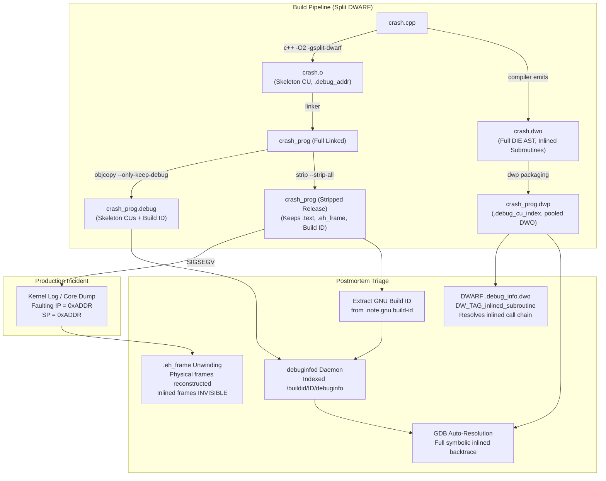

# Drill: Stripped Binary Crash and Split DWARF

> [!summary] Scope
> Timed problem drill presenting a stripped production binary crash with only a raw instruction pointer and a detached Split DWARF (.dwp) package file.
> Challenges the engineer to locate the crash point, reconstruct the stack frame using .eh_frame unwinding, resolve inlined frames via DWARF inlined-subroutine entries and line tables, and configure a local debuginfod daemon.
> Reaches Debug, testing mastery of Stack-Unwinding-CFI-and-Exception-ABI.md and DWARF-Debug-Information-and-Symbol-Bundles.md.

## Related

- Prerequisites: [[Stack-Unwinding-CFI-and-Exception-ABI]], [[DWARF-Debug-Information-and-Symbol-Bundles]]
- Next: [[Drill-Program-Execution-Cross-DSO-Exception-and-RTTI-Failure]]
- See also: [[14-Low-Latency-Systems/13 - Reliability, Ops & Testing/Observability Without Perturbation|Observability Without Perturbation]]
- Lab: `code/00-Program-Execution/drill_split_dwarf/` (requires: linux)

Production systems deploy stripped executables to minimize binary footprint, optimize page cache utilization, and protect internal proprietary logic.
To preserve postmortem debuggability without paying massive link-time penalties in large codebases, modern enterprise build toolchains utilize Split DWARF (`-gsplit-dwarf`).
Split DWARF separates the heavy debugging payload into standalone `.dwo` files during compilation and bundles them into a monolithic `.dwp` container post-link using `dwp`.
When an unhandled segmentation fault occurs in production, the operating system kernel emits only a minimal error line to the system log or generates a core dump containing raw virtual addresses and registers.
The production engineer is tasked with reconstructing the exact execution failure path armed with only the stripped binary, the raw crash instruction pointer, and the detached `.dwp` package.



## Reproduction

The complete reproduction environment is implemented in `code/00-Program-Execution/drill_split_dwarf/`.
The workload simulates an optimized order execution worker where high-frequency risk validation layers are inlined into a top-level processing loop.
The code is compiled under GCC with `-O2 -g -gdwarf-4 -gsplit-dwarf -fdebug-prefix-map=<lab dir>=/lab` and linked with a deterministic GNU Build ID (`-Wl,--build-id=0x11223344556677889900aabbccddeeff11223344`).
The prefix map pins `DW_AT_comp_dir`, so the `dwo_id`, the CU index slot, and the DIE offsets do not change with the directory the lab is built in (checked by running the lab from two different directories and diffing the output).
The recorded output comes from the pinned Ubuntu 24.04 lab image on linux-aarch64 with GCC 13.3.0, binutils 2.42 (`readelf`, `dwp`), and GDB 15.1 (as of 2026-11).
The debug sections are segregated into `crash_prog.debug`, the `.dwo` file is bundled into `crash_prog.dwp` via `dwp` and then deleted so that only the package can satisfy GDB, and the production executable `crash_prog` is stripped with `strip --strip-all`.
The lab prints the full `.eh_frame` entries it discusses and the `readelf` stderr warnings it cites, so every claim below can be read off the recorded output.

To trigger the complete build, crash reproduction, `.eh_frame` inspection, Split DWARF index extraction, and debuginfod resolution pipeline, run the lab entry script:

```bash
bash code/00-Program-Execution/drill_split_dwarf/run.sh
```

## Observed Symptom

When executing the stripped binary `crash_prog` under GDB or capturing its crash from the Linux kernel log, the debugger displays completely stripped call frames without function names, line numbers, or parameter values.
Furthermore, the three intermediate inline functions (`level1_dispatch`, `level2_process`, and `level3_leaf`) are completely absent from the backtrace.

The following terminal output is recorded directly from the lab execution on Linux (linux-aarch64):

```text
=== 1. BUILD STRIPPED BINARY AND SPLIT DWARF PACKAGE ===
Build ID: 11223344556677889900aabbccddeeff11223344
--- Sections in stripped production binary ---
.eh_frame
.eh_frame_hdr
.text
--- Sections in detached Split DWARF package (.dwp) ---
.debug_abbrev.dwo
.debug_line.dwo
.debug_loc.dwo
.debug_str_offsets.dwo
.debug_info.dwo
.debug_str.dwo
.debug_cu_index
.debug_tu_index
--- Sections in the .debug file (skeleton and .debug_addr) ---
.debug_abbrev
.debug_addr
.debug_aranges
.debug_gnu_pubnames
.debug_gnu_pubtypes
.debug_info
.debug_line
.debug_ranges
.debug_str
.symtab
--- Section type of .text in the .debug file (NOBITS means code bytes were dropped) ---
.text NOBITS

=== 2. CRASH SYMPTOM ON STRIPPED BINARY ===
Program received signal SIGSEGV, Segmentation fault.
#0  0xADDR in ?? ()
#1  0xADDR in ?? ()
#2  0xADDR in ?? () from /lib/aarch64-linux-gnu/libc.so.6
#3  0xADDR in __libc_start_main () from /lib/aarch64-linux-gnu/libc.so.6
#4  0xADDR in ?? ()
```

Notice the critical diagnostic limitations evident in this symptom:
1. The `.symtab` symbol table and all `.debug_*` sections were wiped from the release binary, leaving GDB unable to map address `0xADDR` to any function symbol (`?? ()`).
2. Even if the engineer manually looks up `0xADDR` in the unstripped ELF symbol table, the symbol table only reveals the enclosing non-inlined function `physical_worker`.
3. The actual faulting call path originated inside `level3_leaf`, which was called by `level2_process`, which was called by `level1_dispatch`.
   Because the compiler inlined all three functions into `physical_worker` during `-O2` optimization, no physical stack frames were created for them at runtime.
4. The `.dwp` package alone cannot help: it holds no skeleton compilation unit and no `.debug_addr`, so GDB has nothing in the stripped binary that names the package or maps its address indexes to code (Section 6a of the lab output below shows the package next to the executable while GDB still reports `Could not find DWO CU`).

## Progressive Hint Ladder

> [!tip]- Hint 1: Mapping the Raw Instruction Pointer to Binary Virtual Address
> When a process dies from an unhandled fatal signal, the Linux kernel logs an entry to `dmesg` containing the faulting instruction pointer, the stack pointer, and the mapping that contains the instruction pointer.
> On x86-64 the line has the form `crash_prog[1420]: segfault at 0 ip 0000aaaab5bf0764 sp 0000ffffc4052640 error 6 in crash_prog[aaaab5bf0000+1000]` (`show_signal_msg()` in `arch/x86/mm/fault.c`; `error 6` is the x86 page-fault error code for a user-mode write).
> On AArch64, where the lab runs, `arm64_show_signal()` in `arch/arm64/kernel/traps.c` prints `crash_prog[1420]: unhandled exception: <ESR class>, ESR 0x..., <fault name> in crash_prog[aaaab5bf0000+1000]` followed by a register dump that includes `pc`, `lr`, and `sp` (as of 2026-11, Linux master).
> The bracketed `start+size` comes from `print_vma_addr()`: `0xaaaab5bf0000` is the start of the executable mapping that the dynamic linker created for the Position Independent Executable (`PIE`) with `mmap`.
> The link-time virtual address (VMA) of the fault is computed as:
> `VMA = ip - mapping_start + page_align_down(p_vaddr)` of the `PT_LOAD` segment that the mapping covers.
> Inspect the program headers of the stripped binary using `readelf -lW crash_prog` or `eu-readelf -l crash_prog` as detailed in [[ELF-Mach-O-and-PE-Object-Formats]].
> Locate the `PT_LOAD` segment marked with `R E` (Read/Execute) flags that contains `.text`; in the lab binary it starts at `p_vaddr 0x0`, so the VMA is simply `ip - mapping_start`.
> Compute the relative virtual address of the crash point inside the binary; in the lab it is `0x764`, inside `physical_worker` (`0x760..0x76c`).
> Disassemble the machine instruction at that exact offset using `objdump -d --start-address=VMA --stop-address=VMA+4 crash_prog` to determine the faulting CPU opcode; the lab binary shows the store `str w1, [x0]` at `0x764` (GCC 13.3.0, AArch64; on x86-64 the equivalent is `movl $1337, (%rdi)`).

> [!tip]- Hint 2: Decoding Physical Frames with .eh_frame Call Frame Instructions
> Observe why GDB was able to unwind five physical stack frames (`#0` through `#4`) even though the binary was fully stripped and `.symtab` was completely destroyed.
> Standard stripping (`strip --strip-all`) removes the symbol tables (`.symtab`, `.strtab`) and the non-allocated `.debug_*` sections.
> However, `.eh_frame` and `.eh_frame_hdr` are allocated sections (`SHF_ALLOC`, flag `A` in `readelf -SW`) loaded by the read/execute `PT_LOAD` segment, because they are required at runtime for C++ exception propagation (`_Unwind_RaiseException`) and System V ABI stack unwinding.
> The dedicated `PT_GNU_EH_FRAME` program header points only at `.eh_frame_hdr`, the sorted binary-search table that the unwinder uses to find the right FDE in `.eh_frame` (verified with `readelf -lW` on the lab binary: segment `GNU_EH_FRAME` maps `.eh_frame_hdr` alone).
> Inspect the Call Frame Information (CFI) stored in `.eh_frame` using `readelf -wf crash_prog`.
> Identify the Common Information Entry (CIE) and the Frame Description Entry (FDE) covering your crash VMA.
> The CIE specifies the Canonical Frame Address (CFA) base rule (such as `DW_CFA_def_cfa: r31 (sp) ofs 0` or `rsp + 8`) and the return address register column (register 30 `x30`/LR on AArch64, or register 16 `rip` on x86-64).
> Follow the FDE bytecode instructions (`DW_CFA_advance_loc`, `DW_CFA_def_cfa_offset`, `DW_CFA_offset`) to mechanically calculate where the caller's saved instruction pointer and frame pointer were saved on the physical stack.
> Note the crucial architectural constraint: `.eh_frame` operates strictly at the physical machine frame level.
> It contains zero records regarding inline functions or lexical blocks.
> To reconstruct inlined subroutines, you must bridge to DWARF debug information.

> [!tip]- Hint 3: Parsing the Split DWARF Package (.dwp) and Inlined Subroutines
> Split DWARF moves the Debugging Information Entries (DIEs) out of the relocatable object files into `.dwo` files, which `dwp` aggregates into a `.dwp` package.
> Inspect the sections of `crash_prog.dwp` using `readelf -S -W crash_prog.dwp`.
> Notice the presence of `.debug_cu_index`, `.debug_info.dwo`, `.debug_abbrev.dwo`, and `.debug_line.dwo`.
> Dump the Compilation Unit index table using `readelf --debug-dump=cu_index crash_prog.dwp`.
> The `.debug_cu_index` section contains a hash table that maps 64-bit compilation unit signatures (`dwo_id`) to row indices in the section offset and size tables.
> Each row specifies the byte offset and length of that CU's contributions within `.debug_info.dwo` and `.debug_line.dwo`.
> Inspect the DWARF DIE tree inside `.debug_info.dwo` using `readelf -wi crash_prog.dwp`.
> Search for `DW_TAG_inlined_subroutine` entries.
> Notice that each `DW_TAG_inlined_subroutine` contains:
> - `DW_AT_abstract_origin`: A reference to the parent `DW_TAG_subprogram` defining the inline function name and prototype.
> - `DW_AT_call_file` and `DW_AT_call_line`: The source file index and line number where the call occurred.
> - Code address ranges specifying the machine instruction offsets where the inline code was expanded.
> Notice the warning `readelf: Warning: Cannot fetch indexed address: the .debug_addr section is missing` (binutils 2.42, as of 2026-11); the lab prints the unique stderr lines under each `readelf` section.
> The addresses print as `DW_AT_low_pc : (index: 0x7): 0`, an index into `.debug_addr`, not a virtual address.
> The `.dwp` file alone cannot resolve virtual memory addresses because code addresses use indexed forms (`DW_FORM_addrx` or `DW_FORM_GNU_addr_index`) whose underlying address table (`.debug_addr`) resides exclusively in the linked binary or separate `.debug` file.

> [!tip]- Hint 4: Indexing and Automated Symbol Retrieval via Local debuginfod
> To allow GDB to connect the stripped binary to its detached debug symbols, you need two items:
> 1. The GNU Build ID: Extract the unique cryptographic build identifier from the stripped binary using `readelf -n crash_prog` (located in `.note.gnu.build-id`).
> 2. The skeleton debug info file: Generated via `objcopy --only-keep-debug crash_prog crash_prog.debug`.
>    This file retains the `.note.gnu.build-id`, the `.debug_addr` address table, and the skeleton compilation units.
>    In DWARF 5 a skeleton is a `DW_TAG_skeleton_unit` with `DW_AT_dwo_name`, and the `dwo_id` lives in the `DW_UT_skeleton` unit header, not in an attribute (DWARF 5 Sections 3.1.2 and 7.5.1.2).
>    In the GNU DWARF 4 extension that the lab uses (`-gdwarf-4`), it is a `DW_TAG_compile_unit` with `DW_AT_GNU_dwo_name`, `DW_AT_GNU_dwo_id`, and `DW_AT_GNU_addr_base` (verified with `readelf -wi crash.o`).
> GDB can locate this separate debug file using two mechanisms:
> - File-based build-id directory: Place the file at `<debug-dir>/.build-id/xx/yyyyyyyy.debug`, where `xx` is the first two hex characters of the Build ID and `yyyyyyyy` is the remainder, then configure GDB with `set debug-file-directory <debug-dir>`.
> - Network-based debuginfod: Configure a local debuginfod server conforming to the elfutils HTTP specification.
> Run a local debuginfod service that responds to `GET /buildid/<BUILD_ID>/debuginfo` by serving `crash_prog.debug`.
> The lab's `debuginfod_server.py` is a minimal Python stand-in that implements only this one endpoint of the elfutils web API, not the elfutils `debuginfod` daemon.
> Export `DEBUGINFOD_URLS="http://127.0.0.1:8765"` and launch GDB with `set debuginfod enabled on`.
> GDB queries the server using the Build ID extracted from the stripped binary and downloads the skeleton debug file into its cache.
> The `.dwp` is a separate artifact: the debuginfod web API has no type for it, and GDB 15.1 does not look for it next to the executable.
> With `set debug dwarf-read 1` GDB reports `open_and_init_dwp_file`; in the lab it searched for `<executable basename>.dwp` in the directory of the debug file it had loaded, here the Build ID directory of the debuginfod client cache (observed with GDB 15.1, as of 2026-11).
> Only after the `.dwp` is placed there does GDB reconstruct the five-frame inlined call stack.

## Model Solution

> [!success]- Solution
> Here is the complete postmortem triage and symbolication procedure to solve this incident.
>
> ### Phase 1: Reconstruct the Physical Call Stack via `.eh_frame`
> The stripped binary has no symbols, so the lab names the functions from the symbol table that `objcopy --only-keep-debug` kept in `crash_prog.debug`, then prints the complete FDE (every opcode) for each function that matters, plus the shared CIE.
> When inspecting the stripped binary with `readelf -wf crash_prog`, the Call Frame Information table gives the exact unwinding semantics for each function:
>
> ```text
> === 3. PHYSICAL FRAME RECONSTRUCTION VIA .EH_FRAME ===
> --- FDE for main (pc=0000000000000600..) ---
> 000000a4 000000000000001c 000000a8 FDE cie=00000000 pc=0000000000000600..0000000000000618
>   DW_CFA_advance_loc: 4 to 0000000000000604
>   DW_CFA_def_cfa_offset: 16
>   DW_CFA_offset: r29 (x29) at cfa-16
>   DW_CFA_offset: r30 (x30) at cfa-8
>   DW_CFA_advance_loc: 16 to 0000000000000614
>   DW_CFA_restore: r30 (x30)
>   DW_CFA_restore: r29 (x29)
>   DW_CFA_def_cfa_offset: 0
>   DW_CFA_nop
>   DW_CFA_nop
>   DW_CFA_nop
> --- FDE for physical_worker (pc=0000000000000760..) ---
> 00000090 0000000000000010 00000094 FDE cie=00000000 pc=0000000000000760..000000000000076c
>   DW_CFA_nop
>   DW_CFA_nop
>   DW_CFA_nop
> --- FDE for __do_global_dtors_aux (pc=0000000000000700..) ---
> 00000050 0000000000000024 00000054 FDE cie=00000000 pc=0000000000000700..0000000000000750
>   DW_CFA_advance_loc: 4 to 0000000000000704
>   DW_CFA_AARCH64_negate_ra_state
>   DW_CFA_advance_loc: 4 to 0000000000000708
>   DW_CFA_def_cfa_offset: 32
>   DW_CFA_offset: r29 (x29) at cfa-32
>   DW_CFA_offset: r30 (x30) at cfa-24
>   DW_CFA_advance_loc: 8 to 0000000000000710
>   DW_CFA_offset: r19 (x19) at cfa-16
>   DW_CFA_advance_loc: 56 to 0000000000000748
>   DW_CFA_restore: r30 (x30)
>   DW_CFA_restore: r29 (x29)
>   DW_CFA_restore: r19 (x19)
>   DW_CFA_def_cfa_offset: 0
>   DW_CFA_advance_loc: 4 to 000000000000074c
>   DW_CFA_AARCH64_negate_ra_state
>   DW_CFA_nop
>   DW_CFA_nop
>   DW_CFA_nop
> --- CIE shared by all FDEs ---
> 00000000 0000000000000010 00000000 CIE
>   Version:               1
>   Augmentation:          "zR"
>   Code alignment factor: 4
>   Data alignment factor: -8
>   Return address column: 30
>   Augmentation data:     1b
>   DW_CFA_def_cfa: r31 (sp) ofs 0
> ```
>
> Parsing the CIE and the FDE rules reveals:
> 1. The Common Information Entry defines the baseline CFA computation as register 31 (`sp`) plus offset 0, with return address column 30 (`x30`).
> 2. The FDE covering `main` (`0x600..0x618`) executes `DW_CFA_def_cfa_offset: 16` after its first instruction (`stp x29, x30, [sp, #-16]!`), so the Canonical Frame Address is `sp + 16`.
> 3. The rule `DW_CFA_offset: r30 (x30) at cfa-8` establishes that the return address (`lr`/`x30`) is stored at `CFA - 8` (which equals `sp + 8`).
> 4. The rule `DW_CFA_offset: r29 (x29) at cfa-16` establishes that the caller's frame pointer is preserved at `CFA - 16` (which equals `sp`).
> 5. The FDE for `physical_worker` (`0x760..0x76c`) contains only `DW_CFA_nop` padding: the function does not spill registers or allocate stack space, so its CFA remains `sp + 0` and the return address stays in `x30`.
> 6. The `__do_global_dtors_aux` FDE (from the C runtime object `crtbegin.o`) is a useful contrast: it saves `x29`/`x30` at `cfa-32`/`cfa-24` in a 32-byte frame and brackets its body with `DW_CFA_AARCH64_negate_ra_state` for return-address signing.
>
> This unwinding bytecode allows libgcc's unwinder, libunwind, or GDB to cleanly step from `physical_worker` back to `main` (return address in `x30`), and from `main` back into libc (return address at `CFA - 8`).
> However, because `.eh_frame` models CPU register preservation rather than source language semantics, the inline functions `level1_dispatch`, `level2_process`, and `level3_leaf` do not appear in any entry above.
>
> ### Phase 2: Inspect the Split DWARF Index and Inlined Subroutines
> Inspecting the `.debug_cu_index` table of `crash_prog.dwp` demonstrates how the DWARF package file multiplexes debug information:
>
> ```text
> === 4. SPLIT DWARF PACKAGE (.DWP) CU INDEX ===
> readelf exit status: 1
>   Version:                 2
>   Number of columns:       5
>   Number of used entries:  1
>   Number of slots:         16
>   Offset table
>   slot  dwo_id                 info   abbrev     line      loc  str_off
>   [  2] 0xADDR        0        0        0        0        0
>   Size table
>   slot  dwo_id                 info   abbrev     line      loc  str_off
>   [  2] 0xADDR     3004      829      452       88      568
> --- readelf stderr (unique) ---
> readelf: Warning: Section .debug_tu_index is too small to contain a CU/TU header
> ```
>
> The index maps the 64-bit compilation unit identifier (`dwo_id`, scrubbed to `0xADDR` in the recorded output) to the exact byte offset (0) and length (3004 bytes) inside `.debug_info.dwo`.
> `readelf` exits with status 1 because the empty `.debug_tu_index` is too small to hold a header; the CU index itself is intact.
> `Version: 2` is the GNU DWARF 4 package format that `-gdwarf-4` produces; the DWARF 5 index format is version 5.
> The CU lands in slot 2 because the primary hash is the low `k` bits of the `dwo_id` (16 slots, so `k = 4`) and the unscrubbed `dwo_id` of the recorded run, `0xb9a5342880534b32`, ends in hex digit `2` (DWARF 5 Section 7.3.5.3).
> The `dwo_id`, and with it the slot number, depends on the build directory recorded in `DW_AT_comp_dir`; the lab pins that directory with `-fdebug-prefix-map`, so the values above hold wherever the lab is built.
> Traversing `.debug_info.dwo` reveals the nested `DW_TAG_inlined_subroutine` call hierarchy:
>
> ```text
> === 5. INLINED SUBROUTINE DIE RESOLUTION ===
>     <aeb>   DW_AT_abstract_origin: <0xafd>
>  <2><b20>: Abbrev Number: 47 (DW_TAG_inlined_subroutine)
>     <b21>   DW_AT_abstract_origin: <0xb7a>
>     <b31>   DW_AT_call_line   : 21
>     <b34>   DW_AT_abstract_origin: <0xb84>
>  <3><b40>: Abbrev Number: 49 (DW_TAG_inlined_subroutine)
>     <b41>   DW_AT_abstract_origin: <0xb91>
>     <b4c>   DW_AT_call_line   : 16
>     <b4f>   DW_AT_abstract_origin: <0xb9b>
>  <4><b5b>: Abbrev Number: 49 (DW_TAG_inlined_subroutine)
>     <b5c>   DW_AT_abstract_origin: <0xba8>
>     <b67>   DW_AT_call_line   : 11
>     <b6a>   DW_AT_abstract_origin: <0xbae>
>     <b7b>   DW_AT_name        : (indexed string: 0x64): level1_dispatch
>     <b92>   DW_AT_name        : (indexed string: 0x2c): level2_process
>     <ba9>   DW_AT_name        : (indexed string: 0x34): level3_leaf
> --- readelf stderr (unique) ---
> readelf: Warning: Cannot fetch indexed address: the .debug_addr section is missing
> readelf: Warning: Section .debug_tu_index is too small to contain a CU/TU header
> ```
>
> Each inlined DIE reaches its name through `DW_AT_abstract_origin`, which the lab now prints: `<0xb7a>`, `<0xb91>`, and `<0xba8>` point at the abstract `DW_TAG_subprogram` DIEs at `0xb7a`, `0xb91`, and `0xba8`, whose `DW_AT_name` attributes (at `0xb7b`, `0xb92`, and `0xba9`) are the three name lines at the end of the excerpt: `level1_dispatch`, `level2_process`, and `level3_leaf`.
> The `Cannot fetch indexed address` warning is the missing `.debug_addr`: the `.dwp` alone cannot turn code-address indexes into addresses.
> The AST shows three nested inlined scopes:
> - Depth 2: `level1_dispatch` is inlined into `physical_worker` at `crash.cpp:21`.
> - Depth 3: `level2_process` is inlined into `level1_dispatch` at `crash.cpp:16`.
> - Depth 4: `level3_leaf` is inlined into `level2_process` at `crash.cpp:11`.
>
> The leaf function executes the null pointer dereference at line 6 (`*ptr = 1337`).
>
> ### Phase 3: Configure debuginfod and Execute Full Symbolic Unwinding
> Because the production executable had all debug sections stripped, GDB cannot use `crash_prog.dwp` without the skeleton compilation units that link the binary's address space to the external DWO IDs.
> The skeleton units and `.debug_addr` table are stored in `crash_prog.debug`.
>
> To resolve this via the elfutils debuginfod protocol:
> 1. Extract the GNU Build ID:
>    ```bash
>    readelf -n crash_prog | grep "Build ID:" | awk '{print $3}'
>    # Output: 11223344556677889900aabbccddeeff11223344
>    ```
> 2. Archive the skeleton debug file under the build ID key:
>    ```bash
>    mkdir -p symbols/
>    cp crash_prog.debug symbols/11223344556677889900aabbccddeeff11223344.debug
>    ```
> 3. Start a local debuginfod server serving the directory on port 8765 (the lab uses its minimal Python stand-in, `debuginfod_server.py`, and waits until the port accepts connections; in production run elfutils `debuginfod`).
> 4. Launch GDB with debuginfod enabled:
>    ```bash
>    export DEBUGINFOD_URLS="http://127.0.0.1:8765"
>    gdb -q -batch -ex "set debuginfod enabled on" -ex "file ./crash_prog" -ex "r" -ex "bt"
>    ```
>
> GDB issues an HTTP request to `http://127.0.0.1:8765/buildid/11223344556677889900aabbccddeeff11223344/debuginfo` and stores the skeleton debug file in its client cache (`$DEBUGINFOD_CACHE_PATH`, default `~/.cache/debuginfod_client/`).
> Fetching the skeleton is not enough, as the lab shows in Section 6a, where `crash_prog.dwp` sits next to the executable and GDB still cannot find the DWO unit:
>
> ```text
> === 6. DEBUGINFOD SYMBOL RETRIEVAL AND FULL STACK UNWINDING ===
> --- 6a. debuginfod serves the .debug file; crash_prog.dwp sits next to the executable ---
> crash_prog.dwp next to crash_prog: yes
> warning: Could not find DWO CU crash.dwo(0xADDR) referenced by CU at offset 0xADDR [in module DEBUGFILE]
> Program received signal SIGSEGV, Segmentation fault.
> #0  physical_worker(int volatile*) () at crash.cpp:6
> #1  0xADDR in main () at crash.cpp:26
> --- requests the debuginfod stand-in served ---
> [debuginfod] SERVE /buildid/11223344.../debuginfo (200 OK)
> ```
>
> GDB looks for `<executable basename>.dwp` in the directory of the debug file it loaded, so the package has to be delivered next to the fetched file (the debuginfod web API has no `.dwp` type).
> Section 6b copies `crash_prog.dwp` into that directory, GDB reports `DWP file found`, parses the inlined subroutine DIEs, and produces the complete symbolic backtrace:
>
> ```text
> --- 6b. the same .dwp copied next to the fetched debug file ---
> [dwarf-read] open_and_init_dwp_file: DWP file found: <fetched debug file dir>/crash_prog.dwp
> Program received signal SIGSEGV, Segmentation fault.
> #0  level3_leaf (ptr=0xADDR) at crash.cpp:6
> #1  level2_process (ptr=0xADDR) at crash.cpp:11
> #2  level1_dispatch (ptr=0xADDR) at crash.cpp:16
> #3  physical_worker (ptr=ptr@entry=0xADDR) at crash.cpp:21
> #4  0xADDR in main (argc=<optimized out>, argv=<optimized out>) at crash.cpp:26
> ```
>
> The crash is conclusively isolated to `crash.cpp:6` inside `level3_leaf` called through `level2_process` and `level1_dispatch`.

## Core Takeaway

Modern production debugging separates runtime execution efficiency from offline postmortem fidelity:
1. **The Physical Stack vs The Logical Stack:** Compilers operating at high optimization levels (`-O2`, `-O3`) collapse function call hierarchies via aggressive function inlining.
   Runtime unwinding tables (`.eh_frame` and `.eh_frame_hdr`) exist solely to restore CPU register state and unwind physical stack frames during C++ exception handling; they possess no knowledge of inlined subroutines.
   Only DWARF debug information (`DW_TAG_inlined_subroutine`) preserves the logical source call chain.
2. **The Split DWARF Contract:** Split DWARF (`-gsplit-dwarf`) eliminates link-time memory and I/O bottlenecks by keeping the heavy debugging ASTs inside `.dwo` files and combining them with `dwp`.
   However, the linked binary or companion `.debug` file MUST retain the skeleton compilation units and the `.debug_addr` address table.
   Without `.debug_addr`, a `.dwp` file cannot resolve code virtual addresses, and the `.dwp` itself must be delivered to where the debugger looks for it (GDB 15.1 looked beside the loaded debug file, not beside the stripped executable).
3. **Build ID Grounding:** A stripped production binary must always embed a GNU Build ID (`.note.gnu.build-id`), a content hash (SHA-1 by default with `-Wl,--build-id`) or, as in the lab, an explicit value.
   The Build ID acts as the immutable global key connecting stripped production binaries, crash dumps, and detached `.debug` skeleton files across debuginfod servers.
   The elfutils debuginfod web API serves `debuginfo`, `executable`, `source`, and `section` artifacts per Build ID and has no `.dwp` artifact type (debuginfod(8), as of 2026-11), so the `.dwp` must travel by another channel or have its contents merged into the served debug file.

For detailed coverage of the underlying call frame mechanisms and DWARF section structures, see [[Stack-Unwinding-CFI-and-Exception-ABI]] and [[DWARF-Debug-Information-and-Symbol-Bundles]].
For dynamic loader failure modes and relocation mechanics, see [[Dynamic-Linking-PLT-GOT-and-Loaders]] and [[Diagnose-Dynamic-Linker-and-ABI-Failures]].

## Interview Questions

### Question 1 (L5, Predict-the-output)
A C++ program is compiled twice: first using `g++ -O2 -g -c worker.cpp -o worker_standard.o`, and second using `g++ -O2 -g -gsplit-dwarf -c worker.cpp -o worker_split.o`.
Predict which ELF sections will be present in `worker_split.o` compared to `worker_standard.o`, and describe where the bulk of the `.debug_info` and `.debug_line` data is placed.

> [!success]- Answer
> Both commands default to DWARF 5 on GCC 11 and later.
> In the standard compilation (`worker_standard.o`), the object file contains monolithic DWARF sections including `.debug_info`, `.debug_abbrev`, `.debug_line`, `.debug_line_str`, `.debug_str`, `.debug_loclists`, and `.debug_rnglists`.
> In the Split DWARF compilation (`worker_split.o`), the compiler generates two distinct files: `worker_split.o` and `worker_split.dwo`.
> The object file `worker_split.o` retains code, data, relocations, `.eh_frame`, and lightweight DWARF skeleton sections:
> - A minimal `.debug_info` section containing only a `DW_TAG_skeleton_unit` (DWARF 5, with `DW_AT_dwo_name` and `DW_AT_addr_base`, and the `dwo_id` in the unit header) or, under `-gdwarf-4`, a `DW_TAG_compile_unit` with `DW_AT_GNU_dwo_name` and `DW_AT_GNU_dwo_id`.
> - The full `.debug_line` line-number program, which stays in the object because it carries relocated code addresses.
> - A non-allocated `.debug_addr` section (with its `.rela.debug_addr` relocations) tracking addresses referenced by the DWO file, plus `.debug_aranges`, `.debug_rnglists`, and GCC's `.debug_gnu_pubnames`/`.debug_gnu_pubtypes`.
> The heavy DWARF payload, the bulk of `.debug_info`, is diverted into `worker_split.dwo`, which contains `.debug_info.dwo`, `.debug_abbrev.dwo`, `.debug_line.dwo`, `.debug_loclists.dwo`, `.debug_rnglists.dwo`, `.debug_str.dwo`, and `.debug_str_offsets.dwo` (DWARF 5; under `-gdwarf-4` the location lists are `.debug_loc.dwo`).
> `.debug_line.dwo` holds only a specialized table of directories and file names for the split units, not a line program (DWARF 5 Sections 3.1.4 and 7.3.2).
> All of the above was observed with GCC 13.3.0 and binutils 2.42 in the lab image (as of 2026-11).
> When linking `worker_split.o` into the final executable, the linker processes only the lightweight object file, ignoring the `.dwo` file entirely and reducing link time.

### Question 2 (L5, Operational use)
Why does the standard GNU `strip` utility (`strip --strip-all`) preserve `.eh_frame` and `.eh_frame_hdr` while completely removing `.debug_frame`, `.symtab`, and `.strtab`?

> [!success]- Answer
> The key distinction lies in the ELF section flags (`sh_flags`) and program header segments:
> - `.debug_frame`, `.symtab`, and `.strtab` are non-allocated sections (`sh_flags` does not have `SHF_ALLOC`).
>   They are not mapped into virtual memory during process execution and are used exclusively by offline tools like linkers and debuggers.
> - `.eh_frame` and `.eh_frame_hdr` have the `SHF_ALLOC` flag set and are covered by a `PT_LOAD` segment; the dedicated `PT_GNU_EH_FRAME` segment header points at `.eh_frame_hdr` only, the lookup table the unwinder uses to find FDEs in `.eh_frame`.
>   They are loaded directly into the process address space at runtime.
> Under the System V AMD64 and Itanium C++ ABIs, `.eh_frame` is required at runtime for language runtime operations, specifically C++ exception handling (`throw` / `catch`), thread cancellation in `pthreads`, and stack unwinding via `_Unwind_RaiseException`.
> If `strip` were to remove `.eh_frame`, every thrown exception, even one with a matching `catch`, would fail to unwind and end in `std::terminate`, and other unwind-based operations such as `pthread_cancel` would fail the same way.

### Question 3 (L6, Debug-this)
An operations engineer captures a core dump from a stripped production service and attempts to debug it using GDB.
The engineer downloads the detached `.dwp` file (`service.dwp`) produced by CI and places it in the same directory as `service`.
However, running `gdb ./service ./core` still outputs `(No debugging symbols found in ./service)` and backtraces display only raw hexadecimal addresses (`?? ()`).
What is the root cause of this failure, and what exact steps are required to restore full symbolication?

> [!success]- Answer
> The root cause is that the binary deployed to production was aggressively stripped with `strip --strip-all` or `strip -s`, which wiped out the DWARF skeleton compilation units (`DW_TAG_skeleton_unit` in DWARF 5, a `DW_TAG_compile_unit` with `DW_AT_GNU_dwo_name` under `-gdwarf-4`).
> A `.dwp` file is not an executable or independent symbol file; it is an index-addressed package of `.dwo` contributions keyed by 64-bit compilation unit hashes (`dwo_id`).
> GDB cannot load a `.dwp` file in isolation because:
> 1. GDB needs the skeleton compilation units from the binary to learn which `.dwp` file to open and which DWO IDs correspond to which compilation units.
> 2. The `.dwp` file uses indexed addresses (`DW_FORM_addrx`), which require the `.debug_addr` section residing in the binary to map back to virtual addresses.
> To restore full symbolication:
> 1. Retrieve the unstripped skeleton debug file (`service.debug`) archived by CI prior to stripping (created via `objcopy --only-keep-debug service service.debug`).
> 2. Make GDB find `service.debug`: place it in a build-id path (`/usr/lib/debug/.build-id/xx/yyyy.debug`), or, if CI ran `objcopy --add-gnu-debuglink=service.debug service` before shipping, next to `service`.
>    A same-named `service.debug` without a `.gnu_debuglink` is not found; in the lab image GDB 15.1 still printed `?? ()` frames for that layout, while the build-id layout and `symbol-file` both produced the full inlined backtrace (as of 2026-11).
>    Put `service.dwp` in the directory of the debug file GDB loads, because that is where GDB 15.1 looked for `<executable basename>.dwp` in the lab (`set debug dwarf-read 1` prints the path it tried); a `.dwp` next to the stripped executable alone was not found (as of 2026-11).
> 3. Launch GDB pointing to the debug file or configure the symbol file explicitly:
>    `gdb -iex "set debug-file-directory /usr/lib/debug" ./service ./core`
>    Or inside GDB: `symbol-file service.debug`.

### Question 4 (L6, Mechanism internals)
Explain the binary layout and hash table lookup algorithm of the `.debug_cu_index` section in a DWARF 5 package file (`.dwp`).
How does a debugger achieve $O(1)$ lookup time when resolving a 64-bit compilation unit signature (`dwo_id`)?

> [!success]- Answer
> Under the DWARF 5 specification (Section 7.3.5.3, Format of the CU and TU Index Sections), the `.debug_cu_index` section begins with a 16-byte fixed header:
> - `version` (2 bytes, `uhalf`): Index format version, 5 in DWARF 5 and independent of the DWARF version; the pre-standard GNU DWARF 4 package format uses version 2, as the lab's `Version: 2` shows.
> - `padding` (2 bytes, `uhalf`): Reserved, must be zero.
> - `section_count` (4 bytes, `uword`): Number of section columns ($N$) in the offset and size tables.
> - `unit_count` (4 bytes, `uword`): Total number of units indexed ($U$).
> - `slot_count` (4 bytes, `uword`): Total number of slots in the hash table ($M$, a power of 2, $M = 2^k$ with $2^k > 3U/2$).
> Following the header are four sequential tables:
> 1. The Hash Table: An array of $M$ 64-bit signatures, starting at offset 16.
> 2. The Parallel Index Table: An array of $M$ 32-bit row indices, starting at offset $16 + 8M$; unused slots hold 0 in both tables, and a used slot's row index is never 0.
> 3. The Table of Offsets, starting at offset $16 + 12M$: one header row of $N$ section identifiers (`DW_SECT_INFO`, `DW_SECT_ABBREV`, `DW_SECT_LINE`, and so on), then $U$ data rows of $N$ 4-byte offsets, with data rows indexed from 1.
> 4. The Table of Sizes: $U$ rows of $N$ 4-byte contribution sizes in the same column order.
> To look up a compilation unit signature $S$:
> 1. Compute the primary hash slot: $h_1 = S \ \& \ (M - 1)$, the low $k$ bits.
> 2. If the slot contains $S$, read row index $R$ from the parallel index table at the same slot.
> 3. If the slot is unused (all zeros), stop: the signature is absent.
> 4. Otherwise compute the secondary step $h_2 = (((S \gg 32) \ \& \ (M - 1)) \mid 1)$, set $h_1 = (h_1 + h_2) \bmod M$, and repeat from step 2; because $h_2$ is odd and $M$ is a power of 2 larger than $U$, the probe always terminates.
> 5. Row $R$ directly indexes into the offset and size tables, yielding the exact offsets and lengths of every section contribution belonging to that CU in expected $O(1)$ time, since the load factor stays below 2/3.

### Question 5 (L6, Architecture & ABI)
Why do `DW_TAG_inlined_subroutine` entries inside `.debug_info.dwo` utilize indexed address forms (`DW_FORM_addrx` or `DW_FORM_GNU_addr_index`) rather than storing direct 64-bit virtual memory addresses (`DW_FORM_addr`)?

> [!success]- Answer
> The fundamental goal of Split DWARF is to eliminate linker overhead by ensuring the static linker never has to open, parse, relocate, or write `.dwo` files.
> In standard DWARF, every function and inline subroutine scope references absolute code addresses (`DW_AT_low_pc`, `DW_AT_high_pc`, `DW_AT_ranges`).
> During compilation, the compiler does not know the final virtual addresses of functions; therefore, it emits ELF relocation entries (`R_X86_64_64` or `R_AARCH64_ABS64`) for every address reference in `.debug_info`.
> If `.dwo` files contained absolute addresses, the linker would be forced to process hundreds of thousands of relocations inside every `.dwo` file, negating all link-time savings.
> To prevent this, Split DWARF introduces address indexing:
> 1. The compiler places all code addresses into a single `.debug_addr` section in the `.o` file.
> 2. Inside `.debug_info.dwo`, the compiler encodes addresses as simple integer offsets using `DW_FORM_addrx` pointing into `.debug_addr`.
> 3. During linking, the static linker only merges and relocates the compact `.debug_addr` sections into the executable.
> 4. The `.dwo` files remain completely relocation-free, allowing them to be packaged by `dwp` without linker intervention.

### Question 6 (L7, System design)
In low-latency trading engines or real-time continuous profiling agents (such as eBPF-based profilers), what are the performance, latency, and memory trade-offs between frame-pointer unwinding, `.eh_frame` CFI unwinding, and full DWARF line table parsing?

> [!success]- Answer
> Continuous profilers and real-time execution engines must balance stack unwinding overhead against binary performance:
> | Metric | Frame Pointer Unwinding (`-fno-omit-frame-pointer`) | `.eh_frame` CFI Unwinding | Full DWARF Line Tables (`.debug_line` / `.dwp`) |
> | :--- | :--- | :--- | :--- |
> | Unwinding work | Follow the saved frame-pointer chain: one load per frame | Find the FDE through the `.eh_frame_hdr` search table, then interpret its bytecode (lab Section 3) | Not an unwinder: a line program maps an address to file and line, and the DIE tree adds inline scopes |
> | Where it runs | `perf record --call-graph fp` is the default for user space and unwinds from the frame-pointer chain | `perf record --call-graph dwarf` copies the user stack at each sample (8192 bytes by default) and unwinds with CFI using libunwind or libdw | Offline symbolication after the fact |
> | Cost on the profiled program | Needs frame pointers in the binary: costs a register and prologue and epilogue instructions, with an effect that depends on the workload and must be measured | None at runtime beyond the stack copy; compilers keep all registers free | None at runtime |
> | Inlined frames | Invisible: only physical frames exist (lab Section 2) | Invisible: `.eh_frame` has no inline records (lab Section 3) | Recovered from `DW_TAG_inlined_subroutine` (lab Section 5) |
> | Footprint | None | Allocated `.eh_frame` and `.eh_frame_hdr` in the read/execute `PT_LOAD` segment (lab Section 1 keeps them through `strip`) | Non-allocated debug sections in detached files; the lab's CU index reports 3004 bytes of `.debug_info.dwo` for the 28-line `crash.cpp` |
>
> The perf-record man page warns that binaries built with `--fomit-frame-pointer` can produce bogus frame-pointer call graphs and recommends `dwarf` in that case (as of 2026-11, Linux).
> No overhead percentage is claimed here: measure the frame-pointer cost on your own workload before deciding.
>
> Architectural paving rule:
> For continuous profiling, build with frame pointers so that cheap frame-pointer sampling works, or sample with CFI-based unwinding and accept the stack copy per sample; SFrame (`.sframe`, a compact stack-trace format for AMD64, AAPCS64, and s390x per the binutils SFrame specification) is a third route aimed at low-overhead stack traces.
> Defer inlined function symbolication and line number resolution to an asynchronous offline daemon that fetches debug files by Build ID from debuginfod and the matching `.dwp` through a separate channel, because debuginfod has no `.dwp` type.

### Question 7 (L7, Enterprise infrastructure)
Design an enterprise-scale symbol management and crash reporting infrastructure for an engineering organization with 5,000 developers and 50,000 daily CI builds.
How do you structure build-id indexing, storage lifecycle retention, debuginfod proxying, and Split DWARF handling?

> [!success]- Answer
> A production-grade symbol architecture consists of four distinct layers:
> 1. **CI Pipeline Integration & Ingestion:**
>    - Every release build compiles with `-gsplit-dwarf -Wl,--build-id=sha1`.
>    - The post-link stage runs `objcopy --only-keep-debug app app.debug` and `dwp -e app -o app.dwp`.
>    - The release executable is stripped with `strip --strip-unneeded app` and published to deployment registries.
>    - CI uploads `app.debug` and `app.dwp` to an S3/GCS object store organized by Build ID: `s3://symbols/build-id/xx/yyyyyyyy.debug` and `s3://symbols/build-id/xx/yyyyyyyy.dwp`.
>    - The elfutils debuginfod web API has no `.dwp` artifact type (it serves `debuginfo`, `executable`, `source`, and `section`; debuginfod(8), as of 2026-11), so either merge the `.dwp` contents into the served `app.debug` or fetch `app.dwp` by Build ID from the object store with a separate client step.
> 2. **Storage Tiering and Lifecycle (an example policy; the numbers are design choices to tune to your incident-response window, not measured facts):**
>    - Hot Tier (NVMe cache on debuginfod servers): Retains debug symbols for all active production deployments and builds from the last 14 days.
>    - Warm Tier (Standard Object Storage): Retains artifacts for 90 days covering all releases, staging builds, and customer deployments.
>    - Cold Tier (Glacier / Archive): Keeps release tag symbols for 3 years for regulatory compliance; transient development branch builds are purged after 14 days.
> 3. **Federated debuginfod Architecture:**
>    - Deploy read-through `debuginfod` edge proxies in each Kubernetes cluster or datacenter region.
>    - Edge proxies maintain local on-disk LRU caches (`$DEBUGINFOD_CACHE_PATH`).
>    - When a developer or crash ingestion worker runs GDB, `debuginfod` checks the local cache.
>      On a miss, it federates upstream to the object store proxy.
> 4. **Crash Reporting Ingestion Pipeline:**
>    - When a production service dies, `systemd-coredump` or Crashpad extracts the registers, memory mappings, and `.note.gnu.build-id`.
>    - The crash report worker queries debuginfod using the Build ID for the `.debug` file, retrieves the matching `.dwp` through the channel chosen above, and automatically symbolicates the inlined call stack before filing a ticket.

### Question 8 (L7+, Frontier reasoning)
How does Split DWARF interact with Link-Time Optimization (LTO) and ThinLTO?
Specifically, what happens to cross-module inlined subroutines when the compiler inlines a function from `module_b.cpp` into `module_a.cpp` under distributed ThinLTO?

> [!success]- Answer
> Under non-LTO compilation, inlining occurs strictly within single translation units.
> The compiler emits `DW_TAG_inlined_subroutine` entries whose abstract origin (`DW_AT_abstract_origin`) points to a `DW_TAG_subprogram` located within the same `.dwo` file.
> Under Link-Time Optimization (LTO) and ThinLTO, functions are aggressively inlined across translation unit boundaries:
> 1. In ThinLTO, an LLVM feature (GCC's partitioned LTO, WHOPR, works differently), during the parallel code generation phase the backend imports LLVM IR from `module_b.cpp` into `module_a.cpp`.
> 2. If a function from `module_b` is inlined into `module_a`, the backend compiler generating `module_a.dwo` must emit a `DW_TAG_inlined_subroutine` entry for the imported function.
> 3. To maintain self-contained DWO units, the compiler cannot emit a cross-file DWARF reference pointing directly into `module_b.dwo`; LLVM keeps cross-CU references in DWO files off by default (hidden option `-split-dwarf-cross-cu-references`, default false, in `llvm/lib/CodeGen/AsmPrinter/DwarfDebug.cpp`, as of 2026-11).
> 4. Instead, `DwarfDebug::getOrCreateAbstractSubprogramCU` places the abstract subprogram in the inlining CU, so the compiler duplicates the out-of-line declaration (`DW_TAG_subprogram`) of the imported function as an abstract origin inside `module_a.dwo`, referencing type signatures that may also be duplicated or referenced via Type Units (`.debug_types` or `DW_UT_type`).
> 5. When `dwp` aggregates these DWO files into `app.dwp`, the CU index records separate entries for `module_a` and `module_b`.
>    GDB resolves the cross-module inlined frame by traversing the abstract origin within `module_a.dwo`, while `.debug_addr` in the main binary supplies the final relocated execution ranges.
