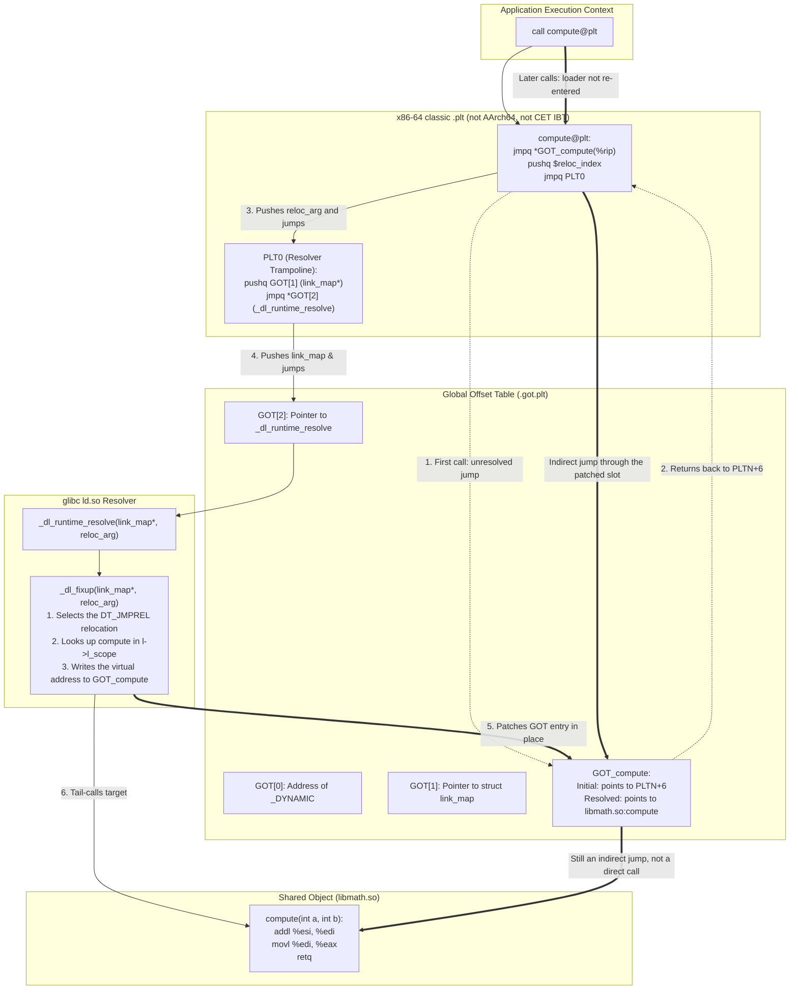
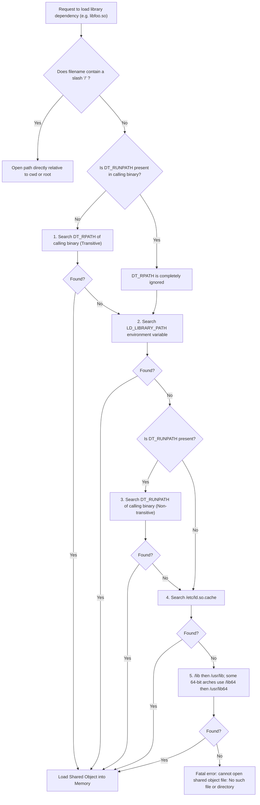

# Dynamic Linking, PLT, GOT, and Loaders

> [!summary] Claim:
> Position-independent code executes across arbitrary process virtual address spaces without text relocation by routing global data accesses through PC-relative Global Offset Table (GOT) slots and external function calls through Procedure Linkage Table (PLT) stubs.
> Under lazy binding, the first invocation of an external function traps into the dynamic loader resolver via PLT0 to bind the symbol and rewrite the GOT entry in place.
> Immediate binding (any nonempty `LD_BIND_NOW`, or `-Wl,-z,now`) resolves PLT relocations at startup so Full RELRO can seal `.got.plt` read-only with `mprotect(PROT_READ)`.
> Linux `ld.so` locates a slash-free `DT_NEEDED` name by directory search: `DT_RPATH` only when `DT_RUNPATH` is absent, then `LD_LIBRARY_PATH` unless secure-execution mode, then `DT_RUNPATH`, then `/etc/ld.so.cache`, then the default directories.
> Symbol lookup is a separate breadth-first walk of already loaded objects, and the first global definition preempts later ones.
> macOS `dyld4` binds each symbol to the dylib named by the two-level namespace, and intercepting a call takes `DYLD_INSERT_LIBRARIES` together with an `__DATA,__interpose` section.



## The Mechanism

Dynamic linking defers the resolution of memory addresses for data and code from link time to program execution time.
This mechanism allows multiple running processes to share a single copy of read-only executable instructions in physical memory while maintaining private writable data structures.
The fundamental contract between the compiler, the static linker, the dynamic loader, and the operating system kernel is defined by the System V generic ABI (gABI), processor-specific ABI supplements (psABI), and platform loaders such as GNU `ld.so` and Apple `dyld4`.

### 1. Position-Independent Code (PIC) and Indirection

In early Unix systems, shared libraries were assigned fixed virtual address slots.
If two libraries collided in their assigned address space, one had to be relocated on disk or remapped with runtime text relocations (`DT_TEXTREL`).
Text relocations require the dynamic loader to modify instructions in the `.text` segment via `mprotect(PROT_READ | PROT_WRITE)`.
Modifying `.text` dirty private copy-on-write memory pages, destroying physical page sharing across processes and increasing memory footprints.

Position-Independent Code (PIC), enabled by `-fPIC`, eliminates text relocations by ensuring code contains no absolute memory addresses.
All references to program code and data within the same compilation unit use instruction-pointer-relative (PC-relative) addressing:
- On x86-64, instructions use RIP-relative addressing modes such as `movq var(%rip), %rax`.
- On AArch64, instructions use PC-relative page-offset pairs such as `adrp x0, var` followed by `ldr x0, [x0, #:lo12:var]`.

Because the distance between the code segment (`.text`) and the data segment (`.data`, `.got`) is fixed at link time by the static linker, RIP-relative addressing enables code to locate its companion data regardless of where the kernel loads the ELF object into the virtual address space.
When code must reference a variable or function defined in an external shared object whose base address is unknown until runtime, direct PC-relative addressing is impossible.
The compiler and linker resolve this dilemma by introducing two indirection tables: the Global Offset Table (GOT) for data, and the Procedure Linkage Table (PLT) for functions.

Position-Independent Executables (PIE), enabled by `-fPIE` and `-pie`, compile the main application binary itself as position-independent.
This allows the operating system kernel to map the main executable at a randomized virtual address during `execve`, completing Address Space Layout Randomization (ASLR) protection across the entire process image.
[[Virtual-Memory-Mmap-and-Process-Address-Space]] covers the kernel address space layout and ASLR entropy bounds.

### 2. Anatomy of the GOT and PLT

The Global Offset Table and Procedure Linkage Table divide responsibilities between data references and executable control transfer.

```
+-------------------------------------------------------------------------+
|                              ELF Object File                            |
|                                                                         |
|  .text (Executable, Read-Only)                                          |
|  +-------------------------------------------------------------------+  |
|  | call foo@plt  ---->  .plt Section                                 |  |
|  |                      PLT0: pushq GOT[1]; jmpq *GOT[2]             |  |
|  |                      PLT1: jmpq *GOT_foo; pushq $idx; jmpq PLT0   |  |
|  +-------------------------------------------------------------------+  |
|                                     |                     ^             |
|                                     v                     |             |
|  .got.plt (Data, Read-Write / RELRO)|                     |             |
|  +----------------------------------+---------------------+----------+  |
|  | GOT[0]: &_DYNAMIC                                      |          |  |
|  | GOT[1]: struct link_map * (populated by ld.so)         |          |  |
|  | GOT[2]: &_dl_runtime_resolve (populated by ld.so)      |          |  |
|  | GOT_foo: initially points to PLT1 + 6 -----------------+          |  |
|  |          updated by resolver to &libfoo:foo                       |  |
|  +-------------------------------------------------------------------+  |
+-------------------------------------------------------------------------+
```

#### The Global Offset Table (.got and .got.plt)

The GOT is an array of absolute virtual addresses allocated in the writable data segment of an ELF binary.
Modern ELF linkers split the GOT into two distinct sections:
1. `.got`: Stores absolute pointers to global data variables.
   Relocations targeting `.got` (such as `R_X86_64_GLOB_DAT` on x86-64 or `R_AARCH64_GLOB_DAT` on AArch64) are resolved immediately during program loading by `ld.so`.
2. `.got.plt`: Stores target addresses for external functions invoked through the PLT.
   Relocations targeting `.got.plt` use type `R_X86_64_JUMP_SLOT` or `R_AARCH64_JUMP_SLOT`.

The AMD64 psABI procedure-linkage section (`object-files/dl.tex`) reserves the first three `.got.plt` entries.
It does not name glibc types.
- `GOT[0]`: Holds the virtual address of the dynamic section (`_DYNAMIC`).
- `GOT[1]`: Reserved so the loader can identify this object.
  glibc stores a `struct link_map *` there.
- `GOT[2]`: Reserved for the loader's resolver entry.
  glibc stores `_dl_runtime_resolve` there.

Subsequent slots (`GOT[3]`, `GOT[4]`, ..., `GOT[n]`) correspond directly to external symbols imported by the executable.

#### The Procedure Linkage Table (.plt)

The PLT is an array of executable code stubs placed in the `.text` segment.
Each imported function has a dedicated entry in `.plt`.
On x86-64, entries are 16 bytes wide and structured as follows:

```assembly
# PLT0: Common trampoline for all unresolved function stubs
.PLT0:
    pushq   GOT+8(%rip)      # Push GOT[1] (pointer to struct link_map) onto the stack
    jmpq    *GOT+16(%rip)    # Jump indirectly through GOT[2] to _dl_runtime_resolve
    nop
    nop
    nop
    nop

# PLT1: Stub for imported function 'foo'
foo@plt:
    jmpq    *GOT_foo(%rip)   # Indirect jump via the GOT slot for 'foo'
.L_foo_bind:
    pushq   $0x0             # Relocation argument for this stub (classic first entry pushes 0)
    jmpq    .PLT0            # Jump to common resolver trampoline
```

On AArch64, the standard non-BTI in-range procedure linkage stub is 16 bytes: `adrp`, `ldr`, `add`, and `br`, using `x16` and `x17` so the argument registers `x0` through `x7` stay intact (AArch64 SysV ABI).
A BTI stub begins with `bti c` and is 20 bytes before the linker pads it.
The PLT0 header is longer than one function stub.
Calling conventions and register preservation rules are documented in [[Calling-Conventions-System-V-AMD64-and-AAPCS64]].

### 3. The Lazy Binding Lifecycle

Upstream GNU ld defaults to lazy binding (`-z lazy` in the ld manual).
On Ubuntu 24.04 the gcc 13.3 driver passes `-pie -z now` and `-z relro` for an ordinary non-static executable, so a plain `gcc` link binds immediately.
Lab Section 6 shows the result on the lab image: a plain `gcc -pie` link carries `FLAGS BIND_NOW`, `FLAGS_1 NOW PIE`, and one `PT_GNU_RELRO` header, while the `-Wl,-z,lazy` link carries only `FLAGS_1 PIE` (Ubuntu 24.04, as of 2026-11).
The lab passes `-Wl,-z,lazy` for `test_got` so the first call is still unresolved.
Unless `DF_BIND_NOW`, `DF_1_NOW`, or the legacy `DT_BIND_NOW` tag is set, the external function is resolved on the first call rather than at process start.

The step-by-step lifecycle proceeds as follows:

1. **Static Link Phase:** The static linker creates a call instruction to `foo@plt` inside the application code.
   It creates a relocation of type `R_X86_64_JUMP_SLOT` in `.rela.plt` pointing to `GOT_foo`.
   The linker initializes the content of `GOT_foo` to point to `.L_foo_bind` (the instruction immediately following the initial jump in `foo@plt`).
2. **Program Launch:** The kernel maps the executable and passes control to `ld.so`.
   The dynamic loader initializes `GOT[1]` with the binary's `struct link_map` pointer and `GOT[2]` with the entry point of `_dl_runtime_resolve`.
   The loader does not resolve `GOT_foo`.
3. **First Invocations:**
   - The application executes `call foo@plt`.
   - `foo@plt` executes `jmpq *GOT_foo(%rip)`.
   - Because `GOT_foo` still holds the initial address `.L_foo_bind`, the CPU jumps to the next instruction in `foo@plt`.
   - The stub pushes the relocation index `0x0` onto the stack and jumps to `.PLT0`.
   - `.PLT0` pushes `GOT[1]` (`struct link_map *`) onto the stack and jumps indirectly via `GOT[2]` into `_dl_runtime_resolve`.
4. **Dynamic Linker Resolution:**
   - The x86-64 trampoline in `sysdeps/x86_64/dl-trampoline.h` saves the argument registers, including `rax`, `rdi`, `rsi`, `rdx`, `rcx`, `r8`, and `r9`, plus the vector state, then calls the resolver.
   - The resolver is `_dl_fixup(struct link_map *l, ElfW(Word) reloc_arg)` in `elf/dl-runtime.c`.
   - `_dl_fixup` uses `reloc_arg` to select the `ElfW(Rela)` entry in the `DT_JMPREL` table.
   - The meaning of `reloc_arg` is per port.
     `sysdeps/x86_64/dl-runtime.h` defines `reloc_offset` as `reloc_arg * sizeof (ElfW(Rela))`, so on x86-64 the PLT pushes an index.
     The generic `elf/dl-runtime.h` returns `reloc_arg` unchanged, so a port without its own `dl-runtime.h` (AArch64 has none) passes a byte offset into `DT_JMPREL` (glibc HEAD, as of 2026-11).
   - It extracts the symbol index with `ELFW(R_SYM)(r_info)` (`ELF64_R_SYM` on ELFCLASS64) and reads the name from `DT_STRTAB`.
   - It searches `l->l_scope`.
   - GNU hash (`DT_GNU_HASH`) is used when the object provides it; otherwise the SysV hash is used.
   - Once the matching symbol definition is found in a loaded shared library (e.g., `libfoo.so`), the resolver computes the absolute runtime address: `symbol_address = library_base_addr + st_value`.
   - `_dl_fixup` writes `symbol_address` into `*(ElfW(Addr) *)(l->l_addr + reloc->r_offset)`, updating `GOT_foo` in place.
   - It returns `symbol_address`.
5. **Execution Transfer:**
   - The trampoline copies the address returned in `rax` to `r11`, restores `rax` and the other saved registers, drops the two words the PLT pushed, and jumps through `r11`.
   - The transfer is `jmp *%r11`, not `jmp *%rax`.
   - `foo()` then runs.
6. **Subsequent Invocations:**
   - The application executes `call foo@plt`.
   - `foo@plt` executes `jmpq *GOT_foo(%rip)`.
   - `GOT_foo` now holds `symbol_address`, so this indirect jump reaches `libfoo.so` without entering the loader again.
   - The call is still an indirect jump through the PLT.
   - It is not a direct call, and the lab does not time it.

### 4. Immediate Binding and RELRO Hardening

While lazy binding amortizes startup costs by avoiding symbol lookups for functions that are never called, it introduces two severe disadvantages:
1. **Unpredictable Latency Spikes:** The first invocation of an external function incurs a full symbol search and relocation overhead, producing latency outliers unacceptable in real-time or low-latency systems.
2. **Security Vulnerability:** Because `_dl_fixup` must rewrite entries in `.got.plt` throughout the process lifetime, the `.got.plt` section must remain mapped with read-write (`PROT_READ | PROT_WRITE`) permissions.
   An attacker who achieves an arbitrary memory write primitive can overwrite a function pointer in `.got.plt` to hijack control flow.

Security and low-latency environments eliminate these drawbacks by enforcing immediate binding and Read-Only Relocations (RELRO).

- **Partial RELRO (`-Wl,-z,relro`):** The linker reorders internal sections so that non-PLT GOT data (`.got`) and initialization function pointer tables (`.init_array`, `.fini_array`) precede `.got.plt`.
  The dynamic loader processes non-PLT relocations at launch and calls `mprotect` to mark those sections read-only using `PT_GNU_RELRO`.
  However, `.got.plt` remains writable to support lazy binding.
- **Full RELRO (`-Wl,-z,relro,-z,now`):** GNU ld sets `DF_BIND_NOW` in `DT_FLAGS` (tag 30) and `DF_1_NOW` in `DT_FLAGS_1` (tag `0x6ffffffb`).
  On the lab image, GNU ld 2.42 does not emit the legacy empty `DT_BIND_NOW` tag (value 24): lab Section 6 prints `(FLAGS) BIND_NOW` and no `(BIND_NOW)` line.
  glibc still honors tag 24 when some other producer emits it.
  The loader resolves `DT_JMPREL` during startup.
  With `-z now`, the linker places `.got.plt` inside the `PT_GNU_RELRO` range.
  `_dl_protect_relro()` in `elf/dl-reloc.c` then calls `mprotect` with `PROT_READ` on that range, before the process reaches the executable entry point.
  On Ubuntu 24.04, gcc already passes both `-z relro` and `-z now` for an ordinary PIE link (as of 2026-11).

Hardware defense interactions with RELRO, ARM Pointer Authentication (PAC), Branch Target Identification (BTI), and Intel Control-flow Enforcement Technology (CET) are analyzed in [[Hardware-Security-ABIs-PAC-BTI-CET-and-RELRO]].
Detailed binary structure and segment headers are covered in [[ELF-Mach-O-and-PE-Object-Formats]].

### 5. Dynamic Loader Runtime Search Ladders

When an ELF or Mach-O binary depends on external shared libraries, the dynamic loader must locate and load those dependencies into memory during startup.
The lookup path follows a strict, deterministic sequence.



#### Linux glibc ld.so Search Sequence

When resolving a dependency declared in `DT_NEEDED` that does not contain a slash (`/`), glibc `ld.so` evaluates search locations in the following exact order:

1. **`DT_RPATH`:** The directory list specified in the `DT_RPATH` tag of the binary's dynamic section.
   `DT_RPATH` is searched only if `DT_RUNPATH` does not exist in the binary.
   `DT_RPATH` is transitive: paths embedded in the main executable apply to transitive dependencies loaded by other libraries.
2. **`LD_LIBRARY_PATH`:** Directories separated by colons or semicolons.
   A nonzero `AT_SECURE` auxiliary-vector entry (tag 23) puts the process in secure-execution mode.
   That happens for set-user-ID, set-group-ID, file capabilities, or a Linux Security Module.
   In that mode `ld.so` ignores `LD_LIBRARY_PATH` completely.
   Kernel auxiliary vectors and credential transitions are detailed in [[Program-Startup-C-Runtime-Init-and-Auxiliary-Vectors]] and [[Proc-Filesystem-and-Process-Credentials]].
3. **`DT_RUNPATH`:** The directory list specified in `DT_RUNPATH`.
   Unlike `DT_RPATH`, `DT_RUNPATH` is evaluated after `LD_LIBRARY_PATH`, allowing users to override runpaths via environment variables.
   Crucially, `DT_RUNPATH` is non-transitive: it applies only to the immediate dependencies of the binary or shared object containing the tag.
4. **`/etc/ld.so.cache`:** The binary cache compiled by `ldconfig`.
   Linking with `-z nodefaultlib` skips cache entries that came from the default paths.
   It does not skip the whole cache.
   The spelling `-z nodeflib` is not the keyword: GNU ld 2.42 warns `-z nodeflib ignored` and still links (run by hand in the lab image, not part of the lab script, as of 2026-11).
5. **Default system directories:** `/lib`, then `/usr/lib`.
   On some 64-bit architectures the defaults are `/lib64`, then `/usr/lib64`.
   On the lab image `ld.so --list-diagnostics` prints `path.system_dirs` as `/lib/aarch64-linux-gnu/`, `/usr/lib/aarch64-linux-gnu/`, `/lib/`, `/usr/lib/` (run by hand in the lab container, Ubuntu 24.04, glibc 2.39, linux-aarch64, as of 2026-11).
   The lab script does not print this list.
   This step is skipped entirely for `-z nodefaultlib`.

`--disable-new-dtags` and `--enable-new-dtags` choose whether `-rpath` emits `DT_RPATH` or `DT_RUNPATH`.
Upstream GNU ld (bfd) does not create the new tags unless `--enable-new-dtags` is passed, so the upstream default is `DT_RPATH`.
Ubuntu 24.04's GNU ld 2.42 emits `DT_RUNPATH` for `-Wl,-rpath` with no extra flag (lab Section 6, as of 2026-11).
The lab passes `--disable-new-dtags` when it needs `DT_RPATH`.
lld's ELF driver defaults `--enable-new-dtags` to on (`lld/ELF/Driver.cpp`).
GNU gold defines `enable-new-dtags` with default true (`gold/options.h`, binutils-gdb HEAD, as of 2026-11).
The binutils `gold/NEWS` carries a deprecation notice for gold.

#### Dynamic String Token Expansion

The dynamic linker expands special string tokens embedded within `DT_RPATH`, `DT_RUNPATH`, and dependency names:
- `$ORIGIN` (or `${ORIGIN}`): Expands to the absolute directory path containing the binary or shared object file.
  This allows self-contained application bundles to locate private shared libraries without hardcoding installation paths.
- `$LIB`: Expands to `lib` or `lib64`.
  Upstream glibc expands x86-64 to `lib64`.
  Debian and Ubuntu multiarch layouts differ.
- `$PLATFORM`: Expands to the `AT_PLATFORM` string (for example `x86_64`).

The gABI forbids `$ORIGIN` substitution for a set-user-ID or set-group-ID process and says a `DT_RUNPATH` entry containing it is ignored (gABI Chapter 5, Substitution Sequences).
glibc is narrower than a total ban (`_dl_dst_substitute` in `elf/dl-load.c`, HEAD, as of 2026-11).
In secure-execution mode an `$ORIGIN` that is not the first element of the path, or is not followed by the end of the string or a `/`, discards that path.
A leading `$ORIGIN` expands, and for the main executable the normalized result must then lie in a trusted directory or the path is discarded (bug 12393).
`ld.so(8)` in man-pages 6.19 does not describe that exception.

#### Apple dyld4 Search Sequence

On macOS, `dyld4` manages loading for Mach-O binaries.
Mach-O binaries encode dependencies using load commands (`LC_LOAD_DYLIB`, `LC_LOAD_WEAK_DYLIB`, `LC_RPATH`).
`dyld4` evaluates search paths using explicit dynamic tokens:
- `@executable_path`: Expands to the directory containing the main process executable.
- `@loader_path`: Expands to the directory containing the Mach-O binary (executable, framework, or dylib) that contains the load command.
- `@rpath`: Expands sequentially against every directory specified in `LC_RPATH` load commands defined in the loading binary and its parent hierarchy.

Darwin resolves a dependency by its install name, not by an unadorned leaf-name search.
`DYLD_LIBRARY_PATH` is a colon-separated list.
Each directory is tried for the leaf name before the install path.
The dyld shared cache is how a system install path is satisfied.
It is not a search step between `DYLD_LIBRARY_PATH` and the install name.
`DYLD_FALLBACK_LIBRARY_PATH` is used only when the install path did not find the dylib.
Binaries built in Fall 2023 or later have no default fallback.
Older binaries default to `/usr/local/lib:/usr/lib` (`dyld(1)` on macOS 27.2, as of 2026-11).
There is no `$(HOME)/lib` default on that manual page.

`dyld(1)` says `DYLD_*` variables are ignored for binaries protected by System Integrity Protection.
The published dyld source holds no directory list for that decision.
`ProcessConfig::Security` takes allow flags from AMFI (`getAMFI` in `dyld/DyldProcessConfig.cpp`), and on macOS it deletes every `DYLD_*` variable from the environment when none of the print, path, or shared-cache flags is allowed (main branch, as of 2026-11).
Apple lists the entitlement `com.apple.security.cs.allow-dyld-environment-variables` as a Hardened Runtime exception that makes dyld read `DYLD_*` variables.
Differences between Linux and Darwin dynamic linking mechanics are explored in [[macOS-vs-Linux-Toolchain-Mechanics]].

### 6. Symbol Interposition and Namespace Models

A major architectural divergence between Linux ELF systems and macOS Mach-O systems is the symbol namespace model.

#### Linux Flat Namespace and Preemption

Linux ELF systems use a flat global symbol namespace by default.
When an application and its shared objects are loaded, `ld.so` creates a single linear search list: `_dl_ns[LM_ID_BASE]._ns_main_searchlist`.
The search order follows a breadth-first search (BFS) across the dependency graph:
1. The main executable binary.
2. Libraries loaded via `LD_PRELOAD`.
3. Direct dependencies declared via `DT_NEEDED` in the executable.
4. Transitive dependencies declared by those libraries.

When resolving any global symbol, the loader walks this list from head to tail and selects the first matching symbol definition (`STB_GLOBAL` or `STB_WEAK`).
This property is called symbol preemption: an earlier definition in the search order preempts (overrides) all subsequent definitions across the entire process space, even if the later definition resides within the shared library that called the function.

This behavior enables library interposition via `LD_PRELOAD`:
Setting `LD_PRELOAD=/path/to/libinterpose.so` inserts that object after the main executable and before `DT_NEEDED` dependencies.
A definition in the main executable still wins.
Hidden libc aliases and `-Bsymbolic` local binds are not interposed.
If `libinterpose.so` defines `malloc`, only the remaining global lookups see it.
The interposer retrieves the next definition with `dlsym(RTLD_NEXT, "malloc")`.
`RTLD_NEXT` means the next occurrence in the search order after the calling object (`dlsym(3)`).
glibc identifies that object from the return address (`_dl_sym_find_caller_link_map` in `elf/dl-sym-post.h`).
The walk is not `caller_map->l_next`.
`l_next` is the load chain, not the breadth-first search order.

To prevent unintended preemption inside a library, developers can use:
- Hidden visibility (`__attribute__((visibility("hidden")))`), which binds the symbol locally at link time and removes it from the dynamic symbol table (`.dynsym`).
- Protected visibility (`__attribute__((visibility("protected")))`), which in the gABI is visible to other objects but not preemptable.
  On x86, copy relocations can break address identity for protected data, and Drepper advises not relying on it.
- `-Wl,-Bsymbolic` emits `DT_SYMBOLIC` (tag 16) and sets `DF_SYMBOLIC` in `DT_FLAGS` (lab Section 6, GNU ld 2.42, as of 2026-11).
- `-Wl,-Bsymbolic-functions` emits neither tag (lab Section 6).
  It binds function references locally at static link time.

#### macOS Two-Level Namespace

In contrast to Linux, macOS uses a two-level namespace by default (`MH_TWOLEVEL` flag in the Mach-O header).
Every symbol reference in a Mach-O binary records two pieces of information:
1. The name of the symbol.
2. The specific dynamic library that must supply the symbol (encoded as a two-level ordinal index into the binary's `LC_LOAD_DYLIB` list).

Because references are bound to specific libraries, two different libraries can define a global function named `compute()` without collision or preemption.
The application explicitly calls the version from the library it was linked against.

Because the two-level namespace blocks standard symbol preemption, loading a dylib with `DYLD_INSERT_LIBRARIES` does not by itself replace symbols.
`DYLD_FORCE_FLAT_NAMESPACE` is absent from `dyld(1)` on macOS 27.2 (as of 2026-11).
The published dyld source has no occurrence of the name (grep of apple-oss-distributions/dyld main, 2026-11-07), and this note makes no claim about older releases.
Link-time `-flat_namespace` is a different flag and still exists in ld64 and lld.
The interposition mechanism the current manual still describes is an `__DATA,__interpose` section in the inserted dylib.
Apple ships the macro as `DYLD_INTERPOSE` in `include/mach-o/dyld-interposing.h` of the dyld source, which the Xcode SDK on the verification host (macOS 27.2) does not install under `usr/include/mach-o`.
The header wraps both fields in a pointer-authentication qualifier when `ptrauth_intrinsics` is available.
The form below is the header's non-ptrauth path (dyld main, as of 2026-11).
   ```c
   #define DYLD_INTERPOSE(_replacement,_replacee) \
      __attribute__((used)) static struct { \
          const void* replacement; \
          const void* replacee; \
      } _interpose_##_replacee \
      __attribute__ ((section ("__DATA,__interpose,interposing"))) = { \
          (const void*)(unsigned long)&_replacement, \
          (const void*)(unsigned long)&_replacee \
      };
   ```
   Unless AMFI bans interposing, `dyld4` scans every non-shared-cache dylib loaded at launch, including inserted ones, for interpose sections and builds the replacement tuples (`RuntimeState::buildInterposingTables` in `dyld/DyldRuntimeState.cpp`).
   Calls to `_replacee` are then redirected to `_replacement` when bindings are applied.

Practical operational runbooks for diagnosing missing symbols, broken sonames, and ABI crashes are documented in [[Diagnose-Dynamic-Linker-and-ABI-Failures]].

## Commands and Numbers to Know

| Item | Value | Platform and date | What it controls |
| :--- | :--- | :--- | :--- |
| `LD_BIND_NOW` | any nonempty string (since glibc 2.1.1) | Linux (as of 2026-11) | Immediate binding at startup; unset or empty keeps the object default; `=0` is nonempty and is not lazy |
| `LD_PRELOAD` | space- or colon-separated paths | Linux (as of 2026-11) | Loaded after the main executable and before `DT_NEEDED`; the executable's own definition still wins |
| `LD_LIBRARY_PATH` | colon- or semicolon-separated directories | Linux (as of 2026-11) | After `DT_RPATH` when `DT_RUNPATH` is absent, and before `DT_RUNPATH`; ignored in secure-execution mode |
| `DYLD_INSERT_LIBRARIES` | colon-separated paths | macOS (as of 2026-11) | Loads extra dylibs early; does not by itself replace two-level bindings |
| `DYLD_LIBRARY_PATH` | colon-separated directories | macOS (as of 2026-11) | Each directory is searched for the leaf name before the install path |
| `DYLD_FORCE_FLAT_NAMESPACE` | not in `dyld(1)` | macOS 27.2 (as of 2026-11) | Not a current interposition switch; use `__DATA,__interpose` with `DYLD_INSERT_LIBRARIES` |
| Default binding mode | upstream ld: `-z lazy`; Ubuntu 24.04 gcc 13.3 PIE: `-z now` | Linux (as of 2026-11) | Whether PLT relocations run at the first call or at startup |
| Full RELRO flags | `-Wl,-z,relro,-z,now` | Linux (as of 2026-11) | Sets `DF_BIND_NOW` and `DF_1_NOW`, then `mprotect` seals the RELRO range |
| `DT_RPATH` | Tag value `15` | Linux (as of 2026-11) | Used only when `DT_RUNPATH` is absent; applies to the dependency tree |
| `DT_RUNPATH` | Tag value `29` | Linux (as of 2026-11) | Searched after `LD_LIBRARY_PATH`; direct `DT_NEEDED` only |
| `DT_PLTGOT` | Tag value `3` | Linux (as of 2026-11) | Dynamic section entry holding the address of the PLT's GOT |
| `DT_JMPREL` | Tag value `23` | Linux (as of 2026-11) | Dynamic section entry pointing to the PLT relocation array |
| `DT_BIND_NOW` | Tag value `24` | Linux (as of 2026-11) | Legacy tag glibc still honors; GNU ld 2.42 `-z now` sets `DT_FLAGS` `BIND_NOW` and `DT_FLAGS_1` `NOW` instead |
| Reserved GOT entries | `3` (`GOT[0]`, `GOT[1]`, `GOT[2]`) | Linux (as of 2026-11) | psABI reserves three slots; glibc stores `link_map *` and `_dl_runtime_resolve` in the last two |
| x86-64 PLT stub size | 16 bytes, classic non-IBT stub | Linux (as of 2026-11) | Classic `.plt` stride; CET IBT adds `.plt.sec` and the initial GOT target is not that stub's +6 |
| AArch64 PLT stub size | 16 bytes, standard non-BTI stub | Linux (as of 2026-11) | `adrp`/`ldr`/`add`/`br`; a BTI entry is 20 bytes before padding |
| `AT_SECURE` auxv tag | Value `23` | Linux (as of 2026-11) | Nonzero selects secure-execution mode; listed loader variables are stripped from the environment |
| Shared cache path | `/System/Volumes/Preboot/Cryptexes/OS/System/Library/dyld/` | macOS (as of 2026-11) | Directory holding monolithic pre-linked system library images |

## Multi-Language Comparison: C++ / Python / Rust

Dynamic linking semantics influence language runtime initialization, foreign function interfaces (FFI), and extension compilation across toolchains.

| Concern | C++ (Ubuntu 24.04 gcc 13.3; Clang not rechecked) | Python (CPython public ABI) | Rust (Rust Reference, 2026-10) |
| :--- | :--- | :--- | :--- |
| Default PIC model | `gcc -c` on the lab image emitted non-PIC relocs (`R_AARCH64_ADR_PREL`, `R_AARCH64_ADD_ABS`); shared libraries still need `-fPIC` (as of 2026-11) | Extension modules (`.so`) are built with `-fPIC` by the usual build backends | `rustc 1.99.0` reports `position-independent-executables: true` for `x86_64-unknown-linux-gnu` and `aarch64-unknown-linux-gnu`; `-C relocation-model=pic` is the default for most targets, and `pie` code cannot be linked into a shared library (rustc book, as of 2026-11) |
| Symbol visibility | Default visibility exports; `-fvisibility=hidden` hides | `PyInit_<name>` is the module initializer; CPython exports a large public C API and is not internally hidden | Hidden by default; `pub extern "C"` does not export an unmangled symbol; `no_mangle` does |
| Symbol preemption | Non-hidden global symbols are preemptible; `-Bsymbolic` binds that object's references locally | `LD_PRELOAD` of a symbol such as `malloc` affects the interpreter; the core is not protected from interposition | A `no_mangle` export is preemptible; hiding the symbol is what stops preemption |
| Dynamic loading API | Standard POSIX `<dlfcn.h>`: `dlopen()`, `dlsym()`, `dlclose()` | `ctypes.CDLL()` is the public API | Ecosystem crate `libloading` wrapping `dlopen` and `LoadLibrary` |
| Rpath generation | Injected via `-Wl,-rpath,dir` in `LDFLAGS` or CMake `CMAKE_INSTALL_RPATH` | Derived by `setuptools` or `auditwheel` during wheel repair | Configured via `cargo:rustc-link-arg=-Wl,-rpath,...` in build scripts |
| Static initialization | Handled via `.init_array` / `.ctors` prior to `main()` entry | Handled inside `PyInit_<module>` upon interpreter import | Handled via compiler-generated global initializers or `ctor` crates |

Program startup, `.init_array` traversal, and runtime initialization order are detailed in [[Program-Startup-C-Runtime-Init-and-Auxiliary-Vectors]].
Symbol versioning and IFUNC dynamic dispatch are covered in [[Symbol-Versioning-IFUNC-and-Linker-Scripts]].

## Worked Lab Example

The companion lab `code/00-Program-Execution/plt_got_interpose/` demonstrates the mechanical reality of dynamic linking on Linux.
It builds a shared library `libmath.so`, an interposition wrapper `libinterpose.so`, and a diagnostic executable `test_got` that inspects its own `.got.plt` entries in memory using `dl_iterate_phdr`.
It also builds two executables to demonstrate search path priority: `app_rpath` (using `DT_RPATH`) and `app_runpath` (using `DT_RUNPATH`).

The test executable performs internal reflection on its ELF headers:
1. It registers a callback with `dl_iterate_phdr()` to locate the `PT_DYNAMIC` segment of the main executable.
2. It walks `_DYNAMIC` to locate the PLT relocation table `DT_JMPREL`, dynamic symbol table `DT_SYMTAB`, and string table `DT_STRTAB`.
3. It finds the `ElfW(Rela)` entry corresponding to the symbol `compute` and calculates the runtime virtual address of the GOT slot: `got_slot = base_addr + rela->r_offset`.
4. It records the address range of the executable's own `PT_LOAD` segments, which contain its `.plt`.
   Before calling `compute()` it classifies the pointer stored in `*got_slot`: inside that range means the slot still holds a stub address in the executable, and anything else is resolved through `dladdr()` to the owning object's file name and symbol name.
5. It invokes `compute(10, 20)`.
6. It classifies `*got_slot` again and prints the owning object, for example `libmath.so`, so an interposed definition shows up as `libinterpose.so`.
7. It repeats the test under `LD_BIND_NOW=1` to demonstrate that immediate binding resolves the slot before the first call.
8. It runs under `LD_PRELOAD=./libinterpose.so` to demonstrate symbol preemption and forwarding via `dlsym(RTLD_NEXT)`.
9. It tests search path precedence by executing `app_rpath` and `app_runpath` with and without `LD_LIBRARY_PATH`.
10. It links the same source with default flags, with `-z lazy`, with a bare `-rpath`, and with the two `-Bsymbolic` spellings, then prints the dynamic tags with `readelf`.
    The lab assumes ELFCLASS64 and stops at compile time otherwise.

```bash
cd code/00-Program-Execution/plt_got_interpose
bash run.sh
```

### Verified output

Recorded on `linux-aarch64` under Ubuntu 24.04 (glibc 2.39); the file is `code/00-Program-Execution/plt_got_interpose/expected/linux-aarch64.txt`.

```text
=== 1. Lazy Binding Mechanics ===
GOT slot address located: valid
Before first call: GOT points into the executable
First call result: 30
After first call: GOT points into libmath.so, symbol compute
Second call result: 40

=== 2. Immediate Binding (LD_BIND_NOW=1) ===
GOT slot address located: valid
Before first call: GOT points into libmath.so, symbol compute
First call result: 30
After first call: GOT points into libmath.so, symbol compute
Second call result: 40

=== 3. Dynamic Library Interposition (LD_PRELOAD) ===
GOT slot address located: valid
Before first call: GOT points into the executable
[interposer] intercepted compute(10, 20) -> real result 30, returning 60
First call result: 60
After first call: GOT points into libinterpose.so, symbol compute
[interposer] intercepted compute(15, 25) -> real result 40, returning 80
Second call result: 80

=== 4. Search Path Precedence (RPATH vs RUNPATH) ===
app_rpath without LD_LIBRARY_PATH:
Greeting: Hello from RPATH directory
app_rpath with LD_LIBRARY_PATH=lib_env (RPATH overrides LD_LIBRARY_PATH):
Greeting: Hello from RPATH directory
app_runpath without LD_LIBRARY_PATH:
Greeting: Hello from RPATH directory
app_runpath with LD_LIBRARY_PATH=lib_env (LD_LIBRARY_PATH overrides RUNPATH):
Greeting: Hello from ENV directory

=== 5. Dynamic Section Tags (readelf -d) ===
app_rpath dynamic tags:
0xADDR (NEEDED)             Shared library: [libgreeting.so]
0xADDR (NEEDED)             Shared library: [libc.so.6]
0xADDR (RPATH)              Library rpath: [$ORIGIN/lib_rpath]
app_runpath dynamic tags:
0xADDR (NEEDED)             Shared library: [libgreeting.so]
0xADDR (NEEDED)             Shared library: [libc.so.6]
0xADDR (RUNPATH)            Library runpath: [$ORIGIN/lib_rpath]

=== 6. Linker Defaults (readelf) ===
plain gcc -pie link, binding tags:
0xADDR (FLAGS)              BIND_NOW
0xADDR (FLAGS_1)            Flags: NOW PIE
plain gcc -pie link, PT_GNU_RELRO headers: 1
-Wl,-z,lazy link, binding tags:
0xADDR (FLAGS_1)            Flags: PIE
-Wl,-rpath with no dtags flag:
0xADDR (RUNPATH)            Library runpath: [$ORIGIN/lib_rpath]
-Bsymbolic tags:
0xADDR (SYMBOLIC)           0x0
0xADDR (FLAGS)              SYMBOLIC
-Bsymbolic-functions tags:
no -Bsymbolic tags:
```

### Reading the result

- In Section 1, the lab ran with `-Wl,-z,lazy`.
  Before `compute()` is called, `*got_slot` lies inside the executable's own load segments, so it still holds a stub address and not the target.
  After the first call it lies in `libmath.so` at the symbol `compute`, and the return value is 30, which is `10+20` from `libmath.so`.
  The second call returns 40.
  The loader is not entered again, but the call is still an indirect jump, and the lab does not measure it.
- In Section 2, `LD_BIND_NOW=1` is a nonempty string, so `ld.so` resolves the relocation during process start.
  Before the first call, the slot already points into `libmath.so`, and the return value is again 30.
- In Section 3, `LD_PRELOAD` places `libinterpose.so` after the main executable and before `libmath.so`.
  The interposer prints the real sum and returns double that sum, 60 then 80.
  After the first call the slot points into `libinterpose.so`, which proves the preload won the lookup, while the interposer still reaches `libmath.so` through `dlsym(RTLD_NEXT)`.
- In Section 4, `app_rpath` contains `DT_RPATH`.
  When `LD_LIBRARY_PATH=lib_env` is set, `app_rpath` continues to load `lib_rpath/libgreeting.so` because `DT_RPATH` has higher search priority than `LD_LIBRARY_PATH`.
  In contrast, `app_runpath` contains `DT_RUNPATH`.
  When `LD_LIBRARY_PATH=lib_env` is set, the loader searches `LD_LIBRARY_PATH` first, successfully overriding `DT_RUNPATH` to output `"Hello from ENV directory"`.
- In Section 5, `readelf -d` confirms that `--disable-new-dtags` generated the `(RPATH)` dynamic tag, whereas `--enable-new-dtags` generated `(RUNPATH)`.
  The harness rewrites tag values to `0xADDR`, so the tag names carry the proof.
- In Section 6, a plain `gcc -pie` link on the lab image has `FLAGS BIND_NOW`, `FLAGS_1 NOW PIE`, and one `PT_GNU_RELRO` header.
  The `-z lazy` link has only `FLAGS_1 PIE`.
  A bare `-rpath` yields `RUNPATH`.
  `-Bsymbolic` yields `SYMBOLIC` and `FLAGS SYMBOLIC`, while `-Bsymbolic-functions` and a plain link yield neither.
  These tags are those of GNU ld 2.42 with the Ubuntu 24.04 gcc driver, not of upstream defaults.

## Pitfalls

> [!warning] Pitfall: Confusing DT_RPATH and DT_RUNPATH Precedence and Transitivity
> `DT_RPATH` is evaluated before `LD_LIBRARY_PATH` and is transitive across all indirect dependencies loaded by the process.
> `DT_RUNPATH` is evaluated after `LD_LIBRARY_PATH` and is strictly non-transitive, resolving direct dependencies of the declaring object only.
> If both tags are emitted into the same binary, glibc `ld.so` completely ignores `DT_RPATH` and evaluates `DT_RUNPATH`.
> A build pipeline that switches linker flags from `--disable-new-dtags` to `--enable-new-dtags` can silently break nested library lookups in production because sub-dependencies will no longer inherit the main executable's search paths.

> [!warning] Pitfall: Jitter and Concurrency Hazards from Lazy Binding
> The first call pays for a symbol lookup and a GOT update.
> This note has no primary measurement of that latency.
> If two threads enter the same unresolved PLT stub, both can run `_dl_fixup`.
> glibc sets a global-scope flag so `dlopen` and `dlclose` cannot unload an object during the lookup (`elf/dl-runtime.c`, bug 23790).
> That flag is not a mutex that makes the second thread wait before writing the GOT.
> Both threads may store the same pointer.
> An aligned 64-bit store does not tear on x86-64 or AArch64.
> `LD_BIND_NOW` set to any nonempty string, or `-Wl,-z,now`, removes that first-call path.
> `LD_BIND_NOW=0` does not; `0` is nonempty.

> [!warning] Pitfall: Missing -fPIC in Static Archives Destined for Shared Libraries
> When building static convenience archives (`.a`) that are later linked into a shared object (`.so`), omitting `-fPIC` when compiling the source files produces relocatable objects containing absolute relocations (such as `R_X86_64_32S`).
> The static linker will fail with an error such as `relocation R_X86_64_32S against symbol can not be used when making a shared object; recompile with -fPIC`.
> Always build library objects with `-fPIC`, even when staging them in intermediary static archives.

> [!warning] Pitfall: Silent Stripping of Preload Variables Under AT_SECURE
> If an executable has setuid or setgid permissions, or has POSIX file capabilities attached (such as `setcap cap_net_raw+ep`), the Linux kernel sets `AT_SECURE=1` in the auxiliary vector.
> `ld.so` strips those variables from the environment the program sees (`ld.so(8)`, man-pages 6.19).
> `LD_LIBRARY_PATH` is ignored entirely.
> An `LD_PRELOAD` pathname that contains a slash is ignored.
> A preload from a standard search directory is honored only when that file has the set-user-ID mode bit set.
> The same page says `LD_AUDIT` is ignored in secure-execution mode, and it also records the glibc 2.13 rule that slash paths are ignored and only set-user-ID objects in the standard directories are loaded.
> A wrapper named with a slash, which is the usual `LD_PRELOAD=./lib.so` form, does not run, and `ld.so` does not print an error for that.

> [!warning] Pitfall: Assuming Interposition Works Out-of-the-Box on macOS
> On macOS, Mach-O binaries use a two-level namespace where symbol references are permanently bound to specific dylibs.
> Setting `DYLD_INSERT_LIBRARIES` without an `__DATA,__interpose` section does not replace calls between already bound dylibs.
> `DYLD_FORCE_FLAT_NAMESPACE` is not in `dyld(1)` on macOS 27.2 (as of 2026-11).
> `dyld(1)` ignores `DYLD_*` variables for binaries protected by System Integrity Protection.
> A hardened-runtime binary also ignores them unless it has `com.apple.security.cs.allow-dyld-environment-variables`.

> [!warning] Pitfall: One Definition Rule (ODR) Violations from Flat Namespace Preemption
> Because Linux uses a flat symbol namespace, if two independent shared libraries define a global symbol with identical names and signatures but different internal layouts, the first library loaded preempts the second.
> Callers in both libraries will invoke the first definition, leading to memory corruption, misaligned structure accesses, or segmentation faults.
> Always protect internal symbols using `-fvisibility=hidden` or anonymous namespaces in C++.

## At Scale

At fleet scale, dynamic linking policy decides whether a deployment is reproducible, how much of the GOT stays writable, and how much work happens before `main`.

### Single Developer vs Enterprise Fleet Trade-offs

- **Single Developer / Small Scale:** Relies on system-wide shared libraries, default lazy binding, and ad-hoc `LD_LIBRARY_PATH` environment overrides.
  Startup times are fast during iterative builds because only modified libraries recompile, and relocations are computed on demand.
- **Enterprise Fleet Scale:** Ad-hoc search paths and unpinned dynamic libraries cause severe configuration drift, known as "dependency hell".
  Organizations enforce hermetic binary builds, static linking, or strict `$ORIGIN`-relative runpaths where all non-standard dependencies reside in a pinned directory tree alongside the binary.
  Production deployments mandate Full RELRO (`-Wl,-z,relro,-z,now`) to satisfy security compliance and prevent memory corruption exploits.

### Startup Performance Economics: Micro-DSOs vs Large Monoliths

Splitting an application into many small shared libraries adds startup work:
1. **Relocation count:** Each cross-DSO reference that the static linker cannot bind locally becomes a dynamic relocation.
   This note cites no relocation count or startup time for any particular fleet.
2. **Page and TLB cost:** Each object brings its own `.plt`, `.got`, `.dynamic`, and text segments.
3. **Symbol tables:** Each exported dynamic symbol is another lookup candidate.
   A GNU-hash Bloom filter rejects many absent names without a chain walk.
   A hit or a collision still walks a chain, so the worst case is not constant time.

There is no calibrated formula of the form "DSOs times lookups" in the loader.
Immediate binding moves that work to before `main`.
It does not remove it.

### Architectural Decision Rules

1. **Low-Latency and HFT Services:** Mandate Full RELRO (`-Wl,-z,relro,-z,now`).
   That removes the first-call resolver path.
   There is no per-slot mutex inside `_dl_fixup` whose removal is the win.
   Static linking should be favored over dynamic linking for all core trading paths to allow link-time optimization (LTO) across translation units.
2. **Hermetic Deployment Packaging:** Never deploy binaries relying on ambient `LD_LIBRARY_PATH` environment variables.
   Embed `$ORIGIN`-relative runpaths via `-Wl,-rpath,'$ORIGIN/../lib' -Wl,--enable-new-dtags`.
   This ensures binaries find their exact companion libraries regardless of where the deployment package is unpacked on the filesystem.
3. **Library Internal Symbol Protection:** Compile all C/C++ shared libraries with `-fvisibility=hidden` and selectively export public API symbols using `__attribute__((visibility("default")))`.
   This allows the static linker to resolve internal calls using direct PC-relative branches, eliminating PLT and GOT overhead for all internal function invocations and preventing external preemption.
4. **Third-Party Profiling and Hooking:** If an application must be monitored using `LD_PRELOAD` allocators or profilers (such as jemalloc or tcmalloc), do not link internal allocation calls with `-Bsymbolic` or `-Bsymbolic-functions`, as symbolic binding forces internal calls to bind locally and defeats preemption.

Advanced post-link optimization, profile-guided layout, and binary rewriting are covered in [[Linkers-LTO-PGO-AutoFDO-and-BOLT]].
Architectural records evaluating linking models across platforms are documented in [[Program-Execution-Decision-Records]].

## Practice Drill

> [!tip] Practice Drill:
> Write a script that compiles an application and a shared library under two different configurations: lazy binding and Full RELRO.
> Use `readelf` and `objdump` to look for the word `BIND_NOW` on `DT_FLAGS` or `DT_FLAGS_1`, for `PT_GNU_RELRO`, and for the disassembled `.plt`.
> GNU ld 2.42 with `-z now` does not emit legacy tag 24.
> Run the application under GDB in batch mode, set breakpoints before and after the first call to the library function, and print the memory content of the function's GOT slot to observe the in-place address update.
> Next, construct a minimal interposer shared library that hooks `puts()` using `dlsym(RTLD_NEXT, "puts")`.
> Execute the binary with `LD_PRELOAD` to observe message interception, then attach file capabilities using `setcap cap_net_raw+ep` on the test binary and verify that `ld.so` silences the preload due to `AT_SECURE`.

```bash
#!/usr/bin/env bash
set -euo pipefail

DIR=$(mktemp -d) && cd "$DIR"

# 1. Create shared library and application
cat << 'EOF' > libtarget.c
#include <stdio.h>
void target_fn(void) {
    puts("Target library function executed");
}
EOF

cat << 'EOF' > main.c
void target_fn(void);
int main(void) {
    target_fn();
    target_fn();
    return 0;
}
EOF

cat << 'EOF' > interpose.c
#define _GNU_SOURCE
#include <stdio.h>
#include <dlfcn.h>

void target_fn(void) {
    void (*orig)(void) = dlsym(RTLD_NEXT, "target_fn");
    puts("[INTERPOSED] Prefix hook");
    if (orig) orig();
}
EOF

# 2. Compile shared library
gcc -shared -fPIC -o libtarget.so libtarget.c
gcc -shared -fPIC -o libinterpose.so interpose.c -ldl

# 3. Compile lazy binary and full RELRO binary
gcc -fPIE -pie -Wl,-z,lazy -o app_lazy main.c -L. -ltarget -Wl,-rpath,'$ORIGIN'
gcc -fPIE -pie -Wl,-z,relro,-z,now -o app_relro main.c -L. -ltarget -Wl,-rpath,'$ORIGIN'

echo "=== Dynamic tags for lazy binary ==="
readelf -d app_lazy | grep BIND_NOW || echo "No BIND_NOW flag present"

echo ""
echo "=== Dynamic tags for Full RELRO binary ==="
readelf -d app_relro | grep BIND_NOW

echo ""
echo "=== Testing normal execution ==="
./app_lazy

echo ""
echo "=== Testing LD_PRELOAD interposition ==="
LD_PRELOAD=./libinterpose.so ./app_lazy

# Clean up
cd / && rm -rf "$DIR"
```

## Interview Questions

> [!question] L5: Why does compiling with `-fPIC` generate different assembly for global variable access compared to non-PIC code?
>
> > [!success]- Answer
> > In non-PIC code for an executable, the compiler assumes the binary will be loaded at a fixed virtual address chosen at link time.
> > The compiler emits direct absolute address references or fixed 32-bit sign-extended displacements to access global data.
> > When compiling with `-fPIC`, the code must be capable of executing at any arbitrary virtual address without requiring runtime text relocations, which would dirty shared memory pages.
> > The compiler therefore accesses global variables via a two-step indirection: it computes the PC-relative address of the variable's slot in the Global Offset Table (GOT) using an instruction such as `movq var@GOTPCREL(%rip), %rax`, and then dereferences `%rax` to retrieve or store the variable.
> > Because the distance between `.text` and `.got` is fixed at static link time, this access pattern is completely position-independent.

> [!question] L5: Predict the output: A binary is compiled with `-Wl,-rpath,/opt/libA -Wl,--enable-new-dtags`.
> Two directories exist: `/opt/libA/libfoo.so` prints "LibA", and `/opt/libB/libfoo.so` prints "LibB".
> What prints when the binary is run with `LD_LIBRARY_PATH=/opt/libB`?
>
> > [!success]- Answer
> > The program will output "LibB".
> > Passing `--enable-new-dtags` instructs the static linker to emit `DT_RUNPATH` instead of `DT_RPATH`.
> > According to the glibc `ld.so` search order, `LD_LIBRARY_PATH` is evaluated before `DT_RUNPATH`.
> > Therefore, the dynamic loader searches `/opt/libB` first, locates `libfoo.so`, and loads it.
> > If the binary had been linked with `--disable-new-dtags`, the linker would have emitted `DT_RPATH`, which is evaluated before `LD_LIBRARY_PATH`, and the output would have been "LibA".

> [!question] L6: Debug this issue: An engineer successfully uses `LD_PRELOAD` to intercept a C library function on Linux, but the same interposition library fails to intercept calls when ported to macOS using `DYLD_INSERT_LIBRARIES`.
> The target application on macOS continues to invoke the original function.
> What is the root cause and how do you resolve it?
>
> > [!success]- Answer
> > The root cause is the architectural difference between the Linux flat namespace and the macOS two-level namespace.
> > On Linux, dynamic symbol resolution uses a flat global list where earlier loaded definitions preempt later ones automatically.
> > On macOS, Mach-O binaries use a two-level namespace by default (`MH_TWOLEVEL`), where every symbol reference records the exact originating dynamic library in a two-level ordinal.
> > Simply loading an inserted library via `DYLD_INSERT_LIBRARIES` does not override calls between existing libraries because callers explicitly request the symbol from its original dylib.
> > On macOS 27, `DYLD_FORCE_FLAT_NAMESPACE` is not a documented fix (`dyld(1)`, as of 2026-11).
> > The engineer puts a replacement tuple in the inserted dylib's `__DATA,__interpose` section.
> > `dyld(1)` ignores `DYLD_*` variables for a SIP-protected binary.
> > A hardened-runtime binary also ignores them without `com.apple.security.cs.allow-dyld-environment-variables`.

> [!question] L6: Walk through the exact step-by-step CPU register and stack state transition during the first invocation of an external function in an ELF x86-64 binary under lazy binding.
>
> > [!success]- Answer
> > 1. The application executes `call foo@plt`.
> > The CPU pushes the return address (the next instruction in the caller) onto the stack and sets `rip` to `foo@plt`.
> > 2. `foo@plt` executes `jmpq *GOT_foo(%rip)`.
> > Under classic non-IBT lazy binding, `GOT_foo` initially holds the address of the next instruction within `foo@plt` (`foo@plt + 6`).
> > CET IBT uses a second PLT, and that +6 rule does not describe it.
> > 3. The CPU jumps to `foo@plt + 6`, which pushes the relocation argument for this stub.
> > The stack now holds the return address followed by that argument.
> > 4. The stub executes `jmpq .PLT0`.
> > 5. `.PLT0` executes `pushq GOT[1](%rip)`.
> > The stack now holds the return address, the relocation argument, and the identifier from `GOT[1]`.
> > glibc stores a `struct link_map *` in that slot.
> > 6. `.PLT0` executes `jmpq *GOT[2](%rip)`, transferring control to `_dl_runtime_resolve`.
> > 7. The x86-64 trampoline saves the argument registers, including `rax`, `rdi`, `rsi`, `rdx`, `rcx`, `r8`, and `r9`, and the vector state.
> > 8. It calls `_dl_fixup(link_map*, reloc_arg)`.
> > 9. `_dl_fixup` selects the `DT_JMPREL` relocation, resolves the symbol, writes `GOT_foo`, and returns the address in `rax`.
> > 10. The trampoline moves that address to `r11`, restores `rax` and the other saved registers, drops the two PLT words, and executes `jmp *%r11`.

> [!question] L7: Why does glibc split the Global Offset Table into `.got` and `.got.plt`, and how does this enable Partial RELRO?
>
> > [!success]- Answer
> > The split separates data relocations from function call relocations.
> > Data relocations (such as global variable pointers in `.got`) cannot be lazily bound; they must be resolved immediately at program load time.
> > Function relocations in `.got.plt` stay lazy only when the object was not marked for immediate binding.
> > Upstream GNU ld defaults to `-z lazy`.
> > Ubuntu 24.04 gcc 13.3 passes `-z now` for an ordinary PIE link, so that default is immediate binding (as of 2026-11).
> > While lazy binding is in force, `.got.plt` must stay writable.
> > By segregating data relocations into `.got` and function pointers into `.got.plt`, the static linker can position `.got`, `.init_array`, `.fini_array`, and `.dynamic` into a contiguous memory region described by the `PT_GNU_RELRO` program header.
> > Under Partial RELRO (`-Wl,-z,relro`), the dynamic loader resolves all non-PLT relocations at launch, and then invokes `mprotect(relro_start, relro_len, PROT_READ)` over the `PT_GNU_RELRO` segment.
> > This protects global data pointers and destructor arrays from being overwritten by exploits while still leaving `.got.plt` writable so that lazy function binding continues to function.

> [!question] L7: In a multi-threaded process under lazy binding, what happens if two threads call the same unresolved PLT entry simultaneously?
>
> > [!success]- Answer
> > Both threads execute the PLT stub and enter `_dl_runtime_resolve` and `_dl_fixup`.
> > glibc sets a global-scope flag around the lookup so `dlopen` and `dlclose` cannot unload the object (`elf/dl-runtime.c`).
> > That is not a mutex that makes the second thread wait before the GOT store (bug 23790).
> > Both threads may compute the address and both may write it.
> > An aligned 64-bit store does not tear on x86-64 or AArch64.
> > The duplicated lookup is the cost.
> > Immediate binding removes the path.

> [!question] L8+: How does `dlsym(RTLD_NEXT, symbol)` locate the "next" symbol definition, and under what conditions can it cause an infinite loop or crash?
>
> > [!success]- Answer
> > When `dlsym(RTLD_NEXT, "fn")` is invoked, glibc identifies the calling object from the return address (`_dl_sym_find_caller_link_map`).
> > `dlsym(3)` defines `RTLD_NEXT` as the next occurrence in the search order after the current object.
> > The walk is not `caller_map->l_next`, which is the load chain.
> > Failure modes:
> > 1. **No later definition:** If the search order has no later definition of `fn`, `dlsym` returns `NULL`.
> > In this situation, `dlsym` returns `NULL`.
> > If the caller fails to check for `NULL` before dereferencing, the application crashes with a segmentation fault.
> > 2. **Recursive Wrapper Loop:** If a developer wraps a function like `malloc()` using `LD_PRELOAD`, but inside the wrapper calls a function (such as `printf` or `dlsym` itself) that internally calls `malloc()` before `orig_malloc` has been resolved, a mutual recursion cycle occurs.
> > The stack overflows, producing a segmentation fault before the first call completes.
> > High-performance interposers resolve this by using a low-level bootstrap allocator or reading symbol tables directly during initialization.

> [!question] L8+: Design a binary and toolchain optimization strategy for a fleet of microservices where cold-start latency is dominated by dynamic relocation processing (over 400,000 relocations across 120 DSOs).
>
> > [!success]- Answer
> > A comprehensive strategy targets four layers:
> > 1. **Visibility and Linkage Audit:** Recompile all internal DSOs with `-fvisibility=hidden` and `-fvisibility-inlines-hidden`.
> > Audit all headers to ensure only public API boundaries carry `default` visibility.
> > Hidden visibility lets the static linker bind calls inside that DSO with PC-relative branches, so those calls never get a PLT or GOT slot.
> > This note claims no percentage of relocations removed.
> > 2. **DSO Consolidation:** Fold internal libraries into fewer shared objects, or into the main executable, so `_dl_lookup_symbol_x` walks fewer link maps.
> > The question's counts of 400,000 relocations and 120 DSOs are the scenario, not a measured fleet.
> > 3. **GNU hash and RELR:** `--hash-style=gnu` emits `DT_GNU_HASH`.
> > The Bloom filter rejects many absent names without a chain walk.
> > A hit or a collision still walks a chain, so this is not worst-case constant time.
> > `-Wl,-z,pack-relative-relocs` packs relative relocations into `DT_RELR`, which is off by default; the ld manual lists i386 and x86-64 as supported and adds a `GLIBC_ABI_DT_RELR` version dependency on glibc (binutils ld manual, as of 2026-11).
> > This note claims no compression ratio.
> > 4. **Static linking where the cold start cannot pay for relocations:** ThinLTO (`-flto=thin`) can see across translation units that a dynamic PLT cannot.
> > A fully static image has no loader relocation pass.
> > This note claims no startup time in milliseconds or microseconds.

## Further Reading

- System V Application Binary Interface (Edition 4.1): The foundational standard specifying ELF file representation, dynamic linking structures, and GOT/PLT semantics.
- System V Application Binary Interface - AMD64 Architecture Processor Supplement (`object-files/dl.tex`): Normative specification for x86-64 relocation encodings and the `.got.plt` / PLT layout.
  `_dl_runtime_resolve` is glibc's name for the resolver stored in `GOT[2]`.
- ELF for the Arm 64-bit Architecture (AAELF64), and the AArch64 SysV ABI it points at for the procedure linkage stub.
- Ulrich Drepper, *How To Write Shared Libraries* (2011): The definitive operational guide on position-independent code, symbol visibility, and dynamic linker optimization.
- glibc dynamic linker source on master as of 2026 (`elf/rtld.c`, `elf/dl-runtime.c`, `elf/dl-reloc.c`, `elf/dl-sym-post.h`, `sysdeps/x86_64/dl-trampoline.h`).
  The lab image is Ubuntu 24.04 glibc 2.39, which is not that master branch.
- Apple Inc., `dyld` Open Source Repository: Authoritative source code for Darwin dynamic linking, two-level namespaces, launch closures, and `__DATA,__interpose`.
- Linux man-pages (`ld.so(8)`, `dlopen(3)`, `dl_iterate_phdr(3)`): Official manual pages documenting loader search rules, environment variables, and program headers inspection.

## Related

- Prerequisites: [[Symbols-Relocations-and-Static-Linking]]
- Next: [[Symbol-Versioning-IFUNC-and-Linker-Scripts]]
- See also: [[02-Programming-Languages/C++/CPP_Zero_to_Godhood/Volume_08_Advanced_Systems/Chapter_102_Linking_Loading_ABI/Chapter_102_Linking_Loading_ABI_and_WPO|Chapter_102_Linking_Loading_ABI_and_WPO]], [[ELF-Mach-O-and-PE-Object-Formats]], [[Program-Startup-C-Runtime-Init-and-Auxiliary-Vectors]], [[Hardware-Security-ABIs-PAC-BTI-CET-and-RELRO]], [[Calling-Conventions-System-V-AMD64-and-AAPCS64]], [[Diagnose-Dynamic-Linker-and-ABI-Failures]]
- Lab: `code/00-Program-Execution/plt_got_interpose/` (requires: linux)
