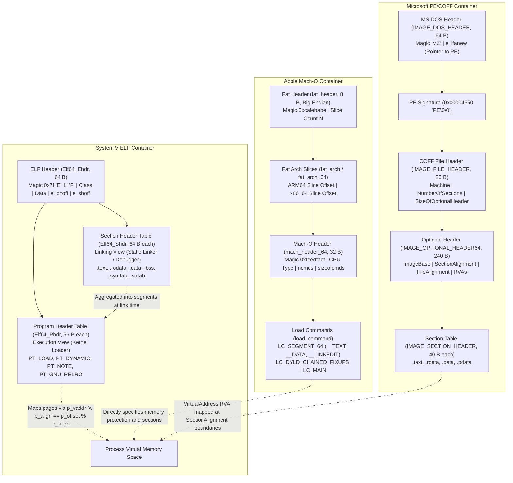
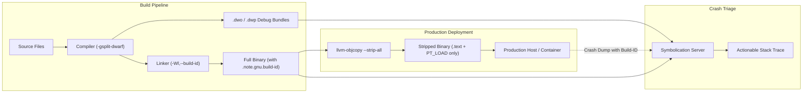

# ELF, Mach-O, and PE Object Formats

> [!summary] Claim:
> Executable and object containers bridge static compiler emissions and kernel demand-paged memory by decoupling linking views from execution views.
> System V ELF organizes compilation units into fine-grained sections via the Section Header Table (`Elf64_Shdr`) for link-time relocation, while bundling memory permissions into coarse-grained segments via the Program Header Table (`Elf64_Phdr`) subject to the strict demand-paging congruence invariant: `p_vaddr % p_align == p_offset % p_align`.
> Apple Mach-O wraps architecture slices in big-endian Fat headers and drives execution through declarative load commands (`LC_SEGMENT_64`) containing nested section descriptors and chained fixup headers.
> Microsoft PE/COFF structures binaries around Relative Virtual Addresses (RVAs) and dual alignments (`SectionAlignment` in RAM versus `FileAlignment` on disk), omitting segment tables entirely by mapping sections directly to page protection domains.



## The Mechanism

Binary object formats solve a fundamental operating system challenge: how to package compiled machine instructions, initialized state, symbol definitions, and metadata so that compilers, linkers, debuggers, and kernel virtual memory subsystems can process the file efficiently without redundant data copies.
The three dominant formats in modern computing - System V ELF (Linux, BSD, Android, illumos), Apple Mach-O (macOS, iOS, watchOS, visionOS), and Microsoft PE/COFF (Windows, UEFI) - reflect distinct architectural philosophies, but all converge on memory management primitives governed by hardware MMUs.

### 1. Dual Views: Linking View versus Execution View

A core insight of object file architecture is the separation between what the static linker needs and what the operating system kernel needs.
The linker operates on logical entities: individual functions, constants, variable allocations, and debug symbols.
These entities require fine-grained grouping based on semantics, such as merging common definitions or stripping unused code.
The operating system kernel, by contrast, operates strictly on virtual memory pages governed by hardware page table protection bits (Read, Write, Execute).

System V ELF codifies this duality through two independent header tables:

1. **The Linking View (Sections):**
   Described by the Section Header Table (`Elf64_Shdr`), this view exposes the binary as a collection of typed sections (`.text`, `.data`, `.rodata`, `.bss`, `.symtab`, `.strtab`).
   Compilers emit relocatable object files (`ET_REL`) containing exclusively section headers and no program headers.
   The static linker uses section headers to resolve symbol references, compute relocations, and perform dead-code stripping.

2. **The Execution View (Segments):**
   Described by the Program Header Table (`Elf64_Phdr`), this view groups contiguous sections into coarse loadable segments (`PT_LOAD`) sharing identical hardware page permissions.
   When the Linux kernel executes a binary via `execve`, the kernel binary loader in `fs/binfmt_elf.c` reads the program headers and ignores the section header table entirely.
   Standard stripping (`strip -s`) removes non-allocatable symbol and debug sections (`.symtab`, `.strtab`, `.debug_*`), and aggressive stripping (`llvm-strip --strip-sections`) omits the section header table altogether without affecting runtime execution.

```text
Relocatable Object (.o):     [ELF Header] -> [Section Header Table] -> (Linking View Only)
Executable / DSO (.so):      [ELF Header] -> [Program Header Table] -> [Segments] -> [Section Header Table (Optional)]
```

In Apple Mach-O, this duality is unified within a hierarchical command architecture.
Mach-O binaries do not possess independent top-level section and program header tables.
Instead, a flat array of variable-length load commands follows the Mach-O header.
Segment load commands (`LC_SEGMENT_64`) define the kernel execution segments (`__TEXT`, `__DATA`, `__LINKEDIT`), and each segment command encapsulates an array of section records (`struct section_64`) defining the linking view components (`__text`, `__cstring`, `__data`) contained within that segment.

In Microsoft PE/COFF, derived from the Unix Common Object File Format (COFF), segments do not exist as distinct entities.
The PE format defines only sections (`IMAGE_SECTION_HEADER`).
Each section header carries both its disk representation (`PointerToRawData`, `SizeOfRawData`) and its runtime memory representation (`VirtualAddress` relative to image base, `VirtualSize`, page permissions).
The Windows kernel loader maps sections directly into memory pages according to the `SectionAlignment` parameter specified in the Optional Header.

### 2. System V ELF Anatomy

The System V ELF specification defines exact, architecture-neutral 64-bit structures in `<elf.h>`.
All multi-byte fields adhere to the endianness specified in the ELF identification array.

#### The ELF Header (`Elf64_Ehdr`)

Every ELF binary begins with the 64-byte `Elf64_Ehdr` header starting at byte offset zero:

```c
typedef struct {
    unsigned char e_ident[16]; /* Magic number and container metadata */
    Elf64_Half    e_type;      /* Object file type (ET_EXEC, ET_DYN, ET_REL) */
    Elf64_Half    e_machine;   /* Target architecture (EM_X86_64=62, EM_AARCH64=183) */
    Elf64_Word    e_version;   /* EV_CURRENT (1) */
    Elf64_Addr    e_entry;     /* Process virtual entry point address */
    Elf64_Off     e_phoff;     /* File offset of Program Header Table */
    Elf64_Off     e_shoff;     /* File offset of Section Header Table */
    Elf64_Word    e_flags;     /* Processor-specific flags */
    Elf64_Half    e_ehsize;    /* Size of this ELF header (always 64 bytes) */
    Elf64_Half    e_phentsize; /* Size of one Program Header entry (always 56 bytes) */
    Elf64_Half    e_phnum;     /* Number of Program Header entries */
    Elf64_Half    e_shentsize; /* Size of one Section Header entry (always 64 bytes) */
    Elf64_Half    e_shnum;     /* Number of Section Header entries */
    Elf64_Half    e_shstrndx;  /* Section index of section name string table (.shstrtab) */
} Elf64_Ehdr;
```

The first 16 bytes (`e_ident`) establish format verification:
- `e_ident[0..3]`: Magic bytes `0x7F`, `'E'`, `'L'`, `'F'` (`0x7F 0x45 0x4C 0x46`).
- `e_ident[4]` (`EI_CLASS`): Container bitness (`ELFCLASS32 = 1`, `ELFCLASS64 = 2`).
- `e_ident[5]` (`EI_DATA`): Data encoding (`ELFDATA2LSB = 1` for little-endian, `ELFDATA2MSB = 2` for big-endian).
- `e_ident[6]` (`EI_VERSION`): Container version (`EV_CURRENT = 1`).
- `e_ident[7]` (`EI_OSABI`): Operating system ABI (`ELFOSABI_SYSV = 0`, `ELFOSABI_LINUX = 3`).
- `e_ident[8]` (`EI_ABIVERSION`): Minor ABI version targeting the dynamic loader.
- `e_ident[9..15]`: Reserved zero padding.

When the program header count is greater than or equal to `0xFFFF` (`PN_XNUM`), `e_phnum` is set to `0xFFFF`, and the true 32-bit program header count is stored in the `sh_info` field of the first section header (section index 0, `SHN_UNDEF`).
Similarly, if the section count is greater than or equal to `0xFF00` (`SHN_LORESERVE`), `e_shnum` is set to `0` and the true count is stored in `sh_size` of section index 0; if the section header string table index is greater than or equal to `0xFF00`, `e_shstrndx` is set to `0xFFFF` (`SHN_XINDEX`) and the true index resides in `sh_link` of section index 0.

#### Program Headers (`Elf64_Phdr`)

The program header table is an array of 56-byte `Elf64_Phdr` structures describing contiguous memory segments:

```c
typedef struct {
    Elf64_Word  p_type;   /* Segment type (PT_LOAD, PT_DYNAMIC, PT_NOTE) */
    Elf64_Word  p_flags;  /* Hardware segment flags (PF_R, PF_W, PF_X) */
    Elf64_Off   p_offset; /* Segment offset in disk file */
    Elf64_Addr  p_vaddr;  /* Virtual memory address where segment is loaded */
    Elf64_Addr  p_paddr;  /* Physical address (unused on virtual memory kernels) */
    Elf64_Xword p_filesz; /* Number of bytes stored in the disk file */
    Elf64_Xword p_memsz;  /* Number of bytes allocated in process virtual memory */
    Elf64_Xword p_align;  /* Required segment alignment (power of 2) */
} Elf64_Phdr;
```

In 64-bit ELF, `p_flags` is placed immediately after `p_type` to avoid 4-byte structure padding that existed in the 32-bit specification.
Standard segment types include:
- `PT_LOAD` (`1`): Loadable segment mapped directly into virtual memory.
- `PT_DYNAMIC` (`2`): Dynamic linking tables (`.dynamic`), detailed in [[Dynamic-Linking-PLT-GOT-and-Loaders]].
- `PT_INTERP` (`3`): Null-terminated path string specifying the dynamic linker (`/lib64/ld-linux-x86-64.so.2` or `/lib/ld-linux-aarch64.so.1`).
- `PT_NOTE` (`4`): Ancillary metadata notes (build IDs, ABI tags, hardware capability notes).
- `PT_PHDR` (`6`): Specifies the location and size of the program header table itself.
- `PT_TLS` (`7`): Thread-local storage template initialized per thread, detailed in [[Thread-Local-Storage-Models-and-ELF-Relocations]].
- `PT_GNU_EH_FRAME` (`0x6474E550`): Sorted index table for exception unwinding, detailed in [[Stack-Unwinding-CFI-and-Exception-ABI]].
- `PT_GNU_STACK` (`0x6474E551`): Memory flags applied to the process thread stack.
  A binary with `PF_R | PF_W` requests a non-executable stack (NX bit enabled); `PF_X` requests an executable stack, which modern security kernels refuse or audit heavily.
- `PT_GNU_RELRO` (`0x6474E552`): Specifies a memory sub-region (`.init_array`, `.fini_array`, `.got`, `.dynamic`) made read-only via `mprotect` after dynamic relocations complete, detailed in [[Hardware-Security-ABIs-PAC-BTI-CET-and-RELRO]].
- `PT_GNU_PROPERTY` (`0x6474E553`): Encodes hardware security requirements, including Intel CET shadow stacks and ARM64 Branch Target Identification (BTI) / Pointer Authentication (PAC).

#### Section Headers (`Elf64_Shdr`)

The section header table is an array of 64-byte `Elf64_Shdr` structures:

```c
typedef struct {
    Elf64_Word  sh_name;      /* Offset into .shstrtab string table */
    Elf64_Word  sh_type;      /* Section type (SHT_PROGBITS, SHT_NOBITS, SHT_RELA) */
    Elf64_Xword sh_flags;     /* Attributes (SHF_WRITE, SHF_ALLOC, SHF_EXECINSTR) */
    Elf64_Addr  sh_addr;      /* Virtual memory address if section is allocatable */
    Elf64_Off   sh_offset;    /* File offset of section contents */
    Elf64_Xword sh_size;      /* Section size in bytes */
    Elf64_Word  sh_link;      /* Index link to companion section */
    Elf64_Word  sh_info;      /* Extra section-dependent information */
    Elf64_Xword sh_addralign; /* Address alignment boundary (power of 2) */
    Elf64_Xword sh_entsize;   /* Entry size if section contains fixed-size table */
} Elf64_Shdr;
```

Crucial section types and their invariant behaviors:
- `SHT_PROGBITS` (`1`): Program code or initialized data occupying disk bytes.
- `SHT_NOBITS` (`8`): Uninitialized data (`.bss`).
  Crucially, `sh_size` indicates memory consumption, but `sh_offset` consumes zero bytes from the file.
- `SHT_SYMTAB` (`2`) and `SHT_DYNSYM` (`11`): Symbol tables storing `Elf64_Sym` arrays, handed off to [[Symbols-Relocations-and-Static-Linking]].
- `SHT_STRTAB` (`3`): Null-terminated character string pools referenced by headers and symbols.
- `SHT_RELA` (`4`): Relocation tables with explicit addends, handed off to [[Symbols-Relocations-and-Static-Linking]].

### 3. The Demand-Paging Congruence Rule

Operating systems do not copy loadable binary segments from disk into physical memory upon process startup.
Instead, kernels map the disk file directly into the process's page tables via demand paging, described in [[Virtual-Memory-Mmap-and-Process-Address-Space]].
When a thread accesses an instruction or variable, the processor MMU triggers a page fault, prompting the kernel to page the relevant 4 KiB, 16 KiB, or 64 KiB block from disk into physical memory backing store.

Hardware MMUs can only map physical file offsets to virtual addresses on page-aligned boundaries.
Because file pages and virtual memory pages must align precisely, the System V ABI specification imposes the foundational **Congruence Invariant** on every `PT_LOAD` segment:

$$\text{p\_vaddr} \equiv \text{p\_offset} \pmod{\text{p\_align}}$$

Expressed in C:
```c
(ph->p_vaddr % ph->p_align) == (ph->p_offset % ph->p_align)
```

The alignment value `p_align` must be an integral power of two and must be greater than or equal to the operating system's maximum page size (typically `0x1000` / 4 KiB on x86-64, and `0x4000` / 16 KiB or `0x10000` / 64 KiB on ARM64).
If `p_vaddr % p_align != p_offset % p_align`, the kernel would be forced to allocate intermediate memory buffers and copy file contents manually on every page fault, defeating zero-copy file mapping.

In the Linux kernel source (`fs/binfmt_elf.c`), the loader function `load_elf_binary()` iterates through all program headers.
For each `PT_LOAD` segment, it invokes `elf_map()`, which translates segment parameters into kernel `vm_mmap()` calls:

```c
/* Simplified extract from Linux kernel fs/binfmt_elf.c */
static unsigned long elf_map(struct file *filep, unsigned long addr,
                             const struct elf_phdr *eppnt, int prot,
                             int type, unsigned long total_size) {
    unsigned long size = eppnt->p_filesz + ELF_PAGEOFFSET(eppnt->p_vaddr);
    unsigned long off = eppnt->p_offset - ELF_PAGEOFFSET(eppnt->p_vaddr);
    addr = ELF_PAGESTART(addr);
    size = ELF_PAGEALIGN(size);
    return vm_mmap(filep, addr, size, prot, type, off);
}
```

When `p_memsz > p_filesz`, the segment contains uninitialized data (`.bss`).
The kernel maps `p_filesz` bytes from disk, clears the remainder of the last mapped page with zeros using `padzero()`, and maps anonymous zero-filled memory (`MAP_ANONYMOUS | MAP_PRIVATE`) to satisfy the remaining `p_memsz - p_filesz` allocation.

```text
File on Disk:
+------------------------+-------------------+
| Initialized Data       | (Not in file)     |
| (p_filesz bytes)       |                   |
+------------------------+-------------------+
 \                      /
  \                    /
Virtual Memory:
+------------------------+-------------------+-----------------------+
| Mapped File Pages      | Zeroed Remainder  | Anonymous Zero Pages  |
|                        | of Last File Page | (.bss continuation)   |
+------------------------+-------------------+-----------------------+
|<--------------------------- p_memsz ------------------------------>|
```

### 4. Apple Mach-O Architecture

Apple operating systems utilize the Mach-O (Mach Object) format, designed originally for the Mach microkernel in NextStep and refined in macOS and iOS.

#### Fat Universal Binaries

To support transitions across hardware architectures (PowerPC to x86, 32-bit to 64-bit x86, and x86-64 to ARM64 Apple Silicon), Apple packages multiple architecture-specific Mach-O files into a single container known as a Universal or Fat binary.
The Fat binary header (`<mach-o/fat.h>`) resides at byte offset zero:

```c
struct fat_header {
    uint32_t magic;     /* FAT_MAGIC (0xcafebabe) or FAT_MAGIC_64 (0xcafebabf) */
    uint32_t nfat_arch; /* Number of architecture slices that follow */
};

struct fat_arch {        /* 20 bytes, used when magic == FAT_MAGIC (0xcafebabe) */
    int32_t  cputype;    /* CPU_TYPE_ARM64 (0x0100000C), CPU_TYPE_X86_64 (0x01000007) */
    int32_t  cpusubtype; /* CPU_SUBTYPE_ARM64_ALL, CPU_SUBTYPE_ARM64E */
    uint32_t offset;     /* 32-bit byte offset to the sliced Mach-O image */
    uint32_t size;       /* 32-bit byte size of the sliced Mach-O image */
    uint32_t align;      /* Alignment as a power of 2 (e.g., 14 = 2^14 = 16 KiB) */
};

struct fat_arch_64 {     /* 32 bytes, used when magic == FAT_MAGIC_64 (0xcafebabf) */
    int32_t  cputype;    /* CPU_TYPE_ARM64 (0x0100000C), CPU_TYPE_X86_64 (0x01000007) */
    int32_t  cpusubtype; /* CPU_SUBTYPE_ARM64_ALL, CPU_SUBTYPE_ARM64E */
    uint64_t offset;     /* 64-bit byte offset to the sliced Mach-O image */
    uint64_t size;       /* 64-bit byte size of the sliced Mach-O image */
    uint32_t align;      /* Alignment as a power of 2 (e.g., 14 = 2^14 = 16 KiB) */
    uint32_t reserved;
};
```

An essential invariant: **All Fat headers are encoded strictly in big-endian byte order (`FAT_MAGIC = 0xCAFEBABE`)**, even on little-endian architectures like x86-64 and Apple Silicon.
When the kernel's `execve` handler parses a binary in `bsd/kern/mach_loader.c`, it swaps the big-endian integer fields, inspects the host CPU architecture, finds the matching slice via `cputype` and `cpusubtype`, and redirects parsing to the inner Mach-O file located at `fat_arch.offset`.

#### Mach-O 64-bit Header (`mach_header_64`)

Each architecture slice contains a complete 32-byte Mach-O header (`<mach-o/loader.h>`):

```c
struct mach_header_64 {
    uint32_t magic;      /* MH_MAGIC_64 (0xfeedfacf, little-endian) */
    int32_t  cputype;    /* CPU type identifier */
    int32_t  cpusubtype; /* CPU machine subtype */
    uint32_t filetype;   /* MH_EXECUTE (2), MH_DYLIB (6), MH_OBJECT (1), MH_BUNDLE (8) */
    uint32_t ncmds;      /* Number of load commands following this header */
    uint32_t sizeofcmds; /* Total byte size of all load commands */
    uint32_t flags;      /* MH_PIE, MH_TWOLEVEL, MH_NOUNDEFS */
    uint32_t reserved;   /* Reserved 4-byte padding */
};
```

#### Load Commands and Segments

Directly following `mach_header_64` are `ncmds` variable-length load commands.
Every load command begins with an 8-byte prefix:

```c
struct load_command {
    uint32_t cmd;     /* Command identifier (e.g., LC_SEGMENT_64) */
    uint32_t cmdsize; /* Total byte size of this command record */
};
```

The dominant command is `LC_SEGMENT_64` (`0x19`), which maps up to 16-character named segments into memory:

```c
struct segment_command_64 {
    uint32_t cmd;         /* LC_SEGMENT_64 */
    uint32_t cmdsize;     /* 72 bytes + (nsects * 80 bytes) */
    char     segname[16]; /* Segment name: "__TEXT", "__DATA", "__LINKEDIT" */
    uint64_t vmaddr;      /* Starting virtual memory address */
    uint64_t vmsize;      /* Virtual memory size */
    uint64_t fileoff;     /* Offset in the disk slice */
    uint64_t filesize;    /* Number of bytes to map from disk */
    int32_t  maxprot;     /* Maximum allowed hardware VM protection */
    int32_t  initprot;    /* Initial VM protection (VM_PROT_READ, WRITE, EXECUTE) */
    uint32_t nsects;      /* Number of section_64 structs embedded below */
    uint32_t flags;       /* Segment flags (SG_READ_ONLY = 0x10) */
};
```

Immediately following each `segment_command_64` are `nsects` contiguous 80-byte `section_64` structures:

```c
struct section_64 {
    char     sectname[16]; /* Section name: "__text", "__cstring", "__const" */
    char     segname[16];  /* Owning segment name */
    uint64_t addr;         /* Virtual memory address */
    uint64_t size;         /* Byte size */
    uint32_t offset;       /* File offset */
    uint32_t align;        /* Section alignment expressed as exponent of 2 */
    uint32_t reloff;       /* File offset to relocations */
    uint32_t nreloc;       /* Number of relocation entries */
    uint32_t flags;        /* S_REGULAR, S_ZEROFILL, SECTION_ATTRIBUTES */
    uint32_t reserved1;
    uint32_t reserved2;
    uint32_t reserved3;
};
```

Standard Mach-O segment conventions:
- `__PAGEZERO`: A 4 GiB unallocated virtual memory region starting at address 0 with `initprot = 0` and `maxprot = 0`.
  It consumes zero file bytes and ensures that any NULL pointer dereference immediately triggers a hardware MMU fault.
- `__TEXT`: Read-only and executable segment (`VM_PROT_READ | VM_PROT_EXECUTE`).
  Contains the Mach-O header, load commands, compiled instructions (`__text`), string constants (`__cstring`), and unwinding metadata (`__unwind_info`).
- `__DATA_CONST`: Read-only after dynamic linker fixups (the Darwin counterpart to ELF `PT_GNU_RELRO`).
  Contains GOT tables (`__got`) and constant pointers.
- `__DATA`: Writable data (`VM_PROT_READ | VM_PROT_WRITE`).
  Contains initialized global variables (`__data`), symbol pointers (`__la_symbol_ptr`), and zero-fill buffers (`__bss`).
- `__LINKEDIT`: Read-only raw linker data.
  Contains symbol tables, string tables, dynamic loader fixup chains (`LC_DYLD_CHAINED_FIXUPS`), and cryptographic code signatures (`LC_CODE_SIGNATURE`).

Modern Darwin systems replace traditional dynamic relocation tables with compact chained fixups (`LC_DYLD_CHAINED_FIXUPS`), where relocation targets are encoded as threaded linked lists directly inside pointer locations in memory pages, saving substantial binary footprint.

### 5. Microsoft PE/COFF Architecture

Microsoft Windows binaries conform to the Portable Executable (PE) format, an extension of COFF standardized in the Microsoft PE/COFF Specification.

```text
Disk File Layout:
+-------------------+-----------------------+---------------------+-------------------+
| IMAGE_DOS_HEADER  | PE Signature "PE\0\0" | IMAGE_FILE_HEADER   | Optional Header   |
| (64 B, magic 'MZ')| (4 B)                 | (COFF Header, 20 B) | (PE32+: 240 B)    |
+-------------------+-----------------------+---------------------+-------------------+
| Section Table     | Section 1: .text      | Section 2: .rdata   | Section 3: .data  |
| (40 B per section)| (Raw file bytes)      | (Raw file bytes)    | (Raw file bytes)  |
+-------------------+-----------------------+---------------------+-------------------+
```

#### The MS-DOS Stub and PE Signature

Every PE executable begins with a legacy 64-byte `IMAGE_DOS_HEADER`.
Its first two bytes contain the magic identifier `0x5A4D` (`'M'`, `'Z'`, named after Mark Zbikowski).
At byte offset `0x3C` is `e_lfanew` (a 4-byte little-endian integer), which points to the start of the PE header.
The bytes between offset 64 and `e_lfanew` constitute the MS-DOS stub program, which prints "This program cannot be run in DOS mode" if executed in real-mode DOS.
At offset `e_lfanew` resides the 4-byte PE signature: `'P'`, `'E'`, `0x00`, `0x00` (`0x00004550`).

#### The COFF File Header (`IMAGE_FILE_HEADER`)

Immediately following the PE signature is the 20-byte COFF File Header:

```c
typedef struct {
    uint16_t Machine;              /* Target architecture (0x8664=x64, 0xAA64=ARM64) */
    uint16_t NumberOfSections;     /* Number of entries in Section Table */
    uint32_t TimeDateStamp;        /* Epoch timestamp of compilation */
    uint32_t PointerToSymbolTable; /* Deprecated COFF symbol table offset */
    uint32_t NumberOfSymbols;      /* Number of COFF symbols */
    uint16_t SizeOfOptionalHeader; /* Size of Optional Header (240 B for PE32+) */
    uint16_t Characteristics;      /* IMAGE_FILE_EXECUTABLE_IMAGE, IMAGE_FILE_DLL */
} IMAGE_FILE_HEADER;
```

#### The Optional Header (`IMAGE_OPTIONAL_HEADER64`)

Despite its name, the Optional Header is mandatory for all PE image executables and DLLs.
For 64-bit systems (PE32+), it consumes 240 bytes:

```c
typedef struct {
    /* Standard COFF fields */
    uint16_t Magic;                   /* 0x020B for PE32+ (64-bit), 0x010B for PE32 */
    uint8_t  MajorLinkerVersion;
    uint8_t  MinorLinkerVersion;
    uint32_t SizeOfCode;
    uint32_t SizeOfInitializedData;
    uint32_t SizeOfUninitializedData;
    uint32_t AddressOfEntryPoint;     /* Entry point RVA */
    uint32_t BaseOfCode;              /* Code section RVA */

    /* Windows-specific fields */
    uint64_t ImageBase;               /* Preferred load address (default 0x140000000) */
    uint32_t SectionAlignment;       /* Memory page alignment (default 0x1000 / 4 KiB) */
    uint32_t FileAlignment;          /* Disk sector alignment (default 0x200 / 512 B) */
    uint16_t MajorOperatingSystemVersion;
    uint16_t MinorOperatingSystemVersion;
    uint16_t MajorImageVersion;
    uint16_t MinorImageVersion;
    uint16_t MajorSubsystemVersion;
    uint16_t MinorSubsystemVersion;
    uint32_t Win32VersionValue;
    uint32_t SizeOfImage;             /* Total virtual memory span (multiple of SectionAlignment) */
    uint32_t SizeOfHeaders;           /* Headers disk size (multiple of FileAlignment) */
    uint32_t CheckSum;
    uint16_t Subsystem;               /* GUI=2, CUI/Console=3 */
    uint16_t DllCharacteristics;      /* ASLR (0x0040), DEP/NX (0x0100), CFG (0x4000) */
    uint64_t SizeOfStackReserve;
    uint64_t SizeOfStackCommit;
    uint64_t SizeOfHeapReserve;
    uint64_t SizeOfHeapCommit;
    uint32_t LoaderFlags;
    uint32_t NumberOfRvaAndSizes;     /* Count of data directories (typically 16, IMAGE_NUMBEROF_DIRECTORY_ENTRIES) */
    IMAGE_DATA_DIRECTORY DataDirectory[16];
} IMAGE_OPTIONAL_HEADER64;
```

#### RVAs and Section Translation

PE binaries address memory using **Relative Virtual Addresses (RVAs)**.
An RVA is a virtual address expressed as an offset from the executable's in-memory base address (`ImageBase`).
When ASLR shifts a binary in memory, the actual virtual address is:

$$\text{VirtualAddress} = \text{ImageBase} + \text{RVA}$$

Because `SectionAlignment` in memory (typically 4096 bytes) differs from `FileAlignment` on disk (typically 512 bytes), a byte's offset on disk differs from its RVA in memory.
The Section Table follows the Optional Header.
Each section is described by a 40-byte `IMAGE_SECTION_HEADER`:

```c
typedef struct {
    uint8_t  Name[8];             /* UTF-8 section name, null-padded */
    union {
        uint32_t PhysicalAddress;
        uint32_t VirtualSize;     /* Actual size in memory */
    } Misc;
    uint32_t VirtualAddress;       /* Section RVA */
    uint32_t SizeOfRawData;        /* Size in disk file (multiple of FileAlignment) */
    uint32_t PointerToRawData;     /* File offset on disk */
    uint32_t PointerToRelocations;
    uint32_t PointerToLinenumbers;
    uint16_t NumberOfRelocations;
    uint16_t NumberOfLinenumbers;
    uint32_t Characteristics;      /* MEM_READ, MEM_WRITE, MEM_EXECUTE */
} IMAGE_SECTION_HEADER;
```

To translate any given RVA to its raw file offset on disk, a parser finds the section enclosing the RVA and applies the offset delta:

$$\text{FileOffset} = \text{RVA} - \text{VirtualAddress} + \text{PointerToRawData}$$

### 6. Architectural Synthesis: ELF vs Mach-O vs PE

| Architectural Dimension | System V ELF (Linux/BSD) | Apple Mach-O (macOS/iOS) | Microsoft PE/COFF (Windows) |
| :--- | :--- | :--- | :--- |
| **Primary Specification** | System V gABI & psABI Supplements | OS X ABI Mach-O File Format Reference | Microsoft PE and COFF Specification |
| **Multi-Arch Packaging** | None (separate files per arch) | Universal Fat Binary (`fat_header`) | None (separate PE32+ binaries per arch) |
| **Header Endianness** | Declared in `e_ident[EI_DATA]` | Fat headers always Big-Endian; slices Little-Endian | Always Little-Endian |
| **Top-Level Structural View** | Dual: `Elf64_Phdr` (exec) & `Elf64_Shdr` (link) | Flat array of variable `load_command` structs | Flat array of `IMAGE_SECTION_HEADER` structs |
| **Paging Alignment Rule** | `p_vaddr % p_align == p_offset % p_align` | Page-aligned `fileoff` and `vmaddr` per segment | Separate `SectionAlignment` vs `FileAlignment` |
| **Memory Protection Container** | `PT_LOAD` Program Header | `LC_SEGMENT_64` Load Command | `IMAGE_SECTION_HEADER` Characteristics |
| **Link-Time Strip Behavior** | Non-allocatable `.symtab`/`.strtab`/debug sections discarded (`--strip-sections` drops `Elf64_Shdr` table) | Local symbols stripped from `__LINKEDIT` | Symbol table discarded; section table retained |
| **NULL Pointer Trap Region** | Unmapped space below `0x400000` or ASLR base | Dedicated `__PAGEZERO` segment (4 GiB) | Reserved 64 KiB page zero in Windows kernel |
| **Address Representation** | Virtual Addresses (`p_vaddr`) | Absolute Virtual Addresses (`vmaddr`) | Relative Virtual Addresses (RVAs) |

## Commands and Numbers to Know

Reference metrics, struct sizes, alignment constraints, and diagnostic utilities across platforms:

| Metric / Parameter | Value / Default | Platform | Technical Significance |
| :--- | :--- | :--- | :--- |
| `Elf64_Ehdr` struct size | 64 bytes (`0x40`) | Linux | Fixed ELF 64-bit file header size (as of 2026-11) |
| `Elf64_Phdr` struct size | 56 bytes (`0x38`) | Linux | Fixed 64-bit program header entry size (as of 2026-11) |
| `Elf64_Shdr` struct size | 64 bytes (`0x40`) | Linux | Fixed 64-bit section header entry size (as of 2026-11) |
| `struct mach_header_64` size | 32 bytes (`0x20`) | macOS | Mach-O 64-bit file header size (as of 2026-11) |
| `struct fat_header` size | 8 bytes (`0x08`) | macOS | Big-endian Fat Universal header size (as of 2026-11) |
| `struct fat_arch_64` size | 32 bytes (`0x20`) | macOS | 64-bit Universal architecture slice record size (as of 2026-11) |
| `struct segment_command_64` size | 72 bytes (`0x48`) | macOS | Base size of `LC_SEGMENT_64` excluding sections (as of 2026-11) |
| `struct section_64` size | 80 bytes (`0x50`) | macOS | Size of individual Mach-O section entry (as of 2026-11) |
| `IMAGE_DOS_HEADER` size | 64 bytes (`0x40`) | Both | Fixed MS-DOS legacy stub header size (as of 2026-11) |
| `IMAGE_FILE_HEADER` size | 20 bytes (`0x14`) | Both | Fixed COFF file header size (as of 2026-11) |
| `IMAGE_OPTIONAL_HEADER64` size | 240 bytes (`0xF0`) | Both | Fixed PE32+ Optional Header size (as of 2026-11) |
| `IMAGE_SECTION_HEADER` size | 40 bytes (`0x28`) | Both | Fixed PE/COFF section table entry size (as of 2026-11) |
| `PT_LOAD` alignment on x86-64 | 4096 bytes (`0x1000`) | Linux | Default x86-64 memory page size alignment (as of 2026-11) |
| `PT_LOAD` alignment on AArch64 | 65536 bytes (`0x10000`) | Linux | 64 KiB max page size alignment on Linux ARM64 (as of 2026-11) |
| Apple Silicon segment alignment | 16384 bytes (`0x4000`) | macOS | 16 KiB hardware page size on M-series chips (as of 2026-11) |
| PE default `SectionAlignment` | 4096 bytes (`0x1000`) | Both | Default virtual memory page alignment for PE (as of 2026-11) |
| PE default `FileAlignment` | 512 bytes (`0x200`) | Both | Historical disk sector alignment for PE files (as of 2026-11) |
| Inspect ELF Program Headers | `readelf -W -l <elf>` | Linux | Displays execution view segments and congruence (as of 2026-11) |
| Inspect ELF Section Headers | `readelf -W -S <elf>` | Linux | Displays linking view sections and offsets (as of 2026-11) |
| Inspect Mach-O Headers | `otool -l <macho>` / `objdump -p` | macOS | Dumps Mach-O load commands and section entries (as of 2026-11) |
| Inspect Mach-O Fat Slices | `lipo -info <binary>` | macOS | Displays contained architecture slices (as of 2026-11) |
| Inspect PE Headers | `llvm-readobj --headers <pe>` | Both | Formats COFF and PE file, optional, and section headers portably (as of 2026-11) |

## Multi-Language Comparison: C++ / Python / Rust

How systems languages and tooling inspect, emit, and manipulate object containers:

| Capability / Concern | C / C++ | Rust | Python |
| :--- | :--- | :--- | :--- |
| **Parsing Object Formats** | `<elf.h>` on Linux, `<mach-o/loader.h>` on macOS, `libelf` | `object` crate (cross-platform zero-copy parser) | `pyelftools` for ELF, `macholib` for Mach-O, `pefile` for PE |
| **Cross-Platform Abstraction** | `LLVMObject` C++ library (`llvm::object::ObjectFile`) | `goblin` or `object::read::File` | `lief` (Library to Instrument Executable Formats) |
| **Assigning Custom Sections** | `__attribute__((section(".custom")))` | `#[link_section = ".custom"]` | Not applicable (interpreter bytecode resides in memory) |
| **Section Alignment Control** | `__attribute__((aligned(64)))` | `#[repr(align(64))]` | Memory alignment managed by CPython pymalloc allocator |
| **Inspecting Slices / Segments** | Standard C structs and memory mapping via `mmap` | `object::Object::segments()` iterator | `pefile.PE()` / `elftools.elf.elffile.ELFFile` |
| **Emitting Linker Symbols** | `extern "C"`, `__attribute__((visibility("default")))` | `#[no_mangle]`, `pub extern "C"` | `ctypes` or `cffi` symbol loading |

## Worked Lab Example

The companion lab `code/00-Program-Execution/elf_section_parser/` implements a standalone ELF64 parser in C that validates ELF header invariants (including the `PN_XNUM` and `SHN_XINDEX` extended numbering escapes), proves System V demand-paging congruence, bounds every section name against the name table, maps sections to segments, and cross-checks the mapping against GNU `readelf`.
It covers ELF only; the Mach-O and PE layouts in this note were checked against the Apple SDK headers and the Microsoft specification, not by this lab.

### 1. Building and Running the Parser

We compile the parser and a test binary containing initialized globals, uninitialized arrays (`.bss`), and read-only strings:

```bash
cd code/00-Program-Execution/elf_section_parser
gcc -O2 -Wall -Wextra -Werror -pedantic elf_parser.c -o elf_parser
gcc -O2 -Wl,--build-id=none target.c -o target
./elf_parser target
```

### 2. Verified Lab Output

The following deterministic output is the byte-identical content of `expected/linux-aarch64.txt`, captured on Linux ARM64 inside the pinned test container (as of 2026-11, Linux aarch64):

```text
=== 1. ELF Section and Segment Parser Output ===
ELF Identification:
  Magic:   7f 45 4c 46 (Valid ELF)
  Class:   ELFCLASS64 (64-bit)
  Data:    ELFDATA2LSB (Little-Endian)
  Version: 1 (EV_CURRENT)
  OS/ABI:  0 (System V / UNIX)
  Type:    ET_DYN (Position-Independent Shared Object / PIE)
  Machine: 183

Header Invariants:
  e_ehsize:    64 bytes (ABI struct size 64) -> MATCH
  e_phentsize: 56 bytes (ABI struct size 56) -> MATCH
  e_shentsize: 64 bytes (ABI struct size 64) -> MATCH
  e_phnum:     9 program headers
  e_shnum:     27 section headers
  e_shstrndx:  26 (string table index)

Program Headers (Execution View):
  [00] PHDR           flags=R   filesz=0x1f8 memsz=0x1f8 align=0x8
  [01] INTERP         flags=R   filesz=0x1b memsz=0x1b align=0x1
  [02] LOAD           flags=R E filesz=0x8d4 memsz=0x8d4 align=0x10000 (congruence: vaddr%align=0 == offset%align=0 -> OK)
  [03] LOAD           flags=RW  filesz=0x27c memsz=0x698 align=0x10000 (congruence: vaddr%align=64920 == offset%align=64920 -> OK) [BSS zero-fill: 1052 bytes]
  [04] DYNAMIC        flags=RW  filesz=0x1f0 memsz=0x1f0 align=0x8
  [05] NOTE           flags=R   filesz=0x20 memsz=0x20 align=0x4
  [06] GNU_EH_FRAME   flags=R   filesz=0x44 memsz=0x44 align=0x4
  [07] GNU_STACK      flags=RW  filesz=0x0 memsz=0x0 align=0x10 [stack: NON-EXECUTABLE (NX)]
  [08] GNU_RELRO      flags=R   filesz=0x268 memsz=0x268 align=0x1

Section Headers (Linking View):
  [00] [NULL]               NULL         flags=-    size=0x0 align=0x0
  [01] .interp              PROGBITS     flags=A    size=0x1b align=0x1
  [02] .note.ABI-tag        NOTE         flags=A    size=0x20 align=0x4
  [03] .gnu.hash            GNU_HASH     flags=A    size=0x1c align=0x8
  [04] .dynsym              DYNSYM       flags=A    size=0xd8 align=0x8
  [05] .dynstr              STRTAB       flags=A    size=0x8d align=0x1
  [06] .gnu.version         GNU_VERSYM   flags=A    size=0x12 align=0x2
  [07] .gnu.version_r       GNU_VERNEED  flags=A    size=0x30 align=0x8
  [08] .rela.dyn            RELA         flags=A    size=0xc0 align=0x8
  [09] .rela.plt            RELA         flags=AI   size=0x60 align=0x8
  [10] .init                PROGBITS     flags=AX   size=0x18 align=0x4
  [11] .plt                 PROGBITS     flags=AX   size=0x60 align=0x10
  [12] .text                PROGBITS     flags=AX   size=0x170 align=0x40
  [13] .fini                PROGBITS     flags=AX   size=0x14 align=0x4
  [14] .rodata              PROGBITS     flags=A    size=0x42 align=0x10
  [15] .eh_frame_hdr        PROGBITS     flags=A    size=0x44 align=0x4
  [16] .eh_frame            PROGBITS     flags=A    size=0xbc align=0x8
  [17] .init_array          INIT_ARRAY   flags=WA   size=0x8 align=0x8
  [18] .fini_array          FINI_ARRAY   flags=WA   size=0x8 align=0x8
  [19] .dynamic             DYNAMIC      flags=WA   size=0x1f0 align=0x8
  [20] .got                 PROGBITS     flags=WA   size=0x68 align=0x8
  [21] .data                PROGBITS     flags=WA   size=0x14 align=0x8
  [22] .bss                 NOBITS       flags=WA   size=0x410 align=0x10
  [23] .comment             PROGBITS     flags=MS   size=0x2d align=0x1
  [24] .symtab              SYMTAB       flags=-    size=0x8b8 align=0x8
  [25] .strtab              STRTAB       flags=-    size=0x26a align=0x1
  [26] .shstrtab            STRTAB       flags=-    size=0xe7 align=0x1

Section to Segment Mapping:
  Segment Sections...
   00     
   01     .interp 
   02     .interp .note.ABI-tag .gnu.hash .dynsym .dynstr .gnu.version .gnu.version_r .rela.dyn .rela.plt .init .plt .text .fini .rodata .eh_frame_hdr .eh_frame 
   03     .init_array .fini_array .dynamic .got .data .bss 
   04     .dynamic 
   05     .note.ABI-tag 
   06     .eh_frame_hdr 
   07     
   08     .init_array .fini_array .dynamic .got 

Allocated vs Unallocated Section Inventory:
  Total Allocatable Sections (loaded into memory): 22
  Total Non-Allocatable Sections (debug/linking metadata): 4

=== 2. Cross-Verification with GNU readelf ===
Verification: Parser Section-to-Segment mapping matches GNU readelf 100% exactly (PASS)

=== 3. Invariant Enforcement & Failure Mode Testing ===
Test A (Bad Magic): Rejection with exit code 1 (PASS)
Test B (Congruence Violation): Rejection with exit code 6 (PASS)
Test C (Truncated Header): Rejection with exit code 7 (PASS)
Test D (Bad e_shstrndx): Rejection with exit code 5 (PASS)
Test E (PN_XNUM phnum read from shdrs[0].sh_info): exit code 0 (PASS)
Test F (PN_XNUM count beyond file): exit code 7 (PASS)
Test G (SHN_XINDEX shstrndx read from shdrs[0].sh_link): exit code 0 (PASS)
Test H (SHN_XINDEX target out of range): exit code 5 (PASS)
Test I (reserved e_shstrndx 0xff00): exit code 5 (PASS)
Test J (e_shnum 0 read from shdrs[0].sh_size): exit code 0 (PASS)
Test K (sh_name outside the name table): exit code 9 (PASS)
Test L (e_shstrndx names a non-STRTAB section): exit code 5 (PASS)
Test M (p_align 0 accepted, no division by zero): exit code 0 (PASS)
Test N (p_align not a power of two): exit code 6 (PASS)
Test P (name table beyond file end): exit code 7 (PASS)
Test O (zero-size section kept in mapping, matches readelf): PASS

All ELF structural invariants and failure modes verified successfully.
```

### 3. Key Observations from the Verification

1. **Demand-Paging Congruence in Practice:**
   Segment `[03]` (`LOAD RW`) exhibits `align = 0x10000` (64 KiB).
   Its file offset `0x00FD98` modulo `0x10000` is `64920` (`0xFD98`), and its virtual address `0x01FD98` modulo `0x10000` is also `64920`.
   The remainder is identical, enabling the kernel to map the file page directly without offset shifting.

2. **The BSS Allocation Delta:**
   Segment `[03]` has `filesz = 0x27C` and `memsz = 0x698`.
   The delta `0x698 - 0x27C = 0x41C` (1052 bytes) accounts for `.data` padding and the uninitialized `.bss` section (`size = 0x410`).
   The kernel maps `0x27C` bytes from the file and zero-fills the remaining 1052 bytes in memory.

3. **Allocated vs Non-Allocated Sections:**
   Out of 27 section headers (where index 0 is the mandatory `SHT_NULL` entry), exactly 22 carry `SHF_ALLOC` and map into loadable segments.
   The remaining 4 sections (`.comment`, `.symtab`, `.strtab`, `.shstrtab`) lack `SHF_ALLOC`, have virtual address 0, and exist exclusively on disk for linkers and debuggers.

4. **Every Check Can Fail:**
   Tests A to N and P each mutate one field of the good binary and demand an exact exit code (1 bad magic, 5 bad `e_shstrndx`, 6 congruence or alignment, 7 truncation, 9 bad `sh_name`).
   Tests E, G, and J show the extended numbering escapes working: the effective `e_phnum`, `e_shstrndx`, and `e_shnum` are read from section header 0 and the file still parses.
   Test M shows `p_align = 0` is treated as no alignment instead of dividing by zero, and Test O shows a zero-size section inside a segment is listed there, exactly as `readelf` lists it.

## Pitfalls

> [!warning] Pitfall: Assuming stripped binaries lack symbol information because static symbol sections were removed
> When an executable is stripped using `strip -s`, the tool removes non-allocated symbol and debug sections (`.symtab`, `.strtab`, `.debug_*`), and `llvm-strip --strip-sections` additionally removes the Section Header Table itself.
> However, dynamic symbols required by `dlopen` or dynamic linking reside in `.dynsym` and `.dynstr`.
> Because `.dynsym` carries the `SHF_ALLOC` flag and is mapped into a `PT_LOAD` segment, stripping an executable does not remove dynamic symbols or PLT/GOT stubs.
> Confusing `.symtab` with `.dynsym` leads engineers to falsely believe their shared library entry points are hidden.

> [!warning] Pitfall: Big-Endian decoding traps in Mach-O Universal Fat headers
> On modern Apple Silicon hardware, native Mach-O code slices are strictly little-endian (`0xFEEDFACF`).
> However, the outer `fat_header`, `fat_arch`, and `fat_arch_64` records are defined by specification to be strictly big-endian (`0xCAFEBABE` / `0xCAFEBABF`).
> Naively casting a memory-mapped file buffer to `struct fat_header *` on an ARM64 processor without performing byte-order swapping reads `nfat_arch` as a scrambled 32-bit integer, causing parsers to segfault or read slice offsets into unmapped memory.

> [!warning] Pitfall: Violating demand-paging congruence when writing custom binary tools or packers
> If a binary packer or obfuscator modifies section layouts or injects a segment where `p_vaddr % PAGE_SIZE != p_offset % PAGE_SIZE`, the Linux kernel's `elf_map()` computes a non-page-aligned file offset (`off = p_offset - ELF_PAGEOFFSET(p_vaddr)`), causing `vm_mmap()` to fail with `-EINVAL`.
> Because `load_elf_binary()` maps segments after `begin_new_exec()` has already torn down the caller's address space, the kernel immediately terminates the process with an uncatchable `SIGSEGV` (while `ld.so` rejects misaligned shared libraries with `ELF load command address/offset not page-aligned`).
> Always calculate `p_offset` such that its offset remainder matches the desired virtual address remainder modulo the maximum page size (`p_align`).

> [!warning] Pitfall: Calculating disk offsets directly from RVAs in PE files without walking the Section Table
> Unlike ELF files where segment offsets often track virtual addresses closely, a PE file's `SectionAlignment` (typically 4096 bytes) differs substantially from its `FileAlignment` (typically 512 bytes).
> An RVA of `0x2400` inside a code section starting at RVA `0x1000` with `PointerToRawData = 0x400` resides at disk offset `0x400 + (0x2400 - 0x1000) = 0x1800`, not `0x2400`.
> Attempting to read PE data structures by indexing directly with RVAs corrupts parsing.

> [!warning] Pitfall: Hardcoding 4 KiB page size assumptions on ARM64 and Apple Silicon architectures
> x86-64 hardware universally operates on 4 KiB virtual memory pages.
> However, Apple Silicon hardware uses 16 KiB pages (`0x4000`), and enterprise Linux distributions on AArch64 (such as RHEL and Android 15+) support or enforce 16 KiB and 64 KiB (`0x10000`) page configurations.
> Binaries linked with a default page size of 4 KiB (`-z max-page-size=4096`) fail to execute on 16 KiB or 64 KiB kernels, aborting with `SIGSEGV`, `SIGBUS`, or dynamic loader errors (`ELF load command address/offset not page-aligned`) due to misaligned or overlapping page boundary mappings.

## At Scale

At large engineering scale (1,000 to 50,000 engineers and tens of thousands of production microservices), binary object format mechanics directly govern infrastructure costs, build latency, and deployment reliability:

1. **The Page Size Migration (4 KiB to 16 KiB / 64 KiB):**
   Android 15 introduced 16 KiB page size support for native applications (mandated by Google Play starting November 2025, as of 2026-11), and high-throughput Linux cloud instances frequently deploy 64 KiB page kernels to reduce TLB miss rates.
   Linkers must align `PT_LOAD` segments to the target architecture's maximum page size (`-z max-page-size=65536`).
   However, naive segment alignment causes binary size bloat: if an ELF executable contains four loadable segments and each segment is padded out to 64 KiB in the disk file, binaries inflate significantly.
   Modern linkers (LLD, Mold, GNU Gold) decouple `max-page-size` from disk padding by placing multiple segments within a shared file page using the Congruence Rule or leveraging common-page-size heuristics (`-z common-page-size=4096 -z max-page-size=65536`).

2. **Fat Universal Binaries in CI/CD:**
   In macOS fleets, building Universal Mach-O binaries containing both `x86_64` and `arm64` slices doubles compile times, increases artifact storage costs, and bloats CI transfer bandwidth.
   Leading engineering organizations build single-slice native binaries (`arm64`) for developer local inner-loops and CI test pipelines, and run `lipo -create` only in the final production release pipeline.

3. **Stripping Strategies and Split DWARF:**
   Unstripped binary files containing full DWARF debug sections commonly exceed several gigabytes for large C++ or Rust services.
   Fleet deployment systems strip all non-allocated sections before pushing images to production containers, reducing deployment bandwidth by up to 90%.
   To preserve debuggability during crash triage, build systems decouple debug information using Split DWARF (`-gsplit-dwarf`) and embed a 20-byte SHA-1 digest inside `.note.gnu.build-id` (36 bytes total including the 12-byte `Elf64_Nhdr` and `"GNU\0"` owner string), described in [[DWARF-Debug-Information-and-Symbol-Bundles]].
   Production symbolication servers index unstripped debug packages by this build ID hash.



## Practice Drill

> [!tip] Practice Drill:
> Inspect the program and section headers of an executable, calculate the demand-paging congruence of its loadable segments, and verify the memory footprint of uninitialized `.bss` data.
> Run the following script in a Linux environment to build a target binary, hand-calculate its segment modulo arithmetic, and verify segment-to-section containment using `readelf`:

```bash
set -euo pipefail
WORK_DIR=$(mktemp -d) && cd "$WORK_DIR"

cat << 'EOF' > demo.c
#include <stdio.h>
const char message[] = "Toolchain Object Format Practice Drill";
int uninitialized_buffer[1024]; /* 4096 bytes in BSS */
int initialized_value = 1234;

int main(void) {
    uninitialized_buffer[0] = initialized_value;
    printf("%s: %d\n", message, uninitialized_buffer[0]);
    return 0;
}
EOF

gcc -O2 -Wl,--build-id=none demo.c -o demo

# 1. Inspect Program Headers and verify congruence
echo "=== Program Headers ==="
readelf -W -l demo

# 2. Extract loadable segments and calculate congruence in Python
python3 -c '
import subprocess, re
output = subprocess.check_output(["readelf", "-W", "-l", "demo"], text=True)
load_lines = [line for line in output.splitlines() if line.strip().startswith("LOAD")]
for idx, line in enumerate(load_lines):
    parts = line.split()
    offset = int(parts[1], 16)
    vaddr = int(parts[2], 16)
    filesz = int(parts[4], 16)
    memsz = int(parts[5], 16)
    align = int(parts[-1], 16)
    v_rem = vaddr % align
    o_rem = offset % align
    print(f"Segment LOAD {idx}: offset=0x{offset:x}, vaddr=0x{vaddr:x}, align=0x{align:x}")
    print(f"  vaddr % align = {v_rem}, offset % align = {o_rem} -> Congruent: {v_rem == o_rem}")
    if memsz > filesz:
        print(f"  BSS zero-fill expansion: {memsz - filesz} bytes (memsz=0x{memsz:x}, filesz=0x{filesz:x})")
'

# 3. Verify section-to-segment mapping
echo ""
echo "=== Section to Segment Mapping ==="
readelf -W -l demo | sed -n '/Section to Segment mapping:/,/^$/p'

cd / && rm -rf "$WORK_DIR"
```

## Interview Questions

> [!question] L5: Why does an operating system kernel require the Program Header Table (`Elf64_Phdr`) rather than the Section Header Table (`Elf64_Shdr`) to execute an ELF binary, and what happens when an executable is stripped?
>
> > [!success]- Answer
> > The operating system kernel enforces memory isolation through hardware page table permissions (Read, Write, Execute).
> > Hardware MMUs cannot protect individual functions or variables; they protect pages.
> > The Program Header Table organizes contiguous memory regions into coarse segments (`PT_LOAD`) sharing identical protection flags and alignment boundaries.
> > The Section Header Table, by contrast, is a linker-level structure defining granular compilation units (`.text`, `.rodata`, `.data`, `.bss`) and debug symbols.
> > The kernel loader (`fs/binfmt_elf.c` in Linux) reads exclusively `Elf64_Phdr` and ignores `Elf64_Shdr`.
> > Standard stripping (`strip -s`) removes non-allocatable symbol and debug sections (`.symtab`, `.strtab`, `.debug_*`), and `llvm-strip --strip-sections` removes the Section Header Table itself, reducing disk size while leaving runtime execution and dynamic linking completely unaffected.

> [!question] L5: Walk through the Mach-O `__PAGEZERO` segment and explain why its `vmaddr = 0`, `vmsize = 0x100000000` (4 GiB on 64-bit), and `initprot = 0` are critical for process security.
>
> > [!success]- Answer
> > The `__PAGEZERO` segment in Apple Mach-O is a reserved virtual memory range starting at address zero (`vmaddr = 0`).
> > On 64-bit systems, its memory size is 4 GiB (`vmsize = 0x100000000`), while its file size is 0 (`filesize = 0`), meaning it consumes zero disk space.
> > Its initial and maximum virtual memory protections are set to zero (`initprot = 0`, `maxprot = 0`), forbidding read, write, and execute permissions.
> > This structure acts as a hardware trap zone for NULL pointer dereferences: any attempt to read or write through a NULL pointer or a small struct offset from NULL (up to 4 GiB) immediately triggers an unrecoverable hardware MMU page fault (`EXC_BAD_ACCESS` / `SIGSEGV`), preventing NULL-pointer exploitation and kernel privilege escalation.

> [!question] L6: Predict the output: An engineer runs `readelf -l` on an ELF shared library and inspects a `PT_LOAD` segment with `p_offset = 0x00FD98`, `p_vaddr = 0x0001FD98`, `p_filesz = 0x000278`, `p_memsz = 0x000280`, `p_align = 0x10000`.
> Predict whether the kernel loader accepts this segment under demand paging congruence, calculate the exact BSS zero-fill byte count, and determine the minimum page count mapped.
>
> > [!success]- Answer
> > 1. **Congruence Invariant Check:**
> >    We evaluate `p_vaddr % p_align` and `p_offset % p_align`:
> >    `0x0001FD98 % 0x10000 = 0xFD98` (64,920).
> >    `0x0000FD98 % 0x10000 = 0xFD98` (64,920).
> >    Because `0xFD98 == 0xFD98`, the segment satisfies the System V demand-paging congruence rule, and the kernel loader accepts the segment without error.
> > 2. **BSS Zero-Fill Expansion:**
> >    `p_memsz - p_filesz = 0x000280 - 0x000278 = 0x8` (8 bytes).
> >    The kernel maps `0x278` bytes from disk and zero-fills the final 8 bytes in memory.
> > 3. **Page Count Mapped:**
> >    On a 64 KiB page system (`align = 0x10000`), the segment spans from `0x0001FD98` to `0x0001FD98 + 0x280 = 0x00020018`.
> >    The start address `0x0001FD98` falls within the page `0x10000..0x20000`.
> >    The end address `0x00020018` crosses into the next page `0x20000..0x30000`.
> >    Therefore, this segment spans across two hardware pages (2 pages mapped).

> [!question] L6: Debug this: A newly compiled proprietary Linux service crashes immediately on launch on an ARM64 cloud instance with `SIGSEGV`, `SIGBUS`, or `ELF load command address/offset not page-aligned`, yet runs without incident on an x86-64 host; `readelf -l` reveals `Align 0x1000` on all `PT_LOAD` segments.
> Diagnose the root cause and provide the linker invocation to fix it.
>
> > [!success]- Answer
> > **Root Cause:**
> > The target ARM64 kernel is running with a 16 KiB or 64 KiB memory page size (standard on many ARM64 enterprise distributions like RHEL, Android, and AWS Graviton), whereas x86-64 uses 4 KiB (`0x1000`) pages.
> > The binary was linked with `-z max-page-size=4096` (the x86-64 default).
> > Because `p_align` is 4096 (`0x1000`), segment virtual addresses and file offsets are only congruent modulo 4096.
> > When executed on a 64 KiB page kernel, `p_vaddr % 65536 != p_offset % 65536`.
> > The kernel's `elf_map()` computes a non-64 KiB-aligned offset and `vm_mmap()` fails with `-EINVAL` after `begin_new_exec()` (terminating the process with `SIGSEGV`), `ld.so` rejects misaligned shared libraries with `ELF load command address/offset not page-aligned`, or overlapping 64 KiB page mappings trigger `SIGBUS` / `SIGSEGV`.
> > **Fix:**
> > Re-link the binary instructing the linker to align loadable segments for 64 KiB page kernels:
> > ```bash
> > gcc -Wl,-z,max-page-size=65536 -Wl,-z,common-page-size=4096 ...
> > ```

> [!question] L6: Why do Apple Mach-O Universal "Fat" binary headers (`struct fat_header` and `struct fat_arch`) always use big-endian encoding regardless of host architecture, whereas the sliced Mach-O headers themselves use host endianness?
>
> > [!success]- Answer
> > Universal binary headers originated on the Motorola 68000 and PowerPC platforms in NeXTSTEP and early Mac OS X, which were big-endian architectures.
> > When Apple transitioned to little-endian x86 and later ARM64, changing the `fat_header` magic or endianness would have broken backward compatibility with existing operating system bootloaders, kernel binary parsers, and command-line tools (`lipo`, `file`).
> > To maintain universal compatibility across decades of architecture migrations, Apple preserved the big-endian invariant (`FAT_MAGIC = 0xCAFEBABE`) for the outer container dispatch wrapper.
> > The inner sliced binaries, by contrast, are parsed only after the kernel selects the specific slice for execution, allowing each slice to use the native, performance-optimal endianness of its target processor.

> [!question] L7: In Microsoft PE/COFF files, explain the distinction between `SectionAlignment` and `FileAlignment`, and show step-by-step how an address translation routine converts a Relative Virtual Address (RVA) to a raw disk file offset.
>
> > [!success]- Answer
> > In the PE Optional Header, `SectionAlignment` defines the page alignment applied when sections are mapped into process virtual memory (typically 4096 bytes / `0x1000`), matching CPU MMU page sizes.
> > `FileAlignment` defines the physical sector alignment of raw section bytes on disk (historically 512 bytes / `0x200`), optimizing disk storage.
> > Because `SectionAlignment >= FileAlignment`, section layouts expand in virtual memory relative to disk.
> > **RVA to File Offset Conversion Algorithm:**
> > 1. Given target `RVA`:
> > 2. Iterate through the Section Table (`IMAGE_SECTION_HEADER`).
> > 3. Find the section where:
> >    `sec.VirtualAddress <= RVA < sec.VirtualAddress + max(sec.VirtualSize, sec.SizeOfRawData)`.
> > 4. Calculate the relative offset within the section:
> >    `delta = RVA - sec.VirtualAddress`.
> > 5. If `delta >= sec.SizeOfRawData`, the RVA falls inside uninitialized zero-padded memory (`.bss`) and has no disk representation.
> > 6. Otherwise, calculate the physical disk offset:
> >    `FileOffset = sec.PointerToRawData + delta`.

> [!question] L7: How does the ELF `PT_GNU_RELRO` segment interact with the dynamic linker and kernel memory protection flags during startup, and why must its segment boundaries align with page boundaries?
>
> > [!success]- Answer
> > `PT_GNU_RELRO` (Read-Only After Relocation) protects sensitive data structures that must be writable during dynamic linking but read-only during normal execution (such as the Global Offset Table `.got`, `.init_array`, `.fini_array`, and `.dynamic`).
> > During program loading, the kernel maps the `PT_GNU_RELRO` region as writable (`PF_R | PF_W`) because it resides inside a writable `PT_LOAD` segment.
> > The dynamic linker (`ld.so`) writes resolved relocation pointers into the GOT and relocates internal data.
> > Once all relocations are complete, but before user code in `main` or constructors executes, `ld.so` invokes the `mprotect(addr, len, PROT_READ)` system call on the memory span specified by `PT_GNU_RELRO`.
> > Because the hardware MMU only modifies access permissions on whole page boundaries, the start address and end address of the RELRO segment must align with the system page size; otherwise, `mprotect` would either fail or unintentionally make adjacent writable data (like `.data` or `.bss`) read-only, causing runtime crashes when variables are mutated.

> [!question] L8+: Android 15 and modern enterprise Linux kernels require support for 16 KiB and 64 KiB page sizes; explain the structural impact of increasing `p_align` on binary size on disk vs memory footprint, how the GNU linker's `-z max-page-size` and `-z common-page-size` flags mitigate disk bloat, and how to architect a fleet-wide migration across 20,000 services without regressing startup latency.
>
> > [!success]- Answer
> > **Structural Impact:**
> > Increasing `p_align` from 4 KiB to 64 KiB forces the distance between consecutive `PT_LOAD` segments to align to 64 KiB boundaries in both memory and disk file offsets (`p_vaddr % 64K == p_offset % 64K`).
> > If a linker pads disk space with zeros to reach the next 64 KiB file offset, an executable with four segments incurs up to 192 KiB of empty padding per binary.
> > Across thousands of microservices and container layers, this causes significant disk image inflation.
> > **Linker Optimization:**
> > Modern linkers decouple memory alignment from disk padding.
> > By passing `-z max-page-size=65536 -z common-page-size=4096`, the linker ensures that `p_align` is 64 KiB so the kernel can map pages on 64 KiB kernels, but places segments on 4 KiB file boundaries on disk whenever they share identical file pages.
> > On 4 KiB systems, pages map normally; on 64 KiB systems, the page fault handler maps the same 64 KiB page multiple times with different virtual addresses, preserving congruence without disk bloat.
> > **Fleet-Wide Migration Architecture:**
> > 1. Update centralized toolchain flags across Bazel / CMake rules to enforce `-Wl,-z,max-page-size=65536` globally.
> > 2. Establish a binary validation gate in CI that parses `Elf64_Phdr` using `readelf` or custom parsers, failing any commit where `p_align < 65536` on any `PT_LOAD` segment.
> > 3. Deploy automated canary verification on 64 KiB kernel instances to measure startup latency, TLB hit rates, and resident set size (RSS).
> > 4. Roll out binaries gradually, monitoring for third-party prebuilt shared libraries that were compiled with legacy 4 KiB alignment assumptions.

> [!question] L8+: Design a high-performance in-memory binary parser and validator for an untrusted plugin loader that accepts ELF, Mach-O, and PE objects; identify the top five structural header attacks (including integer overflows, overlapping segments, and out-of-bounds tables) and specify the invariant checks that prevent them.
>
> > [!success]- Answer
> > A robust in-memory parser must treat all header fields as untrusted inputs and enforce strict mathematical boundaries before performing any memory reads or allocations:
> > 1. **Integer Overflow in Table Boundaries:**
> >    *Attack:* An attacker sets `e_phoff = 0xFFFFFFFFFFFFFF00` and `e_phnum = 10`, causing `e_phoff + e_phnum * sizeof(Elf64_Phdr)` to wrap around to zero, bypassing buffer length checks.
> >    *Defense:* Enforce safe checked arithmetic: verify `e_phnum < MAX_SEGMENTS` (e.g., 1024), and assert `e_phoff <= buffer_size && (buffer_size - e_phoff) / sizeof(Elf64_Phdr) >= e_phnum`.
> > 2. **Out-of-Bounds String Table Indexing:**
> >    *Attack:* Setting `e_shstrndx >= e_shnum` or corrupting `sh_name` to an offset beyond `.shstrtab` length leads to out-of-bounds heap reads.
> >    *Defense:* Validate `e_shstrndx < e_shnum`, verify that `.shstrtab` has `sh_type == SHT_STRTAB`, and verify that every string dereference terminates with a null byte before reaching `sh_size`.
> > 3. **Overlapping and Conflicting Segment Mappings:**
> >    *Attack:* Two `PT_LOAD` segments specify overlapping virtual address ranges with conflicting permissions (e.g., an executable code segment overlapping a writable data segment), allowing self-modifying code or W^X bypasses.
> >    *Defense:* Sort all loadable segments by `p_vaddr` and assert: `seg[i].p_vaddr + seg[i].p_memsz <= seg[i+1].p_vaddr`.
> > 4. **BSS Memory Exhaustion (`p_memsz` Bomb):**
> >    *Attack:* Setting `p_filesz = 100` and `p_memsz = 0x7FFFFFFFFFFF` (many terabytes) causes the kernel or loader to exhaust system memory during anonymous zero-fill allocation.
> >    *Defense:* Enforce a strict ceiling on `p_memsz - p_filesz` (e.g., maximum 2 GiB per segment) based on process resource limits (`RLIMIT_AS`).
> > 5. **PE Section Traversal Traps:**
> >    *Attack:* Corrupting `PointerToRawData` in an `IMAGE_SECTION_HEADER` to point backward into earlier headers, causing recursive parsing loops or heap corruption.
> >    *Defense:* Assert `sec.PointerToRawData >= SizeOfHeaders` and `sec.PointerToRawData + sec.SizeOfRawData <= file_size`.

## Further Reading

- Tool Interface Standard (TIS) Committee, *Executable and Linking Format (ELF) Specification, Version 1.2* (1995): the foundational standard defining ELF identification, section headers, and program segments.
- Santa Cruz Operation (SCO), *System V Application Binary Interface (gABI)* (2003): normative specification for generic Unix binary execution, demand-paging congruence, and dynamic segments.
- H.J. Lu et al., *System V Application Binary Interface: AMD64 Architecture Processor Supplement* (2023): processor-specific relocation types, large code models, and x86-64 calling conventions.
- Arm Limited, *ELF for the Arm 64-bit Architecture (AAELF64)* (2024): 64 KiB page alignment requirements, mapping symbols, and GNU property notes for PAC and BTI.
- Apple Inc., *Mac OS X ABI Mach-O File Format Reference* (2009): comprehensive breakdown of Mach-O headers, load command structures, and segment layouts.
- Apple Inc., *XNU Kernel Source Code* (`bsd/kern/mach_loader.c`): authoritative kernel implementation parsing Mach-O headers and initializing virtual memory.
- Microsoft Corporation, *Microsoft Portable Executable and Common Object File Format Specification* (Revision 11.0, 2024): the authoritative reference for PE headers, RVAs, and section tables on Windows.
- Linus Torvalds et al., *Linux Kernel fs/binfmt_elf.c* (v6.12, 2024): the production kernel implementation of `load_elf_binary()` and `elf_map()`.
- John R. Levine, *Linkers and Loaders* (2000): seminal textbook detailing storage allocation, symbol resolution, and binary format history.
- Ian Lance Taylor, *Linkers (20-Part Essay)* (2007-2008): definitive practical guide to static linking, dynamic linking, and object representation by the author of GNU gold.

## Related

- Prerequisites: [[Program-Startup-C-Runtime-Init-and-Auxiliary-Vectors]]
- Next: [[Symbols-Relocations-and-Static-Linking]]
- See also: [[02-Programming-Languages/C++/CPP_Zero_to_Godhood/Volume_08_Advanced_Systems/Chapter_102_Linking_Loading_ABI/Chapter_102_Linking_Loading_ABI_and_WPO|Chapter_102_Linking_Loading_ABI_and_WPO]], [[15-Technical-Whitepapers/05-Offensive-Security-and-Exploitation/Binary-Exploitation-and-Reverse-Eng|Binary Exploitation and Reverse Eng]]
- Lab: `code/00-Program-Execution/elf_section_parser/` (requires: linux)
