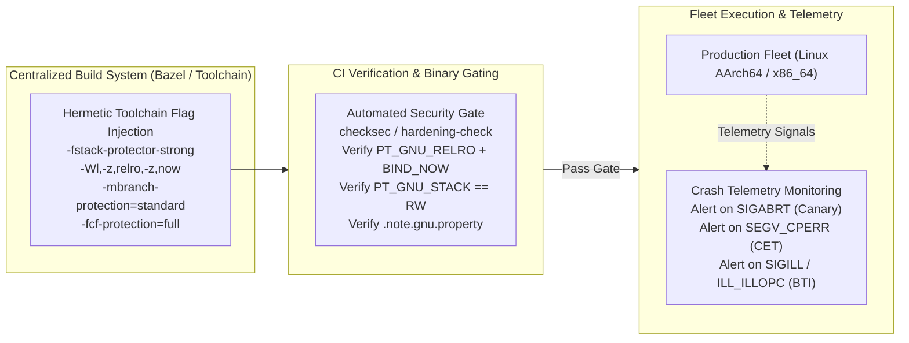

# Hardware Security ABIs: PAC, BTI, CET, and RELRO

> [!summary] Claim:
> Binary hardening and hardware security ABIs constrain control-flow hijacking by converting speculative attack surfaces into synchronous hardware faults.
> Non-executable stacks (`PT_GNU_STACK`) and stack canaries detect linear stack buffer overflows before function return, while Read-Only Relocations (`PT_GNU_RELRO`) protect dynamic linker tables from arbitrary memory writes.
> Modern processors enforce hardware-level control-flow integrity by partitioning execution into backward-edge protection (ARM PAC return address signing, Intel CET Shadow Stacks) and forward-edge indirect branch validation (ARM BTI landing pads, Intel CET Indirect Branch Tracking).
> Apple Silicon platforms fuse hardware pointer authentication with `LC_DYLD_CHAINED_FIXUPS`, eliminating runtime relocation tables by encoding cryptographic diversifiers directly into on-disk pointer chains.

```mermaid
flowchart TD
    subgraph ATTACK_VECTORS["Control-Flow Attack Surface"]
        BOF["Stack Buffer Overflow<br/>(Linear memory write)"]
        GOT_OVERWRITE["GOT Memory Corruption<br/>(Arbitrary 8-byte write)"]
        JOP_COP["Indirect Branch Hijacking<br/>(Forward-edge JOP / COP)"]
        ROP["Return Address Hijacking<br/>(Backward-edge ROP)"]
    end

    subgraph DATA_PLANE["Data-Plane & Relocation Hardening"]
        NX["PT_GNU_STACK (W^X)<br/>Page fault on execution (#PF)"]
        CANARY["Stack Canary (SSP)<br/>Mismatch -> __stack_chk_fail -> SIGABRT"]
        RELRO_PARTIAL["Partial RELRO<br/>mprotect .got PROT_READ<br/>.got.plt remains writable"]
        RELRO_FULL["Full RELRO (BIND_NOW)<br/>mprotect entire GOT PROT_READ<br/>Write -> SIGSEGV"]
    end

    subgraph HARDWARE_CFI["Hardware-Enforced Control-Flow Integrity"]
        subgraph FORWARD_EDGE["Forward-Edge Enforcement"]
            ARM_BTI["ARMv8.5-A BTI<br/>Guarded page checks PSTATE.BTYPE<br/>Target must be BTI c/j/jc or PACIASP<br/>Mismatch -> Branch Target Exception -> SIGILL"]
            INTEL_IBT["Intel CET-IBT<br/>CPU state WAIT_FOR_ENDBR<br/>Target must be ENDBR64 (0xF30F1EFA)<br/>Mismatch -> #CP(ENDBR)"]
        end
        subgraph BACKWARD_EDGE["Backward-Edge Enforcement"]
            ARM_PAC["ARMv8.3-A PAC<br/>Sign LR with SP modifier (PACIASP)<br/>Authenticate before return (AUTIASP)<br/>Corrupted tag -> Translation Fault"]
            INTEL_SHSTK["Intel CET-SS<br/>Hardware-isolated Shadow Stack (SSP)<br/>CALL pushes to both, RET compares<br/>Mismatch -> #CP(NEAR_RET) -> SEGV_CPERR"]
            APPLE_CHAINED["Apple arm64e Chained Fixups<br/>LC_DYLD_CHAINED_FIXUPS<br/>Inline PAC keys + diversity in pointer<br/>dyld signs inline before mprotect __DATA_CONST"]
        end
    end

    BOF -.->|"Blocked by"| NX
    BOF -.->|"Detected by"| CANARY
    GOT_OVERWRITE -.->|"Blocked by"| RELRO_FULL
    JOP_COP -.->|"Hardware trapped by"| ARM_BTI
    JOP_COP -.->|"Hardware trapped by"| INTEL_IBT
    ROP -.->|"Hardware trapped by"| ARM_PAC
    ROP -.->|"Hardware trapped by"| INTEL_SHSTK
    GOT_OVERWRITE -.->|"Signed pointers"| APPLE_CHAINED
```



## The Mechanism

Binary exploitation historically relies on subverting control flow by overwriting pointers stored in writable memory pages.
Hardware security Application Binary Interfaces (ABIs) and compiler mitigations work in concert across the compiler, static linker, dynamic loader, and processor architecture to eliminate writable executable memory and enforce control-flow integrity (CFI).

### 1. Non-Executable Stack (`PT_GNU_STACK`) and W^X

The Write XOR Execute (`W^X`) security model dictates that no memory page should be simultaneously writable and executable.
[[Virtual-Memory-Mmap-and-Process-Address-Space]] owns page-level virtual memory protections configured via `mmap(2)` and `mprotect(2)`.
In the System V ELF format, stack executability is governed by the program header segment `PT_GNU_STACK` (`0x6474e551`).

When the Linux kernel loads an ELF binary via `execve(2)`, `load_elf_binary()` in `fs/binfmt_elf.c` iterates over the program header table (simplified from the current source):

```c
// Linux kernel fs/binfmt_elf.c, load_elf_binary(), simplified
for (i = 0; i < elf_ex->e_phnum; i++, elf_ppnt++)
    switch (elf_ppnt->p_type) {
    case PT_GNU_STACK:
        if (elf_ppnt->p_flags & PF_X)
            executable_stack = EXSTACK_ENABLE_X;
        else
            executable_stack = EXSTACK_DISABLE_X;
        break;
    }
/* later */
if (elf_read_implies_exec(*elf_ex, executable_stack))
    current->personality |= READ_IMPLIES_EXEC;
```

If `p_flags` contains `PF_R | PF_W` (`0x6`), the kernel maps the initial user stack with `PROT_READ | PROT_WRITE`.
If `p_flags` contains `PF_R | PF_W | PF_X` (`0x7`), the stack is mapped with `PROT_EXEC`, allowing shellcode execution directly from stack memory.
If an ELF binary omits `PT_GNU_STACK` entirely, the result is architecture-specific: per the decision table in `arch/x86/include/asm/elf.h`, a missing header means "exec-all" (`READ_IMPLIES_EXEC`) only for ia32 processes or CPUs without NX, and "exec-none" for x86_64 processes on NX hardware; on arm64, `READ_IMPLIES_EXEC` is implied only for 32-bit compat tasks (`compat_elf_read_implies_exec`) `(as of 2026-11, Linux)`.

Compilers emit an empty note section in assembly files to signal that the generated object does not require stack execution:

```assembly
.section .note.GNU-stack,"",@progbits
```

When relocatable object files are linked via GNU `ld`, the static linker applies logical `OR` semantics: if even one input object marks `.note.GNU-stack` executable, the linker marks the final `PT_GNU_STACK` segment `RWE` (GNU ld 2.42 prints `requires executable stack (because the .note.GNU-stack section is executable)`).
An input that lacks `.note.GNU-stack` entirely is target-dependent: GNU ld treats it as requesting an executable stack on targets whose default is executable (x86 historically), but on Ubuntu 24.04 AArch64 GNU ld 2.42 linked an object with the note removed into an `RW` `GNU_STACK` (verified in the lab container, 2026-11).
A notorious edge case occurs in the GNU C extension for nested functions.
When the address of a nested function that accesses its enclosing function's locals is taken (for example, passed as a callback), GCC creates an executable trampoline on the stack containing code that loads the static chain pointer into a register before jumping to the nested function.
A nested function that is only called directly needs no trampoline: GCC 13 on AArch64 produced `RW` for a direct call and `RWE` plus the linker warning above once the nested function was passed as a pointer (verified in the lab container, 2026-11).
Emitting a stack trampoline forces GCC to mark the object's `.note.GNU-stack` executable, silently compromising stack protection across the entire executable.

In the GNU C Library (glibc), loading a dynamic shared object (DSO) via `dlopen(3)` that requires an executable stack historically made the stack executable with `mprotect(..., PROT_READ | PROT_WRITE | PROT_EXEC)`; the current implementation is `_dl_make_stack_executable()` in `sysdeps/unix/sysv/linux/dl-execstack.c`, called from `elf/dl-load.c` (glibc master, fetched 2026-11).
Starting with glibc 2.41, "dlopen and dlmopen no longer make the stack executable if a shared library requires it"; loading such an object fails instead (glibc NEWS 2.41).
glibc 2.41 also added the tunable `glibc.rtld.execstack` (default: allow executable stacks requested by the main program; `0` disables the negotiation).
Applications that `dlopen` legacy trampoline-dependent libraries need glibc 2.42 or later and `GLIBC_TUNABLES=glibc.rtld.execstack=2`, which "forces an executable stack at process start" (glibc NEWS 2.42, glibc manual Tunables).

### 2. Stack Canaries (Stack Smashing Protector)

Stack canaries, originally introduced by StackGuard (Cowan et al., USENIX Security 1998), defend against linear stack buffer overflows that corrupt saved frame pointers or return addresses.
The compiler places a secret guard value on the stack frame between local buffers and control data.
Before returning, the function compares the stack guard value against the authoritative master canary stored in thread-local storage.
A mismatch indicates memory corruption and triggers immediate termination.

The GCC and Clang compilers offer progressive levels of protection:
- `-fno-stack-protector`: Disables canary insertion entirely.
- `-fstack-protector`: Emits canaries for functions "that call `alloca`, and functions with buffers larger than or equal to 8 bytes" (GCC manual; the threshold is `--param=ssp-buffer-size=N`).
- `-fstack-protector-strong`: Additionally protects functions "that have local array definitions, or have references to local frame addresses" (GCC manual), which covers arrays of any size or type, arrays inside local structs, and locals whose address is taken.
- `-fstack-protector-all`: Emits canaries indiscriminately for every function.

```
Low Memory
+------------------------------------------+  <- SP (Stack Pointer)
| Local Variables and Buffers              |
| char buffer[16]                          |
+------------------------------------------+
| Stack Canary Guard Value (8 bytes)       |  <- Checked before return
+------------------------------------------+
| Saved Frame Pointer (RBP / X29) (8 bytes)|
+------------------------------------------+
| Saved Return Address (RIP / X30) (8 bytes|
+------------------------------------------+
High Memory
```

The diagram shows the x86_64 frame; GCC on AArch64 places the frame record (`X29`, `X30`) at the top of the frame, with the canary directly below it and the arrays below the canary (GCC 13 `-fstack-protector-strong -S` on AArch64: `stp x29, x30, [sp, 48]`, canary at `[sp, 40]`, a 16-byte array at `[sp, 24]`; verified in the lab container, 2026-11).

In glibc on x86_64, the master canary is initialized during program startup by `_dl_setup_stack_chk_guard()` using random bytes extracted from the kernel auxiliary vector `AT_RANDOM`.
It is stored in the Thread Control Block (TCB) at fixed offset `%fs:0x28`.
On AArch64 Linux, the master canary is the process-wide global variable `__stack_chk_guard`, which GCC 13 loads through the GOT (`adrp x1, :got:__stack_chk_guard`; verified with `gcc -S` in the lab container, 2026-11); a `TPIDR_EL0`-relative guard exists only through `-mstack-protector-guard=sysreg` and is not the glibc ABI.
The lowest byte of the canary is deliberately set to `0x00` (a null terminator byte).
This design ensures that string-handling functions such as `strcpy()`, `strcat()`, and `sprintf()` terminate their copy operations when hitting the canary rather than reading or leaking the remaining canary bytes.

In assembly, the canary verification sequence executes as follows:

```assembly
// Function Prologue (x86_64)
sub    $0x20, %rsp
mov    %fs:0x28, %rax          // Load master canary from TCB
mov    %rax, 0x18(%rsp)        // Place canary on stack frame
xor    %eax, %eax              // Clear register

// Function Epilogue (x86_64)
mov    0x18(%rsp), %rax        // Read stack canary
xor    %fs:0x28, %rax          // Compare with master canary
jne    .Lstack_chk_fail        // Branch if mismatch
add    $0x20, %rsp
ret

.Lstack_chk_fail:
call   __stack_chk_fail        // Aborts process via SIGABRT
```

The handler `__stack_chk_fail()` prints `*** stack smashing detected ***: terminated` to stderr and invokes `abort()`, which raises `SIGABRT` (glibc `debug/stack_chk_fail.c` calls `__fortify_fail("stack smashing detected")`, and `debug/fortify_fail.c` formats `*** %s ***: terminated`; a smash run in the lab container printed that line on stderr and exited 134, 2026-11).
Canaries provide deterministic detection of linear buffer overflows but offer no defense against non-linear arbitrary writes (such as struct member pointer overwrites within the same frame) or reads that leak stack memory without corrupting the guard.

### 3. Read-Only Relocations (RELRO)

Position-Independent Executables (PIE) and shared libraries cannot contain hard-coded absolute memory addresses in their code segments.
[[Dynamic-Linking-PLT-GOT-and-Loaders]] owns dynamic symbol resolution, Procedure Linkage Table (PLT) trampolines, and the Global Offset Table (GOT).
The GOT contains absolute pointers to functions and global variables resolved by the dynamic linker (`ld.so`).
Because dynamic linking requires writing these addresses at runtime, the GOT must initially reside in writable memory.
In an unprotected binary, an attacker with an arbitrary memory write primitive can overwrite a function pointer in the GOT (for example, replacing `puts()` or `free()` with `system()`) to seize control flow on the next invocation.

Read-Only Relocations (RELRO) mitigates this attack surface by instructing the dynamic linker to mark relocatable sections read-only after resolving symbols.
The ELF program header `PT_GNU_RELRO` (`0x6474e552`) defines the contiguous memory region to be protected:

```c
#define PT_GNU_RELRO 0x6474e552 /* Read-only after relocation */
```

Toolchains provide three operating modes for RELRO:

#### No RELRO (`-Wl,-z,norelro`)
The static linker emits no `PT_GNU_RELRO` program header.
The GOT and data sections remain writable (`PROT_READ | PROT_WRITE`) throughout the entire lifetime of the process.

#### Partial RELRO (`-Wl,-z,relro -Wl,-z,lazy`)
The static linker groups relocatable data sections that do not need runtime writes after startup into a dedicated segment covered by `PT_GNU_RELRO`.
This includes `.init_array`, `.fini_array`, `.jcr`, `.data.rel.ro`, and the non-PLT portion of the GOT (`.got`).
However, because function calls use lazy binding, the dynamic linker must write resolved function addresses into the PLT jump table on their first invocation.
Therefore, the function pointer table (`.got.plt`) is separated from `.got` and placed in a writable data segment outside `PT_GNU_RELRO`.
After processing startup relocations, `ld.so` invokes `mprotect(relro_start, relro_len, PROT_READ)`.
While global variable pointers are protected, `.got.plt` remains completely writable, leaving PLT function pointers vulnerable to overwrite attacks.

#### Full RELRO (`-Wl,-z,relro,-z,now`)
The static linker forces immediate binding of all symbols at load time by setting `DF_BIND_NOW` in `DT_FLAGS` and `DF_1_NOW` (`0x00000001`) in `DT_FLAGS_1`; GNU ld 2.42 emits `(FLAGS) BIND_NOW` and `(FLAGS_1) Flags: NOW PIE` and no separate `DT_BIND_NOW` (`0x18`) entry (verified with `readelf -d` in the lab container, 2026-11).
Because all function relocations are resolved at process startup, lazy binding is disabled entirely.
GNU ld folds the PLT slots into `.got` and emits no `.got.plt` (the lab shows only `.got` for Full RELRO); LLD keeps a separate `.got.plt` but places it inside the RELRO region (ld.lld 18.1.3 in Ubuntu 24.04, AArch64, 2026-11: `.got.plt` stays a separate section; under `-z relro -z now` it sits inside the `PT_GNU_RELRO` range, under `-z relro -z lazy` it lies after it in a writable segment).
The `PT_GNU_RELRO` segment encompasses the entire GOT.
Once `ld.so` completes symbol resolution during initialization, it calls `mprotect(..., PROT_READ)` over the entire region.
Any subsequent attempt to overwrite a GOT entry raises `SIGSEGV` with `SEGV_ACCERR`; the signal is catchable, but the write does not take effect (the lab's child process dies on it).

```
Partial RELRO Memory Layout:
[ .init_array / .data.rel.ro / .got ] -> Covered by PT_GNU_RELRO -> mprotect(PROT_READ)
[ .got.plt                          ] -> Unprotected -> Remains PROT_READ | PROT_WRITE

Full RELRO Memory Layout:
[ .init_array / .data.rel.ro / .got (includes all PLT entries) ] -> PT_GNU_RELRO -> mprotect(PROT_READ)
```

Linker implementations differ in how they pad RELRO boundaries.
GNU `ld` places RELRO data in a single writable `PT_LOAD` segment alongside `.data` and `.bss`, using `DATA_SEGMENT_ALIGN (MAXPAGESIZE, COMMONPAGESIZE)` and `DATA_SEGMENT_RELRO_END` in its default linker script to pad the RELRO end to a page boundary (the script line is from `ld --verbose`, GNU ld 2.42).
`max-page-size` is a linker default per target (64 KiB for AArch64 GNU ld, 4 KiB for x86_64), not a kernel page size; most Linux kernels run 4 KiB pages (x86_64: `ELF_MAXPAGESIZE 0x1000` in binutils `bfd/elf64-x86-64.c`; AArch64: LOAD segments of GNU ld 2.42 carry alignment `0x10000`, and `-z max-page-size=0x1000` changes it, both observed in the lab container, 2026-11).
LLVM's `lld` splits the writable data into two distinct `PT_LOAD` segments at the RELRO boundary, preventing memory waste from alignment padding.

### 4. ARM Pointer Authentication (PAC - ARMv8.3-A)

Pointer Authentication (PAC), introduced in ARMv8.3-A, enforces backward-edge and data pointer integrity at the hardware level.
On 64-bit architectures, the virtual address space typically uses 48 or 52 bits.
The upper bits of a 64-bit pointer above the virtual address are architecturally unused (sign-extended canonical bits).
PAC repurposes some of these unused high bits to store a cryptographic Message Authentication Code (MAC) calculated over the pointer value and a 64-bit context modifier.
Bit 55 still selects the upper or lower address range, and when Top Byte Ignore is enabled bits 63..56 are excluded, so on Linux "the number of bits that the PAC occupies in a pointer is 55 minus the virtual address size configured by the kernel", which is 7 bits for a 48-bit VA (Linux kernel `Documentation/arch/arm64/pointer-authentication.rst`).

```
64-Bit Pointer Format under ARM PAC (Linux, 48-bit VA, TBI enabled):
+-------------+--------+-------------+-----------------------------------------+
| Bits 63..56 | Bit 55 | Bits 54..48 | Bits 47..0                              |
| Tag (TBI)   | Range  | PAC (7 bits)| Virtual Address Payload                 |
+-------------+--------+-------------+-----------------------------------------+
```

The PAC tag is a keyed hash computed in hardware from the pointer, a modifier, and a secret key (Linux `pointer-authentication.rst`; Clang `PointerAuthentication` documentation); the cipher is chosen by the CPU implementation and is not part of the software ABI.
The CPU maintains five 128-bit secret keys in EL1 system registers that EL0 code cannot read; Linux assigns them at `exec()` and exposes them to user space only through ptrace regsets when `CONFIG_CHECKPOINT_RESTORE` is set:
- `APIAKey_EL1`, `APIBKey_EL1`: Instruction pointer authentication keys A and B.
- `APDAKey_EL1`, `APDBKey_EL1`: Data pointer authentication keys A and B.
- `APGAKey_EL1`: Generic authentication key (computes 32-bit signature over arbitrary data).

PAC operations pair an address with a 64-bit context modifier (salt).
For return addresses, the modifier is the current Stack Pointer (`SP`).
This binds the cryptographic signature of the return address directly to the exact stack depth of the calling frame:

$$\text{PAC} = \text{Hash}_{Key}(\text{Pointer}, \text{Context})$$

The instruction set provides dedicated primitives:
- `PACIA Xd, Xn`: Signs instruction pointer in `Xd` using key A and context `Xn`.
- `AUTIA Xd, Xn`: Authenticates instruction pointer in `Xd` using key A and context `Xn`.
- `PACIASP` / `AUTIASP`: Signs/authenticates the Link Register (`X30`) using `SP` as context and key A.
- `RETAA` / `RETAB`: Authenticates `X30` with key A or B and executes `RET` in a single atomic instruction.
- `XPACI`, `XPACD`: Strips the PAC tag from an instruction or data pointer without authentication (used by debuggers and profilers).

`PACIASP` (`0xd503233f`) and `AUTIASP` (`0xd50323bf`) are allocated within the ARMv8.0 `HINT` instruction encoding space.
On pre-ARMv8.3 hardware, these instructions execute harmlessly as NOPs, providing binary backward compatibility.

When an attacker overwrites a signed return address on the stack, the modified pointer lacks a valid cryptographic tag for that stack address.
During `AUTIASP`, the processor recomputes the expected tag.
In the baseline ARMv8.3-A `PAuth` feature, if authentication fails, the hardware does not necessarily trap; it corrupts the pointer so that a later use will likely fault (Clang `PointerAuthentication` documentation), which makes the pointer non-canonical.
When the subsequent `RET` attempts to execute code from this corrupted pointer, the CPU generates an instruction Translation Fault, resulting in `SIGSEGV` or `EXC_BAD_ACCESS`.
With the Faulting PAC (`FPAC`) extension, the `AUT*` instruction itself raises a synchronous exception, closing the window in which a corrupted pointer can be inspected or reused; Linux delivers `SIGILL` with `ILL_ILLOPN` from `do_el0_fpac()` (`arch/arm64/kernel/traps.c`).

### 5. ARM Branch Target Identification (BTI - ARMv8.5-A)

While PAC secures backward-edge control flow (returns), Branch Target Identification (BTI), introduced in ARMv8.5-A, enforces forward-edge control-flow integrity by restricting indirect jump and call targets.
BTI defends against Jump-Oriented Programming (JOP) and Call-Oriented Programming (COP) by ensuring that indirect branches can only land on designated landing-pad instructions.

BTI operation requires memory pages to be marked as Guarded Pages.
The operating system enables guarded execution by setting the `GP` bit in Stage 1 translation table descriptors via `mprotect(..., PROT_BTI)`.
The processor maintains a 2-bit state machine in `PSTATE.BTYPE`:
- `BTYPE = 00`: Default state following direct branches (`B`, `BL`) or sequential execution.
- `BTYPE = 01`: State set following an indirect jump through `X16` or `X17` (`BR X16`, typically PLT jump veneers).
- `BTYPE = 10`: State set following an indirect call (`BLR Xn`).
- `BTYPE = 11`: State set following an indirect jump (`BR Xn` where `n != 16, 17`).

When the processor executes an indirect branch to a guarded page, `PSTATE.BTYPE` transitions to non-zero.
The very next instruction executed at the target address MUST be a landing pad compatible with `BTYPE` (table from the Linux arm64 BTI patch series, which follows the Arm ARM):
- `BTYPE == 01` accepts `BTI jc`, `BTI j`, `BTI c`, and `PACIxSP`.
- `BTYPE == 10` accepts `BTI jc`, `BTI c`, and `PACIxSP`.
- `BTYPE == 11` accepts only `BTI jc` and `BTI j`.
- So `BTI c` marks indirect-call targets (and `X16`/`X17` veneer targets), `BTI j` marks indirect-jump targets, and `BTI jc` accepts both.
- `PACIASP` / `PACIBSP`: Functions as an implicit `BTI c` landing pad while simultaneously signing the return address; whether it also accepts `BTYPE == 11` is controlled by `SCTLR_EL1.BT0`, which Linux sets so that it does not.

If an indirect branch targets any instruction other than an authorized landing pad on a guarded page, the processor raises a Branch Target Exception.
The Linux kernel catches this hardware fault in `do_el0_bti()` and delivers `SIGILL` with `si_code` `ILL_ILLOPC` (`arch/arm64/kernel/traps.c`); mainline `include/uapi/asm-generic/siginfo.h` defines no `ILL_BTCFI` `(as of 2026-11, Linux)`.

ELF binaries declare BTI and PAC compatibility using GNU program properties stored in `.note.gnu.property` (`NT_GNU_PROPERTY_TYPE_0`):

```c
#define GNU_PROPERTY_AARCH64_FEATURE_1_AND 0xc0000000
#define GNU_PROPERTY_AARCH64_FEATURE_1_BTI (1U << 0)
#define GNU_PROPERTY_AARCH64_FEATURE_1_PAC (1U << 1)
#define GNU_PROPERTY_AARCH64_FEATURE_1_GCS (1U << 2) /* Guarded Control Stack */
```

The static linker applies strict `AND` evaluation across all relocatable object files.
If even a single object file linked into an executable or DSO lacks the BTI flag, the linker strips `GNU_PROPERTY_AARCH64_FEATURE_1_BTI` from the output binary.
At runtime, the dynamic linker inspects the property notes of each loaded module and applies `PROT_BTI` (`0x10`) per module: by default "BTI protection is enabled only for modules that have BTI marking", and unmarked modules stay unguarded (glibc manual, `glibc.cpu.aarch64_bti=0`).
glibc 2.43 added `glibc.cpu.aarch64_bti=1`, which makes loading an unmarked module an error (glibc NEWS 2.43) `(as of 2026-11, Linux)`.
The linker option `-Wl,-z,force-bti` (GNU ld and LLD) turns on BTI, generates BTI PLTs, and warns for inputs missing the property.

### 6. Intel Control-flow Enforcement Technology (CET)

Intel CET, introduced in 11th Generation Core (Tiger Lake) and implemented as shadow stack on AMD Zen 3 and later, provides hardware-enforced CFI on x86_64 through two complementary features: Indirect Branch Tracking (IBT) for forward-edge security and Shadow Stack (SS) for backward-edge security (Intel announced CET as first available on Tiger Lake, per AnandTech, 2020-2021; AMD engineers state that current AMD processors support shadow stack but not IBT, per LKML posts for SVM shadow stack support, 2022-2025).
On Linux, "only userspace shadow stack and kernel IBT are supported" on 64-bit kernels, so user-space IBT markings are not enforced by the kernel (Linux kernel `Documentation/arch/x86/shstk.rst`) `(as of 2026-11, Linux)`.

#### Indirect Branch Tracking (CET-IBT)
IBT provides hardware landing pads analogous to ARM BTI.
The processor tracks execution through an internal state machine transitioning between `IDLE` and `WAIT_FOR_ENDBR`.
Any indirect call (`CALL *%rax`) or indirect jump (`JMP *%rax`) transitions the processor to `WAIT_FOR_ENDBR`.
The next instruction fetched and executed MUST be `ENDBR64` (`0xf3 0f 1e fa`) in 64-bit mode or `ENDBR32` (`0xf3 0f 1e fb`) in 32-bit mode.
If any other opcode is fetched, the CPU immediately generates a Control Protection (`#CP`) exception with error code `#CP(ENDBR)`.
`ENDBR64` is encoded in the x86 NOP space (`NOP r/m`) and executes as a benign 4-byte NOP on processors without CET.

#### Shadow Stack (CET-SS)
The CET Shadow Stack implements backward-edge CFI by maintaining a secondary, hardware-isolated memory stack dedicated exclusively to return addresses.
Shadow stack pages are marked with a distinct page table attribute.
Normal memory write operations (`MOV`, `PUSH`, `XCHG`) targeting a shadow stack page fault with a Page Fault (`#PF`).
Only dedicated CET hardware instructions can write to the shadow stack.

The CPU tracks the shadow stack using the Shadow Stack Pointer register (`SSP`).
When the CPU executes `CALL`, it pushes the return address to both the data stack (`RSP`) and the shadow stack (`SSP`).
When executing `RET`, the CPU pops the return address from `RSP` and the expected return address from `SSP` and compares them:

```
Normal Data Stack (RSP):   [ Return Addr A ] <- Overwritten by buffer overflow to Exploit Gadget
Shadow Stack (SSP):        [ Return Addr A ] <- Hardware write-protected

Execution of RET:
CPU compares: Data Stack != Shadow Stack -> Hardware #CP(NEAR_RET) Exception
Linux Kernel Action: Delivers SIGSEGV with si_code = SEGV_CPERR
```

CET introduces specialized instructions for stack management:
- `INCSSP`: Advances `SSP` past a given number of entries (used by `longjmp` and exception unwinding to skip frames).
- `RDSSP`: Reads the current value of `SSP` into a general-purpose register.
- `SAVEPREVSSP` / `RSTORSSP`: Saves and restores previous shadow stack pointers for user-level coroutines and context switching.
- `WRSS` / `WRUSS`: `WRSS` writes to the shadow stack from user mode only when enabled (on Linux via the `ARCH_SHSTK_WRSS` feature); `WRUSS` executes only at CPL 0 and writes with user-mode access rights, and Linux uses it through `write_user_shstk_64()` (`arch/x86/include/asm/special_insns.h`; Intel SDM entry as mirrored at felixcloutier.com/x86/wrussd:wrussq; kernel `shstk.rst` for `ARCH_SHSTK_WRSS`).

Linux kernel support for user-space shadow stacks was merged in Linux 6.6 (`Documentation/arch/x86/shstk.rst`; glibc 2.39 NEWS: "Sync with Linux kernel 6.6 shadow stack interface").
Process threads manage shadow stack features via `arch_prctl(2)`:
`ARCH_SHSTK_ENABLE`, `ARCH_SHSTK_DISABLE`, `ARCH_SHSTK_LOCK`, `ARCH_SHSTK_UNLOCK` (ptrace only), and `ARCH_SHSTK_STATUS`, with feature bits `ARCH_SHSTK_SHSTK` and `ARCH_SHSTK_WRSS`.
Additional shadow stacks (for example, for user-space fibers) are allocated with the separate `map_shadow_stack(2)` system call (`__NR_map_shadow_stack` 453 in `asm-generic/unistd.h`), not through `arch_prctl`; the kernel allocates a new thread's shadow stack itself on `clone`.
Glibc 2.39 provides user-space integration, enabling shadow stack from the loader through `arch_prctl` (the kernel does not read the ELF markers itself) and managing shadow stack unwind operations across `setjmp` and `longjmp`.
On x86 ELF binaries, CET features are marked in `.note.gnu.property` under `GNU_PROPERTY_X86_FEATURE_1_AND` (`0xc0000002`):
`GNU_PROPERTY_X86_FEATURE_1_IBT` (`0x1`) and `GNU_PROPERTY_X86_FEATURE_1_SHSTK` (`0x2`).

### 7. Apple Chained Fixups and Darwin Pointer Authentication (`arm64e`)

On macOS and iOS on Apple Silicon, Apple implements an aggressive variant of ARM PAC under the `arm64e` ABI, protecting all virtual method tables, Objective-C class metadata, C++ vptrs, and function pointers.
To eliminate the performance overhead of signing thousands of pointers at process startup, Apple designed a unified relocation format: Chained Fixups.

In traditional Mach-O binaries, dynamic linking relies on `LC_DYLD_INFO_ONLY`, which contains separate, dense opcode streams for rebasing (ASLR slide adjustments) and binding (external symbol resolution).
`LC_DYLD_CHAINED_FIXUPS` (`0x34 | LC_REQ_DYLD` = `0x80000034`, `mach-o/loader.h` in the macOS SDK) eliminates standalone relocation tables entirely; it became the default output for binaries with a deployment target of macOS 12 / iOS 15 or later, replacing `LC_DYLD_INFO_ONLY` (Emerge Tools, 2021), and `fixup-chains.h` defines separate pointer formats for arm64e (`DYLD_CHAINED_PTR_ARM64E`) without dating when each shipped.
Instead, relocation locations are threaded together into singly-linked lists (chains) embedded directly inside the 64-bit pointer slots in the binary's `__DATA` and `__DATA_CONST` segments.

The root structure is `dyld_chained_fixups_header`, which references `dyld_chained_starts_in_image`.
Each segment contains a `dyld_chained_starts_in_segment` table dividing the segment into VM pages (typically 16 KiB on Apple Silicon).
The `page_start[i]` array specifies the byte offset to the first fixup chain link on page `i`.

In an `arm64e` binary, each 64-bit pointer slot on disk encodes its fixup metadata directly:

```c
// include/mach-o/fixup-chains.h
struct dyld_chained_ptr_arm64e_auth_rebase {
    uint64_t target    : 32, // runtimeOffset (from the image base)
             diversity : 16, // Cryptographic context / salt
             addrDiv   : 1,  // 1 = Mix pointer address into diversity
             key       : 2,  // 0=IA, 1=IB, 2=DA, 3=DB
             next      : 11, // Stride (in 8-byte units) to next fixup
             bind      : 1,  // 0 = Rebase internal symbol
             auth      : 1;  // 1 = Authenticated pointer
};

struct dyld_chained_ptr_arm64e_auth_bind {
    uint64_t ordinal   : 16, // Index into imports table
             zero      : 16,
             diversity : 16, // Cryptographic context / salt
             addrDiv   : 1,  // 1 = Mix pointer address into diversity
             key       : 2,  // 0=IA, 1=IB, 2=DA, 3=DB
             next      : 11, // Stride (in 8-byte units) to next fixup
             bind      : 1,  // 1 = Bind external symbol
             auth      : 1;  // 1 = Authenticated pointer
};
```

When `dyld` loads an `arm64e` Mach-O image:
1. It traverses `page_start[]` across each page of every segment that carries fixups (`__DATA_CONST`, `__DATA`, `__AUTH_CONST`, and so on).
2. It walks each chain by following the 11-bit `next` stride field (8-byte stride for `DYLD_CHAINED_PTR_ARM64E`, per `fixup-chains.h`).
3. For an authenticated rebase pointer (`auth == 1, bind == 0`), `dyld` adds the image load address to `target`, extracts the key (`IA`, `IB`, `DA`, `DB`), and computes the modifier.
If `addrDiv == 1`, `dyld` blends the address of the slot being fixed up with the 16-bit diversity value (the `ptrauth_blend_discriminator()` operation in `<ptrauth.h>`), binding the signed pointer to the virtual address where it is stored (`fixup-chains.h` declares the `addrDiv` bit without a comment; the meaning follows the Clang `PointerAuthentication` documentation, where a pointer whose discriminator incorporates its storage address "is said to have address diversity").
4. `dyld` executes `PAC` instructions in user mode to sign the address and writes the authenticated pointer into the memory slot.
5. Once all chains on the page are processed, `dyld` calls `mprotect(..., PROT_READ)` over the `__DATA_CONST` segment, freezing all authenticated pointers, vtables, and GOT entries before executing module initializers.

## Commands and Numbers to Know

Reference metrics, compiler flags, and architecture-specific constants governing hardware security ABIs.

| Metric / Flag / Parameter | Value / Default | Platform | Scope / Mechanism |
| :--- | :--- | :--- | :--- |
| `PT_GNU_STACK` type | `0x6474e551` | Linux | ELF program header defining stack executability `(as of 2026-11, Linux)` |
| `PT_GNU_RELRO` type | `0x6474e552` | Linux | ELF program header defining read-only relocations `(as of 2026-11, Linux)` |
| `DT_BIND_NOW` tag | `0x00000018` | Linux | Legacy dynamic tag forcing immediate binding; GNU ld 2.42 sets `DF_BIND_NOW` in `DT_FLAGS` instead `(as of 2026-11, Linux)` |
| `DF_1_NOW` flag | `0x00000001` | Linux | `DT_FLAGS_1` bit requesting immediate binding (Full RELRO when combined with `PT_GNU_RELRO`) `(as of 2026-11, Linux)` |
| `-fstack-protector-strong` | Distro Default | Linux | Enabled by default in Ubuntu 24.04 GCC 13 (verified with `gcc -Q --help=common`); Debian enables `stackprotectorstrong` by default through `dpkg-buildflags(1)` hardening features `(as of 2026-11, Linux)` |
| Master canary storage (x86_64) | `%fs:0x28` | Linux | Offset in Thread Control Block holding master canary `(as of 2026-11, Linux)` |
| Master canary null byte | Low byte `0x00` | Both | Guards string operations from leaking canary `(as of 2026-11, Both)` |
| Canary buffer threshold | 8 bytes | Both | GCC default for `-fstack-protector` (`--param=ssp-buffer-size=8`) `(as of 2026-11, Both)` |
| `GNU_PROPERTY_AARCH64_FEATURE_1_AND` | `0xc0000000` | Linux | ELF note property type for AArch64 security features `(as of 2026-11, Linux)` |
| `GNU_PROPERTY_AARCH64_FEATURE_1_BTI` | `0x00000001` | Linux | Feature bit indicating BTI compliance `(as of 2026-11, Linux)` |
| `GNU_PROPERTY_AARCH64_FEATURE_1_PAC` | `0x00000002` | Linux | Feature bit indicating return address signing `(as of 2026-11, Linux)` |
| `GNU_PROPERTY_X86_FEATURE_1_AND` | `0xc0000002` | Linux | ELF note property type for x86 CET features `(as of 2026-11, Linux)` |
| `GNU_PROPERTY_X86_FEATURE_1_IBT` | `0x00000001` | Linux | Feature bit indicating Intel CET IBT compliance `(as of 2026-11, Linux)` |
| `GNU_PROPERTY_X86_FEATURE_1_SHSTK` | `0x00000002` | Linux | Feature bit indicating Intel CET Shadow Stack `(as of 2026-11, Linux)` |
| `ENDBR64` instruction | `f3 0f 1e fa` | Linux | Intel CET 4-byte landing pad opcode `(as of 2026-11, Linux)` |
| `paciasp` instruction | `d5 03 23 3f` | Both | ARMv8.3-A PAC sign LR with SP and key A `(as of 2026-11, Both)` |
| `autiasp` instruction | `d5 03 23 bf` | Both | ARMv8.3-A PAC authenticate LR with SP and key A `(as of 2026-11, Both)` |
| `bti c` instruction | `d5 03 24 5f` | Both | ARMv8.5-A BTI indirect call landing pad `(as of 2026-11, Both)` |
| `LC_DYLD_CHAINED_FIXUPS` | `0x80000034` | macOS | Mach-O load command for Apple chained fixups `(as of 2026-11, macOS)` |
| `SEGV_CPERR` signal code | `10` | Linux | `si_code` delivered on CET `#CP` shadow stack violation `(as of 2026-11, Linux)` |
| `glibc.rtld.execstack` | Tunable default `1` | Linux | Glibc 2.41 tunable controlling executable stacks (default allows them); value `2` needs glibc 2.42 `(as of 2026-11, Linux)` |
| Full RELRO runtime CPU cost | not measured | Linux | No change to steady-state calls beyond the PLT stub, because the GOT is fully bound at load; the cost moves to startup (not benchmarked here; measure on your binary) `(as of 2026-11, Linux)` |
| PAC / BTI runtime CPU cost | not measured | Both | `paciasp`/`autiasp` and `bti` are single instructions that older CPUs execute as NOPs (Linux `pointer-authentication.rst`); no overhead figure was measured here, so benchmark your workload `(as of 2026-11, Both)` |

## Multi-Language Comparison

Binary hardening mechanisms operate at the boundary between language compilers, runtime libraries, and the host operating system ABI.

| Feature / Mechanism | C / C++ (GCC / Clang) | Rust (`rustc`) | Python (CPython Runtime) |
| :--- | :--- | :--- | :--- |
| Stack Canary Enforcement | Compiler emits canaries via `-fstack-protector-strong`; runtime relies on glibc `__stack_chk_fail`. | Off by default; `-Z stack-protector=strong` is an unstable, nightly-only flag (Rust Unstable Book). | CPython binary is built with `-fstack-protector-strong`; Python VM stack frames live on heap. |
| RELRO Configuration | `-Wl,-z,relro,-z,now` enabled by default in major distribution toolchains. | Default linker arguments in `x86_64` and `aarch64` Linux targets emit Full RELRO (Rust Linux targets set `relro_level: RelroLevel::Full` in `compiler/rustc_target/src/spec/base/linux.rs`, fetched 2026-11). | Python C-extensions (`.so`) linked with distro flags; CPython executable uses Full RELRO where the distro toolchain defaults to it (Ubuntu 24.04 GCC does: default links get `BIND_NOW` and `PT_GNU_RELRO`). |
| Non-Executable Stack | Compilers emit `.note.GNU-stack`; nested function trampolines compromise `W^X`. | Emits `.note.GNU-stack` across all crates; pure Rust cannot create executable trampolines. | Python interpreter enforces `NX`; the experimental CPython JIT (3.13+) maps code `PROT_READ \| PROT_WRITE`, then flips it to `PROT_EXEC \| PROT_READ` with `mprotect`, with no dual mapping (`Python/jit.c`). |
| ARM PAC / BTI | Opt in with `-mbranch-protection=standard` (or `pac-ret+bti`); requires all DSOs to match. | Supported via `-Z branch-protection=bti,pac-ret` (unstable, nightly); the standard library does not ship with it, so rebuild with `-Z build-std`. | CPython is BTI-protected only where the distro's default flags include `-mbranch-protection` (Ubuntu 24.04 GCC 13 does not by default); C-extensions must compile with the flag. |
| Intel CET (IBT / SHSTK) | Opt in with `-fcf-protection=full`; dynamic loader validates `.note.gnu.property`. | Supported via `-Z cf-protection=branch\|return\|full` (unstable, nightly, LLVM backend only); the standard library must be rebuilt with it. | CPython CET marking depends on distro build flags; a stack-switching extension that moves between stacks must also manage the shadow stack pointer itself, because the kernel tracks one shadow stack per thread. |
| Apple arm64e PAC | Fully supported via `-arch arm64e`; compiler generates authenticated vtables and chained fixups. | `aarch64-apple-darwin` target uses arm64; arm64e ABI available via nightly target configurations. | `/usr/bin/python3` is an `arm64e` shim, but the Xcode / Command Line Tools interpreter it runs is `x86_64 arm64` (checked with `lipo -archs`, 2026-11); third-party wheels ship as standard arm64 without PAC signing. |

## Worked Lab Example

The companion lab `code/00-Program-Execution/relro_stack_canary/` demonstrates and validates four hardening mechanisms on Linux:
1. Stack canary corruption detection and abnormal abort via `SIGABRT`, contrasted with a build that has no canary.
2. Non-executable stack marking via `PT_GNU_STACK` flags, and an attempt to run code from a stack buffer under each setting.
3. The distinction between Full RELRO and Partial RELRO in symbol resolution and memory protection.
4. Program property note emission for ARMv8.5-A BTI and ARMv8.3-A PAC, in objects and in linked executables (AArch64 only).

The lab builds a shared library `libdummy.so`, six test binaries, and (on AArch64) two more executables and two object files using `gcc`:
- `main_canary`: Compiled with `-fstack-protector-strong`.
- `main_nocanary`: Compiled with `-fno-stack-protector`; both canary binaries run a safe input and a 64-byte write into a 16-byte buffer.
- `main_full`: Compiled with Full RELRO (`-Wl,-z,relro,-z,now`).
- `main_partial`: Compiled with Partial RELRO (`-Wl,-z,relro,-z,lazy`).
- `main_norelro`: Compiled without RELRO (`-Wl,-z,norelro,-z,lazy`).
- `main_execstack`: Compiled with `-z execstack`.
- `main_nobti.o` and `main_bti.o`: Objects compiled with `-mbranch-protection=none` and `-mbranch-protection=standard`.
- `main_bti_plain` and `main_bti_forced`: Executables compiled with `-mbranch-protection=standard`, the second also linked with `-Wl,-z,force-bti`.

The runtime test dynamically parses its own ELF headers using `dl_iterate_phdr(3)` to locate the exact Global Offset Table slot assigned to the exported function `target_func()` and global pointer `target_data_ptr`.
It forks child processes and attempts memory writes against the GOT entries.
The `stack-exec` mode copies a bare `ret` instruction into a stack buffer and calls it in a child process.
Section 5 only runs on AArch64, because the harness has no architecture token in `# requires:`; other architectures print a skip line.

```bash
cd code/00-Program-Execution/relro_stack_canary
bash run.sh
```

### Verified output

Recorded on `linux-aarch64` inside an unprivileged Ubuntu 24.04 container (GCC 13, binutils 2.42, glibc 2.39) managed by `code/_harness/verify.py`; the block is `expected/linux-aarch64.txt` verbatim:

```text
=== 1. Stack Canary Verification ===
-fstack-protector-strong, safe input: returned normally
-fstack-protector-strong, 64 bytes into 16: terminated with signal 6 (SIGABRT)
-fno-stack-protector, safe input: returned normally
-fno-stack-protector, 64 bytes into 16: exited with status 0 (no signal)
=== 2. PT_GNU_STACK Segment Flags ===
Default stack: RW
-z execstack: RWE
Default stack, run code on it: code on the stack: caught signal 11 (SIGSEGV)
-z execstack, run code on it: code on the stack: executed
=== 3. PT_GNU_RELRO Segment and Section Layout ===
Full RELRO: PT_GNU_RELRO present, BIND_NOW present
.got PROGBITS
Partial RELRO: PT_GNU_RELRO present, lazy binding
.got PROGBITS
.got.plt PROGBITS
No RELRO: no RELRO, lazy binding
.got PROGBITS
.got.plt PROGBITS
=== 4. Dynamic GOT Overwrite Protection ===
Full RELRO (target_func):
Original target_func
GOT write target_func: caught signal 11 (SIGSEGV)
Partial RELRO (target_func):
Original target_func
Hijacked target_func execution!
Original target_func
GOT write target_func: succeeded (writable GOT)
Partial RELRO (target_data_ptr):
GOT write target_data_ptr: caught signal 11 (SIGSEGV)
No RELRO (target_func):
Original target_func
Hijacked target_func execution!
Original target_func
GOT write target_func: succeeded (writable GOT)
=== 5. Branch Protection (BTI and PAC) Properties ===
Object, -mbranch-protection=none: no AArch64 feature note
Object, -mbranch-protection=standard: AArch64 feature: BTI, PAC
Prologue instruction: d503233f paciasp
Epilogue instruction: d50323bf autiasp
paciasp count, none: 0
Executable, standard: no AArch64 feature note
Executable, standard plus -z force-bti: AArch64 feature: BTI
```

A second recording, `expected/linux-amd64.txt` (Ubuntu 24.04 `linux/amd64` image run under emulation on the author's machine, 2026-11), differs in four ways:
- the unprotected overflow ends with `terminated with signal 11 (SIGSEGV)`, because the x86_64 frame keeps the return address above the buffer;
- Section 3 also lists a `.plt.got` section;
- the `target_data_ptr` test prints `no GOT slot for target_data_ptr: the linker used a copy relocation into .bss`, because a PIE on x86_64 reaches the variable through a copy relocation instead of a GOT entry;
- Section 5 prints `skipped: -mbranch-protection needs an AArch64 host`.

### Reading the result

- In Section 1, both builds return normally on a safe input.
On the 64-byte write into a 16-byte buffer, the canary build fails its check in the epilogue and `__stack_chk_fail()` terminates the process via `SIGABRT` (signal 6) before the corrupted frame can be consumed.
The `-fno-stack-protector` build shows the contrast: on AArch64 GCC 13 puts the frame record at the bottom of that frame (`stp x29, x30, [sp, -48]!`, buffer at `sp+32`), so the overflow runs upward into the caller's frame, the saved return address survives, and the child exits with status 0 with the corruption unnoticed, and on x86_64 the same write destroys the return address and the child dies with `SIGSEGV`.
- In Section 2, the default compilation emits `GNU_STACK` with flags `RW`.
When passing `-z execstack`, the linker marks the segment as `RWE`, instructing the kernel to map an executable stack.
Running the copied `ret` instruction confirms the effect: it raises `SIGSEGV` on the default stack and executes under `-z execstack`.
- In Section 3, `readelf -S` reveals section layout differences across RELRO modes:
  - `Full RELRO` has no `.got.plt` section, because GNU ld folds the PLT slots into `.got`, and pairs `PT_GNU_RELRO` with `BIND_NOW`.
  - `Partial RELRO` and `No RELRO` split relocations between `.got` (non-PLT data) and `.got.plt` (lazy PLT trampolines).
- In Section 4, the GOT overwrite test reveals the runtime security boundary:
  - Under `Full RELRO`, attempting to write to the GOT entry of `target_func` triggers an immediate segmentation fault (`SIGSEGV`, signal 11).
  The dynamic linker executed `mprotect(..., PROT_READ)` over the entire GOT during startup.
  - Under `Partial RELRO`, attempting to overwrite `target_func` in `.got.plt` succeeds.
  The subsequent function call redirects execution to `hijacked_func()`.
  However, attempting to overwrite `target_data_ptr` in `.got` triggers `SIGSEGV` because `.got` is covered by `PT_GNU_RELRO` (AArch64 recording; the x86_64 recording has no GOT slot for that variable, see above).
  Partial RELRO protects global variables but leaves function pointers vulnerable.
  - Under `No RELRO`, `.got.plt` is writable, and function pointer hijacking succeeds unconditionally.
- In Section 5, `readelf -n` shows that an object built with `-mbranch-protection=none` has no AArch64 feature note, while `-mbranch-protection=standard` emits `.note.gnu.property` asserting `BTI` and `PAC`.
`objdump` verifies that function prologues begin with `paciasp` (`0xd503233f`), which simultaneously signs the return address and acts as an authorized `BTI c` landing pad (the landing-pad role is architectural; the lab does not exercise a guarded page and never runs a BTI fault).
Epilogues verify the signature using `autiasp` (`0xd50323bf`).
The linked executable built with `-mbranch-protection=standard` carries no feature note, because the Ubuntu C runtime start files linked into it (`Scrt1.o`, `crti.o`, `crtn.o`) lack the BTI marking and the linker keeps only properties every input has; adding `-Wl,-z,force-bti` makes GNU ld mark the executable BTI anyway and warn about those inputs on stderr.

## Pitfalls

> [!warning] Pitfall: Silent stack execution escalation from GCC nested functions
> In GNU C, taking the address of a nested function that references variables from its parent stack frame forces GCC to create an executable trampoline on the stack.
> This silently turns `.note.GNU-stack` into an executable section, marking the entire program's `PT_GNU_STACK` header as `RWE`.
> One nested helper function in a massive C codebase disables `W^X` stack protections for the entire process.
> Avoid nested functions in C, or compile with `-Werror=trampolines` to break the build whenever a trampoline is emitted.

> [!warning] Pitfall: Linker property note stripping via the AND rule
> The static linker only sets BTI or CET property notes in the final binary if every single input object file asserts the property.
> If an organization links hundreds of hardened C++ modules against a single legacy third-party `.a` archive or assembly routine compiled without `-mbranch-protection=standard` or `-fcf-protection=full`, the linker silently strips the property note from the output.
> The resulting executable runs with BTI and Shadow Stack disabled for that module or process.
> Enforce strict linker validation using `-Wl,-z,bti-report=error` (LLD; GNU ld 2.42 has no `bti-report`) or `-Wl,-z,cet-report=error` (GNU ld and LLD) in CI.

> [!warning] Pitfall: Partial RELRO false sense of security
> Build systems that pass `-Wl,-z,relro` without `-Wl,-z,now` generate Partial RELRO binaries.
> Security audits reporting "RELRO: Enabled" frequently conflate Partial RELRO with Full RELRO.
> Because attackers targeting control flow overwrite function pointers in `.got.plt` rather than data pointers in `.got`, Partial RELRO provides virtually zero protection against classic GOT overwrite exploits.
> Always pass `-Wl,-z,relro,-z,now` together.

> [!warning] Pitfall: User-space coroutine and fiber crashes under Intel CET Shadow Stack
> Software implementing user-level fibers, green threads, or custom coroutine context switching (such as Boost.Context, QEMU, or legacy Go runtimes) swaps the data stack pointer (`RSP`) without modifying the hardware Shadow Stack Pointer (`SSP`).
> When the switched fiber returns from a function, the CPU checks the return address against the untouched shadow stack, encounters a mismatch, and raises a `#CP(NEAR_RET)` exception, delivering `SIGSEGV` with `SEGV_CPERR`.
> Coroutine runtimes on modern kernels must be upgraded to allocate secondary shadow stacks via `map_shadow_stack(2)` and swap `SSP` using `RSTORSSP` and `SAVEPREVSSP`.

> [!warning] Pitfall: Canary reuse across `fork()` without `exec()`
> Calling `fork(2)` duplicates the parent's address space, copying the master canary in the TCB and memory layouts byte-for-byte into the child.
> In a pre-forking network daemon (such as Apache or custom socket servers) that restarts worker children on crash without invoking `execve(2)`, the canary remains identical across all child processes.
> An attacker can brute-force the canary one byte at a time across consecutive connections: if a guess is wrong, the child crashes with `SIGABRT`; if a guess is right, the child survives.
> Because the low byte is fixed at `0x00`, at most $7 \times 256 = 1792$ connection attempts recover the canary.
> Spawn workers using `posix_spawn()` or `execve()`; re-seeding the master canary in a post-fork hook is only safe if no frame that was live at `fork()` ever returns afterward.

> [!warning] Pitfall: Startup latency and dirty page inflation from Full RELRO in massive DSOs
> In enormous shared libraries with tens of thousands of dynamic symbols, Full RELRO forces the dynamic linker to resolve every relocation eagerly at startup.
> This increases initial process launch latency and touches every page containing GOT entries, preventing those memory pages from being shared copy-on-write across processes.
> For long-running server daemons, the security benefit far outweighs the startup cost; for ephemeral CLI utilities invoked millions of times in build pipelines, measure launch latency before enabling Full RELRO.

> [!warning] Pitfall: Stripping PAC signatures during dynamic hooking on Apple Silicon
> On Darwin `arm64e`, function pointers and vtable entries are signed with PAC, and each signed slot carries its own `addrDiv` bit in the fixup chain, so a copy to another address can fail authentication.
> Security monitoring tools or dynamic interposition libraries that copy function pointers to alternative dispatch tables without stripping and re-signing the pointer trigger immediate `EXC_BAD_ACCESS` crashes when calling through the pointer.
> Use `ptrauth_strip()` and `ptrauth_sign_unauthenticated()` explicitly when performing pointer interposition on Apple platforms.

## At Scale

Implementing hardware security ABIs across an engineering organization of 1,000 to 50,000 engineers requires transitioning from opt-in developer flags to compiler paved roads, CI gates, and operational telemetry.



### Decision Rules for Toolchain Owners

1. **Default Linker Flags:** Inject `-Wl,-z,relro,-z,now` globally across all centralized build toolchains (Bazel toolchains, CMake toolchain files).
Never permit application teams to opt out of Full RELRO unless explicit startup latency benchmarking on ephemeral short-lived CLI binaries justifies the trade-off.
2. **Stack Protection Standards:** Standardize on `-fstack-protector-strong`.
Do not use `-fstack-protector-all` across large codebases; the incremental security benefit over `-strong` is negligible, while function call overhead on tight loops and leaf routines increases; measure before adopting it.
3. **Branch Protection Roadmap:**
   - On AArch64 Linux fleets, enable `-mbranch-protection=standard` across all internal C, C++, and Rust code.
   Add `-Wl,-z,bti-report=error` to LLD flags to catch unhardened third-party dependencies during linking.
   - On x86_64 fleets running Intel Tiger Lake / AMD Zen 3 or newer, enable `-fcf-protection=full` in toolchains.
   Audit coroutine, JIT, and garbage-collected runtimes for Shadow Stack compatibility before enabling CET in production.
4. **Binary CI Enforcement:** Gate all artifact promotion on automated ELF audits using `checksec` or custom `readelf` validation scripts.
Reject any release binary where `PT_GNU_STACK` contains `PF_X`, `PT_GNU_RELRO` is missing, `BIND_NOW` is absent, or `.note.gnu.property` is missing on supported architectures.
5. **Monitoring and Fleet Signals:** Configure kernel crash reporting to classify signals:
   - `SIGABRT` with stack traces in `__stack_chk_fail` indicates active memory corruption or buffer overflow attacks.
   - `SIGSEGV` with `si_code == SEGV_CPERR` indicates backward-edge ROP tampering or uninstrumented fiber context switches under CET.
   - `SIGILL` with `si_code == ILL_ILLOPC` from a BTI fault indicates forward-edge JOP tampering or missing landing pads under ARM BTI (Linux uses `ILL_ILLOPC`; there is no `ILL_BTCFI`).

## Practice Drill

> [!tip] Practice Drill:
> Write a script to audit a compiled binary, predict the impact of stripping its `.note.gnu.property` section, and test whether the dynamic linker still enforces branch protection.
> Compile a small test program with `-mbranch-protection=standard` (on AArch64) or `-fcf-protection=full` (on x86_64).
> Use `readelf` to extract the property flags, then use `objcopy --remove-section .note.gnu.property` to strip the notes, and compare how `readelf -l` and the linker evaluate the modified binary.

Execute the following verification script on a Linux host or container:

```bash
set -euo pipefail
DIR=$(mktemp -d) && cd "$DIR"

cat << 'EOF' > test.c
#include <stdio.h>
void target(void) {
    printf("Target reached\n");
}
int main(void) {
    void (*fn)(void) = target;
    fn();
    return 0;
}
EOF

# 1. Compile with Full Hardening
ARCH=$(uname -m)
if [ "$ARCH" = "aarch64" ]; then
    gcc -O2 -fstack-protector-strong -Wl,-z,relro,-z,now -mbranch-protection=standard test.c -o hardened
elif [ "$ARCH" = "x86_64" ]; then
    gcc -O2 -fstack-protector-strong -Wl,-z,relro,-z,now -fcf-protection=full test.c -o hardened
else
    gcc -O2 -fstack-protector-strong -Wl,-z,relro,-z,now test.c -o hardened
fi

echo "=== Audit Hardened Binary ==="
readelf -l hardened | grep -E 'GNU_STACK|GNU_RELRO'
readelf -d hardened | grep -E 'BIND_NOW|FLAGS'
readelf -n hardened | grep -i "feature" || echo "No property note"

# 2. Strip Property Notes and Re-audit
objcopy --remove-section .note.gnu.property hardened stripped_notes
echo "=== Audit Stripped Binary ==="
readelf -n stripped_notes | grep -i "feature" || echo "Property notes successfully stripped"

# 3. Inspect Disassembly to Verify Instructions Remain in Code Segment
echo "=== Instruction Check (Landing pads remain in .text) ==="
objdump -d -j .text stripped_notes | grep -E 'paciasp|autiasp|endbr64' | head -n 4

cd / && rm -rf "$DIR"
```

## Interview Questions

> [!question] L5: Why does a buffer overflow in a function compiled with `-fstack-protector-strong` trigger `SIGABRT` rather than executing arbitrary shellcode?
>
> > [!success]- Answer
> > The compiler inserts a random guard value (canary) into the function stack frame between local variables and the saved return address.
> > Before the function returns, epilogue code loads the canary from the stack and compares it with the master canary stored in the Thread Control Block (`%fs:0x28` on x86_64).
> > A linear buffer overflow that reaches the saved return address must overwrite the intervening canary value.
> > The comparison fails, branching to `__stack_chk_fail()`, which unblocks `SIGABRT` and invokes `abort()`, killing the process before the CPU can load or execute the corrupted return address.

> [!question] L5: What is the mechanical difference between Partial RELRO and Full RELRO in terms of symbol resolution time and section permissions?
>
> > [!success]- Answer
> > Under Partial RELRO (`-Wl,-z,relro -Wl,-z,lazy`), dynamic function symbols are resolved lazily on their first call via `.plt` and written into `.got.plt`.
> > While non-PLT global data in `.got` is marked read-only after startup, `.got.plt` remains writable throughout execution, leaving PLT function pointers vulnerable to memory overwrite attacks.
> > Under Full RELRO (`-Wl,-z,relro,-z,now`), all dynamic symbols are resolved immediately at startup (`BIND_NOW`).
> > The static linker (GNU ld) merges `.got.plt` into `.got`, and the dynamic linker's `mprotect()` marks the entire Global Offset Table read-only before any user code runs, preventing all GOT overwrite exploits.

> [!question] L6: Predict the output: A developer compiles a C program that passes a GNU C nested function, which reads a local of its parent, as a callback pointer, using `gcc -O2 main.c -o main` on Linux.
> What will `readelf -l main | grep GNU_STACK` output, and what security consequence does it have?
>
> > [!success]- Answer
> > The command will output `GNU_STACK` with flags `RWE` (Read, Write, Execute) instead of the default `RW`.
> > When the address of a nested function that references its parent's variables is taken, GCC implements the call using an executable trampoline constructed directly on the stack at runtime (a directly called nested function needs none and stays `RW`; verified with GCC 13 in the lab container).
> > To allow the trampoline code to execute, GCC marks the object's `.note.GNU-stack` section as executable.
> > The static linker propagates this permission, producing an executable stack for the entire process and disabling `W^X` memory protection, which permits arbitrary shellcode execution on the stack.

> [!question] L6: How does the static linker decide whether to set `GNU_PROPERTY_AARCH64_FEATURE_1_BTI` in an output ELF binary, and what failure mode does this create for mixed-codebase builds?
>
> > [!success]- Answer
> > The static linker applies strict logical `AND` semantics across all input relocatable object files (`.o`).
> > The output binary receives the BTI property note if and only if every single linked object file contains the note asserting BTI compatibility.
> > In mixed builds, linking hundreds of hardened C++ objects against a single legacy assembly file or static archive compiled without BTI flags causes the linker to silently drop BTI from the entire output executable.
> > At runtime, the dynamic linker will not apply `PROT_BTI` to executable memory, leaving the entire application unprotected against indirect branch hijacking.
> > Toolchains using LLD prevent this by passing `-Wl,-z,bti-report=error` to fail the link when inputs lack BTI.

> [!question] L6: Why is the lowest byte of the stack canary guard value set to `0x00`?
>
> > [!success]- Answer
> > The lowest byte is set to `0x00` to act as an ASCII null terminator.
> > Many classic stack buffer overflows and information leaks stem from standard C string library functions such as `strcpy()`, `strcat()`, `sprintf()`, and `printf("%s")`.
> > A null byte at the beginning of the canary ensures that string write operations terminate when hitting the guard, preventing an attacker from writing past it without truncating the input.
> > It also prevents string read operations from leaking the remaining seven random canary bytes across memory boundaries.

> [!question] L7: Debug this: A multi-threaded database service implementing custom user-space fibers runs smoothly on Linux 5.15 on Intel Skylake, but crashes immediately with `SIGSEGV` and `si_code = SEGV_CPERR` when deployed on Linux 6.6 on Intel Tiger Lake.
> Diagnose the root cause and provide the fix.
>
> > [!success]- Answer
> > Intel Tiger Lake introduces Intel CET hardware, Linux 6.6 adds user-space Shadow Stack support (`ARCH_SHSTK_ENABLE`), and glibc 2.39 or later built with `--enable-cet` enables it for binaries whose objects all carry the `SHSTK` property.
> > When compiled with CET-enabled toolchains, function calls push return addresses to both the data stack (`RSP`) and the hardware shadow stack (`SSP`).
> > The user-space fiber runtime switches context by manually swapping `RSP` but fails to update the hardware `SSP`.
> > When the fiber returns from a function, the CPU pops the return address from the fiber stack and compares it with the return address on the unchanged shadow stack.
> > The mismatch triggers a hardware Control Protection exception (`#CP(NEAR_RET)`), and the Linux kernel delivers `SIGSEGV` with `SEGV_CPERR`.
> > The fix requires updating the fiber scheduler to allocate shadow stacks via `map_shadow_stack(2)` and switch `SSP` during context transitions using `SAVEPREVSSP` and `RSTORSSP`, or temporarily disabling shadow stacks via `GLIBC_TUNABLES=glibc.cpu.x86_shstk=off` (glibc manual Tunables).

> [!question] L7: Walk through how Apple's `LC_DYLD_CHAINED_FIXUPS` format encodes authenticated pointers on `arm64e`, and explain why it improves application launch latency.
>
> > [!success]- Answer
> > Instead of storing relocation targets in massive external opcode tables (`LC_DYLD_INFO`), Apple chained fixups embed relocation metadata directly inside the 64-bit pointer slots of data segments.
> > For `arm64e`, each pointer slot is a bitfield struct (`dyld_chained_ptr_arm64e_auth_rebase` or `bind`) containing a 32-bit runtime offset, a 16-bit diversity salt, an address diversity bit (`addrDiv`), a 2-bit PAC key selector (`IA`, `IB`, `DA`, `DB`), and an 11-bit stride to the next pointer chain link.
> > At launch, `dyld` traverses the chains page-by-page, resolves targets, signs pointers in place using hardware PAC instructions, and applies `mprotect(PROT_READ)` over `__DATA_CONST`.
> > This format shrinks binary sizes significantly, eliminates page-faulting across separate relocation tables, and enables single-pass linear memory patching, accelerating launch latency across large applications.

> [!question] L8+: Design a binary hardening strategy for a fleet of 20,000 servers running thousands of heterogeneous C++, Rust, and Go services across mixed x86_64 and AArch64 architectures.
> How do you roll out Full RELRO, PAC, BTI, and CET without causing outages?
>
> > [!success]- Answer
> > 1. **Baseline Compiler Paved Road:** Standardize centralized build definitions (Bazel/CMake) to inject `-fstack-protector-strong` and `-Wl,-z,relro,-z,now` across all C, C++, and Rust builds.
> Measure startup latency on short-lived CLI utilities; exempt only verified latency-critical internal CLI tools from Full RELRO.
> 2. **Architecture Feature Segmentation:** Enable `-mbranch-protection=standard` for AArch64 builds and `-fcf-protection=full` for x86_64 builds.
> Add linker reporting flags (`-Wl,-z,bti-report=warning` / `-Wl,-z,cet-report=warning`) to CI initially to discover third-party vendor archives lacking property notes.
> 3. **Runtime Compatibility Audits:** Identify services using JIT compilers (V8, JVM), coroutine libraries (Boost.Context, greenlet), or custom assembly.
> Ensure fiber engines implement CET shadow stack primitives (`RSTORSSP`) before kernel activation.
> 4. **Phased Production Rollout:** Deploy CET Shadow Stack enforcement to canary pools first; Linux has no warning-only mode for user shadow stacks, so canary pools are the soft launch.
> Use `GLIBC_TUNABLES=glibc.cpu.x86_shstk=off` as a break-glass environment rollback without requiring binary recompilation.
> 5. **CI Gating and Telemetry:** Upgrade CI security gates to reject binaries with `PT_GNU_STACK` `RWE` or missing `PT_GNU_RELRO`.
> Configure fleet crash monitoring to alert on `SIGABRT` (`__stack_chk_fail`), `SEGV_CPERR` (CET mismatch), and `SIGILL` / `ILL_ILLOPC` (BTI failure).

## Further Reading

- System V Application Binary Interface (gABI 4.1): defines base ELF specification, program headers, dynamic section tags, and relocation handling.
- Procedure Call Standard for the Arm 64-bit Architecture (AAPCS64): normative specification of register conventions, frame layout, and standard variant rules for PAC and BTI.
- ELF for the Arm 64-bit Architecture (AAELF64) & SYSVABI64: defines `.note.gnu.property` tags, `DT_AARCH64_BTI_PLT`, and relocation types for AArch64.
- System V Application Binary Interface AMD64 Architecture Processor Supplement: defines x86_64 code models, register assignments, and GNU property notes for CET.
- Intel 64 and IA-32 Architectures Software Developer's Manual (Volume 1, Chapter 18): normative hardware specification for Control-flow Enforcement Technology (IBT and Shadow Stack).
- Linux Kernel User-Space Shadow Stack Documentation (`Documentation/arch/x86/shstk.rst`): details the `arch_prctl` system call interface and signal semantics (`SEGV_CPERR`) for CET.
- Apple `dyld` Source Code (`include/mach-o/fixup-chains.h`): authoritative layout and bitfield definitions for `LC_DYLD_CHAINED_FIXUPS` and `arm64e` authenticated pointers.
- Fangrui Song (MaskRay), *Control-flow Integrity* (2022): deep technical survey of forward-edge and backward-edge CFI implementations across LLVM, GCC, and hardware platforms.
- Crispin Cowan et al., *StackGuard: Automatic Adaptive Detection and Prevention of Buffer-Overflow Attacks* (USENIX Security 1998): seminal paper introducing stack canaries.

## Related

- Prerequisites: [[Dynamic-Linking-PLT-GOT-and-Loaders]]
- Next: [[Calling-Conventions-System-V-AMD64-and-AAPCS64]]
- See also: [[15-Technical-Whitepapers/05-Offensive-Security-and-Exploitation/Binary-Exploitation-and-Reverse-Eng|Binary Exploitation and Reverse Eng]]
- Lab: `code/00-Program-Execution/relro_stack_canary/` (requires: linux)
