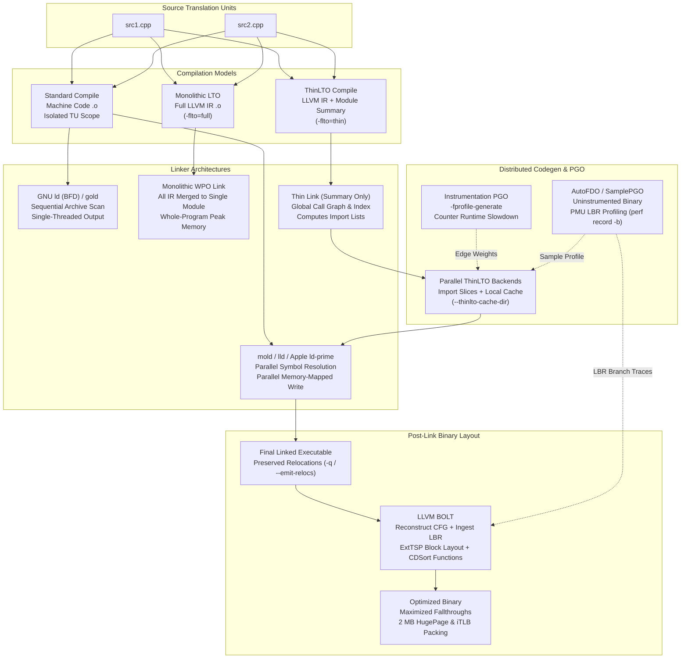

# Linkers, LTO, PGO, AutoFDO, and BOLT

> [!summary] Claim:
> Modern linkers like mold and Apple ld-prime eliminate legacy serialization bottlenecks by decoupling archive processing from symbol resolution, guarding each symbol with a fine-grained lock, merging strings in lock-free hash maps, and writing a memory-mapped output file in parallel.
> Monolithic Full LTO hits steep memory and CPU scaling walls by merging entire codebases into a single compiler intermediate representation, whereas ThinLTO aims to scale like a non-LTO build by combining a fast summary-based Thin Link, its only serial step, with parallel, cacheable backend compilations.
> Compiler instrumentation PGO places counters along control flow spanning trees to guide inlining and branch layout, while sampling-based AutoFDO extracts real production execution profiles from hardware PMU branch records on uninstrumented binaries.
> Post-link optimizers like BOLT operate on final machine code using hardware branch profiles, rearranging basic blocks with ExtTSP and functions with CDSort to reduce instruction cache misses, iTLB misses, and taken branches.



## The Mechanism

Translating source code into an optimized executable requires coordination between the compiler front-end, intermediate optimization passes, the static linker, and post-link binary layout tools.
Foundational static linking mechanics such as archive member extraction, symbol binding, and relocation processing are established in [[Symbols-Relocations-and-Static-Linking]].
Dynamic runtime symbol resolution, procedure linkage tables, and global offset tables are owned by [[Dynamic-Linking-PLT-GOT-and-Loaders]].
Procedure call standards, register argument passing, and stack frame layouts are covered in [[Calling-Conventions-System-V-AMD64-and-AAPCS64]].
Compiler optimization pipeline stages and their consequences for debuggability are analyzed in [[Compiler-Pipeline-and-Debuggability]].
Systematic assembly inspection and compiler remark analysis are developed in [[Reading-Assembly-and-Optimization-Remarks]].
This note owns linker execution speed, whole-program optimization architectures, execution profiling pipelines, and machine code cache layout.

### 1. Modern Linker Architecture and Concurrency

Traditional linkers represent the primary bottleneck in software engineering turnaround time.
GNU `ld` (the BFD linker) was designed in an era of constrained memory and uniprocessor machines.
It processes input files sequentially on a single thread, resolves symbols through one central hash table, and is sensitive to the order of archive libraries (`.a`) on the command line: when it visits an archive it pulls out only the members that resolve symbols still undefined at that point, and never revisits members it skipped (mold(1) manual, "Archive file processing").
If an archive member `libalpha.a` references a symbol in `libbeta.a`, and `libbeta.a` references a symbol in `libalpha.a`, GNU `ld` fails with unresolved symbol errors unless wrapped in rescanning directives like `--start-group` and `--end-group`, which make the link slower.
mold and lld remember which symbols archives can supply, are not sensitive to input order, and accept but silently ignore `--start-group` and `--end-group` (mold(1) manual).

GNU `gold`, written by Ian Lance Taylor, is a separate ELF-only linker in the GNU toolchain; this note makes no claim about its internal synchronization.

LLVM `lld`, originally designed by Rui Ueyama, discarded legacy BFD abstractions in favor of direct memory mapping and target-specific drivers (`ld.lld` for ELF, `ld64.lld` for Mach-O, `lld-link` for PE/COFF, and `wasm-ld` for WebAssembly).
The `lld` design document attributes its speed to doing less work rather than doing the same work more efficiently, and its input sections copy their own data into a memory-mapped output file; it reports linking a 2 GB Chrome executable with debug info in 15 seconds (LLD design document, `NewLLD.html`, undated figure).

`mold`, introduced by Rui Ueyama in 2021, represents a clean-slate architecture designed to link binaries at the speed of memory bandwidth.
Its README reports that, in August 2026 benchmarks of mold 3.0.0, it links 4.9x faster than `lld` at the median, with per-program `lld`/`mold` ratios from 3.8x to 16.1x on Threadripper debug builds; the README publishes no GNU `ld` comparison (as of 2026-11).
mold 3.0.0 is a Rust rewrite (`Cargo.toml` version 3.0.0, released 2026-10-05), and its paper attributes the speedup to "the cumulative effect of parallelizing all passes" (arXiv:2608.23228):

1. **Decoupled Input Parsing:** `mold` maps all input object files and archive member headers into memory simultaneously.
   The mold paper names "entangled symbol resolution and archive processing" as the constraint its clean-slate design decouples, so archive members are not parsed one at a time in command-line order.
2. **Lock-Free String Merging:** Pieces of mergeable sections (`SHF_MERGE` data such as string literals and `.debug_str`) are uniquified in a sharded open-addressing hash map whose insertion is lock-free: a thread claims an empty bucket with a compare-and-swap on its key pointer (`common/concurrent_map.rs`).
3. **Parallel Symbol Resolution:** Input files resolve their symbols in a parallel pass (`resolve_symbols_pass` in `elf/passes.rs`), and each `Symbol` is serialized by a byte-sized spin lock acquired with compare-and-swap (`with_resolution_lock` in `elf/symbol.rs`), so this step uses fine-grained locks rather than being lock-free.
   The lowest rank wins: strong definitions in regular objects (rank 1) beat weak ones (2), which beat strong (3) and then weak (4) definitions from archive members and shared libraries alike, which beat common symbols (5 and 6); ties go to the file that appears first on the command line (`symbol_rank_from_fields` and `symbol_resolution_rank` in `elf/input_files.rs`).
4. **Data-Parallel Stage Execution:** Every major phase (relocation scanning, section garbage collection with `--gc-sections`, identical code folding with `--icf=all`, section layout, and writing output headers) is formulated as a parallel for-loop over flat arrays.
5. **Parallel Memory-Mapped Emission:** `mold` pre-allocates the output file with `fallocate`, memory-maps it, and writes distinct section ranges concurrently from separate worker threads (`common/output_file.rs`).
6. **Two-Process Architecture:** Because the kernel can take a few hundred milliseconds to tear down a large `mold` process, `mold` by default (`--fork`) spawns a child process that does the actual linking.
   The parent exits as soon as the child reports that the output is done, without calling `waitpid(2)`, which hides the teardown latency; pass `--no-fork` to see the real resource usage in `time(1)` (mold(1) manual; `common/subprocess.rs`).

Apple `ld-prime`, introduced with Xcode 15 in 2023, replaces the classic `ld64` linker as the default; the Xcode 15 release notes say it significantly speeds up static linking.
Apple publishes no link-time multiplier in the sources checked, so this note quotes none.
It introduces native support for Mergeable Libraries (`-make_mergeable`, `-merge_library`, `-merge_framework`), presented in WWDC 2023 session 10268, "Meet mergeable libraries".
Mergeable libraries allow dynamic frameworks to be linked as dynamic libraries during rapid debug builds for fast incremental turnaround (in debug the linker does not merge and the build system re-exports the libraries instead), while allowing the linker to merge them into the app binary in release builds to eliminate dynamic runtime load penalties.
Xcode 15 kept the classic linker reachable through `-ld64` and `-Wl,-ld_classic`; on Xcode 27.2 (`ld-27106.1`) `clang -Wl,-ld_classic` prints `ld: warning: -ld_classic is no longer supported and will be ignored` and `-ld64` is not accepted (checked locally, as of 2026-11).

### 2. Link-Time Optimization (LTO): Full Monolithic vs Distributed ThinLTO

Traditional compilers optimize each translation unit (`.c` or `.cpp`) in isolation.
Because the compiler cannot see beyond the file boundary, it cannot inline functions defined in other source files, cannot propagate constants across modules, and cannot prune non-virtual member functions that are never called globally.

#### Monolithic Full LTO (`-flto=full`)

In monolithic Link-Time Optimization, the compiler front-end compiles each source file into an intermediate representation rather than native machine code.
With Clang, `-flto` output files are LLVM bitcode files rather than ELF or Mach-O objects (`file` reports `LLVM bitcode` for both `-flto=thin` and `-flto=full` objects, checked locally); `.llvmbc` sections belong to embedded-bitcode builds, not to plain `-flto`.
With GCC, object files contain GIMPLE bytecode inside `.gnu.lto_*` sections (for example `.gnu.lto_.inline.<hash>`, checked with `readelf -S` on GCC 13.3.0).

At link time, the linker reads the IR through LTO support (`libLTO` for Apple `ld64`, the `LLVMgold.so` plugin for GNU `ld` and `gold`, or LTO built into `lld`) to extract bitcode from all input objects.
The plugin merges all bitcode modules into a single, massive monolithic IR module.
The compiler then executes whole-program optimization (WPO) passes:
- Cross-module function inlining.
- Whole-program devirtualization (analyzing class hierarchies to turn indirect virtual calls into direct function calls).
- Global dead code elimination (stripping unused non-virtual functions and unreferenced static variables).
- Interprocedural constant propagation and alias analysis.

Following WPO, the compiler generates native machine code for the entire monolithic module.
While monolithic LTO achieves maximum optimization quality, it exhibits severe scaling limits:
- **Extreme Memory Footprint:** Merging IR for multi-million-line codebases is, in the Clang ThinLTO documentation's words, "not scalable in time or memory" because it merges all input into a single module; that documentation gives no memory figure, so this note quotes none.
- **Serial Bottlenecks:** Analysis passes across a single massive call graph cannot be parallelized cleanly across dozens of cores.
- **Cache Invalidation:** A one-line edit in a single source file invalidates the monolithic module, forcing a complete re-link and whole-program code generation that can take tens of minutes or hours.

```
Monolithic Full LTO Link Pipeline:
[obj1.bc] \
[obj2.bc]  --> [Linker Plugin: Merge all IR] --> [Single Huge IR Module] --> [Serial WPO Passes] --> [CodeGen] --> [Final Binary]
[obj3.bc] /                                      (Whole-Program Peak Memory, Single Machine, Zero Incremental Caching)
```

#### Distributed ThinLTO (`-flto=thin`)

ThinLTO, created by Teresa Johnson, Mehdi Amini, and Xinliang David Li (CGO 2017), "can scale as well as a non-LTO build while enabling most of the CMO performed with a full LTO build" (paper abstract), and its backends can be distributed across build systems like Bazel.
ThinLTO decouples global analysis from backend code generation through a three-phase pipeline:

```
ThinLTO Distributed Pipeline:
1. Compile:      [src.cpp] --> [Bitcode + Module Summary Index]
2. Thin Link:    [Summary 1] + [Summary 2] + [Summary 3] --> [Global Summary Index] --> [Import Lists Computed] (only serial step)
3. Backends:     [Module 1 IR] + [Imported Funcs from Module 2] --> [Parallel Backend 1] --> [native obj1.o]
                 [Module 2 IR] + [Imported Funcs from Module 1] --> [Parallel Backend 2] --> [native obj2.o]
                 (Fully parallelized across all cores or distributed across cluster workers)
4. Final Link:   [native obj1.o] + [native obj2.o] --> [Fast Static Linker] --> [Final Binary]
```

1. **Phase 1: Compile with Module Summaries:** Clang compiles each source file into LLVM bitcode accompanied by a compact Module Summary Index.
   The summary records lightweight function metadata: instruction count, hotness flags, callers, callees, memory address references, and virtual table type testing records.
   The summary does not store IR instructions, keeping it compact (the Clang ThinLTO documentation: "a compact summary of the module").
2. **Phase 2: The Thin Link:** The linker invokes the ThinLTO plugin to inspect *only* the compact module summaries, completely ignoring the heavy bitcode.
   The thin link constructs a global call graph index.
   It evaluates inlining heuristics globally: if a function in `module_a` calls a small, frequently executed function in `module_b`, the thin link adds that function to `module_a`'s import list.
   It also computes symbol linkage transitions: symbols referenced only within their defining module are privatized (internalized), while symbols imported by external modules are promoted to global linkage.
   The thin link is the only serial step; the paper's abstract calls it "fast purely summary-based Whole-Program Analysis" and the Clang documentation calls it "the fast serial thin link step", and neither gives memory or time figures.
3. **Phase 3: Parallel Distributed Backends:** Guided by the import lists computed during the thin link, each module is compiled in a separate, isolated backend process.
   A backend process loads only its own module's bitcode, plus the specific imported function definitions from other modules.
   It inlines the imported functions, runs optimization passes, and emits a standard native machine code object file (`.o`).
   Because backend tasks are completely independent, they can run across all local CPU cores or be distributed across hundreds of machines in a remote build farm.
4. **ThinLTO Backend Caching:** ThinLTO supports an incremental backend cache in a local directory: `-Wl,--thinlto-cache-dir=<dir>` for ELF `ld.lld`, `-Wl,-cache_path_lto,<dir>` for Apple `ld64` and `ld64.lld`, `-Wl,-plugin-opt,cache-dir=<dir>` for `gold`, and `/lldltocache:<dir>` for `lld-link` (Clang ThinLTO documentation).
   The cache key for a backend compilation is computed by `computeLTOCacheKey` in `llvm/lib/LTO/LTO.cpp` as a SHA1 hash over the LLVM version and revision, the LTO configuration, the module hash, and summary-derived data such as the imported modules' hashes and symbol resolutions:
   $$\text{Key} = \text{SHA1}(\text{LLVM Version} \;\|\; \text{Config and Flags} \;\|\; \text{Module Hash} \;\|\; \text{Import and Resolution Data})$$
   When an engineer edits a single source file, the thin link re-runs, and every backend whose key is unchanged reuses its cached native object file.
   Only the modified module and the modules that import from it are recompiled.

### 3. Profile-Guided Optimization (PGO) vs AutoFDO

Compilers make code generation decisions based on static heuristics: they assume loop iteration counts, guess which branch of an `if-else` statement is taken, and attempt to estimate call frequencies.
Static heuristics frequently fail because real execution profiles depend entirely on production data and runtime traffic patterns.

#### Compiler Instrumentation PGO

Profile-Guided Optimization (also known as Feedback-Directed Optimization) replaces static guesses with measured runtime execution data.
Instrumentation PGO operates in two distinct compilation passes:

1. **Instrumentation Build (`-fprofile-generate` in GCC and Clang):** The compiler instruments the code by inserting execution counters into the control flow graph (CFG).
   Clang has two kinds: IR-based instrumentation (`-fprofile-generate`), which the Clang manual recommends for PGO because of its lower overhead and smaller profiles, and frontend-based instrumentation (`-fprofile-instr-generate`), which has better source correlation and is meant for coverage (Clang User's Manual).
   To minimize profiling overhead, GCC and Clang IR-based instrumentation use spanning tree algorithms (Knuth and Ball-Larus).
   Rather than placing a counter on every basic block, counters are placed only along edges where flow cannot be mathematically deduced using Kirchhoff's current law on CFG vertices.
   The compiler also instruments indirect call sites to record target address distributions (value profiling).
2. **Training Run:** The instrumented binary is executed against a representative workload.
   Upon process termination, the profiling runtime writes raw counter files (`.gcda` in GCC, `.profraw` in LLVM).
   LLVM profiles must be merged and indexed into an optimized format using `llvm-profdata merge -output=code.profdata default.profraw`.
3. **Feedback Build (`-fprofile-use` in GCC, `-fprofile-use=code.profdata` or `-fprofile-instr-use=code.profdata` in Clang):** The compiler reads the execution profile and applies targeted transformations (in GCC, `-fprofile-use` also turns on `-funroll-loops` and `-fpeel-loops`, per the GCC optimization options manual):
   - **Branch Probability Weighting:** Conditional branches are annotated with exact execution frequencies.
     Compilers arrange the hot target to execute via fallthrough, while cold targets are reached via conditional jumps.
   - **Hot/Cold Section Splitting:** Functions and basic blocks that execute frequently are assigned to the hot text section (`.text.hot`), while error handling routines and unreached initialization code are assigned to cold sections (`.text.unlikely` or `.text.cold`).
   - **Selective Loop Transformations:** Loops with high measured trip counts are unrolled and vectorized aggressively.
     Loops that rarely iterate are kept compact to conserve instruction cache space.
   - **Indirect Call Promotion:** If an indirect virtual call or function pointer calls `TargetFunction` 99% of the time, the compiler rewrites the indirect call into a direct branch:
     ```c
     if (func_ptr == &TargetFunction) {
         TargetFunction(); // inlined directly
     } else {
         func_ptr();       // indirect call fallback
     }
     ```

Instrumentation PGO has operational drawbacks:
- Instrumented binaries "typically incur very significant CPU and memory overheads", which makes them inappropriate for production traffic (BOLT paper, section 2.1); the paper gives no multiplier.
- Organizations must maintain artificial benchmark suites that accurately mimic production workloads, leading to optimization skew if benchmark inputs drift from real-world user behavior.

#### AutoFDO (Sampling-Based PGO)

AutoFDO (Automatic Feedback-Directed Optimization), pioneered by Dehao Chen, David Xinliang Li, and Tipp Moseley at Google (CGO 2016), eliminates instrumentation overhead by collecting profiles directly from production machines running uninstrumented binaries.
The paper reports a geomean 10.5% improvement on Google's benchmarks, achieving 85% of the gains of traditional FDO (paper abstract).

AutoFDO leverages hardware Performance Monitoring Units (PMU) available on modern processors:
- On x86-64: Processor Event-Based Sampling (PEBS) and Last Branch Record (LBR).
- On AArch64: CoreSight Embedded Trace Macrocell (ETM) or Branch Record Buffer Extension (BRBE).

Under Linux, `perf` records branch trajectories with minimal overhead (the BOLT paper calls the profile-collection overhead of sample-based profiling "negligible", section 2.1, without a figure).
The Clang User's Manual gives this command for an Intel host, with `branches:u` as the next-best event when that one is unavailable:
```bash
perf record -b -e BR_INST_RETIRED.NEAR_TAKEN:uppp ./code
```
The flag `-b` captures branch execution history using hardware LBR rings; `llvm-profgen` requires it.
Each LBR entry records the `from` and `to` instruction pointers of recently executed branches.

```
AutoFDO Pipeline:
1. Production Fleet:       [Uninstrumented Binary running real traffic]
2. PMU Sampling:           perf record -b (captures taken branches via hardware LBR) --> [perf.data]
3. Profile Conversion:     create_gcov / llvm-profgen --> [profile.afdo / profile.profdata]
4. Compiler Ingestion:     clang -fprofile-sample-use=profile.profdata / gcc -fauto-profile=profile.afdo
```

The raw `perf.data` file is converted into compiler-readable sample profiles using `create_gcov` (for GCC, per the GCC `-fauto-profile` documentation) or `llvm-profgen` and AutoFDO's `create_llvm_prof` (for LLVM, per the Clang User's Manual).
The compiler ingests the sample profile using `-fprofile-sample-use` (Clang) or `-fauto-profile` (GCC).

A critical advantage of AutoFDO in large engineering organizations is **tolerance of profile staleness**.
In warehouse-scale environments where code is committed continuously, the profile gathered from binary version $N$ in production is applied to compile version $N+1$ from source.
Compilers map sample addresses back to source code line numbers and inline call stacks using debug information (`-gline-tables-only` or `-gmlt`); the Clang User's Manual recommends adding `-fdebug-info-for-profiling -funique-internal-linkage-names`.
The internal binary structure of line tables, `.debug_line` state machines, and symbol packages is detailed in [[DWARF-Debug-Information-and-Symbol-Bundles]].
The AutoFDO paper states that "profile data is stale by design" and describes compiler features that deliver stable speedups across releases; LLVM's sample profile format keys each count by line offset from the function's definition line plus an optional discriminator (Clang User's Manual), so edits above a function do not shift its counts.

LLVM Context-Sensitive Sample PGO (CSSPGO) enhances AutoFDO by embedding lightweight pseudo-probes (`-fpseudo-probe-for-profiling`, documented in the Clang User's Manual) into compiler intermediate representations.
The Clang User's Manual describes pseudo instrumentation as "the anchor for accurate profile mapping" between a sampled binary and the compiler's view of the code.
`llvm-profgen` converts `perf` output into LLVM's sample profile format (Clang User's Manual); this note does not claim a specific probe encoding or a parity with instrumentation PGO.

### 4. Post-Link Binary Optimization: BOLT

Even after applying ThinLTO and PGO, final binaries suffer from instruction starvation in data centers.
Modern enterprise services (e.g., search engines, relational databases, web servers) can contain over 100 MB of code (BOLT paper, section 3); the HHVM binary the paper studies has 148.2 MB of text.
This code footprint completely overwhelms hardware instruction caches:
- The L1 instruction cache (L1I) is small, typically tens of KiB per core.
- The L2 unified cache is typically hundreds of KiB to a few MiB per core.
- The instruction TLB (iTLB) holds only tens to hundreds of entries, each covering one page.

When an application's hot code is scattered across hundreds of megabytes, the CPU stalls on front-end instruction fetch misses; the BOLT paper calls HHVM, its largest binary, "front end bound" and reports BOLT cutting HHVM branch misses by about 11% and L1 I-cache misses by 18% (section 6.1, Figure 6).

Compilers cannot solve this problem because they do not control final binary layout.
Compilers emit object files in isolation; the static linker places functions and sections according to input order and linker script rules, not global cache locality.
Furthermore, compilers cannot reorder basic blocks across translation unit boundaries, cannot eliminate trampolines created by the linker, and cannot restructure Procedure Linkage Table stubs.

#### BOLT Architecture and Algorithms

BOLT (Binary Optimization and Layout Tool), developed by Maksim Panchenko, Rafael Auler, Bill Nell, and Guilherme Ottoni at Facebook (CGO 2019) and integrated into LLVM, operates **after** static linking on the final machine code executable.

```
BOLT Workflow:
[Source Code] --> Clang/GCC (-O3 -flto=thin -fprofile-sample-use -Wl,--emit-relocs) --> [Linked ELF Binary]
                                                                                              |
                                                                    perf record -j any,u <--+
                                                                             |
                                                                        [perf.data]
                                                                             |
                                                                         perf2bolt
                                                                             |
                                                                        [perf.fdata]
                                                                             |
[Linked ELF Binary] + [perf.fdata] --> [llvm-bolt Engine] -------------------+
                                             |
                                             v
                          1. CFG Reconstruction (via ELF Relocations)
                          2. Basic Block Reordering (ExtTSP / Cache+)
                          3. Hot/Cold Function Splitting (.text.cold)
                          4. Function Reordering (CDSort / Call Graph)
                          5. PLT Call Optimization (indirect call via GOT)
                                             |
                                             v
                               [BOLT-Optimized Executable]
                               (up to 8.0% on top of PGO function ordering + LTO)
```

BOLT needs at minimum an unstripped symbol table, and to get maximum performance gains the binary should be linked with relocations preserved using `-Wl,--emit-relocs` (or `-Wl,-q`) (BOLT README); function reordering "works only with relocations" (`--reorder-functions` in the BOLT CommandLineArgumentReference).
Relocations allow BOLT to identify code pointers, jump tables, and function references unambiguously during disassembly, and their presence shows up as a `.rela.text` section in the binary.

BOLT executes the following optimization pipeline:

1. **Disassembly and CFG Reconstruction:** BOLT disassembles the executable and constructs a precise Control Flow Graph (CFG) for every function.
   It resolves indirect jump tables and identifies landing pads.
2. **Profile Ingestion:** The companion utility `perf2bolt` parses branch execution traces collected via hardware LBR (`perf record -j any,u`) and maps taken branch counts directly onto the edges of the disassembled CFG.
3. **Basic Block Reordering (ExtTSP / Cache+):** Traditional block placement uses the greedy Pettis-Hansen algorithm (PLDI 1990), which frequently traps in local optima.
   BOLT implements the Extended Traveling Salesperson (ExtTSP) algorithm, selected with `-reorder-blocks=ext-tsp` ("perform layout optimizing I-cache behavior", BOLT CommandLineArgumentReference).
   LLVM's implementation (`llvm/include/llvm/Transforms/Utils/CodeLayout.h`) describes the goal as "increasing the number of fall-through jumps and co-locating frequently executed nodes together", with a score "designed to reflect the locality of the given order".
   This note does not restate the score's per-distance weights.
4. **Function Splitting:** BOLT dissects each function into hot and cold basic block clusters.
   Hot blocks remain in the primary function body in `.text`.
   Cold blocks (e.g., error handling, logging, assertion failures, exception handling) are exiled to a dedicated `.text.cold` section placed at the tail of the binary.
   This keeps cold instructions out of the L1 instruction cache lines fetched during normal execution.
5. **Function Reordering (CDSort):** BOLT reorders functions across the entire binary using Cache-Directed Sort (CDSort), selected with `-reorder-functions=cdsort` (the README's recommended invocation; `hfsort` and `pettis-hansen` are alternatives).
   CDSort builds a global call graph weighted by call frequencies.
   It clusters functions that call each other frequently into contiguous virtual memory pages.
   LLVM describes it as optimizing "call locality" by co-locating functions (`CodeLayout.h`); the BOLT paper's HFSort function ordering combined with block reordering packed HHVM's hot code into about 4 MB of a 148.2 MB text range (section 6.4, Figure 9).
Placing hot code densely is what makes it practical to back the text segment with larger pages.
6. **PLT Call Optimization:** With `-plt=hot` or `-plt=all`, BOLT replaces calls through `.plt` stubs with indirect calls through the GOT, removing the stub hop; on non-x86 targets this requires linking with `-znow` (`bolt/lib/Passes/PLTCall.cpp`, BOLT CommandLineArgumentReference).

The BOLT paper reports speedups of up to 8.0% on Facebook data-center applications on top of profile-guided function reordering and LTO, up to 20.4% on GCC and Clang binaries on top of FDO and LTO, and up to 52.1% when those compilers are built without FDO and LTO (arXiv:1807.06735 abstract).

## Commands and Numbers to Know

The operational parameters, compiler flags, and performance benchmarks governing modern linking and binary layout optimizations are cataloged below.

| Concern / Metric | Value / Flag | Platform | Significance |
| :--- | :--- | :--- | :--- |
| `mold` speedup vs LLVM `lld` | `4.9x faster at the median` (3.8x to 16.1x per program) | Linux (as of 2026-11) | mold README, August 2026 benchmarks of mold 3.0.0 on Threadripper 7980X debug builds; achieved by parallelizing every pass |
| Apple `ld-prime` speedup vs `ld64` | `Significantly faster static linking` (no multiplier published) | macOS (as of 2026-11) | Xcode 15 linker; release notes say it significantly speeds up static linking |
| Apple classic linker fallback | `-ld64` or `-Wl,-ld_classic` (Xcode 15); ignored with a warning on Xcode 27.2 | macOS (as of 2026-11) | Xcode 27.2 `ld-27106.1` prints `-ld_classic is no longer supported and will be ignored` (checked locally) |
| ThinLTO memory reduction vs Full LTO | `Scales as well as a non-LTO build` (paper abstract); monolithic LTO is `not scalable in time or memory` (Clang) | Both (as of 2026-11) | Thin Link reads summaries only, so peak link memory stays far below Full LTO |
| ThinLTO compilation flag | `-flto=thin` | Both (as of 2026-11) | Instructs Clang to generate LLVM bitcode with module summary indexes |
| Full monolithic LTO flag | `-flto=full` (also what plain `-flto` selects) | Both (as of 2026-11) | Clang `--help`: "`-flto` Enable LTO in 'full' mode" |
| GCC LTO compilation flag | `-flto=auto` | Linux (as of 2026-11) | GCC WHOPR partitioned LTO using GNU make's job server if available, otherwise the detected number of CPU threads |
| ThinLTO backend cache directory | `-Wl,--thinlto-cache-dir=<dir>` (ELF `ld.lld`); `-Wl,-cache_path_lto,<dir>` (Apple `ld64`, `ld64.lld`) | Both (as of 2026-11) | Caches native object files under a SHA1 key over LLVM version, config, module hash, and import data |
| PGO instrumentation flag (Clang) | `-fprofile-generate` (IR-based); `-fprofile-instr-generate` (frontend-based) | Both (as of 2026-11) | Clang recommends IR-based instrumentation for PGO; frontend-based suits coverage |
| PGO instrumentation flag (GCC) | `-fprofile-generate=<dir>` | Both (as of 2026-11) | Instruments executable and directs `.gcda` output to target directory |
| PGO feedback flag (Clang) | `-fprofile-instr-use=<file>` | Both (as of 2026-11) | Recompiles using indexed `.profdata` profile generated by `llvm-profdata` |
| PGO feedback flag (GCC) | `-fprofile-use=<dir>` | Both (as of 2026-11) | Recompiles using runtime counter files deposited in target directory |
| PGO runtime execution slowdown | `Very significant CPU and memory overheads` (no multiplier published) | Both (as of 2026-11) | Execution overhead incurred while running instrumented training workloads |
| AutoFDO sample profile flag (Clang) | `-fprofile-sample-use=<file>` | Both (as of 2026-11) | Ingests sampled PMU profiles generated from uninstrumented binaries |
| AutoFDO sample profile flag (GCC) | `-fauto-profile=<file>` | Linux (as of 2026-11) | Ingests sample profiles converted via `create_gcov` |
| AutoFDO PMU sampling overhead | `Negligible` per the BOLT paper (no figure published) | Linux (as of 2026-11) | Runtime cost of collecting branch samples via hardware LBR in production |
| Linux LBR sampling command | `perf record -e cycles:u -j any,u` (BOLT); `perf record -b -e BR_INST_RETIRED.NEAR_TAKEN:uppp` (Clang AutoFDO) | Linux (as of 2026-11) | Records branch target address rings for `perf2bolt` or `llvm-profgen` |
| BOLT relocation preservation flag | `-Wl,--emit-relocs` or `-Wl,-q` | Linux (as of 2026-11) | Recommended for maximum gains and required for function reordering; BOLT itself needs an unstripped symbol table |
| BOLT block reordering flag | `-reorder-blocks=ext-tsp` | Linux (as of 2026-11) | Applies Extended Traveling Salesperson algorithm to basic block layout |
| BOLT function reordering flag | `-reorder-functions=cdsort` | Linux (as of 2026-11) | Clusters frequently calling functions into common pages using CDSort |
| BOLT throughput gain over PGO+LTO | `up to 8.0% speedup` (data-center apps); `up to 20.4%` (GCC and Clang binaries) | Linux (as of 2026-11) | BOLT paper (arXiv:1807.06735) abstract, on top of profile-guided function reordering or FDO, and LTO |
| BOLT throughput gain without FDO and LTO | `up to 52.1% speedup` | Linux (as of 2026-11) | BOLT paper abstract, GCC and Clang built without FDO and LTO |

## Multi-Language Comparison: C++ / Python / Rust

Linking models, whole-program optimization passes, and post-link binary layout tools interact across language runtimes and build ecosystems.

| Concern | C++ (GCC 14 / Clang 19) | Python (CPython 3.12 / 3.13) | Rust (rustc 1.90+ / Cargo) |
| :--- | :--- | :--- | :--- |
| Default Linker Driver | Invokes `ld` via `g++` / `clang++`; select via `-fuse-ld=mold` or `-fuse-ld=lld` | Python extensions link via host C compiler; CPython embeds via `sysconfig` | `rustc` drives the system C compiler as linker, but since Rust 1.90 uses `rust-lld` by default on `x86_64-unknown-linux-gnu` (opt out with `-C linker-features=-lld`) |
| Monolithic Full LTO | `-flto=full` (Clang) or `-flto` (GCC); merges all IR into single module | CPython enables LTO with `--with-lto=[full\|thin\|no\|yes]` (ThinLTO is the Clang default since 3.12); `--enable-optimizations` is PGO only | Configured in `Cargo.toml` via `lto = "fat"` or `lto = true` |
| Distributed ThinLTO | `-flto=thin` with `-Wl,--thinlto-cache-dir`; scales across Bazel remote execution | Not applicable to Python scripts; applies to compiled C extension modules | Configured in `Cargo.toml` via `lto = "thin"`; default across codegen units |
| Cross-Language LTO | Clang bitcode links with Rust bitcode via `-Clinker-plugin-lto` | PyO3 and C extensions link with Clang IR using shared LLVM bitcode targets | Supports mixed C/C++/Rust LTO via `-Clinker-plugin-lto=libLTO.so` |
| Instrumentation PGO | Native `-fprofile-generate` / `-fprofile-use` (GCC and Clang IR-based) and `-fprofile-instr-generate` (Clang frontend-based) | `--enable-optimizations` drives `make profile-opt`, running `PROFILE_TASK` (default `-m test --pgo`) | Automated via `cargo-pgo` crate (`cargo pgo build`, then `cargo pgo optimize build`), or `rustc -Cprofile-generate` / `-Cprofile-use` |
| AutoFDO Ingestion | `-fauto-profile` (GCC) or `-fprofile-sample-use` (Clang) from `perf.data` | Interpreted Python code unaffected; accelerates CPython runtime core | Nightly only, as of 2026-11: `rustc 1.101.0-nightly` lists `-C profile-sample-use=profile.prof` in `rustc -C help`, while stable `rustc 1.99.0` rejects it as an unknown codegen option, so no stable release ingests AutoFDO profiles yet |
| BOLT Post-Link Layout | Supported on binaries linked with `-Wl,--emit-relocs` and `llvm-bolt` | Experimental `--enable-bolt` since 3.12, which "improves performance by 1-5%" (What's New in Python 3.12) | Supported on Rust release executables linked with `-C link-arg=-Wl,--emit-relocs`; `cargo pgo bolt` is experimental |

## Worked Lab Example

The companion lab `code/00-Program-Execution/thinlto_bolt_pgo/` demonstrates the mechanical differences between baseline linking, Link-Time Optimization, and Profile-Guided Optimization on Linux.
It implements a high-throughput network packet processing pipeline split across two translation units: `packet_engine.c` and `main.c`.

The codebase contains:
- `packet_process(type, payload)`: The primary hot function.
  When `type == 1` (99.9% of traffic), it computes a fast linear transformation.
  When `type == 2` (0.1% error traffic), it calls `handle_cold_error(type)`.
- `handle_cold_error(code)`: An error-handling function annotated with `__attribute__((noinline))`.
- `dead_debug_helper(val)`: An unreferenced function compiled into `packet_engine.c` but never invoked by `main()`.
- `main()`: Processes 50,000 packets and prints an accumulator checksum.

The lab script `run.sh` executes four consecutive phases.
It runs GCC full LTO and GCC instrumentation PGO only: the lab container has no `clang`, `lld`, `perf`, or `llvm-bolt`, so the lab does not exercise ThinLTO, AutoFDO, or BOLT, and its directory name `thinlto_bolt_pgo` is broader than its scope.

1. **Baseline Compilation:** Compiles `packet_engine.c` and `main.c` into separate native object files with `gcc -O2` and links them, then relinks the same objects with `-Wl,--gc-sections`.
   `packet_process` is preserved as an external global function (`T`), and `main` calls it with a direct `bl` instruction once per packet (aarch64 `objdump -d`, checked in the lab container).
   `dead_debug_helper` is retained both with and without `--gc-sections`: without `-ffunction-sections` every function shares one `.text` input section, so the linker has nothing it can drop.
2. **Link-Time Optimization (LTO):** Compiles with `gcc -O2 -flto` (GCC whole-program LTO, not ThinLTO) and links without `--gc-sections`.
   - `packet_process` is inlined directly across translation units into `main()`, completely eliminating the cross-module call (the LTO `main` disassembly has no call to it).
   - `dead_debug_helper`, marked `noinline` in the source so that inlining cannot hide it, is unreferenced across the whole program and is removed by GCC's LTO pass, not by section garbage collection.
   - `handle_cold_error` is demoted from external global linkage (`T`) to internal local linkage (`t`), and GCC's IPA-SRA pass replaces it with a local clone named `handle_cold_error.isra.0`.
3. **Profile-Guided Optimization (PGO):** Instruments the binary with `-fprofile-generate`, executes a representative training workload to write runtime execution counters, and recompiles with `-fprofile-use -Werror=missing-profile`.
   The `-Werror=missing-profile` flag fails the build when the profile data file is not found, so the feedback build cannot silently degrade to a non-PGO build.
   The profile changes code generation: `main` grows from 120 bytes under LTO to 632 bytes under PGO as the hot loop is unrolled, and the rarely taken call to `handle_cold_error.isra.0` sits near the end of `main` (disassembly); the clone itself stays in `.text`, and no code moves to `.text.unlikely` (`readelf -S` shows no such section).
4. **Layout Analysis:** `analyze_layout.py` inspects the four binaries only through `nm -S`, reporting inlining, dead code stripping, linkage, and the size of `main` under LTO and PGO.

```bash
cd code/00-Program-Execution/thinlto_bolt_pgo
bash run.sh
```

### Verified output

Recorded on `linux-aarch64` under Ubuntu 24.04 (GCC 13.3.0, GNU Binutils 2.42); the file is `code/00-Program-Execution/thinlto_bolt_pgo/expected/linux-aarch64.txt`.

```text
=== 1. Baseline Compilation (No LTO, No PGO) ===
Checksum: 8741899300
=== 2. Link-Time Optimization (LTO / Whole Program Optimization) ===
Checksum: 8741899300
=== 3. Profile-Guided Optimization (PGO Instrumentation & Feedback) ===
Checksum: 8741899300
=== 4. Layout & Optimization Analysis ===
=== Symbol Resolution & Cross-TU Optimization ===
packet_process in baseline: GLOBAL
packet_process in LTO: INLINED
packet_process in PGO: INLINED
dead_debug_helper in baseline: PRESENT
dead_debug_helper in baseline with --gc-sections: PRESENT
dead_debug_helper in LTO: STRIPPED
dead_debug_helper in PGO: STRIPPED
handle_cold_error linkage: base=GLOBAL, lto=LOCAL, pgo=LOCAL
=== Profile Effect on Code Generation ===
main size in LTO: 120 bytes
main size in PGO: 632 bytes
PGO changed main: YES
```

### Reading the result

- The checksum `8741899300` remains identical across all three builds, confirming that optimization passes preserved program semantics exactly.
- In Section 1 (baseline), `packet_process` is marked `GLOBAL` in the symbol table; every packet costs `main` a `bl` call and return through the procedure call standard.
- In Section 2 (LTO), `packet_process` is marked `INLINED`, which the analysis prints only when no symbol remains; a surviving local copy would print `LOCAL_COPY`.
  The compiler merged the translation units and inlined its body directly into `main`.
- `dead_debug_helper` is `PRESENT` in the baseline and in the baseline relinked with `--gc-sections`, and `STRIPPED` under LTO and PGO.
  The two baseline lines together show that section garbage collection is not what removes it, and GCC's whole-program LTO analysis, which proved the symbol unreachable from `main`, is.
- `handle_cold_error` linkage shifts from `GLOBAL` (`T`) to `LOCAL` (`t`) under LTO and PGO; the linker plugin's symbol resolution reports that nothing outside the LTO unit references it, so GCC internalizes it and clones it as `handle_cold_error.isra.0`.
  A `MISSING` value would mean the function was inlined away instead.
- In the last section, `PGO changed main: YES` compares `main` at 120 bytes under LTO with 632 bytes under PGO; it proves only that the profile altered code generation, because without `-fprofile-use` the two sizes are equal.
  The disassembly, not this check, shows the unrolled loop and the cold call at the tail of `main`.

## Pitfalls

> [!warning] Pitfall: Stripping ELF relocations before running post-link optimizers
> Running standard binary stripping tools like `strip --strip-all` removes the symbol table that BOLT needs at minimum, and omitting `-Wl,--emit-relocs` removes the static relocation tables BOLT needs for its largest gains.
> Without relocation tables, a post-link optimizer cannot distinguish between integer constants and virtual code addresses in data sections or jump tables.
> BOLT then cannot move functions, so `-reorder-functions` "works only with relocations" (BOLT CommandLineArgumentReference) and most of the layout benefit is lost; the README reports whether relocations were detected while processing the binary.
> Always preserve relocations during final link with `-Wl,--emit-relocs` (or `-Wl,-q`), check for a `.rela.text` section, run BOLT, and strip only the final `.bolt` output.

> [!warning] Pitfall: Profile pollution from unrepresentative or multi-threaded training runs
> Feeding an unrepresentative benchmark profile into `-fprofile-use` misleads compiler optimization passes.
> If training traffic exercises error handling paths that are rare in production, the compiler inlines error routines and splits steady-state business logic into cold sections, causing severe production performance regressions.
> In multi-threaded applications, profiling runs using `-fprofile-generate` can suffer from data races on counter arrays unless compiled with thread-safe atomic counter instrumentation (`-fprofile-update=atomic`).
> GCC defaults to `single` unless `-pthread` is on the command line, in which case the driver selects `prefer-atomic`, and `atomic` "prevents profile corruption by emitting thread-safe code" (GCC Instrumentation Options); Clang defaults to `single` (non-atomic increments, "inaccurate under thread contention") unless `-fsanitize=thread` is given (Clang User's Manual).
> Without atomic counter updates, concurrent threads can lose counts, so the profile is inaccurate under thread contention and can mislead the feedback build (Clang User's Manual).

> [!warning] Pitfall: Exhausting build memory with Monolithic Full LTO in large repositories
> Enabling `-flto=full` on multi-million line codebases is, per the Clang ThinLTO documentation, "not scalable in time or memory", so peak link memory grows with the whole program.
> When worker nodes run out of memory, link steps crash with `OOMKilled` or thrash the swap partition, freezing developer machines.
> Furthermore, full LTO invalidates distributed compilation caches, forcing full whole-program rebuilds for single-line changes.
> Production monorepos must use ThinLTO (`-flto=thin`) with the local backend cache enabled via `-Wl,--thinlto-cache-dir` (ELF `ld.lld`), or distributed ThinLTO, where each backend is a separate build action that a remote build cache can store.

> [!warning] Pitfall: Cross-language LTO compiler version skew
> Attempting to perform cross-language LTO between Rust (`rustc`) and C++ (`clang++`) requires linking LLVM Intermediate Representation across language boundaries.
> LLVM bitcode is not a stable format across major compiler releases.
> The rustc book advises an LLVM linker plugin at least as new as the newest compiler involved, says best results come from a `rustc` and LLVM compilers based on the exact same LLVM version (`rustc -vV` shows it), publishes a table of known-good `rustc` and Clang pairs, and documents no specific error text for a mismatch (The rustc book, "Linker-plugin-based LTO").
> Cross-language LTO therefore requires pinning `rustc` and `clang++` to matching LLVM versions.

## At Scale

Optimization and linking strategies evolve as engineering organizations expand from individual developers to enterprise fleets comprising tens of thousands of engineers.

```
Development Lifecycle Strategy Matrix:
Local Development Loop:     mold / lld + Split DWARF + No LTO + No PGO (target: link in seconds)
CI Pull Request Gating:     lld + ThinLTO + Remote Cache (--thinlto-cache-dir) (target: minutes)
Nightly Release Builds:     ThinLTO + AutoFDO (Fleet PMU Profiles) + BOLT (Peak Production Throughput)
```

### 1. Developer Loop Economics vs Release Performance

A single developer iterating on local code requires minimal link latency.
A 30-second link pause breaks concentration and degrades engineering velocity.
For local inner-loop builds, organizations must standardize on `mold` (on Linux) or `ld-prime` (on macOS), paired with Split DWARF (`-gsplit-dwarf`, detailed in [[DWARF-Debug-Information-and-Symbol-Bundles]]) and zero LTO.
Debug linking should complete in seconds, and the team should measure and budget it.

In automated CI environments validating pull requests, builds must balance correctness with resource consumption.
CI jobs should use `lld` with ThinLTO enabled, either keeping `--thinlto-cache-dir` on a persistent local or network-mounted directory (the cache is a filesystem directory, per the Clang ThinLTO documentation) or running distributed ThinLTO so that each backend is a build action cached in an enterprise store (such as Amazon S3, Google Cloud Storage, or Bazel Remote Build Execution).
Because only modified modules recompile, CI links stay incremental while still validating whole-program type correctness.

For production artifact releases, developer convenience is subordinated to fleet execution efficiency.
A 1% CPU reduction in a service running on 100,000 server cores frees the capacity of about 1,000 cores.
Production releases should mandate the three-stage optimization pipeline:
$$\text{Production Binary} = \text{Source} \xrightarrow{\text{ThinLTO}} \text{AutoFDO / SamplePGO} \xrightarrow{\text{BOLT (ExtTSP + CDSort)}} \text{Optimized Executable}$$

### 2. Continuous Fleet AutoFDO Infrastructure

Large technology companies do not maintain synthetic benchmark suites for PGO.
Instead, they build continuous profiling pipelines:

1. **Fleet Sampling Daemons:** A low-overhead daemon runs across production server clusters, sampling a small, rotating subset of machines using Linux `perf` with hardware LBR enabled (`perf record -b`); the AutoFDO paper describes sampling hardware performance monitors on production machines and publishes no fraction.
2. **Profile Aggregation:** Sampling traces are uploaded to a centralized profiling service that strips private data and merges raw samples into aggregated cluster profiles.
3. **Automated Compiler Feedback:** Nightly continuous integration pipelines download the aggregated profile for the target service and compile the next release candidate using `-fprofile-sample-use`.
4. **Tolerance of Drift:** Because AutoFDO tolerates minor source line offsets, a rolling window of recent profiles stays usable for active development branches without developer intervention.

### 3. HugePages, CDSort, and Front-End Stall Mitigation

On large-binary server workloads, instruction TLB misses are a hidden tax: the BOLT paper reports about a 13% iTLB miss reduction on HHVM from layout alone (Figure 6, read from the chart).
At scale, organizations combine BOLT function reordering with 2 MB Linux HugePages:

- BOLT applies Cache-Directed Sort (CDSort), placing functions that frequently call each other into the same 2 MB page boundaries.
- The binary startup wrapper or production execution environment enables transparent huge pages on the text segment via `madvise(text_start, text_size, MADV_HUGEPAGE)` or by linking with `libhugetlbfs`.
- Concentrating hot code into few large pages shrinks the iTLB working set; measure the effect with `perf stat` iTLB counters on your own binary rather than assuming a figure.

## Practice Drill

> [!tip] Practice Drill: Measure Front-End Stalls and Layout Transformations
> Copy `code/00-Program-Execution/thinlto_bolt_pgo/` to a scratch directory on a Linux machine with hardware performance counters enabled.
> Compile three separate variants of the packet engine:
> 1. `app_base`: Compiled with `gcc -O2 packet_engine.c main.c -o app_base`.
> 2. `app_lto`: Compiled with `gcc -O2 -flto packet_engine.c main.c -o app_lto`.
> 3. `app_pgo`: Compiled with two-pass `-fprofile-generate` and `-fprofile-use`.
>
> Run each binary under Linux `perf stat` measuring front-end microarchitectural metrics:
> ```bash
> perf stat -e cycles,instructions,L1-icache-load-misses,branch-misses,iTLB-load-misses ./app_base
> perf stat -e cycles,instructions,L1-icache-load-misses,branch-misses,iTLB-load-misses ./app_lto
> perf stat -e cycles,instructions,L1-icache-load-misses,branch-misses,iTLB-load-misses ./app_pgo
> ```
>
> Observe and explain the results:
> - Compare total executed instructions: predict why `app_pgo` may execute slightly more raw instructions than `app_lto` due to loop unrolling, yet complete in significantly fewer total cycles.
> - Inspect `L1-icache-load-misses`: verify that cold block partitioning in `app_pgo` shrinks the working instruction footprint.
> - Inspect disassembly using `objdump -d app_pgo | grep -A 20 "<main>:"`: verify that the conditional jump for the hot packet branch was inverted into a straight-line fallthrough instruction.

## Interview Questions

> [!question] L5: Predict-the-output
> You compile two C files:
> `alpha.c` defines `void compute(void) { ... }` and `void unused_helper(void) { ... }`.
> Neither function is marked static.
> `main.c` defines `int main(void) { compute(); return 0; }`.
> You build the executable with `gcc -O2 -flto -Wl,--gc-sections alpha.c main.c -o app`.
> What symbols will `nm app | grep -E "compute|unused_helper"` output?
>
> > [!success]- Answer
> > `unused_helper` will not appear in the output at all (it is stripped).
> > `compute` will either be completely absent from the symbol table (if inlined directly into `main`), or will appear with local linkage `t` rather than global linkage `T`.
> > Because GCC LTO performs whole-program analysis, the linker plugin's symbol resolution tells the compiler that nothing outside the LTO unit references `unused_helper`, so GCC internalizes it and removes it as unreachable; `--gc-sections` is not what removes it, since without `-ffunction-sections` the function shares `.text` with live code (the companion lab shows a non-LTO link with `-Wl,--gc-sections` keeps the dead function, while the LTO link without it removes the function).
> > For the same reason, `compute` is internalized from external linkage `T` to local linkage `t`, enabling the compiler to inline it across translation units and discard the standalone entry point; a surviving local copy may carry a clone suffix such as `.isra.0`.

> [!question] L5: Why does `mold` link large binaries so much faster than GNU `ld` on high-core workstations?
>
> > [!success]- Answer
> > GNU `ld` is fundamentally single-threaded and entangled in sequential abstractions.
> > It evaluates archive files (`.a`) strictly in command-line order, requiring serialized symbol lookups.
> > `mold` restructures linking into parallel stages with fine-grained synchronization:
> > 1. It memory-maps all object files and archive member headers concurrently, and remembers which symbols archives can supply, so it is not sensitive to command-line order.
> > 2. It uniquifies mergeable-section strings in a sharded hash map with lock-free compare-and-swap insertion, without a central mutex.
> > 3. It resolves symbols in a file-parallel pass, serializing each symbol with its own byte-sized spin lock and keeping the lowest-ranked definition.
> > 4. It executes relocation processing, ICF, and section garbage collection as data-parallel loops over flat arrays.
> > 5. It pre-allocates the output file with `fallocate` and writes section data concurrently from worker threads through a memory mapping.
> > 6. By default (`--fork`) a child process does the linking and the parent exits as soon as the output is done, hiding the few hundred milliseconds the kernel can take to tear down a large process.
> > (mold(1) manual and mold 3.0.0 source; the mold README's own benchmarks compare against `lld`, not GNU `ld`, and report 4.9x at the median.)

> [!question] L6: Debug-this
> A high-throughput trading service compiled with Clang instrumentation PGO (`-fprofile-instr-generate`) crashes intermittently with `SIGSEGV` during benchmark training runs when executed under 64 concurrent worker threads.
> The non-PGO release build never crashes.
> What is the root cause, and how do you resolve it?
>
> > [!success]- Answer
> > Start from the core dump, not from the counters.
> > By default, `-fprofile-instr-generate` emits non-atomic increment instructions (`incq (%rax)`) to minimize profiling overhead; the Clang User's Manual documents `single` as the default for `-fprofile-update` and says the counters "can be inaccurate under thread contention".
> > Racing read-modify-write increments on fixed counter slots lose counts but do not by themselves fault, so non-atomic counters explain a wrong profile, not a `SIGSEGV`.
> > Find the faulting frame in the core dump; if it is in the profile runtime's exit-time write while worker threads still run, the fix is below, and if it is in application code the crash is not a PGO problem.
> > To resolve the crash:
> > 1. Compile with thread-safe atomic counter instrumentation: pass `-fprofile-update=atomic` during compilation.
> > 2. Ensure that worker threads are joined cleanly before `main()` exits, or configure custom profile dumping using `__llvm_profile_write_file()` before tearing down the thread pool.

> [!question] L6: Walk through the three phases of ThinLTO; explain what is contained in the Module Summary Index and how cross-module inlining is decided.
>
> > [!success]- Answer
> > ThinLTO operates in three phases:
> > 1. **Compile:** Clang compiles each source file into LLVM bitcode accompanied by a Module Summary Index.
> >    The summary contains per-function metadata: instruction count, hotness flags, callees, callers, memory address references, and virtual table records, without full IR instructions.
> > 2. **Thin Link:** The linker reads only the compact module summaries, skipping the heavy IR.
> >    It builds a global call graph index, runs global analysis, and decides which functions should be imported into each module based on an inlining threshold.
> >    It also promotes symbol linkage: symbols imported by external modules are promoted to global visibility, while unreferenced symbols are internalized.
> >    The thin link is the only serial step, and it is fast because it reads only summaries.
> > 3. **Distributed Backends:** Each module is compiled in a separate parallel backend process (which can be distributed across build clusters).
> >    A backend loads its own module bitcode plus only the imported function bitcodes specified by the thin link.
> >    It inlines imported functions, generates native `.o` files, and supports incremental caching via `-Wl,--thinlto-cache-dir` (ELF `ld.lld`) or `-Wl,-cache_path_lto` (Apple `ld64`, `ld64.lld`).
> > A final standard static link combines the native object files into the executable.

> [!question] L7: How does BOLT's ExtTSP basic block reordering algorithm differ from Pettis-Hansen, and why does BOLT achieve speedups on binaries already optimized with PGO and ThinLTO?
>
> > [!success]- Answer
> > The classic Pettis-Hansen algorithm uses a greedy heuristic that iteratively merges pairs of basic blocks with the highest mutual branch frequency.
> > Because it makes irreversible greedy choices, Pettis-Hansen frequently falls into local optima, creating suboptimal chains and failing to minimize long jumps across complex control flow graphs.
> > BOLT's Extended Traveling Salesperson (ExtTSP) algorithm models basic block layout as an optimization problem with a comprehensive objective function:
> > - Increasing fall-through jumps across hot branches.
> > - Co-locating frequently executed blocks, scored for locality (`CodeLayout.h`).
> > BOLT achieves additional speedups on binaries already optimized with PGO and LTO (the CGO 2019 paper reports up to 8.0% on Facebook data-center applications and up to 20.4% on GCC and Clang) because compilers optimize within translation units or partitioned modules before final linking.
> > Compilers cannot control global section placement in virtual memory, cannot reorder basic blocks across entire applications, and cannot optimize Procedure Linkage Table stubs or jump tables.
> > BOLT operates on the final linked machine code, using real hardware LBR execution traces to reorganize the entire binary's layout.

> [!question] L7: Explain how AutoFDO resolves the "profile staleness" problem in continuous deployment environments.
>
> > [!success]- Answer
> > In continuous integration and deployment, source code changes continuously between releases.
> > Gathering a profile from production binary version $N$ and applying it to compile version $N+1$ means the profile is inherently stale: source line numbers, function sizes, and basic block structures have drifted.
> > AutoFDO resolves this using debug metadata and fuzzy control flow matching:
> > 1. Production binaries are built with line table debug information (`-gline-tables-only` or `-gmlt`).
> > 2. The profile generator (`llvm-profgen` or `create_gcov`) translates sampled hardware instruction addresses into source file names, line numbers, and inline call stacks, rather than referencing volatile assembly addresses.
> > 3. During compilation, the compiler maps the sample profile back onto the new AST/IR using function names and relative source line offsets.
> > 4. Counts attach to a function by name and line offset, so a function that was not edited keeps its profile even when code above it moves; the AutoFDO paper states that profile data is stale by design and that compiler features deliver stable speedups across releases.

> [!question] L7: Walk through the mechanics of Apple `ld-prime`'s Mergeable Libraries (`-make_mergeable`), and explain how they resolve the trade-off between app launch latency and modularity.
>
> > [!success]- Answer
> > In large Apple platform applications (iOS and macOS), modular architectures create dozens of dynamic frameworks (`.dylib` / `.framework`).
> > At app launch, the dynamic linker (`dyld`) must map each dynamic library, resolve dependencies, bind symbols, and apply fixups, causing noticeable launch latency.
> > Developers historically chose between slow app launch (using dynamic libraries for modularity) or slow build times (using static libraries, which require full re-linking on every change).
> > `ld-prime` resolves this with Mergeable Libraries:
> > 1. During the library link, dynamic frameworks are built with `-make_mergeable`, which "tells the linker to record the metadata" (WWDC 2023 session 10268).
> >    The resulting dynamic libraries carry that mergeable metadata, which roughly doubles the dylib's size but is discarded once the app is built (WWDC 2023 session 10268).
> > 2. In debug builds, the linker does not merge; the build system re-exports the libraries instead, so they stay on disk as standard dynamic libraries, maintaining rapid incremental build times.
> > 3. In release builds, `ld-prime` invokes `-merge_library` or `-merge_framework`.
> >    The linker reads the preserved metadata, inlines the dynamic library code directly into the main app binary, and removes the dynamic library dependency.
> > The resulting release executable behaves as a monolithic static binary with zero dynamic loading overhead, combining fast debug turnaround with optimal production launch performance.

> [!question] L8+: Design a warehouse-scale continuous optimization infrastructure for a 20,000-engineer organization operating 500,000 server cores.
>
> > [!success]- Answer
> > An enterprise continuous optimization architecture integrates three systems:
> > 1. **Fleet Continuous Profiling:**
> >    - Deploy an unprivileged daemon across 0.1% of fleet servers sampling CPU branches via hardware PMU: `perf record -e cycles:u -j any,u -c 1000003` for 60 seconds every hour.
> >    - Upload profiles to an internal telemetry service that strips tenant identifiers, symbolizes addresses using build IDs against a central debuginfod cluster, and merges traces into a centralized profile storage system.
> > 2. **Build Toolchain Integration:**
> >    - Inner loop: Engineers use `mold` on Linux and `ld-prime` on macOS with Split DWARF (`-gsplit-dwarf`) and local caching, maintaining <2s link turnaround.
> >    - CI verification: Pull requests link via `lld` with ThinLTO (`-flto=thin`), using a persistent `--thinlto-cache-dir` directory or distributed ThinLTO backends cached as build actions in a remote cluster cache.
> >    - Nightly release pipeline: Automate the three-stage optimization pipeline:
> >      a. Ingest the 7-day rolling aggregated fleet sample profile using Clang AutoFDO (`-fprofile-sample-use`).
> >      b. Compile with ThinLTO and preserve relocations (`-Wl,--emit-relocs`).
> >      c. Run `llvm-bolt` with `-reorder-blocks=ext-tsp` and `-reorder-functions=cdsort -split-functions -split-all-cold`.
> > 3. **Production Deployment & Layout Enablement:**
> >    - Package the binary with an ELF text segment aligned to 2 MB.
> >    - Configure the production container runtime to back the binary's text segment with 2 MB transparent huge pages via `madvise(MADV_HUGEPAGE)`.
> >    - Deploy release binaries across a 1% canary ring, monitoring automated telemetry for regression metrics: IPC (instructions per cycle), L1I cache misses, and iTLB walk cycles.
> >    - Automatically gate progressive canary rollouts if front-end stall rates exceed established baselines.

## Further Reading

- Rui Ueyama, "mold: A Massively Parallel Linker" (arXiv:2608.23228, 2026, accepted to ASPLOS 2027): the paper describing how mold decouples symbol resolution from archive processing and parallelizes every linking pass.
- Teresa Johnson, Mehdi Amini, and Xinliang David Li, "ThinLTO: Scalable and Incremental LTO" (IEEE/ACM CGO, 2017): the foundational paper introducing summary-based Thin Link and distributed compilation backends.
- Maksim Panchenko, Rafael Auler, Bill Nell, and Guilherme Ottoni, "BOLT: A Practical Binary Optimizer for Data Centers and Beyond" (IEEE/ACM CGO, 2019; arXiv:1807.06735): the design, implementation, and evaluation of post-link binary optimization at Facebook.
- Dehao Chen, David Xinliang Li, and Tipp Moseley, "AutoFDO: Automatic Feedback-Directed Optimization for Warehouse-Scale Applications" (IEEE/ACM CGO, 2016): Google's production architecture for sampling-based profile-guided optimization.
- Karl Pettis and Robert C. Hansen, "Profile Guided Code Positioning" (ACM SIGPLAN PLDI, 1990): the original paper establishing basic block and function reordering to minimize instruction cache misses.
- Apple Inc., "Meet mergeable libraries" (WWDC 2023 Session 10268): Apple's presentation of Mergeable Libraries and the `-make_mergeable`, `-merge_library`, and `-merge_framework` options of the new linker.
- LLVM Project, "Link Time Optimization", "ThinLTO", the Clang User's Manual, and the BOLT README and CommandLineArgumentReference (main branch, accessed 2026-11): normative toolchain manuals for Clang LTO plugins, `llvm-profgen`, and `llvm-bolt` flags.
- GNU Binutils Contributors, "The GNU Linker ld" (current release, accessed 2026-11): reference manual for BFD linker script commands, section garbage collection, and relocation emission.

## Related

- Prerequisites: [[Symbols-Relocations-and-Static-Linking]], [[Dynamic-Linking-PLT-GOT-and-Loaders]]
- Next: [[macOS-vs-Linux-Toolchain-Mechanics]]
- See also: [[02-Programming-Languages/C++/CPP_Zero_to_Godhood/Volume_08_Advanced_Systems/Chapter_102_Linking_Loading_ABI/Chapter_102_Linking_Loading_ABI_and_WPO|Chapter_102_Linking_Loading_ABI_and_WPO]]
- Lab: `code/00-Program-Execution/thinlto_bolt_pgo/` (requires: linux)
