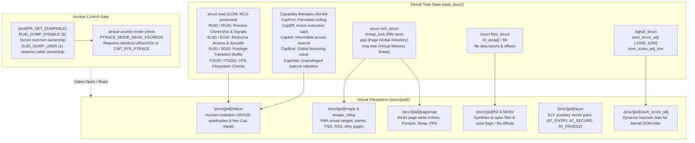
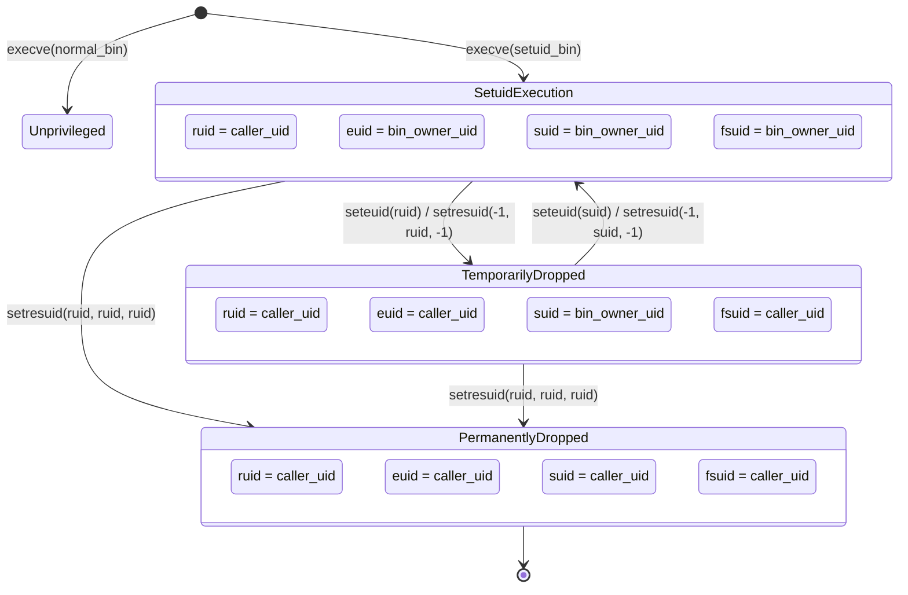
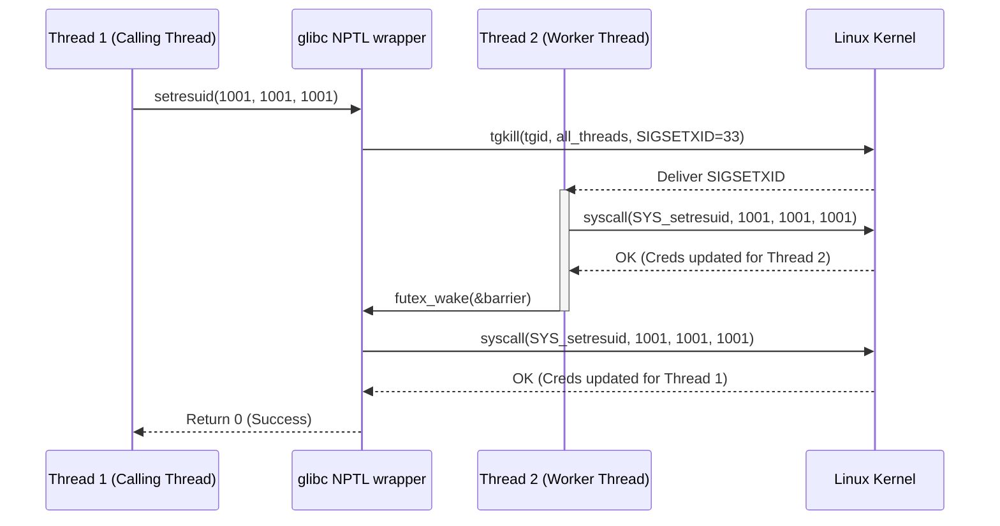
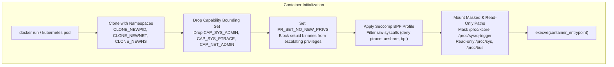

# Proc Filesystem and Process Credentials

> [!summary] Claim:
> The Linux `/proc` pseudo-filesystem exposes live kernel task structures as an in-memory virtual directory hierarchy without disk backing.
> Every process is governed by a reference-counted, copy-on-write `struct cred` containing real, effective, saved, and filesystem UID and GID dimensions alongside five discrete 64-bit capability bitmasks.
> Pseudofiles such as `maps`, `smaps_rollup`, `pagemap`, `fd`, `auxv`, and `oom_score_adj` allow zero-copy inspection of memory topology, physical page backing, descriptor tables, ELF startup parameters, and kernel eviction scoring.
> Reading or mutating these files is governed by strict `ptrace` access mode checks and the process dumpable attribute, while POSIX credential modifications across POSIX threads require user-space coordination via glibc NPTL real-time signals.



## The Mechanism

The `/proc` virtual filesystem originated in Tom Killian's 8th Edition Research Unix (1984) to eliminate hazardous raw memory access through `/dev/kmem`.
System V Release 4 (SVR4) expanded `/proc` into a structured directory where each process was represented by control files queried through binary `ioctl` calls.
Linux 0.97.3 (September 1992, implemented by Darren Senn) and 0.98.6 adopted a distinct architectural model: exposing kernel data structures directly as human-readable and binary virtual streams generated entirely on demand.
In Linux, `/proc` is backed by the `procfs` virtual filesystem driver located in `fs/proc/` in the kernel tree.
The filesystem has no backing block storage; directory nodes and file content are synthesized transiently by kernel callback handlers traversing internal kernel data structures.

### 1. The Kernel Credential Architecture (struct cred)

Every task in the Linux kernel is represented by a `struct task_struct` defined in `include/linux/sched.h`.
Process identity and security privileges are encapsulated in a dedicated structure, `struct cred`, defined in `include/linux/cred.h`.
The task structure maintains two distinct pointers to credentials:
The `real_cred` pointer identifies the subjective credentials of the entity that created the task, which are consulted for signal delivery permissions, process accounting, and audit logging.
The `cred` pointer identifies the objective credentials currently in effect for resource access control, VFS filesystem operations, and capability evaluation.
Both pointers frequently point to the same shared, reference-counted `struct cred` instance.

The `struct cred` layout in modern Linux kernels consists of:

- `atomic_long_t usage`: The atomic reference counter.
  `struct cred` objects are immutable once published and are managed via Copy-On-Write (COW) semantics protected by Read-Copy-Update (RCU).
  When a task alters its credentials, the kernel invokes `prepare_creds()`, which allocates a duplicate structure.
  Once modifications are complete, `commit_creds()` atomically switches the task pointer and frees the superseded credentials via RCU.
- `kuid_t uid, kgid_t gid`: The Real User ID and Real Group ID.
  These identify process ownership and govern signal transmission via `kill(2)`.
- `kuid_t suid, kgid_t sgid`: The Saved Set-User-ID and Saved Set-Group-ID.
  These preserve copies of the effective IDs established during an `execve(2)` of a set-user-ID or set-group-ID executable.
- `kuid_t euid, kgid_t egid`: The Effective User ID and Effective Group ID.
  These govern traditional POSIX access checks for IPC mechanisms, POSIX message queues, shared memory segments, and system calls.
- `kuid_t fsuid, kgid_t fsgid`: The Filesystem User ID and Filesystem Group ID.
  These are Linux-specific credentials passed to the Virtual Filesystem (VFS) layer during `inode_permission()` checks.
- `kernel_cap_t cap_inheritable, cap_permitted, cap_effective, cap_bset, cap_ambient`: Five discrete 64-bit bitmasks representing the Linux capability sets.
- `struct group_info *group_info`: An array of supplementary group IDs associated with the process.
- `struct user_namespace *user_ns`: The user namespace that maps the kernel UIDs and GIDs (`kuid_t`/`kgid_t`) to user-space numeric identifiers.

### 2. POSIX and Linux UID/GID Transition State Machine

POSIX systems define three distinct identities: Real, Effective, and Saved.
Linux introduces a fourth identity: the Filesystem UID/GID (`fsuid`/`fsgid`).



The historical justification for `fsuid` dates to Linux 1.2.
In early Unix and Linux kernels, a process could transmit signals via `kill(2)` to any other process sharing the same effective UID.
When a user-space daemon such as an in-kernel or user-space NFS daemon needed to read or write a file on behalf of an unprivileged client user, switching the daemon's effective UID exposed the daemon process to arbitrary signal termination by that client.
Linux introduced `setfsuid(2)` and `setfsgid(2)` to decouple filesystem authorization from signal authorization.
Under modern Linux semantics:
Whenever a process alters its effective UID or GID, the kernel automatically synchronizes `fsuid` to match `euid` and `fsgid` to match `egid`.
A process can decouple `fsuid` from `euid` only by calling `setfsuid(2)`.
The `setfsuid()` system call has a notorious architectural defect: on both success and failure, it returns the *previous* `fsuid` value without setting `errno`.
To reliably verify whether an unprivileged `setfsuid(target)` succeeded, caller code must invoke `setfsuid(-1)` immediately afterward; because passing an invalid UID fails and returns the current active `fsuid`, comparing that return value against `target` determines success.

The primary system calls governing credential transitions operate under distinct constraints:

- `setuid(uid_t uid)`:
  If the calling process possesses the `CAP_SETUID` capability in its user namespace, `setuid()` atomically sets `ruid = euid = suid = fsuid = uid`.
  If the caller lacks `CAP_SETUID`, `setuid()` can only set `euid = fsuid = uid` if `uid` equals either the current `ruid` or the current `suid`.
- `seteuid(uid_t euid)`:
  Sets `euid = fsuid = euid`.
  An unprivileged process can set `euid` to its current `ruid` or `suid`.
- `setreuid(uid_t ruid, uid_t euid)`:
  Sets real and effective user IDs independently.
  Passing `-1` leaves the respective ID unmodified.
  If the real UID is altered, or if `euid` is set to a value other than the previous `ruid`, the saved set-user-ID (`suid`) is automatically synchronized to the new `euid`.
- `setresuid(uid_t ruid, uid_t euid, uid_t suid)`:
  The definitive, unambiguous Linux interface.
  It allows explicit, independent mutation of all three POSIX user IDs.
  An unprivileged process may set any of `ruid`, `euid`, or `suid` to any value currently held by its `ruid`, `euid`, or `suid`.
  A process with `CAP_SETUID` may set them to arbitrary values.
  `fsuid` is always updated to match the resulting `euid`.

### 3. Linux Capabilities and Transformation Rules on execve()

Traditional Unix enforces a binary privilege model: UID 0 bypasses all permission checks, while non-zero UIDs are subject to standard discretionary access control.
Linux capabilities partition root authority into 41 distinct privileges (as of 2026-11, Linux 6.x, from `CAP_CHOWN` (0) to `CAP_CHECKPOINT_RESTORE` (40)).
Privilege evaluation checks `capable(CAP_*)` against the task's active capability sets.

A thread possesses five capability sets:

1. Permitted (`CapPrm`): The limiting superset of capabilities the thread is authorized to hold.
   A thread can move capabilities from Permitted into Effective at will.
2. Effective (`CapEff`): The active capability mask consulted by the kernel during system call authorization.
3. Inheritable (`CapInh`): The capabilities that may be passed across `execve(2)` when intersecting with the file's inheritable capabilities.
4. Bounding (`CapBnd`): A per-thread mask (system-wide before Linux 2.6.25) that places an upper ceiling on the capabilities an executed binary can acquire.
5. Ambient (`CapAmb`): Added in Linux 4.3 (authored by Christoph Lameter and Andy Lutomirski).
   Capabilities in the ambient set are preserved across `execve(2)` when executing unprivileged, non-setuid binaries lacking file capabilities.

The transformation of capability sets during `execve(2)` executes a deterministic algorithm in the kernel:

$$\begin{aligned}
P'(\text{ambient}) &= (\text{file is privileged}) \;?\; 0 \;:\; P(\text{ambient}) \\
P'(\text{permitted}) &= (P(\text{inheritable}) \;\&\; F(\text{inheritable})) \;|\; (F(\text{permitted}) \;\&\; P(\text{bounding})) \;|\; P'(\text{ambient}) \\
P'(\text{effective}) &= F(\text{effective}) \;?\; P'(\text{permitted}) \;:\; P'(\text{ambient}) \\
P'(\text{inheritable}) &= P(\text{inheritable}) \\
P'(\text{bounding}) &= P(\text{bounding})
\end{aligned}$$

Where $P$ denotes the thread capability set before `execve()`, $P'$ denotes the thread capability set after `execve()`, and $F$ denotes the file capabilities stored in the `security.capability` extended attribute.
A file is deemed privileged if it possesses file capabilities or has its set-user-ID or set-group-ID bit set.
If a thread sets the `PR_SET_NO_NEW_PRIVS` bit via `prctl(2)`, the kernel guarantees that `execve()` cannot grant privileges beyond what the thread already possessed; set-user-ID bits and file capabilities are completely ignored.

### 4. /proc/[pid]/* VFS Architecture and Introspection Pseudofiles

Every process running on the host has a corresponding directory `/proc/[pid]/`.
The virtual dentries and inodes for `/proc/[pid]` are instantiated dynamically by `proc_pid_lookup()` in `fs/proc/base.c`.
When a user-space thread reads a pseudofile, the kernel allocates a temporary buffer (typically a `seq_file` interface) and invokes a driver formatting function.

#### /proc/[pid]/maps and /proc/[pid]/smaps_rollup

The `/proc/[pid]/maps` pseudofile lists all active Virtual Memory Areas (VMAs) allocated in the target process address space.
The underlying address space architecture, page table hierarchies, and allocation mechanics are governed by [[Virtual-Memory-Mmap-and-Process-Address-Space]].
The kernel function `show_map_vma()` in `fs/proc/task_mmu.c` formats each VMA into six columns:

```text
address           perms offset   dev   inode       pathname
00400000-00452000 r-xp  00000000 08:02 173521      /usr/bin/dbus-daemon
00652000-00655000 rw-p  00052000 08:02 173521      /usr/bin/dbus-daemon
7fffb2c0d000-7fffb2c2e000 rw-p  00000000 00:00 0           [stack]
7fffb2d48000-7fffb2d49000 r-xp  00000000 00:00 0           [vdso]
```

- `address`: The virtual start and end address range (`[vm_start, vm_end)`).
- `perms`: Four characters denoting Read (`r`), Write (`w`), Execute (`x`), and Sharing mode (`s` for shared, `p` for private copy-on-write).
- `offset`: File offset if the mapping is file-backed, or `0` for anonymous mappings.
- `dev`: Device major and minor numbers in hexadecimal (`major:minor`).
- `inode`: Filesystem inode number on the backing device.
- `pathname`: File path, or synthetic labels such as `[heap]`, `[stack]`, `[stack:TID]`, `[vdso]`, `[vvar]`, or `[anon_shmem]`.

While `/proc/[pid]/smaps` prints detailed memory breakdowns per VMA, reading `smaps` for a process with 10,000 VMAs generates hundreds of thousands of lines of text and requires holding the process `mmap_lock` (formerly `mmap_sem`) in read mode across the entire traversal.
In Linux 4.14, Daniel Colascione introduced `/proc/[pid]/smaps_rollup`.
The `smaps_rollup` file walks the entire VMA list while holding `mmap_lock` once, aggregates all resident, shared, private, and swap metrics, and outputs a single ~23-line consolidated summary block.
Key metrics in `smaps_rollup` include:

- `Rss`: Resident Set Size (total pages currently resident in physical RAM).
- `Pss`: Proportional Set Size (private memory plus shared memory divided by the number of sharing processes).
- `Private_Clean` and `Private_Dirty`: Memory private to this process; dirty pages cannot be dropped without swapping.
- `Shared_Clean` and `Shared_Dirty`: Memory shared with other processes (e.g., shared libraries or IPC segments).
- `Anonymous`: Memory not backed by any filesystem node (heap, stack, anonymous mmap).
- `Swap` and `SwapPss`: Pages evicted to backing swap devices.

#### /proc/[pid]/pagemap and Physical Page Inspection

Introduced in Linux 2.6.25, `/proc/[pid]/pagemap` allows user space to map virtual addresses to physical page frame numbers (PFNs).
The file contains an array of 64-bit binary integers, where virtual address `VADDR` is located at byte offset:

$$\text{offset} = \left(\frac{\text{VADDR}}{\text{PAGE\_SIZE}}\right) \times 8$$

The 64-bit entry encodes physical page status:

| Bit Range | Meaning | Linux Version Introduced |
| :--- | :--- | :--- |
| Bit 63 | Page is present in physical RAM | Linux 2.6.25 |
| Bit 62 | Page is currently in swap space | Linux 2.6.25 |
| Bit 61 | Page is file-backed or shared anonymous | Linux 3.5 |
| Bit 57 | Page write-protected via userfaultfd | Linux 5.14 |
| Bit 56 | Page is exclusively mapped (no sharing) | Linux 4.2 |
| Bit 55 | PTE is soft-dirty (dirty tracking) | Linux 3.11 |
| Bits 54..0 | Page Frame Number (PFN) if present; swap type/offset if swapped | Linux 2.6.25 |

Security Restriction: In Linux 4.0, reading physical PFNs was restricted to callers holding the `CAP_SYS_ADMIN` capability because physical address layout leaks enabled Rowhammer memory corruption attacks and kernel ASLR bypasses.
Starting in Linux 4.2, unprivileged calls to `pread()` on `pagemap` succeed, but the kernel zeroes out bits 54..0 (PFN = 0).
Bits 63 (present), 62 (swap), 61 (file/shared), 56 (exclusive), and 55 (soft-dirty) remain visible to unprivileged callers querying their own pages.

#### /proc/[pid]/fd and /proc/[pid]/fdinfo

The `/proc/[pid]/fd/` directory contains virtual symbolic links representing every open file descriptor in the process descriptor table (`files_struct`).
Invoking `readlink(2)` on `/proc/[pid]/fd/N` exposes the underlying resource target:

- Regular files yield canonical filesystem paths (e.g., `/var/log/app.log`).
- Anonymous IPC primitives yield synthetic targets: `pipe:[12345]`, `socket:[67890]`.
- Epoll, eventfd, timerfd, and io_uring instances yield `anon_inode:[eventpoll]`, `anon_inode:[eventfd]`, `anon_inode:[timerfd]`, and `anon_inode:[io_uring]`.

The companion directory `/proc/[pid]/fdinfo/N` provides metadata regarding descriptor state:

- `pos`: Current file seek offset in decimal bytes.
- `flags`: Open flags in octal representation (e.g., `02` for `O_RDWR`, `02000000` for `O_CLOEXEC`).
- `mnt_id`: The mount namespace identifier for the filesystem hosting the file.
- Subsystem-specific lines: for instance, epoll fdinfo lists monitored target descriptors (`tfd`), event masks, and user data.

#### /proc/[pid]/auxv and the ELF Auxiliary Vector

The `/proc/[pid]/auxv` file contains the ELF auxiliary vector passed from the kernel binary loader to user space during `execve(2)`.
The initial kernel-to-user stack bootstrap and execution entry sequence are analyzed in [[Program-Startup-C-Runtime-Init-and-Auxiliary-Vectors]].
The file consists of an array of `Elf64_auxv_t` records (on 64-bit systems) terminating with an entry where `a_type == AT_NULL` (`0`).
Each record is 16 bytes: an 8-byte `uint64_t a_type` and an 8-byte `uint64_t a_val`.
Key vector types include:

- `AT_ENTRY` (9): Virtual entry point address of the executable.
- `AT_BASE` (7): Base load address of the ELF interpreter (`ld-linux.so`).
- `AT_PHDR` (3), `AT_PHENT` (4), `AT_PHNUM` (5): Address, entry size, and count of ELF program headers in memory.
- `AT_PAGESZ` (6): Hardware page size in bytes (4096 on x86_64, 4096 or 16384 or 65536 on ARM64).
- `AT_SECURE` (23): Non-zero if the process executed in secure mode (setuid binary, setgid binary, or capability gain).
  When `AT_SECURE` is non-zero, the dynamic linker disables `LD_PRELOAD`, `LD_LIBRARY_PATH`, and `LD_AUDIT`, and glibc's `secure_getenv(3)` returns `NULL`.
  Dynamic loader search path behaviors and security restrictions are detailed in [[Dynamic-Linking-PLT-GOT-and-Loaders]].
- `AT_RANDOM` (25): Pointer to 16 bytes of cryptographically secure random bytes allocated on the initial stack, utilized by glibc to initialize the stack canary.

#### /proc/[pid]/status and Capability Bitmasks

The `/proc/[pid]/status` file presents a consolidated, text-formatted view of process state.
It exposes credentials and capabilities:

- `Uid: <ruid> <euid> <suid> <fsuid>`
- `Gid: <rgid> <egid> <sgid> <fsgid>`
- `Groups: <supplementary group list>`
- `CapInh, CapPrm, CapEff, CapBnd, CapAmb`: 16-character hexadecimal bitmasks representing the five capability sets.
- `NoNewPrivs`: Displays `1` if `prctl(PR_SET_NO_NEW_PRIVS)` was set.
- `Seccomp`: Displays `0` (disabled), `1` (strict mode), or `2` (BPF filter mode).

#### /proc/[pid]/oom_score_adj and the OOM Killer Heuristic

Under severe memory exhaustion, the kernel Out-Of-Memory (OOM) killer invokes `oom_badness()` in `mm/oom_kill.c` to select a victim process to terminate with `SIGKILL`.
The score ranges from 0 to 1000, representing the fraction of allowed RAM consumed.
The `/proc/[pid]/oom_score_adj` pseudofile (introduced in Linux 2.6.36 to replace the legacy `/proc/[pid]/oom_adj`) allows user-space orchestration engines to bias this calculation.
Permitted values range from `-1000` (`OOM_SCORE_ADJ_MIN`) to `+1000` (`OOM_SCORE_ADJ_MAX`).
Setting `-1000` completely immunizes the process from the OOM killer (`oom_badness()` returns 0).
Setting `+1000` makes the process the first candidate for termination.

The kernel mutation logic in `__set_oom_adj()` (`fs/proc/base.c`) enforces a strict asymmetric security rule:

```c
if ((short)oom_adj < task->signal->oom_score_adj_min && !capable(CAP_SYS_RESOURCE)) {
    err = -EACCES;
    goto err_unlock;
}
task->signal->oom_score_adj = oom_adj;
if (!legacy && has_capability_noaudit(current, CAP_SYS_RESOURCE))
    task->signal->oom_score_adj_min = (short)oom_adj;
```

A process without `CAP_SYS_RESOURCE` can freely increase its score up to `+1000` and decrease it back down to its inherited `oom_score_adj_min` (which defaults to 0).
Attempting to write a score lower than `oom_score_adj_min` (e.g., negative values) fails with `-EACCES` (`Permission denied`).
Only a privileged process possessing `CAP_SYS_RESOURCE` can lower `oom_score_adj_min`.

### 5. Introspection Access Control: PTRACE_MODE and Dumpable State

Opening files in `/proc/[pid]/` is not governed by conventional filesystem DAC alone.
Access to sensitive memory and execution metadata (`maps`, `pagemap`, `mem`, `environ`, `auxv`) is gated by a kernel `ptrace` access mode check (`PTRACE_MODE_READ_FSCREDS` or `PTRACE_MODE_ATTACH_FSCREDS`).

The kernel algorithm in `__ptrace_may_access()` executes five sequential checks:

1. Thread Group Match: If caller and target reside in the same thread group, access is unconditionally granted.
2. Credential Selection: If `PTRACE_MODE_FSCREDS` is requested, the caller's filesystem UID and GID are employed; otherwise, real UID and GID are used.
3. ID Equality Check: Deny access unless target's real, effective, and saved UIDs all match the caller's UID, and target's real, effective, and saved GIDs all match the caller's GID, OR the caller possesses `CAP_SYS_PTRACE` in the target's user namespace.
4. Dumpable Check: Deny access if the target process dumpable attribute is not `1` (`SUID_DUMP_USER`), unless the caller possesses `CAP_SYS_PTRACE` in the target's user namespace.
5. LSM Check: The active Linux Security Module (SELinux, AppArmor, Yama) verifies that the caller's capabilities are a superset of the target's capabilities.

The process dumpable attribute is managed via `prctl(PR_SET_DUMPABLE, long dumpable)`:

- `0` (`SUID_DUMP_DISABLE`): Core dumps are disabled, ptrace attach is refused, and `/proc/[pid]/*` file ownership is immediately forced to `root:root` (or container user namespace root since Linux 4.11).
- `1` (`SUID_DUMP_USER`): Core dumps are produced, and `/proc/[pid]/*` file ownership reverts to the effective UID and GID of the process.

Automatic Dumpable Reset:
Whenever a process changes its effective UID, effective GID, filesystem UID, filesystem GID, executes a set-user-ID/set-group-ID binary, or acquires capabilities via file capabilities, the kernel automatically resets `dumpable` to the value in `/proc/sys/fs/suid_dumpable` (which defaults to 0).
As an immediate consequence, a process that assumes another user identity or drops privileges loses ownership of its own `/proc/[pid]/` directory until it explicitly executes `prctl(PR_SET_DUMPABLE, 1)`.

### 6. Multithreaded Credential Hazards and NPTL SIGSETXID

At the Linux kernel boundary, every thread is an autonomous `task_struct` with its own independent `struct cred` pointer.
POSIX.1, however, mandates that all threads within a multi-threaded process must share identical user and group credentials.
The Linux kernel does not enforce process-wide credential propagation in system calls such as `setuid(2)` or `setresuid(2)`; invoking `syscall(SYS_setresuid, ...)` alters credentials only for the calling thread!

To maintain POSIX compliance, the GNU C Library (glibc) Native POSIX Threads Library (NPTL) wraps all credential-modifying functions (`setuid`, `setgid`, `setresuid`, `setresgid`, `setgroups`).
When an application calls `setresuid()`, glibc executes an internal synchronization protocol:

1. The calling thread allocates a credential synchronization packet.
2. The library issues an internal real-time signal, `SIGSETXID` (signal 33 on Linux, positioned immediately adjacent to `SIGCANCEL` at signal 32), directed at all sibling threads in the thread group.
3. Glibc reserves signal numbers 32 and 33 for internal runtime machinery; `SIGRTMIN` is defined as 34 to prevent application interference.
4. Every thread receives `SIGSETXID`, executes the target system call locally in signal context, and signals a futex barrier.
5. The initiating thread waits on the futex until all threads acknowledge completion before returning to the caller.



Direct raw system call invocations (e.g., via `syscall(SYS_setresuid)` or raw assembly in C, Go, or Rust) bypass glibc's `SIGSETXID` broadcast entirely.
This defect produces split-credential processes, where worker threads execute with elevated root credentials while the main thread appears unprivileged in `/proc/self/status`.
Furthermore, glibc does not wrap `capset(2)` or `prctl(PR_CAP_AMBIENT)`: capability sets in Linux are strictly per-thread and must be synchronized across threads using `libcap`'s `cap_set_proc(3)` or explicit thread iteration.

## Commands and Numbers to Know

Every entry in this reference table represents authoritative kernel parameters, pseudofile formats, and capability flags measured across standard modern toolchains.

| Mechanism / Parameter | Constant / Path / Formula | Platform | Meaning and Range (as of 2026-11) |
| :--- | :--- | :--- | :--- |
| OOM killer score adjustment | `/proc/[pid]/oom_score_adj` | Linux | Integer range `-1000` to `+1000`; `-1000` disables OOM kill, `+1000` prioritizes kill. |
| OOM killer score read | `/proc/[pid]/oom_score` | Linux | Unsigned integer `0` to `1000` calculated dynamically by `oom_badness()`. |
| Memory rollup aggregation | `/proc/[pid]/smaps_rollup` | Linux | Single-pass VMA summary; eliminates `mmap_lock` read contention introduced in Linux 4.14. |
| Pagemap binary record size | `sizeof(uint64_t) == 8` B | Linux | 8 bytes per virtual page; byte offset equals `(vaddr / pagesize) * 8`. |
| Pagemap present bit | Bit 63 (`1ULL << 63`) | Linux | Set when page resides in physical RAM; valid for unprivileged callers. |
| Pagemap exclusive bit | Bit 56 (`1ULL << 56`) | Linux | Set when page is mapped exclusively by this process without sharing. |
| Pagemap PFN mask | Bits 54..0 (`0x7fffffffffffff`) | Linux | Physical Page Frame Number; masked to 0 for unprivileged users since Linux 4.2. |
| Process dumpable state | `prctl(PR_SET_DUMPABLE, val)` | Linux | `0` = `SUID_DUMP_DISABLE`, `1` = `SUID_DUMP_USER`; controls core dumps and proc file ownership. |
| Ambient capability prctl | `prctl(PR_CAP_AMBIENT, op, cap)` | Linux | Operations: `PR_CAP_AMBIENT_RAISE` (2), `LOWER` (3), `IS_SET` (1), `CLEAR_ALL` (4); Linux 4.3+. |
| No new privileges flag | `prctl(PR_SET_NO_NEW_PRIVS, 1, 0, 0, 0)` | Linux | Irreversible process bit; disables setuid privilege escalation across `execve()`. |
| Auxiliary vector secure bit | `AT_SECURE` (`type == 23`) | Both | Non-zero when binary executed in secure execution mode; disables `LD_PRELOAD`. |
| NPTL internal signal numbers | Signals 32 and 33 | Linux | Signal 32 (`SIGCANCEL`), Signal 33 (`SIGSETXID`); `SIGRTMIN` starts at 34. |
| Max supplementary groups | `sysconf(_SC_NGROUPS_MAX)` | Both | 65,536 on Linux (since Linux 2.6.4); 16 on standard Darwin/macOS kernels. |
| macOS process introspection | `sysctl(KERN_PROC, ...)` / `proc_pidinfo` | macOS | Darwin lacks `/proc`; relies on Mach task ports and `libproc.h` APIs (see [[macOS-vs-Linux-Toolchain-Mechanics\|macOS vs Linux Toolchain Mechanics]]). |

## Multi-Language Comparison

Process introspection and credential transitions span languages, but language runtime abstractions dictate whether multi-threaded synchronization occurs correctly.

| Concern | C / C++ (glibc / musl) | Python (CPython 3.12+, as of 2026-11) | Rust (nix / caps crates, as of 2026-11) |
| :--- | :--- | :--- | :--- |
| Credential mutation | `setresuid(r, e, s)` via glibc broadcasts `SIGSETXID` across pthreads. | `os.setresuid(r, e, s)` invokes C library `setresuid()`, synchronizing threads. | `nix::unistd::setresuid()` calls libc; raw `libc::syscall` bypasses signal broadcast. |
| Filesystem UID control | `setfsuid(uid)` via `<sys/fsuid.h>`; must verify with subsequent `setfsuid(-1)`. | `os.setfsuid(uid)` available on Linux; returns previous `fsuid`. | `nix::unistd::setfsuid()` or direct `libc::setfsuid()`. |
| Capability manipulation | `libcap` functions (`cap_set_proc`, `cap_get_proc`) or raw `capset(2)` syscall. | Third-party `prctl` module or `ctypes` calling `prctl(PR_CAP_AMBIENT, ...)`. | `caps` crate provides idiomatic abstractions for Permitted, Effective, and Ambient sets. |
| Pagemap inspection | `open("/proc/self/pagemap")` + `pread(fd, &entry, 8, offset)`. | Binary file seek and `struct.unpack("=Q", f.read(8))`. | `std::fs::File` with `std::os::unix::fs::FileExt::read_exact_at()`. |
| Memory rollup metrics | Parse `/proc/self/smaps_rollup` via `fgets` or `getline`. | Read `/proc/self/smaps_rollup` via `Path.read_text()` and regex parsing. | `procfs::process::Process::myself()?.smaps_rollup()`. |
| Dumpable attribute | `prctl(PR_SET_DUMPABLE, 0L)` / `prctl(PR_GET_DUMPABLE)`. | `ctypes.CDLL(None).prctl(4, 0, 0, 0, 0)` (`PR_SET_DUMPABLE == 4`). | `nix::sys::prctl::set_dumpable(false)`. |

## Worked Lab Example

The companion lab in `code/00-Program-Execution/proc_credentials/` validates procfs introspection and credential transition mechanics inside an unprivileged Linux execution environment.
The test harness builds the C binary and executes seven deterministic validation stages.

```c
/* Excerpt from code/00-Program-Execution/proc_credentials/main.c */
static void test_pagemap(void) {
    size_t page_sz = sysconf(_SC_PAGESIZE);
    char *p = mmap(NULL, page_sz * 2, PROT_READ | PROT_WRITE, MAP_PRIVATE | MAP_ANONYMOUS, -1, 0);
    p[0] = 'A'; /* Touch page 0 to allocate physical frame */

    int fd = open("/proc/self/pagemap", O_RDONLY);
    uint64_t entry0 = 0, entry1 = 0;
    pread(fd, &entry0, sizeof(entry0), ((uintptr_t)p / page_sz) * sizeof(uint64_t));
    pread(fd, &entry1, sizeof(entry1), (((uintptr_t)p + page_sz) / page_sz) * sizeof(uint64_t));
    close(fd);

    int page0_present = (entry0 >> 63) & 1;
    int page0_exclusive = (entry0 >> 56) & 1;
    uint64_t page0_pfn = entry0 & 0x7fffffffffffffULL; /* Bits 0-54 */
    int page1_present = (entry1 >> 63) & 1;

    printf("[2] pagemap: touched_present=%d touched_exclusive=%d unpriv_pfn_zeroed=%d untouched_present=%d\n",
           page0_present, page0_exclusive, (page0_pfn == 0), page1_present);
    munmap(p, page_sz * 2);
}
```

When verified under the pinned container on `linux-aarch64`, the lab emits exact output copied directly from `code/00-Program-Execution/proc_credentials/expected/linux-aarch64.txt`:

```text
[1] maps_and_smaps_rollup: found_anon_vma=1 has_rss=1 has_pss=1 has_anon=1
[2] pagemap: touched_present=1 touched_exclusive=1 unpriv_pfn_zeroed=1 untouched_present=0
[3] fd_and_fdinfo: is_pipe_symlink=1 has_pos_zero=1 has_flags=1 cloexec_in_fdinfo=1
[4] auxv: found_pagesz=1 pagesz_match=1 found_secure=1 at_secure_val=0
[5] status_and_credentials: setresuid_ok=1 fsuid_matches_euid=1 fsuid_denied_detected=1 parsed_uid=1 parsed_caps=1 parsed_nnp=1
[6] oom_score_adj: initial=0 write_up_ok=1 new_score=150 downward_errno=13 (EACCES=13)
[7] dumpable: orig=1 set_zero_ok=1 queried_zero=0 set_orig_ok=1 restored=1
```

Verification observations:
In Stage 1, the VMA containing the `mmap` address is found in `maps` as private, writable, and anonymous (inode 0), and `smaps_rollup` reports Rss and Anonymous of at least the two touched pages and a nonzero Pss, parsed as kB values in a single pass.
In Stage 2, the touched page exhibits `present=1` and `exclusive=1`, while its PFN bits are zeroed out (`unpriv_pfn_zeroed=1`) because the container process lacks `CAP_SYS_ADMIN`.
The untouched demand-zero page exhibits `untouched_present=0`.
In Stage 3, `/proc/self/fd/` reveals the `pipe:[...]` symlink, while `/proc/self/fdinfo/` confirms `pos: 0` and the `O_CLOEXEC` octal flag bit.
In Stage 4, `/proc/self/auxv` confirms page size matches `sysconf(_SC_PAGESIZE)` and `AT_SECURE` is 0.
In Stage 5, `setresuid()` with the current IDs succeeds, and the `setfsuid()` idiom reads back the unchanged filesystem UID.
A `setfsuid()` call to an ID the unprivileged lab user may not use returns the previous value and sets no `errno`, and only the `setfsuid(-1)` read-back exposes the denial (`fsuid_denied_detected=1`).
The lab cannot show a successful change to a different ID, because the unprivileged user has one real, effective, saved, and filesystem UID.
The `Uid:` line of `/proc/self/status` is parsed numerically and equals the `getresuid()` triple plus the filesystem UID, and `CapEff:` parses as a hex mask (all zero here).
In Stage 6, the process successfully raises its `oom_score_adj` to 150, but attempting to decrease the score below zero without `CAP_SYS_RESOURCE` immediately fails with `errno 13` (`EACCES`).
In Stage 7, `prctl(PR_SET_DUMPABLE)` toggles dumpable state to 0 and cleanly restores it to 1.

> [!warning] Pitfall: Unchecked setresuid failure and RLIMIT_NPROC deferral
> When dropping root privileges in a setuid daemon via `setresuid(unpriv_uid, unpriv_uid, unpriv_uid)`, developers frequently assume that root calls never fail.
> In Linux 2.6 through 3.0, exceeding the target user's `RLIMIT_NPROC` limit caused `set_user()` to fail with `-EAGAIN`; since Linux 3.1, the kernel succeeds and sets `PF_NPROC_EXCEEDED` (deferring the `-EAGAIN` failure to a subsequent `execve(2)`), though `set_user()` still returns `-EAGAIN` if `alloc_uid()` fails to allocate the kernel `user_struct`.
> If the application ignores the return value of `setresuid()` (or fails to check `execve()`), it continues executing subsequent user requests with full root privileges.
> Always check the return code of credential-dropping calls and terminate immediately on error: `if (setresuid(u, u, u) != 0) abort();`.

> [!warning] Pitfall: Raw system calls bypassing NPTL SIGSETXID
> In multi-threaded applications, calling `syscall(SYS_setresuid, ...)` directly in C, Rust, or Go changes the credentials of only the invoking kernel task.
> The other threads retain their previous credentials, creating an inconsistent security posture where worker threads execute privileged operations while the main thread reports dropped privileges.
> Always use glibc's library wrapper `setresuid()` in C/C++ or language-level thread synchronization primitives (such as Go 1.16+ `syscall.AllThreadsSyscall`).

> [!warning] Pitfall: Silent setfsuid return value ambiguity
> The `setfsuid(2)` system call does not conform to standard POSIX error reporting: it never sets `errno` and returns the *previous* filesystem UID on both success and failure.
> Inspecting the return value of a single `setfsuid(target)` call cannot determine if the transition succeeded.
> Systems code must follow the mandatory verification idiom: call `setfsuid(target)`, then immediately execute `if (setfsuid(-1) != target) handle_error();`.

> [!warning] Pitfall: Assuming pagemap PFNs are valid for unprivileged callers
> Security tools or profilers that attempt to resolve physical addresses or NUMA node placement by inspecting `/proc/[pid]/pagemap` without `CAP_SYS_ADMIN` receive masked zeros in bits 54..0.
> Parsing the low 55 bits as a physical address generates an erroneous physical address of `0x0`.
> Unprivileged code must only inspect status bits 63 (present), 62 (swapped), and 56 (exclusive).

> [!warning] Pitfall: Polling /proc/[pid]/smaps causing mmap_lock storms
> Monitoring agents that periodically read `/proc/[pid]/smaps` on large production database or JVM workloads acquire `mmap_lock` in read mode for each VMA formatted.
> In workloads with tens of thousands of VMAs and heavy thread contention, high-frequency `smaps` reads starve write lockers (threads executing `mmap`, `munmap`, or `brk`), leading to catastrophic multi-second application pauses.
> Production telemetry daemons must query `/proc/[pid]/smaps_rollup` instead of `smaps`.

> [!warning] Pitfall: Automatic dumpable reset breaking ptrace and core dumps
> When a process alters its effective UID or gains capabilities, the kernel automatically resets its dumpable flag to `0`.
> As an immediate consequence, `/proc/[pid]/*` files become owned by `root:root`, crash dumps are suppressed, and external debuggers cannot attach via `ptrace(PTRACE_ATTACH)`.
> Production crash handlers or daemons dropping privileges must explicitly invoke `prctl(PR_SET_DUMPABLE, 1)` after credential modification if post-drop diagnostics are required.

## At Scale

At single-developer scale, process credentials and `/proc` files are inspected ad-hoc through command-line utilities such as `ps`, `cat`, and `gdb`.
In production fleets spanning 1,000 to 50,000 servers hosting containerized microservices, credential management and procfs introspection define the core boundary of cluster security and observability.

### Telemetry and Monitoring Overhead

Fleet-wide metrics daemons (such as Prometheus node-exporter, Datadog, or internal APM sidecars) continuously poll `/proc`.
On a multi-tenant host running 500 containers, naive polling of `/proc/[pid]/smaps` every 10 seconds results in continuous `mmap_lock` contention.
Telemetry agents must enforce clear rules:
1. Never read `/proc/[pid]/smaps` in recurring collection loops.
   Enforce `/proc/[pid]/smaps_rollup` as the paved road for memory profiling.
2. Read `/proc/[pid]/stat` instead of parsing individual status files when querying basic CPU and state metrics.
3. Use `pidfd_open(2)` and eBPF tracepoints (`sched_process_exec`, `sched_process_exit`) to monitor lifecycle events rather than polling `/proc` directory listings (`readdir` on `/proc`).

### Container Security and Privilege Boundaries

Modern container runtimes (containerd, CRI-O, Docker) establish defense-in-depth isolation by stripping credentials and restricting `/proc`:



Key architectural rules at scale:
- Enforce `PR_SET_NO_NEW_PRIVS` across all container execution manifests.
  This ensures that mounted volumes containing setuid binaries cannot execute privilege escalation attacks.
- Utilize Ambient capabilities for service accounts.
  Rather than running containers as root to bind low ports (80/443), grant `CAP_NET_BIND_SERVICE` as an ambient capability to an unprivileged container UID (`USER 10001`).
- Mount `/proc` with masked paths.
  Runtimes must mask `/proc/kcore`, `/proc/sched_debug`, and `/proc/latency_stats` to prevent host memory layout leaks to containerized tenants.

## Practice Drill

> [!tip] Practice Drill: Inspect Credentials and Memory Flags Under Unprivileged Constraints
> Execute this bash script on a Linux system or within a container to inspect live `/proc` pseudofiles.
> Observe how `smaps_rollup` aggregates PSS and RSS, inspect open descriptor flags via `fdinfo` and ELF auxiliary vectors via `LD_SHOW_AUXV`, and prove that unprivileged downward mutations of `oom_score_adj` fail with Permission Denied.

```bash
set -euo pipefail

# 1. Inspect current process credentials and capabilities from status
echo "=== 1. Process Credentials & Capabilities ==="
grep -E "^(Uid|Gid|Groups|Cap[A-Za-z]+|NoNewPrivs|Seccomp):" /proc/self/status

# 2. Inspect memory topology via smaps_rollup
echo "=== 2. Aggregated Memory Rollup ==="
grep -E "^(Rss|Pss|Private_.*|Shared_.*|Anonymous|Swap):" /proc/self/smaps_rollup | head -n 10

# 3. Inspect open file descriptors and fdinfo
echo "=== 3. Open Descriptors & Flags ==="
exec 3< /dev/null
ls -l /proc/self/fd/3
cat /proc/self/fdinfo/3
exec 3<&-

# 4. Verify OOM Score Adjustment Constraints
echo "=== 4. OOM Score Adjustment Mutability ==="
CURRENT_SCORE=$(cat /proc/self/oom_score_adj)
echo "Initial oom_score_adj: $CURRENT_SCORE"

# Upward adjustment succeeds for unprivileged callers
echo 100 > /proc/self/oom_score_adj
echo "Raised oom_score_adj: $(cat /proc/self/oom_score_adj)"

# Downward adjustment below initial (min) fails with EACCES
if echo -50 > /proc/self/oom_score_adj 2>/dev/null; then
    echo "ERROR: Unexpected downward adjustment success"
else
    echo "SUCCESS: Downward adjustment below min rejected with Permission Denied"
fi

# Restore score
echo "$CURRENT_SCORE" > /proc/self/oom_score_adj
echo "Restored oom_score_adj: $(cat /proc/self/oom_score_adj)"

# 5. Inspect ELF Auxiliary Vector
echo "=== 5. Auxiliary Vector Entry Points ==="
LD_SHOW_AUXV=1 /bin/true | grep -E "AT_(ENTRY|PAGESZ|BASE|SECURE|RANDOM)"
```

## Interview Questions

> [!question] L5: What are the four UID dimensions maintained for a Linux process, and what unique purpose does the filesystem UID (fsuid) serve?
>
> > [!success]- Answer
> > The four dimensions are Real UID (identifies process owner and controls signal delivery), Effective UID (governs general resource access checks for IPC and system calls), Saved Set-User-ID (retains the previous effective UID across setuid `execve()` to allow privilege dropping and regaining), and Filesystem UID (governs VFS filesystem permission checks).
> > The `fsuid` is a Linux-specific extension introduced in Linux 1.2 to support user-space servers such as the NFS daemon.
> > Because Unix historically permitted any process with matching effective UID to transmit signals via `kill(2)`, an NFS server switching its effective UID to access files on behalf of an unprivileged client became vulnerable to signal termination by that client.
> > Linux separated `fsuid` so a server could assume a client's filesystem identity without exposing its effective UID to client signals.
> > Under modern semantics, `fsuid` automatically mirrors `euid` unless explicitly decoupled via `setfsuid(2)`.

> [!question] L5: Why is reading `/proc/[pid]/smaps_rollup` preferred over `/proc/[pid]/smaps` in high-frequency production monitoring agents?
>
> > [!success]- Answer
> > Reading `/proc/[pid]/smaps` forces the kernel to format dozens of lines of text for every individual Virtual Memory Area (VMA) in the target process address space.
> > In large processes with thousands of VMAs (such as JVMs, databases, or memory-mapped storage engines), `smaps` generates hundreds of thousands of lines of output and holds the process `mmap_lock` in read mode for tens of milliseconds.
> > This prolonged read hold starves concurrent threads attempting write operations (`mmap`, `munmap`, `brk`, page faults), inducing severe application latency spikes.
> > The `smaps_rollup` file (introduced in Linux 4.14) walks the VMA list once under `mmap_lock`, aggregates resident, proportional, dirty, and swap metrics in memory, and formats a single ~23-line consolidated summary block in a single `seq_file` pass.

> [!question] L6: Predict the output: What happens when an unprivileged program queries bits 54..0 of `/proc/self/pagemap` on Linux 4.2+, and what security vulnerability motivated this kernel behavior?
>
> > [!success]- Answer
> > On Linux 4.2 and newer, unprivileged processes reading `/proc/self/pagemap` receive `0` for bits 54..0 (the Page Frame Number), while status bits such as bit 63 (present) and bit 56 (exclusive) report true values.
> > The kernel explicitly zeroes out the PFN field for callers lacking `CAP_SYS_ADMIN`.
> > This change was introduced because leaking raw physical page addresses to unprivileged user space enabled attackers to determine the physical memory adjacency of DRAM banks.
> > This physical geometry knowledge was exploited in Rowhammer hardware attacks (inducing bit flips in adjacent DRAM rows) and in crafting reliable kernel ASLR bypasses.

> [!question] L6: Predict the output: A process with `oom_score_adj` of 0 raises its score to 200, forks a child, and the child attempts to set its score to 100, then -100.
> What happens in both cases?
>
> > [!success]- Answer
> > In `fs/proc/base.c`, the kernel checks whether the requested `oom_score` is less than `task->signal->oom_score_adj_min`.
> > When the unprivileged parent set its score to 200, its `oom_score_adj_min` remained 0 because lowering or establishing `oom_score_adj_min` requires `CAP_SYS_RESOURCE`.
> > The child inherits `oom_score_adj = 200` and `oom_score_adj_min = 0`.
> > Setting the score to 100 succeeds because 100 is greater than or equal to `oom_score_adj_min` (0).
> > Setting the score to -100 fails with `-EACCES` (`Permission denied`) because -100 is less than `oom_score_adj_min`, and the unprivileged child lacks `CAP_SYS_RESOURCE`.

> [!question] L6: How do Linux ambient capabilities differ from inheritable capabilities, and why were they introduced in Linux 4.3?
>
> > [!success]- Answer
> > Inheritable capabilities (`CapInh`) cannot be inherited across `execve()` unless the target executable file also has the corresponding capability bit set in its `security.capability` extended attribute on disk.
> > This made it impossible for unprivileged processes, script interpreters, or container runtimes executing in environments without extended attribute support to run unprivileged child binaries with preserved privileges.
> > Ambient capabilities (`CapAmb`, added in Linux 4.3) are preserved across `execve()` of normal, unprivileged executables that lack file capabilities and lack setuid bits.
> > If the executed binary is setuid or has file capabilities, the ambient set is automatically cleared to prevent privilege escalation confusion.

> [!question] L7: Debug this: A multi-threaded C++ daemon calls `syscall(SYS_setresuid, 1000, 1000, 1000)` to drop root privileges before handling untrusted client network requests.
> Why does a security audit flag this implementation as broken?
>
> > [!success]- Answer
> > In Linux, credentials (`struct cred`) are fundamentally per-thread data structures stored on `task_struct`.
> > POSIX mandates that all threads within a process share identical credentials.
> > The standard glibc library function `setresuid()` satisfies POSIX by sending an internal real-time signal (`SIGSETXID`, signal 33) to all sibling threads, forcing every thread in the thread group to execute `SYS_setresuid` before returning.
> > Invoking the raw system call `syscall(SYS_setresuid, ...)` bypasses glibc's NPTL signal broadcast machinery completely.
> > Only the single calling thread changes its UID; all other worker threads continue executing with full root privileges (UID 0), allowing untrusted client requests handled on worker threads to execute as root.
> > The fix is to invoke the glibc wrapper `setresuid(1000, 1000, 1000)`.

> [!question] L7: Why does `/proc/[pid]/` directory file ownership change to `root:root` when a process drops privileges via `seteuid()`, and how can the process recover ownership?
>
> > [!success]- Answer
> > Whenever a process alters its effective UID, effective GID, filesystem UID, or gains capabilities, the kernel automatically resets its dumpable attribute (`PR_GET_DUMPABLE`) to the value in `/proc/sys/fs/suid_dumpable` (defaulting to 0, `SUID_DUMP_DISABLE`).
> > When a process is not dumpable, the kernel enforces a security boundary: ownership of all `/proc/[pid]/*` files is forced to `root:root` (or the container root UID since Linux 4.11) to prevent unprivileged users from reading memory mappings, auxiliary vectors, or attaching debuggers to recently privileged memory spaces.
> > To restore `/proc/[pid]/` ownership to its effective UID, the process must explicitly execute `prctl(PR_SET_DUMPABLE, 1L)` after completing its credential changes.

> [!question] L8+: Design a zero-downtime credential dropping and isolation architecture for an edge gateway daemon binding to port 443 that handles untrusted protocols.
>
> > [!success]- Answer
> > The gateway starts as an unprivileged user (UID 10001) with ambient capabilities granted by the container runtime (`CAP_NET_BIND_SERVICE` in `CapAmb`).
> > 1. Binding: The main thread binds and listens on port 443 using its ambient capability.
> > 2. Dropping: Once the listening socket is bound, the daemon clears its ambient capability set via `prctl(PR_CAP_AMBIENT, PR_CAP_AMBIENT_CLEAR_ALL, 0, 0, 0)` and drops permitted capabilities via `capset()` to achieve a completely empty capability set (`CapEff = CapPrm = CapInh = 0`).
> > 3. Irreversible Lockdown: Invoke `prctl(PR_SET_NO_NEW_PRIVS, 1, 0, 0, 0)` so neither this process nor any future child process can acquire elevated privileges via setuid or file capabilities.
> > 4. Syscall Restriction: Install a strict seccomp-BPF filter restricting system calls to network I/O (`epoll_wait`, `read`, `write`, `accept4`), disabling `execve`, `fork`, `ptrace`, and filesystem modification calls.
> > 5. Worker Isolation: Handle connections across worker processes isolated in distinct network or user namespaces, communicating with the listening master solely through transferred socket descriptors.

> [!question] L8+: An observability sidecar inspecting `/proc` on high-throughput database nodes experiences intermittent read timeouts and causes host-wide latency spikes.
> How do you re-architect the telemetry pipeline?
>
> > [!success]- Answer
> > The latency spikes stem from lock contention: polling `/proc/[pid]/maps` or `/proc/[pid]/smaps` acquires the database process's `mmap_lock` in read mode, which blocks concurrent database execution threads attempting write operations (such as buffer pool resizing or temporary file mapping).
> > Re-architecture plan:
> > 1. Replace all `smaps` reads with `/proc/[pid]/smaps_rollup`, which performs a single atomic pass and reduces lock hold time from tens of milliseconds to microseconds.
> > 2. Eliminate repetitive `/proc` directory scanning (`getdents64` on `/proc` to discover PIDs) by capturing process lifecycles via the kernel process event connector (`netlink` `CN_IDX_PROC`) or eBPF `sched_process_exec` / `sched_process_exit` tracepoints.
> > 3. Track file descriptor leaks using eBPF probes on `sys_enter_openat` and `sys_enter_close` rather than periodically walking `/proc/[pid]/fd/`.
> > 4. Obtain stable process handles using `pidfd_open(2)` to eliminate PID recycling race conditions during asynchronous inspection.

## Further Reading

- Michael Kerrisk, *The Linux Programming Interface* (TLPI), Chapters 8, 9, 38, 39: The canonical guide to POSIX process credentials, capability sets, and the `/proc` filesystem.
- Linux Kernel Documentation, `Documentation/filesystems/proc.rst`: The authoritative reference for procfs layout, seq_file generators, and status fields.
- Linux Kernel Documentation, `Documentation/admin-guide/mm/pagemap.rst`: The definitive binary specification for `/proc/[pid]/pagemap` 64-bit entries.
- `fs/proc/task_mmu.c` and `fs/proc/base.c` in the Linux kernel source: Primary C implementation of `maps`, `smaps_rollup`, `pagemap`, and `oom_score_adj`.
- `include/linux/cred.h` and `kernel/cred.c` in the Linux kernel source: The foundational definition of `struct cred` and RCU/COW credential synchronization.
- Hao Chen, David Wagner, and Drew Dean, *Setuid Demystified* (USENIX Security 2002): Formal finite-state automaton analysis of historical POSIX UID transition bugs and saved ID semantics.
- Linux man-pages `capabilities(7)` and `credentials(7)`: The normative specifications for capability transformation math during `execve(2)`.

## Related

- Prerequisites: [[Processes-Fork-Exec-and-File-Descriptors]]
- Next: [[TTYs-PTYs-and-Line-Discipline]]
- See also: [[19-Shell-and-Unix-Engineering/01-Unix-Process-Model/The-proc-Filesystem|The proc Filesystem]], [[19-Shell-and-Unix-Engineering/12-Linux-System-Interfaces/Linux-Capabilities|Linux Capabilities]]
- Lab: `code/00-Program-Execution/proc_credentials/` (requires: linux)
