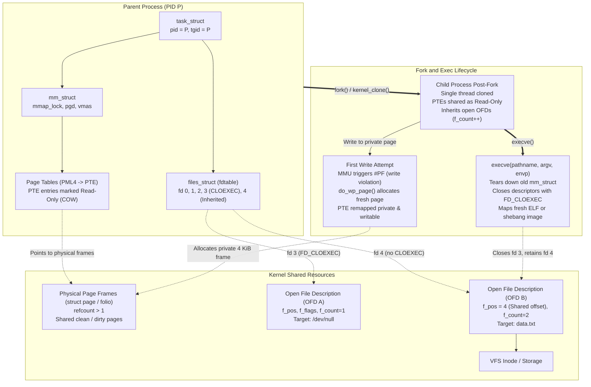

# Processes, Fork, Exec, and File Descriptors

> [!summary] Claim:
> A Unix process creation splits process duplication (`fork`), image replacement (`execve`), and descriptor coordination into distinct kernel operations.
> `fork()` clones the calling thread into a new address space using Copy-on-Write (COW) page tables, sharing physical frames until a write fault allocates private memory.
> In multithreaded runtimes, `fork()` leaves all sibling threads dead and their acquired mutexes permanently locked, making non-async-signal-safe routines like `malloc()` catastrophic deadlock hazards.
> File descriptors index a per-process table pointing to system-wide Open File Descriptions (OFDs), which maintain shared offsets across `fork()` and persist across `execve()` unless stripped by `FD_CLOEXEC`.
> Modern high-throughput platforms bypass `fork()` entirely via `posix_spawn()` or `clone3()` with `CLONE_VM | CLONE_VFORK`, eliminating page table duplication latency and out-of-memory allocation failures.



## The Mechanism

The Unix process lifecycle separates process replication from binary execution.
This architectural design, conceived by Ken Thompson and Dennis Ritchie in early Unix, enables shell pipelines, descriptor redirection, and credential isolation.
However, in modern large-scale, multithreaded systems, it exposes profound synchronization and virtual memory costs.
Every Linux kernel structure, constant, and system call referenced in this note is grounded in Linux kernel v6.12 and glibc 2.40.

### 1. The Three-Tier Kernel Abstraction: task_struct, mm_struct, and files_struct

Inside the Linux kernel, every execution context is represented by a `struct task_struct` defined in `include/linux/sched.h`.
Linux does not maintain distinct structures for kernel threads, user threads, and processes.
Instead, all threads within a thread group share a Thread Group ID (`tgid`), which corresponds to the POSIX Process ID (`pid`).
A process with three threads consists of three `task_struct` instances possessing identical `tgid` values, while each thread possesses a unique kernel `pid` (Thread ID).

A process's resources are organized into modular, reference-counted subsystems:

- Memory descriptor (`struct mm_struct *mm`):
  Defined in `include/linux/mm_types.h`.
  Manages the virtual address space, memory-mapped areas (VMAs), and the architecture-specific page table hierarchy (`pgd`, `p4d`, `pud`, `pmd`, `pte`).
  Threads in the same process share identical `mm_struct` pointers.
- File descriptor table (`struct files_struct *files`):
  Defined in `include/linux/fdtable.h`.
  Maintains the mapping between user-space integer descriptors and kernel open file descriptions.

```text
User Space:       fd 0          fd 1          fd 3 (CLOEXEC)      fd 4
                   |             |                 |               |
Process Table:  [  0  ]       [  1  ]           [  3  ]         [  4  ]  <-- files_struct / fdtable
                   |             |                 |               |
                   +------+------+                 |               |
                          |                        |               |
Kernel VFS:               v                        v               v
                 [ struct file (OFD 1) ]  [ struct file (OFD 2) ]  [ struct file (OFD 3) ]
                 - f_pos (offset)         - f_pos                 - f_pos
                 - f_flags (O_RDWR, etc)  - f_flags               - f_flags
                 - f_count (refcount)     - f_count               - f_count
                          |                        |                       |
                          v                        v                       v
                 [  struct inode A  ]     [  struct inode B  ]    [  struct inode C  ]
```

The Unix I/O model enforces a strict three-tier hierarchy:

1. Per-process file descriptor table (`struct fdtable`):
   Contains an array of pointers to `struct file`, bounded by `max_fds`.
   It embeds two critical bitmaps: `open_fds` (tracks allocated descriptors) and `close_on_exec` (tracks descriptors marked with `FD_CLOEXEC`).
   To eliminate heap allocations for common programs, `struct files_struct` embeds an initial static array of file pointers, `fd_array[NR_OPEN_DEFAULT]`.
   `NR_OPEN_DEFAULT` is defined as `BITS_PER_LONG` (64 entries on 64-bit architectures).
   When a process opens its 65th descriptor, the kernel dynamically allocates an expanded `fdtable` via `alloc_fdtable()`, doubling the capacity.
2. System-wide Open File Description (OFD, `struct file` in `include/linux/fs.h`):
   Represents an active open instance of a file, socket, or pipe created by a call to `open(2)`, `pipe2(2)`, or `socket(2)`.
   The OFD stores:
   - `f_pos`: The current byte offset for subsequent reads and writes.
   - `f_flags`: Open file status flags, such as `O_APPEND`, `O_NONBLOCK`, and `O_ASYNC`.
   - `f_count`: Atomic reference counter tracking how many descriptors reference this description.
   - `f_inode`: Pointer to the underlying filesystem inode.
3. Filesystem Inode (`struct inode` in `include/linux/fs.h`):
   Represents the underlying physical filesystem entity or stream.
   Contains file ownership, access permissions, file size, filesystem block extents, and POSIX file locks.

When two independent processes call `open("/var/log/app.log", O_RDWR)`, the kernel allocates two distinct `struct file` instances pointing to the same `struct inode`.
Each process possesses its own independent `f_pos`.
In contrast, when a process calls `fork()`, the child inherits a duplicate `files_struct` whose descriptor pointers reference the exact same `struct file` instances as the parent, incrementing each `f_count`.
Consequently, the parent and child share the same `f_pos`.
If the child advances the offset by reading or seeking, the parent's file offset moves concurrently.

### 2. Process Duplication: fork, vfork, clone, and clone3

Process creation in Linux centers on the internal kernel routine `kernel_clone()` (which replaced `_do_fork()` in Linux 5.10) in `kernel/fork.c`.
The user-space APIs expose distinct configurations of this underlying primitive:

#### `fork(2)`
The standard POSIX `fork()` call invokes `kernel_clone()` with an exit signal of `SIGCHLD` and all resource sharing flags cleared.
The kernel creates a new PID and a separate `task_struct`.
It duplicates the parent's credentials, signal dispositions, and file descriptor table, and clones the virtual memory layout using Copy-on-Write page table mappings via `dup_mmap()`.

#### `vfork(2)`
Introduced in 3BSD (1979) by Bill Joy for the PDP-11 and VAX architectures, `vfork()` was designed as an optimization before hardware page tables supported efficient Copy-on-Write.
`vfork()` invokes `kernel_clone()` with `CLONE_VM | CLONE_VFORK | SIGCHLD`.
The kernel suspends the parent process using a completion mechanism (`wait_for_vfork_done`).
The child executes in the parent's exact virtual memory space and borrows the parent's stack.
The parent remains suspended until the child either calls `execve(2)` or terminates via `_exit(2)`.
Because the child operates directly on the parent's stack, if the child returns from the function that invoked `vfork()`, it destroys the parent's stack frame.
If the child invokes standard `exit(3)` instead of `_exit(2)`, libc flushes and closes standard I/O streams, corrupting the parent's I/O buffers.

#### `clone(2)` and `clone3(2)`
`clone()` is the underlying Linux system call powering both processes and POSIX threads.
It accepts bitwise flags governing shared state:

| Clone Flag | Bitwise Meaning when Set |
| :--- | :--- |
| `CLONE_VM` | Child shares parent memory descriptor (`mm_struct`); writes are visible to both. |
| `CLONE_FS` | Child shares root directory, working directory, and umask. |
| `CLONE_FILES` | Child shares `files_struct`; descriptor additions or closes affect both. |
| `CLONE_SIGHAND` | Child shares signal handler table; `sigaction()` affects both. |
| `CLONE_THREAD` | Child joins the caller's thread group (`tgid`); does not send `SIGCHLD` on exit. |
| `CLONE_VFORK` | Parent execution blocks until child executes `execve` or exits. |
| `CLONE_PIDFD` | Kernel returns a file descriptor referencing the child process (Linux 5.2). |

Linux 5.3 introduced `clone3(2)` via syscall number 435 (x86-64), taking a pointer to `struct clone_args` and its structure size.
`clone3` resolves the architectural limitation of `clone(2)`, which ran out of flag bits in a single 32-bit integer.
The kernel detects API versioning through size boundaries: `CLONE_ARGS_SIZE_VER0` (64 bytes, Linux 5.3), `CLONE_ARGS_SIZE_VER1` (80 bytes, Linux 5.5, adding `set_tid`), and `CLONE_ARGS_SIZE_VER2` (88 bytes, Linux 5.7, adding `cgroup`).
`CLONE_PIDFD` eliminates PID reuse race conditions.
A process holding a pidfd can poll for process termination via `epoll` (`POLLIN`), send signals via `pidfd_send_signal(2)`, and obtain duplicate file descriptors from the target via `pidfd_getfd(2)`.

### 3. Copy-on-Write (COW) Page Table Semantics

When `fork()` replicates a process, copying gigabytes of physical RAM synchronously would introduce prohibitive latency.
Instead, the kernel employs Copy-on-Write (COW), coordinated across the CPU Memory Management Unit (MMU) and the virtual memory manager.

```text
Step 1: Parent before fork
Virtual Page 0x7FFF0000 ---> [PTE: Writable, Physical Frame 0x1A2B] (refcount=1)

Step 2: fork() executes dup_mmap()
Parent PTE: Read-Only (COW) ---> [Physical Frame 0x1A2B] (refcount=2)
Child  PTE: Read-Only (COW) ---> [Physical Frame 0x1A2B]

Step 3: Child attempts write to 0x7FFF0000
CPU MMU triggers #PF (Page Fault: write violation on read-only page)
Kernel exc_page_fault() -> do_user_addr_fault() -> handle_mm_fault() -> do_wp_page()
Kernel allocates fresh Physical Frame 0x5C6D, copies 4096 bytes from 0x1A2B
Child  PTE: Remapped to Frame 0x5C6D, marked Writable
Parent PTE: Remains mapped to Frame 0x1A2B (refcount decremented to 1)
```

The kernel executes COW through a sequence of steps:

1. Duplicating VMAs (`dup_mmap()` in `kernel/fork.c`):
   The kernel iterates through the parent's memory-mapped areas while holding the parent's `mmap_lock`.
   For each private, writable VMA (`VM_WRITE` set, `VM_SHARED` clear), it copies the page table entries via `copy_page_range()`.
2. Write-protecting entries (`pte_wrprotect()`):
   The kernel clears the write permission bit in both the parent's and child's Page Table Entries (PTEs).
   It increments the reference count of the underlying physical page frame (`struct page` or `struct folio`).
   Both parent and child now read from the exact same physical memory frames without data copying.
3. Write fault exception (#PF):
   When either parent or child executes a store instruction to a write-protected page, the hardware MMU triggers an x86-64 exception #PF (Interrupt 14) with error code bit 1 set (indicating a write access).
4. Kernel fault dispatch:
   The CPU switches to kernel mode and vectors to `exc_page_fault()` and `do_user_addr_fault()` (`arch/x86/mm/fault.c`, which replaced `do_page_fault()` in Linux 5.8), invoking `handle_mm_fault()` and `do_wp_page()` (`mm/memory.c`).
5. Fault resolution:
   - If `folio_ref_count(folio) > 1`: The page is shared.
     The kernel allocates a fresh 4 KiB physical page frame, copies the 4,096 bytes from the original frame via `copy_user_highpage()`, updates the faulting process's PTE to point to the new physical frame, sets the writable bit (`pte_mkwrite()`), decrements the reference count of the original frame, and flushes the local CPU Translation Lookaside Buffer (`flush_tlb_page()`).
   - If `folio_ref_count(folio) == 1`: The other process has already faulted or terminated.
     The kernel invokes `wp_page_reuse()`, marking the existing page as writable without memory allocation or copying.

#### The Scaling Bottleneck of Large Address Spaces
While COW avoids duplicating physical memory frames, `fork()` must duplicate the page tables themselves.
On an x86-64 system with 4-level paging (PML4, PDPT, PD, PT), each lowest-level page table entry manages 4 KiB of virtual memory.
A single page table page holds 512 entries, covering 2 MiB.
A large in-memory database (such as Redis or Dragonfly) or JVM heap consuming 64 GiB of resident memory utilizes 16,777,216 pages, requiring 32,768 page table pages (128 MiB of page table data structures).
Duplicating 128 MiB of page tables during `dup_mmap()` requires allocating 32,768 physical pages and performing millions of pointer operations while holding the process `mmap_lock`.
On production hardware, this traversal introduces a multi-millisecond execution stall (10 ms to 150 ms) during which the parent process is frozen and cannot service incoming client traffic.

#### Overcommit and Memory Allocation Traps
Linux implements virtual memory overcommit, governed by `/proc/sys/vm/overcommit_memory`:

- `0` (Heuristic Overcommit, default): The kernel permits processes to allocate address space exceeding physical RAM, rejecting obviously excessive allocations.
- `1` (Always Overcommit): The kernel grants all memory requests, relying on the OOM killer when physical memory and swap are exhausted.
- `2` (Strict No-Overcommit): The kernel enforces a strict ceiling defined by `CommitLimit`:
  $$\text{CommitLimit} = \text{SwapTotal} + (\text{MemTotal} \times \frac{\text{vm.overcommit\_ratio}}{100})$$

Under `overcommit_memory = 2`, `fork()` checks whether the system has sufficient committed address space to accommodate the child's entire address space duplication.
If an application occupies 50 GiB on a 64 GiB machine with no swap, `fork()` immediately fails with `ENOMEM` (errno 12: Cannot allocate memory), even if the application intended to call `execve()` one microsecond later.

To mitigate page table bloat and COW tracking overhead, applications use `madvise(addr, len, MADV_DONTFORK)`.
This sets the `VM_DONTFORK` flag on the specified VMA.
During `dup_mmap()`, the kernel skips VMAs marked with `VM_DONTFORK`, omitting them from the child's address space.
This primitive is essential for High-Frequency Trading (HFT) and InfiniBand / RDMA architectures, where physical memory pages are pinned in hardware by kernel drivers (`ibv_reg_mr`); forking pinned RDMA pages leads to memory corruption or hardware bus faults.
Further exploration of address space structures and VMA management is detailed in [[Virtual-Memory-Mmap-and-Process-Address-Space]].

### 4. File Descriptor Lifecycle: Inheritance, Races, and FD_CLOEXEC

When a process calls `execve()`, its address space, thread stack, and registers are replaced by the new binary image.
However, file descriptors remain open across `execve()` by default.
This historical Unix design allows parent shells to redirect standard input, standard output, and standard error before executing a child utility.

#### The Descriptor Leak Hazard
If a parent process opens an internal database connection, sensitive socket, or temporary file and subsequently calls `fork()` and `execve()` to launch an external program, all open descriptors are inherited by the child.
The executed child binary can read confidential data, intercept socket traffic, or prevent files from being unmounted.
To prevent this inheritance, POSIX defines the close-on-exec descriptor flag: `FD_CLOEXEC`.
During `execve()`, the kernel routine `do_close_on_exec()` in `fs/file.c` inspects the `close_on_exec` bitmap in the process's `fdtable`.
Every descriptor with its bit set is closed via `filp_close()`, which decrements the OFD's `f_count` and destroys the descriptor before the new program begins execution.

#### The Multithreaded Race Condition
Historically, setting close-on-exec required two separate system calls:

```c
// Flawed historical pattern: contains a race condition
int fd = open("/etc/ssl/private.key", O_RDONLY);
// A concurrent thread calls fork() and execve() HERE
fcntl(fd, F_SETFD, FD_CLOEXEC);
```

In a multithreaded daemon, if Thread B executes `fork()` and `execve()` in the temporal window between Thread A's `open()` and `fcntl()`, the child process inherits the open cryptographic key descriptor.
To close this race condition, modern operating systems introduced atomic close-on-exec flags:

- `open(pathname, flags | O_CLOEXEC)` (Linux 2.6.23, glibc 2.7)
- `pipe2(pipefd, O_CLOEXEC)` (Linux 2.6.27, glibc 2.9)
- `socket(domain, type | SOCK_CLOEXEC, protocol)` (Linux 2.6.27, glibc 2.9)
- `accept4(sockfd, addr, addrlen, SOCK_CLOEXEC)` (Linux 2.6.28, glibc 2.10)
- `dup3(oldfd, newfd, O_CLOEXEC)` (Linux 2.6.27, glibc 2.9)

#### Mass Descriptor Sanitation
When writing daemon supervisors or container runtimes that execute untrusted binaries, clearing all inherited file descriptors historically required querying `/proc/self/fd/` or looping from 3 up to `sysconf(_SC_OPEN_MAX)` (which often defaults to 1,048,576).
Iterating over one million non-existent descriptors issues one million failing `close()` syscalls, consuming tens of milliseconds of CPU time.
To eliminate this inefficiency, Linux 5.9 added `close_range(first, last, flags)` in `fs/file.c`.
Invoking `close_range(3, ~0U, 0)` closes all open descriptors above 2 in a single system call by walking the `fdtable` bitmap directly.
Linux 5.11 added `CLOSE_RANGE_CLOEXEC`, which sets the `FD_CLOEXEC` bit on all descriptors in the specified range without closing them immediately, ensuring they remain usable in the pre-exec setup phase but close automatically upon `execve()`.

### 5. Program Transformation: execve and Shebang Interpretation

The `execve(pathname, argv, envp)` system call replaces the executing process image with a new executable.
The execution flow within `fs/exec.c` proceeds through well-defined phases:

1. Kernel argument buffer allocation:
   The kernel allocates memory to stage `argv` and `envp` strings from user space.
   `MAX_ARG_STRLEN` (`include/uapi/linux/binfmts.h`) limits the length of any individual argument or environment variable string to 32 architecture pages (`PAGE_SIZE * 32`, exactly 131,072 bytes or 128 KiB on 4 KiB page systems).
   In `bprm_stack_limits()` (`fs/exec.c`), the aggregate memory consumed by all arguments and environment variables is capped at `min(_STK_LIM / 4 * 3, rlim_stack.rlim_cur / 4)` - 25% of the soft `RLIMIT_STACK` resource limit (typically 2 MiB under the default 8 MiB `_STK_LIM` stack limit) up to a hard ceiling of 75% of `_STK_LIM` (6 MiB), with a 32-page floor.
2. Binary format inspection:
   The kernel reads the first 256 bytes (`BINPRM_BUF_SIZE`) of the executable file into `linux_binprm->buf`.
   `search_binary_handler()` iterates through registered binary format drivers:
   - `elf_format` (`fs/binfmt_elf.c`): Matches the 4-byte magic signature `\x7fELF`.
     Sets up memory mappings, dynamic linker interposition, and auxiliary vectors.
   - `script_format` (`fs/binfmt_script.c`): Matches the 2-byte magic characters `#!` (ASCII 0x23 0x21).

#### Kernel Shebang (`#!`) Parsing Semantics
When `fs/binfmt_script.c` encounters a shebang line, it applies strict kernel parsing rules:

- Buffer boundary: The shebang line cannot exceed `BINPRM_BUF_SIZE - 1` (255 bytes).
  Any interpreter path or argument extending past byte 255 is truncated.
- Argument splitting: The kernel parses the interpreter path up to the first whitespace character (space or tab).
  If additional non-whitespace characters exist prior to the newline, the kernel extracts the entire remainder of the string as a single optional argument (`i_arg`).
  The Linux kernel does not split multiple options on whitespace.
  For example, given `#!/usr/bin/env python3 -u`:
  - Interpreter: `/usr/bin/env`
  - Argument 1: `"python3 -u"` (treated as a single string containing an embedded space)
  - Argument 2: Path to the target script
  When `/usr/bin/env` executes, it attempts to find an executable literally named `python3 -u` on `$PATH` and fails with `env: 'python3 -u': No such file or directory`.
  To pass multiple options across Linux shebang lines, developers must invoke the GNU coreutils `env` split-string option: `#!/usr/bin/env -S python3 -u`.
- `argv` array rewriting:
  The kernel transforms the process argument vector:
  - `argv[0]` becomes the absolute path to the interpreter binary.
  - `argv[1]` becomes the optional argument extracted from the shebang (if present).
  - `argv[2]` becomes the pathname of the executed script.
  - `argv[3...]` receive the original arguments passed by the caller (`argv[1...]`).
- Recursion limits:
  If a shebang script points to another script, `load_script()` sets `bprm->interpreter` and `exec_binprm()` in `fs/exec.c` iterates around `search_binary_handler()`.
  To prevent infinite loops and kernel stack overflow, Linux 5.8 (commit `bc2bf338d54b`) replaced recursive calls bounded by `BINPRM_MAX_RECURSION` (4) with an iterative loop (`for (depth = 0;; depth++)`) that enforces `if (depth > 5) return -ELOOP;`.
  If interpreter rewrites exceed 5 levels (`depth > 5`), `execve()` aborts and returns `ELOOP` (errno 40: Too many levels of symbolic links).

The kernel-to-user transition following `execve()`, including auxiliary vectors and runtime initialization, is covered in [[Program-Startup-C-Runtime-Init-and-Auxiliary-Vectors]], while binary container formats are analyzed in [[ELF-Mach-O-and-PE-Object-Formats]].

### 6. The Multithreaded Fork Hazard and Async-Signal Safety

The POSIX standard imposes a strict invariant regarding process duplication in multithreaded environments:
When a multithreaded process calls `fork()`, the child process is created with exactly one thread: a clone of the calling thread.
All peer threads in the parent process terminate instantaneously.
They run no destructors, execute no thread-cleanup handlers, and release no acquired locks.

```text
Parent Process (3 Threads):
Thread 1 (Worker):    Acquires ptmalloc arena mutex ------------> [MUTEX LOCKED]
Thread 2 (Caller):    Calls fork() -----------------------------+
Thread 3 (I/O):       Waiting on network socket                 |
                                                                |
                                                                v
Child Process (1 Thread Only!):
Thread 2 Clone:       Inherits memory space.
                      The ptmalloc arena mutex is copied as LOCKED.
                      Thread 1 DOES NOT EXIST in the child.
                      Thread 2 calls malloc() -> tries to acquire arena mutex -> DEADLOCK!
```

This architecture produces critical failure modes:

1. Internal Mutex Deadlocks:
   If Thread 1 held a mutex inside `malloc()` (such as a glibc `ptmalloc` arena lock), the dynamic loader lock (`ld.so`), or a logging library when Thread 2 invoked `fork()`, that mutex is marked as locked in the child's address space.
   Because Thread 1 does not exist in the child process, no thread will ever unlock that mutex.
   If the child process invokes `malloc()`, `free()`, `printf()`, `dlopen()`, or any routine that acquires the locked mutex, the child process deadlocks permanently.
2. POSIX Async-Signal Safety Restriction:
   Under POSIX.1-2008 / POSIX.1-2024, after a multithreaded process calls `fork()`, the child process is permitted to call only async-signal-safe functions until it invokes an `exec` family function or `_exit(2)`.
   Routines that allocate heap memory (`malloc`, `new`), format strings (`sprintf`), flush streams (`exit`), or interact with the runtime loader are strictly prohibited.
3. The Failure of `pthread_atfork()`:
   POSIX provides `pthread_atfork(prepare, parent, child)` to acquire all active mutexes prior to fork and release them in parent and child.
   In large production systems, `pthread_atfork()` fails in practice.
   Third-party dynamic libraries rarely register handlers, and acquiring hundreds of mutexes across complex software architectures inevitably introduces lock-order inversions and deadlocks during the fork preparation phase.

### 7. Modern Process Spawning: posix_spawn Internals

To circumvent the latency of page table duplication, address space allocation traps, and multithreaded fork deadlocks, POSIX standardized `posix_spawn(3)` and `posix_spawnp(3)`.

#### The Evolution of `posix_spawn` in glibc
Historically, glibc implemented `posix_spawn()` as a naive wrapper around `fork()` and `execve()`, inheriting all associated performance penalties.
Over subsequent releases, glibc restructured the implementation (`sysdeps/unix/sysv/linux/spawni.c`):

- glibc 2.24 (2016): Switched to invoking `clone()` directly with `CLONE_VM | CLONE_VFORK`.
  To ensure safety while running on the parent's memory, glibc allocates a dedicated private stack for the child during its setup phase and masks all signals (including internal NPTL signals like `SIGCANCEL` and `SIGSETXID`).
  If an error occurs before `execve()` (such as an invalid path), the child writes the error code into a shared stack structure and terminates via `_exit(127)`, enabling `posix_spawn` to return the exact failure errno to the parent.
- glibc 2.34 (2021): Added support for `clone3()`, passing `CLONE_VM | CLONE_VFORK` via `struct clone_args` and falling back to legacy `clone()` if `clone3()` returns `ENOSYS`.

On macOS, `posix_spawn` is not implemented in user-space libc; it is an optimized kernel system call (`__posix_spawn`) implemented in Darwin's XNU kernel (`bsd/kern/kern_exec.c`).
It avoids duplicating task ports and virtual memory mappings entirely, completing process creation significantly faster than `fork()`.
Platform-specific lifecycle variations between Darwin and Linux are detailed in [[macOS-vs-Linux-Toolchain-Mechanics]].

## Commands and Numbers to Know

| Item | Value | Platform and date | What it controls |
| :--- | :--- | :--- | :--- |
| `BINPRM_BUF_SIZE` | `256` bytes | Linux (as of 2026-11) | Maximum bytes read from file header to inspect magic/shebang |
| `exec_binprm` depth limit | `5` rewrites (`depth > 5`) | Linux (as of 2026-11) | Maximum interpreter rewrite depth in `fs/exec.c` before returning `ELOOP` (replaced `BINPRM_MAX_RECURSION = 4` in Linux 5.8) |
| `MAX_ARG_STRLEN` | `131,072` bytes (128 KiB) | Linux (as of 2026-11) | Maximum allowable size of an individual `argv` or `envp` string |
| `NR_OPEN_DEFAULT` | `64` | Linux (as of 2026-11) | Embedded static file descriptor array size in `struct files_struct` |
| `vm.overcommit_memory` | `0` (heuristic default) | Linux (as of 2026-11) | Memory overcommit policy (`0` heuristic, `1` always, `2` strict) |
| `vm.overcommit_ratio` | `50` percent | Linux (as of 2026-11) | Percentage of physical RAM added to swap when computing `CommitLimit` |
| `CLONE_ARGS_SIZE_VER0` | `64` bytes | Linux (as of 2026-11) | First published size of `struct clone_args` (Linux 5.3) |
| `CLONE_ARGS_SIZE_VER1` | `80` bytes | Linux (as of 2026-11) | Size of `struct clone_args` including `set_tid` fields (Linux 5.5) |
| `CLONE_ARGS_SIZE_VER2` | `88` bytes | Linux (as of 2026-11) | Size of `struct clone_args` including `cgroup` field (Linux 5.7) |
| `posix_spawn` VM clone | `CLONE_VM \| CLONE_VFORK` | Linux (as of 2026-11) | Default spawning mechanism in glibc since version 2.24 |
| `posix_spawn` clone3 | Native `clone3` syscall | Linux (as of 2026-11) | Modern spawning mechanism in glibc since version 2.34 |
| Python multiprocessing | `forkserver` (default) | Linux (as of 2026-11) | Default multiprocessing start method in Python 3.14 on POSIX |
| Python multiprocessing | `spawn` (default) | macOS (as of 2026-11) | Default multiprocessing start method in Python since version 3.8 |
| `close_range(2)` | Syscall 436 (x86-64) | Linux (as of 2026-11) | Bulk file descriptor closure system call added in Linux 5.9 |
| `CLOSE_RANGE_CLOEXEC` | `(1U << 2)` | Linux (as of 2026-11) | Atomically marks descriptor range close-on-exec (Linux 5.11) |
| `MADV_DONTFORK` | `10` | Linux (as of 2026-11) | Marks virtual memory range to omit from child address space |
| `EBADF` | `9` | Both (as of 2026-11) | Errno returned when operating on a closed or invalid descriptor |
| `ELOOP` | `40` (Linux) / `62` (macOS) | Both (as of 2026-11) | Errno returned when shebang recursion exceeds maximum limit |
| `ENOMEM` | `12` | Both (as of 2026-11) | Errno returned when page table or address space allocation fails |

## Multi-Language Comparison: C++ / Python / Rust

The trade-offs between manual `fork`/`exec` pipelines and structured process spawning primitives shape system design across modern languages:

| Concern | C++20 / C++23 (POSIX) | Python (CPython 3.14) | Rust (1.82+) |
| :--- | :--- | :--- | :--- |
| Core Spawning API | `posix_spawn()`, `fork()`, `execve()` | `subprocess.Popen`, `multiprocessing` | `std::process::Command` |
| Low-Level Implementation | Direct system calls via libc; `clone3` on modern glibc | `_posixsubprocess.c` uses `posix_spawnp` or `vfork` wrapper | Fast path uses `posix_spawnp`; falls back to `do_fork` |
| Default Process Model | Explicit choice; applications default to `posix_spawn` | `forkserver` default on Linux (3.14); `spawn` on macOS | `posix_spawnp` default across all Unix targets |
| Descriptor Inheritance | Manual `O_CLOEXEC` flags or `posix_spawn_file_actions` | `close_fds=True` default; sets `O_CLOEXEC` via `os.open` | `std` sets `O_CLOEXEC` on its handles; `dup2` maps stdio |
| Child Setup Hooks | Pre-exec logic executes in forked child | Legacy `preexec_fn` parameter (unsafe with threads; unsupported in subinterpreters) | `unsafe { CommandExt::pre_exec(...) }` forces fallback to fork |
| Multithread Safety | Developer must enforce async-signal safety | `os.fork()` emits `DeprecationWarning` if threads active | Disallows user code in child when using `posix_spawnp` |

The CPython and Rust entries reflect upstream releases as of 2026-11.

## Worked Lab Example

The companion lab is located at `code/00-Program-Execution/fork_exec_fd/` and requires Linux system call primitives.

The lab builds an instrumented C executable (`fork_exec_fd.c`) that executes six sequential verification experiments:

1. Kernel Copy-on-Write (COW) Page Semantics:
   Allocates a 1 MiB anonymous private mapping via `mmap()`, flanked by two `PROT_NONE` guard pages so the mapping cannot merge with a neighbouring writable VMA, populates it with known bytes to establish physical page residency, and reads `/proc/self/smaps` to track `Shared_Dirty` and `Private_Dirty` memory pages.
   The lab aborts unless the `smaps` entry for that address is exactly 1024 kB, so the numbers describe only this buffer.
   Forks a child process.
   Demonstrates that before a write occurs, the child shares all 1024 kB of dirty memory as `Shared_Dirty` with zero `Private_Dirty` allocation.
   The child subsequently writes to the first 512 KiB.
   The kernel write-protect fault splits the mapping: `Shared_Dirty` drops to 512 kB, and `Private_Dirty` becomes 512 kB.
   Following child termination, the parent re-inspects its memory mapping, proving its private pages remained isolated.
2. Open File Description (OFD) Sharing:
   Creates a temporary file containing 16 bytes (`"0123456789ABCDEF"`) and seeks to offset 0.
   Forks a child process that reads 4 bytes (`"0123"`).
   The parent waits for the child and queries its own file position via `lseek(fd, 0, SEEK_CUR)`.
   The parent's offset advances to byte 4, demonstrating that parent and child share the underlying `struct file` instance in kernel space.
3. Descriptor Inheritance Across `execve()` and `FD_CLOEXEC`:
   Opens `/dev/null` as fd 3 without `O_CLOEXEC` and then sets `FD_CLOEXEC` on it with `fcntl()`, so the flag is the only thing that can close it, and maps the shared temporary data file without `FD_CLOEXEC` to fd 4.
   Forks and invokes `execve()` running a helper routine.
   The helper confirms that fd 3 is closed (`EBADF`), while fd 4 remains open and seamlessly reads the next 4 bytes (`"4567"`).
4. Multithreaded Fork Lock Contention Hazard:
   Starts a sibling thread that locks an error-checking `pthread_mutex_t` and then parks on a barrier.
   The main thread confirms two facts in the parent: `/proc/self/status` reports 2 threads, and a 50 ms `pthread_mutex_timedlock()` returns `ETIMEDOUT` (an owner would get `EDEADLK`), so the sibling and not the caller owns the lock.
   The main thread then forks.
   The child reports 1 thread, `pthread_mutex_trylock()` returns `EBUSY`, and a 50 ms `pthread_mutex_timedlock()` again times out, proving the lock is held by a thread that no longer exists.
5. Kernel Shebang Argument Rewriting:
   Dynamically generates an executable script whose first line is `#!` followed by the absolute path of the lab binary and the single argument `KERNEL_OPT`.
   Executes the script via `execve()` passing user arguments `USER_ARG1` and `USER_ARG2`.
   Demonstrates kernel argument synthesis: `argv[0]` maps to the interpreter, `argv[1]` receives `KERNEL_OPT`, `argv[2]` receives the script pathname, and subsequent positions receive caller arguments.
6. Safe Process Spawning with `posix_spawn()`:
   Configures `posix_spawn_file_actions_t` to map a pipe write-end to `STDOUT_FILENO` and to close the original pipe endpoints in the child (the pipe is created with `O_CLOEXEC`, so the close actions are belt and braces and the output does not depend on them).
   Executes the helper via `posix_spawn()` without running user code in a forked child context.
   Reads the child's stdout from the parent's pipe endpoint until EOF, because the helper prints twice, and confirms the next 4 bytes (`"89AB"`) are read from fd 4.

```bash
cd code/00-Program-Execution/fork_exec_fd
bash run.sh
```

### Verified Output

Recorded by `make record` inside the containerized Linux harness (`toolchain-labs:f39efe0ff57b`, `linux-aarch64`, Linux 7.2 kernel with 4 KiB pages) and verified against `expected/linux-aarch64.txt`:

```text
=== 1. Kernel Copy-on-Write (COW) Page Semantics ===
parent before fork:             Shared_Dirty=   0 kB, Private_Dirty=1024 kB
child after fork, before write: Shared_Dirty=1024 kB, Private_Dirty=   0 kB
child after writing 512 KiB:    Shared_Dirty= 512 kB, Private_Dirty= 512 kB
parent after child exit:        Shared_Dirty=   0 kB, Private_Dirty=1024 kB

=== 2. File Descriptor Table vs Open File Description Sharing ===
child read 4 bytes: "0123"
parent f_pos after child read: 4 (shared open file description)

=== 3. Descriptor Inheritance Across execve() and FD_CLOEXEC ===
[execve helper] fd 3 (O_CLOEXEC): CLOSED (EBADF) (errno=9)
[execve helper] fd 4 (inherited): OPEN, read 4 bytes: "4567"

=== 4. Multithreaded Fork Lock Contention / Deadlock Hazard ===
parent threads before fork: 2
parent pthread_mutex_timedlock on mutex held by sibling thread: ETIMEDOUT (blocks)
child threads after fork: 1
child pthread_mutex_trylock on mutex held by other thread: EBUSY (locked forever)
child pthread_mutex_timedlock on mutex held by other thread: ETIMEDOUT (blocks)

=== 5. Shebang (#! ) Argument Rewriting in Kernel ===
  argv[0] = fork_exec_fd
  argv[1] = KERNEL_OPT
  argv[2] = lab_shebang_script
  argv[3] = USER_ARG1
  argv[4] = USER_ARG2

=== 6. Safe Spawning with posix_spawn() and File Actions ===
posix_spawn status: 0, captured child stdout:
  [execve helper] fd 3 (O_CLOEXEC): CLOSED (EBADF) (errno=9)
[execve helper] fd 4 (inherited): OPEN, read 4 bytes: "89AB"
```

### Reading the Result

- In Section 1, `/proc/self/smaps` illustrates Copy-on-Write mechanics with quantitative precision.
  Immediately following `fork()`, the child references the parent's physical pages without allocating private RAM: `Shared_Dirty` is exactly 1024 kB and `Private_Dirty` is 0 kB.
  Writing to 512 KiB forces the MMU to trigger page faults across 128 individual 4 KiB frames on the recording machine's 4 KiB page size; the kernel allocates 128 private frames, resulting in an exact 512 kB shared and 512 kB private split.
- In Section 2, the child's `read()` of 4 bytes shifts the parent's `lseek()` position from 0 to 4.
  This confirms that parent and child share the identical `struct file` entry (Open File Description) in the kernel VFS.
- In Section 3, `execve()` cleanly strips fd 3 because the `FD_CLOEXEC` flag was set on it in the descriptor table, returning `EBADF` (errno 9).
  Fd 4, lacking `FD_CLOEXEC`, persists across the binary execution boundary and resumes reading from byte 4, yielding `"4567"`.
- In Section 4, the parent has 2 threads and cannot take the mutex (`ETIMEDOUT`, not `EDEADLK`), so the sibling thread owns it.
  The child has 1 thread, and `pthread_mutex_trylock()` returns `EBUSY` while a timed lock times out.
  Because the lock holder thread was not duplicated during `fork()`, any blocking call to `pthread_mutex_lock()` in the child would result in a permanent deadlock.
- In Section 5, the kernel argument rewriter shifts caller arguments, positioning `KERNEL_OPT` as `argv[1]` and the script path as `argv[2]`.
  The printed `argv[0]` is the basename of the interpreter path written in the shebang line.
- In Section 6, `posix_spawn()` accomplishes atomic redirection via file actions without manual `fork()` or child execution hazards, reading the next sequential bytes (`"89AB"`) from fd 4.
  The first captured line carries the two-space indent of the lab's own `printf`, and the second does not.

## Pitfalls

> [!warning] Pitfall: Unflushed user-space stdio buffers duplicated across fork
> When standard output is directed to a terminal, glibc line-buffers output by default.
> However, when stdout is redirected to a pipeline, block device, or file, glibc switches to full block-buffering (typically 4,096 or 8,192 bytes).
> Calling `printf()` without a trailing newline or before buffer exhaustion leaves data inside libc's user-space heap buffer.
> When `fork()` executes, the child process inherits an exact duplicate of this unwritten buffer.
> When both parent and child eventually flush their buffers upon exit, the output appears twice in the resulting log file.
> Always invoke `fflush(NULL)` to flush all standard I/O streams before calling `fork()`.

> [!warning] Pitfall: Memory allocation or runtime locking in a multithreaded child
> Calling `malloc()`, `free()`, `new`, `dlopen()`, or C++ logging libraries inside a child process between `fork()` and `execve()` in a multithreaded binary invites intermittent deadlocks.
> If any background thread held a ptmalloc arena lock or runtime loader lock when the fork occurred, the child will hang indefinitely upon acquiring that lock.
> Restrict child execution strictly to async-signal-safe routines, or transition process launching to `posix_spawn()`.

> [!warning] Pitfall: Multi-argument shebang execution without env -S
> Placing multiple command-line arguments in a script shebang line (such as `#!/usr/bin/env python3 -u -Wall`) fails on Linux.
> The Linux kernel parser in `fs/binfmt_script.c` treats all characters following the first space as a single string argument.
> It attempts to execute an interpreter named `"python3 -u -Wall"` on the system search path, failing with `No such file or directory`.
> Always use `#!/usr/bin/env -S python3 -u -Wall` to instruct GNU coreutils `env` to split arguments in user space.

> [!warning] Pitfall: File descriptor leaks to subprocesses via non-atomic open
> Opening file descriptors and subsequently applying `fcntl(fd, F_SETFD, FD_CLOEXEC)` leaves a concurrency vulnerability.
> If a peer thread executes `fork()` and `execve()` concurrently, the child inherits the descriptor before the close-on-exec flag is applied.
> Always pass `O_CLOEXEC` to `open()`, `SOCK_CLOEXEC` to `socket()`, or use `pipe2()` and `accept4()`.

> [!warning] Pitfall: Forking massive in-memory processes under strict overcommit
> When `vm.overcommit_memory = 2`, the kernel refuses memory allocations if committed address space exceeds `SwapTotal + MemTotal * ratio`.
> Forking a 40 GiB database process on a 64 GiB machine with no swap fails immediately with `ENOMEM`, even if the child only calls `execve("hostname", ...)`.
> Use `posix_spawn()` or `vfork()` to avoid committing duplicate address space.

> [!warning] Pitfall: Returning from the caller function inside a vfork child
> Because `vfork()` executes the child on the parent's stack while suspending the parent, returning from the function that called `vfork()` overwrites stack frames and corrupts the return address.
> When the parent process resumes, it executes corrupted instructions or encounters an immediate segmentation fault.
> A `vfork()` child must strictly terminate via `_exit(2)` or invoke `execve()`.

## At Scale

At the scale of thousands of engineers and tens of thousands of compute instances, process management trade-offs transition from syntactic convenience to infrastructure bottlenecks.

```text
Single Developer System:
fork() + execve() works cleanly for small processes (10-50 MB).
Page table copy overhead is negligible (< 100 microseconds).
Multithreading bugs remain rare in simple CLI utilities.

Fleet Scale (1,000 to 50,000 Engineers, Distributed Datacenters):
1. Massive In-Memory Databases (Redis, Dragonfly):
   A 128 GiB Redis instance forks to write an RDB snapshot via BGSAVE.
   Duplicating 256 MiB of page tables freezes the event loop for 120 ms.
   SLA violations occur as p99.9 latency spikes from 200 us to 120 ms.
   Remediation: Forkless snapshotting or dedicated read replicas.

2. Heavy Multi-Language Worker Daemons (Python, Go, Java):
   Pre-fork worker models (Gunicorn, uWSGI) import heavy C-extensions (CUDA, NumPy, PyTorch).
   Spawning worker processes via raw fork() deadlocks OpenMP thread pools and CUDA contexts.
   Remediation: Enforce multiprocessing 'forkserver' or 'spawn' across internal platforms.

3. High-Throughput Build Farms (Bazel, Ninja):
   Compiling 50,000 translation units per minute causes page table allocation storms.
   Switching internal build runners from fork/exec to posix_spawn with clone3(CLONE_VM)
   eliminates 15-30% of total build CPU overhead across server fleets.
```

### Architectural Decision Rules

1. Process Spawning in High-Memory Applications:
   If an application consumes more than 1 GiB of resident memory, never execute subprocesses via `fork()` followed by `execve()`.
   Use `posix_spawn()` or `clone3(CLONE_VM | CLONE_VFORK)`.
   Duplicating page tables on multi-gigabyte heaps wastes memory bandwidth and risks `ENOMEM` under production overcommit limits.
2. Multithreaded Daemon Architecture:
   Never allow `fork()` without immediate `execve()` in any application that has initialized thread pools or background runtime threads.
   In Python environments running Python 3.14, maintain the default `forkserver` or `spawn` start methods.
   In C++ and Rust services, isolate child process creation behind process supervisor pools using `posix_spawn()`.
3. High-Performance Build Systems:
   In build tools (such as Bazel, Ninja, or custom compiler orchestrators) executing tens of thousands of subprocesses per minute, configure process creation through `posix_spawn()` with `POSIX_SPAWN_USEVFORK`.
   Batch descriptor closures using `close_range()` rather than iterative `close()` loops.
4. Latency-Sensitive Systems (HFT and RDMA Networks):
   In low-latency trading engines utilizing kernel bypass or InfiniBand RDMA, apply `madvise(..., MADV_DONTFORK)` to all pinned packet ring buffers.
   Any invocation of `fork()` without `MADV_DONTFORK` causes InfiniBand queue-pair disassociation and catastrophic hardware transmission drops.

## Practice Drill

> [!tip] Practice Drill:
> Write a short C test program (about 35 lines) that spawns a background thread that continuously acquires and releases a `pthread_mutex_t` in a tight loop.
> In the main thread, repeatedly call `fork()`.
> In the child process, immediately attempt to lock the same mutex and print a message using `printf()`.
> Run the program under `strace -f` and watch the child process freeze on a futex system call (`FUTEX_WAIT`) when the fork lands while the background thread holds the mutex.
> Inspect the stuck child with `gdb -p <child_pid>` and run `backtrace` to inspect the exact internal glibc lock where the child deadlocked.
> Then refactor the spawning routine to use `posix_spawn()` with `posix_spawn_file_actions_t` and verify that the deadlock disappears entirely.

```bash
# Compile and trace the reproduction
cat << "EOF" > drill_fork_deadlock.c
#define _GNU_SOURCE
#include <stdio.h>
#include <stdlib.h>
#include <unistd.h>
#include <pthread.h>
#include <sys/wait.h>

static pthread_mutex_t lock = PTHREAD_MUTEX_INITIALIZER;

void *worker(void *arg) {
    (void)arg;
    while (1) {
        pthread_mutex_lock(&lock);
        // hold briefly
        pthread_mutex_unlock(&lock);
    }
    return NULL;
}

int main() {
    pthread_t th;
    pthread_create(&th, NULL, worker, NULL);

    for (int i = 0; i < 50000; i++) {
        pid_t p = fork();
        if (p == 0) {
            // Child attempts to acquire lock: triggers deadlock
            pthread_mutex_lock(&lock);
            printf("Acquired in child %d\n", i);
            pthread_mutex_unlock(&lock);
            _exit(0);
        }
        waitpid(p, NULL, 0);
    }
    return 0;
}
EOF
gcc -O2 -pthread drill_fork_deadlock.c -o drill_fork_deadlock
# Exit status 124 means the program hung on the deadlock (reproduced on linux-aarch64, glibc 2.39, gcc 13.3)
timeout 20 ./drill_fork_deadlock; echo "exit=$?"
```

## Interview Questions

> [!question] L5: Explain why `posix_spawn()` is substantially faster than `fork()` followed by `execve()` for a 32 GiB process.
>
> > [!success]- Answer
> > While `fork()` utilizes Copy-on-Write to avoid duplicating physical data frames, it must still duplicate the entire page table hierarchy representing the virtual address space.
> > For a 32 GiB process on x86-64, this requires duplicating 8,388,608 page table entries spanning 16,384 page table pages (64 MiB of memory), holding the parent's `mmap_lock` and consuming tens of milliseconds of CPU time.
> > In addition, if strict memory overcommit is enabled (`vm.overcommit_memory = 2`), `fork()` fails with `ENOMEM` if committed space exceeds `CommitLimit`.
> > In contrast, `posix_spawn()` on modern Linux (glibc 2.24+) uses `clone()` or `clone3()` with `CLONE_VM | CLONE_VFORK`.
> > The child temporarily shares the parent's memory descriptor without duplicating page tables, creates a private initialization stack, applies file descriptor actions, and calls `execve()` directly.
> > This avoids page table allocation and reduces process creation latency from tens of milliseconds to sub-millisecond durations.

> [!question] L5: Predict the output: A parent writes 10 bytes to an open file, calls `fork()`, the child writes 5 bytes, and the parent writes 5 bytes; what does the file contain, and why?
>
> > [!success]- Answer
> > The file contains all 20 bytes sequentially without overwriting.
> > When `fork()` duplicates the parent's file descriptor table, the child's descriptor table entries point to the identical Open File Description (`struct file`) in the kernel.
> > The `struct file` maintains the single, shared `f_pos` (file offset) for that open file stream, incrementing its reference counter `f_count`.
> > When the child writes 5 bytes, it advances `f_pos` in the shared `struct file` from 10 to 15.
> > When the parent subsequently executes its write, it begins writing at the updated offset 15, advancing the offset to 20.
> > If the parent and child had called `open()` independently on the same path, they would possess distinct `struct file` instances with separate offsets, resulting in interleaved file overwrites.

> [!question] L6: Debug this: A multithreaded Python daemon using `threading` and `subprocess.Popen(..., preexec_fn=fn)` hangs intermittently in production; what is the root cause, and how do you resolve it?
>
> > [!success]- Answer
> > Passing `preexec_fn` forces `subprocess.Popen` to fall back to `fork()` instead of using the optimized `posix_spawn()` fast path.
> > In a multithreaded Python process, `os.fork()` duplicates only the calling thread; all background threads disappear instantly while leaving their internal mutexes locked.
> > If the function supplied to `preexec_fn` allocates memory, executes Python bytecodes that acquire the Global Interpreter Lock (GIL), invokes logging, or calls C runtime routines that lock internal structures, it deadlocks waiting for a mutex held by a dead parent thread.
> > The resolution is twofold:
> > 1. Remove `preexec_fn` completely and pass standard parameters (`cwd`, `env`, `stdin`, `stdout`, `restore_signals`, `start_new_session`) which map directly to `posix_spawn_file_actions_t` and `posix_spawnattr_t`.
> > 2. In Python 3.14+, ensure the application uses `multiprocessing.set_start_method('forkserver')` or `'spawn'`, avoiding raw fork in multithreaded environments.

> [!question] L6: Walk through the exact kernel mechanisms when `execve()` executes a script beginning with `#!/usr/bin/env python3 -O`.
>
> > [!success]- Answer
> > 1. `do_execveat_common()` copies user arguments and environment variables into temporary kernel memory pages bounded by `MAX_ARG_STRLEN` (128 KiB per string) and `min(_STK_LIM / 4 * 3, rlim_stack.rlim_cur / 4)` (25% of `RLIMIT_STACK`, capped at 6 MiB).
> > 2. The kernel reads the first 256 bytes (`BINPRM_BUF_SIZE`) of the executable and calls `search_binary_handler()` inside `exec_binprm()`.
> > 3. `fs/binfmt_script.c` recognizes the `#!` magic bytes.
> > 4. It parses the interpreter path `/usr/bin/env`.
> > 5. It parses the remainder of the shebang line as a single optional argument: `"python3 -O"`.
> > 6. The kernel shifts the `argv` array: `argv[0]` becomes `/usr/bin/env`, `argv[1]` becomes `"python3 -O"`, and `argv[2]` becomes the script's path.
> > 7. `load_script()` sets `bprm->interpreter` to `/usr/bin/env`, and `exec_binprm()` iterates to the next loop step and calls `search_binary_handler()` to load `/usr/bin/env`.
> > 8. In user space, `/usr/bin/env` executes, searches `$PATH` for an executable literally named `"python3 -O"`, fails to find a file containing the embedded space, and exits with error code 127 (`No such file or directory`).
> > To make this work, the shebang must use GNU env's split-string option: `#!/usr/bin/env -S python3 -O`.

> [!question] L7: How does `close_range()` with `CLOSE_RANGE_CLOEXEC` eliminate descriptor leak security vulnerabilities in container runtimes?
>
> > [!success]- Answer
> > Container runtimes (such as runc and crun) set up namespaces, cgroups, and capabilities in user space before executing the containerized workload.
> > If any internal file descriptors remain open across `execve()`, the containerized process can inspect or manipulate host resources.
> > Historically, runtimes looped from 3 to `sysconf(_SC_OPEN_MAX)` (which can be 1,048,576), issuing one million `close()` calls, or read `/proc/self/fd/`, which requires an open directory file descriptor and allocation.
> > If the runtime closed all descriptors prior to setup, it would close descriptors needed by its own runtime hooks.
> > `close_range(3, ~0U, CLOSE_RANGE_CLOEXEC)` (Linux 5.11) solves both problems:
> > 1. It executes in a single system call by walking the kernel `fdtable` bitmap directly, eliminating loop overhead.
> > 2. It sets the `FD_CLOEXEC` bit on all non-standard descriptors rather than closing them immediately.
> > The runtime retains access to its setup descriptors during pre-exec namespace initialization, but every descriptor automatically closes when `execve()` replaces the process image with the container entrypoint.

> [!question] L7: How does the kernel's Copy-on-Write page fault handler distinguish between writing to a COW page versus writing to a read-only memory segment like `.rodata`?
>
> > [!success]- Answer
> > The hardware MMU delivers identical exceptions for both cases: an x86-64 page fault (#PF) with error code bit 1 set (indicating a write access to a non-writable page).
> > To distinguish the cause, the kernel page fault handler (`exc_page_fault()` -> `do_user_addr_fault()` in `arch/x86/mm/fault.c`) inspects the software Virtual Memory Area (`struct vm_area_struct`) covering the faulting address:
> > 1. It searches the process's VMA maple tree via `vma_lookup(mm, address)`.
> > 2. It checks `vma->vm_flags`:
> >    - If the VMA covers `.rodata`, its protection flags are `VM_READ` (without `VM_WRITE`).
> >      The kernel identifies this as an illegal access violation, terminates the fault handler, and delivers a `SIGSEGV` (Signal 11: Segmentation fault, code `SEGV_ACCERR`) to the process.
> >    - If the VMA covers a private writable mapping (`VM_WRITE` is set, `VM_SHARED` is clear), the VMA permits writing, but the individual PTE was write-protected by `dup_mmap()`.
> >      The kernel recognizes this as a valid Copy-on-Write condition and vectors to `do_wp_page()`.
> >      It allocates a fresh physical frame, copies the 4 KiB data, remaps the PTE with the write bit enabled (`pte_mkwrite()`), flushes the TLB, and resumes user-space execution.

> [!question] L8+: A 256 GiB in-memory cache server experiences 80 ms latency spikes during background snapshot persistence (`BGSAVE`); diagnose the kernel bottlenecks and propose an architectural redesign.
>
> > [!success]- Answer
> > Root cause analysis:
> > 1. Page Table Duplication: A 256 GiB resident memory space on standard 4 KiB pages requires 67,108,864 PTEs across 131,072 page table pages (512 MiB of page table structures).
> >    `fork()` must synchronously allocate and copy 512 MiB of page tables in `dup_mmap()` while holding `mmap_lock` in write mode, freezing the cache event loop for 50-80 ms.
> > 2. Copy-on-Write Cascade: Following `fork()`, any incoming write mutation to the cache triggers a COW page fault, incurring allocation latency, 4 KiB memory copies, and TLB shootdowns.
> > Redesign architecture:
> > - Transparent Huge Pages (THP) / HugeTLB: Configure 2 MiB huge pages.
> >   This reduces page table count by a factor of 512 (from 67 million PTEs to 131,072 entries, shrinking page table memory from 512 MiB to 1 MiB), reducing fork latency from 80 ms to under 2 ms.
> > - Forkless Persistence: Modern architectures (e.g., Dragonfly, KeyDB) eliminate `fork()` entirely.
> >   They maintain a user-space write-ahead log (WAL) and implement a threaded background persistence worker that reads snapshot data using lock-free versioned memory chunks or copy-on-write at the application data structure level rather than the kernel page table level.
> > - Memory Exclusion: Apply `madvise(..., MADV_DONTFORK)` to scratch buffers, network connection state, and transient caches so they are omitted from `dup_mmap()`.

> [!question] L8+: Design an ultra-low-latency build orchestration engine on Linux capable of launching 50,000 short-lived compiler processes per second.
>
> > [!success]- Answer
> > Architectural design:
> > 1. Process Spawning Primitives:
> >    Bypass `fork()` completely; use `posix_spawn()` backed by `clone3()` with `CLONE_VM | CLONE_VFORK | CLONE_PIDFD`.
> >    This eliminates page table allocation, isolates process setup on a private stack, and directly returns a `pidfd` for each process.
> > 2. Event-Driven Process Completion:
> >    Register the returned `pidfd` descriptors with an `epoll` event loop (`EPOLLIN`).
> >    When a compiler process exits, the kernel marks the `pidfd` readable.
> >    The orchestrator reaps exit statuses via `waitid(P_PIDFD, pidfd, &siginfo, WEXITED)` without signal handler overhead or `SIGCHLD` delivery bottlenecks.
> > 3. File Descriptor Coordination:
> >    Open compiler input/output files with `O_CLOEXEC`.
> >    Pre-populate `posix_spawn_file_actions_t` objects in an allocation pool, setting up stdout/stderr pipe redirections via `posix_spawn_file_actions_adddup2()` and closing descriptors with `close_range(3, ~0U, CLOSE_RANGE_CLOEXEC)`.
> > 4. Worker Daemon Pools:
> >    For extreme compilation throughput, avoid invoking `execve()` altogether.
> >    Run persistent compiler worker daemons communicating via Unix Domain Sockets or shared memory rings, amortizing dynamic linker, runtime initialization, and header parsing costs.

## Further Reading

- Linux `fork(2)`, `vfork(2)`, `clone(2)`, and `clone3(2)` man-pages: normative descriptions of process duplication flags and kernel structures.
- Linux `execve(2)` and `posix_spawn(3)` man-pages: kernel binary transformation rules, argument size limits, and spawning mechanics.
- Linux `close_range(2)` man-page: atomic bulk descriptor closing and `CLOSE_RANGE_CLOEXEC` specifications.
- IEEE Std 1003.1-2024 (POSIX.1-2024 Issue 8): authoritative specification for `fork`, `exec`, and `posix_spawn`.
- Linux kernel `kernel/fork.c` and `fs/exec.c`: reference implementations of `kernel_clone()`, `dup_mmap()`, and `search_binary_handler()`.
- GNU C Library `sysdeps/unix/sysv/linux/spawni.c`: implementation details of `posix_spawn()` leveraging `clone3` and `CLONE_VM | CLONE_VFORK`.
- W. Richard Stevens and Stephen A. Rago, *Advanced Programming in the UNIX Environment* (3rd Edition, Chapters 3 & 8): definitive treatment of the Unix process model and file descriptor tables.
- Bill Joy, "Comments on the vfork system call" (BSD 3.0, 1979): historical context motivating `vfork` and virtual memory sharing.
- Python 3.14 Documentation (`multiprocessing`): architectural rationale for deprecating `fork` and standardizing on `forkserver` and `spawn`.

## Related

- Prerequisites: none
- Next: [[Signals-Process-Groups-Sessions-and-Job-Control]]
- See also: [[01-CS-Foundations/Operating-Systems/GIOS/Part-2-Process-Thread-Management/P2L1-Processes-and-Process-Management|P2L1 Processes and Process Management]], [[19-Shell-and-Unix-Engineering/01-Unix-Process-Model/Processes-fork-exec-and-wait|Processes fork exec and wait]], [[19-Shell-and-Unix-Engineering/01-Unix-Process-Model/Posix-Spawn-and-Vfork|Posix Spawn and Vfork]], [[19-Shell-and-Unix-Engineering/01-Unix-Process-Model/Close-on-Exec-and-Descriptor-Inheritance|Close on Exec and Descriptor Inheritance]]
- Lab: `code/00-Program-Execution/fork_exec_fd/` (requires: linux)
