# Program Execution Decision Records

> [!summary] Scope
> Owns architectural decision records governing program execution choices across large-scale engineering organizations.
> Evaluates trade-offs between static versus dynamic linking, frame pointer retention versus CFI/eBPF unwinding overhead, ThinLTO versus monolithic LTO, and PGO versus AutoFDO versus post-link BOLT.
> Reaches Decide at scale, synthesizing mechanisms established across the foundational concept notes.

Dynamic loader relocation mechanics, PLT and GOT lazy binding, and runtime search path resolution are owned by [[Dynamic-Linking-PLT-GOT-and-Loaders]].
Operational triage of dynamic linker startup failures, symbol binding mismatches, and glibc version incompatibilities is owned by [[Diagnose-Dynamic-Linker-and-ABI-Failures]].
Low-level stack unwinding mechanics, DWARF Call Frame Information bytecode, and the Itanium C++ exception handling ABI are owned by [[Stack-Unwinding-CFI-and-Exception-ABI]].
Linker internal data structures, static archive extraction, and baseline LTO theory are owned by [[Linkers-LTO-PGO-AutoFDO-and-BOLT]].
Hardware security mitigations including RELRO, stack canaries, ARM PAC and BTI, and Intel CET shadow stacks are owned by [[Hardware-Security-ABIs-PAC-BTI-CET-and-RELRO]].
Thread-local storage models and static TLS surplus allocations are owned by [[Thread-Local-Storage-Models-and-ELF-Relocations]].
C++ virtual table structures, construction vtables, and runtime type identification are owned by [[Cpp-Itanium-ABI-Object-Model-Vtables-and-RTTI]].
Darwin Mach-O dyld and codesigning mechanics are owned by [[macOS-vs-Linux-Toolchain-Mechanics]].
This playbook owns the architectural decision records, trade-off matrices, and operational migration runbooks governing program execution choices across enterprise engineering fleets.

## Trigger and Symptoms

Activate this playbook when engineering organizations face systemic build farm bottlenecks, production latency regressions, or profiling blind spots requiring fleet-wide toolchain standardization.

- Continuous integration build times degrade due to link-time memory exhaustion or multi-minute link pauses on large monolithic C++ and Rust services.
- Microservices deployed in container clusters suffer elevated cold-start latencies caused by dynamic linker symbol resolution across dozens of shared objects.
- Container deployments fail unpredictably in production with dynamic symbol lookup errors or missing glibc versions due to drift between build and host runtime environments.
- Production continuous profiling agents based on eBPF return truncated, broken, or unknown stack traces for part of their samples, blinding performance engineering teams.
- Warehouse-scale services experience heavy CPU instruction starvation, where a large share of CPU cycles is lost to instruction cache misses and instruction TLB misses (measure it with the `perf stat` command in Step 1).
- Multi-team monorepos experience diamond dependency conflicts, symbol interposition bugs, or One Definition Rule violations across shared dynamic libraries.

## Decision Tree

```mermaid
flowchart TD
    Start["Program Execution Architectural Evaluation<br/>Fleet Toolchain Standardization"] --> D1{"ADR-001: Packaging & Linkage<br/>Plugin architecture or vendor DSOs required?"}

    D1 -->|Yes: Proprietary GPUs / C API plugins| Dyn["Dynamic Linking with Full RELRO<br/>-Wl,-z,relro,-z,now<br/>Hermetic RUNPATH with $ORIGIN"]
    D1 -->|No: Autonomous microservice / cloud-native| Stat{"Glibc NSS dynamic dlopen<br/>required for NSS modules?"}

    Stat -->|Yes: Host glibc resolution required| StatGlibc["Static PIE with Container Glibc<br/>-static-pie -fPIE<br/>Keep runtime container base identical"]
    Stat -->|No: Pure POSIX / Musl libc runtime| StatMusl["Hermetic Static PIE with Musl<br/>musl-gcc -static-pie<br/>Zero host dynamic dependencies"]

    Dyn --> D2{"ADR-002: Observability ABI<br/>Continuous profiling architecture?"}
    StatGlibc --> D2
    StatMusl --> D2

    D2 -->|eBPF In-Kernel Sampling Profilers| FP["Mandatory Frame Pointer Retention<br/>-fno-omit-frame-pointer<br/>-mno-omit-leaf-frame-pointer"]
    D2 -->|Offline Tracing / Embedded Resource Cap| SFrame{"Toolchain supports SFrame<br/>binutils with --gsframe and a kernel SFrame unwinder?<br/>user-space SFrame series not mainline as of 2026-05"}

    SFrame -->|Yes: Low binary overhead alternative| SF["SFrame Unwinding ABI<br/>-Wa,--gsframe"]
    SFrame -->|No: Fallback to frame pointers| FP

    FP --> D3{"ADR-003: Whole-Program Opt<br/>Codebase scale & link memory limit?"}
    SF --> D3

    D3 -->|Over 500 TUs or CI link OOM| TLTO["Distributed ThinLTO<br/>-flto=thin -fuse-ld=lld<br/>--thinlto-cache-dir=DIR"]
    D3 -->|Under 500 TUs & extreme runtime budget| Mono{"Link memory under 32 GiB<br/>and link time acceptable?"}

    Mono -->|Yes: Maximum inter-TU optimization| MLTO["Monolithic LTO<br/>-flto=full -fuse-ld=lld"]
    Mono -->|No: Avoid build farm exhaustion| TLTO

    TLTO --> WPD{"C++ Polymorphism Intensive?<br/>Virtual calls on critical path"}
    WPD -->|Yes: Enable Devirtualization| Devirt["Whole Program Devirtualization<br/>-fwhole-program-vtables<br/>-fvisibility=hidden"]
    WPD -->|No: Standard ThinLTO| D4
    Devirt --> D4

    MLTO --> D4{"ADR-004: Feedback Layout<br/>Workload profiling model?"}

    D4 -->|Live production traffic available| AutoFDO["Hardware Sampling AutoFDO<br/>perf record -b LBR<br/>create_llvm_prof<br/>-fprofile-sample-use"]
    D4 -->|Deterministic synthetic benchmark| PGO["Instrumented PGO<br/>-fprofile-generate<br/>llvm-profdata merge<br/>-fprofile-use"]

    AutoFDO --> BOLT["Post-Link Binary Optimization<br/>llvm-bolt -reorder-blocks=ext-tsp<br/>-reorder-functions=cdsort -split-functions"]
    PGO --> BOLT
    BOLT --> Deploy["Production Golden Release Artifact<br/>Verified & Profile-Grounded"]
```



## Prerequisites

Analysis and migration require modern toolchains supporting ELF, DWARF, LLVM ThinLTO, eBPF, and hardware branch recording.

### Linux

```bash
command -v clang clang++ ld.lld llvm-bolt perf2bolt create_llvm_prof llvm-profdata readelf perf bpftrace
```

On Ubuntu 24.04 LTS the packages `clang`, `lld`, `llvm`, `linux-tools-common`, `linux-tools-generic`, and `bpftrace` exist (`apt-cache policy` in a 24.04 container, as of 2026-11, Linux).
BOLT is packaged as `bolt-19` and `bolt-20`, not `bolt` (that name is a Thunderbolt daemon), and installs versioned commands such as `llvm-bolt-19` and `perf2bolt-19`, so adjust the `command -v` line above to the version you install (as of 2026-11, Linux).
`create_llvm_prof` comes from google/autofdo, not from these packages.
Toolchain requirements:
- Clang / LLVM version 18 or higher: BOLT's `-reorder-functions=cdsort` (renamed from `cds` on 2023-11-02, llvm-project #69966) and `-split-strategy=cdsplit` landed after the LLVM 17 branch (as of 2026-11, Linux).
- GNU Binutils with SFrame support: `as --gsframe` and `readelf --sframe` exist in binutils 2.42 (Ubuntu 24.04 container, as of 2026-11, Linux); the first release that has them was not established, so run `as --help | grep gsframe` on your toolchain.
- A CPU and hypervisor that expose branch records: perf_event_open(2) says not all hardware supports branch-stack sampling, so use `perf record -b -e cycles:u -- true` as the capability check before relying on LBR or BRS.

Kernel sysctl and PMU permission verification:

```bash
cat /proc/sys/kernel/perf_event_paranoid
cat /proc/sys/kernel/kptr_restrict
```

The kernel's perf-security document scopes `kernel.perf_event_paranoid` as follows: `2` or more allows per-process monitoring of user-space events only, `1` or more excludes system-wide monitoring, and `0` or less allows both (as of 2026-11, Linux).
A user-only per-process recording such as `perf record -b -e cycles:u` therefore fits the scope allowed at `2`, while system-wide recording needs `0` or less or `CAP_PERFMON`; read the sysctl on your hosts because distributions can raise it.
In locked-down container environments, grant `CAP_SYS_ADMIN` or `CAP_PERFMON` to the profiler container.

### macOS

```bash
command -v clang clang++ ld dwarfdump dsymutil atos
```

Apple Clang accepts `-flto=thin` and the Apple linker links the resulting bitcode (compiled, linked, and run with Apple clang 21.0.0 on macOS arm64, as of 2026-11, macOS); the first Apple Clang release with ThinLTO was not established, so no minimum version is claimed.
Mach-O binaries do not use ELF BOLT; Apple platforms utilize `ld64` order files (`-order_file`) and Xcode Profile Guided Optimization instead.

## Commands and Numbers to Know

| Item | Platform | Value `(as of 2026-11)` | Why it matters |
| :--- | :--- | :--- | :--- |
| `-static-pie` support | Linux | GCC 8+, Clang 9+, glibc 2.27+ (opt-in `--enable-static-pie`; auto-detected since 2.35), musl 1.1.10+ (`rcrt1.o`) | Builds position-independent static binaries with ASLR and zero dynamic loader overhead. |
| Dynamic startup overhead | Linux | No fixed figure; measure per binary. `LD_DEBUG=statistics` prints relocation counts, plus a startup-time line on x86-64 glibc 2.39 but none on aarch64 (lab) | Dynamic linker must load, map, and relocate symbol tables before calling `main()`. |
| Static PIE startup | Linux | No `ld.so` runs; in glibc 2.39 `_start` calls `__libc_start_main`, which calls `_dl_relocate_static_pie` (lab); musl uses `_dlstart_c` | The kernel transfers control directly to `_start`, so startup cost is the self-relocation of `R_*_RELATIVE` entries and no library search. |
| Distro frame pointer default | Linux | Fedora 38+ default C/C++ flags; Ubuntu 24.04 on 64-bit platforms | Eliminates profiler blind spots across standard distribution libraries. |
| Frame pointer CPU throughput impact | Linux | Usually under 1% (Netflix, Gregg); Fedora measured 2.4% kernel build, 2% Blender, 1% to 10% CPython on x86-64; no AArch64 figure was found in the sources used | Consumes one register (`%rbp`) on register-starved x86-64; AArch64 has 31 general registers, so measure the cost on your own hardware. |
| AutoFDO gain | Linux | Geomean 10.5% improvement on Google's benchmarks, 85% of the gains of traditional FDO (AutoFDO abstract, CGO 2016) | Hardware PMU sampling (`perf record -b`) profiles live traffic without binary instrumentation. |
| BOLT additional throughput speedup | Linux | Up to 8.0% on data-center apps on top of profile-guided function reordering and LTO; up to 20.4% on GCC and Clang on top of FDO and LTO (BOLT paper) | Post-link basic block and function reordering reduces CPU frontend stalls. |
| Glibc static TLS surplus | Linux | Fixed 1664 bytes before glibc 2.32; since 2.32 computed by `_dl_tls_static_surplus_init` from `glibc.rtld.nns` and `glibc.rtld.optional_static_tls` (default 512), and the defaults still yield 1664 | Depletion during `dlopen` causes `cannot allocate memory in static TLS block`. |

## Step-by-Step Execution

Follow these five steps to audit, evaluate, and enact the architectural decision records across a production software system.

### Step 1: Establish Program Execution Baseline and Profiling Audit

Before changing toolchain flags, measure current startup latency, CPU instruction starvation, link-time resource usage, and profiling stack integrity.

```bash
# Measure frontend stall cycles, instruction cache misses, and ITLB misses on production workload
# (Intel PMU event names; AMD and Arm use different events)
perf stat -e cycles,instructions,frontend_retired.l1i_miss,frontend_retired.itlb_miss,idq_uops_not_delivered.core \
    -- ./order_matcher --benchmark-iterations=500000

# Audit current dynamic linker relocation work and library count
# (LD_DEBUG has no "timing" option; "statistics" prints relocation counts, plus a startup-time line on x86-64 glibc only)
LD_DEBUG=statistics ./order_matcher --version 2>&1 | grep -E 'startup time|relocations'
ldd ./order_matcher | wc -l
# Wall-clock startup, repeated: compare the dynamic and static builds of the same program
perf stat -r 50 ./order_matcher --version > /dev/null

# Test continuous profiling unwinding fidelity using bpftrace (samples user stacks at 99 Hz)
sudo bpftrace -e 'profile:hz:99 /comm == "order_matcher"/ { @[ustack] = count(); } interval:s:5 { exit(); }' > stack_samples.txt
```

Inspect `stack_samples.txt` for stacks that are one or two frames deep, and for frames shown as raw addresses instead of symbols; both mean the unwinder lost the chain.

The lab prints what the loader knobs above do on a dynamic PIE (linux-aarch64, `expected/linux-aarch64.txt`; the x86-64 recording adds one `total startup time in dynamic loader` line):

```text
== Dynamic loader knobs
default: glibc.rtld.optional_static_tls: 0x200
ok   optional_static_tls default
GLIBC_TUNABLES=glibc.rtld.optional_static_tls=2048: glibc.rtld.optional_static_tls: 0x800
ok   optional_static_tls override
ok   LD_DEBUG help lists statistics
ok   LD_DEBUG help lists no timing option
LD_DEBUG=timing: warning: debug option `timing' unknown; try LD_DEBUG=help
ok   LD_DEBUG=timing is rejected
LD_DEBUG=statistics labels:
final number of relocations
final number of relocations from cache
number of relative relocations
number of relocations
number of relocations from cache
ok   LD_DEBUG=statistics startup-time lines
```

Read the output against these starting thresholds (heuristics to calibrate per fleet, not measured facts):
- If `frontend_retired.l1i_miss` exceeds 15 misses per thousand instructions (MPKI), the binary suffers from heavy instruction cache starvation and requires ADR-004 (AutoFDO and BOLT).
- If dynamic linker startup exceeds 20 ms, the application is spending significant cold-start time inside `ld.so` resolving dynamic relocations.
- If more than 10% of stack traces are truncated or show unsymbolized frames, omitted frame pointers are probably blinding performance tooling and ADR-002 applies.

**Verification:** You obtain baseline numbers for cycles, instructions per cycle (IPC), cache miss rates, startup duration, and stack unwinding success rates.

### Step 2: Enact ADR-001 - Static-PIE vs Scoped Dynamic Packaging Migration

Migrate autonomous microservices from fragile dynamic linking to hermetic, position-independent static executables (`-static-pie`).

Compile the application with Position-Independent Executable flags and link statically:

```bash
# Compile source translation units with position-independent code generation
clang++ -O2 -fPIE -c engine.cpp -o engine.o
clang++ -O2 -fPIE -c main.cpp -o main.o

# Link as a Static Position Independent Executable (Static PIE)
clang++ -O2 -static-pie -fuse-ld=lld engine.o main.o -o order_matcher_static
```

Inspect the resulting binary headers to prove that dynamic loader dependencies have been eliminated while retaining ASLR:

```bash
file order_matcher_static
readelf -l order_matcher_static | grep -E 'INTERP|DYNAMIC|LOAD'
readelf -h order_matcher_static | grep 'Type:'
```

Understand the structural mechanism:
- A standard dynamic executable contains a `PT_INTERP` program header specifying `/lib64/ld-linux-x86-64.so.2` and an `ET_EXEC` or `ET_DYN` ELF type.
- A static PIE executable has ELF type `ET_DYN` (binutils 2.42 `readelf -h` prints `DYN (Position-Independent Executable file)` because `DT_FLAGS_1` carries `PIE`) but contains NO `PT_INTERP` header; it still has a `PT_DYNAMIC` segment for its own relocations.
- Because there is no `PT_INTERP`, kernel `execve(2)` maps the binary at a randomized address and jumps directly to the entry point `_start`.
- The static PIE start file is `rcrt1.o` in both glibc and musl (musl since 1.1.10); in glibc 2.39 its `_start` calls `__libc_start_main`, which calls `_dl_relocate_static_pie()` (the lab shows `_start` itself does not), and musl's start code runs `_dlstart_c`, each processing the binary's own relative relocations (`R_X86_64_RELATIVE`) from its embedded `DT_RELA` table (the lab shows the symbol is called from `__libc_start_main`).

Handle the Glibc Name Service Switch (NSS) constraint:
- If your application calls `getaddrinfo()`, `gethostbyname()`, or `getpwuid()`, the static link prints `warning: Using 'getaddrinfo' in statically linked applications requires at runtime the shared libraries from the glibc version used for linking` (glibc 2.39, Ubuntu 24.04 container).
- Since glibc 2.34 (commits of 2021-07), the `files` and `dns` services are built into libc (`nss/nss_module.c`), so with `hosts: files dns` a static binary opens only `/etc/nsswitch.conf` and loads no `libnss_*.so` (the lab maps `/proc/self/maps` after `getaddrinfo()` and finds no `libnss` object in a static PIE or a dynamic PIE).
- Any other service listed in `/etc/nsswitch.conf` (`mdns4_minimal`, `systemd`, `sss`, `ldap`) is still loaded with an internal `dlopen()`, and a host copy built from a different glibc can fail or crash.
- If true host portability is required across arbitrary Linux distributions, compile against `musl libc` (`musl-gcc -static-pie`), which implements RFC-compliant DNS resolution internally without dynamic NSS plugins.

**Verification:**
The lab `code/00-Program-Execution/execution_decision_checks/` builds a static PIE, a static non-PIE, and a dynamic PIE from one source and checks the facts above.
Its output on linux-aarch64 (`expected/linux-aarch64.txt`, GCC 13.3 and glibc 2.39 in the pinned Ubuntu 24.04 image) is, from the `_dl_relocate_static_pie` caller through the NSS checks:

```text
caller of _dl_relocate_static_pie: __libc_start_main
ok   _dl_relocate_static_pie is called from __libc_start_main
ok   _start itself does not call _dl_relocate_static_pie
ok   static-pie has relative relocations
-- ldd
ldd static-pie: statically linked
ok   ldd static-pie exit status
ok   ldd static-pie says statically linked
ldd static non-PIE: not a dynamic executable
ok   ldd static non-PIE exit status
ok   ldd dynamic PIE lists libc.so.6
-- NSS: the files and dns services are built into libc since glibc 2.34
link warning: Using 'getaddrinfo' in statically linked applications requires at runtime the shared libraries from the glibc version used for linking
ok   static getaddrinfo link warning
static-pie run: getaddrinfo: resolved;libnss objects mapped: 0;
ok   static-pie resolves localhost
ok   static-pie maps no libnss object
dynamic run: getaddrinfo: resolved;libnss objects mapped: 0;
ok   dynamic PIE maps no libnss object
```

The `ok` lines for `ELF type` assert that `readelf -h` prints `DYN (Position-Independent Executable file)` for the static PIE and the dynamic PIE and `EXEC (Executable file)` for the static non-PIE.
`file order_matcher_static` is not part of the lab (the pinned image has no `file`); in a separate Ubuntu 24.04 arm64 run it outputs `ELF 64-bit LSB pie executable, ..., static-pie linked` (`file` on Ubuntu 24.04 arm64, for both GCC 13.3 and Clang 18 with `-fuse-ld=lld`).
`readelf -l order_matcher_static | grep INTERP` outputs nothing, proving `PT_INTERP` is absent.
`ldd order_matcher_static` outputs `statically linked` and exits 0 (glibc 2.39).

### Step 3: Enact ADR-002 - Fleet Frame Pointer Retention and Observability Migration

Enforce compiler flags across all internal builds to guarantee low-overhead, non-blocking stack unwinding for eBPF and Linux `perf` profilers.

Update your build system compiler options (CMake, Bazel, or Meson) to enforce frame pointer preservation on all functions, including leaf routines:

```bash
# Recommended fleet C/C++ compilation flags
COMMON_FLAGS="-O2 -fno-omit-frame-pointer -mno-omit-leaf-frame-pointer -gline-tables-only"
clang++ ${COMMON_FLAGS} -c engine.cpp -o engine.o
clang++ ${COMMON_FLAGS} -c main.cpp -o main.o
clang++ ${COMMON_FLAGS} engine.o main.o -o order_matcher
```

Disassemble the compiled functions to verify that standard stack frame chaining is established:

```bash
# On x86-64: verify prologue pushes %rbp and sets up stack base
objdump -d --no-show-raw-insn order_matcher | grep -A 5 "<_Z14compute_enginev>:"

# On AArch64: verify prologue stores pair x29, x30 and sets x29
# objdump -d --no-show-raw-insn order_matcher | grep -A 5 "<_Z14compute_enginev>:"
```

On x86-64 the frame setup is `push %rbp` followed by `mov %rsp,%rbp`; on AArch64 it is `stp x29, x30, [sp, ...]` and an `add` or `mov` that sets `x29` (the lab matches those instructions in `leaf_stack`, a leaf that needs stack memory).
For the stackless `leaf` function (`return x * 3 + 1`), the lab prints the disassembly under three flag sets.
On linux-aarch64 (`expected/linux-aarch64.txt`, GCC 13.3):

```text
== ADR-002: leaf frame pointers
-- leaf, -fomit-frame-pointer
add w0, w0, w0, lsl #1
add w0, w0, #0x1
ret
ok   leaf frame with -fomit-frame-pointer
-- leaf, -fno-omit-frame-pointer
add w0, w0, w0, lsl #1
add w0, w0, #0x1
ret
ok   leaf frame with -fno-omit-frame-pointer
-- leaf, -fno-omit-frame-pointer -mno-omit-leaf-frame-pointer
stp x29, x30, [sp, #-16]!
add w0, w0, w0, lsl #1
add w0, w0, #0x1
mov x29, sp
ldp x29, x30, [sp], #16
ret
ok   leaf frame with -fno-omit-frame-pointer -mno-omit-leaf-frame-pointer
-- leaf_stack, -fno-omit-frame-pointer (frame setup instructions)
stp x29, x30, [sp, #32]
add x29, sp, #0x20
ok   leaf_stack frame with -fno-omit-frame-pointer
```

On linux-amd64 (`expected/linux-amd64.txt`, GCC 13.3 in an unpinned Ubuntu 24.04 amd64 image, recorded under emulation):

```text
== ADR-002: leaf frame pointers
-- leaf, -fomit-frame-pointer
endbr64
lea    0x1(%rdi,%rdi,2),%eax
ret
ok   leaf frame with -fomit-frame-pointer
-- leaf, -fno-omit-frame-pointer
endbr64
lea    0x1(%rdi,%rdi,2),%eax
ret
ok   leaf frame with -fno-omit-frame-pointer
-- leaf, -fno-omit-frame-pointer -mno-omit-leaf-frame-pointer
endbr64
lea    0x1(%rdi,%rdi,2),%eax
ret
ok   leaf frame with -fno-omit-frame-pointer -mno-omit-leaf-frame-pointer
-- leaf_stack, -fno-omit-frame-pointer (frame setup instructions)
push   %rbp
mov    %rsp,%rbp
ok   leaf_stack frame with -fno-omit-frame-pointer
```

Audit leaf functions specifically:
- A leaf function makes no outgoing function calls.
- Behavior differs by compiler and target (local `-O2 -S` test of a stackless leaf, Ubuntu 24.04 container): Clang 18 on x86-64 keeps `push %rbp; mov %rsp,%rbp` with `-fno-omit-frame-pointer` alone (not in the lab, which has no Clang); GCC 13.3 on AArch64 omits the leaf frame unless `-mno-omit-leaf-frame-pointer` is also passed (lab); GCC 13.3 on x86-64 emits no frame setup in a stackless leaf even with both flags (lab), while a leaf that needs stack memory does get `push %rbp` (lab); GCC 16.2 on x86-64 behaved like 13.3 in a separate run.
- Pass both flags anyway, as Fedora's default flags do, and check the disassembly rather than assuming every function has a frame.
- Omitting leaf frame pointers breaks in-kernel eBPF unwinding whenever the CPU is sampled inside tight mathematical loops or leaf data parsing routines.

**Verification:**
Run `bpftrace` profiling:

```bash
sudo bpftrace -e 'profile:hz:99 /comm == "order_matcher"/ { @[ustack] = count(); } interval:s:3 { exit(); }'
```

Verify that stack samples resolve clear caller-callee chains without broken `[unknown]` entries at the leaf frames; code you did not rebuild (vendor libraries, JIT frames) can still break chains.

### Step 4: Enact ADR-003 - Distributed ThinLTO Pipeline Deployment

Replace monolithic LTO or non-LTO build configurations with distributed, cached ThinLTO to unlock cross-module inlining and Whole Program Devirtualization without link-time memory cliffs.

Configure Clang and LLD flags for ThinLTO compilation, parallel link backend execution, and persistent incremental disk caching:

```bash
CACHE_DIR="/tmp/thinlto_cache"
mkdir -p "${CACHE_DIR}"

# Step 4a: Compile translation units to LLVM bitcode with embedded summaries
clang++ -O3 -flto=thin -fwhole-program-vtables -fvisibility=hidden \
    -c engine.cpp -o engine.o
clang++ -O3 -flto=thin -fwhole-program-vtables -fvisibility=hidden \
    -c main.cpp -o main.o

# Step 4b: Link using LLD with ThinLTO cache pruning policy and parallel backend jobs
clang++ -O3 -flto=thin -fuse-ld=lld \
    -Wl,--thinlto-cache-dir="${CACHE_DIR}" \
    -Wl,--thinlto-cache-policy="cache_size_bytes=10g:prune_interval=1h" \
    -Wl,--thinlto-jobs=8 \
    -Wl,--lto-whole-program-visibility \
    engine.o main.o -o order_matcher_thinlto
```

Inspect the generated intermediate object files to verify LLVM bitcode format:

```bash
file engine.o
```

With `-flto=thin -c`, Clang writes a raw bitcode file, not an ELF object: `file` prints `LLVM IR bitcode` and `readelf -S` fails with `This is a LLVM bitcode file - try using llvm-bcanalyzer` (Clang 18, Ubuntu 24.04 container); a `.llvmbc` section appears only with `-fembed-bitcode`.

Understand Whole Program Devirtualization (WPD):
- Virtual function calls normally execute via indirect pointers fetched from a virtual table: `mov (%rax), %rcx; call *(%rcx)`.
- This prevents compiler inlining, hides branch targets from hardware predictors, and inhibits optimization.
- By passing `-fwhole-program-vtables` and `-fvisibility=hidden`, Clang embeds type metadata (`llvm.type.test`) into the IR.
- During the Thin Link phase, the LLVM LTO library inside LLD examines the class hierarchy summarized across all modules.
- If a virtual method has no overrides or all overrides are known within the link unit, the WholeProgramDevirt pass devirtualizes the indirect call into a direct function call `call _ZN6Engine7processEv`, enabling subsequent inlining and constant propagation.

**Verification:**
Inspect the disassembly of a hot polymorphic callsite in `order_matcher_thinlto`:

```bash
objdump -d -M intel --no-show-raw-insn order_matcher_thinlto | grep -A 8 "<_Z11execute_runP6Engine>:"
```

Verify that the indirect virtual dispatch (`call QWORD PTR [rax]`) has been replaced by a direct call or inlined assembly instructions.
Check that the ThinLTO cache directory `${CACHE_DIR}` contains populated cache objects prefixed with `llvmcache-`.

### Step 5: Enact ADR-004 - AutoFDO and BOLT Post-Link Layout Optimization Pipeline

Apply sample-based feedback-directed optimization and post-link binary layout to eliminate instruction cache misses and branch mispredictions.

Build an optimized release candidate with debug line tables and relocations preserved:

```bash
# Build baseline binary with ThinLTO and preserved relocations for BOLT
clang++ -O3 -flto=thin -fuse-ld=lld -gline-tables-only \
    -Wl,-q \
    engine.o main.o -o order_matcher.base
```

The linker flag `-Wl,-q` (`--emit-relocs`) preserves relocation sections in the final binary, allowing `llvm-bolt` to safely disassemble, modify instruction offsets, and rewrite jump targets without guessing.

Collect live branch execution profiles using Linux hardware Last Branch Records (LBR):

```bash
# Run production canary workload under perf with LBR branch stack recording
perf record -b -e cycles:u -o perf.data -- ./order_matcher.base --benchmark-iterations=1000000
```

Convert the LBR hardware profile into BOLT profile format using `perf2bolt`:

```bash
perf2bolt -p perf.data -o order_matcher.fdata order_matcher.base
```

Apply BOLT code layout optimizations to produce the final production binary:

```bash
llvm-bolt order_matcher.base \
    -data=order_matcher.fdata \
    -o order_matcher.bolt \
    -reorder-blocks=ext-tsp \
    -reorder-functions=cdsort \
    -split-functions \
    -split-strategy=cdsplit \
    -dyno-stats
```

Examine the optimization mechanics reported by `-dyno-stats`:
- Basic block reordering (`-reorder-blocks=ext-tsp`): Solves an Extended Traveling Salesperson Problem on the control flow graph, placing frequently taken branch targets immediately adjacent in physical memory to maximize fall-through execution and minimize taken jumps.
- Function splitting (`-split-functions`): Separates basic blocks that were never executed during profiling (cold error handlers, logging routines) and places them in a separate `.text.cold` section, preventing cold instructions from polluting the L1 instruction cache.
- Function reordering (`-reorder-functions=cdsort`): Cache-Directed Sort places frequently calling and called functions close together to cut i-cache and iTLB misses; BOLT documents it as working only with relocations.
- `-split-strategy=cdsplit` splits into hot, warm, and cold fragments; BOLT refuses to run CDSplit on AArch64 (llvm-project commit of 2025-10-03, #159351), so use the default `profile2` there.

**Verification:**
Run hardware performance counter comparison between `order_matcher.base` and `order_matcher.bolt`:

```bash
perf stat -e cycles,instructions,frontend_retired.l1i_miss,frontend_retired.itlb_miss \
    -- ./order_matcher.bolt --benchmark-iterations=1000000
```

`llvm-bolt` stdout prints a summary of dynamic metrics; the labels below come from `bolt/include/bolt/Core/DynoStats.h` and the banner from `BinaryPassManager.cpp`, and the elided counts and deltas depend on the profile:

The summary opens with the banner `BOLT-INFO: program-wide dynostats after all optimizations before SCTC and FOP:` and then lists, each with a count and a percentage delta: `executed forward branches`, `taken forward branches`, `executed backward branches`, `taken backward branches`, `executed unconditional branches`, `all function calls`, `taken branches`, `non-taken conditional branches`.

Verify that instruction cache misses (`frontend_retired.l1i_miss`) decrease compared to the baseline binary.

## Rollback Procedure

When an architectural migration introduces unexpected regressions in CI link latency, binary size, or runtime compatibility, follow these targeted rollback steps.

1. **Rollback ADR-001 (Static PIE to Dynamic Linking):**
   If third-party dynamic plugins fail to load or static NSS resolution fails across legacy nodes, revert the top-level link flag from `-static-pie` to `-pie -Wl,-z,relro,-z,now`.
   Retain Full RELRO to ensure GOT security hardening while restoring dynamic loader resolution.
   **Check:** `file order_matcher` confirms `dynamically linked, interpreter /lib64/ld-linux-x86-64.so.2`.
2. **Rollback ADR-002 (Frame Pointer Retention):**
   If a compute-bound micro-benchmark on register-constrained x86-64 hardware exhibits an unrecoverable throughput regression exceeding 3.0%, remove `-fno-omit-frame-pointer -mno-omit-leaf-frame-pointer` for that specific translation unit only.
   Do not disable frame pointers globally across the entire repository.
   **Check:** Verify with `objdump -d` that only the isolated hot loop omits `%rbp` frame setup while outer service layers retain stack chaining.
3. **Rollback ADR-003 (ThinLTO to Standard Compilation):**
   If a distributed build cluster experiences network saturation or cache corruption, remove `-flto=thin -fwhole-program-vtables` from compiler and linker options.
   Clear the local ThinLTO cache directory with `rm -rf "${CACHE_DIR}"`.
   **Check:** `file engine.o` reports an ELF relocatable object rather than `LLVM IR bitcode`.
4. **Rollback ADR-004 (BOLT Post-Link Pipeline):**
   If `llvm-bolt` fails on the binary or the BOLTed binary misbehaves, deploy the pre-BOLT binary `order_matcher.base` directly.
   Because BOLT operates strictly post-link, rolling back requires zero recompilation: simply swap the deployment target pointer back to the un-bolted binary.
   **Check:** `readelf -S order_matcher.base` confirms absence of BOLT reordered sections such as `.text.cold`.

## Failure Modes of the Procedure

| Failure | How it shows up | Root cause | Recovery |
| :--- | :--- | :--- | :--- |
| Static PIE NSS resolver crash | Segmentation fault inside `getaddrinfo()` on host deployment | Glibc statically linked binary dynamically loaded a mismatched NSS module (not `files` or `dns`, which are built into libc since 2.34) from the host | Link against `musl libc` for true static resolution, or deploy inside hermetic containers matching build glibc. |
| Static TLS exhaustion | `dlopen()` fails with `cannot allocate memory in static TLS block` | DSO loaded at runtime uses Initial-Exec TLS model and exceeds static TLS surplus | Set `GLIBC_TUNABLES=glibc.rtld.optional_static_tls=2048` or recompile plugins with `-ftls-model=global-dynamic`. |
| Broken leaf stack frames | Profiler flame graph drops leaf functions or reports `[unknown]` | `-fno-omit-frame-pointer` used without `-mno-omit-leaf-frame-pointer` | Append `-mno-omit-leaf-frame-pointer` to compiler flags and rebuild. |
| ThinLTO link OOM | Linker process killed by OOM killer during Thin Link | Unbounded parallel backend jobs saturating system memory | Restrict parallel codegen workers using `-Wl,--thinlto-jobs=$(nproc / 2)` and configure cache pruning. |
| Devirtualization miscompile | Undefined behavior; the Clang manual says these features need the entire class hierarchy visible and treats a hidden-LTO-visibility class defined in several linkage units as effectively an ODR violation | Whole-program visibility asserted (`-Wl,--lto-whole-program-visibility`, or `-fvisibility=hidden` on a class) for a hierarchy that is actually derived from in another DSO | Enforce `-fvisibility=hidden` only on internal hierarchies; mark exposed library interfaces with `__attribute__((visibility("default")))`. |
| AutoFDO profile staleness | Optimization gain drops over time while the build keeps succeeding | Production source code drifted significantly since LBR profile collection | Implement automated nightly canary profiling jobs to continuously refresh AutoFDO profiles. |
| Missing BOLT input relocations | `llvm-bolt` runs in non-relocation mode, so `-reorder-functions` has no effect and some passes are disabled (it errors only for options that require relocations, such as the Intel JCC erratum mitigation) | Binary was linked without `--emit-relocs` | Add `-Wl,-q` or `-Wl,--emit-relocs` to the baseline link command. |

## Pitfalls

> [!warning] The Container Shared Library Memory Illusion
> Engineers frequently assume dynamic linking saves physical memory in containerized Kubernetes environments through page cache deduplication.
> In Linux, the page cache shares file-backed `.text` pages across processes only when those processes map the exact same file on the exact same underlying filesystem mount and inode.
> When services run from different images whose libraries live in different layers, each container maps distinct files and those `.text` pages are not shared; containers that use the same image layer do share them, because Docker documents that with overlayfs "multiple containers accessing the same file share a single page cache entry for that file".
> Furthermore, dynamic linking forces each process to create private copy-on-write mappings for the Global Offset Table (`.got`), `.data`, `.bss`, and `.data.rel.ro` across every loaded DSO.
> In a microservice loading 40 shared libraries, private dirty memory overhead adds private dirty memory per pod that you can measure as `Private_Dirty` in `/proc/<pid>/smaps_rollup` (no fleet-independent figure is claimed), whereas a static PIE binary eliminates redundant GOT tables and minimizes RSS.

> [!warning] DWARF Call Frame Information Unwinding In Kernel Context Is Impossible
> Production teams often resist frame pointer retention, claiming that modern debuggers unwind stacks using DWARF Call Frame Information (`.eh_frame`).
> While user-space debuggers like GDB unwind via DWARF, the kernel's own stack walkers (`bpf_get_stack` and Linux `perf` callchains) do not interpret DWARF bytecode inside non-maskable interrupt (NMI) and timer handlers.
> DWARF CFI expressions form a general stack machine, and user memory that is paged out cannot be faulted in from NMI context, so the in-kernel user-stack copy simply stops at that point rather than resolving the fault.
> Profilers that copy user stacks for offline DWARF unwinding (`perf record --call-graph dwarf`) are slower than frame pointer walking; Gregg writes that "the overhead just to walk DWARF is also high" and that it is impractical on busy production servers.
> The exception is eBPF profilers that pre-compile `.eh_frame` into BPF map tables: the OpenTelemetry eBPF profiler unwinds native code without frame pointers and reports under 1% CPU in its testing (as of 2026-11, Linux).
> Frame pointers remain the simplest and most widely supported mechanism for ubiquitous production stack tracing, and Gregg reports their typical cost as under 1%.

> [!warning] Whole Program Devirtualization Traps Without Hidden Visibility
> Compiling with `-fwhole-program-vtables` without properly managing symbol visibility causes catastrophic runtime failures or silently disables devirtualization.
> By default in C++, classes have default visibility, meaning the compiler must assume that an unseen dynamic library loaded in the future might subclass a virtual interface.
> Unless `-fvisibility=hidden` or `-Wl,--lto-whole-program-visibility` is asserted, LLVM conservatively disables Whole Program Devirtualization to prevent undefined behavior.
> Conversely, asserting whole-program visibility when an application actually subclasses interfaces across dynamic shared objects makes the program's behavior undefined, because the Clang manual says these features require the entire class hierarchy to be visible and treats a hidden-visibility class defined in several linkage units as effectively an ODR violation.

> [!warning] Profiling Synthetic Workloads Degrades Production Tail Latency
> Training instrumented PGO on synthetic microbenchmarks frequently optimizes the wrong code paths.
> Synthetic test harnesses typically exercise happy-path algorithms in tight loops, teaching the compiler that error-handling, edge-case validation, and timeout handling are cold.
> When deployed to production, unexpected traffic distributions hit de-optimized cold paths, causing severe P99 tail latency spikes and cache thrashing.
> AutoFDO eliminates this bias by sampling actual live production traffic on canary nodes, grounding compiler optimizations in authentic user requests.

## At Scale

At scale across 1,000 to 50,000 servers, program execution choices directly govern infrastructure power consumption, hardware procurement budgets, and engineering velocity.

```mermaid
flowchart LR
    subgraph CI["Build & Release Pipeline"]
        Source["Source Code Monorepo"] --> Thin["ThinLTO Compilation<br/>Parallel Distributed Workers"]
        Thin --> Cache["Persistent ThinLTO Cache<br/>Shared Remote Object Store"]
        Cache --> Link["Thin Link: LLD<br/>Whole Program Devirtualization"]
        Link --> BaseBin["Relocatable Binary<br/>-Wl,-q -gline-tables-only"]
    end

    subgraph Canary["Canary Fleet Deployment"]
        BaseBin --> CanaryNodes["1% Canary Fleet Instances"]
        CanaryNodes --> Perf["eBPF Continuous Profiler &<br/>LBR Hardware Branch Sampling"]
        Perf --> LBRData["LBR Execution Profiles<br/>Captured Live in Production"]
    end

    subgraph AutoOpt["Automated Post-Link Pipeline"]
        LBRData --> P2B["perf2bolt Profile Conversion"]
        BaseBin --> BOLT["llvm-bolt Optimization<br/>Ext-TSP Block & CDSORT Func Layout"]
        P2B --> BOLT
        BOLT --> FleetBin["Hardened Golden Binary<br/>High I-Cache Locality"]
    end

    subgraph Prod["Fleet-Wide Production"]
        FleetBin --> FleetNodes["99% Production Fleet<br/>50,000 Server Instances"]
        FleetNodes --> Metrics["Continuous Observability<br/>-fno-omit-frame-pointer<br/>100% Unwinding Fidelity"]
    end
```



### Fleet Economics and Infrastructure Efficiency

In a datacenter operating 50,000 servers running cloud-native microservices, CPU utilization directly dictates capital expenditures:
- Published gains are per technique and workload: the AutoFDO paper reports a geomean 10.5% improvement on Google's benchmarks, and the BOLT paper reports up to 8.0% on data-center applications on top of profile-guided function reordering and LTO and up to 20.4% on GCC and Clang on top of FDO and LTO; no combined figure for ThinLTO, AutoFDO, and BOLT together is claimed here.
- For a hypothetical 50,000-server fleet, an assumed 8% throughput improvement lets the same load run on about 46,300 servers (50,000 / 1.08), freeing roughly 3,700 servers; the 8% is an input to the arithmetic, not a measurement.
- The typical cost of retaining frame pointers, under 1% per Gregg and 2% to 2.4% in Fedora's x86-64 compiler and Blender benchmarks, is easily repaid: Gregg reports frame-pointer-enabled profiling finding wins from 5% to 500%, with continuous profiling flame graphs pinpointing suboptimal memory allocations, redundant JSON serializations, and locking contentions.

### Continuous Profile-Guided Rebuilding Pipeline

To operationalize feedback-directed optimization without manual engineering intervention:
1. Build systems compile release candidates with ThinLTO, `-gline-tables-only`, `-fno-omit-frame-pointer`, and `-Wl,-q`.
2. New binary revisions deploy to a 1% canary tier in production.
3. Automated daemons capture hardware LBR profiles (`perf record -b`) from live canary traffic over a 30-minute representative window.
4. The CI pipeline ingests the canary LBR profiles, executes `create_llvm_prof` for AutoFDO recompilation, and runs `llvm-bolt` to synthesize the finalized golden production artifact.
5. The optimized golden binary undergoes automated canary verification before rolling out to the remaining 99% of the fleet.

### Decision Rules for Engineering Leadership

| Scenario | Architectural Mandate |
| :--- | :--- |
| Cloud-native microservices on Kubernetes | Mandate Static PIE (`-static-pie` with musl or container glibc); eliminate dynamic library loading to guarantee hermetic execution and reduce private dirty RSS. |
| Fleet-wide compiler baseline flags | Mandate `-fno-omit-frame-pointer -mno-omit-leaf-frame-pointer` across all C and C++ production builds and `-C force-frame-pointers=yes` for Rust; Go keeps frame pointers by default (Gregg: "that became the default years ago"). The rustc codegen manual documents `-C force-frame-pointers` as forcing frame pointers on. |
| Monorepo codebases exceeding 500 translation units | Enforce `-flto=thin -fuse-ld=lld` with a shared remote cache directory; ban monolithic `-flto=full` to prevent build farm memory exhaustion. |
| C++ polymorphism with deep class hierarchies | Enforce `-fwhole-program-vtables` paired with `-fvisibility=hidden` to devirtualize indirect calls and enable cross-module inlining. |
| High-throughput services with >15 L1i MPKI | Implement canary-driven post-link BOLT (`-reorder-blocks=ext-tsp -reorder-functions=cdsort -split-functions`) to eliminate instruction starvation. |
| Third-party extensible plugin systems | Permit dynamic linking (`dlopen`) with Full RELRO (`-Wl,-z,relro,-z,now`); enforce strict `-ftls-model=global-dynamic` on all plugin DSOs to prevent static TLS pool exhaustion. |

## Practice Drill

> [!tip] Practice Drill: Fleet Toolchain Optimization Migration
> Execute this self-contained verification drill on a Linux system with Clang, LLD, and Linux perf to observe the concrete mechanical effects of the four decision records.
> 1. Create a polymorphic test harness `benchmark.cpp` containing an abstract base class `Engine` with virtual method `compute()`, a derived class `FastEngine`, and a million-iteration call loop.
> 2. Compile baseline dynamic binary with `clang++ -O2 benchmark.cpp -o bench_dyn`.
>    Run `readelf -l bench_dyn | grep INTERP` and observe the dynamic linker path.
>    Run `perf stat ./bench_dyn` and record baseline cycles and L1i misses.
> 3. Compile static PIE binary with `clang++ -O2 -static-pie -fuse-ld=lld benchmark.cpp -o bench_static`.
>    Run `readelf -l bench_static | grep INTERP` and verify that `PT_INTERP` is completely absent while `readelf -h bench_static` retains `Type: DYN (Position-Independent Executable file)`.
> 4. Disassemble `bench_dyn` with `objdump -d bench_dyn`.
>    Observe whether leaf functions contain `%rbp` frame setup.
>    Recompile with `-fno-omit-frame-pointer -mno-omit-leaf-frame-pointer` and verify that `push %rbp; mov %rsp, %rbp` is present in every function (true for Clang 18 on x86-64; GCC 13.3 and 16.2 still emitted no frame in a stackless leaf in a local test).
> 5. Compile with ThinLTO and devirtualization with `clang++ -O3 -flto=thin -fwhole-program-vtables -fvisibility=hidden -fuse-ld=lld benchmark.cpp -o bench_thinlto`.
>    Disassemble the execution loop and verify that the indirect virtual call `call *(%rax)` has been transformed into a direct call or inlined.
> 6. Record branch profiles with `perf record -b -o perf.data -- ./bench_thinlto`.
>    If `perf2bolt` and `llvm-bolt` are installed, run `perf2bolt -p perf.data -o bench.fdata bench_thinlto` and optimize with `llvm-bolt bench_thinlto -data=bench.fdata -o bench.bolt -reorder-blocks=ext-tsp -reorder-functions=cdsort -dyno-stats`.
>    Verify the percentage reduction in taken branches and cache misses.

## Interview Questions

> [!question] L5: Predict the Output
> A software engineer inspects a newly compiled binary `worker_service` using standard Linux utilities.
> The binary was linked with `clang++ -O2 -static-pie -fuse-ld=lld main.o -o worker_service`.
> Predict the terminal output of the following three commands, and explain the mechanism behind the apparent contradiction between the ELF type and `ldd`:
> 
> ```bash
> readelf -h worker_service | grep 'Type:'
> readelf -l worker_service | grep INTERP
> ldd worker_service
> ```
>
> > [!success]- Answer
> > Expected output:
> > 
> > Expected results:
> > - `readelf -h worker_service | grep 'Type:'` prints `Type:` followed by `DYN (Position-Independent Executable file)`.
> > - `readelf -l worker_service | grep INTERP` prints nothing and grep exits 1.
> > - `ldd worker_service` prints `statically linked` and exits 0.
> > 
> > The lab (`code/00-Program-Execution/execution_decision_checks/`, GCC 13.3, glibc 2.39, linux-aarch64 and linux-amd64) asserts exactly these three facts for a `-static-pie` build: the `Type:` text, a `PT_INTERP` count of 0, and `ldd` printing `statically linked` with exit status 0.
> > `file` on the same binary prints `pie executable` and `static-pie linked` (Ubuntu 24.04 arm64 run, not in the lab).
> > 
> > Mechanism:
> > `file` identifies the binary as a `pie executable` because its ELF header `e_type` is `ET_DYN` (shared object file), which allows the Linux kernel's ASLR loader to map the binary at a randomized virtual address.
> > However, standard dynamic executables contain a `PT_INTERP` program header pointing to the dynamic linker (`/lib64/ld-linux-x86-64.so.2`).
> > In a static PIE binary, `PT_INTERP` is omitted.
> > `ldd` is a shell script that hands the file to the dynamic loader (`ld.so --verify`, then trace mode) rather than parsing `PT_INTERP` itself, and for this static PIE glibc 2.39 prints `statically linked` and exits 0; there is no real contradiction, since `file` describes the ELF type and `ldd` the loader dependency.
> > On execution, the kernel maps the binary at a random address and invokes `_start` directly.
> > The `_start` from `rcrt1.o` calls `__libc_start_main`, which performs the binary's own base relocations (`R_X86_64_RELATIVE`) via `_dl_relocate_static_pie()` before calling `main()`, achieving position independence without dynamic loader dependencies.

> [!question] L5
> Why does compiling with `-fno-omit-frame-pointer` without `-mno-omit-leaf-frame-pointer` cause eBPF profilers to drop frames in high-frequency compute loops?
>
> > [!success]- Answer
> > A leaf function is a function that does not call any other functions.
> > On some targets, `-fno-omit-frame-pointer` alone still leaves leaf functions without a frame: in a local `-O2` test, Clang 18 and GCC 13.3 on AArch64 omitted the leaf frame, while Clang 18 on x86-64 kept it.
> > When an eBPF continuous profiler interrupts a process running inside a leaf function, the kernel's stack walker (`bpf_get_stack`) takes the leaf from the instruction pointer and then follows the frame pointer register (`%rbp` or `x29`).
> > Because the leaf function never updated the frame pointer, it still points to the *caller's* frame, so the first return address the walker reads belongs to the caller's caller.
> > The caller of the leaf function is silently skipped (on AArch64 its return address sits only in `x30`), so cycles are attributed to a stack missing one frame.
> > Passing `-mno-omit-leaf-frame-pointer` makes Clang and GCC on AArch64 emit `stp x29, x30, [sp, #-16]!; mov x29, sp` in leaf functions; GCC 13.3 and 16.2 on x86-64 still emitted no frame in a stackless leaf in the same test, so verify with `objdump` rather than assume.

> [!question] L6: Debug This Issue
> A C++ microservice is statically linked against glibc on an Ubuntu 24.04 build machine using `clang++ -static -O2 main.cpp -o service`.
> During local integration testing inside an Ubuntu container, network DNS lookups via `getaddrinfo()` succeed.
> However, when the binary is deployed to a production Alpine Linux container or a minimal Red Hat Enterprise Linux host whose `/etc/nsswitch.conf` lists extra services (for example `hosts: files myhostname resolve dns` or `sss`), calling `getaddrinfo()` fails, by crashing or by returning an error.
> Diagnose the exact root cause at the C runtime and dynamic linking layer, and provide the permanent production remediation.
>
> > [!success]- Answer
> > Root cause:
> > Even in a statically linked binary, glibc's implementation of `getaddrinfo()` relies on the Name Service Switch (NSS) architecture defined in `/etc/nsswitch.conf`.
> > Since glibc 2.34 the `files` and `dns` services are built into libc, so `hosts: files dns` needs no plugin (a glibc 2.39 static binary resolved names on Alpine and Debian 12 in a local test); every other listed service is loaded at runtime with an internal `dlopen` of `libnss_<service>.so.2` from the host filesystem, and the link step warns about this.
> > When the binary runs inside an Alpine Linux container (which uses musl libc) or a different RHEL distribution with a different glibc release, one of two failures occurs:
> > 1. On Alpine Linux, the glibc shared libraries (`libnss_*.so.2`) do not exist in `/lib` or `/usr/lib`, causing `dlopen()` to fail and the lookup through that service to fail.
> > 2. On a different glibc host, the static binary loads a host `libnss_<service>.so.2` (for example `libnss_systemd.so.2` or `libnss_sss.so.2`) that was built against a different glibc version.
> > The link-time warning states that this requires the shared libraries from the glibc version used for linking, because glibc internals are not a stable interface across releases; this local test did not reproduce a crash, so treat the failure mode as undefined rather than as a specific signal.
> > 
> > Production remediation:
> > 1. For true portable static binaries across arbitrary Linux distributions, recompile using `musl libc` (`musl-gcc -static-pie` or Alpine build container). Musl implements standard DNS resolution natively inside the static library without dynamic NSS plugins.
> > 2. If glibc must be used, deploy the binary inside a container whose base image provides the identical glibc version matching the build host, or transition the build to dynamically linked PIE with locked container dependencies.

> [!question] L6
> In high-density container environments running Kubernetes, why does migrating from dynamic shared libraries (`.so`) to static PIE binaries often reduce per-pod dirty memory (RSS), despite the traditional claim that dynamic linking saves RAM?
>
> > [!success]- Answer
> > The traditional claim that dynamic linking saves memory relies on page cache deduplication: multiple processes on the same operating system map the exact same file-backed read-only `.text` pages from disk into their virtual address spaces.
> > However, in containerized cloud environments, microservices frequently run from distinct container images or layered overlay filesystems.
> > The Linux kernel deduplicates file pages only when processes map the exact same physical filesystem device and `struct inode`.
> > When containers ship the libraries in different image layers, they are different files and `.text` is not shared across them; containers that use the same layer do share it, since Docker documents that with overlayfs multiple containers accessing the same file share a single page cache entry.
> > 
> > Conversely, dynamic linking imposes substantial private dirty memory overhead:
> > Every dynamic shared object (`.so`) loaded into a process requires its own Global Offset Table (`.got`), dynamic relocation table (`.data.rel.ro`), initialized data (`.data`), and zero-initialized memory (`.bss`).
> > These pages are mapped with copy-on-write (`MAP_PRIVATE`) and become dirty pages in the process's Resident Set Size (RSS) immediately upon relocation and execution.
> > When a microservice loads 50 shared libraries, the cumulative per-pod dirty overhead across GOT and data segments is unshareable RAM that you can measure with `Private_Dirty` in `/proc/<pid>/smaps_rollup`.
> > A static PIE binary eliminates intermediate DSO boundaries, consolidates all global data into single compact segments, resolves internal symbols directly, and eliminates per-DSO GOT bloat, substantially reducing total per-pod dirty RSS.

> [!question] L6
> An engineer enables `-flto=thin -fwhole-program-vtables` in Clang, but disassembly inspection reveals that virtual function calls are still using indirect vtable dispatch `call *(%rax)`.
> What critical compilation constraint was omitted, and how does symbol visibility govern Whole Program Devirtualization?
>
> > [!success]- Answer
> > The missing constraint is symbol visibility: the classes were compiled with default visibility rather than hidden visibility (`-fvisibility=hidden` or `-fvisibility-ms-compat`).
> > 
> > Mechanism:
> > In C++, classes have default external visibility unless explicitly modified.
> > Default visibility informs the linker that code outside the current link unit (such as a future dynamic plugin or an external shared object) could potentially inherit from the class and override its virtual methods.
> > If the compiler cannot prove that the entire class hierarchy is closed and fully visible within the current link unit, it must conservatively assume that an unseen override exists.
> > Consequently, LLVM's Whole Program Devirtualization pass refuses to devirtualize the virtual call.
> > 
> > To fix this:
> > Compile with `-fvisibility=hidden` or pass `-Wl,--lto-whole-program-visibility` to the linker (LLD).
> > This asserts that all class hierarchies with hidden visibility are entirely contained within the executable, allowing LLD's Thin Link phase to prove that no external overrides exist and safely rewrite the indirect virtual dispatch into a direct function call.

> [!question] L7
> Compare instrumented PGO (`-fprofile-generate`), sample-based AutoFDO (`perf record -b`), and post-link BOLT (`llvm-bolt`).
> Explain why AutoFDO and BOLT are synergistic rather than redundant, and design an automated production release pipeline combining them.
>
> > [!success]- Answer
> > Comparison:
> > - Instrumented PGO compiles dedicated software counters into the binary.
> >   It provides exact edge execution counts and value profiles, but slows the instrumented run and inflates binary size, and requires curated synthetic workloads that often skew optimization away from real-world traffic.
> > - AutoFDO uses hardware PMU branch sampling (Intel LBR or AMD BRS) on unmodified production binaries.
> >   It runs on unmodified production binaries, and the AutoFDO paper reports 85% of the gains of traditional FDO, and captures authentic production traffic, but provides lower resolution than software counters and can suffer from profile staleness as code evolves.
> > - Post-link BOLT disassembles the already-linked ELF executable and uses LBR profile data to optimize low-level machine code layout: reordering basic blocks via Extended TSP, splitting cold code into `.text.cold`, and ordering functions via CDSORT.
> > 
> > Why they are synergistic:
> > AutoFDO and BOLT operate at different abstraction layers.
> > AutoFDO directs the compiler's high-level Intermediate Representation (IR) passes: it guides cross-module function inlining, register allocation, loop unrolling, and vectorization.
> > However, compilers and linkers cannot optimize exact post-relocation machine code layout because instruction sizes, alignment padding, and branch displacements are not finalized until final linking.
> > BOLT operates on the final binary to solve instruction cache (L1i) and instruction TLB (iTLB) starvation by packing hot basic blocks into 64-byte cache lines and clustering calling functions into 2 MiB huge pages.
> > 
> > Automated Pipeline Architecture:
> > 1. Compile Phase: Build canary binaries with `-O3 -flto=thin -gline-tables-only -fno-omit-frame-pointer -Wl,-q`.
> > 2. Canary Profiling: Deploy canary binaries to 1% of production nodes.
> >    Collect 30 minutes of hardware LBR profiles using `perf record -b`.
> > 3. AutoFDO Feedback: Convert profiles with `create_llvm_prof` and feed into the next compile cycle via `-fprofile-sample-use`.
> > 4. BOLT Layout: Feed the canary LBR data into `perf2bolt` and run `llvm-bolt -reorder-blocks=ext-tsp -reorder-functions=cdsort -split-functions` on the linked output.
> > 5. Fleet Release: Deploy the finalized BOLT-optimized binary to the remaining 99% of production servers.

> [!question] L7
> An enterprise service built with `-static-pie` dynamically loads third-party vendor plugins using `dlopen()`.
> In production, calling `dlopen()` fails with the error: `cannot allocate memory in static TLS block`.
> Explain the thread-local storage mechanism that causes this failure, why static PIE binaries are especially vulnerable, and evaluate the architectural remediations.
>
> > [!success]- Answer
> > Mechanism:
> > In the ELF ABI, Thread-Local Storage (TLS) supports four access models: General Dynamic, Local Dynamic, Initial Exec, and Local Exec.
> > The Initial Exec (IE) model generates fast, direct thread-pointer offset accesses (`movq %fs:offset, %rax`) rather than making calls to `__tls_get_addr()`.
> > However, Initial Exec requires that the thread-local variable reside inside the static TLS block allocated at process and thread startup.
> > 
> > Why static PIE is vulnerable:
> > In a dynamic executable, the dynamic linker (`ld.so`) reserves a surplus (`GLRO(dl_tls_static_surplus)`, 1664 bytes with default tunables) specifically to allow a limited number of `dlopen`ed libraries to utilize Initial Exec TLS.
> > A static PIE binary is not especially vulnerable on this axis: glibc's static startup (`__libc_setup_tls` in `csu/libc-tls.c`) calls the same `_dl_tls_static_surplus_init`, so it reserves the same surplus.
> > The real static-PIE hazard is that `dlopen` from a statically linked glibc program is fragile in general, because the plugin pulls in the host's shared libc alongside the static copy, which is why the link step warns.
> > If a third-party plugin was compiled with `-ftls-model=initial-exec` (jemalloc is one documented example: its build has a `--disable-initial-exec-tls` option so that it can be loaded with `dlopen`) and its TLS requirements exceed the surplus, `dlopen()` cannot fit the library into the fixed thread-pointer offset range and fails with `cannot allocate memory in static TLS block`, in static and dynamic executables alike.
> > 
> > Remediation options:
> > 1. Runtime Tunable: Set the glibc environment variable `GLIBC_TUNABLES=glibc.rtld.optional_static_tls=2048` to expand the static TLS surplus before launching the application.
> > 2. Plugin Compilation: Recompile vendor plugins with the General Dynamic TLS model (`-ftls-model=global-dynamic`), which allocates TLS variables dynamically via `__tls_get_addr()` without consuming static TLS slots.
> > 3. Architectural Transition: If the service relies heavily on third-party dynamic plugins with unmodifiable TLS models, revert from `-static-pie` to dynamically linked PIE with Full RELRO (`-pie -Wl,-z,relro,-z,now`).

> [!question] L8+: System Architecture Synthesis
> You are the Distinguished Engineer for an infrastructure platform operating 50,000 servers running hundreds of heterogeneous microservices.
> Formulate the fleet-wide program execution and compiler strategy.
> Ground your recommendations across all four architectural decision records: packaging, observability ABI, whole-program optimization, and feedback-directed layout.
> Quantify the infrastructure efficiency, failure modes, and developer velocity trade-offs.
>
> > [!success]- Answer
> > Architectural Blueprint:
> > 
> > 1. Packaging and Linkage (ADR-001):
> > - Standard: Default all cloud-native services to hermetic Static PIE (`-static-pie`).
> > - Rationale: Eliminates dynamic linker startup overhead, prevents diamond dependency and host glibc version drift failures, and eliminates per-DSO private dirty RSS.
> > - Exception Gate: Dynamic linking (`-pie -Wl,-z,relro,-z,now`) is permitted strictly for services requiring host hardware driver interop (e.g., NVIDIA CUDA user-space drivers) or third-party dynamic plugin extensions.
> > 
> > 2. Observability ABI (ADR-002):
> > - Standard: Enforce `-fno-omit-frame-pointer -mno-omit-leaf-frame-pointer` fleet-wide across C and C++ services, with the Rust equivalent `-C force-frame-pointers=yes` (rustc codegen manual); Go keeps frame pointers by default (Gregg).
> > - Rationale: Enables non-blocking, in-kernel eBPF continuous profiling via `bpf_get_stack()` at 99 Hz with zero page-fault hazards.
> >   The typical cost, under 1% per Gregg and about 2% in Fedora's x86-64 benchmarks (no AArch64 figure was found), is repaid by actionable fleet flame graphs.
> > - Migration Target: Track SFrame (`.sframe`) maturity in binutils and in the kernel, where the deferred unwinder landed in Linux 6.17 but the user-space SFrame unwinder series was still under review in May 2026, to transition to metadata unwinding once merged.
> > 
> > 3. Whole-Program Optimization (ADR-003):
> > - Standard: Mandate distributed ThinLTO (`-flto=thin -fuse-ld=lld`) with remote object caching (`--thinlto-cache-dir`) and Whole Program Devirtualization (`-fwhole-program-vtables -fvisibility=hidden`).
> > - Rationale: Avoids the monolithic LTO memory cliff by running the global analysis on summaries and the code generation in parallel (ThinLTO paper, CGO 2017); measure link memory and time on your own codebase before setting a threshold.
> > 
> > 4. Feedback-Directed Binary Layout (ADR-004):
> > - Standard: Implement continuous AutoFDO and post-link BOLT for all Tier-1 production services consuming more than 100 CPU cores fleet-wide.
> > - Rationale: Captures authentic production traffic profiles via hardware LBR without developer instrumentation overhead.
> >   BOLT reorders basic blocks via Ext-TSP and functions via CDSORT, reducing L1 instruction cache misses and improving throughput; the BOLT paper reports up to 8.0% on data-center applications on top of profile-guided function reordering and LTO.
> > 
> > Fleet Impact Quantification:
> > Across 50,000 servers, an assumed aggregate 10% CPU throughput improvement lets the same load run on about 45,500 servers (50,000 / 1.1), freeing roughly 4,500 servers; the 10% is an input, and capital and power savings depend on your server cost and power draw.
> > The combination of hermetic static PIE packaging and mandatory frame pointer retention gives robust deployment reliability and near-complete stack visibility for code the fleet builds itself; vendor binaries and JIT frames remain gaps.

## Further Reading

- Teresa Johnson, Mehdi Amini, and Xinliang David Li, ThinLTO: Scalable and Incremental LTO, CGO 2017, https://doi.org/10.1109/CGO.2017.7863738.
  The foundational paper establishing the three-phase ThinLTO summary-based cross-module optimization model.
- Maksim Panchenko, Rafael Auler, Bill Nell, and Guilherme Ottoni, BOLT: A Practical Binary Optimizer for Data Centers and Beyond, CGO 2019, https://doi.org/10.1109/CGO.2019.8661193.
  Describes the architecture of post-link basic block reordering, function splitting, and i-cache optimization.
- Dehao Chen, David Xinliang Li, and Tipp Moseley, AutoFDO: Automatic Feedback-Directed Optimization for Warehouse-Scale Applications, CGO 2016, https://doi.org/10.1109/CGO.2016.7451372.
  Documents hardware PMU sample-based profile-guided optimization and stale profile tolerance algorithms at Google scale.
- Brendan Gregg, The Return of the Frame Pointers, brendangregg.com, 2024-03-17, https://www.brendangregg.com/blog/2024-03-17/the-return-of-the-frame-pointers.html.
  Analysis of the performance economics, register pressure realities, and continuous profiling necessity of frame pointer retention (the previously cited CACM version could not be confirmed).
- Fedora Project, Changes/fno-omit-frame-pointer, 2023, https://fedoraproject.org/wiki/Changes/fno-omit-frame-pointer.
  The Fedora 38 change proposal and its benchmark results that established frame pointer retention in modern Linux distributions.
- Canonical, Performance engineering on Ubuntu leaps forward with frame pointers by default in Ubuntu 24.04 LTS, 2023, https://ubuntu.com/blog/ubuntu-performance-engineering-with-frame-pointers-by-default.
  Canonical's rationale for enabling frame pointers on 64-bit platforms in Ubuntu 24.04 and its overhead trade-off.
- Indu Bhagat, The Simple Frame (SFrame) Format Specification, Free Software Foundation, 2024, https://sourceware.org/binutils/docs/libsframe/The-SFrame-Format.html.
  The specification for lightweight, table-driven stack unwinding designed for online tracing without DWARF complexity.
- Ulrich Drepper, How To Write Shared Libraries, Red Hat Inc., 2011, https://software.intel.com/sites/default/files/m/a/1/e/dsohowto.pdf.
  The authoritative reference on ELF dynamic linking overhead, relocation structures, and symbol visibility.
- Michael Kerrisk et al., ld.so(8) - dynamic linker/loader, Linux man-pages project, 2026, https://man7.org/linux/man-pages/man8/ld.so.8.html.
  Covers dynamic linker search paths, environment variables, security auditing flags, and relocation processing.
- LLVM Project, Clang Compiler User's Manual: ThinLTO and Whole Program Devirtualization, 2026, https://clang.llvm.org/docs/UsersManual.html.
  Reference documentation for ThinLTO compilation, cache directory tuning, and vtable devirtualization constraints.

## Related

- Prerequisites: [[Linkers-LTO-PGO-AutoFDO-and-BOLT]], [[Stack-Unwinding-CFI-and-Exception-ABI]], [[Dynamic-Linking-PLT-GOT-and-Loaders]]
- Next: [[Diagnose-Dynamic-Linker-and-ABI-Failures]]
- Lab: `code/00-Program-Execution/execution_decision_checks/` (requires: linux)
- See also: [[02-Programming-Languages/C++/CPP_Zero_to_Godhood/Volume_08_Advanced_Systems/Chapter_102_Linking_Loading_ABI/Chapter_102_Linking_Loading_ABI_and_WPO|Chapter_102_Linking_Loading_ABI_and_WPO]]
