# Program Startup, C Runtime Init, and Auxiliary Vectors

> [!summary] Claim:
> Program execution begins not in `main()`, but in the kernel ELF loader `create_elf_tables()`, which constructs the initial user stack containing `argc`, `argv`, `envp`, and the auxiliary vector (`auxv`).
> For dynamically linked executables, the kernel transfers control to the dynamic linker `ld.so`, which self-relocates, initializes static thread-local storage and the stack canary from `AT_RANDOM`, and executes `.preinit_array` followed by shared library constructors in dependency order.
> Control then reaches the binary entry point `_start`, where the C runtime zeroes the base pointer to terminate stack unwinding and invokes `__libc_start_main`.
> Global constructors registered in `.init_array` execute in ascending priority order before `main()`, while destructors registered in `.fini_array` execute in reverse priority order alongside `atexit` callbacks during process teardown.

```mermaid
flowchart TD
    subgraph KERNEL["Kernel Space (sys_execve)"]
        BIN["load_elf_binary()<br/>Read ELF headers & PT_INTERP"]
        MAP["Map PT_LOAD segments<br/>Allocate user stack page"]
        AUX["create_elf_tables()<br/>Push argv/envp strings, auxv, envp[], argv[], argc"]
        BIN --> MAP --> AUX
    end

    subgraph STACK["Initial Process Stack Layout"]
        direction TB
        S_HIGH["High Memory: Strings (argv, envp, AT_RANDOM 16 B)"]
        S_AUXV["auxv: AT_PHDR, AT_BASE, AT_ENTRY, AT_RANDOM, AT_NULL"]
        S_ENVP["envp[M-1] ... envp[0], NULL pointer"]
        S_ARGV["argv[N-1] ... argv[0], NULL pointer"]
        S_ARGC["argc (8 bytes) <- %rsp at process entry"]
        S_HIGH --- S_AUXV --- S_ENVP --- S_ARGV --- S_ARGC
    end

    subgraph DYN_LINKER["Dynamic Linker Bootstrap (ld.so)"]
        DL_START["_dl_start()<br/>Self-relocation (R_X86_64_RELATIVE or R_AARCH64_RELATIVE)"]
        DL_SORT["_dl_map_object_deps()<br/>Map DT_NEEDED libraries, DFS sort (glibc.rtld.dynamic_sort=2)"]
        DL_TLS["init_tls() & security_init()<br/>Initialize TCB, Thread Pointer, & __stack_chk_guard"]
        DL_RELOC["_dl_relocate_object()<br/>Apply GOT and PLT relocations, then RELRO"]
        DL_INIT["_dl_init()<br/>Run exe DT_PREINIT_ARRAY, then DSO DT_INIT / DT_INIT_ARRAY"]
        DL_JUMP["Jump to AT_ENTRY<br/>Pass rtld_fini pointer in %rdx / x0"]
        DL_START --> DL_SORT --> DL_TLS --> DL_RELOC --> DL_INIT --> DL_JUMP
    end

    subgraph CRT["C Runtime & Executable Entry (crt1.o)"]
        E_START["_start in start.S<br/>xorl %ebp, %ebp (terminate backtrace)<br/>Align %rsp to 16 bytes"]
        E_MAIN["__libc_start_main()<br/>Register rtld_fini (or init TLS/canary if static)"]
        E_CTOR["call_init()<br/>Iterate exe .init_array (forward)"]
        E_USER["main(argc, argv, envp)"]
        E_EXIT["exit(status)<br/>atexit handlers LIFO, then _dl_fini (.fini_array per object), then stdio flush"]
        E_SYSEXIT["sys_exit_group()"]
        E_START --> E_MAIN --> E_CTOR --> E_USER --> E_EXIT --> E_SYSEXIT
    end

    AUX -->|"Point %rsp at argc"| STACK
    STACK -->|"If dynamic binary"| DL_START
    DL_JUMP -->|"Transfer control"| E_START
    STACK -->|"If static binary"| E_START
```



## The Mechanism

Program execution on Unix-like operating systems begins with the `execve(2)` system call, which discards the caller memory image and replaces it with a new executable.
The handoff from kernel to user space and the subsequent transition to `main()` is governed by the System V Application Binary Interface and the architecture processor supplements (psABI).
This pipeline is divided into five phases: kernel stack synthesis, auxiliary vector generation, dynamic linker bootstrap, C runtime initialization, and constructor execution.

### 1. Kernel Stack Allocation and `create_elf_tables()`

When `execve(2)` invokes the Linux kernel ELF binary loader in `fs/binfmt_elf.c:load_elf_binary()`, the kernel maps the executable program segments into virtual memory as defined in [[Virtual-Memory-Mmap-and-Process-Address-Space]].
It allocates a new stack memory region and synthesizes the initial execution frame via `create_elf_tables()`.
Unlike standard function calls governed by [[Calling-Conventions-System-V-AMD64-and-AAPCS64]], arguments are not delivered via registers; the kernel places all execution parameters directly onto the stack.

The stack grows downward from high virtual memory addresses toward lower addresses.
The kernel populates the stack in the following sequence:

1. **String Storage:** `do_execveat_common()` in `fs/exec.c` copies the executable pathname string (the target of `AT_EXECFN`) first, so it sits highest, then the environment variable strings (`"NAME=VALUE"`), then the command-line argument strings (`argv[0]`, `argv[1]`, ...) below them.
2. **Platform and Random Payloads:** `create_elf_tables()` then pushes the platform identifier string (`AT_PLATFORM`, e.g., `"x86_64"` or `"aarch64"`), the 16-byte random byte buffer (`AT_RANDOM`), and architecture alignment padding.
3. **Auxiliary Vector (`auxv`):** An array of `Elf64_auxv_t` key-value structures terminated by an entry with `a_type == AT_NULL`.
4. **Environment Pointer Array (`envp`):** A null-terminated sequence of 8-byte pointers referencing the environment variable strings.
5. **Argument Pointer Array (`argv`):** A null-terminated sequence of 8-byte pointers referencing the command-line argument strings.
6. **Argument Count (`argc`):** A single 8-byte integer indicating the number of entries in `argv`.

At the moment the kernel transfers control to user space, the stack pointer register (`%rsp` on x86-64, `sp` on AArch64) points directly to `argc`.
The System V AMD64 psABI mandates that `(%rsp + 8)` is a multiple of 16 at function calls, but at process entry `_start`, the value in `%rsp` itself is 16-byte aligned before any instructions execute.

```text
High Address  +---------------------------------------------------+
              | AT_EXECFN string, Environment, Argument strings   |
              | Platform string, 16-byte AT_RANDOM block          |
              +---------------------------------------------------+
              | AT_NULL (0)                 | 0x0                 |
              | AT_SYSINFO_EHDR (33)        | vDSO Base Address   |
              | AT_RANDOM (25)              | &random_bytes       |
              | AT_SECURE (23)              | 0 or 1              |
              | AT_BASE (7)                 | ld.so Base Address  |
              | AT_PAGESZ (6)               | 4, 16, or 64 KiB    |
              | AT_PHNUM (5)                | Header count        |
              | AT_PHENT (4)                | 56 (sizeof Phdr)    |
              | AT_PHDR (3)                 | Program Header Addr |
              +---------------------------------------------------+
              | NULL pointer terminator (8 bytes)                 |
              | envp[M-1] ... envp[0] pointers                    |
              +---------------------------------------------------+
              | NULL pointer terminator (8 bytes)                 |
              | argv[N-1] ... argv[0] pointers                    |
              +---------------------------------------------------+
%rsp ------>  | argc (8 bytes, integer count of argv)             |
Low Address   +---------------------------------------------------+
```

The auxiliary-vector rows in the figure are representative keys.
Linux 6.12 `create_elf_tables()` writes the architecture's `ARCH_DLINFO` entries first (`AT_SYSINFO_EHDR` and `AT_MINSIGSTKSZ` on x86-64 and AArch64), then `AT_HWCAP`, `AT_PAGESZ`, `AT_CLKTCK`, `AT_PHDR`, `AT_PHENT`, `AT_PHNUM`, `AT_BASE`, `AT_FLAGS`, `AT_ENTRY`, the real and effective uid and gid entries, `AT_SECURE`, `AT_RANDOM`, the extra hardware-capability entries, `AT_EXECFN`, and `AT_PLATFORM` (`fs/binfmt_elf.c`, as of 2026-11).
After `AT_PLATFORM` it writes `AT_BASE_PLATFORM` where the architecture defines a base platform, `AT_EXECFD` when `binfmt_misc` passes an open file, and, with `CONFIG_RSEQ`, `AT_RSEQ_FEATURE_SIZE` and `AT_RSEQ_ALIGN`, so `AT_PLATFORM` is not the last entry.
It terminates the vector with a full `AT_NULL` pair.
`AT_PAGESZ` is 4096 on x86-64.
On AArch64 the kernel is built with `CONFIG_ARM64_4K_PAGES`, `CONFIG_ARM64_16K_PAGES`, or `CONFIG_ARM64_64K_PAGES`, so the value is 4096, 16384, or 65536.

### 2. The Auxiliary Vector (`auxv`)

The auxiliary vector communicates kernel-level runtime parameters and hardware configuration to user space without requiring system calls during early startup.
Each auxiliary vector entry is represented in `<elf.h>` as:

```c
typedef struct {
    uint64_t a_type;
    union {
        uint64_t a_val;
    } a_un;
} Elf64_auxv_t;
```

The primary auxiliary vector types defined by the System V ABI and Linux kernel include:

- `AT_ENTRY` (9): The virtual entry point of the executable binary (`_start`).
- `AT_PHDR` (3): The virtual memory address of the executable program header table, as detailed in [[ELF-Mach-O-and-PE-Object-Formats]].
- `AT_PHENT` (4): The size in bytes of a single program header entry (56 bytes on ELF64).
- `AT_PHNUM` (5): The number of program header entries in the executable.
- `AT_PAGESZ` (6): The system hardware page size in bytes (4096 on x86-64; 4096, 16384, or 65536 on AArch64, selected at kernel build).
  This eliminates the need for early startup code to query `sysconf(_SC_PAGESIZE)` via a syscall.
- `AT_BASE` (7): The base address where the dynamic linker (`ld.so`) was mapped by the kernel.
  For statically linked executables, this value is 0.
- `AT_RANDOM` (25): A pointer to 16 bytes of random entropy generated by the kernel PRNG.
  The dynamic linker derives the stack canary (`__stack_chk_guard`) from these bytes, as analyzed in [[Hardware-Security-ABIs-PAC-BTI-CET-and-RELRO]].
  Since glibc 2.44 (as of 2026-11) it then replaces the bytes, so a later `getauxval(AT_RANDOM)` does not reveal the guards (sourceware BZ 34197).
- `AT_SYSINFO_EHDR` (33): The memory address of the kernel-mapped Virtual Dynamic Shared Object (vDSO) ELF header.
  The dynamic linker resolves timekeeping symbols (e.g., `__vdso_clock_gettime`) against this header, allowing fast system calls to execute entirely in user space.
- `AT_SECURE` (23): An integer flag set to 1 if the process is running in secure-execution mode.
  The kernel sets `AT_SECURE = 1` when the real and effective user or group IDs differ (setuid or setgid), when a binary confers capabilities, or when a Linux Security Module requests secure execution (`ld.so(8)`, man-pages 6.20).
- `AT_HWCAP` (16) and `AT_HWCAP2` (26): Architecture-specific bitmasks indicating available CPU instruction set extensions (e.g., Neon, CRC32, AES on AArch64).
  On AArch64 these flags let GNU Indirect Function (`IFUNC`) resolvers select vector routines without reading the CPU ID registers, as examined in [[Symbol-Versioning-IFUNC-and-Linker-Scripts]].
  On x86-64, `AT_HWCAP` carries only the CPUID leaf 1 `EDX` feature bits, which do not include AVX or AVX-512, so glibc's x86 IFUNC resolvers use the `cpu_features` data that glibc fills from `CPUID` at startup instead.

User space applications query the auxiliary vector via `getauxval(3)` (declared in `<sys/auxv.h>`):

```c
#include <sys/auxv.h>
#include <errno.h>

unsigned long pagesz = getauxval(AT_PAGESZ);
```

When an entry is not present, `getauxval(3)` returns 0 and sets `errno` to `ENOENT` (since glibc 2.19).
Alternatively, any process can inspect its own auxiliary vector by opening `/proc/self/auxv` and reading raw `Elf64_auxv_t` structures until `a_type == AT_NULL`.

### 3. Dynamic Linker Bootstrap and Static TLS

If an ELF binary contains a `PT_INTERP` program header, the kernel maps the interpreter (typically `/lib64/ld-linux-x86-64.so.2` or `/lib/ld-linux-aarch64.so.1`) into the process address space alongside the executable.
Instead of jumping to `AT_ENTRY`, the kernel sets the instruction pointer to the dynamic linker entry point `_start`.

The dynamic linker bootstrap sequence operates under extreme constraints: no external symbols are resolved, no global variables are initialized, and dynamic memory allocation (`malloc`) is unavailable.
In glibc (`elf/rtld.c`), the bootstrap proceeds as follows:

1. **Self-Relocation:** `_dl_start()` locates its own dynamic section (the `_DYNAMIC` symbol, which the `PT_DYNAMIC` segment covers) and processes its own relative relocations (`R_X86_64_RELATIVE` or `R_AARCH64_RELATIVE`).
   It computes absolute target addresses by adding its load base to each relocation offset; `elf_machine_load_address()` computes that base PC-relatively rather than reading `AT_BASE`.
2. **Dependency Loading and Sorting:** `dl_main()` then calls `_dl_map_object_deps()`, which parses the binary's `DT_NEEDED` dynamic tags, maps all required shared libraries into memory, and sorts the loaded objects into dependency order for initialization.
   Since glibc 2.35 the default `glibc.rtld.dynamic_sort` value `2` selects a depth-first topological sort.
   The value `1` selects the algorithm used in glibc 2.33 and earlier.
   The glibc 2.35 NEWS text says the new sort addresses performance issues on particular circular dependency cases.
3. **Initial Thread-Local Storage (TLS) and Stack Guard:** Once every initial module, and therefore every static TLS block, is known, `init_tls()` allocates the initial Thread Control Block (TCB) and reserves space for the static TLS blocks.
   It configures the architecture thread pointer (the x86-64 FS base via `arch_prctl(ARCH_SET_FS)`, `TPIDR_EL0` on AArch64), establishing the runtime environment required for [[Thread-Local-Storage-Models-and-ELF-Relocations]].
   Immediately after TLS setup, `security_init()` seeds the stack canary (`__stack_chk_guard` and the TCB stack guard) from `_dl_random` (`AT_RANDOM`) via `_dl_setup_stack_chk_guard()`, masking the least-significant byte to zero so a string overflow stops on a zero byte.
   Current glibc copies that value from `AT_RANDOM`.
   Since glibc 2.44, `_dl_reseed_random` then scrubs those 16 bytes and refills them with `getrandom` (`GRND_NONBLOCK`) before any ELF constructor runs, in `security_init` for a dynamic process and in `__libc_start_main` for a static one.
   The 2.44 commit leaves the bytes zero when that refill is not available (BZ 34197, commit 337e18d).
4. **Relocation:** After `security_init()`, the dynamic linker relocates every loaded object: it resolves symbol references and applies GOT and PLT relocations.
   Partial RELRO then marks the `PT_GNU_RELRO` segment read-only with `mprotect`.
   Full RELRO also links with `BIND_NOW`, so the GOT is resolved at startup and then made read-only.
5. **Preinit and DSO Constructor Execution (`_dl_init`):** Inside `elf/dl-init.c`, `_dl_init()` first executes the main executable's `DT_PREINIT_ARRAY` (`.preinit_array`) if present, and then invokes `DT_INIT` and `DT_INIT_ARRAY` constructors for all loaded shared libraries in dependency order.
   Shared library constructors run before the main executable's `.init_array` constructors.
6. **Handoff to Executable:** The dynamic linker places a pointer to its shared object finalization routine (`_dl_fini`) into register `%rdx` (on x86-64) or `x0` (on AArch64).
   It restores the stack pointer to point at the initial `argc` on the stack and jumps to `AT_ENTRY` (the executable's `_start`).

If the executable is statically linked, the kernel maps no interpreter, sets `AT_BASE` to 0, and transfers execution directly to the executable's `AT_ENTRY`.

### 4. Executable Entry Point `_start` and `__libc_start_main`

The entry point of an executable is typically `_start`, provided by the C runtime startup object `crt1.o` (or `Scrt1.o` for Position-Independent Executables, `rcrt1.o` for Static PIE).
The implementation in glibc for x86-64 (`sysdeps/x86_64/start.S`) performs the following assembly instructions:

```assembly
	.globl _start
	.type _start, @function
_start:
	/* 1. Clear frame pointer register to terminate unwinding */
	xorl %ebp, %ebp

	/* 2. Extract arguments from stack according to ABI */
	movq %rdx, %r9         /* 6th argument: rtld_fini from dynamic linker */
	popq %rsi              /* 2nd argument: argc popped off stack */
	movq %rsp, %rdx        /* 3rd argument: argv pointer */

	/* 3. Align stack to 16-byte boundary */
	andq $~15, %rsp

	/* 4. Push arguments for __libc_start_main call */
	pushq %rax             /* Alignment padding */
	pushq %rsp             /* 7th argument: stack_end */
	xorl %r8d, %r8d        /* 5th argument: fini (deprecated / 0 in glibc 2.34+) */
	xorl %ecx, %ecx        /* 4th argument: init (deprecated / 0 in glibc 2.34+) */
	movq main@GOTPCREL(%rip), %rdi /* 1st argument: main function pointer */

	/* 5. Call glibc high-level runtime initialization */
	call *__libc_start_main@GOTPCREL(%rip)
	hlt
```

The instruction `xorl %ebp, %ebp` zeroes the base pointer.
AMD64 psABI section 3.4.1 leaves `%rbp` unspecified at process initialization and says user code should set the frame pointer to zero to mark the deepest stack frame.
glibc follows that here so unwinders stop, as explored in [[Stack-Unwinding-CFI-and-Exception-ABI]].

Control transfers to `__libc_start_main` in `csu/libc-start.c`.
Its responsibilities include:

1. **Finalizer Registration and Static Bootstrap:** Registering `rtld_fini` (`_dl_fini`) with `__cxa_atexit` for dynamically linked binaries, or initializing static TLS and `__stack_chk_guard` from `_dl_random` (`AT_RANDOM`) when statically linked (`!SHARED`).
2. **Execution Environment Setup:** Storing `environ` pointers, initializing security settings, and configuring threading primitives.
3. **Executable Constructor Invocation:** Invoking `.preinit_array` (in statically linked binaries) and the executable's `.init` and `.init_array` functions via `call_init`.
4. **Invocation of `main()`:** Calling `int result = main(argc, argv, __environ)` via `__libc_start_call_main`.
5. **Process Teardown:** Invoking `exit(result)` when `main()` returns.

In glibc 2.34+, the C runtime startup architecture was refactored.
The historical symbols `__libc_csu_init` and `__libc_csu_fini` were removed from `libc_nonshared.a`.
Glibc shifted constructor invocation into internal static functions (`call_init` and `__libc_start_call_main`), which simultaneously eliminated the classic `ret2csu` Return-Oriented Programming (ROP) exploitation technique used by attackers to control `%rdi`, `%rsi`, and `%rdx` registers.

### 5. Constructor and Destructor Execution Order (`.init_array` vs `.fini_array`)

ELF binaries structure initialization and termination routines into dedicated section arrays defined by the System V gABI:

- `.preinit_array` (`SHT_PREINIT_ARRAY`, `DT_PREINIT_ARRAY`): An array of function pointers executed first by the runtime loader.
  This section is permitted only in the main executable and is ignored in shared libraries.
- `.init` (`SHT_PROGBITS`, `DT_INIT`): A legacy section containing executable machine instructions executed before `.init_array`.
  Modern toolchains deprecate `.init` in favor of array sections.
- `.init_array` (`SHT_INIT_ARRAY`, `DT_INIT_ARRAY`): An array of function pointers executed in forward order (index 0 to $N-1$).
- `.fini_array` (`SHT_FINI_ARRAY`, `DT_FINI_ARRAY`): An array of function pointers executed in reverse order (index $N-1$ down to 0).
- `.fini` (`SHT_PROGBITS`, `DT_FINI`): A legacy section containing executable instructions invoked during final teardown.

Developers register functions into these arrays using compiler attributes:

```c
__attribute__((constructor(priority))) void my_init(void);
__attribute__((destructor(priority))) void my_fini(void);
```

The integer `priority` must fall between 101 and 65535 (values 0 through 100 are reserved for compiler and C runtime internals).
When an explicit priority is declared, the compiler emits the symbol pointer into a subsection named `.init_array.NNNNN` (e.g., `.init_array.00101` for priority 101).
The default linker script aggregates these subsections using the `SORT_BY_INIT_PRIORITY` directive:

```text
.init_array : {
    KEEP (*(SORT_BY_INIT_PRIORITY(.init_array.*)))
    KEEP (*(.init_array))
}
```

Because `.init_array` executes in **forward order**, lower numerical priorities execute first.
A constructor with priority 101 executes before priority 200, which executes before constructors with no priority argument.
GCC and Clang give a constructor with no priority the same placement as `constructor(65535)`: both go into the plain `.init_array` section, while every lower priority goes into `.init_array.NNNNN` (`gcc -S` with GCC 13.3 on Linux AArch64, and `clang -S --target=aarch64-linux-gnu` with Apple clang, as of 2026-11).
The default linker script lists the sorted `.init_array.*` subsections first and the plain `.init_array` last (`ld --verbose`, binutils on Ubuntu 24.04).
Constructors that share the plain section run in the order the compiler emitted them, which was source order within one translation unit in the lab build (GCC 13.3, `-O2`).

Conversely, `.fini_array` executes in **reverse order** (from last element down to first).
Destructors marked with `__attribute__((destructor(priority)))` are placed into `.fini_array.NNNNN` sorted by the same ascending priority.
Because iteration occurs in reverse, destructors with no priority or priority 65535 execute first, followed by priority 200, followed by priority 101 executing last.
This guarantees that resource destruction mirrors the inverse sequence of construction.

Functions registered via `atexit(3)` or `__cxa_atexit` are managed on an internal LIFO stack.
When `main()` returns or calls `exit(3)`, glibc 2.40 runs `__run_exit_handlers` in `stdlib/exit.c`, which proceeds as follows:

1. Thread-local destructors for the exiting thread (`__call_tls_dtors`, which serves C++ `thread_local` objects).
2. Handlers registered via `atexit(3)` / `__cxa_atexit` during `main()` and during constructors, in strict LIFO order.
3. For a dynamically linked program, `_dl_fini`.
   `__libc_start_main` registers it with `__cxa_atexit` before it calls the executable's constructors, so it runs after every handler registered by an executable constructor or by `main()` (`csu/libc-start.c`).
   Shared-library constructors have already run by then, inside `_dl_init` in the dynamic linker, so the registration is not earlier than those constructors.
   It runs the `.fini_array` and `DT_FINI` routines of every loaded object, the main executable included, with each array in reverse order.
   The objects are sorted so that a module's destructors run before those of its dependencies (`elf/dl-fini.c`).
   A statically linked program registers `call_fini` instead, which runs the executable's `.fini_array`.
4. After the whole list is empty, `_IO_cleanup` flushes the stdio streams, so output buffered by a handler or destructor is still written (`stdlib/exit.c`).
5. Kernel termination via the `_exit` wrapper over `exit_group(2)`.

### 6. Secure Execution Mode (`AT_SECURE`)

When a process executes with elevated privileges (setuid, setgid, file capabilities, or an LSM request), the kernel sets `AT_SECURE = 1`.
`ld.so` then runs in secure-execution mode (man-pages 6.20, as of 2026-11):

- The linker ignores `LD_LIBRARY_PATH`, `LD_DEBUG`, `LD_DYNAMIC_WEAK`, and `LD_SHOW_AUXV`, among others.
  It still honors `LD_PRELOAD` and `LD_AUDIT`, with the restrictions below.
  `LD_DEBUG` has been ignored in this mode since glibc 2.3.4 unless `/etc/suid-debug` exists.
  `LD_SHOW_AUXV` has been ignored since glibc 2.3.4.
- A `LD_PRELOAD` pathname that contains a slash is ignored.
  A preload is accepted only from the standard search directories, and only when the object has the set-user-ID mode bit set.
  Those directories are `/lib` and `/usr/lib`, or `/lib64` and `/usr/lib64` on some 64-bit architectures (`ld.so --help` prints the paths in use).
- Since glibc 2.13, an `LD_AUDIT` name that contains a slash is ignored, and only a set-user-ID object in the standard search directories is loaded.
- `LD_ORIGIN_PATH` is ignored since glibc 2.4.
  Under `__libc_enable_secure`, `$ORIGIN` expansion in an rpath is an empty string when the loader treats the token as untrusted (BZ 22625).
- The loader still parses `GLIBC_TUNABLES` while starting a secure process and applies each tunable's own security level.
  CVE-2023-4911 is a buffer overflow in that parser.
  On the affected glibc versions, a local user who launched a setuid binary with a crafted `GLIBC_TUNABLES` value could run code with the elevated privileges of that binary (CVE record, published 2023-10-03).

### 7. Darwin and macOS Divergence

On macOS and Darwin systems, the program execution sequence differs fundamentally from Linux ELF, as detailed in [[macOS-vs-Linux-Toolchain-Mechanics]]:

- The kernel Mach-O loader does not construct an ELF auxiliary vector.
- The Darwin kernel places `argc`, `argv`, `envp`, and then a further null-terminated array of "apple" strings, which starts with the executable path, onto the user stack.
  The Csu entry code `start.s` finds that array after the NULL that ends `envp` and passes it as a fourth argument, so on Darwin `main()` can optionally be declared `int main(int argc, char **argv, char **envp, char **apple)`.
  This note does not list the individual `apple` keys.
- Initialization routines are not defined via `.init_array`.
  Instead, the compiler emits constructor function pointers into the `__DATA,__mod_init_func` section of each Mach-O object file, and the linker concatenates them.
  Clang lowers `__attribute__((constructor(priority)))` through `llvm.global_ctors`, which the LLVM Language Reference orders by ascending priority with the order of equal priorities undefined.
  `clang -S --target=arm64-apple-macos` (Apple clang, as of 2026-11) emitted the priority 101 constructor first, then the two with no priority or 65535, within one translation unit.
  This note does not claim any ordering across separate object files on macOS.
- The dynamic linker `dyld` (dyld4) maps the Mach-O container, parses `LC_MAIN` load commands, executes `__mod_init_func` routines, and directly invokes `main()`.

## Commands and Numbers to Know

| Parameter or Mechanism | Value / Default | Platform | Scope and Impact |
| :--- | :--- | :--- | :--- |
| Process entry stack alignment | `%rsp` 16-byte aligned | x86-64 (as of 2026-11) | AMD64 psABI 3.4.1. `%rbp` is unspecified; user code should set it to zero |
| AArch64 `SP` alignment | `SP` mod 16 = 0 | AArch64 (as of 2026-11) | AAPCS64 public-interface rule. Linux `_start` register state is glibc `sysdeps/aarch64/start.S` |
| `Elf64_auxv_t` structure size | 16 bytes | Linux (as of 2026-11) | 8-byte `a_type` uint64 + 8-byte `a_val` uint64 |
| `AT_RANDOM` entropy size | 16 bytes | Linux (as of 2026-11) | Kernel buffer. glibc 2.44 reseeds it after deriving the canary (BZ 34197) |
| Reserved constructor priority range | 0 - 100 | Both (as of 2026-11) | Reserved for GCC, Clang, and libc runtime internals |
| User constructor priority range | 101 - 65535 | Both (as of 2026-11) | GCC and Clang. The Linux ELF linker script sorts `.init_array.NNNNN` across object files. On macOS this note covers order within one translation unit only |
| Default constructor priority | same section as 65535 | Both (as of 2026-11) | A constructor with no priority and `constructor(65535)` both land in plain `.init_array`; source order breaks the tie in the lab |
| `glibc.rtld.dynamic_sort` | `2` (DFS) | Linux (as of 2026-11) | Default since glibc 2.35. `1` selects the algorithm used in glibc 2.33 and earlier |
| `__libc_csu_init` removal | glibc 2.34 | Linux (as of 2026-11) | Removed from `libc_nonshared.a`; breaks ret2csu ROP attacks |
| `getauxval(3)` introduction | glibc 2.16 | Linux (as of 2026-11) | First introduced in glibc 2.16; sets `ENOENT` since glibc 2.19 |
| `LD_SHOW_AUXV` | any definition | Linux (as of 2026-11) | Prints the auxiliary vector. Ignored in secure-execution mode since glibc 2.3.4 |
| `AT_SYSINFO_EHDR` ELF magic | `\x7fELF` | Linux (as of 2026-11) | In-memory vDSO shared object header address |
| `apple` argument support | 4th parameter | macOS (as of 2026-11) | Non-standard Darwin `main(argc, argv, envp, apple)` vector |

## Multi-Language Comparison: Runtime Initialization Across C++, Rust, and Python

The startup pipeline transitions differently across compiled and interpreted languages before reaching user code.

| Lifecycle Phase | C++ (glibc / GCC / Clang) | Rust (`std::rt` / `core`) | Python (CPython 3.12+ / 3.13) |
| :--- | :--- | :--- | :--- |
| **Object Entry Point** | `_start` in `crt1.o` | `_start` in `crt1.o` | `_start` in `crt1.o` (CPython binary) |
| **Runtime Handoff** | Calls `__libc_start_main` | Calls `__libc_start_main` | Calls `__libc_start_main` |
| **Pre-Main Language Runtime** | Invokes `call_init` for `.init_array` | Calls `std::rt::lang_start` | CPython `main` calls `Py_BytesMain`, which runs `pymain_init` (config and `Py_InitializeFromConfig`) and then `Py_RunMain` (CPython 3.13 `Programs/python.c`, `Modules/main.c`) |
| **Global Constructors** | Supported via `__attribute__((constructor))` and global static object constructors | No language-level global constructors: a `static` initializer is a constant expression evaluated at compile time (Rust Reference: Static Items) | Module-level top-level code executed sequentially during import |
| **Thread-Local Storage Setup** | Static TLS initialized by `ld.so` before `.init_array` | Static TLS initialized by `ld.so` before Rust code runs | Same `ld.so` static TLS setup as C, because the CPython binary is a C executable loaded by `ld.so` |
| **Stack Canary Setup** | `__stack_chk_guard` seeded from `AT_RANDOM` | `__stack_chk_guard` seeded from `AT_RANDOM` via libc | Inherited from CPython binary compilation |
| **Auxiliary Vector Access** | `<sys/auxv.h>` `getauxval()` | `libc::getauxval()` or reading `/proc/self/auxv` | Not in stdlib; requires `ctypes.CDLL(None).getauxval` or `/proc/self/auxv` |
| **Pre-Main Error Failure Mode** | Exception in static constructor triggers `std::terminate()` | No language-level pre-main code exists to fail (Rust Reference: Static Items) | Syntax or import error during startup prints a traceback and aborts the process |
| **Exit Tear-down Order** | `atexit` LIFO, then `_dl_fini` (each object's `.fini_array`, dependents first), then stdio flush, then `exit_group` | No `Drop` on `static` items (Rust Reference: Static Items) | `atexit` callbacks run inside `Py_FinalizeEx` (via `_Py_Finalize` and `_PyAtExit_Call`), after non-daemon threads finish and before module finalization (CPython 3.13 `Python/pylifecycle.c`) |

## Worked Lab Example

The companion lab `code/00-Program-Execution/auxv_init_array/` builds three objects with `$ORIGIN` runtime paths: `libdep2.so` (a leaf), `libdep.so` (which needs `libdep2.so`), and `main` (which needs `libdep.so`).
The program exercises:

1. Executable constructors and destructors with explicit priorities (101, 200) and with no priority.
   `libdep.so` also carries an explicit priority 65535 constructor and destructor next to the unnumbered ones.
2. Initialization and teardown order across the three-object dependency chain.
3. Static Thread-Local Storage (`__thread`) read in the earliest constructor and from a second thread.
4. `getauxval(3)` checks for `AT_PAGESZ`, `AT_ENTRY` (compared with the address of `_start`), `AT_BASE`, `AT_PHDR` with `AT_PHENT` and `AT_PHNUM`, `AT_RANDOM`, and `AT_SYSINFO_EHDR`.
   It also compares nine auxiliary-vector types one by one with the raw records in `/proc/self/auxv` and checks that an `AT_SECURE` record is present.
5. `atexit(3)` callbacks interleaved with `.fini_array` destructors.

The lab declares `# requires: linux`.
The recorded output below is `linux-aarch64`, produced in the pinned container (Ubuntu 24.04, glibc 2.39, GCC 13.3) by `make verify`:

```bash
cd code/00-Program-Execution/auxv_init_array
bash run.sh
```

The resulting standard output matches `expected/linux-aarch64.txt` byte for byte:

```text
[dso2] constructor priority 101
[dso] constructor priority 101
[dso] constructor priority 200
[dso] constructor unnumbered
[dso] constructor priority 65535
[exe] constructor priority 101 (TLS canary: 0x1337)
[exe] constructor priority 200 (TLS canary: 0x1338)
[exe] constructor priority default (TLS canary: 0x1339)
[main] entry reached (TLS canary: 0x133a)
[main] new thread sees initial TLS image: 0x1337 (main thread: 0x133a)
auxv AT_PAGESZ matches sysconf: true (non-zero: true)
auxv AT_ENTRY equals &_start: true
auxv AT_BASE non-zero: true (ELF header valid: true, e_type is ET_DYN: true)
auxv AT_PHDR valid: true (phnum > 0: true, phent == sizeof(Elf64_Phdr): true)
auxv program headers contain LOAD: true, INTERP: true, DYNAMIC: true, TLS: true
auxv AT_RANDOM has at least 8 distinct bytes of 16: true
auxv AT_SYSINFO_EHDR (vDSO) valid: true (ELF header valid: true)
/proc/self/auxv matches getauxval for all 9 checked types: true
auxv AT_SECURE record present in /proc/self/auxv: true (value: 0)
[main] exiting
[atexit] registered during main
[atexit] registered during exe constructor
[exe] destructor priority default
[exe] destructor priority 200
[exe] destructor priority 101
[dso] destructor priority 65535
[dso] destructor unnumbered
[dso] destructor priority 200
[dso] destructor priority 101
[dso2] destructor priority 101
```

### Key Observations from the Execution Trace

1. **Dependency-Ordered DSO Constructors:** The dynamic linker runs `libdep2.so` first because `libdep.so` depends on it, then `libdep.so`, and only then the executable's own constructors.
2. **Ascending Constructor Order:** Within every object the trace order is priority 101, then 200, then the constructors in the plain `.init_array` section.
   In `libdep.so` those are the unnumbered constructor and the explicit priority 65535 one.
   They print in source order, because the compiler places both in the same section.
   Reversing their definitions in the source reversed the trace in a mutation run of this lab.
   The run itself reads no priority value back from any section; the section placement comes from the `gcc -S` and `ld --verbose` observations in the Mechanism section.
3. **Static TLS Availability:** `g_tls_canary` reads `0x1337` in the priority 101 constructor, which shows `ld.so` bound the thread pointer before `.init_array` ran, and reaches `0x133a` in `main`.
   A second thread sees the initial image `0x1337`, so the variable is thread-local, and the program headers contain a `PT_TLS` entry.
4. **Auxiliary Vector Validity:** `AT_ENTRY` equals the address of `_start`.
   `AT_BASE` points to an ELF header of type `ET_DYN`, the dynamic linker.
   `AT_PHDR`, `AT_PHENT`, and `AT_PHNUM` expose `PT_LOAD`, `PT_INTERP`, `PT_DYNAMIC`, and `PT_TLS` entries.
   `AT_SYSINFO_EHDR` references a valid in-memory vDSO ELF image.
   `AT_RANDOM` points to 16 bytes with at least 8 distinct values, which holds whether or not the libc has reseeded the buffer.
   `getauxval` and the raw `/proc/self/auxv` records agree for all nine checked types, and the kernel record for `AT_SECURE` exists and is 0.
5. **Reverse Teardown:** Upon `main()` exit, the two `atexit` callbacks run in LIFO order: the handler registered in `main`, then the handler registered in the executable constructor.
   `_dl_fini` then runs the executable destructors in reverse order (the unnumbered one, then 200, then 101), then `libdep.so` (65535, unnumbered, 200, 101), then `libdep2.so`.
   That is dependents before dependencies, as `elf/dl-fini.c` sorts them.

### What the Lab Does Not Show

- `AT_SECURE` is 1 only for setuid, setgid, capability-bearing, or LSM-flagged executions.
  The lab runs unprivileged and non-setuid, so it observes the value 0 only.
- The container runs glibc 2.39, which does not reseed `AT_RANDOM`.
  The reseed in glibc 2.44 (BZ 34197) is not exercised, and the lab does not compare `AT_RANDOM` with the canary.
- The lab covers one dependency chain, not circular dependencies, `dlopen`, or `DT_INIT_ARRAY` ordering among unrelated siblings.

## Pitfalls

> [!warning] Pitfalls:
> 1. **Static Initialization Order Fiasco (SIOF):** In C++, the initialization order of global static variables defined across separate translation units is undefined by the ISO standard.
>    If a constructor in translation unit A references an uninitialized global in translation unit B, the program reads zeroed or unconstructed memory, causing random startup crashes.
>    Resolve SIOF by converting global variables into function-local static references ("Meyers' Singleton") or assigning strict priority attributes (`__attribute__((init_priority(N)))`).
> 2. **Calling `dlopen` from a constructor, or waiting on the loader lock from another thread:** A constructor reached through `dlopen` runs while glibc holds the recursive `dl_load_lock` (`dl_open_worker`, sourceware BZ 15686, as of 2026-11).
>    Another thread that needs that lock, or a constructor that calls `dlopen` again and re-enters it, can deadlock.
>    `_dl_fini` in glibc 2.40 drops `dl_load_lock` before it calls destructors.
> 3. **Assuming Destructor Priority Follows Constructor Priority:** Destructor priority runs in **reverse**.
>    Writing cleanup code assuming `__attribute__((destructor(101)))` executes before `__attribute__((destructor(200)))` leads to use-after-free bugs.
>    Priority 101 is the last destructor to execute.
> 4. **Reading `envp` After Changing the Environment in `main()`:** glibc's `__libc_start_call_main` passes the current value of `__environ` as `main`'s third argument, after every constructor has run, so a constructor's `setenv(3)` is already visible through `envp`.
>    Once `main()` is running, `setenv(3)` that adds a variable can allocate a new environment table on the heap and reassign the global `environ` pointer, while the `envp` parameter keeps pointing at the old table.
>    Code that reads `char **envp` after such a call, rather than the global `environ` or `getenv(3)`, observes stale or missing environment variables.
> 5. **Expecting `LD_PRELOAD` to Work on Elevated Binaries:** If an executable has setuid/setgid bits enabled or carries POSIX file capabilities, the kernel sets `AT_SECURE = 1`.
>    The dynamic linker ignores `LD_LIBRARY_PATH` and `LD_DEBUG`, and it ignores any `LD_PRELOAD` entry that contains a slash; it preloads only set-user-ID objects from the standard search directories.
>    Developers debugging setuid test binaries will find their custom preloads ignored unless permissions are normalized.

## At Scale

At massive organizational scale (10,000 to 50,000 engineers and tens of thousands of microservices), startup initialization architecture introduces critical reliability and latency bottlenecks.

### 1. The Pre-Main Latency Tax in Serverless and Microservices

In containerized serverless runtimes (such as AWS Lambda, Google Cloud Run, and Kubernetes autoscalers), pre-main initialization directly dictates cold-start latency.
Each `.init_array` constructor and each `DT_NEEDED` mapping runs before `main`, so a large link closure adds to cold-start time.
This note quotes no startup figure: measure `LD_DEBUG=statistics` and your own constructors on your own binaries.

- **Protobuf and RPC Registration:** Automatic registration of serialization schemas, gRPC reflection handlers, and logging sinks in global constructors allocates and takes locks before `main()` begins.
- **Dynamic Linker Sorting Cost:** Circular `DT_NEEDED` graphs are the case the glibc 2.35 NEWS entry calls out.
  `glibc.rtld.dynamic_sort=2` is the default sort from that release on.
- **Decision Rule:** Mandate a zero-constructor paved road for production services.
  Enable Clang `-Wglobal-constructors` so a static declaration that needs dynamic initialization fails the build.
  Replace eager initialization with lazy evaluation (`std::call_once`, `pthread_once`, or Rust `std::sync::OnceLock`).

### 2. Monitoring Fleet Startup Overhead

Production performance engineering teams track startup bloat by auditing the auxiliary vector and dynamic linker counters:

```bash
# Display full auxiliary vector contents passed by the kernel
LD_SHOW_AUXV=1 /path/to/binary

# Measure exact cycles spent in relocation and initialization
LD_DEBUG=statistics /path/to/binary
```

Current glibc `print_statistics` in `elf/rtld.c` prints these startup lines, with the cycle lines only when the build enables inline HP timing:

```text
runtime linker statistics:
  total startup time in dynamic loader: <cycles> cycles
            time needed for relocation: <cycles> (<percent>%)
                 number of relocations: <count>
      number of relocations from cache: <count>
        number of relative relocations: <count>
           time needed to load objects: <cycles> (<percent>%)
```

There is no `init.array` timing line and no library-count line in that function (as of 2026-11).
The counts are for one process.
`_dl_fini` adds `final number of relocations` and `final number of relocations from cache` when the same debug category is set (`elf/dl-fini.c`).
A build gate has to measure a field this output actually contains, such as relocation time or object-load time.

## Practice Drill

> [!tip] Practice Drill:
> Write a standalone C program that reads the main executable's `PT_INTERP` path from its own program headers (`AT_PHDR`, `AT_PHENT`, `AT_PHNUM`).
> That path is the dynamic linker the kernel mapped.
> Separately, use `AT_BASE`, walk the linker's `PT_DYNAMIC`, and print `DT_SONAME`.
> `DT_SONAME` is an offset into the linker's `DT_STRTAB`.
> It is the shared-object name, such as `ld-linux-x86-64.so.2` or `ld-linux-aarch64.so.1`, and it is a name rather than the full interpreter path.
> Check the executable with `readelf -l` (the `INTERP` header) and the linker with `readelf -d` (the `SONAME` tag).
> Link the exercise to [[Diagnose-Dynamic-Linker-and-ABI-Failures]].

## Interview Questions

> [!question] L5: What is the auxiliary vector (`auxv`), which operating system component constructs it, and how does user space query it?
>
> > [!success]- Answer
> > The auxiliary vector is an array of key-value pairs (`Elf64_auxv_t`) synthesized by the operating system kernel inside `create_elf_tables()` during `execve(2)`.
> > It is placed onto the process stack immediately following the environment variable pointer array (`envp`) and is terminated by an entry with `a_type == AT_NULL`.
> > The auxiliary vector transfers critical system metadata to user space without requiring system calls.
> > Key entries include `AT_PAGESZ` (hardware page size), `AT_RANDOM` (pointer to 16 bytes the kernel supplies; glibc 2.44 reseeds them after deriving the stack canary), `AT_SYSINFO_EHDR` (vDSO base address), `AT_ENTRY` (executable entry point), and `AT_BASE` (dynamic linker base address).
> > User space programs query entries using the glibc API `getauxval(unsigned long type)` declared in `<sys/auxv.h>` or by reading the raw binary stream from `/proc/self/auxv`.

> [!question] L5: Why does the entry point assembly `_start` clear the base pointer register (`xorl %ebp, %ebp`) before calling `__libc_start_main`?
>
> > [!success]- Answer
> > The System V AMD64 psABI section 3.4.1 says `%rbp` is unspecified at process initialization and that user code should set the frame pointer to zero to mark the deepest stack frame.
> > glibc's `xorl %ebp, %ebp` does that and marks the outermost stack frame of the process.
> > Debuggers (like GDB), stack unwinders (like `libunwind`), core dump analyzers, and profilers (like `perf`) follow frame pointer chains (`%rbp`) backwards to construct backtraces.
> > When an unwinder encounters a base pointer value of 0, it knows it has reached the root of the call stack and terminates unwinding cleanly rather than dereferencing unmapped memory and crashing.

> [!question] L6: Predict the exact output order of the following program containing multiple constructors, destructors, `main()`, and an `atexit()` callback.
>
> ```c
> #include <stdio.h>
> #include <stdlib.h>
> 
> void cleanup(void) { puts("atexit handler"); }
> __attribute__((constructor(200))) void ctor_b(void) { puts("ctor 200"); }
> __attribute__((constructor(101))) void ctor_a(void) { puts("ctor 101"); }
> __attribute__((constructor))      void ctor_c(void) { puts("ctor default"); }
> __attribute__((destructor(101))) void dtor_a(void) { puts("dtor 101"); }
> __attribute__((destructor(200))) void dtor_b(void) { puts("dtor 200"); }
> __attribute__((destructor))      void dtor_c(void) { puts("dtor default"); }
> 
> int main(void) {
>     atexit(cleanup);
>     puts("main body");
>     return 0;
> }
> ```
>
> > [!success]- Answer
> > The program outputs:
> > ```text
> > ctor 101
> > ctor 200
> > ctor default
> > main body
> > atexit handler
> > dtor default
> > dtor 200
> > dtor 101
> > ```
> > Rationale:
> > 1. Constructors in `.init_array` execute in forward priority order: lower numbers execute first (101, then 200, then the default constructor, which GCC and Clang place in the same section as priority 65535).
> > 2. `main()` executes and registers `cleanup` with `atexit()`.
> > 3. When `main()` returns, `exit()` invokes `atexit` callbacks in LIFO order before running `.fini_array`.
> > 4. Destructors in `.fini_array` execute in reverse priority order: the default destructor (same section as 65535) runs first, followed by priority 200, followed by priority 101 executing last.

> [!question] L6: A shared library plugin crashes with a segmentation fault inside a global constructor before `main()` is entered.
> How do you isolate and debug this failure?
>
> > [!success]- Answer
> > Debugging pre-main crashes requires catching execution before `main()`:
> > 1. Launch GDB and set a breakpoint directly at the dynamic linker entry point or executable entry point: `catch load` or `break _start`.
> > 2. Alternatively, set a breakpoint on the dynamic linker's constructor dispatcher: `break _dl_init`.
> > 3. Run the binary.
> >    When GDB breaks in `_dl_init`, step through the loaded DSO link maps to identify which shared object is currently being initialized.
> > 4. Inspect the backtrace at the crash site using `bt`.
> >    The frame will typically show `call_init` or `_dl_init` invoking an address in `.init_array`.
> > 5. Run the binary outside GDB with dynamic loader tracing enabled:
> >    `LD_DEBUG=all ./binary 2>&1 | grep -E "calling init|init_array"`
> >    The final logged DSO constructor prior to the segmentation fault identifies the offending translation unit.

> [!question] L6: How do `AT_RANDOM` and the auxiliary vector implement stack canary protection (`-fstack-protector`), and what happens if a binary is statically linked?
>
> > [!success]- Answer
> > When `load_elf_binary()` initializes the process stack, the Linux kernel generates 16 random bytes using its cryptographic PRNG and places them on the stack.
> > It writes the memory address of this buffer into the auxiliary vector as `AT_RANDOM`.
> > For a dynamic executable, `security_init` in `ld.so` derives the guard from `_dl_random` (the `AT_RANDOM` pointer) through `_dl_setup_stack_chk_guard`, which clears the least-significant byte.
> > The live canary on x86-64 glibc sits at `%fs:0x28`.
> > A static executable does the same derivation inside `__libc_start_main`, still from `_dl_random`, not from a later `getauxval` call.
> > The compiler places a canary check at the prologue and epilogue of protected functions.
> > If an attacker overflows a stack buffer and overwrites the return address, the canary value is corrupted, and `__stack_chk_fail()` terminates the process immediately.
> > Since glibc 2.44, `_dl_reseed_random` scrubs those 16 bytes and refills them with `getrandom` before constructors, so `getauxval(AT_RANDOM)` after startup does not reveal the guards (BZ 34197).
> > In glibc 2.40 the Linux `_dl_setup_stack_chk_guard` (`sysdeps/unix/sysv/linux/dl-osinfo.h`) copies the first word of `_dl_random` with no NULL test and never reads `/dev/urandom`.
> > Only the generic `sysdeps/generic/dl-osinfo.h` substitutes a fixed constant when the pointer is NULL.

> [!question] L7: What structural change did glibc 2.34 introduce regarding `__libc_csu_init` and `__libc_csu_fini`, why did it break the classic "ret2csu" ROP exploitation technique, and how did it impact external compiler toolchains?
>
> > [!success]- Answer
> > In glibc 2.34, the GNU toolchain maintainers refactored process startup to simplify the C runtime boundary.
> > Historically, `crt1.o` passed pointers to `__libc_csu_init` and `__libc_csu_fini` (from `libc_nonshared.a`) as parameters to `__libc_start_main`, which then invoked `__libc_csu_init` to iterate `.init_array`.
> > In glibc 2.34, `__libc_csu_init` and `__libc_csu_fini` were removed entirely, and constructor execution was moved into private static functions (`call_init`).
> > Impact on Security: `__libc_csu_init` contained universal x86-64 ROP gadgets (`pop %rbx; pop %rbp; pop %r12; pop %r13; pop %r14; pop %r15; ret` followed by a call instruction) that allowed exploit authors to populate registers `%rdi`, `%rsi`, and `%rdx` without finding specific binary gadgets.
> > Removing `__libc_csu_init` removed that gadget sequence from glibc (commit 035c012, glibc 2.34).
> > Impact on Toolchains: External compilers and runtimes that generated custom entry objects hardcoding calls to `__libc_csu_init` (such as older versions of Zig, Free Pascal, and custom cross-compilation sysroots) failed to link on glibc 2.34+ with `undefined reference to __libc_csu_init`.
> > Toolchains had to be updated to pass null pointers or avoid referencing CSU routines.

> [!question] L7: What is `AT_SECURE`, what specific kernel conditions cause it to be set to 1, and what defensive actions does the dynamic linker take when it is active?
>
> > [!success]- Answer
> > `AT_SECURE` is an auxiliary vector entry (type 23) that flags whether a process must execute in secure-execution mode to prevent local privilege escalation.
> > The Linux kernel sets `AT_SECURE = 1` in `fs/binfmt_elf.c` if:
> > 1. The process real UID differs from effective UID (`ruid != euid`) or real GID differs from effective GID (`rgid != egid`) as resulting from setuid/setgid execution.
> > 2. The process gained POSIX file capabilities (e.g., via `setcap`).
> > 3. A Linux Security Module (LSM, such as SELinux or AppArmor) explicitly requests secure execution.
> > When `AT_SECURE == 1`, `ld.so` enforces strict defenses:
> > - It ignores `LD_LIBRARY_PATH`, `LD_DEBUG`, `LD_DYNAMIC_WEAK`, and `LD_SHOW_AUXV`, and it restricts `LD_PRELOAD` and `LD_AUDIT` as described below (`ld.so(8)`).
> > - It still parses `GLIBC_TUNABLES` and applies each tunable's security level.
> >   CVE-2023-4911 is a buffer overflow in that parser.
> >   On the affected glibc versions it let a local user run code with the privileges of a setuid binary (published 2023-10-03).
> > - A preload or audit pathname that contains a slash is ignored.
> >   An object is preloaded only from the standard search directories (`/lib` then `/usr/lib`, or `/lib64` then `/usr/lib64` on some 64-bit architectures) and only if it has the set-user-ID mode bit set.
> > - `LD_ORIGIN_PATH` is ignored.
> >   `$ORIGIN` in an rpath expands empty under `__libc_enable_secure` in the BZ 22625 behavior.
> > - glibc records the mode in `__libc_enable_secure`.
> >   Applications observe it through `secure_getenv(3)`, which returns null in this mode.
> >   glibc does not provide the BSD function `issetugid()`.

> [!question] L8+: In large distributed systems and serverless environments, pre-main initialization adds to cold-start time, and a constructor reached through `dlopen` can deadlock on `dl_load_lock` (sourceware BZ 15686).
> How do you architect a comprehensive organizational policy, compiler gate, and runtime verification system to cut pre-main work across a fleet of 10,000 microservices?
>
> > [!success]- Answer
> > Eliminating pre-main bloat across a massive engineering organization requires a three-tier architectural framework:
> > 1. **Paved Road Architecture (Eliminate Eager Globals):**
> >    - Ban non-trivial global and static object constructors across all company coding standards.
> >    - Replace global registrations with lazy initializers using `std::call_once`, `pthread_once`, or C++20 `constinit` / `constexpr` for compile-time constants.
> >    - Decouple RPC and Protobuf registration: transition reflection frameworks from eager `.init_array` self-registration to build-time code-generated lookup tables or on-demand descriptor loading.
> > 2. **Build and CI Enforcement Gate:**
> >    - Enable Clang `-Wglobal-constructors` for a static declaration that requires dynamic initialization.
> >      A separate `clang-tidy` AST check can still reject heap allocation, I/O, or thread creation in a static initializer.
> >      The check name `cppcoreguidelines-avoid-non-const-global-variables` is a different rule.
> >    - Add a binary size and section inspector in CI: parse ELF section headers using `llvm-readelf` and measure `.init_array` byte size (`sh_size / sizeof(void*)`).
> >    - Enforce a strict budget: if `.init_array` entry count exceeds 20 functions, the pull request fails CI.
> > 3. **Production Telemetry and Performance Verification:**
> >    - Instrument microservice benchmarking using `LD_DEBUG=statistics` and eBPF kernel probes on `sys_enter_execve` to `main()` entry.
> >    - Collect dynamic-linker relocation time and object-load time from `LD_DEBUG=statistics`.
> >      Current glibc does not print an `.init_array` cycle count.
> >    - Deploy glibc 2.35 or later fleet-wide so `glibc.rtld.dynamic_sort` stays at its default `2`.
> >      That default is the DFS sort the 2.35 NEWS entry describes for particular circular dependencies.
> >    - Transition performance-critical microservices and serverless binaries to static PIE with ThinLTO and BOLT, removing shared-object loading and symbol lookup; a static PIE still applies its own relative relocations at startup.

## Further Reading

- H.J. Lu et al., *System V Application Binary Interface - AMD64 Architecture Processor Supplement* (2026): The normative specification for initial process stack alignment, register states at `_start`, and auxiliary vectors.
- Arm Limited, *Procedure Call Standard for the Arm 64-bit Architecture (AAPCS64)* (2025): Requires `SP` mod 16 = 0 at public interfaces.
  Linux process entry, the auxiliary vector, and the `x0` finalizer handoff are glibc `sysdeps/aarch64/start.S` and `sysdeps/aarch64/dl-start.S`.
- The Linux Kernel Organization, *Linux Kernel Source: `fs/binfmt_elf.c`* (2024): The authoritative implementation of `load_elf_binary()` and `create_elf_tables()`.
- Free Software Foundation, *The GNU C Library Source: `csu/libc-start.c`, `sysdeps/x86_64/start.S`, and `elf/rtld.c`* (2024): Reference implementations of `_start`, `__libc_start_main`, dynamic linker bootstrap, and `.init_array` execution.
- Michael Kerrisk, *Linux man-pages: `getauxval(3)` and `auxv(7)`* (2026): Official API documentation and type specifications for querying auxiliary vectors.
- Fangrui Song (MaskRay), *init, .ctors, and .init_array* (2021): Comprehensive breakdown of ELF constructor and destructor array history, section sorting, and linker mechanics.
- Ulrich Drepper, *How To Write Shared Libraries* (2011): Definitive treatise on ELF dynamic loading, constructor overhead, and DSO dependency management.
- The SCO Group, *System V Application Binary Interface - Generic Base (gABI 4.1)* (2003): Core ELF specifications for program loading, `.dynamic` tags, and initialization arrays.

## Related

- Prerequisites: [[Virtual-Memory-Mmap-and-Process-Address-Space]]
- Next: [[ELF-Mach-O-and-PE-Object-Formats]]
- See also: [[19-Shell-and-Unix-Engineering/01-Unix-Process-Model/Program-Startup-argv-envp-and-ARG_MAX|Program Startup argv envp and ARG_MAX]], [[19-Shell-and-Unix-Engineering/01-Unix-Process-Model/Environment-Variables-and-Inheritance|Environment Variables and Inheritance]]
- Lab: `code/00-Program-Execution/auxv_init_array/` (requires: linux)
