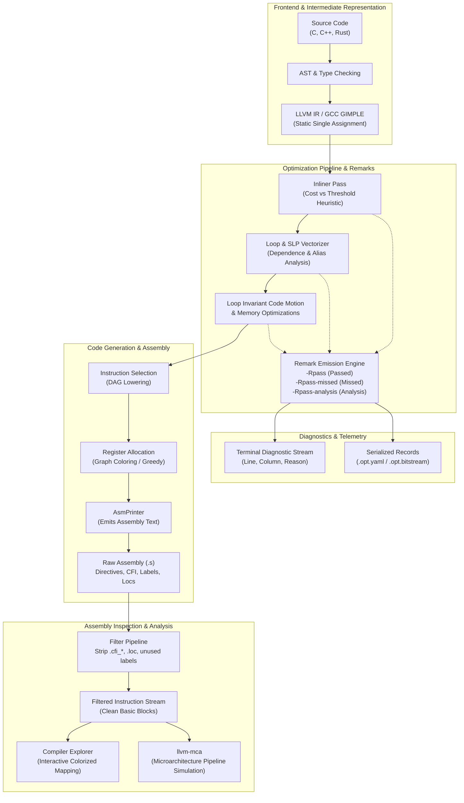
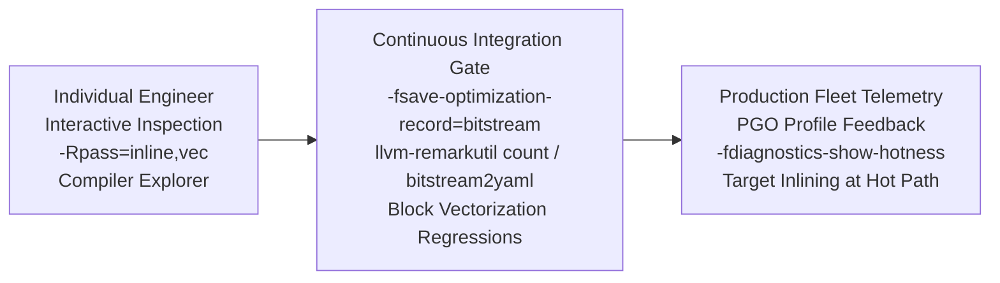

# Reading Assembly and Optimization Remarks

> [!summary] Claim:
> Reading compiler-generated assembly is the definitive verification step to confirm that zero-cost abstractions compile away, memory loads collapse into registers, and hot loops vectorize.
> Raw compiler output intersperses executable machine instructions with assembler directives, Call Frame Information tables (`.cfi_*`), and debug location markers, requiring systematic filtering to reveal the real control-flow graph.
> Optimization remarks (`-Rpass`, `-Rpass-missed`, `-Rpass-analysis`, and GCC `-fopt-info`) expose the compiler's internal cost models, proving exactly why a function failed to inline or why a loop was not vectorized due to pointer aliasing or carried dependencies.
> Serialized optimization records (`-fsave-optimization-record`) convert these transformation decisions into machine-readable YAML or bitstream records, enabling continuous integration pipelines to prevent silent performance regressions.



## The Mechanism

[[Compiler-Pipeline-and-Debuggability]] establishes how high-level code lowers from an Abstract Syntax Tree (AST) to intermediate representations like LLVM IR or GCC GIMPLE.
At the machine-level boundary, developers must verify whether the optimizer successfully realized the intended execution model.
Every optimization decision is governed by mathematical cost heuristics, aliasing proofs, and target architecture register budgets.

### 1. Disassembly Structure: x86-64 versus AArch64

Assembly language represents machine instructions using human-readable mnemonics and operands.
Two primary architectures dominate modern production fleets: x86-64 (CISC legacy with variable-length instructions from 1 to 15 bytes) and AArch64 (ARMv8-A/ARMv9-A RISC architecture with uniform 32-bit instructions).

#### x86-64 Syntax Dialects: AT&T versus Intel

On x86-64, tools present assembly in either AT&T syntax (the default for GNU `as`, `objdump`, and LLVM on Unix systems) or Intel syntax (the default for MASM and Windows tools; Compiler Explorer also starts with its "Intel asm syntax" output option checked, because `views/options-output.pug` passes `defaultchecked` true for it and `ClientStateCompilerOptions` in `lib/clientstate.ts` sets `intel = true`, read from the compiler-explorer repository 2026-11-07, as of 2026-11, Both).

| Attribute | AT&T Syntax | Intel Syntax | Mechanism Rationale |
| :--- | :--- | :--- | :--- |
| Operand Order | `mnemonic src, dst` | `mnemonic dst, src` | Intel matches assignment semantics (`dst = src`), whereas AT&T mirrors information flow. |
| Register Prefix | `%rax`, `%edi`, `%rsp` | `rax`, `edi`, `rsp` | AT&T requires `%` to avoid collisions with bare symbol names. |
| Immediate Values | `$42`, `$0x1000` | `42`, `0x1000` | AT&T requires `$` to disambiguate immediate values from absolute memory addresses. |
| Memory Dereference | `disp(base, index, scale)` | `[base + index*scale + disp]` | AT&T uses parenthesized tuples; Intel uses bracketed mathematical expressions. |
| Instruction Suffix | `movb`, `movw`, `movl`, `movq` | `mov byte ptr`, `mov dword ptr` | AT&T encodes size in the mnemonic suffix; Intel encodes size in operand specifiers. |

For example, computing `dst = *(int32_t*)(base + index * 4 + 16)` is expressed in AT&T as `movl 16(%rdi,%rax,4), %ebx` and in Intel as `mov ebx, dword ptr [rdi + rax*4 + 16]`.

#### AArch64 Architectural Principles

AArch64 is a load-store architecture, defined by the Arm Architecture Reference Manual; its register roles and calling convention are defined by the Procedure Call Standard for the Arm 64-bit Architecture (AAPCS64).
Data processing instructions operate strictly on registers; memory is accessed exclusively through explicit load (`ldr`, `ldp`) and store (`str`, `stp`) instructions.

- **Registers:** 31 64-bit general-purpose registers (`x0` through `x30`).
  The low 32 bits are addressed as `w0` through `w30`.
  Writing to a `w` register zero-extends into the upper 32 bits of the corresponding `x` register, matching x86-64 behavior on 32-bit registers.
  Register `xzr`/`wzr` acts as a hardware zero sink that discards writes and yields zero on reads.
  `sp` designates the dedicated stack pointer.
- **Addressing Modes:** AArch64 provides rich addressing modes without CISC instruction bloat:
  - Base register without offset: `[x0]`
  - Base register with immediate offset: `[x0, #16]`
  - Pre-indexed immediate (updates base before access): `[x0, #16]!`
  - Post-indexed immediate (updates base after access): `[x0], #16`
  - Register offset with optional sign-extension and shifting: `[x0, w1, sxtw #2]` (sign-extends 32-bit `w1` and shifts left by 2 bits, scaling by 4 bytes).
- **Condition Codes and Predication:** Rather than using separate compare-and-branch sequences everywhere, AArch64 provides conditional select (`csel`, `cset`, `cinv`) instructions that eliminate branch misprediction penalties by converting control dependencies into data dependencies.

#### Isolating Executable Instructions from Boilerplate

A compiler emitting assembly (`clang -S` or `gcc -S`) outputs extensive non-executable metadata:

1. **Assembler Directives:** Directives like `.file`, `.section`, `.globl`, `.p2align 4`, and `.build_version` direct object file layout and alignment.
2. **Call Frame Information (CFI):** Directives such as `.cfi_startproc`, `.cfi_def_cfa_offset 16`, `.cfi_offset %rbp, -16`, and `.cfi_endproc` instruct the assembler to populate `.eh_frame` or `.debug_frame` tables for stack unwinding, as owned by [[Stack-Unwinding-CFI-and-Exception-ABI]].
3. **Debug Location Directives:** Directives like `.loc 1 12 5` map instructions to source file lines and columns for DWARF generators, as owned by [[DWARF-Debug-Information-and-Symbol-Bundles]].
4. **Local Labels:** Ephemeral branch targets like `.LBB0_1` or `Ltmp0` demarcate basic block boundaries.

The share of boilerplate depends heavily on debug info: for the lab's `opt_demo.c` under Apple clang 21 on darwin-arm64, filtering removes 33.9% of the 186 lines at `-O3` (123 instructions kept), but 87.7% of the 1,267 lines at `-O3 -g` (156 kept) (measured 2026-11-07, as of 2026-11, macOS).
Systematic assembly reading begins by filtering directives and comments to isolate the pure instruction sequences.

### 2. Optimization Remarks Architecture

Optimization remarks are structured diagnostics emitted by middle-end and backend optimization passes.
Rather than requiring engineers to manually reverse-engineer assembly diffs, remarks state whether an optimization was performed, why it failed, or what cost model evaluated it.

#### Clang Diagnostic Remark Families

Clang categorizes optimization diagnostics into three distinct command-line flags:

- **`-Rpass=<regex>` (Passed):** Reports optimizations that were successfully executed by passes whose names match the regular expression.
  For example, `-Rpass=inline` confirms inlined call sites, and `-Rpass=loop-vectorize` confirms vectorization factors.
- **`-Rpass-missed=<regex>` (Missed):** Reports optimizations that were attempted by matching passes but aborted due to profitability thresholds, loop structure constraints, or safety hazards.
- **`-Rpass-analysis=<regex>` (Analysis):** Emits detailed analytical rationale from optimization passes, explaining cost calculations, memory dependence conflicts, and code size impacts.

To capture remarks across all passes, Clang accepts wildcard expressions:

```bash
clang -O3 -Rpass=.* -Rpass-missed=.* -Rpass-analysis=.* -c source.c
```

#### Cost Models and Inlining Heuristics

Function inlining eliminates call and return overhead, merges parameter values into local registers, and exposes the callee's body to intra-procedural optimizations like constant folding and dead code elimination.
However, unrestricted inlining inflates binary size, evicts instructions from CPU L1 instruction caches, and increases compile times.

LLVM evaluates an inline cost model for every direct call site:

$$\Delta\text{Benefit} = \text{Threshold} - \text{Cost}$$

If $\text{Cost} < \text{Threshold}$ (strictly less, `InlineCost::operator bool` in `InlineCost.h`), the call site is inlined.
The baseline threshold in LLVM is 225 (`-inline-threshold`, the `-O2` default) and 250 at `-O3` (`InlineConstants::OptAggressiveThreshold`); 325 is the `-inlinehint-threshold` for callees carrying an inline hint (LLVM release/21.x `InlineCost.cpp`, as of 2026-11, Both).
The analyzer adds a 50% single-basic-block bonus to the threshold up front, which is why the lab's `-O3` remark reports `threshold=375` (250 + 125).
Cost accumulates based on the instructions inside the callee: each instruction costs `-inline-instr-cost` = 5 units, and each call inside the callee adds `-inline-call-penalty` = 25.

Specific circumstances dramatically alter these weights:
- **`__attribute__((always_inline))`:** Forces $\text{Cost} = \text{always}$, bypassing the heuristic threshold entirely.
- **`__attribute__((noinline))`:** Sets $\text{Cost} = \text{never}$, emitting `-Rpass-missed=inline` with the diagnostic `noinline function attribute`.
- **Single-Caller Static Functions:** If a `static` internal helper has exactly one call site, inlining it permits the compiler to delete the standalone function definition completely.
  LLVM subtracts `TTI::getInliningLastCallToStaticBonus()` = 15000 from the cost in this scenario (`TargetTransformInfoImpl.h`), so the lab's `helper_inline` reports `cost=-15025`, making the helper inline for any callee of realistic size.

#### Vectorization Diagnostics and Memory Disambiguation

Auto-vectorization operates at two distinct granularities:
1. **Loop Vectorizer (LV):** Transforms sequential loop iterations into Single Instruction Multiple Data (SIMD) vector lanes operating across 128-bit (SSE/NEON), 256-bit (AVX2), or 512-bit (AVX-512) registers.
2. **Superword-Level Parallelism (SLP) Vectorizer:** Merges scalar operations within a single basic block into vector instructions.

For the Loop Vectorizer to vectorize a loop, it must prove three invariants:
1. **Countable Trip Count:** The loop termination condition must be computable before the loop executes (known induction variable, no early breaks or exceptions).
2. **No Unsafe Loop-Carried Dependencies:** Iteration $i$ must not depend on values computed in iteration $i - 1$ in a manner that requires serial execution (such as `a[i] = a[i-1] + b[i]`).
3. **No Pointer Aliasing:** Pointers written to must not overlap with pointers read from.

When pointer aliasing cannot be statically disproven, the compiler faces a choice.
If profitability models allow, it emits a *versioned loop*: it generates a runtime check preamble, either a range-overlap comparison (`a + n <= b || b + n <= a`) or, when the accesses share a stride, a cheaper pointer-difference check; for `c[i] = a[i] + b[i]` Apple clang 21 at `-O3` on arm64 emits `sub x9, x2, x0` / `cmp x9, #64` (unsigned distance at least VF x interleave x 4 bytes), measured locally (as of 2026-11, macOS).
If the pointers do not overlap at runtime, execution branches to the vectorized loop; otherwise, it falls back to a scalar loop.
Marking pointers with the C99 `restrict` qualifier or annotating loops with `#pragma clang loop vectorize(assume_safety)` tells the vectorizer the accesses are independent, eliminating the runtime alias checks; `#pragma clang loop vectorize(enable)` only overrides the profitability decision and keeps the checks (both measured locally on Apple clang 21: `enable` keeps two `cmp ..., #64` checks, `assume_safety` keeps none).

#### GCC Optimization Reports: `-fopt-info`

GCC provides comparable optimization telemetry through the `-fopt-info` flag hierarchy:

```bash
-fopt-info[-<group>[-<type>][=<filename>]]
```

- **Optimization Groups:** `ipa` (interprocedural optimizations), `loop` (loop transformations), `inline` (function inlining), `omp` (OpenMP and offloading), `vec` (vectorization), or `optall` (all groups); omitted options default to `optimized-optall` (GCC Developer Options).
- **Event Types:** `optimized` (successful applications), `missed` (failed opportunities), `note` (detailed decision context), or `all`.
- **Output Routing:** Omitting `=<filename>` directs reports to standard error; specifying a filename writes to disk.

For example, tracking missed vectorization opportunities in GCC is executed via:

```bash
gcc -O3 -fopt-info-vec-missed=vec_missed.txt -c source.c
```

### 3. Serialized Optimization Records: `-fsave-optimization-record`

Directing remarks to stderr works interactively, but production builds across thousands of files generate gigabytes of unstructured terminal noise.
Clang provides `-fsave-optimization-record` to serialize remarks into structured files alongside compilation objects (`<basename>.opt.yaml` or `<basename>.opt.bitstream`).

An optimization record document contains:
- **`!Passed` / `!Missed` / `!Analysis`:** The diagnostic event type.
- **`Pass`:** The originating optimization pass (`inline`, `loop-vectorize`, `slp-vectorizer`, `regalloc`).
- **`Name`:** Specific remark identifier (`Inlined`, `NeverInline`, `Vectorized`, `UnsafeDep`, `MissedDetails` are the five the lab emits; `InstructionMix` comes from the asm printer).
- **`DebugLoc`:** Exact source file path, line number, and column number.
- **`Function`:** Mangled or demangled name of the enclosing function.
- **`Args`:** An ordered list of structured key-value arguments capturing details such as `VectorizationFactor`, `InterleaveCount`, `Cost`, `Threshold`, and instruction delta numbers.

```yaml
--- !Passed
Pass:            loop-vectorize
Name:            Vectorized
DebugLoc:        { File: kernel.c, Line: 12, Column: 5 }
Function:        compute_sum
Args:
  - String:          'vectorized '
  - String:          ''
  - String:          'loop (vectorization width: '
  - VectorizationFactor: '4'
  - String:          ', interleaved count: '
  - InterleaveCount: '4'
  - String:          ')'
...
```

The LLVM project provides utilities to inspect serialized remarks:
- `llvm-remarkutil`: Converts between YAML and bitstream (`bitstream2yaml`, `yaml2bitstream`), extracts instruction counts (`instruction-count`, `annotation-count`), counts remarks filtered by pass, name, argument, or type (`count`), and diffs size remarks, meaning instruction count and stack size from the asm printer (`size-diff`) (LLVM 21 `llvm-remarkutil.rst`).
- `opt-viewer.py`: Reads YAML records and emits annotated HTML pages linking source code directly to compiler remark diagnostics.

### 4. Compiler Explorer Internals and Methodologies

Compiler Explorer (Godbolt) is the industry standard for interactive binary inspection.
Under the hood, Compiler Explorer executes a Node.js server that spawns sandboxed compiler binaries and processes stdout/stderr through an assembly filtering pipeline.

#### The Filter Pipeline

When Compiler Explorer compiles source code, it invokes the target compiler with `-g` (`optionsForFilter` in `lib/base-compiler.ts` starts from `['-g', '-o', <output>]`) and pipes the generated assembly through several regex-based filters defined in `lib/parsers/asm-parser.ts`:

1. **`directives`:** Removes lines matching assembler directives (`/^\s*\..*$/`, `asm-parser.ts`), retaining only labels and instructions.
2. **`labels`:** Analyzes jump targets and deletes local labels that have no referencing jump or branch instructions in the assembly.
3. **`commentOnly`:** Strips assembler comment lines beginning with `#`, `;`, or `//`.
4. **`intel`:** Appends the compiler's configured `intelAsm` options (`-masm=intel` for GCC and Clang) to render x86 assembly in Intel notation (`base-compiler.ts`).
5. **`demangle`:** Pipes symbol identifiers through `c++filt` or `rustfilt` to restore demangled function signatures.
6. **`libraryCode`:** Excludes assembly generated from system headers (such as `<vector>` or `<algorithm>`), focusing exclusively on user-authored functions.

#### Source-to-Assembly Mapping

Compiler Explorer correlates high-level language statements with assembly instructions using DWARF `.loc` state machines emitted by the compiler.
When the `directives` filter runs, the line table mapping engine records which source line each assembly instruction originated from before stripping the `.loc` directives.
The UI color-codes source lines and assembly instruction blocks using this table, allowing instant visual identification of which high-level lines generated specific instructions.

### 5. Microarchitectural Handoff

Static assembly reading reveals *what* instructions the compiler selected, but it cannot measure *how fast* modern out-of-order execution pipelines will retire them.
Instruction count is an unreliable proxy for execution latency:
- A sequence of four independent `fadd` instructions can execute concurrently on modern multi-issue superscalar pipelines with identical throughput to a single instruction.
- A single memory read that misses every cache level and goes to DRAM incurs a penalty of hundreds of clock cycles regardless of instruction brevity; an L1 miss that hits L2 costs on the order of ten cycles.

Tools like `llvm-mca` (LLVM Machine Code Analyzer) bridge static assembly inspection and physical execution.
`llvm-mca` simulates a target microarchitecture's instruction fetch, decode, register renaming, out-of-order dispatch, execution port pressure, and retirement queues.
By wrapping assembly kernels in `# LLVM-MCA-BEGIN` and `# LLVM-MCA-END` comments (any comment starting with those substrings marks a region, `llvm-mca.rst`), developers evaluate IPC (Instructions Per Cycle), reciprocal throughput, and execution bottlenecks before running physical benchmarks.
Downstream dynamic profiling and hardware performance counter measurements are owned by the 05-Profiling pillar.

## Commands and Numbers to Know

| Flag / Parameter | Value / Syntax | Platform and Date | Operational Role |
| :--- | :--- | :--- | :--- |
| Clang Passed Remarks | `-Rpass=<regex>` | Both (as of 2026-11) | Emits remarks for successful compiler optimization transformations. |
| Clang Missed Remarks | `-Rpass-missed=<regex>` | Both (as of 2026-11) | Emits remarks detailing attempted optimizations that were aborted. |
| Clang Analysis Remarks | `-Rpass-analysis=<regex>` | Both (as of 2026-11) | Emits detailed cost model and structural analysis rationale. |
| Save Optimization Record | `-fsave-optimization-record[=yaml\|bitstream]` | Both (as of 2026-11) | Serializes optimization remarks into companion files (`.opt.yaml` by default). |
| Optimization Record Passes | `-foptimization-record-passes=<regex>` | Both (as of 2026-11) | Filters serialized optimization records to passes matching the regex. |
| Optimization Record File | `-foptimization-record-file=<path>` | Both (as of 2026-11) | Overrides output path for serialized optimization remarks. |
| Profile Hotness in Remarks | `-fdiagnostics-show-hotness` | Both (as of 2026-11) | Includes Profile-Guided Optimization (PGO) execution counts in diagnostics. |
| GCC Optimization Info | `-fopt-info[-<group>[-<type>][=<file>]]` | Both (as of 2026-11) | GCC optimization telemetry flag; groups include `vec`, `inline`, `loop`, `ipa`, `omp`, `optall`. |
| GCC Missed Vectorization | `-fopt-info-vec-missed` | Both (as of 2026-11) | Prints GCC loop and SLP vectorization failure diagnostics to stderr. |
| GCC Inline Reports | `-fopt-info-inline-all` | Both (as of 2026-11) | Emits all successful and rejected function inlining decisions in GCC. |
| Intel Syntax Dialect | `-masm=intel` | Both (as of 2026-11) | Forces Clang and GCC to output x86 assembly in Intel bracketed syntax. |
| Verbose Assembly | `-fverbose-asm` | Both (as of 2026-11) | Annotates assembly output with high-level variable names and register roles. |
| LLVM Baseline Inline Threshold | `225` (default, O2), `250` (O3), `325` (inline hint) | Both (as of 2026-11) | Default cost budget for inlining; hot call sites get `3000`, cold call sites `45` with profile data. |
| LLVM Last-Call-To-Static Bonus | `15000` (subtracted from cost) | Both (as of 2026-11) | Cost credit applied when the call is the only use of an internal-linkage callee. |
| Always Inline Cost | `always` (`-2147483648`) | Both (as of 2026-11) | Synthetic cost assigned to `__attribute__((always_inline))` call sites. |
| Never Inline Cost | `never` (`2147483647`) | Both (as of 2026-11) | Synthetic cost assigned to `__attribute__((noinline))` call sites. |
| `llvm-remarkutil` Conversion | `llvm-remarkutil yaml2bitstream in -o out` | Both (as of 2026-11) | Transcodes serialized optimization remarks between YAML and bitstream formats. |
| `llvm-mca` Default Iterations | `100` (also when `-iterations=0`) | Both (as of 2026-11) | Simulated iterations of code kernel executed through out-of-order pipeline model. |

## Multi-Language Comparison: C++ / Rust / Python

| Capability / Concern | C++ (Clang / GCC) | Rust (`rustc`) | Python (CPython 3.13+) |
| :--- | :--- | :--- | :--- |
| Disassembly Generation | `clang++ -S -O3 file.cpp`<br/>`g++ -S -O3 file.cpp` | `rustc --emit asm -O file.rs`<br/>`cargo asm` (`cargo-show-asm`) | `python3 -m dis script.py`<br/>(Inspects bytecode, not machine assembly) |
| Optimization Remarks | `-Rpass=<regex>`<br/>`-fopt-info-<group>` | `-C remark=<passes>` (needs `-C debuginfo` for locations)<br/>`-C llvm-args="-pass-remarks=<regex>"` (with `-O`, `-C llvm-args=-pass-remarks=loop-vectorize` printed `vectorized loop (vectorization width: 4, interleaved count: 4)` for a slice-add loop; rustc 1.99.0, macOS, tested 2026-11-07) | Not applicable in interpreter: there is no compiler pass pipeline to report on |
| Serialized Optimization Records | `-fsave-optimization-record`<br/>(Emits `.opt.yaml` or `.opt.bitstream`) | Not via `-C llvm-args`: rustc 1.99 rejects `-pass-remarks-output` as an unknown argument (tested 2026-11-07)<br/>Nightly only: `-Z remark-dir=<dir> -C remark=all` wrote `<cgu>.opt.opt.yaml` and `<cgu>.codegen.opt.yaml` files in LLVM remark YAML format (rustc 1.101.0-nightly 2026-10-24, macOS, tested 2026-11-07); stable rejects `-Z` | Not supported natively; requires C extension build tracing |
| Function Inlining Controls | `__attribute__((always_inline))`<br/>`__attribute__((noinline))` | `#[inline(always)]`<br/>`#[inline(never)]`<br/>`#[inline]` | No direct inlining control;<br/>Bytecode evaluation loop incurs interpreter dispatch |
| Vectorization Controls | `#pragma clang loop vectorize(enable)`<br/>C99 `restrict` pointers | Iterators with known bounds;<br/>`slice.copy_from_slice()` | Python loops cannot auto-vectorize;<br/>Requires NumPy (C/Fortran SIMD kernels) |
| Source-to-Assembly Mapping | `-gline-tables-only`<br/>Emits `.loc` DWARF line tables | `-C debuginfo=1`<br/>Emits DWARF debug line markers | Bytecode line mapping embedded in code object `co_linetable` |
| Compiler Explorer Integration | Native support for Clang and GCC<br/>with direct AST and LLVM IR views | Native support for stable and nightly `rustc`<br/>with MIR and LLVM IR views | Native support displaying CPython bytecode (its Python compiler runs a disassembly script, `lib/compilers/python.ts`) |

## Worked Lab Example

The companion lab is located at `code/00-Program-Execution/opt_remarks_asm/`.
It compiles test cases demonstrating vectorization and inlining behaviors, inspects compiler remarks, and verifies generated assembly; the lab declares `# requires: macos` and checks Clang on AArch64 only, because the golden counts depend on the Apple clang 21 backend; `make verify` skips it on Linux and fails fast if `CC` is not Clang targeting AArch64.

The lab source `opt_demo.c` implements four targeted scenarios:
1. `vector_add`: Array addition with independent buffers qualified with C99 `restrict`, permitting clean auto-vectorization.
2. `dependent_add`: Array addition with a backward loop-carried data dependency (`a[i] = a[i-1] + b[i]`), preventing vectorization.
3. `call_inline`: Call to a small static helper function with a single call site, qualifying for inlining.
4. `call_noinline`: Call to a function decorated with `__attribute__((noinline))`, inhibiting inlining and forcing a procedure call.

The test harness `verify_remarks.py` executes `"${CC:-cc}"` with `-O3` and remark diagnostic flags (`-Rpass`, `-Rpass-missed`, `-Rpass-analysis`, and `-fsave-optimization-record`), compiles to assembly (`-S`), and works in a temporary directory so a failed run leaves nothing behind.
It cross-checks three sources for each function: the stderr remark text, the `(kind, pass, name, function)` tuple of each YAML record, and the instructions in that function's slice of the assembly.
The checks are: the inline remark has `cost < threshold`; the `noinline` remark says `cost=never`; the vectorized loop reports width 4 and interleave 4 and `vector_add` has interleave-plus-one `fadd.4s` instructions (the extra one is the single-vector epilogue loop); `dependent_add` has zero vector instructions and at least one scalar `fadd`; `call_inline` has no `bl` or `blr`, folds into `madd`, and its static helper symbol is gone; `call_noinline` has exactly one `bl _helper_noinline` and a `stp x29, x30, [sp, #-16]!` frame.

To execute the lab:

```bash
cd code/00-Program-Execution/opt_remarks_asm
bash run.sh
```

### Verified Output

Recorded on `darwin-arm64` on 2026-11-07 and verified against `code/00-Program-Execution/opt_remarks_asm/expected/darwin-arm64.txt`:

```text
=== Compiler Optimization Diagnostic Verification ===
Compiler: clang
Architecture: aarch64

--- Diagnostic Remarks Output ---
Remark [inlining success]: helper_inline into call_inline, cost -15025 < threshold 375 -> PASSED
Remark [inlining inhibited]: helper_noinline into call_noinline, cost=never -> PASSED
Remark [vectorization success]: vector_add, width 4, interleave 4 -> PASSED
Remark [vectorization missed]: dependent_add, backward loop-carried dependence -> PASSED

--- Serialized Optimization Records (YAML) ---
Total serialized records: 5
  Analysis loop-vectorize UnsafeDep dependent_add
  Missed inline NeverInline call_noinline
  Missed loop-vectorize MissedDetails dependent_add
  Passed inline Inlined call_inline
  Passed loop-vectorize Vectorized vector_add
Records match the remarks per function: PASSED

--- Assembly Structure and Filtering ---
Raw assembly lines: 186
Filtered assembly instructions: 123
Directives, comments, and labels removed: 33.9%
Functions found in assembly: all 5

--- Code Generation ---
vector_add 128-bit fadd.4s instructions: 5 (interleave count 4 + 1 epilogue) -> PASSED
dependent_add vector instructions: 0 (expected 0)
dependent_add scalar fadd instructions: 9 (expected more than 0)
call_inline calls: 0 (expected 0), madd present: True, helper_inline symbol emitted: False
call_noinline calls: ['bl _helper_noinline'] (expected ['bl _helper_noinline']), 16-byte frame setup: True

Verification status: ALL CHECKS PASSED
```

### Reading the Result

The output demonstrates every core mechanism in the compiler optimization pipeline:
- **Inlining Verification:** In `call_inline`, the helper `helper_inline` is inlined (`cost=-15025, threshold=375` in the remark), reducing function call instructions (`bl` on AArch64) to 0.
  The entire function collapses into a register multiply-add sequence (`madd w0, w0, w8, w9`), and stack frame setup instructions are omitted.
  In contrast, `call_noinline` preserves exactly 1 call instruction (`bl _helper_noinline`), allocating a 16-byte stack frame to preserve the frame pointer and link register (`stp x29, x30, [sp, #-16]!`).
- **Vectorization Verification:** `vector_add` emits NEON vector instructions (`fadd.4s v0, v0, v4`) operating on 128-bit vector lanes (four 32-bit floating-point values simultaneously), unrolled across four vector registers per iteration, followed by one more `fadd.4s` in a single-vector epilogue loop and a scalar tail (5 `fadd.4s` in total).
  In `dependent_add`, the backward carried dependency forces the Loop Vectorizer to abort, emitting scalar floating-point additions (`fadd s0, s0, s1`, unrolled by 8) with zero SIMD instructions; the lab asserts both the 9 scalar `fadd` (8 in the unrolled loop plus 1 in the scalar epilogue) and the absence of any vector instruction, so a vectorized loop with a scalar epilogue cannot pass.
- **Assembly Filtering:** The 63 removed lines of the 186 are 26 assembler directives (13 of them `.cfi_*`; there are no `.loc` lines because the lab compiles without `-g`), 19 comment-only lines, and 18 labels, with or without a trailing `;` comment (33.9% overhead reduction, 123 instructions kept).
- **Serialized Records:** The temporary `opt_demo.opt.yaml` contains 5 serialized records capturing `!Passed`, `!Missed`, and `!Analysis` states across both the `inline` and `loop-vectorize` passes.

## Pitfalls

> [!warning] Pitfall: Assuming the C++ `inline` keyword guarantees function inlining
> The `inline` keyword in C and C++ is a linkage directive that allows multiple definitions across translation units without violating the One Definition Rule (ODR).
> It is not an optimization directive and does not force the compiler to inline a function.
> Modern compilers evaluate inlining strictly through heuristic cost models based on call site frequency and callee instruction weight.
> To mandate inlining, you must use compiler attributes like `__attribute__((always_inline))` or `__forceinline`, and even then inlining fails if the function is recursive or if its address is taken.

> [!warning] Pitfall: Reading debug (`-O0`) assembly to diagnose production performance
> Under `-O0`, compilers disable optimization passes, allocating every local variable to a stack slot and reloading it into registers before every operation.
> Reading assembly or measuring instruction counts under `-O0` gives zero signal regarding production runtime behavior.
> Always compile with production optimization levels (`-O2` or `-O3`) and debug symbols (`-gline-tables-only` or `-g`) when inspecting assembly.

> [!warning] Pitfall: Forgetting floating-point associativity constraints during vectorization
> Floating-point addition is mathematically non-associative: $(a + b) + c \ne a + (b + c)$ due to rounding errors.
> By default under standard C and C++ compliance (`-std=c++20`), compilers refuse to reorder floating-point summations into parallel vector reduction trees.
> On x86-64, a loop summing an array of floats will not auto-vectorize unless compiled with `-ffast-math` (or `-fassociative-math`) or `#pragma clang loop vectorize(enable)`, or transformed into explicit SIMD intrinsics; the remark is `cannot prove it is safe to reorder floating-point operations` (Apple clang 21, `-target x86_64-apple-macos14`, tested 2026-11-07).
> On AArch64 the same loop does report `vectorized loop (vectorization width: 4, interleaved count: 4)` without `-ffast-math`, because the target enables ordered (in-loop strict) reductions: the assembly uses vector `ldp q` loads but then a chain of scalar `fadd s0, s0, sN` in source order, so the remark alone overstates the speedup (tested 2026-11-07, as of 2026-11, macOS).

> [!warning] Pitfall: Misattributing memory stall cycles to instruction count
> A short vectorized loop that misses the cache on every load can run slower than a longer scalar loop whose data stays in cache, because cache-miss latency dwarfs the cost of the extra instructions.
> The assembly looks better in the first case and the clock says otherwise, so no instruction count settles the question.
> Reading assembly confirms instruction selection, but profiling with hardware performance counters (PMU metrics like `CYCLE_ACTIVITY.STALLS_MEM_ANY` and IPC) is required to evaluate actual throughput.

> [!warning] Pitfall: Unintended pointer aliasing creating bloated runtime versioning loops
> When compiling functions taking raw pointer arguments (`float *a, float *b`), the compiler must assume that pointers may overlap.
> Unless pointers are marked `restrict` or loop bounds are proven disjoint, the compiler generates defensive preamble code containing multiple branch comparisons to verify non-overlap before executing vector code.
> If loop trip counts are small, the cost of checking pointer overlaps in the preamble exceeds the throughput gained from vectorization.

## At Scale

Optimization remark methodologies diverge fundamentally between an individual engineer inspecting a micro-benchmark and an organization maintaining a multi-million-line codebase.



### Single Developer versus Enterprise Fleet

1. **Local Developer Iteration:** A developer tuning an algorithmic kernel (such as an order book matching loop or matrix multiplication) relies on interactive Compiler Explorer instances and CLI flags (`-Rpass=loop-vectorize -Rpass-missed=inline`).
   The developer inspects instruction selection, verifies register allocation, and eliminates spills.
2. **Fleet CI Regression Gating (1,000 to 50,000 Engineers):**
   In large engineering fleets, developers frequently make innocent changes (adding a logging statement, modifying a constructor, or introducing a virtual call) that invisibly shatter compiler optimizations in core libraries.
   - **The Anti-Pattern:** Relying on benchmark suites alone.
     Micro-benchmarks are noisy, flaky across virtualized CI runners, and expensive to execute on every pull request.
   - **The Paved Road:** Enabling `-fsave-optimization-record=bitstream` on production library builds.
     Bitstream files are much smaller than YAML: measured with Apple clang 21 at `-O3`, a synthetic 1,200-function file with 9,188 records gave 630,980 bytes of bitstream versus 4,749,306 bytes of YAML (7.5x), and the lab's `opt_demo.c` gave 2,820 versus 24,868 bytes with all passes (8.8x) and 532 versus 3,309 bytes with `-foptimization-record-passes='(loop-vectorize|inline)'` (6.2x) (as of 2026-11, macOS).
     Three timed compiles of the synthetic file took 0.64 to 0.78 s without records and 0.69 to 0.73 s with bitstream records, so the compile-time cost was inside the noise there; measure it on your own build before promising a bound.
     A lightweight CI check converts both records with `llvm-remarkutil bitstream2yaml` (or counts them with `llvm-remarkutil count --pass-name=loop-vectorize`) and diffs the PR branch against `main`; `llvm-remarkutil size-diff` only diffs instruction-count and stack-size remarks, so it cannot see a lost vectorization.
     If a critical inner loop drops its vectorization factor (e.g., from `VF=8` to scalar fallback) or if a hot helper in an internal trading library fails to inline, the CI gate fails immediately with the exact remark diagnostic.

### Organizational Decision Rules

- **Hot-Path Libraries (Quant Engines, Video Codecs, Database Engines):** Remarks cannot be promoted to errors: Apple clang 21 rejects `-Werror=pass-missed` as an unknown warning option and suggests `-Werror=pass-failed` (tested 2026-11-07).
  Annotate critical loops with `#pragma clang loop vectorize(enable)` and build with `-Werror=pass-failed`, which turns a failed pragma-requested transformation into an error (`error: loop not vectorized: the optimizer was unable to perform the requested transformation ... [-Werror,-Wpass-failed=transform-warning]`, Apple clang 21, tested 2026-11-07), and require `restrict` pointers on buffer interfaces.
- **Profile-Guided Optimization (PGO) Integration:** Pair remarks with `-fdiagnostics-show-hotness`.
  This annotates optimization diagnostics with physical execution counts gathered from production traces, preventing engineers from wasting effort tuning cold loops that account for 0.001% of CPU cycles.
- **Compiler Explorer Internal Mirror:** Deploy an internal, authenticated instance of Compiler Explorer pinned to the exact corporate toolchain versions, target CPU flags (`-march=znver4` or `-mcpu=neoverse-v2`), and internal header libraries.

## Practice Drill

> [!tip] Practice Drill: Verifying Auto-Vectorization and Investigating Pointer Aliasing
> In this drill, you will compile an array accumulation function, inspect the generated vector assembly, find the runtime alias checks that possible pointer aliasing forces into the preamble, and remove them using the C99 `restrict` qualifier.
> Both functions report `vectorized loop (vectorization width: 4, interleaved count: 4)` on Apple clang 21 arm64; aliasing costs a versioned loop, not vectorization, so the evidence is in the assembly diff, not the remark (tested 2026-11-07).
> Follow the script below to compile with Clang, inspect the diagnostic remarks, and verify the instruction diff.

```bash
cat << 'EOF' > drill_demo.c
#include <stddef.h>

void array_add_aliased(float *a, float *b, float *c, size_t n) {
    for (size_t i = 0; i < n; ++i) {
        c[i] = a[i] + b[i];
    }
}

void array_add_restrict(float * restrict a, float * restrict b, float * restrict c, size_t n) {
    for (size_t i = 0; i < n; ++i) {
        c[i] = a[i] + b[i];
    }
}
EOF

# 1. Compile with Clang remarks for loop vectorization
echo "--- Compiling with Optimization Remarks ---"
clang -O3 -Rpass=loop-vectorize -Rpass-analysis=loop-vectorize -c drill_demo.c -o /dev/null

# 2. Inspect generated assembly for both functions
echo -e "\n--- Generating Assembly ---"
clang -O3 -S drill_demo.c -o drill_demo.s

# 3. Count pointer-difference alias checks (cmp against VF*IC*4 = 64 bytes) per function
#    Expected on Apple clang 21 arm64: aliased 2, restrict 0
for fn in array_add_aliased array_add_restrict; do
    n=$(awk -v f="_${fn}:" '$1 == f {p=1} p && /End function/ {p=0} p' drill_demo.s | grep -cE 'cmp\s+x[0-9]+, #64')
    echo "${fn}: ${n} runtime alias checks"
done

# 4. Clean up
rm -f drill_demo.c drill_demo.s
```

## Interview Questions

> [!question] L5: How does x86-64 AT&T syntax differ from Intel syntax in operand ordering and memory addressing expressions?
>
> > [!success]- Answer
> > In AT&T syntax, the source operand precedes the destination operand (`mnemonic src, dst`), whereas Intel syntax places the destination first (`mnemonic dst, src`), matching assignment semantics.
> > Registers in AT&T are prefixed with `%` (`%rax`), and immediates are prefixed with `$` (`$42`), whereas Intel syntax omits these prefixes.
> > For memory dereferencing, AT&T uses parenthesized format `disp(base, index, scale)`, such as `8(%rdi,%rax,4)`.
> > Intel syntax uses bracketed algebraic notation `[base + index*scale + disp]`, such as `[rdi + rax*4 + 8]`.
> > Furthermore, AT&T specifies operand size via mnemonic suffixes (`movb`, `movw`, `movl`, `movq`), whereas Intel specifies size via operand qualifiers (`byte ptr`, `word ptr`, `dword ptr`, `qword ptr`).

> [!question] L5: Predict the output: What assembly instructions and compiler remarks are emitted when compiling a floating-point array reduction loop with and without `-ffast-math`?
>
> > [!success]- Answer
> > Given a loop `for (int i=0; i<n; ++i) sum += arr[i];` with `float sum = 0.0f;`:
> > Without `-ffast-math`, standard IEEE 754 compliance forbids reordering floating-point addition because float addition is non-associative.
> > On x86-64 the compiler emits `-Rpass-analysis=loop-vectorize` with `loop not vectorized: cannot prove it is safe to reorder floating-point operations; allow reordering by specifying '#pragma clang loop vectorize(enable)' ... or ... '-ffast-math'`, plus a bare `loop not vectorized` under `-Rpass-missed=loop-vectorize`, and the loop stays scalar (`addss`).
> > On AArch64, Clang instead vectorizes with an ordered (strict) reduction: it reports `vectorized loop (vectorization width: 4, interleaved count: 4)`, loads with `ldp q`, and then adds lanes in source order with a chain of scalar `fadd s0, s0, sN`, so the result is bit-identical but the add chain stays serial (Apple clang 21, tested 2026-11-07).
> > With `-ffast-math` (or `-fassociative-math`), the compiler is permitted to reassociate additions.
> > It emits remark `-Rpass=loop-vectorize` indicating a vectorization factor (e.g., `vectorization width: 4` or `8`), and the assembly generates vector SIMD additions (`vaddps` or `fadd.4s`) unrolled across vector accumulator registers, followed by a horizontal scalar reduction step after the loop.

> [!question] L6: Debug this: A 5-line mathematical helper marked `inline` generates millions of calls and high branch latency in production CPU profiles; how do you triage why inlining failed?
>
> > [!success]- Answer
> > First, recognize that `inline` in C++ is a linkage directive that permits multiple definitions across compilation units; it does not force inlining.
> > To diagnose why the compiler rejected inlining, compile the code with `-Rpass-missed=inline -Rpass-analysis=inline`.
> > The compiler will emit a diagnostic remark detailing the exact inlining decision, including the calculated `cost` and `threshold`.
> > Common root causes revealed by the remark include:
> > 1. Callee cost exceeded the threshold (e.g., `cost=350, threshold=225`) due to nested operations or hidden constructor calls.
> > 2. The function address was taken and passed as a function pointer, forcing the compiler to retain an external symbol.
> > 3. The function was declared in a separate translation unit without Link-Time Optimization (LTO) enabled.
> > 4. The function contains recursion or complex exception handling (`try`/`catch`) blocks.
> > If inlining is strictly required, apply `__attribute__((always_inline))` and verify via `-Rpass=inline`.

> [!question] L6: How does the compiler handle potential memory aliasing in a loop when `restrict` pointers are omitted, and what assembly footprint does this produce?
>
> > [!success]- Answer
> > When pointers to input and output arrays might overlap, the compiler cannot safely vectorize the loop unconditionally because writing to an output element could alter an upcoming input element within the same vector lane.
> > To safely vectorize, the compiler generates a *versioned loop*.
> > In assembly, this produces a preamble before the loop containing pointer address arithmetic and comparisons, either range checks (`dst + n <= src1 || src1 + n <= dst`) or, for equal strides, pointer-difference checks; Apple clang 21 on arm64 emits `sub x9, x2, x0` / `cmp x9, #64` / `b.lo <scalar loop>` per source pointer (tested 2026-11-07).
> > If the pointer ranges do not overlap, execution branches to an optimized vector loop body (using SIMD registers like `ymm` or `v0-v31`).
> > If pointers overlap, execution branches to a scalar fallback loop.
> > This defensive preamble adds instruction bloat and branch prediction overhead, which can degrade performance if $n$ is small.
> > Specifying `restrict` informs the compiler that pointers never alias, eliminating the preamble comparisons and generating direct vector entry.

> [!question] L7: In LLVM's inliner pass, how is the inlining cost model calculated, what triggers negative costs like `-15025`, and how does Profile-Guided Optimization (PGO) affect the threshold?
>
> > [!success]- Answer
> > LLVM's `InlineCost` pass evaluates an analytical model of the callee's intermediate representation.
> > Every instruction in the callee contributes a base cost (`-inline-instr-cost`, default 5), and the decision is `Cost < Threshold` with a default threshold of 225 (250 at `-O3`).
> > The pass simulates simplification: if passing a constant argument allows constant folding of branches or eliminates dead code in the callee, those instructions are deducted from the cost.
> > If the callee is a static (internal linkage) function and the call site being evaluated is its *only* direct call site, inlining allows the compiler to completely eliminate the standalone function definition from the object file.
> > LLVM subtracts a large bonus in this scenario (`TTI::getInliningLastCallToStaticBonus()` = 15000, formerly `InlineConstants::LastCallToStaticBonus`), and the lab's remark prints `cost=-15025`; the extra -25 is the `-inline-call-penalty` default of 25: with `-mllvm -inline-call-penalty=0` the same remark prints `cost=-15000`, and with `-mllvm -inline-call-penalty=100` it prints `cost=-15100` (Apple clang 21, macOS, tested 2026-11-07).
> > When Profile-Guided Optimization (PGO) is active, LLVM switches the `threshold` by call-site hotness: cold call sites use `-inline-cold-callsite-threshold` = 45, hot call sites use `-hot-callsite-threshold` = 3000, and locally hot call sites `-locally-hot-callsite-threshold` = 525 (LLVM release/21.x `InlineCost.cpp`, as of 2026-11, Both).

> [!question] L7: Explain the file format and schema of LLVM optimization records (`.opt.yaml`), and architect an automated CI verification check to catch vectorization regressions.
>
> > [!success]- Answer
> > Serialized optimization records generated by `-fsave-optimization-record` consist of multi-document YAML (or bitstream) files containing structured diagnostics.
> > Each record begins with a document header (`!Passed`, `!Missed`, or `!Analysis`) and specifies:
> > - `Pass`: The optimization pass identifier (`loop-vectorize`, `inline`, `slp-vectorizer`).
> > - `Name`: Specific event string (`Vectorized`, `NeverInline`, `MissedDetails`, `UnsafeDep`).
> > - `DebugLoc`: File, line, and column coordinates.
> > - `Function`: Enclosing function identifier.
> > - `Args`: Structured list of diagnostic details, including `VectorizationFactor`, `InterleaveCount`, `Cost`, and `Threshold`.
> > To build an automated CI regression check:
> > 1. Enable `-fsave-optimization-record=bitstream` on builds in both the target branch and baseline `main`.
> > 2. Run a post-build CI script that converts records with `llvm-remarkutil bitstream2yaml` and extracts all `!Passed` records where `Pass == "loop-vectorize"` (`llvm-remarkutil count --pass-name=loop-vectorize` gives a quick per-function count).
> > 3. Diff the baseline records against the PR records for designated performance-critical files.
> > 4. If any loop drops from `Vectorized` to `MissedDetails`, or if its `VectorizationFactor` decreases, fail the PR build and output the exact source line and remark explanation.

> [!question] L8+: A high-throughput trading organization experiences a 35% compilation slowdown after enabling comprehensive optimization remarks; how do you redesign the diagnostics pipeline?
>
> > [!success]- Answer
> > The slowdown stems from enabling unrestricted string formatting and regular expression matching across every pass (`-Rpass=.*`) and serializing large, uncompressed YAML files (`.opt.yaml`) to network-mounted disks.
> > Redesign the pipeline across three distinct layers:
> > 1. **Switch Serialization Format:** Replace YAML serialization with binary LLVM bitstream (`-fsave-optimization-record=bitstream`).
> >    Bitstream serialization uses a string table instead of repeating strings, reducing file size by 6x to 9x in the measurements above (Apple clang 21, macOS, as of 2026-11).
> > 2. **Pass Filtering:** Restrict remark emission to targeted passes using `-foptimization-record-passes='^(loop-vectorize|inline)$'`.
> >    This eliminates millions of trivial remarks emitted by peephole optimizers and instruction selectors.
> > 3. **Asynchronous Out-of-Band Analysis:** Decouple remark parsing from developer compilation loops.
> >    In developer builds, disable remarks entirely.
> >    In CI and nightly release builds, generate bitstream remarks, upload them to object storage, and execute centralized analysis using `llvm-remarkutil` and custom scripts to detect regressions asynchronously.

> [!question] L8+: How do static assembly analysis, compiler diagnostic remarks, and microarchitectural simulation (`llvm-mca`) form an integrated performance engineering workflow?
>
> > [!success]- Answer
> > These three tools address complementary layers of abstraction in program performance:
> > 1. **Compiler Remarks (Compiler Intent):** Optimization remarks explain *why* transformations succeeded or failed at the IR and AST level, proving whether inlining occurred, why loop unrolling stopped, and whether aliasing prevented vectorization.
> > 2. **Assembly Inspection (Generated Code):** Disassembly reading verifies *what* machine instructions the compiler selected, confirming register allocation, stack frame layout, and the elimination of redundant loads or branch instructions.
> > 3. **Microarchitectural Simulation with `llvm-mca` (Execution Throughput):** Assembly reading cannot reveal pipeline hazards or port saturation.
> >    `llvm-mca` ingests the assembly instruction stream, simulates a specific CPU microarchitecture's hardware execution units (reservation stations, issue ports, load/store queues, and reorder buffers), and outputs reciprocal throughput, IPC, and pipeline resource pressure.
> > By chaining them together, an engineer first uses remarks to achieve optimal code transformation, inspects assembly to confirm clean code generation, and runs `llvm-mca` to verify maximum instruction-level parallelism prior to hardware validation with PMU profiling.

## Further Reading

- LLVM Project, *Clang Compiler User's Manual: Options to Emit Optimization Reports*: Normative documentation for `-Rpass`, `-Rpass-missed`, and `-fsave-optimization-record`.
- LLVM Project, *Remarks Documentation*: Normative specification of LLVM remark types (`Passed`, `Missed`, `Analysis`), C API, and YAML/bitstream serialization formats.
- GCC Development Team, *Options That Control Optimization (-fopt-info)*: Complete reference for GCC optimization report groups, event types, and file redirection syntax.
- Matt Godbolt, *Compiler Explorer Documentation and Architecture*: Design of the online interactive compiler interface, regex assembly filters, and line table mappings.
- System V Application Binary Interface: AMD64 Architecture Processor Supplement: The normative specification for x86-64 register allocation, calling conventions, and code models.
- Procedure Call Standard for the Arm 64-bit Architecture (AAPCS64): Normative specification for AArch64 registers, addressing modes, and parameter passing.
- Bryant and O'Hallaron, *Computer Systems: A Programmer's Perspective*, 3rd Edition: Chapters 3 and 5 provide foundational pedagogy on machine-level representation and loop optimization.
- LLVM Project, *llvm-mca - LLVM Machine Code Analyzer*: Manual for static microarchitectural simulation, execution pipeline visualization, and bottleneck analysis.

## Related

- Prerequisites: [[Calling-Conventions-System-V-AMD64-and-AAPCS64]], [[Compiler-Pipeline-and-Debuggability]]
- Next: [[Linkers-LTO-PGO-AutoFDO-and-BOLT]]
- See also: [[02-Programming-Languages/C++/CPP_Zero_to_Godhood/Volume_08_Advanced_Systems/Chapter_89_Reading_the_Compilers_Output/Chapter_89_Reading_the_Compilers_Output|Chapter_89_Reading_the_Compilers_Output]]
- Lab: `code/00-Program-Execution/opt_remarks_asm/` (requires: macos)
