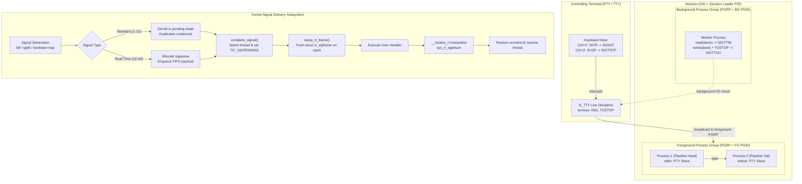

# Signals, Process Groups, Sessions, and Job Control

> [!summary] Claim:
> Signals are kernel-mediated software interrupts that asynchronously preempt thread execution, constructed by mutating the thread register context to execute user trampolines on the thread or alternate stack (`sigaltstack`).
> Standard signals (1-31) coalesce into pending bitmasks upon delivery saturation, whereas POSIX real-time signals (`SIGRTMIN`-`SIGRTMAX`) queue reliably in FIFO order with integer or pointer payloads.
> Process groups aggregate processes into pipeline jobs, while sessions isolate interactive login contexts bound to a single controlling terminal.
> The terminal line discipline enforces job control by stopping background process groups via `SIGTTIN` on terminal read and `SIGTTOU` on terminal write under `TOSTOP`, protecting orphaned groups from deadlocks via immediate `EIO` returns and waking stopped orphans with `SIGHUP` and `SIGCONT`.



## The Mechanism

Signals provide asynchronous notifications of hardware exceptions, software conditions, and external process events.
The kernel signal and process relationship subsystems govern how multi-process applications coordinate terminal access and respond to runtime interruptions.
The historical evolution of Unix signal semantics explains the design of modern POSIX signal primitives.

### 1. Historical Evolution: From Unreliable V6 Signals to POSIX.1

In Early Version 6 and Version 7 Unix, signal handling was fundamentally unreliable.
The historic `signal(2)` system call reset the signal disposition back to `SIG_DFL` (default termination) immediately before entering the user handler.
To catch subsequent occurrences, the application was forced to reinstall the handler inside the handler itself.
This design created an unfixable race condition: a second signal arriving before the reinstallation call executed terminated the process immediately.
Furthermore, early Unix lacked signal masks, meaning an active signal handler could be recursively interrupted by the identical signal, corrupting non-reentrant data structures.

BSD 4.2 introduced reliable signals with `sigvec(2)`, preserving handler dispositions across invocations and introducing atomic signal blocking masks as explored in [[Processes-Fork-Exec-and-File-Descriptors]].
System V Release 3 adopted an alternate reliable signal interface with `sigset(2)`.
The IEEE POSIX.1-1988 and POSIX.1-1990 standards unified these divergent designs under `sigaction(2)`, `sigprocmask(2)`, and the `sigset_t` bitmask type.
POSIX guarantees that handlers remain installed until explicitly modified, that the signal being handled is automatically added to the thread's signal mask during execution unless `SA_NODEFER` is requested, and that pending blocked signals remain preserved until unblocked.

### 2. Signal Generation, Routing, and Queuing Internals

Signal lifecycle begins with generation.
Signals are generated by hardware exceptions (such as memory management faults triggering `SIGSEGV` or divide-by-zero traps triggering `SIGFPE`), by terminal line disciplines (such as `Ctrl+C` generating `SIGINT`), or by explicit system calls (`kill(2)`, `tgkill(2)`, `sigqueue(3)`).

In the Linux kernel source (`kernel/signal.c`), signal delivery routes signals either to a thread group (an entire process) or to an individual task (a specific POSIX thread):
- When `kill(pid, sig)` is invoked with `pid > 0`, the kernel invokes `kill_pid_info()`, resolving the `struct pid` to the thread group leader (`PIDTYPE_TGID`).
  The signal is appended to the shared process-wide queue: `task->signal->shared_pending`.
- When `pthread_kill(thread, sig)` or `tgkill(tgid, tid, sig)` is invoked, the signal targets a single execution context (`PIDTYPE_PID`).
  The signal is appended to the thread's private queue: `task->pending`.

The kernel differentiates standard signals from POSIX real-time signals:
- **Standard Signals (1 to 31):** Represented by bit positions in a fixed-width bitmask (`sigset_t`).
  Inside `kernel/signal.c`, `legacy_queue()` tests whether the signal bit is already asserted in the target pending mask.
  If the signal is already pending, subsequent arrivals are silently dropped.
  Standard signals do not queue; multiple occurrences coalesce into a single pending bit.
  Standard signals cannot carry application metadata payloads.
- **Real-Time Signals (`SIGRTMIN` to `SIGRTMAX`):** Real-time signals are queued reliably.
  Each real-time signal generation allocates a `struct sigqueue` from the per-user `RLIMIT_SIGPENDING` resource pool.
  The kernel links the `sigqueue` structure into a doubly linked FIFO list alongside the pending mask.
  Multiple real-time signals sent with `sigqueue(3)` are delivered strictly in arrival order.
  Furthermore, when multiple distinct real-time signals are pending simultaneously, lower-numbered signals have strict delivery priority over higher-numbered signals.

Once the signal is recorded in the pending queue, `complete_signal()` selects a recipient thread.
If the signal was targeted to the thread group (`type != PIDTYPE_PID`), the kernel iterates through the thread group using `wants_signal()`.
The kernel selects a thread that does not have the signal blocked in its `task->blocked` mask and is not currently exiting or stopped.
The kernel executes `signal_wake_up()`, which marks `TIF_SIGPENDING` in the thread's `thread_info->flags` and wakes the thread from interruptible sleep (`TASK_INTERRUPTIBLE`).

### 3. Signal Delivery and the User Stack Frame

A pending signal is not executed instantaneously; it is delivered only when the target thread transitions from kernel space back to user space.
This transition occurs when returning from a system call, page fault, or hardware timer interrupt via `exit_to_user_mode_loop()` in the Linux kernel architecture layer.

```
+-------------------------------------------------------------+  High Memory
|                    Original User Stack                      |
|  [ Interrupted Application Stack Frames ]                   |
+-------------------------------------------------------------+
|  struct rt_sigframe (pushed by setup_rt_frame)              |
|  - FP / Extended Vector State (fpstate: xsave / AVX-512)    |
|  - info (siginfo_t): signal number, errno, code, PID/UID,   |
|                      payload union sigval (int / ptr)       |
|  - uc (struct ucontext_t):                                  |
|      - uc_flags                                             |
|      - uc_link                                              |
|      - uc_stack (stack_t settings)                          |
|      - uc_mcontext: saved CPU registers (RAX, RDI, RSP, RIP)|
|      - uc_sigmask: previous thread signal blocking mask     |
|  - pretcode: points to __restore_rt trampoline (at (%rsp))  |
+-------------------------------------------------------------+  <- New RSP (16n - 8 aligned)
|  User Signal Handler Stack Frame                            |
+-------------------------------------------------------------+  Low Memory
```

When `TIF_SIGPENDING` is detected, the kernel calls `arch_do_signal_or_restart()` and `get_signal()`.
If the disposition is a user-defined function, `setup_rt_frame()` (dispatching to `x64_setup_rt_frame()` in `arch/x86/kernel/signal.c` for x86-64) builds the signal execution context directly on the user stack:
1. **Frame Construction:** The kernel writes `struct rt_sigframe` onto the thread's active user stack (or the alternate signal stack).
   This frame contains `siginfo_t`, the full `ucontext_t` structure (storing the general-purpose registers, instruction pointer `%rip`, stack pointer `%rsp`, and the current blocked signal mask `uc_sigmask`), and floating-point/vector registers.
2. **Trampoline Pointer Setup:** The return address at the base of the frame (`pretcode` at `(%rsp)`) is configured to point to the user-space signal trampoline: `__restore_rt` (supplied via `sa_restorer` by the C runtime library on x86-64, or mapped in the kernel vDSO as `__kernel_rt_sigreturn` on AArch64 and 32-bit x86).
Debuggers and exception unwinders rely on DWARF unwind annotations in `.eh_frame` to trace call chains through this signal boundary, as analyzed in [[Stack-Unwinding-CFI-and-Exception-ABI]].
3. **Register Mutation:** The kernel overrides the CPU registers before returning to user space:
   - On x86-64: `%rdi` receives the signal number; `%rsi` receives the pointer to `siginfo_t` inside the stack frame; `%rdx` receives the pointer to `ucontext_t`; `%rip` is set to the user signal handler function; `%rsp` is set to the base of `struct rt_sigframe` (`round_down(sp, 16) - 8`, so `%rsp + 8` is 16-byte aligned per the System V AMD64 ABI post-`call` entry invariant).
   - The thread resumes execution not at its interrupted instruction, but inside the user signal handler.
4. **Execution and Return:** When the handler completes, it executes a standard function `ret` instruction.
   This pops `pretcode` into `%rip`, jumping into `__restore_rt`.
   The trampoline executes assembly:
   ```assembly
   mov $15, %rax        # __NR_rt_sigreturn on Linux x86-64
   syscall
   ```
5. **Context Restoration:** In the kernel, `sys_rt_sigreturn` reads `struct rt_sigframe` from user memory.
   It validates the context, restores the thread's previous signal mask from `uc_sigmask`, restores the original CPU general-purpose and vector registers, and transfers execution back to the exact user instruction interrupted by the signal.

System calls interrupted by a signal return `-EINTR` unless `SA_RESTART` was specified in `sigaction.sa_flags`.
When `SA_RESTART` is active, `handle_signal()` automatically prepares eligible blocking system calls (such as `read(2)` or `write(2)` on slow devices, `open(2)`, and `waitpid(2)` returning `-ERESTARTSYS`) for restart by restoring `%rax` to the original system call number (`orig_ax`) and backing up `%rip` by the length of the `syscall` instruction (2 bytes on x86-64) before `setup_rt_frame()` saves the register state, so `sys_rt_sigreturn` resumes directly at the `syscall` instruction.
Non-restartable calls (such as `poll(2)`, `select(2)`, `nanosleep(2)`, or socket operations with timeouts) always return `-1` with `errno` set to `EINTR`.

### 4. Alternate Signal Stack (`sigaltstack`)

When a thread encounters a stack overflow, the stack pointer `%rsp` attempts to write past the allocated stack boundary into an unmapped guard page.
The CPU memory management unit generates a page fault exception, which the kernel translates into `SIGSEGV`.
If the process installed a `SIGSEGV` handler on the default stack, `setup_rt_frame()` attempts to push `struct rt_sigframe` at the faulting `%rsp`.
Because `%rsp` is invalid, the write immediately triggers a second page fault.
The kernel detects this fault-on-signal-delivery condition and immediately kills the process with an uncatchable core dump.

The alternate signal stack system call, `sigaltstack(2)`, solves this failure mode.
A thread registers a pre-allocated memory region as its alternate signal stack, mapped beyond the primary stack guard page as detailed in [[Virtual-Memory-Mmap-and-Process-Address-Space]]:
```c
stack_t ss;
ss.ss_sp = mmap(NULL, stack_size, PROT_READ | PROT_WRITE, MAP_PRIVATE | MAP_ANONYMOUS, -1, 0);
ss.ss_size = stack_size;
ss.ss_flags = 0;
sigaltstack(&ss, NULL);
```
When registering signal handlers via `sigaction(2)`, setting `sa_flags |= SA_ONSTACK` instructs `setup_rt_frame()` to evaluate `ss.ss_flags`.
If the thread is not already executing on the alternate stack (`!(ss.ss_flags & SS_ONSTACK)`), the kernel establishes `struct rt_sigframe` at the top of the `ss_sp` region, allowing crash loggers and diagnostic unwinders to inspect stack state safely.

Historically, Unix systems defined `SIGSTKSZ` (8 KiB on x86-64, 16 KiB on AArch64) and `MINSIGSTKSZ` (2 KiB on x86-64, 5 KiB on AArch64) as compile-time constants.
Starting in glibc 2.34 (as of 2021-08, Linux), `SIGSTKSZ` and `MINSIGSTKSZ` are no longer compile-time constants under `_GNU_SOURCE`.
In `<bits/sigstksz.h>`, `SIGSTKSZ` expands dynamically to `sysconf(_SC_SIGSTKSZ)` and `MINSIGSTKSZ` is aliased to `SIGSTKSZ` (while `sysconf(_SC_MINSIGSTKSZ)` queries the kernel's `AT_MINSIGSTKSZ` auxiliary vector value directly).
This architectural change was necessitated by modern vector extensions, including ARM SVE (Scalable Vector Extension) and Intel AVX-512, whose dynamically sized vector register states exceeded the historical 8 KiB stack allocation during `ucontext_t` serialization.

### 5. Async-Signal-Safety

An asynchronous signal handler interrupts execution at an arbitrary instruction boundary.
If the interrupted code was executing inside a function holding a shared lock or manipulating global heap state, invoking that same function or another function acquiring the same lock inside the signal handler produces a permanent deadlock or heap corruption.

The POSIX.1 specification codifies this rule under `signal-safety(7)`.
A function is async-signal-safe if and only if it is either reentrant or non-interruptible with respect to signals.
The vast majority of the standard C library is NOT async-signal-safe:
- `malloc(3)`, `calloc(3)`, `free(3)`, and `realloc(3)` acquire internal arena mutexes; invoking them in a handler deadlocks if interrupted during an allocation.
- `printf(3)`, `snprintf(3)`, and standard I/O streams (`FILE*`) lock internal `FILE` mutexes and maintain shared static buffers.
- Mutex acquisition (`pthread_mutex_lock(3)`) is non-reentrant and causes self-deadlocks.

Async-signal-safe operations are restricted to direct system call wrappers (`read(2)`, `write(2)`, `_exit(2)`, `kill(2)`), and reading or writing atomic variables of type `volatile sig_atomic_t` or lock-free `std::atomic`.
To process complex signals in production architectures without violating safety constraints, systems use the self-pipe trick or Linux `signalfd(2)`.
By blocking signals across worker threads and reading them from an event file descriptor inside an epoll or kqueue event loop, asynchronous interruptions are transformed into synchronous, thread-safe I/O events.

### 6. Process Groups, Sessions, and Job Control Mechanics

Job control coordinates how multiple processes share a single interactive terminal display and keyboard input stream.
It governs process execution states and terminal ownership, leaving low-level character parsing and termios mode switching to [[TTYs-PTYs-and-Line-Discipline]].
It is built upon three hierarchical process abstractions maintained by the kernel:

```
+========================================================================+
|                        Session (SID = 1000)                            |
|  Controlling Terminal: /dev/pts/1 (tty->session = 1000)                |
|  Session Leader: PID 1000 (Interactive Shell)                          |
+------------------------------------------------------------------------+
|                                                                        |
|  +---------------------------------+  +-----------------------------+  |
|  |  Foreground Process Group       |  |  Background Process Group   |  |
|  |  (PGID = 1050, tty->pgrp=1050)  |  |  (PGID = 1080)              |  |
|  |                                 |  |                             |  |
|  |  PID 1050: grep pattern         |  |  PID 1080: cc -c file1.c    |  |
|  |  PID 1051: wc -l                |  |  PID 1081: cc -c file2.c    |  |
|  |  Has terminal read/write access |  |  Terminal read -> SIGTTIN   |  |
|  |  Receives Ctrl+C (SIGINT)       |  |  Terminal write -> SIGTTOU  |  |
|  +---------------------------------+  +-----------------------------+  |
+========================================================================+
```

1. **Process ID (PID):** Uniquely identifies an individual process or thread group.
2. **Process Group (PGRP / PGID):** A collection of one or more processes collaborating on a single pipeline job.
   A process group is identified by its Process Group ID (`pgid`), which matches the PID of the process group leader.
   The system call `setpgid(pid, pgid)` joins an existing process group or creates a new one.
   A process can only set the PGID of itself or its direct children, and cannot change the PGID of a child that has executed `execve(2)`.
3. **Session (SID):** A collection of one or more process groups.
   A session is established via `setsid(2)`.
   The calling process becomes the session leader (`pid == sid`) and the process group leader of a new process group (`pid == pgid`).
   `setsid(2)` strictly fails with `EPERM` if the caller is already a process group leader; daemons avoid this error by calling `fork()` first and executing `setsid()` exclusively in the child.
4. **Controlling Terminal:** A session can be bound to at most one controlling terminal (a physical TTY or virtual PTY).
   When a session leader opens a terminal device without the `O_NOCTTY` flag (or issues `ioctl(fd, TIOCSCTTY, 0)`), that terminal becomes the session's controlling terminal.
   The terminal data structure in kernel memory (`struct tty_struct` in `include/linux/tty.h`) records references to the controlling session (`tty->ctrl.session`) and the active foreground process group (`tty->ctrl.pgrp`).

At any instant, exactly one process group in the session is the **foreground process group**.
All other process groups in the session are **background process groups**.
The session leader assigns the foreground process group using `tcsetpgrp(fd, pgid)`, which internally issues `ioctl(fd, TIOCSPGRP, &pgid)`.
The terminal line discipline directs keyboard events exclusively to the foreground process group:
- When a user presses `Ctrl+C`, the line discipline driver (`drivers/tty/n_tty.c`) detects the `INTR` character and invokes `kill_pgrp(tty->ctrl.pgrp, SIGINT, 1)`.
- When a user presses `Ctrl+Z`, the line discipline detects the `SUSP` character and invokes `kill_pgrp(tty->ctrl.pgrp, SIGTSTP, 1)`.

The kernel enforces strict isolation on background process groups attempting terminal I/O:
- **Background Terminal Read (`SIGTTIN`):** When a process belonging to a background process group invokes `read(2)` on its controlling terminal, the line discipline driver executes `n_tty_read()` and `__tty_check_change(tty, SIGTTIN)` (in `drivers/tty/tty_jobctrl.c`).
  The driver detects that `task_pgrp(current) != tty->ctrl.pgrp`.
  Instead of returning user keystrokes, the kernel sends `SIGTTIN` to the background process group.
  The default disposition of `SIGTTIN` suspends all processes in the group (`TASK_STOPPED`).
  The shell receives a `SIGCHLD` notification, inspects `waitpid(..., WUNTRACED)`, and reports the job as stopped.
- **Background Terminal Write (`SIGTTOU`):** When a background process invokes `write(2)` on its controlling terminal, behavior is governed by the `TOSTOP` flag in `termios.c_lflag`.
  If `TOSTOP` is cleared (the default in standard shells), background writes succeed and interleave output onto the terminal screen.
  If `TOSTOP` is set via `stty tostop` or `tcsetattr(3)`, the kernel's `tty_check_change()` (in `drivers/tty/tty_jobctrl.c`) detects the background write and sends `SIGTTOU` to the background process group, stopping it.
- **Terminal Attribute Modification:** Any background process attempting to invoke `tcsetattr(3)`, `tcsetpgrp(3)`, or terminal `ioctl` commands unconditionally generates `SIGTTOU`, regardless of the `TOSTOP` setting.
  This prevents background jobs from altering terminal baud rates, echo settings, or stealing foreground ownership.

### 7. Orphaned Process Groups and Terminal Disconnects

What prevents a background process from suspending indefinitely if its controlling parent process terminates?
If a background job received `SIGTTIN` after its managing shell exited, no interactive entity would remain in the session to issue `tcsetpgrp()` or send `SIGCONT` to wake it up.

POSIX solves this failure mode through the concept of the **orphaned process group**:
A process group is defined as orphaned if the parent of every process in the group is either itself a member of the group, or is not a member of the process group's session.
In the Linux kernel (`kernel/exit.c`), `will_become_orphaned_pgrp()` validates this condition: an orphan group has zero members whose parent resides in a different process group within the identical session.

The kernel applies two strict rules to orphaned process groups:
1. **Terminal Stop Immunity and `EIO`:** Terminal-generated stop signals (`SIGTSTP`, `SIGTTIN`, `SIGTTOU`) cannot stop an orphaned process group.
   Inside `n_tty_read()` and `tty_check_change()`, if `is_current_pgrp_orphaned()` (wrapping `is_orphaned_pgrp()`) returns true, the kernel refuses to send `SIGTTIN` or `SIGTTOU`.
   Instead, the system call immediately fails and returns `-1` with `errno` set to `EIO` (Input/output error).
   This allows headless or orphaned daemon processes to detect terminal loss and terminate cleanly rather than hanging in stopped states.
2. **Orphan Transition of Stopped Jobs (`SIGHUP` + `SIGCONT`):** If a process terminates or reparents, and its exit causes an existing process group to become newly orphaned, the kernel checks whether that group contains any stopped processes (`TASK_STOPPED`).
   If stopped processes exist, `kill_orphaned_pgrp()` sends `SIGHUP` (hangup) followed immediately by `SIGCONT` (continue) to every process in the newly orphaned process group.
   The `SIGHUP` notifies processes that their controlling parent has disappeared, while `SIGCONT` guarantees that stopped processes wake up to process the `SIGHUP` or terminate.

When a terminal disconnection occurs (such as closing a virtual terminal window, terminating an SSH session, or closing a pseudoterminal master descriptor):
1. The kernel terminal driver generates `SIGHUP` to the session leader (`tty->ctrl.session`).
2. The session leader (the login shell) receives `SIGHUP`.
3. The shell forwards `SIGHUP` to all child process groups registered in its active job table.
4. If the session leader terminates, the controlling terminal is disassociated (`tty->ctrl.session = NULL`), and any subsequent terminal read or write operations by remaining processes fail with `EIO`.

## Commands and Numbers to Know

Reference numbers, signal constants, flag defaults, and interface specifications governing signals and job control across platforms.

| Identifier / Metric | Value / Setting | Platform | Context / Mechanism |
| :--- | :--- | :--- | :--- |
| `SIGHUP` | `1` | Both (as of 2026-11) | Hangup detected on controlling terminal or death of controlling process |
| `SIGINT` | `2` | Both (as of 2026-11) | Interactive attention signal generated by terminal line discipline `INTR` (`Ctrl+C`) |
| `SIGQUIT` | `3` | Both (as of 2026-11) | Interactive quit signal generated by line discipline `QUIT` (`Ctrl+\`); produces core dump |
| `SIGKILL` | `9` | Both (as of 2026-11) | Uncatchable, unignorable immediate termination by kernel task scheduler |
| `SIGUSR1` | `10` (Linux) \| `30` (macOS) | Both (as of 2026-11) | User-defined signal 1; numeric divergence across operating systems |
| `SIGSEGV` | `11` | Both (as of 2026-11) | Invalid memory reference; MMU page fault translation |
| `SIGUSR2` | `12` (Linux) \| `31` (macOS) | Both (as of 2026-11) | User-defined signal 2; numeric divergence across operating systems |
| `SIGPIPE` | `13` | Both (as of 2026-11) | Broken pipe; write to pipe or socket with no active reader |
| `SIGTERM` | `15` | Both (as of 2026-11) | Standard graceful termination request signal sent by orchestrators |
| `SIGCHLD` | `17` (Linux) \| `20` (macOS) | Both (as of 2026-11) | Child process terminated, stopped, or resumed; numeric divergence across operating systems |
| `SIGCONT` | `18` (Linux) \| `19` (macOS) | Both (as of 2026-11) | Continue executing if stopped; wakes task from `TASK_STOPPED` |
| `SIGSTOP` | `19` (Linux) \| `17` (macOS) | Both (as of 2026-11) | Uncatchable, unignorable execution pause by kernel task scheduler |
| `SIGTSTP` | `20` (Linux) \| `18` (macOS) | Both (as of 2026-11) | Terminal stop signal generated by line discipline `SUSP` (`Ctrl+Z`) |
| `SIGTTIN` | `21` | Both (as of 2026-11) | Background process group attempted `read(2)` from controlling terminal |
| `SIGTTOU` | `22` | Both (as of 2026-11) | Background process group attempted `write(2)` with `TOSTOP` or `tcsetattr(3)` |
| `SIGRTMIN` | `34` (Linux NPTL) \| Absent | Both (as of 2026-11) | First user real-time signal; glibc reserves signals 32 (`SIGCANCEL`) and 33 (`SIGSETXID`) |
| `SIGRTMAX` | `64` (Linux) \| Absent | Both (as of 2026-11) | Maximum real-time signal supported by Linux kernel `_NSIG` |
| `_NSIG` / `NSIG` | `64` (Linux kernel) / `65` (glibc) \| `32` (macOS `NSIG`) | Both (as of 2026-11) | Signal table width; kernel `sigset_t` is 8 B on Linux (glibc `sigset_t` is 128 B) and 4 B on macOS |
| `MINSIGSTKSZ` | `SIGSTKSZ` (`sysconf(_SC_SIGSTKSZ)`) | Linux (as of 2026-11) | Dynamic in glibc 2.34+ (`_SC_MINSIGSTKSZ` queries `AT_MINSIGSTKSZ`); static 2048 B (x86-64) / 5120 B (arm64) |
| `SIGSTKSZ` | `sysconf(_SC_SIGSTKSZ)` | Linux (as of 2026-11) | Default alternate stack size; dynamic in glibc 2.34+; static 8192 B (x86-64) / 16384 B (arm64) |
| `MINSIGSTKSZ` / `SIGSTKSZ` | `32768` / `131072` | macOS (as of 2026-11) | Minimum (32 KiB) and recommended (128 KiB) alternate stack sizes on Darwin platforms |
| `RLIMIT_SIGPENDING` | `ulimit -i` (default `max_threads / 2`) | Linux (as of 2026-11) | Per-real-UID limit on queued signals; scaled by RAM in `fork_init()` (replaced `/proc/sys/kernel/rtsig-max` in 2.6.8) |
| `SA_SIGINFO` | `0x00000004` (Linux) \| `0x0040` (macOS) | Both (as of 2026-11) | Invokes 3-argument handler: `void (*)(int, siginfo_t *, void *)` |
| `SA_RESTART` | `0x10000000` (Linux) \| `0x0002` (macOS) | Both (as of 2026-11) | Automatically restarts interruptible system calls across signal delivery |
| `SA_NODEFER` | `0x40000000` (Linux) \| `0x0010` (macOS) | Both (as of 2026-11) | Prevents the signal from being automatically added to thread mask during handler execution |
| `SA_RESETHAND` | `0x80000000` (Linux) \| `0x0004` (macOS) | Both (as of 2026-11) | Resets signal disposition to `SIG_DFL` upon entering user handler (V6 semantics) |
| `SA_ONSTACK` | `0x08000000` (Linux) \| `0x0001` (macOS) | Both (as of 2026-11) | Executes handler on alternate stack established by `sigaltstack(2)` |
| `EIO` | `5` | Both (as of 2026-11) | Input/output error; returned when orphaned process group attempts terminal I/O |

## Multi-Language Comparison

Signal handling and process group coordination across modern systems programming languages.

| Language / Runtime | Signal Registration | Masking / Blocking | Async Safety Guarantees | Event Loop Integration |
| :--- | :--- | :--- | :--- | :--- |
| **C++ (POSIX / C++23)** | `sigaction(2)` with `sa_sigaction`; standard `std::signal` provides undefined behavior if handler touches non-trivial state | `sigprocmask(2)` for single-thread; `pthread_sigmask(3)` for multi-threaded processes | Enforced by developer; safe types limited to `volatile std::sig_atomic_t` and lock-free `std::atomic` | Self-pipe trick or Linux `signalfd(2)` registered into epoll or kqueue event loop |
| **Python (3.12/3.13)** | `signal.signal(sig, handler)`; handlers execute exclusively on the main interpreter thread inside evaluation loop | `signal.pthread_sigmask(how, mask)`; thread mask manipulation exposed via standard library | Python virtual machine defers handler execution until GIL release/acquisition boundary; avoids C heap corruption | `signal.set_wakeup_fd(fd)`; writes signal byte to pipe or socket for asyncio integration |
| **Rust (2021/2024)** | `signal_hook::iterator::Signals` or raw `libc::sigaction`; `signal-hook` avoids unsafe handler code via self-pipe | `nix::sys::signal::pthread_sigmask`; blocks signals across tokio worker thread pools | Raw signal handlers require `unsafe extern "C"`; `signal-hook` registers atomic flags or pipes to maintain safety | `tokio::signal::unix::signal(SignalKind)`; integrates signal reception as asynchronous `Stream` / `Future` |

## Worked Lab Example

The companion lab in `code/00-Program-Execution/signal_job_control/` compiles and runs a test harness verifying the five core mechanisms of signal delivery and job control.
The program verifies signal coalescing versus real-time queuing, alternate signal stack execution under `sigaltstack`, background terminal read suspension (`SIGTTIN`), background terminal write suspension under `TOSTOP` (`SIGTTOU`), and orphaned process group isolation (`EIO` return and `SIGHUP`+`SIGCONT` waking).

### Building and Executing the Lab

To execute the lab in the containerized Linux environment:

```bash
cd code && python3 -m _harness.verify 00-Program-Execution/signal_job_control/
```

The lab compiles `signal_job_control.c` using `-O2 -Wall -Wextra -Werror -pedantic -std=c11` and executes the binary under an unprivileged user session.
The verified output copied from `expected/linux-aarch64.txt` (measured on `linux-aarch64` container, as of 2026-11):

```text
[CHECK 1: SIGNAL QUEUE]
Standard signal SIGUSR1 instances received: 1 (coalesced)
Real-time signal SIGRTMIN instances received: 3 (queued)
Real-time payloads: 100 101 102

[CHECK 2: SIGALTSTACK]
Alternate stack active in handler: true
Handler frame within sigaltstack memory window: true

[CHECK 3: JOB CONTROL SIGTTIN]
Background process reading from controlling terminal stopped: true
Stop signal: SIGTTIN (21)

[CHECK 4: JOB CONTROL SIGTTOU]
Background process writing to TOSTOP terminal stopped: true
Stop signal: SIGTTOU (22)

[CHECK 5: ORPHANED PROCESS GROUP]
Orphaned background read errno: EIO (5)
Orphaned stopped process received SIGHUP: true
Orphaned stopped process received SIGCONT: true
```

### Mechanism Analysis

1. **Check 1 (Signal Queuing):** The harness blocks `SIGUSR1` and `SIGRTMIN`.
   It sends three standard signals (`kill(pid, SIGUSR1)`) and three real-time signals carrying distinct integer values (`sigqueue(pid, SIGRTMIN, sv)`).
   Upon unblocking, the standard signal handler executes exactly once because bits in the pending mask coalesce duplicates.
   The real-time signal handler executes three distinct times in FIFO order, accurately recovering payloads `100`, `101`, and `102`.
2. **Check 2 (Alternate Stack):** The harness maps an anonymous memory window and registers it via `sigaltstack(2)`.
   A `SIGUSR2` handler configured with `SA_ONSTACK` intercepts `raise(SIGUSR2)`.
   The handler inspects `sigaltstack(NULL, &cur_oss)` and validates that `SS_ONSTACK` is asserted, and that the address of its local stack frame resides strictly within the mapped alternate stack bounds.
3. **Check 3 (Terminal Read Stop):** A session leader allocates a pseudoterminal (`posix_openpt`) and establishes it as its controlling terminal.
   It creates a child process in a distinct process group (`setpgid(child, child)`), leaving the session leader in the foreground.
   When the child attempts `read(slave_fd)`, the kernel halts the child with `SIGTTIN` (signal 21), verified by the parent via `waitpid(child, &st, WUNTRACED)`.
4. **Check 4 (Terminal Write Stop):** The session leader configures `TOSTOP` on the slave terminal attributes.
   A background child attempts `write(slave_fd, "v", 1)`.
   The kernel intercepts the background write and halts the child with `SIGTTOU` (signal 22).
5. **Check 5 (Orphaned Group Protection):** A grandchild is placed in an independent process group.
   Its parent exits, reparenting the grandchild to the init process outside the session, orphaning the grandchild's process group.
   When the orphaned grandchild attempts `read(slave_fd)`, the kernel refuses to send `SIGTTIN` and immediately fails the system call with `errno = EIO` (5).
   The session leader stays alive, holding the controlling terminal open, until it sees EOF on a completion pipe that only the grandchild holds, so the result does not depend on a sleep.
   In Check 5B, a stopped process group becomes orphaned when its session parent exits; the kernel issues `SIGHUP` and `SIGCONT`, waking the child to process the termination.

> [!warning] Pitfalls:
> 1. **Invoking Non-Reentrant Functions in Signal Handlers:** Calling `malloc`, `free`, `printf`, or `syslog` inside a signal handler deadlocks the process if the signal interrupted a thread holding an internal allocator or I/O mutex.
> 2. **Signal Loss via Standard Signal Coalescing:** Assuming that sending N standard signals guarantees N handler executions.
>    Standard signals coalesce in the pending mask; applications must use real-time signals or state-driven draining loops.
> 3. **Errno Mutation inside Handlers:** Failing to save and restore `errno` across signal handlers.
>    If a handler invokes an async-signal-safe system call like `write(2)` that modifies `errno`, the interrupted code resumes with corrupted `errno` state, inducing nondeterministic bugs in calling code.
> 4. **Process Group Fork Races:** Calling `setpgid()` exclusively in the child after `fork()`.
>    If the parent shell invokes `tcsetpgrp()` or `waitpid()` before the child executes `setpgid()`, the parent operates on the old process group or fails with `EPERM`.
>    Robust shells must invoke `setpgid(pid, pid)` in BOTH parent and child immediately after `fork()`.
> 5. **Unintentional Daemon Stopping via Unhandled `SIGTTOU`:** Daemons executing `tcsetattr()` or writing to inherited terminal descriptors without redirecting standard file descriptors to `/dev/null` freeze in `TASK_STOPPED` when executed in the background under `TOSTOP`.
> 6. **Recursive Stack Overflow Termination:** Attempting to catch `SIGSEGV` or `SIGBUS` without establishing an alternate signal stack via `sigaltstack(2)` with `SA_ONSTACK`.
>    The faulting stack cannot hold `struct rt_sigframe`, causing immediate uncatchable process aborts.

## At Scale: Fleet Signals and Process Isolation

As software architectures scale from single processes to distributed microservices and massive build systems, operational trade-offs shift:

1. **Graceful Shutdown Protocols in Container Fleets:** In Kubernetes and container orchestration environments, pod eviction commences with `SIGTERM`.
   Workloads are granted a termination grace period (default 30 seconds) to stop accepting incoming traffic, drain in-flight RPCs, flush database write-ahead logs, and exit.
   If the container does not exit before the grace period expires, the container runtime sends `SIGKILL`.
   Production services must register `SIGTERM` handlers that initiate non-blocking drainage rather than immediate process termination.
2. **The Container PID 1 Signal Trap:** Inside a Linux PID namespace, the root process is PID 1.
   The Linux kernel treats PID 1 differently from all other processes: the kernel refuses to apply default signal actions to PID 1.
   If a program running as PID 1 does not install an explicit signal handler for `SIGTERM` or `SIGINT`, sending those signals has zero effect; the kernel drops them.
   `SIGKILL` remains capable of killing PID 1 from an ancestor namespace, but cannot be sent from within the container namespace itself.
   Container images must use init supervisors (such as `tini` or `dumb-init`) or execute application binaries via `exec` in shell entrypoints to ensure signals reach application handlers.
3. **Zombie Process Reaping in Multi-Tenant Runtimes:** When child processes terminate, they transition to the zombie state (`EXIT_ZOMBIE`) until their parent reads their exit status via `waitpid(2)`.
   If a parent process terminates without reaping its children, the children are reparented to PID 1.
   In modern Linux (kernel 3.4+), any process can designate itself as an intermediate subreaper via `prctl(PR_SET_CHILD_SUBREAPER, 1)`.
   Process orchestrators, language runtimes, and build tools use subreapers to catch and reap orphaned background grandchildren, preventing PID table exhaustion across the operating system.
4. **Process Groups versus Linux Cgroups for Isolation:** Build systems (such as Bazel or Ninja) historically tracked compiler subprocesses using process groups (`kill(-pgid, SIGKILL)`).
   However, rogue subprocesses can detach from their process group by calling `setsid()` or `setpgid(0, 0)`, escaping cleanup signals and leaking orphaned compiler daemons.
   Modern production build and CI systems avoid process groups for lifecycle containment, relying instead on Linux cgroups v2 (`cgroup.kill`).
   Writing `1` to `cgroup.kill` atomically terminates every process currently residing in the cgroup hierarchy, regardless of session or process group transitions.
5. **Signal Masking in Low-Latency Trading Engines:** In low-latency execution engines, asynchronous signal interruptions induce unpredictable latency spikes (jitter) by interrupting cache-hot CPU pipelines and triggering kernel stack transitions.
   High-frequency trading architectures mask all asynchronous signals across execution threads (`pthread_sigmask(SIG_BLOCK, &all_signals, NULL)`).
   A single, isolated management thread running on an unpinned housekeeping core handles signals synchronously via `sigwaitinfo(2)` or `signalfd(2)`.

> [!tip] Practice Drill:
> Write a minimal C harness that forks a child into its own process group, establishes a pseudo-terminal pair via `posix_openpt`, toggles foreground ownership with `tcsetpgrp`, and verifies that the child stops upon `read(slave_fd)`.
> Confirm that `waitpid(child, &status, WUNTRACED)` returns true for `WIFSTOPPED(status)` and that `WSTOPSIG(status)` equals `SIGTTIN`.
> Then, kill the parent to orphan the child group, issue another read, and verify that the call returns `-1` with `errno == EIO`.

## Interview Questions

### L5: Predict the Output and Signal Coalescing

> [!question] L5: What is the output of the following C program, and why?
> ```c
> #include <stdio.h>
> #include <signal.h>
> #include <unistd.h>
> 
> static volatile int count = 0;
> void handler(int sig) { count++; }
> 
> int main() {
>     signal(SIGUSR1, handler);
>     sigset_t mask, old;
>     sigemptyset(&mask);
>     sigaddset(&mask, SIGUSR1);
>     sigprocmask(SIG_BLOCK, &mask, &old);
>     for (int i = 0; i < 5; i++) kill(getpid(), SIGUSR1);
>     sigprocmask(SIG_SETMASK, &old, NULL);
>     printf("count = %d\n", count);
>     return 0;
> }
> ```
>
> > [!success]- Answer
> > The program prints `count = 1`.
> > While `SIGUSR1` is blocked in the thread's signal mask, calls to `kill(getpid(), SIGUSR1)` attempt to deliver the signal.
> > Because `SIGUSR1` is a standard (non-real-time) signal, the kernel records pending state by asserting a single bit in the thread's pending signal mask (`task->pending.signal`).
> > Subsequent generations of `SIGUSR1` while the signal is pending find the bit already asserted and are silently discarded (coalesced).
> > When `sigprocmask` unblocks `SIGUSR1`, the kernel delivers the single pending signal, incrementing `count` exactly once.

### L5: Async-Signal Safety

> [!question] L5: Why is calling `printf()` or `malloc()` unsafe inside an asynchronous signal handler, and what failure occurs under high load?
>
> > [!success]- Answer
> > `malloc()` and `printf()` are not async-signal-safe because they acquire non-reentrant internal mutexes to protect heap arenas and standard I/O buffer structures.
> > If a thread is interrupted by a signal while actively holding the heap arena mutex inside `malloc()`, and the signal handler attempts to allocate memory or format output via `printf()`, the handler attempts to acquire the exact same mutex.
> > Because standard POSIX mutexes are non-recursive by default, the thread deadlocks with itself permanently.
> > Under high load, this manifests as application threads freezing in `futex` or mutex wait states with zero CPU utilization.

### L6: Debugging Stopped Background Jobs

> [!question] L6: A background daemon launched from a deployment shell script randomly freezes.
> Attaching with `gdb` or inspecting `/proc/[pid]/status` shows `State: T (stopped)`.
> What caused this, and how do you resolve it?
>
> > [!success]- Answer
> > The process belongs to a background process group and attempted I/O on its inherited controlling terminal.
> > If the daemon attempted to `read(stdin)`, the kernel generated `SIGTTIN`.
> > If the daemon attempted to `write(stdout)` while the terminal had `TOSTOP` enabled (`stty tostop`), or executed terminal attribute calls like `tcsetattr()`, the kernel generated `SIGTTOU`.
> > Because the background daemon did not install custom handlers or ignore these signals, the default action suspended the process (`TASK_STOPPED`).
> > To resolve this:
> > 1. Daemonize properly by calling `setsid()` to disassociate from the controlling terminal session.
> > 2. Redirect `stdin`, `stdout`, and `stderr` to `/dev/null` or log files upon startup.
> > 3. If running under a shell script, ensure the process is disconnected using `< /dev/null > /dev/null 2>&1 &`.

### L6: System Call Interruption and Register Restoration

> [!question] L6: Walk through the exact CPU register and stack transitions during the execution of a signal handler on Linux x86-64 from the moment of interruption to handler return.
>
> > [!success]- Answer
> > 1. While returning to user mode, the kernel detects `TIF_SIGPENDING` and executes `setup_rt_frame()`.
> > 2. The kernel allocates and populates `struct rt_sigframe` on the user stack (or `sigaltstack`).
> >    It serializes general-purpose registers (`%rdi`, `%rsi`, `%rdx`, `%rax`, `%rsp`, `%rip`, etc.), floating-point registers, and the active signal mask into `ucontext_t`.
> > 3. The kernel sets `%rdi = signo`, `%rsi = &siginfo_t`, and `%rdx = &ucontext_t`.
> >    It sets `%rsp` to the `16n - 8` aligned base of `rt_sigframe` (`pretcode` at `(%rsp)`) and `%rip` to the user handler address.
> >    The return address on the stack points to `__restore_rt` (the user-space signal trampoline in `libc` on x86-64, or the vDSO trampoline on AArch64/i386).
> > 4. The kernel returns to user mode, transferring control directly into the handler.
> > 5. The handler executes and terminates with `ret`.
> >    This pops `__restore_rt` into `%rip`.
> > 6. The trampoline executes `mov $15, %rax; syscall` (`sys_rt_sigreturn`).
> > 7. The kernel validates the stack frame, restores the thread's previous signal mask from `uc_sigmask`, restores all CPU registers from `mcontext_t`, and resumes user execution at the interrupted `%rip`.

### L6: Process Group Races in Shell Pipelines

> [!question] L6: In a job control shell, why must `setpgid()` be invoked in BOTH the parent shell and the child process immediately after `fork()`?
>
> > [!success]- Answer
> > If `setpgid()` is invoked exclusively in the child, a race condition occurs between the parent and child.
> > If the parent executes first and calls `tcsetpgrp(tty_fd, child_pid)` or `waitpid(child_pid, ...)`, the child may not have executed `setpgid()` yet.
> > The parent's `tcsetpgrp()` fails with `EPERM` because the target process group does not exist yet.
> > Conversely, if `setpgid()` is invoked exclusively in the parent, the child may execute `execve()` before the parent runs `setpgid()`.
> > Once a process calls `execve()`, subsequent `setpgid()` calls by the parent fail with `EACCES`/`EPERM`.
> > Invoking `setpgid(pid, pid)` in both processes guarantees that whichever process runs first establishes the process group before any dependent operations occur.
> > Redundant `setpgid()` calls succeed idempotently.

### L7: Orphaned Process Group Invariants

> [!question] L7: Define an orphaned process group under POSIX.
> Why does reading from a controlling terminal return `EIO` instead of generating `SIGTTIN`, and what occurs when a process group containing stopped jobs becomes orphaned?
>
> > [!success]- Answer
> > An orphaned process group is one where no member has a parent process in the same session but a different process group.
> > In an orphaned group, no parent shell or supervisor remains in the session to detect job control signals, issue `tcsetpgrp()`, or send `SIGCONT`.
> > If the kernel sent `SIGTTIN` when an orphaned background process attempted a terminal `read()`, the process would suspend in `TASK_STOPPED` with no possible mechanism to ever resume, leaking resources permanently.
> > To prevent unresumable deadlocks, the kernel detects `is_current_pgrp_orphaned()` (`is_orphaned_pgrp()`) and returns `-1` with `errno = EIO`.
> > When a parent exit or reparenting causes an active process group to become newly orphaned while containing stopped processes, the kernel immediately delivers `SIGHUP` followed by `SIGCONT` to all processes in the group.
> > This ensures stopped processes wake up, recognize parent termination, and exit cleanly.

### L7: Container PID 1 Signal Masking

> [!question] L7: Why does sending `SIGTERM` to a process running as PID 1 inside a Docker container fail to terminate it by default, and how does the kernel implement this exception?
>
> > [!success]- Answer
> > When the first process in a PID namespace is created (`copy_process()` in `kernel/fork.c`), the kernel sets the `SIGNAL_UNKILLABLE` flag in `task->signal->flags`.
> > In `kernel/signal.c`, `sig_task_ignored()` checks `t->signal->flags & SIGNAL_UNKILLABLE` and ignores any signal whose disposition is `SIG_DFL` unless `force && sig_kernel_only(sig)` (which permits `SIGKILL` or `SIGSTOP` sent from an ancestor PID namespace, while `is_global_init(t)` blocks even forced `SIGKILL`/`SIGSTOP` for the host init).
> > For normal processes, unhandled signals apply default actions (such as termination for `SIGTERM`).
> > For PID 1, the kernel ignores all signals for which the process has not installed an explicit user signal handler.
> > This protects the init process from accidental termination by spurious default-disposition signals.
> > In containers, if the application binary does not install an explicit `sigaction` handler for `SIGTERM`, the kernel discards the signal.
> > The container runtime waits for the stop timeout (default 10s) and terminates the container forcibly with `SIGKILL` issued from the parent PID namespace.

### L8+: Low-Latency Signal Architecture

> [!question] L8+: Architect a signal handling subsystem for a 64-thread low-latency matching engine.
> Compare traditional `sigaction` trampolines, dedicated `sigwaitinfo` threads, and `signalfd` integrated into an epoll loop.
>
> > [!success]- Answer
> > In high-frequency matching engines, asynchronous signal delivery via `sigaction` trampolines introduces unacceptable tail latency:
> > - Interrupting an execution thread forces user-to-kernel-to-user mode transitions, invalidates CPU branch prediction tables, pollutes L1 instruction caches with signal handling code, and serializes floating-point registers via `xsave`.
> > - Handlers are strictly bounded by async-signal safety, preventing rich diagnostic telemetry.
> >
> > The distinguished architecture:
> > 1. At process initialization, before spawning worker threads, block all maskable signals across the entire process using `pthread_sigmask(SIG_BLOCK, &all_mask, NULL)`.
> >    All child threads inherit this full blocking mask, guaranteeing that matching threads pinned to isolated CPU cores are never interrupted by asynchronous signals.
> > 2. Dedicate an unpinned housekeeping thread to signal management.
> > 3. **Design Choice: `signalfd(2)` vs `sigwaitinfo(2)`:**
> >    - If the housekeeping subsystem runs an epoll event loop managing timer file descriptors (`timerfd`), network admin sockets, and metrics, use `signalfd(2)`.
> >      `signalfd` converts signal deliveries into standard readable file descriptor events (`EPOLLIN`), allowing the thread to multiplex signals alongside administrative I/O without extra thread hops.
> >    - If signal handling is purely dedicated to synchronous control (such as reconfiguration via `SIGHUP` or shutdown via `SIGTERM`), execute a tight loop over `sigwaitinfo(2)` or `sigtimedwait(2)`.
> >      `sigwaitinfo` avoids file descriptor table overhead and directly extracts `siginfo_t` from the process pending queue synchronously.
> > 4. Synchronous processing completely eliminates async-signal-safety hazards.
> >    The housekeeping thread safely allocates heap memory, formats structured JSON logs, shuts down thread pools via atomics, and drains queues before exiting.

## Further Reading

- IEEE Std 1003.1-2024 (POSIX.1-2024), Issue 8, System Interfaces: defines normative behavior for `sigaction`, `sigaltstack`, `sigprocmask`, `setpgid`, `setsid`, and `tcsetpgrp`.
- Linux `signal(7)` and `signal-safety(7)` man pages: comprehensive reference for kernel signal dispositions, thread routing, and the POSIX list of async-signal-safe functions.
- Linux kernel source `kernel/signal.c`, `kernel/exit.c`, `drivers/tty/tty_jobctrl.c`, and `arch/x86/kernel/signal.c`: authoritative implementation of `send_signal_locked()`, `complete_signal()`, `setup_rt_frame()`, `tty_check_change()`, and orphaned process group handling (`will_become_orphaned_pgrp()`).
- W. Richard Stevens and Stephen A. Rago, *Advanced Programming in the UNIX Environment* (3rd Edition), Chapters 9 and 10: classic, definitive analysis of Unix process relationships, sessions, controlling terminals, and signal mechanics.
- glibc release notes for version 2.34 (August 2021): documents the transition of `SIGSTKSZ` and `MINSIGSTKSZ` from compile-time constants to dynamic `sysconf` evaluations.
- Linux `signalfd(2)` man page: kernel interface for transforming asynchronous signals into synchronous file descriptor read events.
- Michael Kerrisk, *The Linux Programming Interface*, Chapters 20-22 and 34: exhaustive treatment of signal masks, real-time signal queues, and terminal process groups.

## Related

- Prerequisites: [[Processes-Fork-Exec-and-File-Descriptors]]
- Next: [[Proc-Filesystem-and-Process-Credentials]]
- See also: [[01-CS-Foundations/Operating-Systems/IPC-Complete-Guide|IPC Complete Guide]], [[19-Shell-and-Unix-Engineering/01-Unix-Process-Model/Signals-Dispositions-Masks-and-Delivery|Signals Dispositions Masks and Delivery]], [[19-Shell-and-Unix-Engineering/01-Unix-Process-Model/Async-Signal-Safety|Async Signal Safety]], [[19-Shell-and-Unix-Engineering/01-Unix-Process-Model/Sessions-Process-Groups-and-Controlling-Terminals|Sessions Process Groups and Controlling Terminals]], [[19-Shell-and-Unix-Engineering/02-Terminals-and-Job-Control/Job-Control-Signals|Job Control Signals]]
- Lab: `code/00-Program-Execution/signal_job_control/` (requires: linux)
