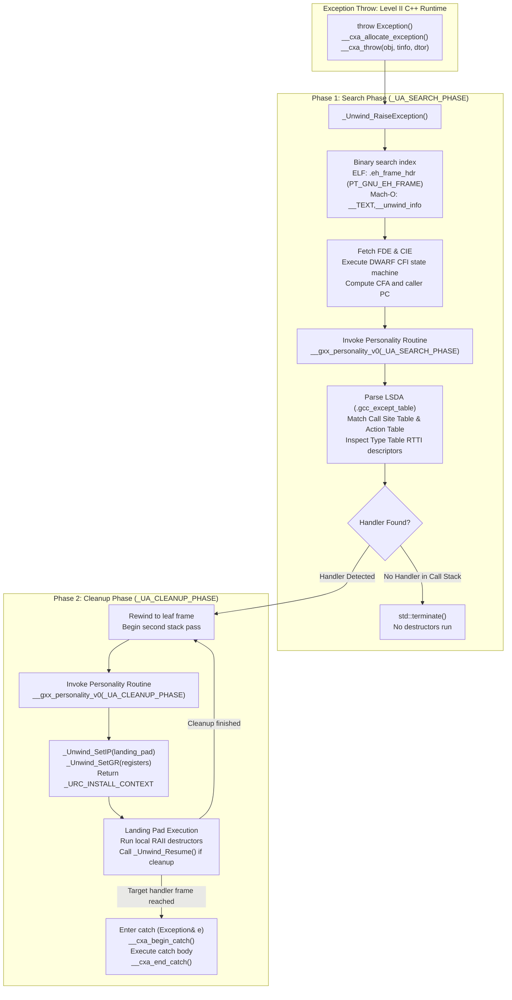
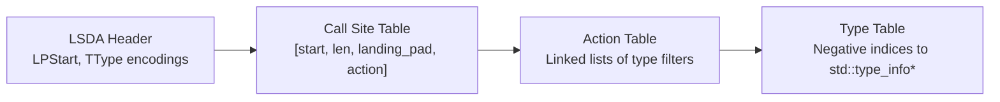

# Stack Unwinding, CFI, and Exception ABI

> [!summary] Claim:
> Stack unwinding traverses active call frames using either hardware register linked lists or out-of-band metadata tables.
> Frame pointer chaining (`-fno-omit-frame-pointer`) provides instant, async-signal-safe $O(K)$ stack walks at the cost of one dedicated register and typically 1-2% CPU overhead (up to 10% on CPython benchmarks, per the Fedora 38 change proposal).
> Table-based unwinding trades zero instruction overhead on normal execution paths for substantial read-only metadata bloat and microsecond-scale throw latencies.
> Linux packages DWARF Call Frame Information into `.eh_frame` indexed by `.eh_frame_hdr`, macOS encodes compact bitfields into `__TEXT,__unwind_info`, and both drive the Itanium two-phase unwinding state machine (`_Unwind_RaiseException`).



## The Mechanism

Stack unwinding is the algorithmic process of recovering the sequence of active execution contexts (call frames) starting from the current program counter and stack pointer back to the thread entry point.
Two opposing architectural philosophies govern stack traversal in modern operating systems: synchronous/asynchronous hardware register chaining and out-of-band table metadata interpretation.
[[Calling-Conventions-System-V-AMD64-and-AAPCS64]] establishes the low-level register roles and stack layouts that make these unwinding schemes possible.

### 1. Frame Pointer Chaining (`-fno-omit-frame-pointer`)

Hardware frame pointer chaining maintains an explicit, singly-linked list of stack frames in memory at runtime.
On x86-64, the standard base pointer register is `%rbp`.
When a non-leaf function sets up a frame, it executes the classic two-instruction prologue:

```asm
pushq   %rbp
movq    %rsp, %rbp
```

The stack layout of an established frame places the caller's saved `%rbp` at address `(%rbp)` and the return address at `8(%rbp)`.
An unwinder dereferences `%rbp` to reach the caller's frame pointer, reading the return address immediately above it.
The epilogue reverses this sequence using `leave` (equivalent to `movq %rbp, %rsp; popq %rbp`) followed by `ret`.

On AArch64 (AAPCS64), register `x29` serves as the frame pointer (FP), while `x30` acts as the link register (LR).
Because function calls execute `bl` (branch with link) without pushing to the stack, the function prologue saves both registers as an aligned 16-byte pair:

```asm
stp     x29, x30, [sp, #-16]!
mov     x29, sp
```

The memory layout mirrors x86-64: `*(void**)x29` stores the caller's frame pointer, and `*((void**)x29 + 1)` stores the caller's return address.
Walking the stack via frame pointers requires only pointer dereferences:

```c
void **fp = (void **)__builtin_frame_address(0);
while (fp != NULL) {
    void *return_address = fp[1];
    void **next_fp = (void **)fp[0];
    if (next_fp <= fp) {
        break;
    }
    fp = next_fp;
}
```

The primary advantages of frame pointer unwinding are algorithmic simplicity and safety.
A frame pointer walk runs in strictly bounded $O(K)$ instructions for a call stack of depth $K$.
It executes zero memory allocations, requires no file parsing or complex table decoding, and never faults if memory pages are present.
Consequently, frame pointer walks are fully async-signal-safe and safe to execute inside non-maskable interrupt (NMI) perf handlers and eBPF tracing programs.

The primary disadvantage is runtime cost.
Retaining the frame pointer consumes one general-purpose register (`%rbp` on x86-64).
On register-constrained code paths (such as the CPython interpreter loop or dense linear algebra routines), reserving `%rbp` increases register spills to stack memory; the Fedora 38 measurements show CPython benchmarks 1-10% slower with frame pointers.
Upstream GCC enables `-fomit-frame-pointer` at `-O1` and above on x86-64 to reclaim `%rbp` (as of 2026-11), which breaks hardware stack walking whenever a frameless function executes.

### 2. DWARF Call Frame Information (CFI) in `.eh_frame`

DWARF Call Frame Information (CFI) eliminates the runtime register tax by shifting frame reconstruction into static metadata tables.
Defined in Chapter 6.4 of the DWARF 5 specification, CFI conceptually models call stack state as an abstract matrix.
The rows represent machine instruction addresses (PCs).
The columns represent the Canonical Frame Address (CFA) and the saved locations of all architectural registers.

The Canonical Frame Address (CFA) is defined as the value of the stack pointer (`%rsp` on x86-64, `sp` on AArch64) in the calling frame immediately before the call instruction was executed.
At function entry on x86-64, the `call` instruction has pushed the 8-byte return address.
The stack pointer has decreased by 8 bytes, making the CFA equal to `%rsp + 8`.
The return address is stored at `CFA - 8`.
If the function executes `pushq %rbp`, the stack pointer moves down another 8 bytes, making CFA equal to `%rsp + 16`.
Once `movq %rsp, %rbp` executes, the CFA rule transitions to `%rbp + 16`.
From that instruction onward, dynamic stack allocations (`alloca` or variable-length arrays) that alter `%rsp` do not alter the CFA calculation.

CFI matrices are compressed into two data structures in the ELF `.eh_frame` section:
1. **Common Information Entry (CIE):** Defines shared architecture characteristics, including code alignment factor, data alignment factor, return address column, and an augmentation string.
2. **Frame Description Entry (FDE):** Defines the PC range (`initial_location` and `address_range`) for a single function and contains a stream of bytecode instructions describing transitions in the CFA and register rules.

The CIE augmentation string dictates optional runtime pointers:
- `'z'`: Indicates the presence of an augmentation data length field.
- `'P'`: Encodes a pointer to the language personality routine (`__gxx_personality_v0`).
- `'R'`: Specifies the pointer encoding used for FDE initial location addresses.
- `'L'`: Specifies the pointer encoding for the Language Specific Data Area (LSDA).

Common DWARF CFI bytecodes include:
- `DW_CFA_def_cfa (register, offset)`: Defines the CFA rule as `register + offset`.
- `DW_CFA_def_cfa_offset (offset)`: Updates the CFA offset while keeping the current base register.
- `DW_CFA_def_cfa_register (register)`: Updates the CFA base register while preserving the offset.
- `DW_CFA_offset (register, offset)`: Specifies that the previous value of `register` is saved at address `CFA + (offset * data_alignment_factor)`.
- `DW_CFA_advance_loc (delta)`: Advances the virtual instruction address by `delta * code_alignment_factor`.
- `DW_CFA_remember_state` / `DW_CFA_restore_state`: Pushes or pops the register rule set onto an internal unwinder stack.

While `.debug_frame` is non-allocable and stripped during release packaging, `.eh_frame` carries the `SHF_ALLOC` flag and is loaded into virtual memory via the `PT_LOAD` program header.
Stripping `.eh_frame` renders C++ exceptions, thread cancellation, and `_Unwind_Backtrace` completely inoperable.

### 3. Fast Indexing via `.eh_frame_hdr` (`PT_GNU_EH_FRAME`)

Linear scanning of `.eh_frame` to locate an FDE for an arbitrary PC requires $O(N)$ operations across all functions in an executable or shared library.
To prevent catastrophic exception latency, ELF static linkers (GNU `ld.bfd` and `gold`, LLVM `lld`, and `mold`) synthesize an auxiliary indexing section named `.eh_frame_hdr` when given `--eh-frame-hdr`, which the GCC and Clang drivers pass by default on Linux.
The static linker also emits an ELF program header of type `PT_GNU_EH_FRAME` (flags `PF_R`) covering `.eh_frame_hdr`; at run time the unwinder finds it through `dl_iterate_phdr` or, with glibc 2.35 and later, the lock-free `_dl_find_object`.

The binary format of `.eh_frame_hdr` conforms strictly to the Linux Standard Base Core Specification:

```c
struct eh_frame_hdr {
    uint8_t version;            /* Always 1 */
    uint8_t eh_frame_ptr_enc;   /* DWARF pointer encoding for eh_frame_ptr */
    uint8_t fde_count_enc;      /* DWARF pointer encoding for fde_count */
    uint8_t table_enc;          /* DWARF pointer encoding for table entries */
    /* Encoded pointer to the start of .eh_frame (typically DW_EH_PE_pcrel | DW_EH_PE_sdata4) */
    int32_t eh_frame_ptr;
    /* Encoded count of entries in the binary search table (typically DW_EH_PE_udata4) */
    uint32_t fde_count;
    /* Binary search table of sorted pairs */
    struct {
        int32_t initial_loc;    /* Function start address (DW_EH_PE_datarel | DW_EH_PE_sdata4) */
        int32_t fde_ptr;        /* Pointer to FDE in .eh_frame (DW_EH_PE_datarel | DW_EH_PE_sdata4) */
    } table[fde_count];
};
```

Because the binary search table is strictly sorted in ascending order of `initial_loc`, an unwinder locates the FDE covering any instruction address in $O(\log N)$ comparisons using bisection search.
libgcc's `find_fde_tail` (`libgcc/unwind-dw2-fde-dip.c`, GCC 13) uses the table only when `fde_count_enc` is not `DW_EH_PE_omit` (`0xff`) and `table_enc` is exactly `DW_EH_PE_datarel | DW_EH_PE_sdata4`.
Otherwise it falls back to `linear_search_fdes`, an $O(N)$ scan of `.eh_frame`.

### 4. macOS Compact Unwinding (`__TEXT,__unwind_info`)

macOS Darwin architectures bypass DWARF parsing during standard unwinding by generating a compact unwind format.
Compilers on Darwin output an intermediate `__LD,__compact_unwind` section in relocatable object files (`.o`).
Each record in `__LD,__compact_unwind` occupies 32 bytes on 64-bit architectures:
- `range-start` (8 bytes): Pointer to the beginning of the function or code fragment.
- `range-length` (4 bytes): Unsigned 32-bit integer length of the range.
- `compact-unwind-encoding` (4 bytes): Architecture-specific 32-bit compact bitfield.
- `personality-function` (8 bytes): Pointer to personality routine, or zero if none.
- `lsda` (8 bytes): Pointer to the Language Specific Data Area, or zero if none.

During final linking, the Darwin linker (`ld64` or `lld`) strips `__LD,__compact_unwind` and synthesizes the two-level hierarchical lookup structure `__TEXT,__unwind_info`.
The format is governed by `mach-o/compact_unwind_encoding.h`.

The top-level header `struct unwind_info_section_header` defines:
- `version`: Unwind section version, currently set to 1.
- `commonEncodingsArraySectionOffset` and `commonEncodingsArrayCount`: Table of common 32-bit encodings reused across the image (capped at 127 entries: the compressed-page encoding index is 8 bits, indexes 0 to 126 are common, and 127 to 255 are local to each page, per `COMMON_ENCODINGS_MAX` in lld's `UnwindInfoSection.cpp`).
- `personalityArraySectionOffset` and `personalityArrayCount`: Table of unique 32-bit offsets to personality function pointers.
- `indexSectionOffset` and `indexCount`: Array of `struct unwind_info_section_header_index_entry` structures.

The first-level index breaks code memory into coarse ranges mapping to second-level 4096-byte pages.
Each index entry contains:
- `functionOffset` (4 bytes): Starting function offset relative to Mach-O `__TEXT` segment base.
- `secondLevelPagesSectionOffset` (4 bytes): Offset to the second-level page.
- `lsdaIndexArraySectionOffset` (4 bytes): Offset to the accompanying LSDA index array.

Second-level pages exist in two distinct formats:
1. **Regular Second-Level Page (`UNWIND_SECOND_LEVEL_REGULAR` = 2):** Holds up to 511 entries of `struct unwind_info_regular_second_level_entry`, where each entry is an explicit pair of `functionOffset` (4 bytes) and `encoding` (4 bytes).
2. **Compressed Second-Level Page (`UNWIND_SECOND_LEVEL_COMPRESSED` = 3):** Holds up to 1021 entries.
   Each entry is a single 32-bit value where the upper 8 bits store an encoding index and the lower 24 bits store the function offset relative to the page base.

The 32-bit compact unwind encoding bitfield unpacks as follows:
- Bit 31 (`UNWIND_IS_NOT_FUNCTION_START`): Set if the entry represents an internal range rather than the prologue.
- Bit 30 (`UNWIND_HAS_LSDA`): Set if an accompanying LSDA record exists.
- Bits 29-28 (`UNWIND_PERSONALITY_MASK`): A 2-bit 1-based index selecting the personality function.
- Bits 27-24 (`UNWIND_MODE_MASK`): Architecture unwinding mode.

On x86-64, the modes are:
- `UNWIND_X86_64_MODE_RBP_FRAME` (`0x01000000`): Standard frame-pointer function.
  Bits 23-16 encode the offset/8 of the save area below `%rbp` (`UNWIND_X86_64_RBP_FRAME_OFFSET`), and bits 14-0 (`UNWIND_X86_64_RBP_FRAME_REGISTERS`) hold five 3-bit entries, each naming one saved register; the Lehmer-code permutation is used only by the frameless modes.
- `UNWIND_X86_64_MODE_STACK_IMMD` (`0x02000000`): Frameless function with stack allocation $\le 2048$ bytes.
- `UNWIND_X86_64_MODE_STACK_IND` (`0x03000000`): Frameless function with large stack allocation where the stack size is encoded directly in a prologue `subq $imm32, %rsp` instruction.
- `UNWIND_X86_64_MODE_DWARF` (`0x04000000`): Fallback flag indicating the function cannot be represented in 32 bits.
  The low 24 bits encode the direct offset of the DWARF FDE in `__TEXT,__eh_frame`.

On ARM64, the modes are:
- `UNWIND_ARM64_MODE_FRAMELESS` (`0x02000000`): Leaf function with no saved FP/LR.
- `UNWIND_ARM64_MODE_DWARF` (`0x03000000`): Fallback to DWARF FDE in `__TEXT,__eh_frame`.
- `UNWIND_ARM64_MODE_FRAME` (`0x04000000`): Standard frame where FP/LR are pushed together.
  Bits 4-0 flag the saved X19-X28 pairs and bits 11-8 flag the saved D8-D15 pairs (`UNWIND_ARM64_FRAME_X19_X20_PAIR` = `0x1` through `UNWIND_ARM64_FRAME_D14_D15_PAIR` = `0x800`).
- `UNWIND_ARM64_MODE_FRAME_PAUTH_LR` (`0x05000000`): Arm64e prologue where LR is cryptographically signed via `pacibsppc` prior to push.

This two-level hierarchy allows macOS `libunwind` to resolve unwinding instructions using bitwise shifts and masks, avoiding DWARF bytecode execution for every function the compact encoding can describe.

### 5. Itanium Two-Phase Exception Unwinding

The Itanium C++ ABI specification defines the cross-language exception unwinding protocol implemented on Linux, macOS, Android, and BSD.
The protocol separates language-independent stack traversal (Level I Base ABI, prefixed with `_Unwind_*`) from language-specific exception matching (Level II C++ ABI, prefixed with `__cxa_*`).
Exceptions execute through a strict two-phase stack traversal.

#### Level I: The Base Unwind API
The low-level unwinder interface manages execution contexts using opaque `struct _Unwind_Context` pointers:
- `_Unwind_RaiseException(struct _Unwind_Exception *exception_object)`: Initiates the two-phase unwinding process.
- `_Unwind_Resume(struct _Unwind_Exception *exception_object)`: Resumes Phase 2 unwinding after executing a cleanup landing pad.
- `_Unwind_GetIP(context)` / `_Unwind_SetIP(context, new_value)`: Reads or overrides the instruction pointer in the target frame.
- `_Unwind_GetGR(context, index)` / `_Unwind_SetGR(context, index, new_value)`: Reads or modifies general-purpose registers in the restored context.

Exceptions are identified by the generic header `struct _Unwind_Exception`:

```c
typedef void (*_Unwind_Exception_Cleanup_Fn)(_Unwind_Reason_Code reason, struct _Unwind_Exception *exc);

struct _Unwind_Exception {
    uint64_t exception_class;               /* 8-byte vendor/language identifier, e.g. "GNUCC++\0" */
    _Unwind_Exception_Cleanup_Fn exception_cleanup; /* Deallocation callback */
    uint64_t private_1;                     /* Unwinder internal scratchpad */
    uint64_t private_2;                     /* Unwinder internal scratchpad */
};
```

The unwinder interacts with compilers via the language personality routine.
Its function pointer is stored in the CIE augmentation data:

```c
_Unwind_Reason_Code (*__personality_routine)(
    int version,
    _Unwind_Action actions,
    uint64_t exceptionClass,
    struct _Unwind_Exception *exceptionObject,
    struct _Unwind_Context *context
);
```

The `actions` parameter is a bitmask carrying state flags:
- `_UA_SEARCH_PHASE` (`0x01`): Indicates Phase 1 execution.
- `_UA_CLEANUP_PHASE` (`0x02`): Indicates Phase 2 execution.
- `_UA_HANDLER_FRAME` (`0x04`): Passed during Phase 2 when the frame contains the target catch handler identified in Phase 1.
- `_UA_FORCE_UNWIND` (`0x08`): Passed during thread cancellation or `longjmp` unwinding.

#### Phase 1: Search Phase
When user code executes `throw`, the C++ runtime invokes `__cxa_throw`, which calls `_Unwind_RaiseException`.
`_Unwind_RaiseException` begins Phase 1:
1. It queries the active PC, looks up the FDE via `.eh_frame_hdr` or `__unwind_info`, and determines if a personality routine exists.
2. It invokes the personality routine with `actions = _UA_SEARCH_PHASE`.
3. The personality routine parses the function's Language Specific Data Area (LSDA) to evaluate whether the current PC is covered by a call-site entry with an active catch handler matching the thrown exception type.
4. If a catch block matches, the personality routine returns `_URC_HANDLER_FOUND`.
   The unwinder records the target frame and terminates Phase 1.
5. If no catch block matches, the personality routine returns `_URC_CONTINUE_UNWIND`.
   The unwinder restores caller registers and repeats the search on the next stack frame.
6. If the unwinder reaches the top of the stack without discovering a matching handler, `_Unwind_RaiseException` returns `_URC_END_OF_STACK`.
   The runtime immediately invokes `std::terminate()`.
   Crucially, because Phase 1 found no handler, Phase 2 is never entered, and zero stack destructors are executed.
   ISO C++ ([except.terminate]) leaves it implementation-defined whether the stack is unwound before `std::terminate` when no handler exists; the Itanium two-phase design is what makes the answer "not unwound" on these platforms.

#### Phase 2: Cleanup Phase
If Phase 1 finds a handler, `_Unwind_RaiseException` resets its internal traversal state and begins Phase 2 at the leaf frame:
1. It steps through each frame, invoking the personality routine with `actions = _UA_CLEANUP_PHASE`.
2. If the frame contains non-trivial cleanups (RAII object destructors), the personality routine inspects the LSDA for a cleanup landing pad.
3. The personality routine writes the exception pointer into architectural register 0 (e.g. `%rax` on x86-64, `x0` on AArch64) via `_Unwind_SetGR`.
4. It writes an exception selector value into architectural register 1 (e.g. `%rdx` on x86-64, `x1` on AArch64) via `_Unwind_SetGR`.
5. It overrides the frame's instruction pointer with the landing pad address via `_Unwind_SetIP`.
6. The personality routine returns `_URC_INSTALL_CONTEXT`.
7. `_Unwind_RaiseException` restores all architectural registers according to the unwinding rules and executes an indirect jump to the landing pad.
8. The landing pad code runs the local object destructors in reverse order of construction.
9. If the frame was performing cleanups without a catch block, the landing pad invokes `_Unwind_Resume`, handing control back to the unwinder to continue Phase 2 for outer frames.
   `_Unwind_Resume` starts that pass at the frame that made the `_Unwind_Resume` call, so the personality routine is queried once more for that same frame (GCC 13 `libgcc/unwind.inc`); the call site has no landing pad, so it returns `_URC_CONTINUE_UNWIND`.
10. When Phase 2 reaches the frame holding the matching handler, the personality routine is called with `_UA_CLEANUP_PHASE | _UA_HANDLER_FRAME`.
    It transfers control directly to the `catch` block landing pad.
    The landing pad calls `__cxa_begin_catch` to obtain the exception object and complete the dispatch.

### 6. Language Specific Data Area (LSDA) Anatomy

The Language Specific Data Area (LSDA) is emitted by the compiler into `.gcc_except_table` for any function requiring cleanups or exception catching.
Its internal structure consists of four contiguous segments:



1. **LSDA Header:**
   - `lpstart_format`: DWARF pointer encoding format for landing pad bases.
     If omitted (`DW_EH_PE_omit`), the function start address acts as the landing pad base.
   - `ttype_format`: DWARF pointer encoding for type table entries.
   - `ttype_base_offset`: ULEB128 offset pointing to the end of the Type Table.
   - `call_site_format`: DWARF pointer encoding format for call site start/length entries.
   - `call_site_table_length`: ULEB128 byte length of the Call Site Table.

2. **Call Site Table:**
   An ordered array of variable-length call site records mapping code ranges:
   - `cs_start`: Byte offset from the function start (`_Unwind_GetRegionStart`, not `LPStart`) marking the start of a protected region; GCC 13.3 emits it as `.uleb128 .LEHB0-.LFB<n>`, measured in the lab container.
   - `cs_len`: Byte length of the protected region.
   - `cs_lp`: Offset from `LPStart` to the landing pad code.
     If zero, no exception handling or cleanup is required for exceptions escaping this instruction range.
   - `cs_action`: Byte offset into the Action Table plus one.
     A value of zero indicates a pure cleanup action with no type filters.

3. **Action Table:**
   A chained list of records encoding type filter actions:
   - `action_filter`: Signed LEB128 (SLEB128).
     A positive value is a 1-based index into the Type Table representing a `catch` type.
     A zero value represents a cleanup handler.
     A negative value is an index into an exception specification list.
   - `action_next`: Signed LEB128 (SLEB128).
     Relative byte offset to the next action record in the chain, or zero to terminate the chain.

4. **Type Table:**
   An array of pointers to `std::type_info` RTTI metadata.
   Crucially, the Type Table is indexed negatively from `ttype_base_offset`.
   Filter index 1 addresses the entry at `ttype_base - size`, and filter index 2 the entry at `ttype_base - 2 * size`, where `size` is the width of one entry under `ttype_format`, not `sizeof(void*)`.
   GCC 13.3 emits `ttype_format` = `0x9b` (`DW_EH_PE_indirect | DW_EH_PE_pcrel | DW_EH_PE_sdata4`), so each entry is a 4-byte PC-relative offset to a pointer, measured in the lab container (linux-aarch64).
   A null pointer in the Type Table represents a catch-all block (`catch (...)`).
   The matching algorithm compares the thrown type against these descriptors using `std::type_info::__do_catch`, which handles inheritance and pointer conversions as detailed in [[Cpp-Itanium-ABI-Object-Model-Vtables-and-RTTI]].

### 7. Asynchronous Unwind Tables and Compiler Flags

The precision of generated `.eh_frame` tables is determined by two orthogonal compiler flags:
1. `-fexceptions`: Instructs the compiler to emit `.gcc_except_table` (LSDA) and link personality routines for functions containing `try`/`catch` blocks or non-trivial RAII destructors.
   In GCC and Clang, C++ defaults to `-fexceptions`, whereas C defaults to `-fno-exceptions`.
2. `-fasynchronous-unwind-tables`: Instructs the compiler to emit CFI records that are exact at **every instruction boundary** (GCC manual: "exact at each instruction boundary, so it can be used for stack unwinding from asynchronous events").
   Without asynchronous tables (`-fno-asynchronous-unwind-tables`), CFI records are only guaranteed to be accurate at **call sites** where a synchronous call or throw can occur.

The interaction of these flags produces four distinct operational profiles:

| Compiler Options | `.eh_frame` Emitted | `.gcc_except_table` Emitted | Behavioral Characteristics |
| :--- | :--- | :--- | :--- |
| `-fasynchronous-unwind-tables`<br/>`-fexceptions` | Yes (Instruction-exact) | Yes | Full C++ exception handling. Guarantees accurate backtraces from asynchronous signals, page faults, and hardware interrupts. Default for C++ on Linux x86-64. |
| `-fno-asynchronous-unwind-tables`<br/>`-fexceptions` | Yes (Call-site exact) | Yes | Standard synchronous C++ exceptions work correctly. Stack unwinding from asynchronous signals or traps inside function bodies can fail or corrupt register state. No size saving appeared in GCC 13.3: under `-fexceptions`, `.eh_frame` was the same size with and without `-fasynchronous-unwind-tables` for the lab's `two_phase.cpp` (296 bytes on aarch64, 368 on x86-64) and for a 300-function synthetic C file (20,440 bytes on aarch64, 13,248 on x86-64), so do not budget a saving from this flag alone (measured on Linux, as of 2026-11). |
| `-fasynchronous-unwind-tables`<br/>`-fno-exceptions` | Yes (Instruction-exact) | No | Debuggers, `perf`, and profilers can unwind stacks across all instruction boundaries. No language exception overhead. If an external C++ exception propagates through this frame, no local destructors execute. Default for C on Linux x86-64. |
| `-fno-asynchronous-unwind-tables`<br/>`-fno-exceptions` | No (unless `-g` emits `.debug_frame`), but on AArch64 GCC also needs `-fno-unwind-tables`, because `-funwind-tables` is on by default there (measured, GCC 13.3) | No | Minimal binary footprint. Stack unwinding is impossible without hardware frame pointers. The Linux kernel's x86 build passes `-fno-asynchronous-unwind-tables` (`arch/x86/Makefile`, read 2026-11-07). |

## Commands and Numbers to Know

The operational metrics and defaults governing stack unwinding on modern systems are summarized below.

| Metric or Parameter | Value | Target Platform | Description and Context |
| :--- | :--- | :--- | :--- |
| x86-64 Frame Pointer Default | Compiler: `-fomit-frame-pointer` at `-O1`+<br/>Distro packages: `-fno-omit-frame-pointer -mno-omit-leaf-frame-pointer` (as of 2026-11) | Linux | Upstream GCC still omits at `-O1` and above. Fedora 38+ adds the two flags through `redhat-rpm-config` package build flags, not the compiler default; Ubuntu 24.04+ rebuilds 64-bit packages with frame pointers. |
| AArch64 Frame Pointer Default | Non-leaf: `x29` kept; leaf: omitted (`-momit-leaf-frame-pointer`) | Linux | GCC's AArch64 backend default: at plain `-O2`, GCC 13.3 (Ubuntu 24.04) keeps the `x29` frame record in non-leaf functions and drops it in leaves, even though `-Q --help=common` reports `-fomit-frame-pointer [enabled]` (measured, as of 2026-11). |
| Default Unwind Tables | GCC: `-fasynchronous-unwind-tables` on both; `-funwind-tables` on AArch64 only<br/>Clang: `uwtable` (asynchronous) on Linux x86-64 and AArch64, `uwtable(sync)` on arm64 macOS | Both | `gcc -O2 -Q --help=common` with GCC 13.3: AArch64 reports both flags enabled, x86-64 reports `-fasynchronous-unwind-tables` enabled and `-funwind-tables` disabled. Apple clang 21 `-S -emit-llvm` for each target triple emitted the quoted attribute; a bare `uwtable` means `async` per the LLVM LangRef (all measured, as of 2026-11). |
| `.eh_frame_hdr` Format Version | `1` | Linux | Fixed format version byte at offset 0 in `.eh_frame_hdr` (as of 2026-11, Linux). |
| `__unwind_info` Format Version | `1` | macOS | Fixed format version integer at offset 0 in Mach-O `__TEXT,__unwind_info` (as of 2026-11, macOS). |
| Max Compressed Page Entries | `1021` | macOS | Maximum number of 32-bit compact entries in a Darwin compressed second-level unwind page (as of 2026-11, macOS). |
| Max Regular Page Entries | `511` | macOS | Maximum number of 64-bit entries in a Darwin regular second-level unwind page (as of 2026-11, macOS). |
| Exception Throw Latency | `~3,700 ns` (Linux)<br/>`~21,000 ns` (macOS) | Both | Median wall-clock cost to throw, unwind 10 `noinline` frames, and catch, `-O2`: GCC 13.3 in the Ubuntu 24.04 linux-aarch64 lab container on Apple silicon, and Apple clang 21 on darwin-arm64 (measured 2026-11-07, one host, as of 2026-11); x86-64 not measured. |
| Error Code Return Latency | `~6 ns` per 10 frames | Both | Median cost of returning an integer code through the same 10 `noinline` frames, under 1 ns per frame, on both hosts above (measured, as of 2026-11). |
| Metadata Size Overhead | `8%` to `22%` of `.text` | Linux | `.eh_frame` + `.eh_frame_hdr` + `.gcc_except_table` over nine Ubuntu 24.04 binaries per architecture (libstdc++, libc, libm, libgcc_s, cc1plus, cc1, gdb, python3.12, ld.bfd): 12.0% to 21.8% of `.text` on arm64 and 7.8% to 19.8% on x86-64, which is 1.8% to 12.3% and 2.1% to 10.0% of the file size; libstdc++.so.6.0.33 on arm64 is 286,120 bytes against 1,309,596 bytes of `.text`, 22% (measured, as of 2026-11). |
| SFrame Support in Binutils | `--gsframe` (gas); `--sframe` dump option (readelf, objdump) | Linux | Introduced in GNU Binutils 2.40; the format is at version 3 and covers AMD64, AArch64, and s390x. GNU ld 2.42 has no SFrame option (measured, as of 2026-11). |

## Multi-Language Comparison

Exception models and unwinding guarantees differ fundamentally across modern compiled and interpreted language runtimes.

| Language | Primary Unwinding Mechanism | Unwinding Execution Model | Binary Size Tax | Failure Path Latency | Async Profiler Unwinding Support |
| :--- | :--- | :--- | :--- | :--- | :--- |
| **C++** | DWARF CFI (`.eh_frame`) & Itanium ABI (`_Unwind_RaiseException`) | Zero-cost happy path; two-phase table-driven search and cleanup on throw | 8% to 22% of `.text` for `.eh_frame`, `.eh_frame_hdr`, and LSDA across nine Ubuntu 24.04 binaries (measured) | Microsecond scale (about 3.7 us on Linux aarch64 and 21 us on macOS arm64 for a 10-frame throw, measured) | Perfect with `.eh_frame` or frame pointers; broken if tables and FP omitted |
| **Rust** | DWARF CFI (`panic = "unwind"`) or Abort (`panic = "abort"`) | Unwinding panic calls `_Unwind_RaiseException` with Rust personality `rust_eh_personality` | Unwind tables plus LSDA; `-C panic=abort` terminates on panic instead of unwinding, and unwind tables are controlled separately by `-C force-unwind-tables`, whose default depends on the target | About 37 us for a panic caught by `catch_unwind` through 10 frames (rustc 1.99 `-O`, macOS arm64, measured 2026-11-07); no unwinding with `-C panic=abort` | Full support via `.eh_frame`; Rust emits its own LSDA in `.gcc_except_table`, but no C++ RTTI type matching |
| **Go** | Custom runtime stack maps (`pclntab`) | Co-operative goroutine stack walking via compiler-generated PC-value tables | Runtime symbol and PC-line tables | About 283 ns for `panic` plus `recover` through 10 frames, against about 10 ns for returning through the same frames (go1.27.3, macOS arm64, measured 2026-11-07) | Go runtime handles internally; Go has kept frame pointers on amd64 since Go 1.7 (and on arm64 Linux), so perf and eBPF frame-pointer walkers work without a custom unwinder |
| **Python** | Frame object linked list (`PyFrameObject` / `_PyInterpreterFrame`) | Interpreted stack unwinding via eval loop exception checks | No unwind tables for Python frames, which are interpreter data structures | About 709 ns for `raise` plus `except` through 10 frames, against about 177 ns for returning through the same frames (CPython 3.15.2, macOS arm64, measured 2026-11-07) | Native profilers see only `_PyEval_EvalFrameDefault`; requires PyPerf/eBPF Py unwinder |

## Worked Lab Example

The companion lab `code/00-Program-Execution/cfi_backtrace/` provides a fully reproducible environment demonstrating the differences between frame pointer chaining and DWARF CFI unwinding, inspecting `.eh_frame_hdr`, and proving the Itanium two-phase unwinding model.

### 1. Frame Pointer vs DWARF CFI Walk Comparison
The program `cfi_unwind.c` is plain C built with `gcc`; it builds an execution chain (`main` $\to$ `outer` $\to$ `middle` $\to$ `leaf`) and initiates backtraces using both manual frame pointer dereferences and `_Unwind_Backtrace`.
The frame pointer walk rejects any hop larger than 4096 bytes and stops at the first return address outside the four lab functions, so its count does not depend on what the C library leaves in the frame pointer register before `main`.

When compiled with `-O2 -fomit-frame-pointer`, GCC drops the frame pointer record from `middle`, `outer`, and `main`.
On aarch64 they save only `x30` (`str x30, [sp, #-16]!`), and on x86-64 they only adjust `%rsp` (`sub $0x8,%rsp`) without touching `%rbp`.
`leaf` still builds a frame record (`stp x29, x30, [sp, #48]; add x29, sp, #0x30` on aarch64, `push %rbp; mov %rsp,%rbp` on x86-64), because it reaches `__builtin_frame_address(0)` through the inlined `trace_fp` (disassembly checked in both lab containers).
The lab is recorded on linux-aarch64 (`expected/linux-aarch64.txt`) and linux-amd64 (`expected/linux-amd64.txt`, recorded in an amd64 container emulated on Apple silicon); the two files are byte-identical, so the `%rbp` form of every result below is proven as well.
The output blocks below are copied from `expected/linux-aarch64.txt`:

```text
=== 1. Frame Pointer vs DWARF CFI Unwinding ===
[*] Compiling with -O2 -fomit-frame-pointer...
  Trace results from leaf():
  -- DWARF CFI unwinding:
    [CFI] frame 0: leaf
    [CFI] frame 1: middle
    [CFI] frame 2: outer
    [CFI] frame 3: main
  -- Frame Pointer unwinding:
    [FP ] frame 0: middle
  Summary: CFI found 4 frames, FP found 1 frames
```

Under `-fomit-frame-pointer`, the frame pointer chain is severed after frame 0: `leaf`'s record yields the return address into `middle`, but its saved frame pointer is whatever the register held when `main` was entered, since `middle`, `outer`, and `main` never write it.
The next hop therefore does not reach a lab function, and the walk stops with a count of 1.
In contrast, DWARF CFI unwinding reads `.eh_frame` and successfully recovers all 4 stack frames.

When compiled with `-O2 -fno-omit-frame-pointer`, both unwinding mechanisms recover the entire call hierarchy; the frame pointer walk reports 3 frames because `leaf` itself is the starting frame and is not a return address:

```text
[*] Compiling with -O2 -fno-omit-frame-pointer...
  Trace results from leaf():
  -- DWARF CFI unwinding:
    [CFI] frame 0: leaf
    [CFI] frame 1: middle
    [CFI] frame 2: outer
    [CFI] frame 3: main
  -- Frame Pointer unwinding:
    [FP ] frame 0: middle
    [FP ] frame 1: outer
    [FP ] frame 2: main
  Summary: CFI found 4 frames, FP found 3 frames
```

### 2. Binary Inspection of `.eh_frame_hdr`
Running `parse_eh_frame_hdr.py` on the compiled binary decodes the header with plain `struct` parsing (no `readelf`) and exits non-zero if any check fails:

```text
=== 2. Inspecting .eh_frame_hdr Binary Search Index ===
  Header: version=1 eh_frame_ptr_enc=0x1b fde_count_enc=0x03 table_enc=0x3b
  Header is version 1 with the GCC and Clang encodings: True
  PT_GNU_EH_FRAME covers .eh_frame_hdr: True
  eh_frame_ptr resolves to the start of .eh_frame: True
  fde_count entries fit in the section: True
  Binary search table is strictly sorted by function start: True
  Every FDE pointer lands inside .eh_frame: True
  Every table entry equals the pc_begin of the FDE it points to: True
  leaf, middle, outer, and main are each indexed at their symbol address: True
```

The checks establish, for this binary:
- The header is version 1 with `eh_frame_ptr` encoded as `0x1b` (`DW_EH_PE_pcrel | DW_EH_PE_sdata4`), `fde_count` as `0x03` (`DW_EH_PE_udata4`), and the table as `0x3b` (`DW_EH_PE_datarel | DW_EH_PE_sdata4`).
- The `PT_GNU_EH_FRAME` program header covers exactly `.eh_frame_hdr`, and `eh_frame_ptr` resolves to the start of `.eh_frame`.
- The table size matches `fde_count`, and the entries are strictly sorted by function start, which is what makes binary search valid.
- Every entry points inside `.eh_frame`, and its start address equals the `pc_begin` of the FDE it points to, decoded through the CIE's `R` pointer encoding.
- `leaf`, `middle`, `outer`, and `main` each appear in the table at their `.symtab` address.

The number of FDEs is deliberately not printed, because it depends on the C runtime start files of the image.

### 3. Verification of Itanium Two-Phase Unwinding
The program `two_phase.cpp` is linked with `-Wl,--wrap=__gxx_personality_v0`, which redirects the personality reference in its own unwind tables to a wrapper that logs each call (its `_Unwind_Action` bits and its return code) and then runs the real routine.
This makes the two phases directly visible instead of inferred from destructor order.

In Scenario A (handled exception), Phase 1 asks `will_throw_caught` (no match, `_URC_CONTINUE_UNWIND`) and then `main` (`_URC_HANDLER_FOUND`) without running any destructor.
Phase 2 then starts again at the throwing function: the cleanup landing pad runs the RAII destructor, `_Unwind_Resume` queries the same frame once more (the extra `CLEANUP -> CONTINUE_UNWIND` line), and finally `main` is entered with `CLEANUP|HANDLER_FRAME`:

```text
=== 3. Itanium Two-Phase Exception Handling Verification ===
[*] Scenario A: Handled exception (Phase 1 finds catch block -> Phase 2 runs cleanups)
  [RAII] acquire: caught_scope
  [personality] SEARCH -> CONTINUE_UNWIND
  [personality] SEARCH -> HANDLER_FOUND
  [personality] CLEANUP -> INSTALL_CONTEXT
  [RAII] destruct: caught_scope
  [personality] CLEANUP -> CONTINUE_UNWIND
  [personality] CLEANUP|HANDLER_FRAME -> INSTALL_CONTEXT
  [catch] caught integer exception: 42
  [catch] personality calls: search=2 cleanup=3
```

In Scenario B (unhandled exception), Phase 1 asks both frames, finds no handler, and the runtime calls `std::terminate`.
No `CLEANUP` call is made (`cleanup=0`) and the local RAII destructor never runs:

```text
[*] Scenario B: Unhandled exception (Phase 1 finds no catch block -> Phase 2 never starts)
  [RAII] acquire: uncaught_scope
  [personality] SEARCH -> CONTINUE_UNWIND
  [personality] SEARCH -> CONTINUE_UNWIND
  [terminate] personality calls: search=2 cleanup=0
```


> [!warning] Pitfalls:
> 1. **Destructor Skipping on Uncaught Exceptions:** Because Itanium Phase 1 searches without running cleanups, an uncaught exception triggers `std::terminate()` immediately.
>    Local RAII destructors, lock releases, and file flushes in intermediate stack frames never execute, leading to resource leaks or corrupted external transaction state.
> 2. **Silent Destructor Elimination via `-fno-exceptions`:** Compiling intermediate shared libraries with `-fno-exceptions -fasynchronous-unwind-tables` allows C++ exceptions from downstream code to pass through without error.
>    However, because `-fno-exceptions` omits the LSDA (`.gcc_except_table`), the unwinder treats the frame as a transparent passthrough and skips all local destructors.
> 3. **Stripping `.eh_frame` from Binaries:** Running `strip -s` strips symbol tables and debug sections but correctly preserves `.eh_frame`.
>    However, custom linker scripts that `/DISCARD/` `.eh_frame`, or links without `--eh-frame-hdr`, leave the unwinder without tables or index, turning subsequent runtime exceptions into `std::terminate` (`--gc-sections` alone does not: a `-ffunction-sections -Wl,--gc-sections` build with GCC 13.3 still threw and caught on linux-aarch64 and linux-amd64, and the linker only dropped the FDEs of discarded functions, from 8 to 7 on aarch64 and from 8 to 6 on x86-64; measured).
> 4. **Exception Crossing `extern "C"` Boundaries:** Throwing a C++ exception across a C ABI boundary or a foreign language boundary (e.g., Python C-extensions or Rust without `extern "C-unwind"`) invokes undefined behavior if the intermediate frames lack valid unwind tables.
> 5. **No DWARF Unwinding in NMI / eBPF Context:** DWARF CFI cannot be decoded inside Linux NMI perf handlers or eBPF programs, because the tables and the user stack may live in pageable memory that cannot be faulted in from interrupt context.
>    The kernel therefore ships no in-NMI DWARF user-stack unwinder: `perf record --call-graph dwarf` copies raw user stack bytes into each sample and unwinds offline, and a frame-pointer walk that hits a non-resident page is simply truncated.

## At Scale

At massive scale (fleets of 10,000 to 500,000 servers), stack unwinding decisions fundamentally affect fleet power efficiency, fleet-wide observability, and operational debuggability.

### 1. The Observability Tax vs CPU Overhead
Historically, compiler teams enforced `-fomit-frame-pointer` to capture a small CPU throughput gain: usually under 1% in Brendan Gregg's Netflix tests, roughly 1-2% in Canonical's analysis, and 2-2.4% for kernel builds and Blender (up to 10% on CPython) in the Fedora 38 proposal.
In large-scale hyperscale infrastructure (such as Google and Meta), continuous fleet profiling via eBPF and Linux `perf` became mandatory for identifying optimization targets.
Profiling without frame pointers requires collecting raw stack memory samples and symbolication post-processing using DWARF CFI.
This approach introduces severe operational bottlenecks:
- In-kernel DWARF parsing is impossible due to memory safety, latency, and NMI page-fault constraints.
- Copying a raw user stack slice into every sample (8192 bytes by default for `perf record --call-graph dwarf`, per the perf-record man page) loads ring buffers and disk writes in proportion to the sample rate.
- Frame pointer walks read only saved frame pointers and return addresses, so the sampler records a trace without copying any stack memory.

Consequently, Meta builds all its libraries and executables with `-fno-omit-frame-pointer -mno-omit-leaf-frame-pointer` by default, and Google is reported to compile its critical software with frame pointers (both as stated in the Fedora 38 change proposal).
Fedora (starting in Fedora 38, through its RPM build flags) and Ubuntu (starting in Ubuntu 24.04 LTS, on 64-bit architectures) rebuild their package archives with frame pointers.
The decision rule is clear: trading a 1% CPU cycle optimization for blindness in production fleet observability is a net-negative operational trade-off.

### 2. The Cost of Zero-Cost Exceptions in Production
"Zero-cost" exceptions are only zero-cost when exceptions are not thrown.
In high-throughput distributed microservices, throwing an exception incurs severe tail-latency penalties:
- Allocating the exception header invokes `malloc` via `__cxa_allocate_exception`, risking lock contention on the global allocator heap.
- Two full stack walks must be executed by `_Unwind_RaiseException`, invalidating CPU instruction and data caches.
- The unwinder reads cold metadata pages (`.eh_frame`, `.gcc_except_table`), inducing minor page faults and TLB misses.
- RTTI type matching performs iterative string comparisons across shared library boundaries.

A single C++ exception thrown through 10 frames measured about 3,700 nanoseconds on Linux aarch64 (GCC 13.3) and about 21,000 nanoseconds on macOS arm64 (Apple clang 21), whereas returning an error code through the same 10 frames took about 6 nanoseconds (measured 2026-11-07, as of 2026-11).
If a high-throughput network service throws 100,000 exceptions per second for common validation failures (e.g., invalid HTTP headers or missing cache keys), the throws alone cost about 0.37 core-seconds per second at the Linux figure, more than a third of one core, and over two cores at the macOS figure, before cache and allocator side effects.
Engineers must enforce the rule: **Exceptions are exclusively for exceptional conditions; expected control flow failures must use value-based error types (`std::expected`, `absl::StatusOr`).**

### 3. Binary Size and Deployment Economics
In monorepo environments compiling tens of millions of lines of code, `.eh_frame` and `.gcc_except_table` take a material share of binary file size: the nine Ubuntu 24.04 binaries measured above carry 2% to 12% of their file size (8% to 22% of `.text`) in `.eh_frame`, `.eh_frame_hdr`, and `.gcc_except_table` (measured, as of 2026-11).
Applied linearly to a 1 GiB distributed binary, that share would be roughly 20 MiB to 125 MiB of unwinding tables (an extrapolation, not a measurement of a monorepo binary).
This bloat directly impacts:
- Container image build and transfer latency over internal container registries.
- VM cold startup times and disk read I/O during fleet rollout deployments.
- Page table memory usage in operating system kernel memory.

For binaries that strictly prohibit runtime C++ exceptions, organizations compile with `-fno-exceptions -fno-asynchronous-unwind-tables` combined with `-fno-omit-frame-pointer`, adding `-fno-unwind-tables` on AArch64, where GCC 13.3 otherwise still emits `.eh_frame` (measured).
This configuration removes LSDA and DWARF unwind tables from the code compiled that way; the linked binary still carries `.eh_frame` and `.eh_frame_hdr` from the C runtime start files (144 bytes of `.eh_frame` on aarch64 and 136 bytes on x86-64 for the lab's `cfi_unwind.c`, measured), and profiling fidelity comes from frame pointers.
Modern linkers and toolchains are adopting SFrame (`.sframe`) via GNU Binutils 2.40+ as a streamlined middle ground: providing simple, fast unwinding tables without DWARF bytecode complexity.

> [!tip] Practice Drill:
> Execute the hands-on verification drill in [[Drill-Program-Execution-Cross-DSO-Exception-and-RTTI-Failure]] to diagnose cross-DSO C++ exception slicing and symbol visibility failures across dynamic shared object boundaries.

## Interview Questions

> [!question] L5: What is the mechanical difference between `-fomit-frame-pointer` and `-fno-omit-frame-pointer`, and why does it affect `perf` backtraces?
>
> > [!success]- Answer
> > `-fno-omit-frame-pointer` instructs the compiler to reserve a dedicated architectural register (`%rbp` on x86-64, `x29` on AArch64) to maintain a linked list of call frames.
> > Each function prologue saves the caller's frame pointer and points the register to the saved location, placing the return address at a fixed offset immediately above it.
> > Tools like `perf` and eBPF walk this chain in $O(K)$ steps using simple memory dereferences.
> > When compiled with `-fomit-frame-pointer`, the compiler frees this register for general computation and omits frame setup.
> > Without a frame pointer, an unwinder cannot determine the caller's stack frame boundary or return address without reading and parsing external DWARF Call Frame Information (`.eh_frame`), which kernel-level profilers cannot safely do during interrupt context.

> [!question] L5: Predict the output: What happens when the following C++ code is executed, and why?
> 
> ```cpp
> #include <iostream>
> #include <exception>
> #include <unistd.h>
> 
> struct Guard {
>     ~Guard() { std::cout << "Destructed" << std::endl; }
> };
> 
> void worker() {
>     Guard g;
>     throw 100;
> }
> 
> int main() {
>     std::set_terminate([]() {
>         std::cout << "Terminated" << std::endl;
>         _exit(0);
>     });
>     worker();
>     return 0;
> }
> ```
>
> > [!success]- Answer
> > The output is exclusively:
> > `Terminated`
> > "Destructed" is never printed.
> > Under the Itanium C++ Exception ABI, exception handling executes in two distinct phases: Phase 1 (search phase) and Phase 2 (cleanup phase).
> > In Phase 1, `_Unwind_RaiseException` traverses the call stack looking for a matching `catch` block.
> > Because `main()` does not catch `int`, Phase 1 finishes with `_URC_END_OF_STACK` without finding any handler.
> > Because no handler was found, Phase 2 is never initiated.
> > The runtime directly calls `std::terminate()`.
> > Destructors are only executed during Phase 2; therefore, the destructor for `g` never runs.
> > Verified by running it with GCC 13.3 on linux-aarch64 and Apple clang 21 on darwin-arm64 (2026-11-07); ISO C++ leaves this implementation-defined, so the answer holds for Itanium-ABI platforms.

> [!question] L6: Walk through the byte-level structure and algorithmic purpose of `.eh_frame_hdr`.
>
> > [!success]- Answer
> > `.eh_frame_hdr` is an ELF section created by the linker and pointed to by the `PT_GNU_EH_FRAME` program header.
> > Its header consists of four 1-byte fields: `version` (always 1), `eh_frame_ptr_enc`, `fde_count_enc`, and `table_enc`.
> > These are followed by an encoded pointer to the `.eh_frame` section, an encoded count of entries (`fde_count`), and a sorted binary search table.
> > Each table entry is an 8-byte pair of 32-bit signed offsets: the function starting PC (relative to `.eh_frame_hdr`) and the offset to the corresponding FDE in `.eh_frame`.
> > Because the entries are sorted by starting PC, the unwinder executes an $O(\log N)$ binary search to locate the FDE for any instruction address, replacing an $O(N)$ linear parse of `.eh_frame`.

> [!question] L6: Explain how the Language Specific Data Area (LSDA) encodes catch matching and RAII cleanups.
>
> > [!success]- Answer
> > The LSDA (emitted in `.gcc_except_table`) contains a Header, a Call Site Table, an Action Table, and a Type Table.
> > When an exception occurs at a specific PC, the personality routine reads the Call Site Table to find the record whose half-open interval `[cs_start, cs_start + cs_len)`, measured from the function start, encloses the PC.
> > The call site record specifies a landing pad offset (`cs_lp`) and an action index (`cs_action`).
> > If `cs_action == 0`, the landing pad is a pure cleanup block that executes local destructors and calls `_Unwind_Resume`.
> > If `cs_action > 0`, it indexes into the Action Table.
> > The Action Table contains records with a signed type filter (`action_filter`) and a next-record offset (`action_next`).
> > A positive filter indexes into the Type Table (which stores `std::type_info*` descriptors using negative offsets from the table base).
> > The personality routine compares the thrown type against these descriptors.
> > If a match is found, control is dispatched to the landing pad; otherwise, the action chain is traversed until the chain terminates.

> [!question] L7: Debug this: A high-throughput C++ service experiences 50-millisecond latency spikes under bursty traffic, yet CPU usage is below 40%. Profiling reveals millions of calls to `_Unwind_RaiseException`. What is the root cause and remediation?
>
> > [!success]- Answer
> > The service is using C++ exceptions for expected validation or control-flow logic (such as invalid user input, malformed JSON fields, or cache misses).
> > Table-based zero-cost exceptions have zero instruction overhead on the happy path, but the failure path is extraordinarily expensive.
> > Throwing an exception invokes `__cxa_allocate_exception` (which can contend on heap allocator locks), executes two full stack walks across multiple frames, searches `.eh_frame_hdr` tables, parses DWARF bytecodes, and compares RTTI type strings.
> > Furthermore, unwinding tables are cold in memory, causing TLB misses and page faults.
> > While CPU utilization appears moderate, worker threads block on allocator locks and, with glibc before 2.35, on the global loader lock that `dl_iterate_phdr` takes for every FDE lookup; glibc 2.35 added the lock-free `_dl_find_object`, which libgcc and LLVM libunwind use when present.
> > The remediation is to refactor all operational validation and expected error paths to use value-based error types like `std::expected` or `absl::StatusOr`, reserving exceptions strictly for unrecoverable errors.

> [!question] L7: How does macOS compact unwinding (`__TEXT,__unwind_info`) differ from Linux `.eh_frame`, and how does it handle functions that cannot be represented compactly?
>
> > [!success]- Answer
> > macOS compact unwinding encodes stack frame reconstruction into fixed 32-bit bitfields rather than variable-length DWARF bytecode streams.
> > The linker (`ld64`) reads `__LD,__compact_unwind` from object files and builds `__TEXT,__unwind_info`.
> > It formats this into a two-level page hierarchy: a first-level index mapping address ranges to 4 KiB second-level pages (either regular with 511 entries or compressed with up to 1021 entries).
> > The 32-bit compact encoding specifies the framing mode (e.g., standard RBP/FP frame, frameless with immediate stack size, frameless with indirect prologue scan) and saved register bitmasks.
> > Unwinding is performed with fast bitwise shifts and additions without running a DWARF virtual machine.
> > If a function has a complex prologue or non-standard register layout that cannot be encoded in 32 bits, the linker sets the mode to `DWARF` (`UNWIND_X86_64_MODE_DWARF` or `UNWIND_ARM64_MODE_DWARF`).
> > In this mode, the low 24 bits of the compact encoding store a direct section offset to a standard DWARF FDE in `__TEXT,__eh_frame`, providing a seamless fallback.

> [!question] L8+: An engineering organization wants to eliminate frame pointers across their entire monorepo to save 1% CPU overhead, arguing that `.eh_frame` already exists: why is this reasoning flawed for continuous profiling and eBPF observability?
>
> > [!success]- Answer
> > The reasoning confuses synchronous compiler-driven unwinding with asynchronous out-of-process sampling profilers.
> > First, eBPF programs run in kernel context under strict real-time constraints and cannot execute unbounded loops or complex DWARF bytecode interpreters.
> > Second, DWARF unwinding requires reading user-space memory tables that may not be resident in physical RAM.
> > An NMI or hardware timer interrupt cannot service page faults, so the kernel's non-faulting user copy fails and the sample is truncated.
> > Third, copying raw stack memory to userspace to perform DWARF unwinding post-hoc creates ring-buffer and disk bandwidth proportional to the sample rate times the stack slice (8192 bytes per sample by default), a cost that the roughly 1-2% CPU saved by omitting frame pointers does not account for.
> > Fourth, JIT runtimes (Java, V8, Julia) frequently do not emit DWARF `.eh_frame` dynamically, whereas frame pointers provide a universal language-agnostic backtracing contract.
> > Major distributions (Fedora, Ubuntu) and companies (Meta, and reportedly Google) build with `-fno-omit-frame-pointer` specifically because the loss of fleet observability far outweighs the 1% CPU throughput micro-optimization.

> [!question] L8+: How does the GNU Simple Frame (`.sframe`) format address the tension between DWARF complexity and frame pointer overhead?
>
> > [!success]- Answer
> > SFrame (`.sframe`), introduced in GNU Binutils 2.40 and now at format version 3 (AMD64, AArch64, s390x), is a lightweight, non-DWARF stack-unwinding format designed specifically for online profiling and eBPF tracing.
> > Unlike DWARF CFI, SFrame does not support arbitrary register restoration or Turing-complete bytecode expressions.
> > It records only three canonical values per instruction range: the Canonical Frame Address (CFA) offset from SP or FP, the Frame Pointer (FP) offset, and the Return Address (RA) offset.
> > SFrame uses fixed-size function descriptor entries (sorted when `SFRAME_F_FDE_SORTED` is set, which GNU ld typically does) pointing at variable-size frame row entries whose fields are 1, 2, or 4 bytes wide, eliminating runtime memory allocations and complex decoding loops.
> > An unwinder binary-searches the descriptors in $O(\log N)$, scans that function's row entries, and then recovers CFA, FP, and RA with a few additions.
> > This allows compilers to omit frame pointers (`-fomit-frame-pointer`) for maximum CPU throughput while still giving the kernel and eBPF profilers a bounded, allocation-free way to walk stacks.
> > Kernel status (as of 2026-11, Linux): the deferred user-space unwinder infrastructure merged in Linux 6.17, while the SFrame series (`unwind_user/sframe`, posted as v13 for SFrame format V3 in January 2026) had not merged: `kernel/unwind/` in torvalds/linux master held only `Makefile`, `deferred.c`, and `user.c` when read on 2026-11-07.

## Further Reading

- *Itanium C++ ABI: Exception Handling (abi-eh.html)*: The normative cross-language specification defining the two-phase unwinding model, personality routines, and Level I/II interfaces.
- *DWARF Debugging Information Format Specification Version 5.0 (Chapter 6.4)*: Formal specification of Call Frame Information (CFI), Canonical Frame Address (CFA), and DWARF bytecode instructions.
- *System V Application Binary Interface: AMD64 Processor Supplement (Chapter 3.6 & 4.2)*: Details DWARF register numbering, `.eh_frame` layout, and the `PT_GNU_EH_FRAME` segment header on x86-64.
- *Procedure Call Standard for the Arm 64-bit Architecture (AAPCS64)*: The ARM specification mandating `x29`/`x30` stack frame layouts and frame pointer chaining rules.
- *mach-o/compact_unwind_encoding.h (Apple Open Source / dyld)*: The authoritative C header defining Darwin compact unwind modes, bitmasks, and two-level page lookup structures.
- *Fangrui Song (MaskRay), Stack Unwinding and C++ Exception Handling ABI*: Comprehensive compiler-engineer analysis of `.eh_frame`, LSDA encoding, and asynchronous table trade-offs.
- *Brendan Gregg, The Return of the Frame Pointers (2024)*: Grounded performance analysis detailing why modern Linux distributions and hyperscalers re-enabled `-fno-omit-frame-pointer` for eBPF profiling.
- *The Simple Frame (SFrame) Format Specification (GNU Binutils 2.40)*: The specification for fast, non-DWARF stack unwinding tables designed for kernel and eBPF tracing.

## Related

- Prerequisites: [[Calling-Conventions-System-V-AMD64-and-AAPCS64]], [[Cpp-Itanium-ABI-Object-Model-Vtables-and-RTTI]]
- Next: [[DWARF-Debug-Information-and-Symbol-Bundles]]
- See also: [[14-Low-Latency-Systems/13 - Reliability, Ops & Testing/Observability Without Perturbation|Observability Without Perturbation]]
- Lab: `code/00-Program-Execution/cfi_backtrace/` (requires: linux)
