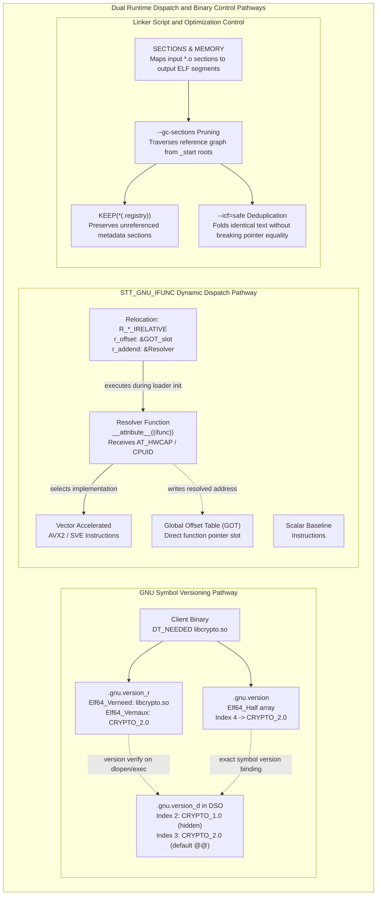
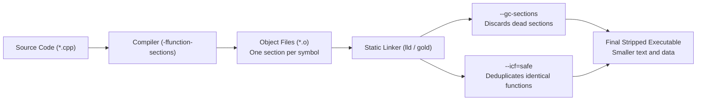

# Symbol Versioning, IFUNC, and Linker Scripts

> [!summary] Claim:
> GNU symbol versioning records version nodes in `.gnu.version`, `.gnu.version_d`, and `.gnu.version_r`, allowing a shared object to export multiple ABI implementations of the same symbol name while the dynamic loader enforces forward and backward binding compatibility.
> GNU indirect functions (`STT_GNU_IFUNC`) delegate runtime dispatch to early relocation resolvers invoked via `R_*_IRELATIVE` relocations before constructors run, requiring resolvers to avoid un-relocated dynamic state, external procedure linkage, and compiler instrumentation.
> Linker scripts govern output section placement, program header mappings, and memory bank topology, while compiler section partitioning enables mark-and-sweep garbage collection (`--gc-sections`) and Identical Code Folding (`--icf`) to eliminate dead code and redundant templates.



## The Mechanism

[[Dynamic-Linking-PLT-GOT-and-Loaders]] establishes how dynamic linkers load shared libraries, resolve external symbol references, and manage Global Offset Table (GOT) slots.
Static linkers and dynamic loaders augment raw symbol names with three distinct mechanisms to maintain binary compatibility, optimize execution paths, and control binary layout:
1. GNU Symbol Versioning, which tags symbol strings with version nodes in dedicated ELF sections.
2. GNU Indirect Functions (`STT_GNU_IFUNC`), which evaluate runtime hardware capabilities during process startup to populate GOT entries directly.
3. Linker Script architecture, which orchestrates section placement, segment generation, section-level dead code elimination (`--gc-sections`), and Identical Code Folding (`--icf`).

### 1. GNU Symbol Versioning Mechanics and ELF Layout

Before symbol versioning, Unix shared libraries relied entirely on major soname increments (`libcrypto.so.1` to `libcrypto.so.2`) to signal incompatible ABI changes.
When two distinct shared libraries in the same process address space depended on different major sonames of a common library, the dynamic linker mapped both libraries simultaneously, and the flat symbol namespace bound each unversioned reference to whichever definition it found first, leading to symbol collisions, memory allocator corruption, and silent data destruction.
Solaris' link editor and `ld.so` introduced symbol versioning in 1995, and Ulrich Drepper and Eric Youngdale borrowed and extended it for GNU ld and glibc in 1997 (MaskRay, All about symbol versioning).

GNU symbol versioning stores version metadata across three coordinated ELF sections:
- `.gnu.version` (section type `SHT_GNU_versym`, value `0x6fffffff`): A contiguous array of 16-bit integers (`Elf64_Half`), matching the entry count and order of the dynamic symbol table `.dynsym` exactly.
- `.gnu.version_d` (section type `SHT_GNU_verdef`, value `0x6ffffffd`): The version definition section, describing every version node exported by the current shared object.
- `.gnu.version_r` (section type `SHT_GNU_verneed`, value `0x6ffffffe`): The version requirement section, recording the external libraries and version strings required by the client object.

#### The Version Symbol Array (`.gnu.version`)

Every dynamic symbol entry in `.dynsym` has a corresponding 16-bit integer at the identical index in `.gnu.version`.
The dynamic loader interprets this 16-bit value using predefined masks:
- Index `0` (`VER_NDX_LOCAL`): The symbol is local to the object and hidden from external dynamic binding.
- Index `1` (`VER_NDX_GLOBAL`): The symbol is global and unversioned; it matches any versioned or unversioned reference.
- Index `>= 2`: A numeric index referencing an `Elf64_Verdef` record (if the symbol is defined in this DSO) or an `Elf64_Vernaux` record (if the symbol is imported).
- Bit 15 (`0x8000`, `VERSYM_HIDDEN`): The hidden version flag.
When bit 15 is clear, the symbol is the default version (`sym@@VERSION`).
The static linker binds all new object compilations against the default version.
When bit 15 is set, the symbol is a non-default, legacy version (`sym@VERSION`).
Legacy binaries already linked against this version continue to bind to it, but the static linker will never bind new compilations to it unless explicitly directed.

#### Version Definition Layout (`.gnu.version_d`)

The `.gnu.version_d` section contains a linked sequence of `Elf64_Verdef` structures, each pointing to one or more `Elf64_Verdaux` structures:

```c
typedef struct {
    Elf64_Half vd_version; /* Version revision: must be 1 */
    Elf64_Half vd_flags;   /* VER_FLG_BASE (0x1) or VER_FLG_WEAK (0x2) */
    Elf64_Half vd_ndx;     /* Version index value referenced by .gnu.version */
    Elf64_Half vd_cnt;     /* Number of associated Verdaux entries */
    Elf64_Word vd_hash;    /* 32-bit ELF hash of the version string */
    Elf64_Word vd_aux;     /* Byte offset from Verdef start to Verdaux array */
    Elf64_Word vd_next;    /* Byte offset from Verdef start to next Verdef */
} Elf64_Verdef;

typedef struct {
    Elf64_Word vda_name;   /* String table offset (.dynstr) for version name */
    Elf64_Word vda_next;   /* Byte offset to next Verdaux (parent version) */
} Elf64_Verdaux;
```

The first `Elf64_Verdef` entry in a shared library is always assigned index `1` with flag `VER_FLG_BASE` (`0x1`), holding the library's own soname as its string.
Subsequent `Elf64_Verdef` entries define API versions (such as `GLIBC_2.17`, `GLIBC_2.34`, `CRYPTO_1.0`).
If a version node inherits from an earlier version (for example, `CRYPTO_2.0` inherits from `CRYPTO_1.0`), its `vd_cnt` is `2`.
The first `Elf64_Verdaux` entry stores the version's own name, and the second `Elf64_Verdaux` stores the parent version's name, establishing a version inheritance DAG.

#### Version Requirements Layout (`.gnu.version_r`)

When an executable or library is linked against versioned shared objects, the static linker generates `.gnu.version_r`.
This section contains a list of `Elf64_Verneed` records, each describing one dependency DSO, followed by a list of `Elf64_Vernaux` records describing the imported version nodes:

```c
typedef struct {
    Elf64_Half vn_version; /* Version revision: must be 1 */
    Elf64_Half vn_cnt;     /* Number of associated Vernaux entries */
    Elf64_Word vn_file;    /* String table offset for DSO filename (e.g. libc.so.6) */
    Elf64_Word vn_aux;     /* Byte offset to first Vernaux record */
    Elf64_Word vn_next;    /* Byte offset to next Verneed record */
} Elf64_Verneed;

typedef struct {
    Elf64_Word vna_hash;   /* 32-bit ELF hash of required version string */
    Elf64_Half vna_flags;  /* Flags: 0 or VER_FLG_WEAK (0x2) */
    Elf64_Half vna_other;  /* Version index assigned to this requirement */
    Elf64_Word vna_name;   /* String table offset for version name */
    Elf64_Word vna_next;   /* Byte offset to next Vernaux record */
} Elf64_Vernaux;
```

The `vna_other` field in `Elf64_Vernaux` holds the exact index stored in the client binary's `.gnu.version` array for symbols imported from that version.
At runtime, the dynamic linker (`ld.so`) verifies that every `Elf64_Vernaux` name and hash in the client binary exists in the corresponding loaded library's `Elf64_Verdef` table.
If a required version is absent, `ld.so` terminates execution before running any user code, outputting:
``./app: /lib/x86_64-linux-gnu/libc.so.6: version `GLIBC_2.38' not found (required by ./app)``.
The backtick-quote pairing is glibc's own format string (``version `%s' not found (required by %s)`` in glibc 2.39's `ld.so`, checked with `strings`, as of 2026-11).

#### Source Directives and Version Scripts

Shared library authors govern symbol versioning using a linker version script and assembler directives.
A version script specifies public nodes, inheritance, and local symbol stripping:

```text
CRYPTO_1.0 {
    global:
        crypto_hash;
    local:
        *;
};

CRYPTO_2.0 {
    global:
        crypto_hash;
} CRYPTO_1.0;
```

In C and C++ source code, developers bind distinct internal implementations to specific external version nodes using the `.symver` assembly directive:

```c
uint32_t crypto_hash_v1(const uint8_t *data, size_t len) {
    /* Legacy implementation: 32-bit additive checksum */
    uint32_t sum = 0;
    for (size_t i = 0; i < len; ++i) sum += data[i];
    return sum;
}
__asm__(".symver crypto_hash_v1, crypto_hash@CRYPTO_1.0");

uint64_t crypto_hash_v2(const uint8_t *data, size_t len) {
    /* Modern implementation: 64-bit FNV-1a hash */
    uint64_t hash = 0xcbf29ce484222325ULL;
    for (size_t i = 0; i < len; ++i) {
        hash ^= data[i];
        hash *= 0x100000001b3ULL;
    }
    return hash;
}
__asm__(".symver crypto_hash_v2, crypto_hash@@CRYPTO_2.0");
```

A single `@` defines an exported but non-default version (`VERSYM_HIDDEN` set); the lab's `client_v1` still binds to it, and `readelf -V` prints its `.gnu.version` entry as `2h(CRYPTO_1.0)`.
A double `@@` defines the default version (`VERSYM_HIDDEN` clear).
Only one default version can exist for any given symbol name.

### 2. STT_GNU_IFUNC (GNU Indirect Functions) Mechanics

Standard dynamic function dispatch routes calls through Procedure Linkage Table (PLT) stubs and Global Offset Table (GOT) entries as documented in [[Dynamic-Linking-PLT-GOT-and-Loaders]].
However, when a library contains multiple optimized variants of a function (for example, a scalar baseline, an AVX2 vectorized implementation, and an AVX-512 implementation), selecting the optimal path at runtime traditionally required a global function pointer check inside the function prologue on every single invocation.
This prologue branch wastes CPU cycles and pollutes branch predictor state in latency-critical loops.

The `STT_GNU_IFUNC` (symbol type `10`) extension eliminates this runtime overhead.
An IFUNC symbol redirects its resolution to a user-defined *resolver function* executed by the dynamic linker during binary startup.
The resolver evaluates CPU features and returns the direct memory address of the optimal target function.
The dynamic linker writes this returned address directly into the binary's GOT slot.
Subsequent calls through the PLT reach the target implementation with no per-call feature check; the remaining cost is the PLT's indirect jump.

#### IFUNC Dynamic Relocations (`R_*_IRELATIVE`)

When an executable or DSO contains an IFUNC symbol, the static linker generates an indirect relocation:
- On x86-64: `R_X86_64_IRELATIVE` (relocation type 37, `0x25`).
- On AArch64: `R_AARCH64_IRELATIVE` (relocation type 1032, `0x408`).

Unlike standard symbol relocations that reference a symbol table index (`r_info >> 32`), an `IRELATIVE` relocation operates without a symbol index (`ELF64_R_SYM(r_info) == 0`).
The relocation structure contains:
- `r_offset`: The virtual address of the GOT entry to be updated.
- `r_addend`: The relative virtual address of the resolver function.

During relocation processing (`_dl_relocate_object` in glibc), the dynamic linker computes:
`resolver = (Elf64_Addr (*)(...))(load_bias + reloc->r_addend);`
`target_address = resolver(hwcap, ...);`
`*(Elf64_Addr *)(load_bias + reloc->r_offset) = target_address;`

#### Resolver Arguments and Architecture ABI Differences

The calling convention and environment provided to an IFUNC resolver vary across hardware architectures:
- On AArch64: glibc's `elf_ifunc_invoke` (`sysdeps/aarch64/dl-irel.h`) passes two arguments: `x0` holds `AT_HWCAP | _IFUNC_ARG_HWCAP` (bit 62 flags that a second argument exists), and `x1` holds `const __ifunc_arg_t *`, a struct from `<sys/ifunc.h>` with `_size`, `_hwcap`, and `_hwcap2` (glibc 2.39), plus `_hwcap3` and `_hwcap4` on glibc master (as of 2026-11).
An AArch64 resolver checks features (such as `HWCAP_ASIMD`, `HWCAP_SVE`, `HWCAP_CRC32`) directly from its input parameters without issuing system calls.
- On x86-64: glibc passes no arguments; `sysdeps/x86_64/dl-irel.h` calls the resolver as `ElfW(Addr) (*) (void)` (as of 2026-11).
An x86-64 resolver either executes the `cpuid` instruction directly or uses GCC's `__builtin_cpu_supports`, in which case the GCC manual says it must first call `__builtin_cpu_init()`, because resolvers run before the constructor that normally initializes the CPU model data.
The lab's x86-64 branch follows that rule, but only the AArch64 branch was compiled and run in this verification, so only `expected/linux-aarch64.txt` exists (as of 2026-11, Linux).

#### The IFUNC Resolver Hazard Boundary

IFUNC resolvers execute in an exceptionally fragile execution context.
They run during the dynamic linker's relocation pass:
- Before `main()` is entered.
- Before `.init_array` and global C++ constructors execute.
- Before other dynamic relocations in dependent shared libraries are guaranteed to have completed.

This lifecycle phase imposes programming constraints; the toolchain guideline (Szabolcs Nagy, quoted by MaskRay) is that a resolver must not access global data or call functions in other modules including libc, and must not fail.
Several of them are order-dependent hazards rather than guaranteed crashes:
1. An IFUNC resolver should not call functions in another shared object via the PLT.
   If the target DSO's own relocations have not completed, the call jumps to an uninitialized GOT entry, triggering a segmentation fault; MaskRay reports that before glibc 2.44, in lazy PLT mode, `ld.so` called the resolver before the `JUMP_SLOT` for `puts` was set up and the program segfaulted, observable only with `-z lazy` because many distributions default to `-z now`.
   The fix is glibc commit `63b31c05a8`, "elf: Defer all IRELATIVE relocations until after PLT setup" (Adhemerval Zanella, 2026-05-14, read on the GitHub mirror), which applies `R_*_IRELATIVE` relocations in a separate pass after the others; MaskRay lists it as fixed in glibc 2.44, and the glibc 2.39 of the lab image predates it.
   In a verifier probe (glibc 2.39, aarch64, PIE main executable) a resolver calling `memset`, `malloc`, `fprintf`, and `free` ran correctly under both `-Wl,-z,now` and lazy binding, because `libc.so.6` is relocated before the executable.
2. Calling `malloc()`, `calloc()`, or `free()` inside an IFUNC resolver falls under the same rule (no calls into other modules, libc included), so it is order-dependent rather than a guaranteed failure: the probe above allocated and freed successfully from a PIE executable.
3. Compiling an IFUNC resolver with `-fstack-protector` or `-fstack-protector-strong` crashes in static and static-PIE links, where IRELATIVE relocations are applied before the canary is set up (glibc bug 25680, "crash in IFUNC resolver due to stack canary", fixed in glibc 2.34).
   In the dynamically linked probe above, a resolver built with `-fstack-protector-all -Wl,-z,now` ran without `SIGABRT`.
4. Sanitizer instrumentation breaks a resolver.
   In the verifier probe (GCC 13.3, glibc 2.39, aarch64) a resolver that wrote through a `malloc`ed pointer and was built with `-fsanitize=address` died with SIGSEGV (exit 139) in both PIE and non-PIE dynamic links.
   The same source without the sanitizer, with `__attribute__((no_sanitize("address")))` on the resolver, and with `no_sanitize("all")` on the resolver each printed `f()=7`; the probe did not isolate the exact faulting access.
   MaskRay documents the analogous crash for profiling instrumentation in static binaries, worked around with `no_profile_instrument_function`.
5. A resolver must not access TLS: on some targets it runs before TLS setup in static linking, as detailed in [[Thread-Local-Storage-Models-and-ELF-Relocations]].

#### Supply Chain Security: CVE-2024-3094 (XZ Utils)

Because IFUNC resolvers run so early in process initialization, they present a dangerous target for binary tampering.
In CVE-2024-3094, a sophisticated threat actor injected a backdoor into the `liblzma` library (XZ Utils v5.6.0 and v5.6.1).
The payload replaced the IFUNC resolvers `crc32_resolve()` and `crc64_resolve()` (Freund).
When OpenSSH (`sshd`), which Debian and other distributions patch for systemd notification, loaded `liblzma` via its `libsystemd` dependency, the malicious resolver ran during early symbol resolution because `sshd` is linked with `-Wl,-z,now`, before `-Wl,-z,relro` remaps the GOT read-only.
The backdoor installed an audit hook into the dynamic linker, parsed in-memory symbol tables, and changed `RSA_public_decrypt@....plt` to point to its own code (Freund), which Freund says is "likely to allow some form of access or other form of remote code execution" (his initial post had not yet determined what the backdoor checks).

### 3. Linker Script Architecture and Engine Mechanics

Static linkers (GNU `ld`, `gold`, LLVM `lld`, and `mold`) transform independent object files (`.o`) into executables and shared libraries as introduced in [[Symbols-Relocations-and-Static-Linking]].
The internal synthesis engine is directed by a **Linker Script**.
If no custom script is specified via the `-T` flag, the linker uses an internal default script (viewable with `ld --verbose`).

Linker scripts use a declarative domain-specific language consisting of four primary structural commands:
1. `SECTIONS`: Maps input sections from relocatable object files into output sections in the final binary, specifying layout order, alignment, and virtual addresses.
2. `MEMORY`: Defines physical and virtual memory regions (origin and length), enforcing boundary limits for embedded firmware and kernel memory maps.
3. `PHDRS`: Explicitly constructs ELF Program Headers (segments), defining segment types (`PT_LOAD`, `PT_NOTE`, `PT_TLS`, `PT_GNU_RELRO`) and access permissions.
4. `VERSION`: Embeds symbol version hierarchies directly within the linker script instead of passing a separate `--version-script` file.

#### The `SECTIONS` Command and Section Placement

The `SECTIONS` command controls the mapping of input sections to output sections:

```text
SECTIONS
{
    . = 0x400000;                     /* Set location counter to virtual address */
    .text : {
        *(.text.entry)                /* Place entry function first */
        *(.text .text.*)              /* Wildcard match all text sections */
        *(.rodata .rodata.*)          /* Merge read-only constants */
    }
    . = ALIGN(0x1000);                /* Align location counter to 4 KiB page */
    .data : {
        PROVIDE(__data_start = .);    /* Define symbol if referenced */
        *(.data .data.*)
        PROVIDE(__data_end = .);
    }
    .bss : {
        *(.bss .bss.*)
        *(COMMON)
    }
}
```

Key directives inside `SECTIONS` include:
- The Location Counter (`.`): Tracks the current virtual memory offset.
Assigning to `.` advances output allocation, creating padding if necessary (`. = ALIGN(4096);`).
- `PROVIDE(symbol = value)`: Defines a global symbol only if it is referenced by an input object and not defined anywhere else.
- `PROVIDE_HIDDEN(symbol = value)`: Defines the symbol with hidden ELF visibility, preventing export into `.dynsym`.
- `KEEP(*(section_pattern))`: Instructs the linker's garbage collector (`--gc-sections`) that matching sections are roots and must never be stripped, even if no explicit symbol references reach them.

#### Script Augmentation with `INSERT`

Replacing the entire default linker script with a custom file breaks standard runtime startup arrays (`.init_array`, `.fini_array`), thread-local storage headers, and unwinding tables (`.eh_frame`).
To inject custom sections without overriding the default script, linkers provide the `INSERT` command:

```text
SECTIONS
{
  .registry : {
    KEEP(*(.registry))
  }
}
INSERT AFTER .rodata;
```

Passing `-Wl,-T,augment.ld` instructs GNU ld to append the `.registry` output section immediately following `.rodata` within the standard ELF program headers.

### 4. Linker Dead Code Elimination (`--gc-sections`) and Identical Code Folding (ICF)

Compilers traditionally emit all compiled functions of a translation unit into a single `.text` section and all global variables into `.data`.
If any single function in an object file is referenced, the static linker must include the entire `.text` section in the final binary, pulling in dozens of unreferenced functions.

#### Mark-and-Sweep Garbage Collection (`--gc-sections`)

Linker section garbage collection solves this bloat:
1. The compiler compiles code with `-ffunction-sections` and `-fdata-sections`.
This partitions each function into `.text.function_name` and each variable into `.data.variable_name`.
2. The linker runs with `-Wl,--gc-sections`.
3. The linker constructs a directed graph of all sections where edges represent ELF relocations.
4. It initializes root nodes:
   - The binary entry point (e.g. `_start`).
   - Exported dynamic symbols defined by version scripts or `-Wl,--export-dynamic`.
   - Sections marked with `KEEP()` in linker scripts.
   - Sections marked with the `SHF_GNU_RETAIN` ELF flag (emitted via GCC/Clang `__attribute__((retain))`).
5. It executes a mark-and-sweep traversal.
Any section not marked as reachable from the root set is discarded from the output binary.

#### Identical Code Folding (`--icf`)

Template-heavy C++ and generic Rust code generate redundant machine code across instantiation types (for example, `std::vector<int*>` and `std::vector<void*>` compile to identical machine instructions).
Linkers supporting Identical Code Folding (GNU `gold`, deprecated since binutils 2.44 in February 2025 and shipped only in a separate tarball; LLVM `lld`; and `mold`) inspect `.text.*` sections to deduplicate identical code:
- `--icf=all`: The linker merges all functions whose machine instruction bytes and relocation targets are identical.
It retains one physical copy in `.text` and adjusts symbol table entries so both names point to the same virtual address.
- The ISO C/C++ Pointer Equality Trap: Under ISO C99 and ISO C++, every distinct function must possess a unique memory address (`&func_a != &func_b`).
Under `--icf=all`, comparing function pointers of folded functions evaluates to equal at runtime.
If code uses function pointer addresses as hash table keys or unique callbacks, `--icf=all` introduces silent logic errors.
- `--icf=safe`: Solves the pointer equality trap.
Under `--icf=safe`, `lld` inspects address-significance tables (`.llvm_addrsig` emitted by Clang), while `gold` infers address-taking from relocation types.
If a function's address is ever taken in code (`void *p = (void*)func;`), the linker refuses to fold it.
`gold --help` (gold 1.16) states that `--icf=safe` "Folds ctors, dtors and functions whose pointers are definitely not taken"; a verifier probe on aarch64 confirmed that gold folds two identical direct-call-only functions to one address under `--icf=safe`.

## Commands and Numbers to Know

Every entry in the reference table below captures operational defaults, flags, and ELF characteristics across modern toolchains.

| Tool / Mechanism | Parameter / Command | Value / Default | Platform | Impact / Meaning |
| :--- | :--- | :--- | :--- | :--- |
| `readelf` | `-V`, `--version-info` | Inspection flag | Linux | Dumps `.gnu.version`, `.gnu.version_d`, and `.gnu.version_r` tables; reads ELF only (as of 2026-11) |
| ELF Section Type | `SHT_GNU_versym` | `0x6fffffff` | Linux | Section type value for 16-bit symbol version array `.gnu.version` (as of 2026-11) |
| ELF Section Type | `SHT_GNU_verdef` | `0x6ffffffd` | Linux | Section type value for exported version definitions `.gnu.version_d` (as of 2026-11) |
| ELF Section Type | `SHT_GNU_verneed` | `0x6ffffffe` | Linux | Section type value for imported version requirements `.gnu.version_r` (as of 2026-11) |
| ELF Version Mask | `VERSYM_HIDDEN` | `0x8000` | Linux | Bit 15 mask indicating hidden, non-default version node `sym@VER` (as of 2026-11) |
| ELF Symbol Type | `STT_GNU_IFUNC` | `10` (`0xa`) | Linux | Symbol type denoting an indirect function resolved dynamically (as of 2026-11) |
| Dynamic Relocation | `R_X86_64_IRELATIVE` | `37` (`0x25`) | Linux | Dynamic relocation invoking x86-64 IFUNC resolver to populate GOT (as of 2026-11) |
| Dynamic Relocation | `R_AARCH64_IRELATIVE`| `1032` (`0x408`) | Linux | Dynamic relocation invoking AArch64 IFUNC resolver with HWCAPs (as of 2026-11) |
| Linker Option | `-Wl,--version-script`| Path to script | Linux | Binds symbol version definitions and scopes to shared object (as of 2026-11) |
| Linker Option | `-Wl,--gc-sections` | Disabled by default| Linux | Discards unreferenced input sections during link-time graph sweep; macOS `ld` rejects it ("unknown options: --gc-sections") and uses `-dead_strip` instead (as of 2026-11) |
| Compiler Option | `-ffunction-sections` | Disabled by default| Both | Emits each function into isolated `.text.func` section for GC (as of 2026-11) |
| Compiler Option | `-fdata-sections` | Disabled by default| Both | Emits each global into isolated `.data.var` section for GC (as of 2026-11) |
| Linker Option (gold/lld) | `-Wl,--icf=safe` | Disabled by default| Linux | Folds identical code while preserving addresses of address-taken functions (as of 2026-11) |
| Linker Option (gold/lld) | `-Wl,--icf=all` | Disabled by default| Linux | Aggressively folds identical code; breaks strict C/C++ pointer equality (as of 2026-11) |
| Linker Script Command| `KEEP(*(.section))` | Linker directive | Linux | Protects matching sections from being discarded by `--gc-sections`; macOS `ld` has no linker scripts (as of 2026-11) |
| Linker Script Command| `INSERT AFTER .sec` | Linker directive | Linux | Augments default internal script without replacing standard layout (as of 2026-11) |

## Multi-Language Comparison: C++ / Rust / Python

Symbol versioning, indirect dispatch, and binary section pruning intersect differently across systems programming languages and interpreted runtimes.

| Engineering Concern | C++ (Clang / GCC) | Rust (`rustc` / Cargo) | Python (CPython / C-Extensions) |
| :--- | :--- | :--- | :--- |
| **Runtime Dynamic Dispatch** | `__attribute__((ifunc("resolver")))` or `__attribute__((target_clones("avx2", "default")))`. Resolver executes during dynamic relocation. | `std::is_x86_feature_detected!` or `is_aarch64_feature_detected!` inside functions. Dispatched via standard `OnceLock` or branch. | Inspects CPU flags at module import via `cpuinfo` or C-extension, binding Python function pointers to optimized C functions. |
| **Symbol Versioning Control** | Version script passed via `-Wl,--version-script,map.ld`. Source versions mapped via `__asm__(".symver ...")`. | Emitted via `cargo:rustc-link-arg=-Wl,--version-script=map.ld` in `build.rs`. Exported symbols named with `#[no_mangle]`. | Extension wheels constrained by `auditwheel` to match `manylinux` glibc version tags (e.g. `GLIBC_2.17`, `GLIBC_2.34`). |
| **Dead Code Elimination** | Requires manual compiler flags `-ffunction-sections -fdata-sections` paired with `-Wl,--gc-sections`. | `rustc` removes dead code at link time by default in every profile, not only release (`-C link-dead-code` defaults to `no`, per the rustc book). | CPython does not prune unused Python functions; compiled C-extensions must compile with `--gc-sections` to minimize `.so` size. |
| **Identical Code Folding** | Pass `-Wl,--icf=safe` to `gold` or `lld`. Must use `safe` to prevent function pointer equality collisions in template code. | Pass `-C link-arg=-Wl,--icf=safe`. Clang/LLVM emits `.llvm_addrsig` to protect address-taken closures and trait objects. | Not applicable to bytecode. Applied during the link step of native extension libraries (`.so` / `.pyd`). |
| **Custom Section Placement** | `__attribute__((section(".registry")))` combined with custom linker script or `INSERT AFTER`. | `#[link_section = ".registry"]` on static items combined with linker scripts via Cargo build scripts. | Native extensions use C macro attributes to place metadata tables into distinct ELF sections. |

## Worked Lab Example

The companion lab located at `code/00-Program-Execution/ifunc_resolver/` compiles and exercises:
1. A versioned shared library `libcrypto.so` providing `CRYPTO_1.0` (32-bit sum) and `CRYPTO_2.0` (64-bit FNV-1a hash).
2. Two separate clients (`client_v1` and `client_v2`) run one after the other against the same `libcrypto.so` file.
3. An `STT_GNU_IFUNC` resolver that tests `HWCAP_ASIMD` in its `x0` argument and populates an `R_AARCH64_IRELATIVE` relocation slot.
4. Section garbage collection (`--gc-sections`) stripping dead code while preserving custom `.registry` sections via `KEEP()`.
5. Identical Code Folding under `ld.gold`, comparing `--icf=none`, `--icf=all`, and `--icf=safe` on address-taken functions and on direct-call-only twins.

### 1. GNU Symbol Versioning Execution and Inspection

The library exports `crypto_hash_v1` under `CRYPTO_1.0` and `crypto_hash_v2` under default `CRYPTO_2.0`:

```bash
cd code/00-Program-Execution/ifunc_resolver
bash run.sh
```

Execution produces the verified deterministic output on `linux-aarch64` (GCC 13.3, GNU ld 2.42, glibc 2.39):

```text
=== 1. GNU Symbol Versioning Execution ===
client_v1 (CRYPTO_1.0) sum: 100
client_v2 (CRYPTO_2.0) fnv: dfd466d299e427e5
=== 2. Version Definitions in libcrypto.so (.gnu.version_d) ===
000000: Rev: 1  Flags: BASE  Index: 1  Cnt: 1  Name: libcrypto.so
0x001c: Rev: 1  Flags: none  Index: 2  Cnt: 1  Name: CRYPTO_1.0
0x0038: Rev: 1  Flags: none  Index: 3  Cnt: 2  Name: CRYPTO_2.0
0x0054: Parent 1: CRYPTO_1.0
--- exported crypto_hash symbols (@ is non-default, @@ is default) ---
crypto_hash@@CRYPTO_2.0
crypto_hash@CRYPTO_1.0
=== 3. Version Requirements (.gnu.version_r) ===
--- client_v1 ---
0x0020: Version: 1  File: libcrypto.so  Cnt: 1
0x0030:   Name: CRYPTO_1.0  Flags: none  Version: 4
--- client_v2 ---
0x0020: Version: 1  File: libcrypto.so  Cnt: 1
0x0030:   Name: CRYPTO_2.0  Flags: none  Version: 4
```

Notice that `client_v1` computes the legacy 32-bit sum (10 + 20 + 30 + 40 = 100), while `client_v2` computes the 64-bit FNV hash.
The client prints the hash without a `0x` prefix so the harness scrubber, which masks `0x` followed by 8 to 16 hex digits, leaves it visible; `dfd466d299e427e5` matches an independent FNV-1a computation over the bytes `{10, 20, 30, 40}`.
In `.gnu.version_d`, index 1 is reserved for the base DSO `libcrypto.so`.
Index 2 defines `CRYPTO_1.0`, and index 3 defines `CRYPTO_2.0` with `Parent 1: CRYPTO_1.0`.
The `readelf --dyn-syms` lines show the two exports: `crypto_hash@@CRYPTO_2.0` (default) and `crypto_hash@CRYPTO_1.0` (non-default, `VERSYM_HIDDEN` set).
In `.gnu.version_r`, `client_v1` records a requirement on `CRYPTO_1.0` and `client_v2` on `CRYPTO_2.0`, both from `libcrypto.so`.

### 2. STT_GNU_IFUNC Execution and Relocation

The indirect function `compute_digest` dispatches to `resolve_hash`, which runs during loader relocation.
On AArch64 it tests `HWCAP_ASIMD` in its first argument (`x0`) and returns `hash_vector` when the bit is set, else `hash_scalar`; the lab then reports which of the two reference digests the IFUNC call matched:

```text
=== 4. STT_GNU_IFUNC Execution and Relocation ===
AT_HWCAP has HWCAP_ASIMD: yes
IFUNC selected: vector
IFUNC digest: 0001496c28eb66fc
vector reference: 0001496c28eb66fc
scalar reference: 0000000000007c42
IFUNC GLOBAL compute_digest
R_AARCH64_IRELATIVE
```

The first line reads `AT_HWCAP` from the auxiliary vector in `main` to show the input the resolver saw; `IFUNC selected: vector` and the digest equal to the vector reference show the dispatch took the `HWCAP_ASIMD` branch, and the scalar reference (`0x7c42`) is the value a wrong dispatch would print.
The symbol table reports `compute_digest` with type `IFUNC` (`STT_GNU_IFUNC`).
The relocation table reports `R_AARCH64_IRELATIVE` (on x86-64, this reports `R_X86_64_IRELATIVE`).
The dynamic linker invokes the resolver function directly from the relocation table before `main()` starts.

### 3. Linker Dead Code Elimination and Identical Code Folding

The lab links `sections_demo.c` with `-ffunction-sections -fdata-sections -Wl,--gc-sections`:

```text
=== 5. Linker Dead Code Elimination and KEEP() ===
dead_code_function without --gc-sections: retained
dead_code_function: discarded by --gc-sections
.registry without KEEP: discarded by --gc-sections
.registry with KEEP: preserved in output ELF
=== 6. Identical Code Folding (ICF) Pointer Identity ===
gold --icf=none: Pointers are distinct (safe)
gold --icf=all: Pointers are identical (folded)
gold --icf=safe: Pointers are distinct (safe)
gold --icf=none direct-call-only twins: distinct addresses
gold --icf=all direct-call-only twins: folded to one address
gold --icf=safe direct-call-only twins: folded to one address
```

The first line is the control: without `--gc-sections` the symbol `dead_code_function` stays in the output, so its absence in the next line is the linker's doing.
Without `KEEP()`, the unreferenced `.registry` section is swept and discarded by `--gc-sections`.
With `augment.ld` using `KEEP(*(.registry))`, the section is retained in the output binary.
The `--icf=none` build is the control: nothing is folded, so any folding below comes from the linker.
Under `ld.gold --icf=all`, `algo_a` and `algo_b` share the identical virtual address.
Under `ld.gold --icf=safe`, the linker detects that function pointers were taken and preserves distinct addresses.
The `twin_a` and `twin_b` functions are only ever called directly, so `--icf=safe` folds them as well as `--icf=all` does, while `--icf=none` leaves them apart.

## Pitfalls

> [!warning] Pitfall: Calling external library procedures inside an IFUNC resolver
> An IFUNC resolver executes during the dynamic loader's relocation phase before external shared library relocations are guaranteed to be complete.
> Calling `printf()`, `malloc()`, or any function located in an external shared object can jump through an un-relocated PLT or uninitialized GOT slot when that object has not been relocated yet, producing a segmentation fault; whether it crashes depends on relocation order, so a resolver that works in one link can fail in another.
> Keep IFUNC resolvers completely self-contained: inspect CPU registers (`cpuid` or parameter registers) and return a function pointer immediately.

> [!warning] Pitfall: Compiling IFUNC resolvers with stack-protector canaries or sanitizers
> Compiling an IFUNC resolver translation unit with `-fstack-protector` crashes static and static-PIE binaries, where IRELATIVE relocations run before the canary is set up (glibc bug 25680, fixed in glibc 2.34); a resolver built with `-fsanitize=address` crashed with SIGSEGV in the verifier probe (GCC 13.3, glibc 2.39, aarch64, PIE and non-PIE), and marking the resolver `no_sanitize("address")` fixed it.
> In a dynamically linked glibc 2.39 PIE, a verifier probe built with `-fstack-protector-all -Wl,-z,now` ran normally, so the failure is link-mode dependent rather than universal.
> Always compile IFUNC resolver translation units with `-fno-stack-protector` and disable sanitizers on resolver functions via `__attribute__((no_sanitize("all")))`.

> [!warning] Pitfall: Forgetting `local: *;` in a symbol version script
> If a version script defines a version node but omits `local: *;`, GNU ld exports all other symbols in the object with global unversioned visibility.
> This pollutes the shared library's dynamic symbol table, slows down loader hash lookups, and exposes internal implementation functions to accidental symbol interposition by client binaries.

> [!warning] Pitfall: Breaking function pointer equality in C/C++ under `--icf=all`
> The ISO C and C++ standards require that two distinct declared functions have distinct, unique addresses.
> When `--icf=all` merges two functions with identical machine code instructions, both symbols point to the same memory address.
> Code that uses function pointers as keys in `std::map`, `std::unordered_map`, or callback registries will experience key collisions and broken invariants.
> Always use `--icf=safe` in production builds to ensure address-taken functions retain unique pointer addresses.

> [!warning] Pitfall: Omitting `KEEP()` in custom linker scripts with `--gc-sections`
> When compiling embedded firmware or plugin architectures, developers place registration structs, interrupt vector tables, or driver descriptors into custom sections like `.drivers` or `.registry`.
> When `-Wl,--gc-sections` is enabled, the linker discards these sections because no explicit call graph edge reaches them from `_start`.
> Enclose all unreferenced metadata tables in `KEEP(*(.section_name))` inside the linker script, or tag variables with `__attribute__((retain))` in GCC 11+ / Clang 13+.

> [!warning] Pitfall: Renaming an exported symbol version without preserving a backward compatibility alias
> Bumping a library's default symbol version from `LIB_1.0` to `LIB_2.0` without retaining `.symver` aliases for `LIB_1.0` instantly breaks all existing deployed binaries.
> At runtime, `ld.so` scans `.gnu.version_r` and immediately halts execution with `version 'LIB_1.0' not found`.
> Maintain backward compatibility by keeping the legacy implementation bound via `.symver func_old, func@LIB_1.0` while publishing the new implementation via `.symver func_new, func@@LIB_2.0`.

## At Scale

At the scale of 10,000 to 50,000 engineers operating in massive monorepos or multi-tenant microservice fleets, binary interfaces and linker mechanics dictate runtime reliability, deployment safety, and infrastructure cost.

### 1. Paved Road ABI Policies and Symbol Versioning

In large organizations, breaking an ABI in a core library (such as an internal RPC runtime, telemetry agent, or math library) triggers cascading deployment failures across thousands of independent services.
Mature engineering organizations enforce:
- Mandatory version scripts on all shared libraries: Every internal DSO must compile with a version script that explicitly declares `local: *;`.
This prevents accidental symbol leaks and protects internal helper functions from dynamic symbol interposition as explored in [[Diagnose-Dynamic-Linker-and-ABI-Failures]].
- Automated ABI diffing in CI: Toolchains run `abidiff` (from `libabigail`) on pull requests.
`abidiff` parses DWARF debug information and ELF symbol tables across two library versions.
If a function changes parameter types, modifies struct member offsets, or deletes a symbol version node without creating a `.symver` backward compatibility bridge, CI rejects the pull request before merge.
- Hermetic soname versioning: Monorepos standardly link internal microservice dependencies statically (`.a`), restricting shared libraries (`.so`) to operating system interfaces and hardware plugin modules.

### 2. Fleet-Wide Binary Size and Memory Optimization

Across a fleet of 500,000 servers, binary size directly impacts deployment latency, container startup times, and instruction cache miss rates:
- Compiler Section Partitioning: `-ffunction-sections -fdata-sections` gives each function and variable its own input section, which costs extra section headers and relocation entries in every `.o`, and `-Wl,--gc-sections` then removes the unreachable ones from the link.
Neither the cost nor the saving has a universal percentage: measure both with `size` on your own targets before setting fleet policy.
- Safe ICF Deployment: `-Wl,--icf=safe` in LLVM `lld` folds identical functions whose addresses are not significant, so pointer equality is preserved.
The only published number used here is Collingbourne's 2018 measurement on a release-plus-asserts Clang build: 109,407,184 bytes with `--icf=none`, 108,534,736 with `safe` (-0.8%), and 107,281,360 with `all` (-2%).
Treat it as one data point from one binary, not a fleet estimate.
Combined with Bolt post-link optimization as detailed in [[Linkers-LTO-PGO-AutoFDO-and-BOLT]], section deduplication maximizes instruction cache (I-cache) residency.



## Practice Drill

> [!tip] Practice Drill: Implement an ABI Evolution Bridge with Backward-Compatible Symbol Versioning
> Construct a shared library `libstringutil.so` that evolves its string hashing function across two API generations:
> 1. Version `STRUTIL_1.0`: `uint32_t str_hash(const char *s)` implements a basic 32-bit additive hash.
> 2. Version `STRUTIL_2.0`: `uint64_t str_hash(const char *s)` implements 64-bit MurmurHash or FNV-1a.
> 
> Author a version script `strutil.map` defining `STRUTIL_1.0` and `STRUTIL_2.0`.
> In your C source, write two separate functions and use `__asm__(".symver ...")` to bind `str_hash_v1` as the hidden version `str_hash@STRUTIL_1.0` and `str_hash_v2` as the default version `str_hash@@STRUTIL_2.0`.
> Compile two client binaries: `legacy_client` compiled against `str_hash@STRUTIL_1.0`, and `modern_client` compiled against the default version.
> Run `readelf -V libstringutil.so` and verify that `STRUTIL_1.0` has index 2, that the `.gnu.version` entry for `str_hash@STRUTIL_1.0` prints as `2h(STRUTIL_1.0)` (the `h` is the `VERSYM_HIDDEN` bit, shown in `.gnu.version`, not in `.gnu.version_d`), and that `STRUTIL_2.0` has index 3.
> Verify that both binaries execute against the same `.so` file and produce their respective 32-bit and 64-bit outputs without symbol clashes or re-linking.

## Interview Questions

> [!question] L5: What happens when a binary compiled against `crypto_hash@CRYPTO_1.0` runs on a system where `libcrypto.so` exports `crypto_hash@@CRYPTO_2.0` as its default version?
>
> > [!success]- Answer
> > The binary executes successfully and invokes the `CRYPTO_1.0` implementation.
> > The dynamic linker (`ld.so`) does not bind dynamic symbols by name alone.
> > When the binary was linked, the static linker recorded the version string `CRYPTO_1.0` in the binary's `.gnu.version_r` section and assigned it an index in `.gnu.version`.
> > At runtime, `ld.so` searches `libcrypto.so` for a symbol named `crypto_hash` specifically matching the `CRYPTO_1.0` version node in `.gnu.version_d`.
> > Even though `CRYPTO_2.0` is the default version (`@@`) for newly compiled programs, `libcrypto.so` retains the legacy `CRYPTO_1.0` node with the hidden flag set (`@`).
> > The dynamic loader binds the legacy binary to the legacy code path, preserving backward binary compatibility.

> [!question] L5: Why does `-Wl,--gc-sections` fail to prune uncalled functions if the compiler is invoked without `-ffunction-sections`?
>
> > [!success]- Answer
> > By default, the compiler outputs all compiled functions of a translation unit into a single, monolithic `.text` section.
> > The static linker's garbage collector operates at the granularity of ELF sections, not individual functions or symbols.
> > If any single function in the object file is referenced by the call graph, the entire `.text` section is marked as live and retained.
> > Passing `-ffunction-sections` instructs the compiler to place each function `foo` into its own distinct input section `.text.foo`.
> > This section isolation allows the linker's mark-and-sweep algorithm to evaluate and discard individual unreferenced function sections independently.

> [!question] L6: Predict the output: when two identical functions are compiled with -O2 -ffunction-sections -fuse-ld=gold -Wl,--icf=all, what does pointer equality evaluate to when checked through volatile pointers, and why?
>
> > [!success]- Answer
> > The program prints `1` (true).
> > Under `--icf=all` (Identical Code Folding), the linker scans all `.text.*` input sections and identifies that `f1` and `f2` possess identical machine code bytes and identical relocation targets.
> > The linker merges the two sections into a single physical section in the output ELF file and points both symbol table entries (`f1` and `f2`) to the identical virtual address.
> > When loaded into memory, both function pointers resolve to the same byte address.
> > Note that without volatile pointer assignments, optimizing compilers like GCC or Clang may fold `&f1 == &f2` to `0` at compile time under ISO C/C++ rules, which mandate that distinct declared functions possess distinct addresses.

> [!question] L6: Debug this: why does an IFUNC resolver crash inside ld.so with SIGSEGV or SIGABRT under -O3 -fstack-protector-strong -Wl,-z,now despite working in debug builds?
>
> > [!success]- Answer
> > The usual cause is the compiler inserting stack-smashing protection into the IFUNC resolver function.
> > With `-fstack-protector-strong`, the compiler instruments the resolver prologue and epilogue to read the stack canary.
> > With `-Wl,-z,now`, the dynamic linker processes all relocations eagerly at startup before executing any user code or C runtime initializers.
> > IFUNC resolvers execute during this early relocation phase.
> > In static and static-PIE links, IRELATIVE relocations are applied before the canary and TLS are set up, so the instrumented resolver crashes before `main()` (glibc bug 25680, "crash in IFUNC resolver due to stack canary", fixed in glibc 2.34).
> > In a dynamically linked glibc 2.39 PIE, a verifier probe with `-fstack-protector-all -Wl,-z,now` and a resolver calling libc ran normally, so the premise is link-mode dependent.
> > Under `-z now` without lazy binding, a resolver that calls into a not-yet-relocated DSO is the other common SIGSEGV source.
> > The fix is to compile the resolver translation unit with `-fno-stack-protector` and ensure the resolver does not call external dynamic library routines.

> [!question] L6: Explain the internal structure of `.gnu.version`, `.gnu.version_d`, and `.gnu.version_r`, and how the loader identifies non-default version nodes.
>
> > [!success]- Answer
> > `.gnu.version` is a parallel array of 16-bit integers (`Elf64_Half`) indexed 1:1 with the dynamic symbol table `.dynsym`.
> > For an exported symbol, the 16-bit value (modulo the top bit) indexes an `Elf64_Verdef` structure in `.gnu.version_d`.
> > Each `Elf64_Verdef` holds a version string hash, version index (`vd_ndx`), and an array of `Elf64_Verdaux` structures defining the version name and parent inheritance.
> > For an imported symbol, the 16-bit value indexes an `Elf64_Vernaux` record within `.gnu.version_r`, which specifies the required version string and parent library filename (`Elf64_Verneed`).
> > The loader detects a non-default (hidden) version via bit 15 (`0x8000`, `VERSYM_HIDDEN`).
> > If bit 15 is set, the symbol is hidden from static linker binding and matches only explicit legacy requests.
> > If bit 15 is clear, the symbol is the default version (`@@`).

> [!question] L7: In the CVE-2024-3094 backdoor, why did the attacker choose an `STT_GNU_IFUNC` resolver rather than a standard C++ static constructor or `.init_array` function to inject malicious hooks?
>
> > [!success]- Answer
> > IFUNC resolvers execute earlier in process lifecycle than `.init_array` constructors.
> > During dynamic loading (`_dl_relocate_object`), `IRELATIVE` relocations run while the Global Offset Table and Procedure Linkage Table are being populated, before `.init_array` functions execute.
> > Because `sshd` is linked with `-Wl,-z,now`, all symbols are resolved early, and the GOT is still writable because `-Wl,-z,relro` remaps it read-only only afterwards (Freund).
> > By replacing the `crc32_resolve()` and `crc64_resolve()` IFUNC resolvers, the attacker gained execution inside the dynamic linker's relocation pass before `sshd` ran any of its own code.
> > The backdoor then installed its own audit hook into the dynamic linker to catch symbol resolution for libraries not yet loaded, and changed `RSA_public_decrypt@....plt` to point to its own code (Freund).
> > A `.init_array` constructor runs after RELRO is applied, so it could not have patched the GOT in place without an extra `mprotect` (inferred from Freund's RELRO timing, not stated by him).

> [!question] L7: How does `PROVIDE(sym = .)` differ from `sym = .` in a custom linker script, and what additional guarantee does `PROVIDE_HIDDEN(sym = .)` provide?
>
> > [!success]- Answer
> > Direct assignment (`sym = .`) unconditionally defines `sym` in the output object, overriding or causing multiple-definition collisions if the symbol is already defined in an input object.
> > `PROVIDE(sym = .)` defines the symbol conditionally: the linker creates `sym` only if the symbol is referenced by an input object and not defined in any linked compilation unit.
> > If an input object already defines `sym`, the linker quietly ignores the `PROVIDE` directive.
> > `PROVIDE_HIDDEN(sym = .)` performs the same conditional definition, but additionally sets the symbol's ELF visibility to `STV_HIDDEN`.
> > This prevents the static linker from exporting `sym` into the dynamic symbol table (`.dynsym`) of a shared library, ensuring the symbol remains strictly internal to the DSO and cannot be preempted or referenced by external objects.

> [!question] L7+: How does Clang's address-significance table (`.llvm_addrsig`) enable `--icf=safe` to fold functions without violating C/C++ pointer equality rules?
>
> > [!success]- Answer
> > Under ISO C and C++, taking the address of a function (`void (*p)() = &func;`) requires that the function pointer compare unequal to the address of any distinct function.
> > When Clang compiles with `-faddrsig` (on by default for ELF targets that use the integrated assembler since Clang 7, per the Clang 7.0.0 release notes; the current driver turns it off for PS4, VE, NetBSD, Gentoo, and Android targets), it emits an ELF section named `.llvm_addrsig` containing a ULEB128-encoded table of symbol indices whose addresses were taken in the translation unit.
> > Functions called exclusively via direct `call` instructions are omitted from `.llvm_addrsig`.
> > During the link step with `--icf=safe`, the linker inspects `.llvm_addrsig` and relocation types:
> > 1. If a function's symbol index appears in `.llvm_addrsig`, `lld` treats its address as significant and marks it non-foldable; `gold`, which predates `.llvm_addrsig`, instead treats a function referenced by a non-call relocation (such as an `R_X86_64_64` data pointer relocation) as address-taken.
> > 2. If neither of two identical functions has its address taken, the linker safely folds them into a single machine code body because no valid program logic can compare their pointers.
> > This keeps standard compliance and avoids pointer hash collisions, at some size cost relative to `--icf=all`: in Collingbourne's 2018 Clang measurement `safe` removed 0.8% of the binary and `all` removed 2%.

## Further Reading

- Ulrich Drepper, *How To Write Shared Libraries* (Red Hat, 2006): The definitive guide to ELF shared object construction, symbol versioning internals, and export control.
- System V Application Binary Interface - AMD64 Architecture Processor Supplement: Normative specification for x86-64 dynamic linking, GOT/PLT structure, and `R_X86_64_IRELATIVE` relocations.
- Arm Limited, *Procedure Call Standard for the Arm 64-bit Architecture (AAPCS64)*: Normative register usage; it does not define IFUNC resolver arguments, which glibc defines in `sysdeps/aarch64/dl-irel.h`, and `R_AARCH64_IRELATIVE` is specified in the separate ELF for the Arm 64-bit Architecture (AAELF64) document as code 1032 with operation `Indirect(Delta + A)`.
- Free Software Foundation, *The GNU Linker ld Manual*: Official documentation for the linker script command language (`SECTIONS`, `MEMORY`, `PHDRS`, `VERSION`), `--gc-sections`, and `KEEP()`.
- Fangrui Song (MaskRay), *All about symbol versioning* (2020): In-depth historical and mechanical analysis of `.gnu.version`, `.gnu.version_d`, and `.gnu.version_r`.
- Fangrui Song (MaskRay), *GNU indirect function* (2021): Comprehensive treatise on `STT_GNU_IFUNC`, toolchain bugs, and early resolver relocation hazards.
- Peter Collingbourne, *Proposal for address-significance tables for --icf=safe* (llvm-dev, 2018): The design of `.llvm_addrsig` and the only size measurement of `none`, `safe`, and `all` cited in this note.
- LLVM Project, *Clang 7.0.0 Release Notes*: The release that made address-significance tables a default for ELF objects.
- Andres Freund, *backdoor in upstream xz/liblzma leading to ssh server compromise* (oss-security, 2024): The original vulnerability disclosure detailing how IFUNC resolvers were exploited in CVE-2024-3094.

## Related

- Prerequisites: [[Dynamic-Linking-PLT-GOT-and-Loaders]]
- Next: [[Thread-Local-Storage-Models-and-ELF-Relocations]]
- See also: [[02-Programming-Languages/C++/CPP_Zero_to_Godhood/Volume_08_Advanced_Systems/Chapter_102_Linking_Loading_ABI/Chapter_102_Linking_Loading_ABI_and_WPO|Chapter_102_Linking_Loading_ABI_and_WPO]]
- Lab: `code/00-Program-Execution/ifunc_resolver/` (requires: linux)
