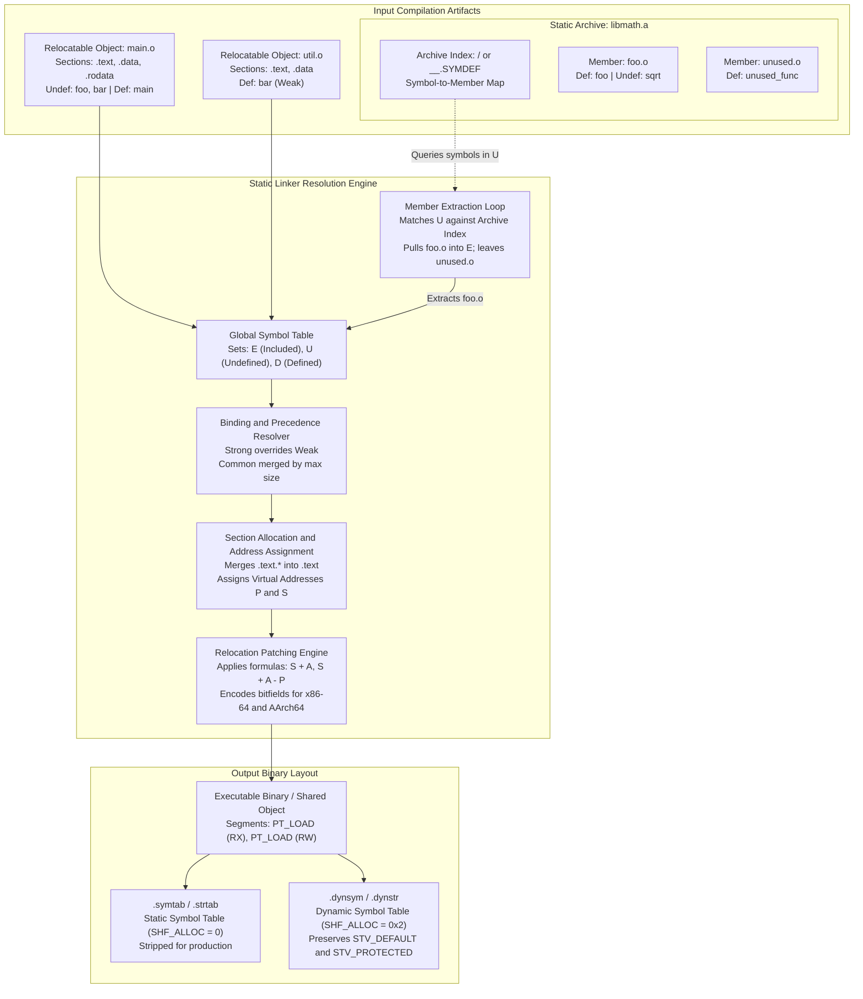
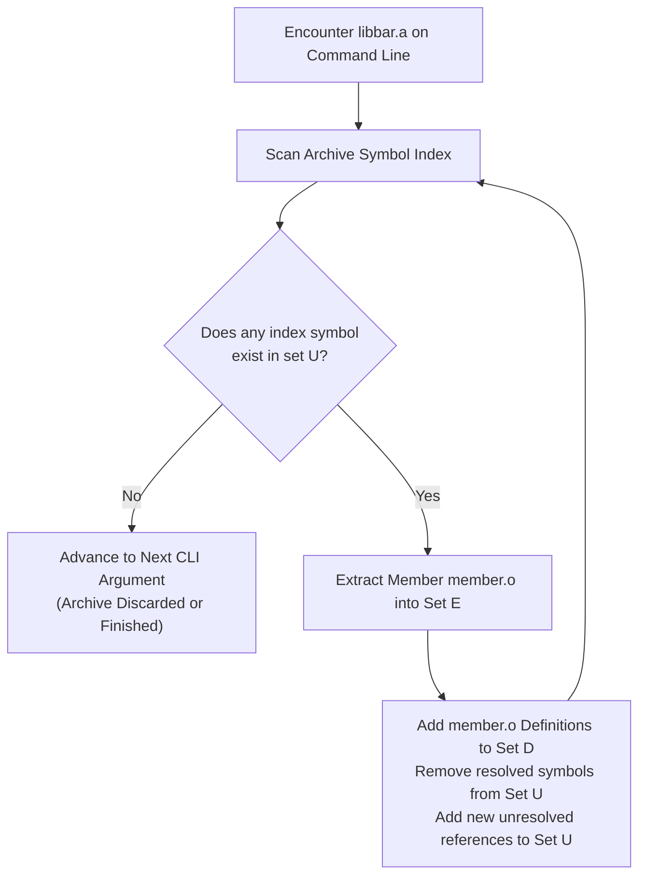

# Symbols, Relocations, and Static Linking

> [!summary] Claim:
> Static linking synthesizes isolated relocatable object files into a unified executable address space by evaluating symbol definitions against unresolved references.
> Single-pass static linkers process archive members lazily against an accumulated undefined symbol set, establishing command-line library ordering as a strict semantic invariant.
> Precedence rules govern symbol binding by giving strong definitions absolute authority over weak symbols and resolving tentative common allocations into uninitialized data sections.
> The static relocation engine iterates through relocation entries to execute target-specific arithmetic, patching machine code immediate fields to finalize all internal control transfers and data references.



## The Mechanism

[[ELF-Mach-O-and-PE-Object-Formats]] establishes how the compiler structures object files into section headers, byte streams, and symbol tables.
Static linking is the link-time phase that transforms these relocatable files (`ET_REL`) into an executable file (`ET_EXEC`) or a shared object (`ET_DYN`).
The linker performs three fundamental tasks: symbol resolution across translation units, section layout with virtual address assignment, and relocation patching.
`Elf64_Sym`, bindings `STB_LOCAL` through `STB_WEAK`, types `STT_NOTYPE` through `STT_FILE`, and `SHN_UNDEF`, `SHN_ABS`, and `SHN_COMMON` are from System V gABI Edition 4.1.
Symbol visibility and `STT_TLS` are from the current generic ABI symbol-table chapter.
Relocation numbers below are from the AMD64 psABI and from AAELF64 release 2026Q3 (issued 3 November 2026).
GNU linker behavior was checked on Binutils 2.42 in the lab image unless a later release is named.

### 1. Symbol Representation in ELF

A symbol represents a programmer-defined or compiler-generated entity such as a function entry point, a global variable, or a section boundary.
In a 64-bit ELF object file, every symbol entry in a symbol table is encoded as a 24-byte `Elf64_Sym` structure:

```c
typedef struct {
    Elf64_Word    st_name;   /* Symbol name (index into string table) */
    unsigned char st_info;   /* Symbol type (bits 3:0) and binding (bits 7:4) */
    unsigned char st_other;  /* Symbol visibility (bits 1:0) */
    Elf64_Half    st_shndx;  /* Section index or special pseudo-index */
    Elf64_Addr    st_value;  /* Symbol value (virtual address or section offset) */
    Elf64_Xword   st_size;   /* Symbol size in bytes */
} Elf64_Sym;
```

The data structure places `st_info` (1 byte) and `st_other` (1 byte) immediately before `st_shndx` (2 bytes).
This layout packs 4 bytes before `Elf64_Addr st_value`, which guarantees natural 8-byte alignment for the 64-bit value field without internal padding bytes.

The byte field `st_info` packs two distinct orthogonal properties:

```c
#define ELF64_ST_BIND(i)   ((i) >> 4)
#define ELF64_ST_TYPE(i)   ((i) & 0xf)
#define ELF64_ST_INFO(b,t) (((b) << 4) + ((t) & 0xf))
```

The symbol binding (`ELF64_ST_BIND`) governs linkage visibility and collision resolution:
- `STB_LOCAL` (value `0`): The symbol is scoped strictly to its defining relocatable object file.
  Static functions and file-scope variables emit local symbols.
  Local symbols never collide across compilation units and are placed first in the symbol table.
- `STB_GLOBAL` (value `1`): The symbol is visible to all object files participating in the link.
  Unsatisfied references to global symbols are resolved across translation units.
- `STB_WEAK` (value `2`): The symbol resembles a global symbol but possesses lower precedence during collision resolution.
  A weak symbol can be overridden by a strong global definition of the same name without raising a multiple-definition error.
- `STB_GNU_UNIQUE` (value `10`): A GNU extension ensuring a single definition across all dynamically loaded modules in a process (used for C++ inline static members).

The symbol type (`ELF64_ST_TYPE`) classifies the underlying program construct:
- `STT_NOTYPE` (value `0`): Unspecified type (commonly used for raw assembly labels or external unresolved references).
- `STT_OBJECT` (value `1`): A data object, such as a variable, array, or structure.
- `STT_FUNC` (value `2`): Executable code, representing a function entry point.
- `STT_SECTION` (value `3`): A symbol associated with a section, used primarily as a relocation target for local symbols.
- `STT_FILE` (value `4`): A local symbol containing the source file name associated with the compilation unit.
- `STT_COMMON` (value `5`): An unallocated common block symbol (tentative definition).
- `STT_TLS` (value `6`): A thread-local storage data entity, handed off to [[Thread-Local-Storage-Models-and-ELF-Relocations]].

The `st_shndx` field identifies the section containing the symbol.
When `st_shndx` holds specific values in the reserved range `0xff00` through `0xffff`, it denotes special semantics:
- `SHN_UNDEF` (value `0`): The symbol is undefined in this object file and must be resolved by another object or dynamic library.
- `SHN_ABS` (value `0xfff1`): The symbol has an absolute value that does not change during relocation (such as linker script constants).
- `SHN_COMMON` (value `0xfff2`): The symbol represents a tentative unallocated global variable.
  The `st_value` field specifies alignment constraints, while `st_size` specifies the required byte allocation.

The `st_other` field reserves its lowest two bits (`st_other & 0x3`) for symbol visibility:
- `STV_DEFAULT` (value `0`): Visibility is determined by the symbol binding.
  Global symbols are visible externally and can be preempted by default when linked into dynamic libraries.
- `STV_INTERNAL` (value `1`): Processor-specific visibility rules, typically treated as hidden.
- `STV_HIDDEN` (value `2`): The symbol is not exported outside the current link component (executable or shared library).
  References to hidden symbols from within the same component bypass the Procedure Linkage Table and Global Offset Table.
- `STV_PROTECTED` (value `3`): The symbol is exported to dynamic symbol tables, but references originating from within the defining component must bind locally.

### 2. Symbol Tables: `.symtab` versus `.dynsym`

An ELF file can contain two distinct symbol table sections: `.symtab` and `.dynsym`.

| Property | `.symtab` (Static Symbol Table) | `.dynsym` (Dynamic Symbol Table) |
| :--- | :--- | :--- |
| Section Type | `SHT_SYMTAB` (`0x02`) | `SHT_DYNSYM` (`0x0b`) |
| Section Flags | None (`0`) | `SHF_ALLOC` (`0x02`) |
| Memory Residency | Disk only (not loaded into virtual memory) | Loaded into process memory during `execve()` |
| Stripping Safety | Can be stripped safely (`strip --strip-all`) | Cannot be stripped without breaking runtime dynamic linking |
| Content Scope | Complete symbols: locals, debug markers, static functions | Public interface: exported functions, imported dynamic references |
| Companion String Table | `.strtab` (`SHT_STRTAB`) | `.dynstr` (`SHT_STRTAB`, `SHF_ALLOC`) |

The static linker uses `.symtab` during static resolution.
When generating a shared object or executable, the static linker constructs `.dynsym` by filtering symbols from `.symtab`.
Any symbol with `STV_HIDDEN` visibility is omitted from `.dynsym`.
On GNU ld 2.42 the output `.symtab` also records that symbol as `STB_LOCAL` with `STV_DEFAULT`, which is the `sym_hidden` row in the lab.
[[Dynamic-Linking-PLT-GOT-and-Loaders]] owns runtime consumption of `.dynsym`.

### 3. Symbol Binding and Precedence Rules

When the linker combines multiple relocatable object files, it builds a global symbol table.
Symbols with identical names across distinct compilation units interact according to defined precedence rules:

```text
Rule 1: Two strong symbols with the same name trigger a fatal link error.
Rule 2: A strong symbol overrides any number of weak symbols with the same name.
Rule 3: Multiple weak symbols resolve to an arbitrary single weak definition.
Rule 4: Common symbols merge into a single BSS allocation sized to the maximum definition.
```

A strong symbol is a function or an initialized global variable (such as `int counter = 1;`).
A weak symbol is declared with `__attribute__((weak))`, `#pragma weak`, or the assembler directive `.weak`.
An `extern` declaration names a symbol defined in another translation unit.
Under `-fcommon`, a C tentative definition such as `int buffer[100];` is a common symbol.
Under `-fno-common`, that same tentative definition is a strong `.bss` definition.
If a strong symbol and a weak symbol collide, the static linker binds all references to the strong symbol.
If only weak symbols exist, the linker arbitrarily selects the first weak definition encountered.

Common symbols originate from tentative definitions in C (such as `int buffer[100];` without `extern` or initializer).
Historically, the C compiler placed tentative definitions into `SHN_COMMON` sections (`-fcommon`).
When the linker resolves multiple common symbols of the same name:
1. It records the maximum size across all tentative definitions (`max(st_size)`).
2. It records the strictest alignment requirement across all definitions (`max(st_value)`).
3. It allocates a single contiguous block in the output `.bss` section matching that maximum size and alignment.

If a common symbol collides with a strong symbol, the strong definition wins, and the linker allocates the strong symbol's size even when a common symbol requested more bytes.
On GNU ld 2.42 a 128-byte common `int big[32]` against `int big = 1` links with exit status 0, allocates 4 bytes, and warns `size of symbol 'big' changed from 128 in c.o to 4 in d.o`.
`--warn-common` adds `definition of 'big' overriding common`.
Starting in GCC 10 (2020) and Clang 11.0.0 (2020), compilers default to `-fno-common`.
Under `-fno-common`, tentative global declarations are emitted directly as strong definitions in `.bss`, causing duplicate tentative declarations across headers to fail immediately with `multiple definition` errors.

### 4. Static Archive (`.a`) Anatomy and Member Extraction Algorithm

A static library (`.a`) is a Unix archive created by the `ar` utility.
The archive file starts with an 8-byte ASCII magic header:

```text
!<arch>\n  (Hexadecimal: 0x21 0x3c 0x61 0x72 0x63 0x68 0x3e 0x0a)
```

Each contained object file member is preceded by a fixed 60-byte ASCII header:

```text
+-------------------+-------------------+-------------------+
| ar_name (16 B)    | ar_date (12 B)    | ar_uid (6 B)      |
+-------------------+-------------------+-------------------+
| ar_gid (6 B)      | ar_mode (8 B)     | ar_size (10 B)    |
+-------------------+-------------------+-------------------+
| ar_fmag (2 B)     | (Object Payload follows immediately)  |
+-------------------+---------------------------------------+
```

Every numerical field in `ar_hdr` is encoded as right-padded decimal or octal ASCII text.
The header terminates with the two magic bytes `ar_fmag` (`0x60 0x0a`, representing ``"`\n"``).
In the System V / GNU archive format, long filenames exceeding 15 characters are stored in a special member named `//`, and individual member headers reference them as `/<offset>`.

The GNU and System V archive index is a special member named `/`.
That member stores a 32-bit big-endian count $N$, then $N$ 32-bit big-endian offsets of member `ar_hdr` headers, then NUL-terminated symbol names.
The BSD and macOS index is a member named `__.SYMDEF` or `__.SYMDEF SORTED`.
That member stores a host-endian byte count, then `ranlib` records (a string-table index plus a member offset), then the string table (FreeBSD `ar(5)`).

#### The Single-Pass Member Extraction Algorithm

Classic Unix static linkers process command-line arguments strictly from left to right in a single pass.
`ld.bfd` still does.
`gold` has been deprecated since Binutils 2.44 (2 February 2025) and is omitted from the default tarball (as of 2026-11).
Inside one archive, GNU ld rescans the index until a pass extracts nothing, which the steps below describe.
The linker maintains three disjoint symbol sets throughout the link:
- $E$: The set of relocatable object files selected to be combined into the final binary.
- $U$: The set of undefined symbol names referenced by files in $E$ but not yet defined.
- $D$: The set of defined symbol names provided by files in $E$.

When the linker encounters a standalone object file `foo.o`:
1. It adds `foo.o` to $E$.
2. For each defined symbol $s$ in `foo.o`, it adds $s$ to $D$ and removes $s$ from $U$ (if present).
3. For each undefined symbol reference $u$ in `foo.o`, if $u \notin D$, it adds $u$ to $U$.

When the linker encounters an archive library `libbar.a`:
1. The linker inspects the archive's symbol index.
2. It checks whether any symbol $s \in U$ matches an entry in the archive symbol index.
3. If no symbol in $U$ matches any symbol defined in `libbar.a`, the entire archive is discarded without extracting any members.
4. If a matching symbol is found, the member object file `member.o` defining that symbol is extracted and added to $E$.
5. The linker updates $D$ and $U$ using `member.o`'s symbol table.
6. Because `member.o` may introduce new undefined symbols that are satisfied by other members inside `libbar.a`, the linker repeats this scan over the archive index.
7. The loop repeats until a full pass over the index extracts no additional members (reaching a fixpoint).
8. The linker closes `libbar.a` and advances to the next command-line argument.



This algorithm yields a critical operational consequence: static archive ordering on the command line is strictly significant.
If `main.o` calls `alpha()`, `libalpha.a` defines `alpha()` and calls `beta()`, and `libbeta.a` defines `beta()`:
- Linking `main.o -lalpha -lbeta` succeeds: `main.o` puts `alpha` in $U$; `libalpha.a` resolves `alpha` and puts `beta` in $U$; `libbeta.a` resolves `beta`.
- Linking `main.o -lbeta -lalpha` fails with an undefined reference to `beta`: when `libbeta.a` is processed, `beta` is not yet in $U$, so `libbeta.a` is discarded.
  Subsequently, `libalpha.a` extracts `alpha.o`, introducing `beta` into $U$, but the linker does not backtrack to `libbeta.a`.

To resolve circular dependencies between archives, the linker provides `--start-group` and `--end-group` (`-Wl,--start-group ... -Wl,--end-group`).
The linker loops over all archives enclosed within the group delimiters until a full scan over all enclosed libraries yields zero new member extractions.
Because repeated archive rescanning causes quadratic I/O overhead on large link jobs, modern linkers (`ld.lld`) employ lazy in-memory symbol tables and provide `--start-lib` / `--end-lib` to treat loose object files with archive semantics without writing `.a` containers.

### 5. Relocation Mechanics and Calculations

Compilers generate machine instructions before final virtual addresses are known.
The compiler emits a placeholder value (often zeros) into the instruction stream and writes an entry into a relocation section.
A relocation entry identifies the exact section offset that needs modification, the target symbol, the arithmetic operation to perform, and an optional constant addend.

ELF defines two relocation structures in `<elf.h>`:

```c
typedef struct {
    Elf64_Addr   r_offset; /* Location to apply relocation */
    Elf64_Xword  r_info;   /* Symbol table index and relocation type */
} Elf64_Rel;

typedef struct {
    Elf64_Addr   r_offset; /* Location to apply relocation */
    Elf64_Xword  r_info;   /* Symbol table index and relocation type */
    Elf64_Sxword r_addend; /* Explicit constant addend */
} Elf64_Rela;
```

`Elf64_Rel` is 16 bytes and relies on an implicit addend stored in the target machine instruction field itself.
`Elf64_Rela` is 24 bytes and stores the constant addend explicitly in `r_addend`.
Both x86-64 (AMD64 psABI) and AArch64 (AAELF64) mandate `Elf64_Rela`.
The `r_info` field encodes the symbol table index in its upper 32 bits and the architecture-specific relocation type in its lower 32 bits:

```c
#define ELF64_R_SYM(i)     ((i) >> 32)
#define ELF64_R_TYPE(i)    ((i) & 0xffffffffL)
#define ELF64_R_INFO(s,t)  ((((Elf64_Xword)(s)) << 32) + ((t) & 0xffffffffL))
```

#### Relocation Variables

The System V psABI specifications use standard algebraic notation to define relocation formulas:
- $A$: The explicit addend stored in `r_addend`.
- $B$: The base virtual address at which a shared object is loaded into memory during execution.
- $G$: The offset into the Global Offset Table (GOT) where the address of the relocation symbol resides.
- $GOT$: The virtual address of the Global Offset Table.
- $L$: The virtual address or section offset of the Procedure Linkage Table (PLT) entry for the symbol.
- $P$: The place (virtual address or section offset) of the storage unit being relocated, computed as `SectionVirtualAddr + r_offset`.
- $S$: The final virtual address of the symbol identified by `ELF64_R_SYM(r_info)`.

#### x86-64 Relocations (System V AMD64 psABI)

On x86-64, relocations patch 32-bit or 64-bit instruction displacement fields:

| Relocation Name | Value | Field Type | Calculation Formula | Semantic Meaning |
| :--- | :--- | :--- | :--- | :--- |
| `R_X86_64_NONE` | 0 | None | None | No relocation performed |
| `R_X86_64_64` | 1 | `word64` | $S + A$ | 64-bit absolute address (pointer tables, global pointers) |
| `R_X86_64_PC32` | 2 | `word32` | $S + A - P$ | 32-bit signed PC-relative offset (RIP-relative data access, local jumps) |
| `R_X86_64_GOT32` | 3 | `word32` | $G + A$ | 32-bit offset into the GOT |
| `R_X86_64_PLT32` | 4 | `word32` | $L + A - P$ | 32-bit PC-relative offset to PLT entry (function calls) |
| `R_X86_64_GOTPCREL` | 9 | `word32` | $G + GOT + A - P$ | 32-bit PC-relative offset to the symbol's GOT entry |
| `R_X86_64_32` | 10 | `word32` | $S + A$ | 32-bit unsigned absolute address (zero-extended) |
| `R_X86_64_32S` | 11 | `word32` | $S + A$ | 32-bit signed absolute address (sign-extended, small code model) |
| `R_X86_64_GOTPCRELX` | 41 | `word32` | $G + GOT + A - P$ | Relaxable 32-bit PC-relative offset to GOT entry |
| `R_X86_64_REX_GOTPCRELX` | 42 | `word32` | $G + GOT + A - P$ | Relaxable GOT reference with REX prefix |

For `R_X86_64_PC32`, the computation $S + A - P$ measures the distance from the relocated immediate field ($P$) to the target symbol ($S + A$).
Because the x86-64 program counter (`%rip`) advances to the start of the next instruction during execution, the compiler accounts for the remaining bytes of the instruction by encoding them as a negative addend (typically $A = -4$).
The signed 32-bit field holds $[-2^{31}, 2^{31} - 1]$.
The x86-64 small code model is a separate rule: the program and its symbols lie in $[0, 2^{31} - 2^{24})$ (addresses `0x00000000` through `0x7effffff`) (AMD64 psABI `low-level-sys-info.tex`, as of 2026-11).

`R_X86_64_GOTPCRELX` is a linker relaxation relocation introduced in GNU Binutils 2.26.
When the symbol is local and the addend is $-4$, the linker rewrites `movq sym@GOTPCREL(%rip), %reg` (opcode `48 8b 05` for `%rax`) to `leaq sym(%rip), %reg` (opcode `48 8d 05`).
In a non-PIC link, a local symbol in the low 32 bits can become `mov $sym, %reg`.
The same relocation rewrites a GOT-indirect `call` or `jmp` into a direct immediate branch (`linker-optimization.tex`).

#### AArch64 Relocations (AAELF64)

AArch64 instructions are strictly 32-bit fixed-width words.
A single instruction cannot embed a full 64-bit absolute address or even a 32-bit displacement.
Instead, AArch64 splits address calculations across instruction pairs using PC-relative page offsets and low-order byte offsets:

| Relocation Name | Value | Field / Instruction | Calculation Formula | Semantic Meaning |
| :--- | :--- | :--- | :--- | :--- |
| `R_AARCH64_NONE` | 0 | None | None | No relocation performed |
| `R_AARCH64_ABS64` | 257 | `word64` | $S + A$ | 64-bit absolute address |
| `R_AARCH64_ABS32` | 258 | `word32` | $S + A$ | Write bits `[31:0]`. Check $-2^{31} \le X < 2^{32}$ (AAELF64 2026Q3). |
| `R_AARCH64_PREL32` | 261 | `word32` | $S + A - P$ | 32-bit PC-relative offset. Check $-2^{31} \le X < 2^{31}$. DWARF `.eh_frame` uses this offset class. |
| `R_AARCH64_ADR_PREL_PG_HI21` | 275 | `adrp` instruction | $\text{Page}(S + A) - \text{Page}(P)$ | High 21 bits of PC-relative 4KB page distance |
| `R_AARCH64_ADD_ABS_LO12_NC` | 277 | `add` (immediate) | $(S + A) \& \text{0xFFF}$ | Low 12 bits of absolute symbol address (no check) |
| `R_AARCH64_LDST64_ABS_LO12_NC` | 286 | `ldr`/`str` (64-bit) | $S + A$ | Write bits `[11:3]` of $S + A$ (the immediate is scaled by 8). No overflow check. |
| `R_AARCH64_JUMP26` | 282 | `b` instruction | $S + A - P$ | 26-bit word distance ($\pm128\text{ MB}$ range) |
| `R_AARCH64_CALL26` | 283 | `bl` instruction | $S + A - P$ | 26-bit word distance with link ($\pm128\text{ MB}$ range) |

The operator $\text{Page}(X)$ is defined as $X \ \& \ \sim\text{0xFFF}$, which clears the lowest 12 bits to align to a 4 KiB page boundary.
The relocation `R_AARCH64_ADR_PREL_PG_HI21` calculates the signed difference in 4 KiB pages:

$$\Delta_{\text{pages}} = \frac{\text{Page}(S + A) - \text{Page}(P)}{4096}$$

The linker encodes this 21-bit signed value into the `adrp` instruction:
- Bits `1:0` of $\Delta_{\text{pages}}$ are placed into instruction bits `30:29`.
- Bits `20:2` of $\Delta_{\text{pages}}$ are placed into instruction bits `23:5`.

Immediately following `adrp`, the relocation `R_AARCH64_ADD_ABS_LO12_NC` extracts the lowest 12 bits of the target address:

$$\text{offset}_{12} = (S + A) \ \& \ \text{0xFFF}$$

This 12-bit unsigned value is written directly into instruction bits `21:10` of the `add` instruction.
The suffix `_NC` stands for "No Check", indicating that the linker must not raise an arithmetic overflow error because the higher bits were already accommodated by `adrp`.

For function calls (`bl`), `R_AARCH64_CALL26` computes $S + A - P$.
Because all AArch64 instructions must be 4-byte aligned, the low two bits of the byte distance are always zero.
The linker shifts the distance right by 2 bits ($(S + A - P) \gg 2$) and packs the resulting 26-bit signed immediate into instruction bits `25:0`.
This yields an addressing range of $\pm128\text{ MB}$.
If a call target exceeds $\pm128\text{ MB}$, the linker inserts a range-extension thunk (also known as a veneer) containing an indirect branch through a register.

## Commands and Numbers to Know

| Entity / Property | Numerical Value / Command Syntax | Scope / Target Platform | Verification Context (as of 2026-11) |
| :--- | :--- | :--- | :--- |
| `Elf64_Sym` Structure Size | 24 bytes | Linux (ELF) | System V ELF gABI 64-bit specification. macOS object files are Mach-O. |
| `Elf64_Rela` Structure Size | 24 bytes | Linux (ELF) | System V ELF gABI 64-bit explicit addend format |
| `Elf64_Rel` Structure Size | 16 bytes | Linux (ELF) | System V ELF gABI 64-bit implicit addend format |
| Unix Archive Global Magic | `!<arch>\n` (8 ASCII bytes) | Both Linux and macOS | POSIX `ar` and System V archive specification |
| Archive Member Header Size | 60 bytes | Both Linux and macOS | Fixed ASCII header preceding every member payload |
| GCC / Clang Common Default | `-fno-common` | Both Linux and macOS | Default since GCC 10 (2020) and Clang 11.0.0 (2020) |
| x86-64 Small Code Model Symbol Range | $[0, 2^{31}-2^{24})$ (`0x00000000` through `0x7effffff`) | Linux x86-64 | AMD64 psABI `low-level-sys-info.tex` (as of 2026-11). A `R_X86_64_PC32` field is a separate signed 32-bit displacement. |
| AArch64 Direct Branch Range | $\pm128\text{ MB}$ ($[-2^{27}, 2^{27}-4]$) | Linux AArch64 | AAELF64 Section 5.7 26-bit immediate word offset |
| AArch64 `adrp` Page Offset Reach | $\pm4\text{ GiB}$ ($[-2^{20}, 2^{20}-1]$ pages) | Linux AArch64 | AAELF64 Section 5.7 21-bit page displacement |
| Inspect Relocatable Object Relocations | `readelf -r <file.o>` | Linux (Binutils 2.47, July 2026; lab image 2.42) | Displays `.rela.text`, `.rela.data` and addends |
| Inspect Exported Dynamic Symbols | `readelf --dyn-syms <file.so>` | Linux (Binutils 2.47, July 2026; lab image 2.42) | Dumps allocable `.dynsym` section |
| Inspect All Static Symbols | `readelf -s <binary>` | Linux (Binutils 2.47, July 2026; lab image 2.42) | Dumps complete `.symtab` symbol table |
| List Undefined Symbols Only | `nm -u <file.o>` | Both Linux and macOS | Dumps symbols with `SHN_UNDEF` (`U`) |
| Group Delimiters for Circular Archives | `-Wl,--start-group ... -Wl,--end-group` | Linux (`ld.bfd` and `ld.lld`; `gold` deprecated since Binutils 2.44) | Instructs linker to loop over archives until fixpoint |
| Force Full Extraction of Archive | `-Wl,--whole-archive ... -Wl,--no-whole-archive` | Linux (`ld.bfd` and `ld.lld`; `gold` deprecated since Binutils 2.44) | Forces extraction of every member object in `.a` |
| macOS Whole Archive Loading | `-Wl,-force_load,<path.a>` | macOS Darwin (`ld64`) | Equivalent to Linux `--whole-archive` for single file |

## Multi-Language Comparison: C / C++ / Rust / Python

| Feature / Behavior | C / C++ | Rust | Python (C Extensions / CTypes) |
| :--- | :--- | :--- | :--- |
| Symbol Name Mangling | C: unmangled identifiers.<br/>C++: Itanium ABI mangling (`_Z...`) encoding namespaces, classes, templates, and parameters. | Modern v0 mangling (`_R...`, RFC 2603) or legacy (`_ZN...`).<br/>Extern blocks use `#[no_mangle]` for C ABI compatibility. | C extension functions must export `PyInit_<name>` unmangled for module initialization. |
| Default Symbol Visibility | Default is `STV_DEFAULT` (all non-static symbols exported and preemptible unless `-fvisibility=hidden` is set). | Crate items are private unless marked `pub`.<br/>`#[no_mangle]` items are publicly exported from the produced library, and the Reference example is a private function (Rust Reference, `no_mangle`).<br/>The Reference says a `staticlib` carries all upstream code and exports all public symbols of it, so a downstream shared library limits that set with a version script or an exported-symbols list (Rust Reference, Linkage).<br/>A local probe (rustc 1.99.0, macOS arm64, `nm`) confirmed that a private `#[no_mangle] extern "C" fn` is exported from both a `cdylib` and a `staticlib`.<br/>In that probe a mangled `pub extern "C" fn` was absent from both symbol tables, so do not expect a mangled `pub` item to be linkable from C (as of 2026-11). | Extension objects default to `STV_DEFAULT`.<br/>CPython's loader passes interpreter `dlopen` flags that set neither `RTLD_GLOBAL` nor `RTLD_LOCAL` (CPython issue 137880).<br/>On Linux, glibc treats that omission as `RTLD_LOCAL` (`dlopen(3)`).<br/>On macOS the omission behaves as `RTLD_GLOBAL` (as of 2026-11).<br/>Build with `-fvisibility=hidden` and default visibility only on `PyInit_<name>`. |
| Common Symbol Handling | Historically `-fcommon` merged tentative definitions.<br/>Modern default is `-fno-common`.<br/>C++ forbids common symbols (always `.bss`). | Common symbols are not generated.<br/>Global static variables are allocated in `.bss` or `.data` sections with strict single definitions. | Python runtime internals rely on `.bss` / `.data`.<br/>Extension modules linking static C libraries inherit toolchain `-fno-common` defaults. |
| Duplicate Symbol Deduplication | C++ inline functions and template instantiations emit COMDAT groups (`SHF_GROUP`) discarded at link time. | Monomorphized generic functions emit linkonce_odr or COMDAT sections to deduplicate across crates. | Not applicable at compile time.<br/>On Linux, CPython's default flags leave one extension's symbols out of the next extension's search.<br/>On macOS the omitted scope flag behaves as `RTLD_GLOBAL`, so an `STV_DEFAULT` helper can be preempted (as of 2026-11).<br/>Two extensions that `DT_NEEDED` the same shared library still share that one library. |
| Static Archive Format | Standard `ar` archive containing `.o` files with GNU `/` or BSD `__.SYMDEF` ranlib index. | `rlib` archives are standard `ar` containers holding `.o` object files and serialized `rmeta` crate metadata. | Not directly compiled; extensions link against system `.a` or shared libraries using standard linkers. |
| Dynamic Symbol Lookup | Functions resolved at compile/link time via PLT/GOT or runtime via `dlsym()`. | Resolved via standard static linking or dynamic linking through foreign function interfaces (`extern "C"`). | `ctypes.CDLL` and `cffi` invoke `dlsym()`.<br/>Cannot resolve `STB_LOCAL` or `STV_HIDDEN` symbols from `.dynsym`. |

## Worked Lab Example

The companion lab in `code/00-Program-Execution/symbol_binding_reloc/` demonstrates the four core static linking mechanisms on a Linux system:
1. Archive extraction ordering and circular dependency resolution.
2. Weak versus strong symbol precedence and common symbol merging.
3. Symbol visibility filtering between `.symtab` and `.dynsym`.
4. Bit-exact verification of AArch64 relocation arithmetic in the recorded `linux-aarch64` run (`gcc` 13.3.0, GNU ld 2.42).

Each check reads the relocation type the assembler emitted from the relocatable objects (`.rela.text`, `.rela.data`) and then checks the word the linker patched in the executable.
The executable must be `ET_EXEC`, so a PIE link fails the lab.
On `x86_64`, `verify_relocs.py` checks `R_X86_64_64`, `R_X86_64_PC32`, and `R_X86_64_PLT32` the same way.
That x86-64 path is outside the recorded transcript below: no `expected/linux-amd64.txt` exists yet.
It was run once under amd64 emulation in a `gcc:13` image (gcc 13.5.0, GNU ld 2.40, not the lab image) and printed the three `MATCH` lines.

Execute the lab using the test harness:

```bash
cd code && python3 -m _harness.verify --record 00-Program-Execution/symbol_binding_reloc/
python3 -m _harness.verify 00-Program-Execution/symbol_binding_reloc/
```

### Lab Execution Output

The test harness executed the lab inside the pinned Linux container environment (`linux-aarch64`).
The exact output recorded in `expected/linux-aarch64.txt` is:

```text
=== 1. Archive Member Extraction Order ===
Linking: main.o libbeta.a libalpha.a
Result: FAIL (undefined reference to 'beta')
Linking: main.o libalpha.a libbeta.a
Result: SUCCESS (exit code 42)
Linking: main.o --start-group libbeta.a libalpha.a --end-group
Result: SUCCESS (exit code 42)

=== 2. Symbol Binding and Precedence Rules ===
Weak symbol overridden by strong symbol:
Result: SUCCESS (priority = 20)
Two conflicting strong symbols:
Result: FAIL (multiple definition of 'priority')
Common symbols with -fcommon:
Result: SUCCESS (merged common symbol size = 128 bytes in .bss)
Common symbols with -fno-common:
Result: FAIL (multiple definition of 'shared_comm')

=== 3. Symbol Visibility and Symbol Tables ===
Relocatable object .symtab:
sym_default: bind=GLOBAL, vis=DEFAULT
sym_hidden: bind=GLOBAL, vis=HIDDEN
sym_protected: bind=GLOBAL, vis=PROTECTED
Shared library .symtab:
sym_default: bind=GLOBAL, vis=DEFAULT
sym_hidden: bind=LOCAL, vis=DEFAULT
sym_protected: bind=GLOBAL, vis=PROTECTED
Shared library .dynsym (exported for dynamic linking):
sym_default: bind=GLOBAL, vis=DEFAULT
sym_hidden: ABSENT
sym_protected: bind=GLOBAL, vis=PROTECTED

=== 4. Static Relocation Calculations ===
Architecture: aarch64
Relocation R_AARCH64_ABS64: S + A -> MATCH
Relocation R_AARCH64_ADR_PREL_PG_HI21: Page(S + A) - Page(P) -> MATCH
Relocation R_AARCH64_ADD_ABS_LO12_NC: (S + A) & 0xFFF -> MATCH
Relocation R_AARCH64_CALL26: S + A - P -> MATCH
```

### Mathematical Breakdown of Step 4

The verification script `verify_relocs.py` parses the generated ELF binary headers directly using Python's `struct` module.
It reads the symbol virtual addresses and validates the exact bitfield patches.
The addresses in this section are the layout of one non-PIE link (`gcc` 13.3.0, GNU ld 2.42, `linux-aarch64`).
The script prints `MATCH` lines only.
`objdump -d` on that binary shows `400628: 90000100 adrp`, `40062c: 9100a000 add`, and `400640: 94000003 bl 40064c`.

- `target_var` virtual address: $S = \text{0x420028}$, addend $A = 0$.
- `caller` virtual address: $P_{\text{caller}} = \text{0x400628}$.
- Page calculation for `R_AARCH64_ADR_PREL_PG_HI21`:
  $$\text{Page}(S + A) = \text{0x420028} \ \& \ \sim\text{0xFFF} = \text{0x420000}$$
  $$\text{Page}(P) = \text{0x400628} \ \& \ \sim\text{0xFFF} = \text{0x400000}$$
  $$\Delta_{\text{pages}} = \frac{\text{0x420000} - \text{0x400000}}{4096} = 32 = \text{0x20}$$
  Bits `1:0` ($0$) are placed at bits `30:29`.
  Bits `20:2` ($8$) are placed at bits `23:5` ($8 \ll 5 = \text{0x100}$).
  Base `adrp x0, 0` instruction is `0x90000000`.
  Final patched instruction word: $\text{0x90000000} \ | \ \text{0x100} = \text{0x90000100}$, matching binary byte content exactly.
- Low-order offset calculation for `R_AARCH64_ADD_ABS_LO12_NC`:
  $$\text{offset}_{12} = \text{0x420028} \ \& \ \text{0xFFF} = \text{0x028}$$
  Base `add x0, x0, #0` instruction is `0x91000000`.
  Offset shifted to bits `21:10`: $\text{0x028} \ll 10 = \text{0xa000}$.
  Final patched instruction word: $\text{0x91000000} \ | \ \text{0xa000} = \text{0x9100a000}$, matching binary byte content exactly.
- Function call calculation for `R_AARCH64_CALL26`:
  `target_func` virtual address: $S = \text{0x40064c}$.
  `bl` instruction virtual address: $P_{\text{bl}} = \text{0x400640}$.
  $$S + A - P = \text{0x40064c} - \text{0x400640} = 12 \text{ bytes}$$
  $$\text{Word displacement} = \frac{12}{4} = 3$$
  Base `bl` instruction opcode is `0x94000000`.
  Final patched instruction word: $\text{0x94000000} \ | \ 3 = \text{0x94000003}$, matching binary byte content exactly.

## Pitfalls

> [!warning] Pitfall: Command-Line Archive Ordering Failure
> Placing a static archive before the object file that references it causes the linker to discard the archive members.
> When the linker processes `libfoo.a` before `main.o`, the set of unresolved symbols $U$ does not yet contain references introduced by `main.o`.
> The linker inspects `libfoo.a`'s index, finds no symbols matching $U$, extracts zero members, and ignores `libfoo.a`.
> When `main.o` is subsequently parsed, its references remain unsatisfied, terminating the link with `undefined reference` errors.
> Remediation: Always place static libraries after the object files that consume them, ordered from high-level libraries to low-level dependencies, or wrap interdependent archives in `--start-group ... --end-group`.

> [!warning] Pitfall: Silent Common Symbol Type and Size Collisions
> When compiling with legacy `-fcommon`, uninitialized global variables of the same name in different translation units merge silently without a link-time error.
> If translation unit A declares `int counter;` (4 bytes) and translation unit B declares `double counter;` (8 bytes) without `extern`, the linker allocates 8 bytes in `.bss`.
> Writing to `counter` from translation unit A modifies 4 bytes, while reading it from translation unit B accesses 8 bytes, causing memory aliasing bugs that pass link-time checks.
> Remediation: Always enforce `-fno-common` across all compilation flags to force the compiler to emit strong definitions that trigger fatal linker errors upon collision.

> [!warning] Pitfall: Protected Visibility Data Pointer Inequality (Copy Relocations)
> Marking a global data symbol `__attribute__((visibility("protected")))` in a shared library is unsafe when a non-PIE executable takes the address of that data.
> If the link is accepted, the static linker emits `R_X86_64_COPY`, the dynamic loader copies the initial value into the executable's `.bss`, and the library's protected references stay on the library's own copy.
> The process then has two addresses for one C object.
> ld.lld rejects that link with `cannot preempt symbol` (overridable with `--ignore-data-address-equality`).
> GNU ld 2.39 and later, on x86-64, rejects it with `copy relocation against non-copyable protected symbol` (binutils PR ld/28875) (as of 2026-11).
> Remediation: Restrict `STV_PROTECTED` to function symbols, or use `STV_HIDDEN` for internal variables and expose explicit accessor functions.

> [!warning] Pitfall: Global Symbol Bleed Across Python C Extensions
> Compiling Python C extension modules without `-fvisibility=hidden` leaves helper functions exported with `STV_DEFAULT` in `.dynsym`.
> CPython loads an extension with the interpreter's `dlopen` flags (`Python/dynload_shlib.c`).
> Those flags set neither `RTLD_GLOBAL` nor `RTLD_LOCAL` (CPython issue 137880, 2025).
> On Linux, glibc treats the omitted scope flag as `RTLD_LOCAL` (`dlopen(3)`), so one extension's symbols are outside the next extension's search.
> On macOS, the omitted scope flag behaves as `RTLD_GLOBAL`, so a later extension can bind to an earlier extension's `STV_DEFAULT` symbol (as of 2026-11).
> Two extensions that list the same shared library in `DT_NEEDED` still share that one library instance.
> A static archive linked into both extensions is a separate copy in each extension.
> Remediation: Pass `-fvisibility=hidden` by default and mark only `PyInit_<name>` with `__attribute__((visibility("default")))`.

> [!warning] Pitfall: Relocation Truncation Overflow in Monolithic Binaries
> The x86-64 small code model places the program and its symbols in $[0, 2^{31} - 2^{24})$ (`0x00000000` through `0x7effffff`).
> A `R_X86_64_PC32` displacement is a separate signed 32-bit field, range $[-2^{31}, 2^{31})$.
> When that field overflows, GNU ld reports `relocation truncated to fit: R_X86_64_PC32 against '.text'`.
> ld.lld reports `relocation R_X86_64_PC32 out of range`.
> On x86-64, `-mcmodel=medium` places large data beyond 2 GiB, and `-mcmodel=large` is the wider model.
> The AArch64 small code model, which is the default, keeps each symbol within 4 GiB of the instruction that addresses it.
> GCC accepts `-mcmodel=tiny`, `-mcmodel=small`, and `-mcmodel=large` on AArch64.
> Direct `b` and `bl` branches reach $\pm128\text{ MB}$, and a longer call gets a linker veneer.
> `adrp` fails the link when the page distance falls outside $[-2^{32}, 2^{32})$.
> A static AArch64 link that outgrows the small model uses `-mcmodel=large`.
> `R_AARCH64_PREL32` is a data relocation with a signed 32-bit range, checked as $-2^{31} \le X < 2^{31}$.
> Linker section ordering and [[Linkers-LTO-PGO-AutoFDO-and-BOLT]] keep callers near callees.

## At Scale

In large monolithic codebases, link time dominates many developer inner loops and CI builds.
Static linking mechanics impose distinct scaling constraints across four operational dimensions:

### 1. Linker Architecture: `ld.bfd` vs `ld.lld` vs `mold`

Traditional GNU linkers (`ld.bfd`) were designed in an era of constrained memory, relying on single-threaded, sequential file passes and on-disk data structures.
As debug sections (`.debug_info`) grew to multiple gigabytes per binary, `ld.bfd` became CPU-bound and memory-bound on symbol string deduplication and relocation processing.

Modern linkers rethink this architecture:
- `ld.lld` (LLVM Linker): Utilizes multi-threading, memory-mapped input files, parallel string merging, and lock-free symbol resolution tables.
- `mold`: Multi-core linker with parallel relocation scanning, concurrent section layout, and SIMD string hashing.
  Version 3.0.0 (5 October 2026) is the Rust rewrite.
  The last C++ release was 2.42.1.

| Linker | Multi-Threaded Scaling | Archive Processing Model | One Node.js link, about 160 MB, median of 6 (as of 2026-11, Linux) |
| :--- | :--- | :--- | :--- |
| `ld.bfd` | Single-threaded | Classic single-pass member extraction | The cited run used Binutils 2.41 at 2.52 s. The current release is 2.47 (July 2026). The lab image has 2.42. |
| `ld.gold` | Threaded | Single-pass with parallel relaxation | Deprecated since Binutils 2.44 (February 2025) and omitted from the default tarball. Binutils 2.41 measured 1.46 s on that link (about 1.7x that bfd). |
| `ld.lld` | Threaded | In-memory lazy symbol resolution | LLVM 23.1.5 (3 November 2026). That measurement did not publish an lld time. |
| `mold` 3.0.0 | Scalable (SIMD / tasks) | Parallel symbol table pre-scan | 0.49 s at 1 thread, 0.13 s at 8 threads, 0.11 s at 128 threads (about 23x that bfd). Daniel Lemire, 6 October 2026, dual-socket Xeon Gold 6548N. |

### 2. Static Archives vs Thin Archives vs `--start-lib`

In large enterprise build systems (such as Bazel or Buck2), packaging object files into static archive files (`.a`) is an anti-pattern:
1. Creating an archive requires writing every `.o` file payload to disk twice: once during compilation, and once when `ar` bundles them into the `.a` container.
2. `ranlib` must construct the `/` symbol table member, which duplicates symbol strings already present in each `.o` file's `.strtab`.
3. The linker must read the archive header, parse member offsets, and perform redundant file seeking.

Modern build systems replace static archives with two alternatives:
- Thin Archives (`ar crsT libfoo.a *.o`): The archive stores only the index and relative filesystem paths to the original `.o` files, eliminating file copying.
- Object File Groups (`--start-lib ... --end-lib`): The build system passes loose `.o` files directly to `ld.lld` or `mold` enclosed within `--start-lib` and `--end-lib` flags.
  The linker treats these loose objects with lazy archive semantics (extracting them only if they satisfy an unresolved symbol in $U$), completely eliminating the archive creation step.

### 3. Dead Code Stripping: Section Splitting and ICF

By default, an ELF compiler places all functions into a single `.text` section and all global variables into a single `.data` section.
If the linker needs a single function from an object file, it is forced to include the entire `.text` section, dragging in unreferenced helper functions and data.

Engineering organizations enforce two build flags at scale:
- `-ffunction-sections -fdata-sections`: The compiler emits each function into its own unique section (e.g., `.text.my_func`) and each variable into `.data.my_var`.
- `-Wl,--gc-sections`: During the link, the static linker traces symbol references starting from program entry points (`_start` or `main`).
  Any section not reachable through the relocation graph is omitted from the output binary.
  How much of the input that removes depends on the program.
- `-Wl,--icf=all` (Identical Code Folding): `ld.lld` and `mold`, and the deprecated `gold` linker, compare the byte instructions and relocation graphs of identical functions (such as identical C++ template instantiations).
  When two functions are identical, the linker folds them into a single memory location, patching relocations to point to the shared instance.

### 4. Enterprise Decision Matrix

```text
Decision Rule 1: Replace ld.bfd with ld.lld or mold in all local developer debug loops.
Decision Rule 2: Configure build systems (Bazel/Buck2) to emit --start-lib/--end-lib instead of .a files.
Decision Rule 3: Enforce -ffunction-sections -fdata-sections -Wl,--gc-sections on all static release builds.
Decision Rule 4: If debug link times dominate CI, enable Split DWARF (-gsplit-dwarf) to decouple DWARF from linking.
```

[[DWARF-Debug-Information-and-Symbol-Bundles]] details how Split DWARF (`.dwo` files) prevents the static linker from having to process debug info sections during the link phase.

## Practice Drill

> [!tip] Practice Drill: Diagnose and Resolve an Archive Ordering Deadlock
> In this exercise, you will manually simulate a production link failure caused by archive dependency cycles and resolve it using two distinct methods.
>
> 1. Create four source files in a scratch directory:
>    - `driver.c`: Calls `engine_start()`.
>    - `engine.c`: Defines `engine_start()` and calls `logger_log()`.
>      It does not define `engine_status()`.
>    - `status.c`: Defines `engine_status()`.
>    - `logger.c`: Defines `logger_log()` and calls `engine_status()`.
> 2. Compile each file to a relocatable object: `gcc -c driver.c engine.c status.c logger.c`.
> 3. Pack them into separate archives:
>    - `ar cr libengine.a engine.o status.o`
>    - `ar cr liblogger.a logger.o`
> 4. Link in linear order: `gcc driver.o -L. -lengine -llogger -o app`.
>    `engine.o` is extracted to satisfy `engine_start` and adds `logger_log` to the undefined set.
>    `logger.o` is extracted next and adds `engine_status`.
>    `libengine.a` is already closed, so `status.o` stays inside it and the link fails with `undefined reference to 'engine_status'`.
>    Putting `engine_status` in `engine.c` instead makes this command succeed, because that symbol arrives with `engine_start`.
> 5. Resolve the failure with the GNU group syntax: `gcc driver.o -L. -Wl,--start-group -lengine -llogger -Wl,--end-group -o app`.
>    On GNU ld 2.42 that link exits 0.
> 6. Resolve the failure without group flags by passing the loose objects to `ld.lld` or `mold`:
>    `clang driver.o -fuse-ld=lld -Wl,--start-lib engine.o logger.o status.o -Wl,--end-lib -o app`.
>    The lab image's GNU ld 2.42 rejects `--start-lib`, and that image has no `ld.lld`.
> 7. Run `readelf -s app | grep -E "engine|logger"` to verify that `engine_start`, `engine_status`, and `logger_log` are present with `GLOBAL DEFAULT` binding in `.symtab`.

## Interview Questions

### L5: Archive Extraction Order

Why does `gcc main.o -lmath -lengine` fail with an undefined reference when `libmath.a` calls functions in `libengine.a` and `libengine.a` calls functions in `libmath.a`?
How does the single-pass linker algorithm explain this failure, and what are two ways to fix it?

> [!success]- Answer
> The classic static linker processes input files sequentially from left to right in a single pass.
> It maintains a set of unresolved symbol names $U$.
> When `libmath.a` is processed, its member objects are extracted to satisfy unresolved references from `main.o`.
> However, these newly extracted math objects introduce new references to functions defined in `libengine.a`, adding them to $U$.
> Next, the linker processes `libengine.a`, extracting members that resolve those references, but those engine members in turn introduce new references back to `libmath.a`.
> Because the linker has already passed `libmath.a` and does not backtrack, those new references remain in $U$ when the command line terminates, causing an `undefined reference` error.
> The issue can be resolved by:
> 1. Enclosing the circular libraries in group flags: `-Wl,--start-group -lmath -lengine -Wl,--end-group`, which instructs the linker to repeatedly rescan the libraries until no new references are added to $U$.
> 2. Repeating the dependent library on the command line: `gcc main.o -lmath -lengine -lmath`.

### L5: Symbol Tables (.symtab vs .dynsym)

What is the difference between the `.symtab` section and the `.dynsym` section in an ELF executable?
Which one is required for a dynamically linked binary to run, and why can `strip` safely remove one but not the other?

> [!success]- Answer
> `.symtab` is the complete static symbol table with section type `SHT_SYMTAB`.
> It contains all program symbols, including local static functions, file names, compilation markers, and non-exported symbols.
> It lacks the `SHF_ALLOC` flag, meaning the operating system kernel does not load it into process virtual memory during `execve()`.
> The `strip` utility can safely remove `.symtab` because the binary does not require it for execution.
> `.dynsym` is the dynamic symbol table with section type `SHT_DYNSYM`.
> It has the `SHF_ALLOC` flag set and is mapped directly into process virtual memory.
> It contains only the global symbols required for runtime dynamic linking (exported library interfaces and unresolved external references resolved via dynamic loaders or `dlsym()`).
> Stripping `.dynsym` corrupts the runtime dynamic linkage structures, rendering the executable unstartable by the dynamic linker.

### L6: Relocation Arithmetic Derivation

Derive the mathematical calculation for `R_X86_64_PC32` on x86-64 and `R_AARCH64_ADR_PREL_PG_HI21` on AArch64.
Why does the x86-64 relocation typically require a negative addend (such as $A = -4$) in compiler-generated assembly?

> [!success]- Answer
> For `R_X86_64_PC32`, the formula is $S + A - P$.
> Here, $S$ is the virtual address of the target symbol, $A$ is the relocation addend, and $P$ is the virtual address of the 4-byte immediate field being patched.
> During instruction execution, the CPU's `%rip` register points to the *next* instruction, not the immediate field $P$.
> Because the 4-byte displacement occupies the final 4 bytes of the current instruction, the next instruction starts at $P + 4$.
> The true PC-relative distance required by the CPU is $S - (P + 4) = S - 4 - P$.
> The compiler accounts for this by encoding the addend as $A = -4$, making the standard formula $S + A - P$ evaluate correctly to $S - 4 - P$.
>
> For `R_AARCH64_ADR_PREL_PG_HI21`, the formula is $\text{Page}(S + A) - \text{Page}(P)$, where $\text{Page}(X) = X \ \& \ \sim\text{0xFFF}$.
> It computes the difference between the 4 KiB page containing the symbol ($S + A$) and the 4 KiB page containing the instruction ($P$).
> The result is divided by 4096 to yield a 21-bit signed page count, which is packed into bits `30:29` (low 2 bits) and `23:5` (high 19 bits) of the `adrp` instruction word.

### L6: Predict-the-Output: Weak vs Strong vs Common Collision

Given the following two translation units linked together with `gcc -fcommon file1.c file2.c -o app`:

```c
/* file1.c */
int balance;
__attribute__((weak)) int status = 1;
int get_val(void) { return balance + status; }

/* file2.c */
int balance = 100;
int status = 2;
int main(void) { return get_val(); }
```

Predict the return code of `app`.
Then predict what happens if the compilation flag is changed to `gcc -fno-common file1.c file2.c -o app`.

> [!success]- Answer
> Under `gcc -fcommon`, the program compiles cleanly and returns `102` (exit code `102`).
> Rationale:
> 1. In `file1.c`, `int balance;` is a tentative definition placed in `SHN_COMMON`.
>    In `file2.c`, `int balance = 100;` is an initialized strong global definition.
>    The linker resolves the collision by binding `balance` to the strong definition in `file2.c` ($100$).
> 2. In `file1.c`, `status` is a weak global variable initialized to $1$.
>    In `file2.c`, `status` is a strong global variable initialized to $2$.
>    Rule 2 dictates that the strong symbol overrides the weak symbol, binding `status` to $2$.
> 3. `get_val()` returns $100 + 2 = 102$.
>
> If compiled with `gcc -fno-common`, the link fails with a fatal error: `multiple definition of 'balance'`.
> Under `-fno-common`, `int balance;` in `file1.c` is emitted as a strong uninitialized definition in `.bss`.
> When the linker encounters two strong definitions of `balance` (`file1.c` in `.bss` and `file2.c` in `.data`), Rule 1 triggers a multiple definition link error.

### L6: Debug-This: Static Archive Missing Symbol at Runtime

An engineer builds a shared library `libplugin.so` by linking a static archive:
`gcc -shared -o libplugin.so plugin.o libcore.a`
The build succeeds without errors.
However, when the main application dynamically loads `libplugin.so` via `dlopen()` and calls `dlsym(handle, "core_init")`, `dlsym` returns `NULL`.
Running `readelf -s libcore.a | grep core_init` confirms that `core_init` is defined in `core_init.o` inside `libcore.a`.
Why is `core_init` missing from `libplugin.so`, and how do you fix it without modifying source code?

> [!success]- Answer
> The issue is caused by the static linker's selective member extraction algorithm.
> When `libplugin.so` was linked, `plugin.o` did not contain any unresolved references to `core_init`.
> Because no symbol in the linker's undefined set $U$ referenced `core_init`, the linker never extracted `core_init.o` from `libcore.a`, completely discarding it from the resulting shared object.
> The link succeeded because no unresolved references were left unsatisfied.
> To fix this without modifying code, force the linker to extract all members of the archive regardless of whether they satisfy current references in $U$:
> `gcc -shared -o libplugin.so plugin.o -Wl,--whole-archive libcore.a -Wl,--no-whole-archive`
> On macOS, the equivalent linker option is:
> `gcc -dynamiclib -o libplugin.dylib plugin.o -Wl,-force_load,libcore.a`.

### L7: Protected Visibility and Copy Relocation Hazards

Why does the ELF specification's `STV_PROTECTED` visibility create severe correctness hazards for global data symbols, leading modern toolchain engineers to recommend against its use?
Explain the exact mechanism involving copy relocations (`R_X86_64_COPY`).

> [!success]- Answer
> `STV_PROTECTED` specifies that a symbol is exported to dynamic symbol tables, but all references originating within the defining shared object must bind locally to the defining instance rather than being preempted.
> When a non-position-independent executable (non-PIE) references a global variable exported by a shared library, the executable's code requires direct, absolute addressing.
> Because the executable cannot alter its pre-allocated data addresses at runtime, the static linker generates an `R_X86_64_COPY` relocation.
> At program startup, the dynamic loader copies the initial data from the shared library into the executable's `.bss` segment, redirecting external references to the executable's copy.
> If that link is accepted, protected references inside the shared library stay on the library's own copy, and the executable uses the copied instance.
> The process then has two addresses for one C object, so pointer equality fails and the two copies diverge.
> ld.lld rejects this link with `cannot preempt symbol` (overridable with `--ignore-data-address-equality`).
> GNU ld 2.39 and later, on x86-64, rejects it with `copy relocation against non-copyable protected symbol` (binutils PR ld/28875) (as of 2026-11).

### L7: Linker Scalability and `--start-lib` Internals

How does the `--start-lib` and `--end-lib` mechanism in modern linkers (`ld.lld`, `mold`) fundamentally differ from traditional Unix archive (`.a`) processing, and why does it significantly improve build performance in monorepo architectures?

> [!success]- Answer
> In traditional archive processing, the build system must execute the `ar` tool to write a composite file containing an 8-byte magic header, 60-byte headers per member, and an index member constructed by `ranlib`.
> In a large monorepo with tens of thousands of targets, this involves massive redundant disk writes and serialization of symbol tables that already exist inside individual `.o` files.
> During linking, `ld.bfd` reads the archive headers and seeks across the file to extract member payloads.
> The `--start-lib` / `--end-lib` mechanism bypasses archive construction entirely.
> The build system passes loose `.o` files directly to the linker between `--start-lib` and `--end-lib` flags.
> The linker treats these loose object files with lazy archive semantics:
> Instead of immediately adding all sections to the binary, the linker indexes their symbol tables in memory and marks them as "lazy".
> An object file is only parsed, relocated, and included in the output if one of its symbols satisfies an active undefined reference in $U$.
> This eliminates the CPU and disk I/O cost of creating `.a` files, avoids duplicate string table allocations, and allows the linker to parse object headers concurrently in memory.

### L7+: Linker Relocation Relaxation Mechanics

Explain the concept of linker relaxation using `R_X86_64_GOTPCRELX`.
How does the static linker rewrite machine code bytes at link time, and what specific hardware execution benefit does this provide?

> [!success]- Answer
> When code is compiled with `-fPIC`, the compiler accesses global variables through the Global Offset Table to allow for dynamic interposition:
> `movq sym@GOTPCREL(%rip), %rax` (Opcode: `48 8b 05 <disp32>`, requiring an indirect memory load).
> The compiler emits an `R_X86_64_GOTPCRELX` (or `R_X86_64_REX_GOTPCRELX`) relocation.
> During static linking (or when creating a non-preemptible binary where `sym` is hidden or resolved locally), the static linker detects that `sym`'s final virtual address is known and cannot be preempted at runtime.
> Instead of allocating a GOT slot and forcing the CPU to perform an extra memory load, the linker relaxes the instruction.
> It rewrites that `mov` into `leaq sym(%rip), %rax` (opcode `48 8d 05 <disp32>`) when the symbol is local and the addend is $-4$.
> In a non-PIC link, a local symbol in the low 32 bits can become `mov $sym, %reg`.
> A GOT-indirect `call` or `jmp` becomes a direct immediate branch.
> The `lea` form drops the extra load through the GOT and uses RIP-relative addressing.

## Further Reading

- System V Application Binary Interface (Edition 4.1): The authoritative foundation for ELF object formats, symbol tables, and static relocation models.
- System V AMD64 psABI, including the living `low-level-sys-info.tex` and `linker-optimization.tex`: x86-64 code models, relocation formulas, and relaxation types.
- ELF for the Arm 64-bit Architecture (AAELF64 release 2026Q3, issued 3 November 2026): Relocation encodings, `adrp` page arithmetic, and call veneers.
- John R. Levine, *Linkers and Loaders* (2000): The classic text detailing storage allocation, symbol resolution algorithms, and link-time history.
- Randal E. Bryant and David R. O'Hallaron, *Computer Systems: A Programmer's Perspective* (3rd Edition, Chapter 7): The definitive conceptual introduction to static linking and symbol resolution for systems engineers.
- Fangrui Song (MaskRay), "Symbol processing" (2021): An exhaustive, implementation-level breakdown of global symbol table mechanics in modern linkers.
- Fangrui Song (MaskRay), "Archives and --start-lib" (2022): Technical analysis of traditional Unix archive extraction limitations and modern lazy object processing.
- Fangrui Song (MaskRay), "All about COMMON symbols" (2022): Comprehensive historical and technical exploration of Fortran/C common blocks and `-fno-common`.
- GNU Binutils `ld` manual (lab image 2.42; release 2.47, July 2026): Command-line options, archive groups, and section garbage collection.

## Related

- Prerequisites: [[ELF-Mach-O-and-PE-Object-Formats]]
- Next: [[Dynamic-Linking-PLT-GOT-and-Loaders]]
- See also: [[02-Programming-Languages/C++/CPP_Zero_to_Godhood/Volume_08_Advanced_Systems/Chapter_102_Linking_Loading_ABI/Chapter_102_Linking_Loading_ABI_and_WPO|Chapter_102_Linking_Loading_ABI_and_WPO]]
- Lab: `code/00-Program-Execution/symbol_binding_reloc/` (requires: linux)
