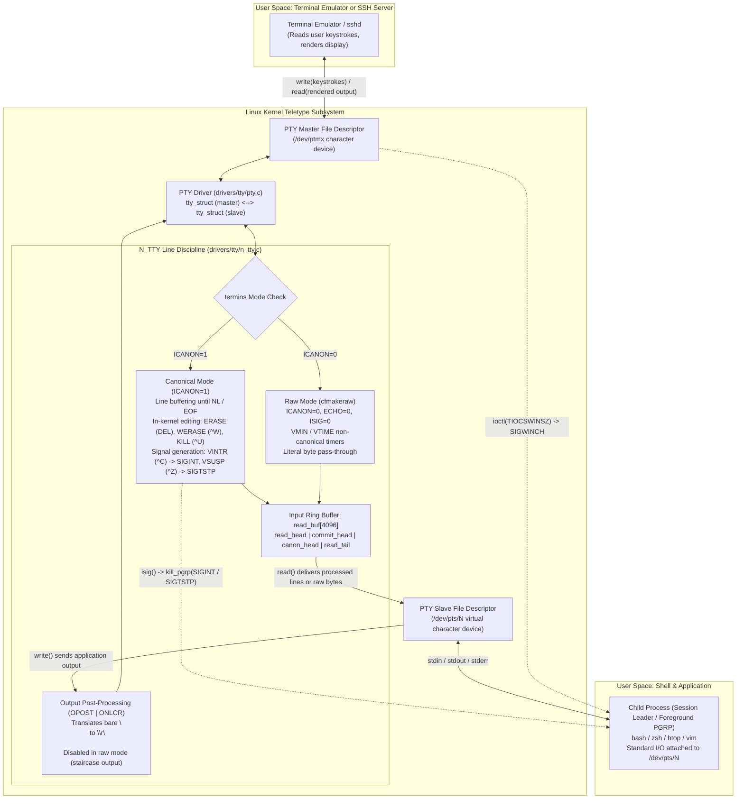
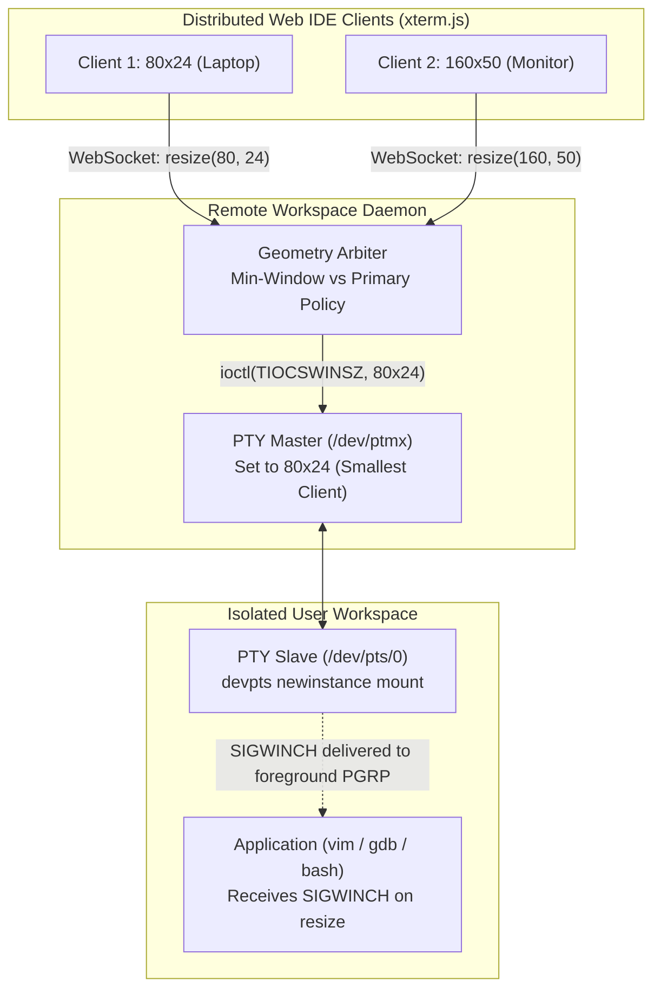

# TTYs, PTYs, and Line Discipline

> [!summary] Claim:
> A terminal device in Unix is a bidirectional character pipeline split into an underlying hardware or virtual transport and an intermediary kernel line discipline that parses in-flight character streams.
> Pseudoterminals (PTYs) emulate physical serial lines via a multiplexed master/slave pair (`/dev/ptmx` and `/dev/pts/*`) where userland terminal emulators drive the master end and ordinary programs attach to the slave end.
> The kernel `N_TTY` line discipline processes input line buffering, in-kernel editing, carriage-return translation, and signal generation in canonical mode, or passes bytes directly through to userland buffers when placed in raw mode via `cfmakeraw()`.
> Terminal dimensions exist as advisory kernel state propagated to the foreground process group via `TIOCSWINSZ` and `SIGWINCH`.



## The Mechanism

The Unix terminal subsystem is one of the oldest abstractions in computing, originating from electromechanical teleprinters (Teletype Model 33 ASR) attached to mainframes via serial RS-232 lines.
Because hardware teleprinters transmitted characters at slow serial rates (such as 110 or 300 baud), operating system kernels assumed responsibility for local echoing, line editing, and control character decoding.
The line discipline abstraction was codified by Dennis Ritchie in Version 7 Unix (1979) to cleanly decouple physical asynchronous communication drivers (UARTs) from high-level terminal semantics.
Understanding the terminal subsystem requires inspecting four distinct layers: PTY allocation, line discipline buffering, session job control, and terminal attribute configuration.

### 1. Pseudoterminal Architecture: Master/Slave Multiplexing

Physical terminals are backed by hardware device drivers, such as serial ports (`/dev/ttyS0`) or virtual console memory (`/dev/tty1`).
Terminal emulators (such as Alacritty, Kitty, GNOME Terminal, and tmux) and remote shell daemons (`sshd`) do not possess physical serial hardware.
Instead, they allocate a pseudoterminal (PTY), which is a software-constructed, bidirectional pair of virtual character devices.

Historically, 4.2BSD implemented PTYs using static device nodes: master devices were named `/dev/pty[p-za-e][0-9a-f]` and slave devices were named `/dev/tty[p-za-e][0-9a-f]`.
A daemon was forced to loop across all 256 potential master paths, attempting an `open()` on each until one succeeded without `EIO`, `EBUSY`, or `ENOENT`.
This design suffered from severe race conditions, denial of service attacks, security leaks, and a fixed architectural ceiling on concurrent terminal sessions.

The Single UNIX Specification (UNIX 98) replaced static device probing with dynamic pseudoterminal multiplexing via `/dev/ptmx` and the `devpts` virtual filesystem:

```
posix_openpt(O_RDWR | O_NOCTTY)
    |
    +--> Opens /dev/ptmx (Major 5, Minor 2)
    |    Kernel allocates struct tty_struct (master) and pts node index
    |
grantpt(master_fd)
    |
    +--> Verifies slave ownership and permissions (often a no-op on modern devpts)
    |
unlockpt(master_fd)
    |
    +--> Clears lock flag in kernel via ioctl(master_fd, TIOCSPTLCK, &zero)
    |
ptsname_r(master_fd, buf, buflen) OR ioctl(master_fd, TIOCGPTPEER, flags)
    |
    +--> Resolves /dev/pts/N or directly creates slave file descriptor (Linux 4.13+)
```

When a process opens `/dev/ptmx`, the kernel entry point `ptmx_open()` in `drivers/tty/pty.c` invokes `devpts_new_index()` in `fs/devpts/inode.c` to allocate an unused terminal index from an internal ID allocator (`ida_alloc_max`).
It instantiates two connected `struct tty_struct` instances: one for the pseudoterminal master (PTM) and one for the pseudoterminal slave (PTS).
The master file descriptor is returned to the allocating process.
The slave device node is dynamically instantiated inside the `devpts` filesystem at `/dev/pts/<index>`.

The slave node remains locked by default; userland calls to `open(/dev/pts/<index>)` fail with `EACCES` or `EIO` until the controlling process executes `unlockpt(master_fd)`, which issues the `TIOCSPTLCK` ioctl to clear the kernel lock bit.
Traditionally, the allocating process then called `ptsname_r()` to obtain the string path `/dev/pts/<index>` and called `open()` to acquire the slave file descriptor.
However, opening by path introduces security hazards across container mount namespaces where `/dev/pts` may represent an isolated instance or where an adversary can mount a misleading path.
To resolve this path-resolution race, Linux 4.13 introduced the `TIOCGPTPEER` ioctl:

```c
int slave_fd = ioctl(master_fd, TIOCGPTPEER, O_RDWR | O_NOCTTY | O_CLOEXEC);
```

`TIOCGPTPEER` directly constructs and returns a new open file descriptor to the slave device without traversing filesystem mount points or relying on pathname resolution.

### 2. Kernel Data Structures: `tty_struct` and `n_tty_data`

The Linux teletype subsystem manages terminal state across three interconnected kernel data structures:

```
               struct tty_struct (Master)
             +-----------------------------+
             | *driver  --> ptm_driver     |
             | *ldisc   --> tty_ldisc      |
             | *link    -----------------------+
             +-----------------------------+   |
                                               |
                                               v
               struct tty_struct (Slave)
             +-----------------------------+
             | *driver   --> pts_driver    |
             | *ldisc    --> tty_ldisc (N_TTY)
             | *link     --> master tty    |
             | ctrl.pgrp --> foreground pid|
             | winsize   --> ws_row, ws_col|
             | termios   --> struct ktermios|
             | *disc_data -----------------+
             +-----------------------------+   |
                                               v
               struct n_tty_data (drivers/tty/n_tty.c)
             +-----------------------------------------------------+
             | u8 read_buf[4096]          (Circular input buffer)  |
             | size_t read_head           (Producer write index)   |
             | size_t read_tail           (Consumer read index)    |
             | size_t commit_head         (Committed raw index)    |
             | size_t canon_head          (Committed line index)   |
             | size_t line_start          (Current line head)      |
             | DECLARE_BITMAP(read_flags, 4096)                    |
             | DECLARE_BITMAP(char_map, 256)                       |
             | struct mutex atomic_read_lock                       |
             | struct mutex output_lock                            |
             +-----------------------------------------------------+
```

1. **`struct tty_struct` (`include/linux/tty.h`):**
   The central terminal object in the kernel.
   It encapsulates the hardware or software driver operations (`struct tty_driver *driver`), the active line discipline (`struct tty_ldisc *ldisc`), the current terminal attributes (`struct ktermios termios`), the foreground process group pointer (`tty->ctrl.pgrp`, `struct pid *`), the owning session pointer (`tty->ctrl.session`, `struct pid *`), the reader wait queue (`wait_queue_head_t read_wait`), and the window dimensions (`struct winsize winsize`).
   In a PTY, the `link` pointer binds the master `tty_struct` directly to the slave `tty_struct`.

2. **`struct tty_ldisc_ops` (`include/linux/tty_ldisc.h`):**
   The dispatch table for line disciplines.
   Line disciplines are indexed by integer; `N_TTY` (index 0) is the default line discipline.
   Other specialized line disciplines include `N_SLIP` (Serial Line IP), `N_PPP` (Point-to-Point Protocol), and `N_BLUETOOTH`.
   The line discipline defines callback entry points including `open()`, `close()`, `read()`, `write()`, `ioctl()`, `set_termios()`, and `receive_buf()`.

3. **`struct n_tty_data` (`drivers/tty/n_tty.c`):**
   The private execution state of `N_TTY`, pointed to by `tty->disc_data`.
   Incoming characters from the driver or PTY master are stored in the circular ring buffer `read_buf`, dimensioned by `N_TTY_BUF_SIZE` (4,096 bytes).
   Buffer progression is coordinated by four monotonically increasing unsigned indices wrapped with the mask `(N_TTY_BUF_SIZE - 1)`:
   - `read_head`: Points to the next slot where incoming characters from the master/driver will be deposited.
   - `read_tail`: Points to the next character that user space `read()` will extract from the buffer.
   - `commit_head`: In non-canonical mode, marks the boundary of processed characters published to user space.
   - `canon_head`: In canonical mode, marks the end of the last completed line terminated by a newline (`\n`), EOF (`^D`), or EOL character.

### 3. The Line Discipline Execution Pipeline

Data passing through a terminal moves along two independent unidirectional pathways:

```
[Keystrokes from Master] --> pty_write() --> tty_insert_flip_string() --> n_tty_receive_buf()
                                                                                |
                                           +------------------------------------+
                                           v
                                 Special Char Handler:
                             - ISIG check: ^C -> SIGINT
                             - ICANON edit: DEL -> Erase
                             - Echo: emit \b \b to output
                                           |
                                           v
                                    read_buf[4096]
                                           |
[Application on Slave] <-- read() <--------+

---------------------------------------------------------------------------------------------

[Application on Slave] --> write() --> n_tty_write()
                                             |
                                             v
                                   Output Post-Processing:
                               - OPOST | ONLCR check
                               - \n translated to \r\n
                                             |
                                             v
[Render Loop on Master] <-- read() <-- pty_write()
```

#### The Input Path
When the user presses a key in a terminal emulator, the emulator executes `write(master_fd, buf, len)`.
The kernel routes this write to `pty_write()` in `drivers/tty/pty.c`.
Instead of putting characters into a physical wire, `pty_write()` calls `tty_insert_flip_string()` to copy the bytes into the slave's TTY flip buffer and schedules `tty_flip_buffer_push()`.
The slave's line discipline receives the batch via `n_tty_receive_buf_common()`.

Inside `n_tty.c`, each incoming byte is inspected against the bitmap `char_map`:
- If `c_lflag & ISIG` is enabled and the byte matches `c_cc[VINTR]` (`0x03` / `^C`), `c_cc[VQUIT]` (`0x1c` / `^\`), or `c_cc[VSUSP]` (`0x1a` / `^Z`), the character is not queued for reading.
  Instead, the kernel executes `isig()`, locating the terminal foreground process group `tty->ctrl.pgrp` and delivering `SIGINT`, `SIGQUIT`, or `SIGTSTP` via `kill_pgrp()`.
  Unless `c_lflag & NOFLSH` is set, input and output buffers are flushed immediately.
- If `c_lflag & ICANON` is enabled, the byte enters canonical editing.
  Standard characters advance `read_head`.
  If the byte matches `c_cc[VERASE]` (`0x7f` / DEL or `0x08` / `^H`), `read_head` decrements, discarding the previous byte.
  If the byte matches `c_cc[VWERASE]` (`0x17` / `^W`), `read_head` decrements backwards across preceding whitespace and alphanumeric bytes until a word boundary is reached.
  If the byte matches `c_cc[VKILL]` (`0x15` / `^U`), `read_head` resets to `line_start`, discarding the entire uncommitted line.
  If the byte matches `\n` or `c_cc[VEOL]`, `canon_head` is updated to match `read_head`, and `wake_up_interruptible_poll(&tty->read_wait, EPOLLIN | EPOLLRDNORM)` awakens any thread waiting inside `read()` on the slave.
- If `c_lflag & ECHO` is enabled, the character (or its erasure sequence `\b \b` when `ECHOE` is set) is echoed directly to the slave's output queue, sending rendered feedback back to the master.

#### The Output Path
When an application on the slave writes output via `write(slave_fd, "hello\n", 6)`, the kernel calls `n_tty_write()`.
If `c_oflag & OPOST` is set, output post-processing transforms the byte stream.
Crucially, if `c_oflag & ONLCR` is enabled, every newline character `\n` (`0x0a`) is transformed into two bytes: carriage return followed by newline (`\r\n` / `0x0d 0x0a`).
The bytes are then written to the master's buffer, where the terminal emulator consumes them via `read(master_fd, ...)`.

### 4. Canonical Mode vs. Raw Mode

Terminal behavior is dictated by four 32-bit bitmasks and a control character array within `struct termios`:
- `c_iflag`: Input processing modes (such as parity stripping and carriage-return translation).
- `c_oflag`: Output post-processing modes (such as newline expansion and delays).
- `c_cflag`: Hardware control modes (such as baud rate, character size, parity, and stop bits).
- `c_lflag`: Local processing modes (such as canonical buffering, echoing, and signal generation).
- `c_cc[NCCS]`: Array of special control characters and non-canonical timing limits.

In **Canonical Mode** (`ICANON` set in `c_lflag`), the terminal operates as a line buffer.
The application's `read()` blocks in the kernel until a line delimiter (`\n`, `VEOL`, or `VEOF`) arrives.
If `c_cc[VEOF]` (`0x04` / `^D`) is entered on a blank line, `read()` immediately returns 0 bytes, signaling end-of-file to the application.
If `VEOF` is entered in the middle of a line, the kernel flushes the partial buffer to the reader without a trailing newline, and the `VEOF` byte itself is discarded.

In **Raw Mode**, canonical buffering, character echoing, output translation, and terminal-generated signals are entirely disabled.
The BSD and glibc library function `cfmakeraw(struct termios *t)` performs the standard bit manipulation defined in glibc (`termios/cfmakeraw.c`):

```c
void cfmakeraw(struct termios *t) {
    t->c_iflag &= ~(IGNBRK | BRKINT | PARMRK | ISTRIP | INLCR | IGNCR | ICRNL | IXON);
    t->c_oflag &= ~OPOST;
    t->c_lflag &= ~(ECHO | ECHONL | ICANON | ISIG | IEXTEN);
    t->c_cflag &= ~(CSIZE | PARENB);
    t->c_cflag |= CS8;
    t->c_cc[VMIN] = 1;
    t->c_cc[VTIME] = 0;
}
```

Every keystroke typed by the user (including `Ctrl-C`, `Ctrl-Z`, backspace, and escape sequences) bypasses line editing and reaches the application `read()` as literal binary bytes.
Screen-oriented applications (such as text editors, shells, and interactive debuggers) operate almost exclusively in raw mode, handling cursor navigation and signal traps internally.

### 5. Non-Canonical Mode Timing: The Four VMIN and VTIME Configurations

When `ICANON` is cleared, `read(slave_fd, buf, count)` behavior is governed by two control fields: `c_cc[VMIN]` and `c_cc[VTIME]`.
`VTIME` is measured in deciseconds (tenths of a second; 1 unit = 100 ms).
POSIX defines four mutually exclusive timing behaviors:

```
                      +----------------------------------------------+
                      |             VMIN > 0 (Byte Count)            |
                      | YES                                  NO      |
         +------------+------------------------------+---------------+
         |            | Case 4: Inter-Byte Timeout   | Case 3:       |
         | YES        | Timer starts AFTER byte 1.   | Pure Timeout. |
VTIME > 0| (Timer)    | Returns on VMIN bytes or     | Starts on     |
         |            | inter-byte pause > VTIME.    | read(); 0/B.  |
         +------------+------------------------------+---------------+
         |            | Case 2: Pure Blocking        | Case 1:       |
         | NO         | Blocks indefinitely until    | Non-blocking. |
         |            | at least VMIN bytes arrive.  | Immediate 0/B.|
         +------------+------------------------------+---------------+
```

1. **Case 1: `VMIN == 0`, `VTIME == 0` (Non-blocking polling):**
   If characters are present in `read_buf`, `read()` returns immediately with up to `count` bytes.
   If the buffer is empty, `read()` returns 0 immediately without blocking.

2. **Case 2: `VMIN > 0`, `VTIME == 0` (Pure blocking count):**
   `read()` blocks indefinitely until at least `VMIN` bytes have been received from the master.
   It then returns the available bytes (up to `count`).
   This is the configuration established by `cfmakeraw()`, where `VMIN=1` and `VTIME=0`.

3. **Case 3: `VMIN == 0`, `VTIME > 0` (Pure timeout):**
   A timer initialized to `VTIME * 100` milliseconds starts the instant `read()` is invoked.
   If any character arrives before the timer expires, `read()` returns immediately with the available bytes.
   If the timer expires with no data received, `read()` returns 0 (indicating timeout).

4. **Case 4: `VMIN > 0`, `VTIME > 0` (Inter-byte timer):**
   `read()` blocks indefinitely until the *first* character arrives.
   The instant the first character is buffered, an inter-byte countdown timer is started with duration `VTIME * 100` milliseconds.
   The timer resets every time a subsequent character arrives.
   `read()` unblocks and returns when either `VMIN` characters accumulate, the inter-byte timer expires, or `count` bytes are fulfilled.
   If the timer expires after receiving partial data, `read()` returns the bytes buffered so far.

### 6. Sessions, Controlling Terminals, and Job Control

Terminal drivers participate directly in Unix process management and job control, as detailed in [[Signals-Process-Groups-Sessions-and-Job-Control]].
A process group within a session is designated as the **foreground process group** (`tty->ctrl.pgrp`), while all other process groups in that session are background process groups:

1. **Controlling Terminal Acquisition:**
   When a terminal emulator forks a child process to launch a shell, the child must call `setsid()` to become a session leader and detach from any inherited terminal, as covered in [[Processes-Fork-Exec-and-File-Descriptors]].
   On Linux and System V systems, opening a terminal device without the `O_NOCTTY` flag automatically binds that terminal as the session's controlling terminal if the session leader does not yet possess one.
   To be fully portable across BSD and macOS systems, the process explicitly issues the `TIOCSCTTY` ioctl:
   ```c
   ioctl(slave_fd, TIOCSCTTY, 0);
   ```
   The process then assigns itself as the foreground process group using `tcsetpgrp(slave_fd, getpid())`.

2. **Job Control Signal Generation:**
   - When control keys (`^C`, `^\`, `^Z`) are processed by `N_TTY` under `ISIG`, the signal is sent exclusively to the foreground process group `tty->ctrl.pgrp`.
     Background processes in the session never receive keyboard interrupts.
   - If a background process group attempts to `read()` from the controlling terminal, the kernel blocks the process by delivering `SIGTTIN` to the entire background group.
   - If a background process group attempts to `write()` to the controlling terminal and the `TOSTOP` flag is set in `c_lflag`, the kernel blocks the process by delivering `SIGTTOU`.

3. **Window Size Propagation (`TIOCSWINSZ`):**
   Terminal dimensions (rows and columns) do not alter kernel memory buffers; they represent advisory geometry stored in `tty->winsize`.
   When a user resizes a terminal emulator window, the emulator executes:
   ```c
   struct winsize ws = { .ws_row = 42, .ws_col = 132, .ws_xpixel = 0, .ws_ypixel = 0 };
   ioctl(master_fd, TIOCSWINSZ, &ws);
   ```
   In response to `TIOCSWINSZ`, the kernel compares the new dimensions against `tty->winsize`.
   If the values differ, the kernel copies the new structure into `tty->winsize` and transmits a `SIGWINCH` (Window Change) signal to the foreground process group `tty->ctrl.pgrp`.
   The foreground application traps `SIGWINCH` and queries the updated dimensions using `ioctl(slave_fd, TIOCGWINSZ, &ws)`.

## Commands and Numbers to Know

Every entry below identifies its platform applicability and is accurate (as of 2026-11).

| Constant / Command / Variable | Target Platform | Numeric Value / Default | Description |
| :--- | :--- | :--- | :--- |
| `N_TTY_BUF_SIZE` | Linux | `4096` bytes (as of 2026-11) | Fixed capacity of `read_buf` in Linux `drivers/tty/n_tty.c` |
| `MAX_CANON` | Both | `255` B (Linux) / `1024` B (macOS) (as of 2026-11) | Max bytes in a single canonical input line (`<limits.h>`) |
| `MAX_INPUT` | Both | `255` B (Linux) / `1024` B (macOS) (as of 2026-11) | Space available in input queue before discarding characters |
| `NCCS` | Both | `32` (Linux) / `20` (macOS) (as of 2026-11) | Size of control character array `c_cc` in `struct termios` |
| `TIOCSWINSZ` | Both | `0x5414` (Linux) / `0x80087467` (macOS) (as of 2026-11) | ioctl to set terminal window size and trigger `SIGWINCH` |
| `TIOCGWINSZ` | Both | `0x5413` (Linux) / `0x40087468` (macOS) (as of 2026-11) | ioctl to read current terminal window size (`struct winsize`) |
| `TIOCSCTTY` | Both | `0x540E` (Linux) / `0x20007461` (macOS) (as of 2026-11) | ioctl to set terminal as controlling terminal for session |
| `TIOCNOTTY` | Both | `0x5422` (Linux) / `0x20007471` (macOS) (as of 2026-11) | ioctl to detach calling process from controlling terminal |
| `TIOCGPGRP` | Both | `0x540F` (Linux) / `0x40047477` (macOS) (as of 2026-11) | ioctl underlying `tcgetpgrp()` to query foreground PGRP |
| `TIOCSPGRP` | Both | `0x5410` (Linux) / `0x80047476` (macOS) (as of 2026-11) | ioctl underlying `tcsetpgrp()` to set foreground PGRP |
| `TIOCGPTPEER` | Linux | `0x5441` (`_IO('T', 0x41)`) (as of 2026-11) | ioctl to allocate slave fd from master without path lookup |
| `TIOCSPTLCK` | Linux | `0x40045431` (as of 2026-11) | ioctl underlying `unlockpt()` to unlock slave device node |
| `TIOCGPTN` | Linux | `0x80045430` (as of 2026-11) | ioctl underlying `ptsname()` to query slave integer index |
| `TIOCPKT` | Both | `0x5420` (Linux) / `0x80047470` (macOS) (as of 2026-11) | ioctl to enable packet mode on master PTY |
| `VMIN` index | Both | Index `6` (Linux) / Index `16` (macOS) (as of 2026-11) | Index in `c_cc` for non-canonical minimum read count |
| `VTIME` index | Both | Index `5` (Linux) / Index `17` (macOS) (as of 2026-11) | Index in `c_cc` for non-canonical timeout in deciseconds |
| `VEOF` index | Both | Index `4` (Linux) / Index `0` (macOS) (as of 2026-11) | Index in `c_cc` for canonical End-of-File (`0x04` / `^D`) |
| `VINTR` index | Both | Index `0` (Linux) / Index `8` (macOS) (as of 2026-11) | Index in `c_cc` for Interrupt signal character (`0x03` / `^C`) |
| `VERASE` index | Both | Index `2` (Linux) / Index `3` (macOS) (as of 2026-11) | Index in `c_cc` for character erase (`0x7f` DEL / `0x08` `^H`) |
| `VWERASE` index | Both | Index `14` (Linux) / Index `4` (macOS) (as of 2026-11) | Index in `c_cc` for word erase (`0x17` / `^W`) |
| `VKILL` index | Both | Index `3` (Linux) / Index `5` (macOS) (as of 2026-11) | Index in `c_cc` for full line kill (`0x15` / `^U`) |
| `VSUSP` index | Both | Index `10` (Linux) / Index `10` (macOS) (as of 2026-11) | Index in `c_cc` for Suspend signal character (`0x1a` / `^Z`) |
| `/proc/sys/kernel/pty/max` | Linux | `4096` (as of 2026-11) | Maximum concurrent UNIX 98 PTY pairs permitted globally |
| `/proc/sys/kernel/pty/nr` | Linux | Dynamic counter (as of 2026-11) | Number of UNIX 98 PTY pairs currently allocated |
| `stty -a` | Both | CLI utility (as of 2026-11) | Formats and displays all active `termios` flags on `stdin` |

## Multi-Language Comparison: C / Python / Rust

Terminal manipulation across low-level and systems languages requires interacting with libc wrappers or OS system calls.

| Operation | C (POSIX / glibc) | Python (Standard Library) | Rust (`nix` / `libc` Crates) |
| :--- | :--- | :--- | :--- |
| **Allocate PTY Pair** | `openpty(&m, &s, NULL, NULL, NULL);` or `posix_openpt()` + `TIOCGPTPEER` | `m, s = pty.openpty()` | `let pty = nix::pty::openpty(None, None)?;` |
| **Fork with PTY** | `pid = forkpty(&m, NULL, NULL, NULL);` | `pid, m = pty.fork()` | `let res = unsafe { nix::pty::forkpty(None, None) }?;` |
| **Fetch Attributes** | `tcgetattr(fd, &tio);` | `attrs = termios.tcgetattr(fd)` | `let tio = nix::sys::termios::tcgetattr(fd)?;` |
| **Apply Attributes** | `tcsetattr(fd, TCSANOW, &tio);` | `termios.tcsetattr(fd, termios.TCSANOW, attrs)` | `nix::sys::termios::tcsetattr(fd, SetArg::TCSANOW, &tio)?;` |
| **Enter Raw Mode** | `cfmakeraw(&tio);`<br/>`tcsetattr(fd, TCSANOW, &tio);` | `import tty`<br/>`tty.setraw(fd)` | `nix::sys::termios::cfmakeraw(&mut tio);`<br/>`tcsetattr(fd, SetArg::TCSANOW, &tio)?;` |
| **Set Window Size** | `struct winsize ws = {rows, cols, 0, 0};`<br/>`ioctl(fd, TIOCSWINSZ, &ws);` | `buf = struct.pack("HHHH", r, c, 0, 0)`<br/>`fcntl.ioctl(fd, termios.TIOCSWINSZ, buf)` | `let ws = nix::pty::Winsize { ws_row: r, ws_col: c, ws_xpixel: 0, ws_ypixel: 0 };`<br/>`unsafe { libc::ioctl(fd, libc::TIOCSWINSZ, &ws) };` |
| **Get Foreground PGRP** | `pid_t pgrp = tcgetpgrp(fd);` | `pgrp = os.tcgetpgrp(fd)` | `let pgrp = nix::unistd::tcgetpgrp(fd)?;` |
| **Set Foreground PGRP** | `tcsetpgrp(fd, pgrp);` | `os.tcsetpgrp(fd, pgrp)` | `nix::unistd::tcsetpgrp(fd, pgrp)?;` |

## Worked Lab Example

The companion lab located at `code/00-Program-Execution/pty_raw_mode/` exercises the complete lifecycle of a UNIX 98 pseudoterminal: allocation via `posix_openpt()` and `TIOCGPTPEER`, canonical mode line editing, `VEOF` edge semantics, raw mode byte transparency, signal dispatching via `VINTR`, window size propagation via `TIOCSWINSZ`, and non-canonical `VMIN`/`VTIME` timing.

Executing `bash run.sh` inside the verification container compiles `pty_raw_mode.c` and outputs the verified deterministic sequence below.
The output block was recorded on `linux-aarch64` (Ubuntu 24.04 with Linux 7.2):

```
[1] PTY allocation: master fd allocated, slave unlocked and connected
[2] Baseline attributes: ICANON=1 ECHO=1 ISIG=1 OPOST=1 ONLCR=1 ICRNL=1
[3] Canonical editing: sent 22 raw bytes, line discipline delivered 13 bytes: "hello planet"
[4] Canonical EOF: mid-line VEOF delivered 19 bytes ("interrupted_payload"); empty-line VEOF returned 0 bytes
[5] Output translation: OPOST|ONLCR yielded 6 bytes (\r\n translation); bare OPOST=0 yielded 5 bytes (raw \n)
[6] Raw mode transition: ICANON=0 ECHO=0 ISIG=0 OPOST=0 VMIN=1 VTIME=0; control bytes delivered literally (0x03 0x7f 0x17)
[7] Signal generation: master wrote VINTR (0x03), child foreground process group caught SIGINT
[8] Window size propagation: TIOCSWINSZ set 42x132, child caught SIGWINCH and confirmed dimensions
[9] Non-canonical timing: VMIN=0/VTIME=2 timed out correctly (PASS); VMIN=3/VTIME=0 blocked until 3rd byte arrived (PASS)
```

### Deconstructing the Step-by-Step Execution

1. **Step 1 (Allocation):**
   The harness calls `posix_openpt(O_RDWR | O_NOCTTY | O_CLOEXEC)`, followed by `grantpt(m)` and `unlockpt(m)`.
   The slave file descriptor is opened using `ioctl(m, TIOCGPTPEER, O_RDWR | O_NOCTTY)`, bypassing `/dev/pts` directory lookups.

2. **Step 2 (Baseline Attributes):**
   `tcgetattr()` retrieves the default terminal state.
   The kernel provisions a fresh PTY slave with `ICANON=1` (canonical mode), `ECHO=1` (echo enabled), `ISIG=1` (signals enabled), `OPOST=1` (output post-processing), `ONLCR=1` (`\n` to `\r\n` translation), and `ICRNL=1` (`\r` to `\n` input translation).

3. **Step 3 (Line Editing):**
   The harness disables `ECHO` to prevent echoed bytes from buffering on the master.
   It writes 22 raw bytes: `"helxo\x7f\x7flo worl\x17planet\n"`.
   Inside `n_tty.c`, the first two DEL characters (`0x7f`) erase `'o'` and `'x'`, leaving `"hel"`.
   Adding `"lo worl"` produces `"hello worl"`.
   The `0x17` (`^W` / `WERASE`) character instructs the line discipline to delete preceding non-whitespace bytes, removing `"worl"` and leaving `"hello "`.
   Adding `"planet\n"` commits the line.
   The reader on the slave extracts exactly 13 bytes: `"hello planet\n"`.

4. **Step 4 (EOF Semantics):**
   Writing `"interrupted_payload"` followed immediately by `c_cc[VEOF]` (`0x04` / `^D`) causes the line discipline to commit the partial buffer without appending a newline.
   The slave `read()` unblocks and receives the 19 unadorned bytes.
   The master then writes a solitary `0x04` on a fresh line.
   The slave `read()` immediately returns 0 bytes, signaling standard EOF.

5. **Step 5 (Output Translation & Staircase):**
   Writing `"line\n"` (5 bytes) to the slave under `OPOST | ONLCR` results in the master reading 6 bytes (`"line\r\n"`).
   When `OPOST` is cleared, writing `"line\n"` delivers exactly 5 bytes (`"line\n"`).
   Without the carriage return `\r`, a physical or virtual cursor moves down one row but maintains its existing column position, generating the classic terminal staircase defect.

6. **Step 6 (Raw Mode Transformation):**
   Applying `cfmakeraw()` clears `ICANON`, `ECHO`, `ISIG`, and `OPOST`, while establishing `VMIN=1` and `VTIME=0`.
   The master writes `\x03` (`^C`), `\x7f` (DEL), and `\x17` (`^W`).
   The slave reader receives all three bytes verbatim as literal data (`0x03 0x7f 0x17`), proving that signal generation and editing are fully suppressed.

7. **Step 7 & 8 (Job Control and Geometry):**
   A child process forks, executes `setsid()`, binds the slave as controlling terminal via `ioctl(s, TIOCSCTTY, 0)`, and claims foreground status via `tcsetpgrp(s, getpid())`.
   When the master writes `0x03` (`VINTR`), `N_TTY` detects `ISIG` and delivers `SIGINT` to the child.
   When the master issues `ioctl(m, TIOCSWINSZ, &ws)` with dimensions 42 rows by 132 columns, the kernel transmits `SIGWINCH` to the child, which catches the signal and verifies the new dimensions with `TIOCGWINSZ`.

8. **Step 9 (Non-Canonical Timers):**
   Under `VMIN=0` and `VTIME=2` (200 ms timeout), `read()` returns 0 bytes after an elapsed duration of ~200 ms.
   Under `VMIN=3` and `VTIME=0`, the reader process blocks after 2 bytes (`"xy"`) are sent, unblocking only when the 3rd byte (`"z"`) arrives.

## Pitfalls

> [!warning] Pitfalls:
> 1. **Terminal Left in Raw Mode After Crash or Signal:**
>    If an application enables raw mode via `cfmakeraw()` and subsequently crashes, aborts, or terminates via an unhandled signal (such as `SIGSEGV` or `SIGTERM`), the terminal remains in raw mode.
>    Symptoms include invisible keystrokes (due to `ECHO=0`), staircased terminal output (due to `OPOST=0` missing `\r`), and an inability to interrupt running jobs with `Ctrl-C` (due to `ISIG=0`).
>    *Mitigation:* Applications must store the baseline `struct termios` before entering raw mode, install signal handlers for `SIGINT`, `SIGTERM`, `SIGQUIT`, and `SIGHUP` that invoke `tcsetattr(STDIN_FILENO, TCSANOW, &orig)`, and register an `atexit()` cleanup callback.
>    If trapped in a corrupted terminal, run `stty sane` followed by `Ctrl-J` (linefeed).
>
> 2. **Master Read Hangup Discrepancy (`EIO` vs. EOF):**
>    When the last process holding an open file descriptor to the slave closes it or terminates, reading from the master file descriptor behaves differently across operating systems.
>    On Linux, `read(master_fd, ...)` fails immediately with `-1` and `errno == EIO`.
>    On macOS and BSD systems, `read(master_fd, ...)` returns `0` (indicating standard EOF).
>    This fundamental behavioral divergence between Linux and Darwin is analyzed in [[macOS-vs-Linux-Toolchain-Mechanics]].
>    *Mitigation:* Asynchronous event loops and terminal multiplexers must treat both `n == 0` and `n == -1 && errno == EIO` as a clean slave hangup event.
>
> 3. **PTY Kernel Ring Buffer Deadlock:**
>    The kernel buffer connecting PTY master and slave is bounded (`N_TTY_BUF_SIZE = 4096` bytes on Linux).
>    If an emulator process writes continuously to `master_fd` while the slave process generates voluminous output, and neither side drains output because both are blocked inside synchronous `write()` calls, the processes enter an unrecoverable kernel-level deadlock.
>    *Mitigation:* Both master and slave endpoints must be managed using non-blocking I/O (`O_NONBLOCK`) inside an event loop backed by `epoll` or `kqueue`.
>
> 4. **Missing Controlling Terminal in Daemonized Children:**
>    If an orchestration engine, CI runner, or SSH daemon spawns a shell attached to `/dev/pts/N` but omits `setsid()`, `ioctl(slave_fd, TIOCSCTTY, 0)`, or `tcsetpgrp(slave_fd, child_pid)`, the child process lacks job control.
>    Interactive programs (such as `vim`, `less`, or `git commit`) will fail with `tcsetpgrp: Inappropriate ioctl for device` (`ENOTTY`) or hang when attempting to suspend via `Ctrl-Z`.
>
> 5. **Path Resolution Vulnerability in Container Namespaces:**
>    Using `ptsname()` or `ptsname_r()` followed by `open()` in container runtimes is vulnerable to mount namespace spoofing or collisions where `/dev/pts` points to a host or sibling mount.
>    *Mitigation:* Use `ioctl(master_fd, TIOCGPTPEER, flags)` on Linux to acquire the slave file descriptor directly from the master without touching the VFS path hierarchy.

## At Scale

Terminal infrastructure at enterprise scale (supporting 10,000 to 50,000 developers across distributed remote shells, containerized CI runners, and web-based cloud IDEs like Coder, Gitpod, and VS Code Remote) introduces specific architectural trade-offs:

1. **Global Kernel PTY Exhaustion:**
   Linux limits the total number of allocated pseudoterminals via `/proc/sys/kernel/pty/max` (defaulting to 4,096 on Linux (as of 2026-11)).
   In dense multi-tenant container hosts running parallel test harnesses, build systems, and terminal daemons, concurrent PTY allocations frequently trigger `ENOSPC` or `EMFILE` on `/dev/ptmx`.
   Kernel process limits and `/proc` filesystem metrics are detailed in [[Proc-Filesystem-and-Process-Credentials]].
   *Decision Rule:* Production container nodes must increase `/proc/sys/kernel/pty/max` to at least `65536` or `1048576` via sysctl (`kernel.pty.max = 1048576`), and monitoring agents must alert when `/proc/sys/kernel/pty/nr` crosses 75% of capacity.

2. **Multi-Instance `devpts` Isolation:**
   By default, mounting `devpts` creates a shared view of terminal nodes across the host.
   To prevent containers from snooping on or interacting with sibling terminal nodes, container engines must mount `devpts` with private instance flags:
   ```bash
   mount -t devpts -o newinstance,ptmxmode=0666,mode=620 devpts /dev/pts
   ```
   Each container namespace obtains an independent PTY space where terminal indices start at 0, preventing global index collisions and securing slave access.

3. **High-Throughput Streaming and Flow Control:**
   Commands producing massive output streams (such as `cat large_file.log` or streaming compilers) can saturate terminal emulators.
   If the line discipline has `IXON` enabled, transmitting `0x13` (`^S` / XOFF) halts transmission, while `0x11` (`^Q` / XON) resumes it.
   Modern remote multiplexers (such as tmux and mosh) disable software flow control (`IXON`) to treat control bytes as binary payload, relying instead on TCP window backpressure or application-level flow control to prevent buffer exhaustion.

4. **Window Resizing in Multiplexed Sessions:**
   When multiple users or browser windows attach to the same shared terminal session (e.g., pair programming in tmux or web terminals), the kernel allows only one `struct winsize` per PTY.
   *Decision Rule:* The terminal server must choose a window resolution policy: either constrain the PTY to the smallest connected client dimensions, force all clients to match the active window, or crop output virtually in userland while leaving the kernel PTY fixed at the primary operator's geometry.



## Practice Drill

> [!tip] Practice Drill:
> Execute the following self-contained shell session on a Linux workstation or container to inspect live terminal flags, observe the staircase defect, and verify kernel PTY allocation metrics.

```bash
#!/usr/bin/env bash
set -euo pipefail

# 1. Inspect kernel PTY capacity and current allocation count
echo "=== Kernel PTY Statistics ==="
echo "Max PTYs permitted: $(cat /proc/sys/kernel/pty/max)"
echo "Current PTYs in use: $(cat /proc/sys/kernel/pty/nr)"

# 2. Inspect active termios flags on standard input
echo -e "\n=== Current stdin Termios Settings ==="
stty -a | head -n 3

# 3. Demonstrate the raw mode 'staircase effect' caused by missing ONLCR
echo -e "\n=== Demonstrating Output Translation (ONLCR) ==="
python3 -c '
import sys, termios, time

fd = sys.stdout.fileno()
old = termios.tcgetattr(fd)
try:
    # Disable ONLCR (newline to carriage-return newline translation)
    new = termios.tcgetattr(fd)
    new[1] &= ~termios.ONLCR  # c_oflag is index 1
    termios.tcsetattr(fd, termios.TCSANOW, new)
    
    sys.stdout.write("Line 1 with bare newline\n")
    sys.stdout.write("Line 2 staircases to the right\n")
    sys.stdout.write("Line 3 staircases further right\n")
    sys.stdout.flush()
    time.sleep(0.5)
finally:
    # Always restore original attributes
    termios.tcsetattr(fd, termios.TCSANOW, old)
    sys.stdout.write("\rRestored standard carriage-return handling.\n")
'

# 4. Allocate a standalone PTY and inspect the allocated slave device
echo -e "\n=== Ephemeral PTY Allocation Test ==="
python3 -c '
import pty, os, fcntl, termios, struct

master, slave = pty.openpty()
pts_path = os.ttyname(slave)
print(f"Allocated PTY: master fd={master}, slave fd={slave}, path={pts_path}")

# Query default dimensions
buf = fcntl.ioctl(slave, termios.TIOCGWINSZ, b"\x00" * 8)
rows, cols, xpix, ypix = struct.unpack("HHHH", buf)
print(f"Initial dimensions: {rows} rows x {cols} cols")

# Resize via master
new_size = struct.pack("HHHH", 50, 100, 0, 0)
fcntl.ioctl(master, termios.TIOCSWINSZ, new_size)

# Verify updated dimensions on slave
buf = fcntl.ioctl(slave, termios.TIOCGWINSZ, b"\x00" * 8)
rows, cols, _, _ = struct.unpack("HHHH", buf)
print(f"Resized dimensions: {rows} rows x {cols} cols")

os.close(slave)
os.close(master)
'
```

## Interview Questions

> [!question] L5: What is the fundamental functional difference between a pipe and a pseudoterminal (PTY)?
>
> > [!success]- Answer
> > A pipe is a unidirectional, unformatted byte stream between processes with no terminal semantics: bytes written into one end emerge unaltered at the other end.
> > A pseudoterminal is a bidirectional virtual character device backed by the kernel teletype subsystem and a line discipline (`N_TTY`).
> > A PTY performs in-kernel character transformations: in canonical mode it provides line editing (`DEL`, `^W`, `^U`), line buffering until a newline, character echoing, carriage-return translation (`\r` to `\n` on input, `\n` to `\r\n` on output), and signal generation (`^C` generates `SIGINT` to the foreground process group).
> > Furthermore, PTYs track window dimensions (`struct winsize`) and propagate resize signals (`SIGWINCH`), which pipes cannot do.

> [!question] L5: Why does text print in a staircased pattern across the terminal when a program exits abnormally while in raw mode?
>
> > [!success]- Answer
> > The staircase effect occurs because raw mode disables implementation-defined output post-processing by clearing the `OPOST` flag in `c_oflag`.
> > In standard canonical terminals, `c_oflag` has both `OPOST` and `ONLCR` enabled, causing the kernel line discipline to automatically translate every standalone newline character `\n` (`0x0a`, linefeed) into a carriage return plus linefeed (`\r\n` / `0x0d 0x0a`).
> > A carriage return moves the cursor to column 0, and a linefeed moves the cursor down one line.
> > When raw mode disables `OPOST`, printing a bare `\n` advances the cursor down one line while preserving its current horizontal column, causing each consecutive line of text to begin where the previous line ended.

> [!question] L6: Predict the exact output and return values of the following C code snippet executed on Linux:
> ```c
> int m, s;
> openpty(&m, &s, NULL, NULL, NULL);
> struct termios tio;
> tcgetattr(s, &tio);
> tio.c_lflag &= ~ECHO;
> tcsetattr(s, TCSANOW, &tio);
>
> write(m, "alpha\x04" "beta\n", 11);
> char buf[32] = {0};
> ssize_t r1 = read(s, buf, sizeof(buf));
> printf("r1=%zd, buf1=%s\n", r1, buf);
>
> memset(buf, 0, sizeof(buf));
> ssize_t r2 = read(s, buf, sizeof(buf));
> printf("r2=%zd, buf2=%s", r2, buf);
> ```
>
> > [!success]- Answer
> > The output will be:
> > ```
> > r1=5, buf1=alpha
> > r2=5, buf2=beta
> > ```
> > In canonical mode (`ICANON=1`), the character `0x04` corresponds to `c_cc[VEOF]`.
> > When `VEOF` is received following pending uncommitted text (`"alpha"`), the line discipline immediately commits the accumulated buffer and flushes it to user space without appending a newline.
> > The `VEOF` character itself is consumed and discarded by the line discipline.
> > Therefore, `r1` returns 5 bytes containing `"alpha"`.
> > The remaining input `"beta\n"` remains queued in the line discipline ring buffer until terminated by `\n`, causing the second `read()` to return 5 bytes containing `"beta\n"`.

> [!question] L6: Walk through the exact system call and signal sequence when a user presses `Ctrl-C` inside an interactive command running in an SSH session.
>
> > [!success]- Answer
> > 1. The user's local terminal emulator reads the raw keypress and transmits byte `0x03` over the encrypted SSH TCP connection to `sshd` on the remote server.
> > 2. The remote `sshd` process reads `0x03` from the network socket and executes `write(master_fd, "\x03", 1)` into the master end of the allocated PTY.
> > 3. The kernel PTY driver passes the byte to the slave's line discipline (`drivers/tty/n_tty.c`), which identifies `0x03` as matching `c_cc[VINTR]`.
> > 4. Because `c_lflag & ISIG` is enabled, the line discipline does not store `0x03` in `read_buf`.
> > 5. Instead, `n_tty` invokes `isig(SIGINT, tty)`, which calls `tty_get_pgrp(tty)` to retrieve the current foreground process group ID.
> > 6. The kernel calls `kill_pgrp(pgrp, SIGINT, 1)`, delivering `SIGINT` to every process in the foreground process group (e.g., the running compiler or script).
> > 7. Unless `c_lflag & NOFLSH` is set, the kernel flushes all unread input and unwritten output queues.

> [!question] L7: Debug this cross-platform terminal emulator hangup failure:
> A developer wrote a high-performance terminal emulator in C.
> On macOS, closing the child shell causes the event loop on `master_fd` to receive 0 bytes and cleanly exit.
> On Linux, the exact same event loop crashes with an unhandled exception or log error `Input/output error` (errno 5).
> Why?
>
> > [!success]- Answer
> > The bug stems from an architectural divergence in how BSD/macOS and Linux handle slave termination on pseudoterminal masters.
> > On macOS and BSD systems, when the last process holding an open file descriptor to the PTY slave closes it or exits, subsequent `read()` calls on `master_fd` return `0`, mimicking standard end-of-file (EOF).
> > On Linux, the teletype driver (`drivers/tty/pty.c`) treats the closure of the slave device as a hangup condition and forces `read(master_fd, ...)` to fail with `-1` while setting `errno = EIO`.
> > In Python, this raises `OSError: [Errno 5] Input/output error`; in C or Rust, naive checks for `bytes_read == 0` miss the EOF condition.
> > To fix the defect portably across platforms, the event loop must treat both `n == 0` and `(n == -1 && errno == EIO)` as legitimate EOF indications signifying that the child has exited.

> [!question] L7: How does `ioctl(fd, TIOCGPTPEER, flags)` prevent container breakout and mount namespace race conditions compared to `ptsname_r()` followed by `open()`?
>
> > [!success]- Answer
> > `ptsname_r()` queries the kernel for the slave index via `ioctl(master_fd, TIOCGPTN)` and constructs a pathname string of the form `/dev/pts/N`.
> > The application must then execute `open("/dev/pts/N", flags)`.
> > This introduces a time-of-check to time-of-use (TOCTOU) vulnerability and mount namespace ambiguity:
> > 1. If the calling process runs inside a container runtime with a private `devpts` mount namespace or chroot, the path `/dev/pts/N` may resolve to a host node, a sibling container node, or an unmounted path.
> > 2. A malicious process sharing a mount namespace could replace `/dev/pts` with a symlink to hijack file opens.
> > `TIOCGPTPEER` (introduced in Linux 4.13) operates entirely within the kernel's internal object model: given an open master `tty_struct`, it instantiates and returns a new open `struct file` referencing the linked slave `tty_struct` directly.
> > Because no VFS pathname resolution occurs, it functions reliably even if `/dev/pts` is unmounted, jailed, or in a foreign mount namespace.

> [!question] L8+: Triage and remediate this production PTY exhaustion incident:
> A cloud IDE hosting 20,000 concurrent developer workspaces inside Kubernetes containers reports that random microservices fail to spawn terminals with `ENOSPC` on `posix_openpt()`, even though disk space is at 40% and container memory limits are healthy.
> How do you triage, root-cause, and remediate this production incident?
>
> > [!success]- Answer
> > **Root Cause:**
> > The error `ENOSPC` returned by `posix_openpt()` or `open("/dev/ptmx")` indicates exhaustion of the Linux kernel global PTY limit.
> > Linux enforces a system-wide ceiling on concurrent UNIX 98 pseudoterminal pairs defined by the sysctl parameter `/proc/sys/kernel/pty/max`, which defaults to 4,096 on many distributions.
> > With 20,000 concurrent containers on a large node or shared kernel cluster, once the total active PTY count (`/proc/sys/kernel/pty/nr`) hits `/proc/sys/kernel/pty/max`, all subsequent PTY allocation requests fail with `ENOSPC`.
> > **Triage:**
> > Inspect node-level telemetry:
> > `cat /proc/sys/kernel/pty/nr` and `cat /proc/sys/kernel/pty/max`.
> > If `nr == max`, the global table is exhausted.
> > Identify PTY leaks by running `lsof /dev/ptmx` or checking `/proc/*/fd` across zombie processes.
> > **Remediation:**
> > 1. Immediately raise the kernel ceiling across all container hosts: `sysctl -w kernel.pty.max=1048576`.
> > 2. Ensure every container mounts its own isolated `devpts` instance using `mount -t devpts -o newinstance,ptmxmode=0666,mode=620 devpts /dev/pts` to prevent cross-container index collisions.
> > 3. Audit backend terminal server daemons (e.g., node-pty or xterm bridge) to ensure master file descriptors are closed immediately when WebSocket connections terminate, preventing descriptor leakage.

> [!question] L8+: Design an asynchronous, non-blocking pseudoterminal supervisor in C or Rust that multiplexes I/O between a network WebSocket and a child shell without risking kernel buffer deadlocks or orphaned terminals.
>
> > [!success]- Answer
> > **Architecture:**
> > 1. **PTY Creation & Non-Blocking State:**
> >    Allocate master via `posix_openpt()`, unlock, and obtain slave via `TIOCGPTPEER`.
> >    Immediately set `O_NONBLOCK` on `master_fd` and the WebSocket socket using `fcntl(fd, F_SETFL, O_NONBLOCK)`.
> > 2. **Child Isolation:**
> >    Fork child process.
> >    In child: call `setsid()`, bind slave via `ioctl(slave_fd, TIOCSCTTY, 0)`, duplicate `slave_fd` onto file descriptors 0, 1, and 2, close all inherited descriptors, set foreground process group with `tcsetpgrp()`, and exec the target shell.
> > 3. **Dual Ring Buffers:**
> >    Because the kernel PTY buffer is bounded at 4,096 bytes, never execute synchronous writes.
> >    Maintain two user-space ring buffers: `network_to_pty` and `pty_to_network`.
> > 4. **Event Loop (`epoll` on Linux / `kqueue` on macOS):**
> >    Register `master_fd` and `socket_fd` with `EPOLLIN`.
> >    Only enable `EPOLLOUT` on a file descriptor when its outbound user-space buffer holds pending data.
> >    When `master_fd` is readable, drain into `pty_to_network`; if `read()` returns `EWOULDBLOCK`, wait for next event.
> >    If `read()` returns 0 or `(errno == EIO)`, initiate clean shutdown.
> >    When `socket_fd` is writable, flush `pty_to_network`.
> >    If `master_fd` buffer fills, stop reading from `socket_fd` (exercising natural TCP backpressure).
> > 5. **Signal and Process Lifecycle:**
> >    Listen for `SIGCHLD` via `signalfd()` or self-pipe.
> >    Upon `SIGCHLD`, reap child with `waitpid()`, drain remaining bytes from `master_fd`, and close `master_fd`.
> >    Propagate client window changes by parsing JSON resize frames from WebSocket and issuing `ioctl(master_fd, TIOCSWINSZ, &ws)`.

## Further Reading

- The Open Group Base Specifications Issue 7 / IEEE Std 1003.1-2017, Chapter 11 "General Terminal Interface": The normative standard defining `termios` flags, special characters, and canonical versus non-canonical mode processing.
- Linux Kernel Source `drivers/tty/n_tty.c`: The authoritative implementation of the `N_TTY` line discipline, input ring buffer management, and signal generation.
- Linux Kernel Source `drivers/tty/pty.c`: The UNIX 98 pseudoterminal multiplexer driver, implementing `/dev/ptmx` and `devpts` integration.
- Linux Manual Pages `termios(3)`, `pty(7)`, and `ioctl_tty(2)`: Detailed reference documentation covering terminal ioctls, baud rates, and attribute structures.
- W. Richard Stevens and Stephen A. Rago, *Advanced Programming in the UNIX Environment* (3rd Edition), Chapters 9 and 18: The canonical industry reference for Unix terminal job control, session relationships, and pseudoterminal programming.

## Related

- Prerequisites: [[Signals-Process-Groups-Sessions-and-Job-Control]]
- Next: [[Terminal-Escape-Sequences-and-Unicode]]
- See also: [[19-Shell-and-Unix-Engineering/02-Terminals-and-Job-Control/TTY-Line-Discipline|TTY Line Discipline]], [[19-Shell-and-Unix-Engineering/02-Terminals-and-Job-Control/Pseudo-Terminals|Pseudo Terminals]], [[19-Shell-and-Unix-Engineering/02-Terminals-and-Job-Control/Canonical-and-Raw-Mode|Canonical and Raw Mode]], [[19-Shell-and-Unix-Engineering/02-Terminals-and-Job-Control/termios-and-stty|termios and stty]]
- Lab: `code/00-Program-Execution/pty_raw_mode/` (requires: linux)
