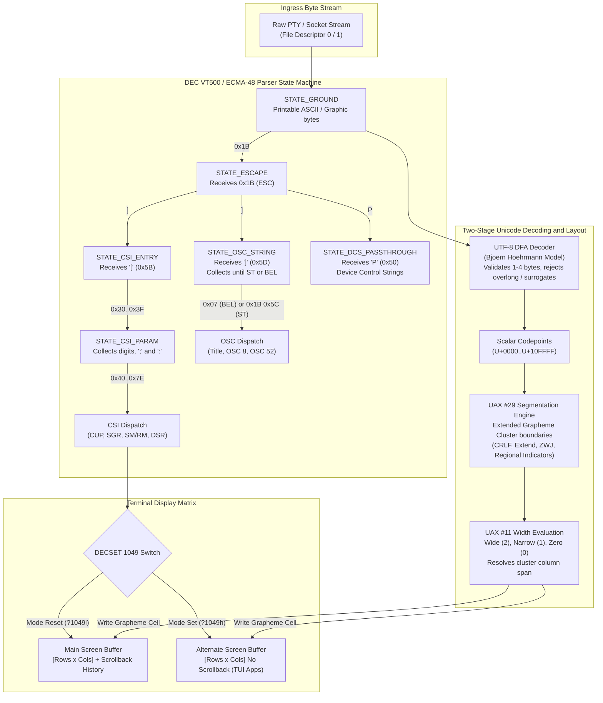
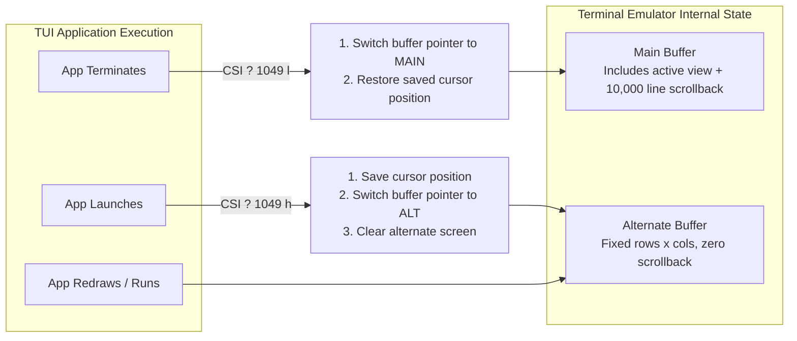
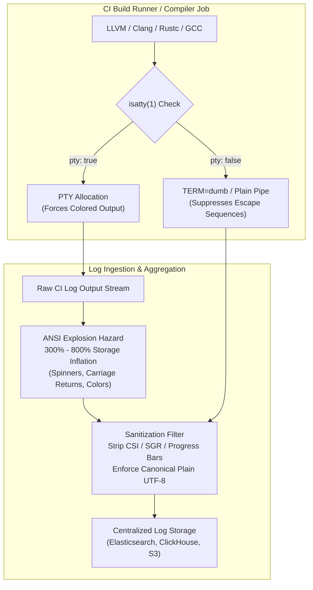

# Terminal Escape Sequences and Unicode

> [!summary] Claim:
> Terminal communication is an in-band, byte-oriented protocol multiplexed across a single bidirectional stream where control signals, layout commands, and character data share the same channel.
> A terminal emulator processes this stream through a deterministic finite automaton based on the DEC VT500 parser model, isolating C0/C1 control codes, ECMA-48 Control Sequence Introducers (CSI), Operating System Commands (OSC), and Device Control Strings (DCS) from printable text.
> Accurate terminal grid rendering requires a two-stage pipeline: incoming bytes must pass through a branchless UTF-8 DFA decoder to yield scalar codepoints, which are then segmented into extended grapheme clusters under UAX #29 before evaluating column display width under UAX #11.
> POSIX `wcwidth()` evaluates scalar codepoints in isolation and fails catastrophically on modern emoji Zero-Width Joiner (ZWJ) sequences, skin tone modifiers, and variation selectors, creating desynchronization between user-space cursor models and the physical terminal grid.



## The Mechanism

User-space processes interact with terminals through character devices managed by pseudoterminal (PTY) pairs, detailed in [[TTYs-PTYs-and-Line-Discipline]].
While the kernel line discipline handles canonical line buffering, erase editing, and signal generation, it remains largely agnostic to visual layout.
All cursor positioning, color rendition, screen switching, and character dimensions are negotiated entirely in user space through in-band byte sequences.
Understanding how user-space parsers process these streams requires analyzing control character classifications, grammar state machines, buffer switching models, keyboard protocols, and multi-byte Unicode segmentation.

### 1. In-Band Protocol Architecture and C0/C1 Controls

The foundation of terminal protocols originates in ISO/IEC 6429 and ECMA-48 ("Control Functions for Coded Character Sets", 5th Edition, 1991).
Because teletypes and early video displays possessed only a single communication channel, control directives had to be multiplexed directly into the printable text stream.
Control functions are partitioned into distinct ranges:

- **C0 Control Set (0x00 to 0x1F, and 0x7F):**
  Inherited from standard 7-bit ASCII.
  Key functions include `NUL` (`0x00`), `BEL` (`0x07`, audio/visual alert), `BS` (`0x08`, backspace), `HT` (`0x09`, horizontal tab), `LF` (`0x0A`, line feed), `CR` (`0x0D`, carriage return), and `ESC` (`0x1B`, escape).
  The delete character `DEL` (`0x7F`) historically punched all holes in paper tape to erase an erroneous character.
- **C1 Control Set (0x80 to 0x9F in 8-bit mode, or `ESC 0x40` to `ESC 0x5F` in 7-bit mode):**
  Introduced for 8-bit character sets to provide higher-level control without consuming multiple bytes.
  Prominent C1 controls include `CSI` (Control Sequence Introducer, `0x9B` or `ESC [`), `OSC` (Operating System Command, `0x9D` or `ESC ]`), `DCS` (Device Control String, `0x90` or `ESC P`), and `ST` (String Terminator, `0x9C` or `ESC \`).

#### The UTF-8 C1 Collision Hazard

In an 8-bit single-byte environment (such as ISO-8859-1), receiving byte `0x9B` unambiguously invokes `CSI`.
However, under UTF-8 encoding (RFC 3629), the byte range `0x80` through `0xBF` is reserved exclusively for multi-byte continuation bytes.
If a terminal parser interprets `0x9B` as an 8-bit C1 `CSI` control code, any multi-byte UTF-8 character whose continuation bytes contain `0x9B` (such as `U+019B` or `U+029B`) would prematurely trigger a control sequence, corrupting the text display.
Consequently, modern terminal emulators operating in UTF-8 mode disable 8-bit C1 controls by default, requiring applications to emit 7-bit escape sequences (`ESC [`, `ESC ]`, `ESC P`) exclusively.

#### The DEC VT500 Parser State Machine

The industry-standard model for parsing arbitrary ANSI and DEC escape sequences is the state machine formalized by Paul Flo Williams on VT100.net, derived from DEC VT500-series hardware (VT520/VT525).
The parser consists of 14 discrete states:

1. `STATE_GROUND`: The default state.
   Bytes in the range `0x20` to `0x7E` and valid multi-byte lead bytes invoke the `print` action.
   C0 controls invoke the `execute` action.
2. `STATE_ESCAPE`: Entered whenever byte `0x1B` (`ESC`) is received from any state.
   This "anywhere" transition immediately aborts any partially parsed sequence and clears intermediate buffers.
3. `STATE_ESCAPE_INTERMEDIATE`: Entered when an intermediate character (`0x20` to `0x2F`) arrives following `ESC`.
4. `STATE_CSI_ENTRY`: Entered when `[` (`0x5B`) arrives while in `STATE_ESCAPE`; collects optional private markers (`<`, `=`, `>`, `?`).
5. `STATE_CSI_PARAM`: Entered when numeric parameter digits (`0x30` to `0x39`), separators (`;`), private markers (from `STATE_CSI_ENTRY`), or subparameter delimiters (`:`, in ECMA-48 / ITU-T T.416 extensions) arrive.
6. `STATE_CSI_INTERMEDIATE`: Entered when intermediate bytes (`0x20` to `0x2F`) arrive following parameters.
7. `STATE_CSI_IGNORE`: Error recovery sink state entered if an illegal byte arrives during CSI collection; consumes bytes until a valid final character (`0x40` to `0x7E`) returns the parser to `STATE_GROUND`.
8. `STATE_OSC_STRING`: Entered when `]` (`0x5D`) arrives while in `STATE_ESCAPE`.
   Collects arbitrary payload bytes until terminated by `BEL` (`0x07`) or `ST` (`ESC \`).
9. `STATE_DCS_ENTRY`, `STATE_DCS_PARAM`, `STATE_DCS_INTERMEDIATE`, `STATE_DCS_PASSTHROUGH`, `STATE_DCS_IGNORE`: Handle Device Control Strings for device-specific functions like SIXEL graphics.
10. `STATE_SOS_PM_APC_STRING`: Collects Start of String (`SOS`), Privacy Message (`PM`), or Application Program Command (`APC`) strings, utilized by modern protocols such as the Kitty Graphics Protocol (`ESC _ G ... ESC \`).

Interrupting characters `CAN` (`0x18`) and `SUB` (`0x1A`) immediately abort any sequence and force an unconditional return to `STATE_GROUND` without executing a dispatch.

### 2. CSI, OSC, and DCS Grammars

Terminal control functions rely on structured parameter-passing conventions.

#### CSI (Control Sequence Introducer) Structure

A CSI sequence follows the strict grammar:

```text
CSI [Private Marker] [Parameters] [Intermediates] FinalByte
\x1b[     (? | > | = | <)    (0-9 | ; | :)     (0x20-0x2F)     (0x40-0x7E)
```

- **Private Parameter Markers (`0x3C` to `0x3F`):**
  A leading `?` designates DEC private modes (e.g., `\x1b[?1049h`).
  A leading `>` designates secondary terminal queries or modern keyboard extensions (e.g., `\x1b[>1u`).
- **Parameter Separation (`;`) versus Subparameters (`:`):**
  Parameters are decimal integers separated by semicolons `;`.
  An omitted or empty parameter defaults to a command-specific value, typically 0 or 1.
  For example, `\x1b[;5H` specifies row 1, column 5.
  ECMA-48 5th Edition (Section 5.4.2) and ITU-T Recommendation T.416 (Section 13.1.8) standardize the colon `:` as a subparameter delimiter.
  Subparameters allow nested hierarchical data within a single parameter slot.
  This distinction is vital for Select Graphic Rendition (SGR, `CSI ... m`):
  - Legacy 24-bit Truecolor (semicolon syntax): `\x1b[38;2;255;128;0m`.
    This legacy syntax violates ECMA-48 by flattening RGB arguments across five top-level parameter slots, confusing parsers that inspect argument counts.
  - Standardized Truecolor (colon syntax): `\x1b[38:2::255:128:0m`.
    Here, parameter 38 has subparameters specifying color space (omitted default), red (255), green (128), and blue (0).
  - Underline styles: `\x1b[4:3m` selects a curly (wavy) underline, where 4 is the underline command and subparameter 3 specifies the curly style (1=straight, 2=double, 3=curly, 4=dotted, 5=dashed).

#### Common CSI Commands

| Final Byte | Mnemonic | Name | Typical Parameter Example | Meaning |
| :--- | :--- | :--- | :--- | :--- |
| `H` / `f` | `CUP` | Cursor Position | `\x1b[12;34H` | Move cursor to row 12, column 34 (1-indexed) |
| `A` / `B` | `CUU` / `CUD` | Cursor Up / Down | `\x1b[5A` | Move cursor up 5 rows |
| `C` / `D` | `CUF` / `CUB` | Cursor Forward / Back | `\x1b[3C` | Move cursor right 3 columns |
| `G` | `CHA` | Cursor Horiz Absolute | `\x1b[10G` | Move cursor to column 10 on the current row |
| `J` | `ED` | Erase in Display | `\x1b[2J` | Erase entire visible screen (0: cursor to end, 1: start to cursor, 2: all) |
| `K` | `EL` | Erase in Line | `\x1b[2K` | Erase entire current line |
| `m` | `SGR` | Select Graphic Rendition | `\x1b[1;31;40m` | Bold (1), Red foreground (31), Black background (40) |
| `n` | `DSR` | Device Status Report | `\x1b[6n` | Query cursor position; terminal responds with `\x1b[r;cR` |
| `h` / `l` | `SM` / `RM` | Set / Reset Mode | `\x1b[?25h` / `\x1b[?25l` | Show / Hide cursor (`DECTCEM`) |

#### OSC (Operating System Command) Structure

OSC sequences configure terminal-level integration and window properties.
Their syntax is:

```text
OSC CommandNumber ; Payload (BEL | ST)
\x1b]       (0-9)     ;   (...)    (\x07 | \x1b\\)
```

Common OSC commands include:

- **OSC 0 and OSC 2 (Window Title):** `\x1b]0;Production Server\x07` sets both icon name and window title.
- **OSC 8 (Hyperlinks):** `\x1b]8;id=item1;https://example.com\x1b\\Click Here\x1b]8;;\x1b\\` creates clickable text in supporting emulators without exposing raw URLs in the text buffer.
- **OSC 52 (Clipboard Operations):** `\x1b]52;c;SGVsbG8=\x07` writes Base64-encoded text into the system clipboard across an SSH session.
- **OSC 10 and OSC 11 (Color Palette Queries):** `\x1b]10;?\x07` queries the current default foreground color, returning `\x1b]10;rgb:ffff/ffff/ffff\x1b\\`.

### 3. Screen Buffer Management: Main versus Alternate Buffers

Full-screen terminal applications (such as Vim, Less, Htop, and Tmux) must draw complex user interfaces without destroying the user's shell scrollback history.
Terminal emulators achieve this by maintaining two distinct screen buffers:



- **DECSET 47 (`\x1b[?47h`) / DECRST 47 (`\x1b[?47l`):**
  The earliest xterm alternate buffer implementation.
  It switched the active screen buffer pointer but did not save the cursor or clear the screen, requiring applications to emit separate cursor save and screen clear sequences.
- **DECSET 1047 (`\x1b[?1047h`):**
  Introduced in xterm patch #90 (December 1998); switches to the alternate screen buffer and clears the alternate screen on exit (`\x1b[?1047l`) to remove leftover artifacts.
- **DECSET 1048 (`\x1b[?1048h`):**
  Introduced in xterm patch #90 (December 1998); dedicated save and restore cursor position mode (equivalent to DEC `DECSC` `\x1b7` and `DECRC` `\x1b8`).
- **DECSET 1049 (`\x1b[?1049h` / `\x1b[?1049l`):**
  The modern unified standard (introduced in xterm patch #90 in December 1998).
  Setting mode 1049 atomically:
  1. Saves the cursor position and graphic attributes (as in `DECSC`).
  2. Switches the display pointer to the alternate buffer.
  3. Clears the alternate buffer completely.
  Resetting mode 1049 atomically:
  1. Switches the display pointer back to the normal (main) buffer.
  2. Restores the previously saved cursor position and attributes (as in `DECRC`).

If a program exits abruptly (e.g., via `SIGKILL` or unhandled `SIGSEGV`) without executing its cleanup routines, the terminal remains trapped in the alternate buffer.
The user sees an unresponsive shell missing its scrollback history until they run `reset` or emit `tput rmcup`.
Robust applications register signal handlers for `SIGINT`, `SIGTERM`, and `SIGQUIT` that emit `\x1b[?1049l` before invoking default signal actions via `raise()`, as detailed in [[Signals-Process-Groups-Sessions-and-Job-Control]].

### 4. Keyboard Protocols: Legacy Ambiguities and Progressive Enhancement

The legacy ASCII keyboard encoding model has deep historical flaws:

1. **Control Key Collisions:**
   Holding `Ctrl` historically cleared bit 6 and bit 7 of the generated character code.
   Consequently, `Ctrl+I` emits `0x09` (identical to `Tab`), `Ctrl+M` emits `0x0D` (identical to `Enter`), `Ctrl+[` emits `0x1B` (identical to `Escape`), and `Ctrl+H` emits `0x08` (identical to `Backspace`).
   A terminal application cannot distinguish whether the user pressed the `Tab` key or the key combination `Ctrl+I`.
2. **Modifier Loss:**
   Pressing `Shift+Enter` or `Ctrl+Enter` emits `0x0D`, discarding the modifier flags entirely.
3. **No Key-Release (KeyUp) Events:**
   Terminals report key presses.
   They cannot report when a key is released, making it impossible to implement desktop-grade UI interactions (such as chorded hotkeys or games) without external hooks.

#### The Kitty Keyboard Protocol

Created by Kovid Goyal, the Kitty Keyboard Protocol solves these limitations through backward-compatible progressive enhancement.
Applications query and enable features using a bitmask:

| Bit | Value | Flag Name | Capability Granted |
| :--- | :--- | :--- | :--- |
| 0 | `1` | Disambiguate escape codes | Emits `CSI u` for ambiguous keys (`Tab` vs `Ctrl+I`, `Enter` vs `Shift+Enter`, `Esc`) |
| 1 | `2` | Report event types | Reports key press (1), key repeat (2), and key release (3) events |
| 2 | `4` | Report alternate keys | Reports shifted key codepoint and physical base layout key |
| 3 | `8` | Report all keys as escape codes | Forces even plain text keys (`a`, `1`) to arrive as structured `CSI u` sequences |
| 4 | `16` | Report associated text | Appends decoded text codepoints directly to the escape sequence |

Applications negotiate capabilities using a stack:

- Push mode: `\x1b[>flags u` (e.g., `\x1b[>1u` enables disambiguation).
- Pop mode: `\x1b[<count u` (e.g., `\x1b[<1u` pops one level off the stack upon application exit).
- Query mode: `\x1b[?u` requests current flags; the terminal responds with `\x1b[?flags u`.

Under full progressive enhancement (`\x1b[>31u`), pressing and releasing `Shift+a` produces:

```text
\x1b[97:65;2;65u  # Press 'a' (97), shifted key 'A' (:65), Shift (modifier 2), emitting 'A' (65)
\x1b[97:65;2:3u   # Release (:3) 'a' (97), shifted key 'A' (:65), with Shift (modifier 2)
```

The modifier parameter is calculated as `1 + (Shift ? 1 : 0) + (Alt ? 2 : 0) + (Ctrl ? 4 : 0) + (Super ? 8 : 0)`.

### 5. Bracketed Paste Mode (DECSET 2004)

In default terminal operation, pasting text from the OS clipboard into a terminal window injects characters into the PTY input stream indistinguishably from rapid keyboard typing.
This introduces the severe security vulnerability known as **Paste-Jacking**:

If a user copies text containing embedded newlines from an untrusted web page or document (for example, `git status\nrm -rf /tmp/data\n`), the terminal emulator immediately writes those newlines to standard input.
The shell interprets each newline as an enter keystroke, immediately executing the malicious payload before the user can inspect it.

Bracketed paste mode (DECSET 2004, introduced by Thomas Dickey in xterm patch #203 in July 2005 from patches by Joe Allen) neutralizes this attack:

1. The shell or editor emits `\x1b[?2004h` to activate bracketed paste mode on startup.
2. When the user executes a paste operation, the terminal emulator wraps the clipboard text inside framing tokens:
   - Prefix: `\x1b[200~`
   - Suffix: `\x1b[201~`
3. The shell line editor (such as GNU Readline or Zsh ZLE) inspects the stream.
   Upon encountering `\x1b[200~`, it suspends command execution, buffers all intervening newlines as literal whitespace or multiline line breaks, and highlights the pasted text block.
4. Execution occurs only when the user deliberately presses the physical `Enter` key after inspecting the payload.
5. The shell emits `\x1b[?2004l` to disable bracketed paste mode before launching child processes via `execve()`, detailed in [[Processes-Fork-Exec-and-File-Descriptors]], ensuring programs that do not understand framing tokens receive raw input.

### 6. Terminal Queries, Responses, and Injection Attack Surfaces

Because terminal communication shares a single bidirectional channel, querying terminal status establishes an asynchronous feedback loop.
When an application emits a status query, the terminal emulator synthesizes a response and writes it directly into the master side of the PTY, causing the response bytes to arrive on the application's standard input (file descriptor 0) as if typed by the user:

```mermaid
sequenceDiagram
    participant App as Application / Tool
    participant Slave as PTY Slave (/dev/pts/X)
    participant Master as Terminal Emulator (PTY Master)

    App->>Slave: write(1, "\x1b[6n") [Cursor Position Query]
    Slave->>Master: Kernel line discipline forwards bytes
    Master->>Master: Computes current cursor: row 15, col 42
    Master->>Slave: write(master_fd, "\x1b[15;42R")
    Slave->>App: read(0, buf) -> returns "\x1b[15;42R"
```

#### The Escape Injection Vector (CVE-2003-0063)

In early terminal emulators, several query responses were insufficiently isolated.
Most notably, xterm implemented a window title reporting escape sequence (`\x1b[21t`), which queried the current window title and returned `\x1b]l<title>\x1b\\` into standard input.
An attacker could write an escape sequence into a shared system log file:

```text
\x1b]2;rm -rf /tmp/test\x0a\x07\x1b[21t
```

When an administrator inspected the log file using `cat /var/log/app.log`, the sequence:
1. Set the terminal window title to `rm -rf /tmp/test\n`.
2. Emitted the title report query `\x1b[21t`.
3. The terminal emulator responded by writing `rm -rf /tmp/test\n` directly into the administrator's shell input buffer.
4. The shell parsed the injected newline and executed the command with administrative privileges.

Modern terminal emulators prevent this vulnerability by:
- Disabling window title reporting and destructive query responses.
- Restricting `OSC 52` clipboard reads unless explicitly authorized by user interaction.
- Filtering control characters from window titles and status strings.

### 7. UTF-8 Stream Decoding via Deterministic Finite Automata

Once escape sequences are extracted by the DEC parser, graphic text bytes must be converted from raw bytes into Unicode scalar values.
UTF-8 (RFC 3629) encodes Unicode codepoints from `U+0000` to `U+10FFFF` across one to four bytes:

| Scalar Value Range | Byte 1 | Byte 2 | Byte 3 | Byte 4 |
| :--- | :--- | :--- | :--- | :--- |
| `U+0000`..`U+007F` | `0xxxxxxx` | | | |
| `U+0080`..`U+07FF` | `110xxxxx` | `10xxxxxx` | | |
| `U+0800`..`U+FFFF` | `1110xxxx` | `10xxxxxx` | `10xxxxxx` | |
| `U+10000`..`U+10FFFF`| `11110xxx` | `10xxxxxx` | `10xxxxxx` | `10xxxxxx` |

RFC 3629 mandates three strict security constraints:
1. **Rejection of Overlong Encodings:** A character must only be encoded using the minimum necessary number of bytes.
   For example, encoding `NUL` (`U+0000`) as `0xC0 0x80` instead of `0x00` is strictly illegal, as overlong forms were historically used to bypass firewall and security filters.
2. **Rejection of UTF-16 Surrogates:** Codepoints in the range `U+D800` through `U+DFFF` are reserved for UTF-16 surrogate pairs and must never appear in valid UTF-8 streams.
   Byte sequences starting with `0xED 0xA0..0xBF` must be rejected.
3. **Upper Bound Enforcement:** Codepoints above `U+10FFFF` (lead bytes `0xF5` through `0xFF`) are invalid.

#### The Bjoern Hoehrmann Branchless DFA

Traditional UTF-8 decoders rely on nested `if-else` branches to validate byte ranges.
On modern out-of-order CPUs, unpredictable branching causes severe branch misprediction penalties when parsing mixed ASCII and multi-byte text.
The canonical high-performance solution is Bjoern Hoehrmann's Flexible and Economical UTF-8 Decoder.

The decoder flattens UTF-8 validation into a 364-byte lookup table (`utf8d`):
1. The first 256 bytes map each incoming byte (`0x00` to `0xFF`) to one of 12 character classes.
2. The remaining 108 bytes represent state transitions for 9 distinct states, where `UTF8_ACCEPT = 0` indicates a completed valid character and `UTF8_REJECT = 12` indicates an illegal sequence.

```c
#define UTF8_ACCEPT 0
#define UTF8_REJECT 12

static inline uint32_t decode_utf8_byte(uint32_t *state, uint32_t *codep, uint8_t byte) {
    uint32_t type = utf8d[byte];
    *codep = (*state != UTF8_ACCEPT) ?
        (byte & 0x3fu) | (*codep << 6) :
        (0xff >> type) & (byte);
    *state = utf8d[256 + *state + type];
    return *state;
}
```

This decoder requires zero branching, executes in constant time per byte, and guarantees complete compliance with RFC 3629.

### 8. Character Width, Monospace Cell Grids, and Unicode Segmentation

The foundational invariant of a terminal emulator is the **Fixed Character Cell Grid**:
Every row is divided into discrete, identical rectangular columns.
Unlike desktop word processors that perform proportional font layout, a terminal must assign every visual element an integer column span: 0, 1, or 2 cells.

#### UAX #11: East Asian Width

Unicode Standard Annex #11 (UAX #11) defines six `East_Asian_Width` property categories (`W`, `F`, `Na`, `H`, `A`, `N`), which terminal width engines combine with Unicode `General_Category` values:

- **Wide (`W`) and Fullwidth (`F`):** CJK ideographs (e.g., `U+4E2D`), Fullwidth Latin forms (`U+FF01`..`U+FF60`), and most emoji pictographs (`U+1F300`..`U+1FAFF`).
  Assigned a display width of **2 columns**.
- **Narrow (`Na`), Halfwidth (`H`), and Neutral (`N`):** ASCII printables (`U+0020`..`U+007E`), Halfwidth Katakana, punctuation, and Latin scripts.
  Assigned a display width of **1 column** (unless classified as zero-width marks or format characters).
- **Non-Spacing Marks (`Mn`), Enclosing Marks (`Me`), and Formatting (`Cf`):** Unicode `General_Category` classes covering combining accents (`U+0300`..`U+036F`), Zero-Width Joiner (`U+200D`), and Variation Selectors (`U+FE00`..`U+FE0F`).
  Assigned a display width of **0 columns** prior to East Asian Width evaluation.
- **Ambiguous (`A`):** Characters historically rendered wide in East Asian typography but narrow in Western scripts (e.g., Greek, Cyrillic, box drawing symbols, ellipsis `U+2026`).
  In Western locales (`LC_CTYPE=en_US.UTF-8`), Ambiguous characters occupy 1 column.
  In East Asian locales (`LC_CTYPE=ja_JP.UTF-8`), they occupy 2 columns.
  This locale dependency is a primary cause of cross-platform TUI alignment breakage.

#### UAX #29: Extended Grapheme Clusters

In modern Unicode, a single user-perceived character (a "grapheme cluster") does not correspond to a single scalar codepoint:

1. **Combining Sequences:** Base Latin `e` (`U+0065`, width 1) followed by Combining Acute Accent (`U+0301`, width 0) renders as a single glyph `e` with acute (`U+00E9`) occupying **1 column**.
2. **Emoji Modifier Sequences:** Waving Hand (`U+1F44B`, width 2) followed by Medium-Dark Skin Tone (`U+1F3FE`, width 2) renders as a single tinted hand occupying **2 columns**.
3. **Emoji ZWJ Sequences:** Man (`U+1F468`, width 2) + `ZWJ` (`U+200D`, width 0) + Laptop (`U+1F4BB`, width 2) renders as a single Technologist glyph occupying **2 columns**.
4. **Flag Sequences:** Regional Indicator `U` (`U+1F1FA`, width 1) + Regional Indicator `S` (`U+1F1F8`, width 1) renders as the United States flag occupying **2 columns**.

#### The Catastrophic Failure of POSIX `wcwidth()`

POSIX defines `wcwidth(wchar_t wc)` and `wcswidth(const wchar_t *pwcs, size_t n)` in `<wchar.h>`.
The function accepts a single 32-bit wide character and returns its column width (-1, 0, 1, or 2).

POSIX `wcwidth()` is fundamentally incapable of handling modern Unicode:

1. **Isolation Blindness:** Because `wcwidth()` operates on one codepoint at a time, it cannot inspect adjacent characters.
   When presented with the Technologist sequence (`U+1F468 U+200D U+1F4BB`), it evaluates:
   $$\text{wcwidth}(0\text{x1F468}) + \text{wcwidth}(0\text{x200D}) + \text{wcwidth}(0\text{x1F4BB}) = 2 + 0 + 2 = 4 \text{ columns}$$
   However, modern terminal emulators (Kitty, Alacritty, WezTerm, Ghostty) segment the text using UAX #29 and render the combined grapheme in exactly **2 columns**.
2. **Grid Desynchronization:**
   If a command-line application (such as Readline or an interactive shell) uses `wcwidth()` to calculate cursor movement, it believes the cursor advanced 4 columns.
   When the user presses backspace, the application emits cursor backward commands (`CSI 4 D`), moving the cursor two columns to the left of where the emoji actually begins.
   Subsequent typing overwrites existing text, ghost characters appear on screen, and line wrapping calculates incorrect split points.
3. **System Table Drift:**
   The libc table lags the Unicode release that terminal fonts and emulators track.
   Measured with a scratch C program (not by the lab) on macOS 27.2 under `en_US.UTF-8` (as of 2026-11, macOS): `wcwidth()` returns 2 for `U+1FAE8` but -1 for `U+1FAE9` (Face with Bags Under Eyes) and `U+1FAC8` (Hairy Creature), which Python's `unicodedata` (Unicode 17.0.0) classifies as East Asian Wide.
   A -1 return makes a naive layout loop treat a printable emoji as a control character.

Modern production TUIs bypass libc `wcwidth()` entirely, deploying embedded UAX #29 segmentation engines paired with UAX #11 tables to compute column widths over grapheme clusters.

## Commands and Numbers to Know

Reference numbers, protocol sequences, and configuration flags governing terminal escape sequences and Unicode (as of 2026-11):

| Mechanism / Sequence | Default / Value | Target Platform | Operational Function |
| :--- | :--- | :--- | :--- |
| `CSI ? 1049 h` | String sequence | Both (as of 2026-11) | Atomically save cursor, switch to alternate screen buffer, clear screen |
| `CSI ? 1049 l` | String sequence | Both (as of 2026-11) | Atomically switch back to normal (main) screen buffer and restore cursor |
| `CSI ? 2004 h` | String sequence | Both (as of 2026-11) | Enable Bracketed Paste Mode |
| `CSI ? 2004 l` | String sequence | Both (as of 2026-11) | Disable Bracketed Paste Mode |
| `\x1b[200~` / `\x1b[201~`| Framing tokens | Both (as of 2026-11) | Enclose pasted clipboard payloads under Bracketed Paste Mode |
| `CSI 6 n` | Status query | Both (as of 2026-11) | Device Status Report: requests cursor position (`CSI r ; c R` response) |
| `CSI ? u` | Status query | Both (as of 2026-11) | Query active Kitty Keyboard Protocol progressive enhancement flags |
| `CSI > flags u` | Mode control | Both (as of 2026-11) | Push Kitty Keyboard Protocol flags onto the enhancement stack |
| `CSI < count u` | Mode control | Both (as of 2026-11) | Pop Kitty Keyboard Protocol flags from the enhancement stack |
| `OSC 0 ; title ST` | Window control | Both (as of 2026-11) | Set terminal window title and icon name |
| `OSC 8 ; ; uri ST` | Hyperlink | Both (as of 2026-11) | Begin OSC 8 terminal hyperlink anchor (`OSC 8 ; ; ST` closes) |
| `OSC 52 ; c ; data ST`| Clipboard | Both (as of 2026-11) | Set system clipboard contents with Base64 payload |
| `CSI 38 : 2 : : r : g : b m`| SGR Color | Both (as of 2026-11) | ITU-T T.416 / ISO/IEC 8613-6 colon subparameter format for 24-bit Truecolor foreground |
| `CSI 4 : 3 m` | SGR Style | Both (as of 2026-11) | Subparameter format selecting curly (wavy) underline |
| `UTF8_ACCEPT` | `0` | Both (as of 2026-11) | State constant indicating valid character boundary in Hoehrmann DFA |
| `UTF8_REJECT` | `12` | Both (as of 2026-11) | State constant indicating malformed UTF-8 byte in Hoehrmann DFA |
| `MAX_PARAMS` | `16` | Both (as of 2026-11) | Standard maximum parameter vector length in DEC VT500 parsers |
| `MAX_SUBPARAMS` | `8` | Both (as of 2026-11) | Typical subparameter vector depth per parameter slot in ITU-T T.416 parsers |
| `NO_COLOR` | Environment variable | Both (as of 2026-11) | When set (non-empty), CLI tools must suppress ANSI color escape codes |
| `TERM=dumb` | Environment variable | Both (as of 2026-11) | Designates basic teletype with zero escape code processing capabilities |

## Multi-Language Comparison: C / C++ / Python / Rust

Terminal protocol parsing, Unicode decoding, and width calculation implementations across systems programming languages:

| Concern | C (POSIX / Standards) | C++ (Modern C++20 / C++23) | Python (CPython 3.12+) | Rust (Modern Toolchain) |
| :--- | :--- | :--- | :--- | :--- |
| ANSI / VT Parser | Paul Flo Williams FSM / `libvterm` (C99) | Windows Terminal `StateMachine` (`OutputStateMachineEngine`) / FTXUI | `pyte` / `prompt_toolkit.input.vt100_parser` | `vte` crate (Joe Wilm / Alacritty) |
| UTF-8 Validation | Bjoern Hoehrmann DFA / glibc `mbrtowc` | `simdutf` / `icu::UnicodeString::fromUTF8` | CPython `unicodeobject.c` (PEP 393) | Standard library `std::str::from_utf8` / `simdutf8` |
| Grapheme Segmentation | `libutf8proc` (JuliaLang / C) | ICU `BreakIterator` / `boost::locale` | `regex` module (`\X`) / `grapheme` package | `unicode-segmentation` crate (UAX #29) |
| Character Cell Width | POSIX `wcwidth()` / Markus Kuhn `wcwidth.c` | ICU `u_getIntPropertyValue` / custom tables | `unicodedata.east_asian_width` / `wcwidth` PyPI | `unicode-width` crate (UAX #11) |
| Alternate Buffer / Mode | Raw escape strings / `termios.h` | `ftxui::ScreenInteractive` | `curses` / `blessed` / raw stdout writes | `crossterm` / `ratatui` backend |
| Keyboard Protocols | Custom CSI parser | Windows Terminal Input Engine | `prompt_toolkit.input.vt100` | `crossterm::event::PushKeyboardEnhancementFlags` |

## Worked Lab Example

The companion lab is located in `code/00-Program-Execution/terminal_escape_unicode/`.
It contains a self-contained, zero-dependency C test suite (`terminal_engine.c`) that implements:
1. Bjoern Hoehrmann's branchless DFA UTF-8 decoder.
2. Paul Flo Williams' DEC VT500 parser state machine with colon subparameter parsing.
3. Extended Grapheme Cluster segmentation under UAX #29 and display width calculation under UAX #11, printed beside the sum that libc `wcwidth()` returns under an `en_US.UTF-8` locale.
4. Alternate screen buffer state tracking (`DECSET 1049`).
5. Bracketed paste command isolation (`DECSET 2004`).

To compile and verify the lab output natively:

```bash
cd code/00-Program-Execution/terminal_escape_unicode
bash run.sh
```

### Verified Output

The execution output below was recorded directly on `darwin-arm64` and verified mechanically by `code/_harness/verify.py` against `expected/darwin-arm64.txt`:

```text
=== Section 1: UTF-8 DFA Decoder (Bjoern Hoehrmann) ===
ASCII decoding: 12 codepoints, final state=0 (OK)
Multi-byte decoding: 3 codepoints (U+00E9, U+4E2D, U+1F468), final state=0 (OK)
Overlong sequence 0xC0 0x80: state=12 (expected reject=12)
Surrogate half 0xED 0xA0 0x80: state=12 (expected reject=12)
Out of range byte 0xF5: state=12 (expected reject=12)

=== Section 2: DEC VT500 / ECMA-48 Parser State Machine ===
Parser metrics:
  Print characters: 10
  Execute C0 controls: 1
  CSI dispatches: 4
  OSC dispatches: 3
  Final cursor position: row=1, col=1
  SGR 38:2:: truecolor: r=255 g=128 b=0
  OSC 8 hyperlink URI: https://example.com
  Kitty keyboard protocol flags: 1
  Alternate screen buffer active: true
  After DECRST 1049:
    Alternate screen buffer active: false
    Restored cursor position: row=15, col=42

=== Section 3: Character Width and Grapheme Segmentation ===
libc LC_CTYPE: en_US.UTF-8
Case 1 [ASCII 'A']:
  Codepoint count: 1, Grapheme cluster count: 1
  Naive codepoint wcwidth sum (lab table): 1
  Naive codepoint wcwidth sum (libc wcwidth): 1
  True terminal display width: 1
  Match: wcwidth aligns with terminal grid.
Case 2 [CJK Hanzi U+4E2D]:
  Codepoint count: 1, Grapheme cluster count: 1
  Naive codepoint wcwidth sum (lab table): 2
  Naive codepoint wcwidth sum (libc wcwidth): 2
  True terminal display width: 2
  Match: wcwidth aligns with terminal grid.
Case 3 [Combining acute 'e' + U+0301]:
  Codepoint count: 2, Grapheme cluster count: 1
  Naive codepoint wcwidth sum (lab table): 1
  Naive codepoint wcwidth sum (libc wcwidth): 1
  True terminal display width: 1
  Match: wcwidth aligns with terminal grid.
Case 4 [Emoji skin tone: Waving hand + Medium-Dark tone]:
  Codepoint count: 2, Grapheme cluster count: 1
  Naive codepoint wcwidth sum (lab table): 4
  Naive codepoint wcwidth sum (libc wcwidth): 4
  True terminal display width: 2
  DISCREPANCY: Naive wcwidth over-allocates by 2 column(s)!
Case 5 [Emoji ZWJ: Man + ZWJ + Laptop (Technologist)]:
  Codepoint count: 3, Grapheme cluster count: 1
  Naive codepoint wcwidth sum (lab table): 4
  Naive codepoint wcwidth sum (libc wcwidth): 4
  True terminal display width: 2
  DISCREPANCY: Naive wcwidth over-allocates by 2 column(s)!
Case 6 [Flag sequence: US Flag (Regional U + Regional S)]:
  Codepoint count: 2, Grapheme cluster count: 1
  Naive codepoint wcwidth sum (lab table): 2
  Naive codepoint wcwidth sum (libc wcwidth): 2
  True terminal display width: 2
  Match: wcwidth aligns with terminal grid.

=== Section 4: Bracketed Paste Mode and Injection Defense ===
DECSET/DECRST 2004 parser state: initial=off, after set=on, after reset=off
Scenario A (Bracketed Paste DISABLED):
  Parser mode flag handed to the shell: off
  Commands executed immediately: 2
  Blocked newlines: 0
Scenario B (Bracketed Paste ENABLED via DECSET 2004):
  Parser mode flag handed to the shell: on
  Commands executed immediately: 0
  Blocked newlines (buffered safely): 2
  Buffered literal text: "git status\nrm -rf ./scratch\n"
```

### Reading the Result

- In **Section 1**, the Hoehrmann DFA validates valid multi-byte sequences (`U+00E9`, `U+4E2D`, `U+1F468`) returning state 0 (`UTF8_ACCEPT`).
  Overlong sequences (`0xC0 0x80`), surrogate codepoints (`0xED 0xA0 0x80`), and out-of-range lead bytes (`0xF5`) immediately transition to state 12 (`UTF8_REJECT`) without executing recursive branches.
- In **Section 2**, the DEC VT500 state machine correctly extracts printable characters, executes the C0 `LF` control, and decodes the colon subparameters of `\x1b[38:2::255:128:0m` into `r=255 g=128 b=0` (the empty slot is the colour-space identifier).
  It dispatches three OSC strings: one terminated by `BEL` and two OSC 8 hyperlink strings terminated by `ESC \` (ST), and it captures the OSC 8 URI `https://example.com`.
  The `ESC` that begins ST ends the OSC string, as in the Williams parser model, so the ST-terminated strings are not dropped.
  It sets Kitty keyboard progressive enhancement flags (`\x1b[>1u`), and moves the cursor to row 15, column 42.
  Upon receiving `\x1b[?1049h`, it saves the cursor and activates the alternate screen buffer.
  Upon receiving `\x1b[?1049l`, it restores the cursor to row 15, column 42 and deactivates the alternate screen.
- In **Section 3**, Case 4 and Case 5 expose the fundamental flaw of scalar `wcwidth()`.
  Two sums are printed per case: one from the lab's own width table and one from libc `wcwidth()` on the recording host (`darwin-arm64`, `en_US.UTF-8`); they agree on all six cases.
  For the Technologist emoji (`U+1F468 U+200D U+1F4BB`), naive summation produces 4 columns by both.
  The grapheme engine identifies the Zero-Width Joiner (`U+200D`) and groups the sequence into a single grapheme cluster occupying 2 columns.
  Naive `wcwidth()` over-allocates by 2 columns, which would cause an interactive CLI editor to misplace the cursor.
- In **Section 4**, the parser's own mode flag starts off, turns on after `\x1b[?2004h`, and turns off after `\x1b[?2004l`; that flag is what the shell simulator is given.
  Injecting a multiline payload with bracketed paste disabled immediately triggers 2 command executions in the shell simulator.
  With bracketed paste enabled (`DECSET 2004`), framing markers isolate the payload, blocking 2 newlines from triggering execution and safely buffering the string for manual review.

## Pitfalls

> [!warning] Pitfall: Naive Codepoint Summation for Cursor Addressing
> Summing POSIX `wcwidth()` across scalar codepoints to track cursor columns causes cursor drift on modern emoji ZWJ sequences, skin tone modifiers, and flag pairs.
> For the sequence `U+1F468 U+200D U+1F4BB` (Technologist), `wcwidth()` sums to `2 + 0 + 2 = 4`, whereas terminal emulators render the glyph across 2 columns.
> Always segment text into extended grapheme clusters under UAX #29 before calculating column spans.

> [!warning] Pitfall: Flattening Colon Subparameters into Semicolons
> Emitting Truecolor SGR sequences using semicolons (`\x1b[38;2;R;G;Bm`) violates ECMA-48 by consuming five top-level parameter slots.
> Older or strict parsers that cap parameters at `MAX_PARAMS = 16` overflow or misinterpret trailing text attributes.
> Use standardized colon subparameter syntax (`\x1b[38:2::R:G:Bm`) for modern terminal applications, falling back to 256-color palettes when terminfo lacks Truecolor (`RGB` or `Tc` alongside `setaf`) capabilities.

> [!warning] Pitfall: Orphaned Alternate Screen Buffer on Abnormal Termination
> If an application crashes or is killed by a signal (`SIGSEGV`, `SIGABRT`, `SIGTERM`) while running in the alternate screen buffer (`DECSET 1049`), the terminal remains trapped in the alternate buffer with scrollback disabled.
> Applications must register signal handlers for all catchable termination signals that emit `\x1b[?1049l` before resetting signal dispositions and terminating.

> [!warning] Pitfall: Missing Bracketed Paste Mode in Interactive REPLs
> CLI tools and REPLs that disable bracketed paste mode expose users to paste-jacking attacks.
> An attacker tricking a user into copying multiline shell code can execute arbitrary commands instantly upon pasting.
> Always emit `\x1b[?2004h` when initializing interactive prompts and `\x1b[?2004l` before passing control to external subprocesses.

> [!warning] Pitfall: Unsanitized Terminal Output and Escape Injection
> Streaming raw, untrusted data (such as network packets, database payloads, or server access logs) directly to stdout allows attackers to inject escape sequences.
> Attackers can trigger terminal status queries (`CSI 6 n`), manipulate window titles, or overwrite system clipboards via `OSC 52`.
> Always sanitize untrusted output by stripping control characters (`0x00`..`0x1F`, `0x7F`, and `0x1B`) or pipe logs through a sanitizing pager.

> [!warning] Pitfall: Assuming Ambiguous Width Characters are Always Narrow
> Assuming Ambiguous (`A`) characters (such as Greek letters, Cyrillic, or box drawing glyphs) occupy 1 column breaks TUI rendering in East Asian locales (`LC_CTYPE=ja_JP.UTF-8`), where terminals render them across 2 columns.
> High-performance terminal applications must query locale settings or allow users to configure explicit ambiguous width overrides.

> [!warning] Pitfall: Processing 8-bit C1 Control Codes in UTF-8 Mode
> Allowing byte `0x9B` to trigger `CSI` in a UTF-8 environment corrupts multi-byte character decoding whenever `0x9B` appears as a valid continuation byte.
> Terminals and parsers operating on UTF-8 streams must explicitly disable 8-bit C1 controls and accept only 7-bit escape representations (`\x1b[`).

## At Scale

At massive scale (1,000 to 50,000 engineers sharing monorepos and continuous integration infrastructure), terminal escape sequences and Unicode layout dictate build performance, log storage economics, and remote developer productivity:



### 1. The ANSI Explosion in Continuous Integration Logs

Compilers, test runners, and build tools (Cargo, Webpack, Bazel) detect interactive terminals via `isatty(fileno(stdout))` to emit colored error diagnostics and animated progress spinners.
When CI runners allocate virtual pseudoterminals to preserve colored compiler diagnostics, tools frequently emit high-frequency cursor positioning commands (`CSI G`, `CSI K`, `\r`) to animate progress bars.
In large monorepo builds generating gigabytes of logs:
- Animated spinners and progress bars emit millions of uncompressed escape sequences that rewrite the same line thousands of times.
- Storing these raw byte streams inflates centralized log storage (Elasticsearch, Loki, ClickHouse) by **300% to 800%** with useless rendering garbage.
- Web log viewers in CI dashboards freeze and crash attempting to parse megabytes of raw ANSI escape sequences in browser DOMs.

**Organizational Paved Road:**
- Build harnesses must set `TERM=dumb` and pass `NO_COLOR=1` when running non-interactive CI jobs.
- Build tools must disable animated spinners when stdout is not connected to a physical human-operated tty.
- Centralized log ingestion pipelines must execute streaming ANSI stripping filters before writing logs to durable object storage.

### 2. High-Throughput Terminal Emulator Rendering Bottlenecks

A single fast compile job or test suite emitting unthrottled output can easily generate **500 MB/s to 1 GB/s** of log output.
Legacy terminal emulators (such as standard macOS Terminal.app or older VTE-based terminals) process streams using single-threaded, byte-by-byte parsers coupled with CPU-bound CoreGraphics/X11 text layout.
When hit with massive output:
- The terminal emulator pegs a CPU core at 100%, causing the UI to freeze and beachball.
- The PTY buffer fills, applying kernel backpressure (blocking `write()` calls in the compiler or child process), artificially slowing down compilation builds by factors of 2x to 10x.

**Engineering Decision Rules:**
- Standardize developer workstations on GPU-accelerated terminal emulators (such as Alacritty, Kitty, or Ghostty).
  These emulators decouple PTY stream parsing (using branchless SIMD UTF-8 validation and the Paul Flo Williams state machine) from rendering.
- Maintain character cell grids in contiguous GPU vertex buffers, updating only dirty damage regions at monitor refresh rates (60 Hz to 120 Hz) regardless of whether the ingress byte rate is 10 MB/s or 1 GB/s.

### 3. Remote Development and SSH Latency Hazards

In modern remote engineering environments, developers execute TUIs (Neovim, Tmux) on cloud virtual machines accessed over SSH connections with 50 ms to 150 ms round-trip latency.
If an application performs full-screen redraws (`\x1b[2J\x1b[H...`) on every keystroke, bandwidth consumption spikes and users experience intolerable display stutter and screen tearing.

**TUI Design Standards:**
- Terminal UI frameworks must maintain dual virtual grid buffers in application memory: a `front_buffer` (representing the terminal's current state) and a `back_buffer` (representing the newly rendered frame).
- Before emitting escape codes over the network socket, the framework must run a differential comparison algorithm, emitting `CUP` (`\x1b[r;cH`) and printable characters only for cells that changed.
- Frame updates must be wrapped in Synchronized Updates mode (DECSET 2026, `\x1b[?2026h` / `\x1b[?2026l`), instructing the terminal emulator to buffer incoming draw commands and blit the entire frame atomically to the GPU surface on `DECRST 2026`.

## Practice Drill

> [!tip] Practice Drill: Low-Level Cursor Probing and Mode Inspection
> Execute the following Bash script to interact directly with low-level terminal protocols:
> 1. Puts the terminal into raw non-canonical mode without echo using `stty`.
> 2. Queries the live cursor position using `CSI 6 n` and parses the asynchronous `CSI r ; c R` response directly from standard input.
> 3. Emits bracketed paste framing markers and inspects the raw hexadecimal bytes delivered to the shell.
> 4. Safely restores terminal modes using a trap handler.

```bash
#!/usr/bin/env bash
set -euo pipefail

# Save initial terminal settings
OLD_STTY=$(stty -g)

cleanup() {
    # Restore terminal state and exit alternate screen / paste mode safely
    stty "${OLD_STTY}" 2>/dev/null || true
    printf "\033[?2004l\033[?1049l"
    echo "Terminal state restored."
}
trap cleanup EXIT

echo "=== Drill: Low-Level Terminal Protocol Verification ==="

# Step 1: Query Cursor Position via DSR (CSI 6 n)
# Put terminal in raw mode so the response is not swallowed by line discipline
stty raw -echo

# Emit CSI 6 n to stdout (FD 1)
printf "\033[6n"

# Read response from stdin (FD 0): Expected format \033[<row>;<col>R
RESPONSE=""
while IFS= read -r -n 1 -d '' CHAR; do
    RESPONSE="${RESPONSE}${CHAR}"
    if [[ "${CHAR}" == "R" ]]; then
        break
    fi
done

# Restore stty temporarily to print results cleanly
stty "${OLD_STTY}"

# Format and display the raw response
ESC_CHAR=$(printf "\033")
PRINTABLE_RESP=$(echo -n "${RESPONSE}" | sed "s/${ESC_CHAR}/ESC/g")
echo "1. Device Status Report (DSR) Query Sent: ESC [ 6 n"
echo "   Raw Response Received on STDIN:       ${PRINTABLE_RESP}"

# Step 2: Test Alternate Screen Buffer Switching
echo "2. Testing Alternate Screen Buffer (DECSET 1049)..."
printf "\033[?1049h"
sleep 1
printf "\033[1;1H\033[32m[Alternate Screen Active - Notice lack of scrollback]\033[0m"
sleep 1
printf "\033[?1049l"
echo "   Returned to Main Screen Buffer successfully."

# Step 3: Inspect Bracketed Paste Mode
echo "3. Testing Bracketed Paste Mode (DECSET 2004)..."
printf "\033[?2004h"
echo "   Bracketed paste enabled. Simulating paste framing:"
PASTE_PAYLOAD=$(printf "\033[200~echo 'Pasted command line'\033[201~")
PRINTABLE_PASTE=$(echo -n "${PASTE_PAYLOAD}" | sed "s/${ESC_CHAR}/ESC/g")
echo "   Sample Framed Stream: ${PRINTABLE_PASTE}"
printf "\033[?2004l"
echo "   Bracketed paste disabled."
```

## Interview Questions

### L5: Concept

> [!question] L5: How do CSI escape sequences differ from OSC commands in both syntax and execution purpose?
>
> > [!success]- Answer
> > CSI (Control Sequence Introducer) and OSC (Operating System Command) sequences serve distinct architectural roles and follow different parsing grammars:
> > 
> > 1. **Syntax:**
> >    - CSI begins with `ESC [` (`0x1B 0x5B`), followed by optional private parameter markers (`?`, `>`, `=`), semicolon-separated numeric parameters, optional intermediate characters, and a final command byte in the range `0x40` to `0x7E` (e.g., `\x1b[12;34H`).
> >    - OSC begins with `ESC ]` (`0x1B 0x5D`), followed by a numeric command identifier, a semicolon, an arbitrary string payload, and a terminating `ST` (`ESC \`) or `BEL` (`0x07`) character (e.g., `\x1b]0;Title\x07`).
> > 2. **Execution Purpose:**
> >    - CSI controls the in-grid visual display and terminal emulator engine: cursor movement (`CUP`), character deletion/insertion (`ED`, `EL`), text attributes/color (`SGR`), and terminal modes (`SM`/`RM` like alternate screen or bracketed paste).
> >    - OSC controls system-level, window-level, and environment integration: setting window titles, querying or setting the color palette (`OSC 10/11`), manipulating the OS clipboard (`OSC 52`), and embedding hyperlinks (`OSC 8`).

### L5: Predict-the-Output

> [!question] L5: Predict the cursor position and terminal display state after processing the following byte stream:
> `printf "\033[2J\033[10;20HHello\033[3D\033[KWorld"`
>
> > [!success]- Answer
> > Step-by-step stream execution:
> > 1. `\033[2J`: `ED` (Erase in Display) with parameter 2 erases the entire screen buffer and leaves the cursor at its existing position.
> > 2. `\033[10;20H`: `CUP` (Cursor Position) moves the cursor to row 10, column 20.
> > 3. `Hello`: Prints 5 characters.
> >    The characters occupy columns 20, 21, 22, 23, and 24.
> >    The cursor rests at row 10, column 25.
> > 4. `\033[3D`: `CUB` (Cursor Backward) with parameter 3 moves the cursor 3 columns to the left:
> >    $$25 - 3 = 22$$
> >    The cursor is now at row 10, column 22 (resting on the second 'l' of "Hello").
> > 5. `\033[K`: `EL` (Erase in Line) with default parameter 0 erases from the cursor position to the end of the line.
> >    Columns 22, 23, and 24 ("lo") are cleared.
> >    Columns 20 and 21 ("He") remain.
> > 6. `World`: Prints 5 characters starting at column 22.
> >    They occupy columns 22, 23, 24, 25, and 26.
> > 
> > **Final State:**
> > Row 10 contains the string `"HeWorld"` starting at column 20.
> > The final cursor position is row 10, column 27.

### L6: Debug-This

> [!question] L6: An interactive text editor renders line-wrapping defects and cursor misalignment when users insert emoji characters like Technologist (U+1F468 U+200D U+1F4BB).
> The engineer uses `wcwidth()` on every `wchar_t` in the input buffer to calculate screen columns.
> Diagnose the defect and provide the architectural fix.
>
> > [!success]- Answer
> > **Root Cause:**
> > The Technologist emoji (`U+1F468 U+200D U+1F4BB`) is an Emoji ZWJ Sequence consisting of three Unicode scalar values:
> > 1. `U+1F468` (Man): East Asian Wide (`W`), `wcwidth()` returns 2.
> > 2. `U+200D` (Zero-Width Joiner): Formatting (`Cf`), `wcwidth()` returns 0.
> > 3. `U+1F4BB` (Laptop): East Asian Wide (`W`), `wcwidth()` returns 2.
> > 
> > Evaluating `wcwidth()` codepoint-by-codepoint yields a total width of:
> > $$2 + 0 + 2 = 4 \text{ columns}$$
> > 
> > However, modern terminal emulators implement Unicode Standard Annex #29 (UAX #29) Extended Grapheme Cluster segmentation.
> > The emulator recognizes the ZWJ boundary rules (rule GB11: `\p{Extended_Pictographic} Extend* ZWJ x \p{Extended_Pictographic}`) and renders the entire 3-codepoint sequence as a single composite glyph occupying exactly **2 columns**.
> > 
> > Because the editor calculates 4 columns while the terminal advances only 2 columns, the editor's internal cursor state drifts 2 columns ahead of the physical cursor.
> > When the user backspaces or types additional characters, the editor issues `CHA` (`CSI G`) or cursor backward commands based on the wrong column index, causing visual tearing and overwriting adjacent text.
> > 
> > **Architectural Fix:**
> > 1. Discontinue using scalar `wcwidth()` for layout tracking.
> > 2. Integrate a UAX #29 grapheme cluster segmentation library (such as `libutf8proc` in C, `unicode-segmentation` in Rust, or ICU in C++).
> > 3. Segment the text buffer into extended grapheme clusters first.
> > 4. Calculate display width per cluster under UAX #11: if the cluster contains wide or emoji pictographs, assign the cluster a total width of 2; otherwise 1 (or 0 for isolated non-spacing marks).

### L6: State Machine Mechanics

> [!question] L6: Walk through the DEC VT500 parser state transitions when the byte stream `\x1b[12;34\x1b[H` is received.
> What happens to the partially collected parameter `34`?
>
> > [!success]- Answer
> > The byte sequence contains an embedded escape byte (`\x1b`) interrupting an incomplete CSI sequence:
> > 
> > 1. `\x1b`: Parser enters `STATE_ESCAPE`.
> > 2. `[`: Parser transitions to `STATE_CSI_ENTRY`.
> > 3. `1`, `2`: Parser transitions to `STATE_CSI_PARAM`, collecting parameter 1 (`12`).
> > 4. `;`: Parser allocates parameter 2 slot.
> > 5. `3`, `4`: Parser collects digits into parameter 2 (`34`).
> > 6. `\x1b`: **Anywhere Event.**
> >    In the Paul Flo Williams VT500 model, byte `0x1B` triggers an unconditional transition to `STATE_ESCAPE` from any state.
> >    As part of the transition, the parser executes the `clear` action:
> >    - All collected parameters (`12`, `34`) are discarded.
> >    - All intermediate characters and private flags are wiped.
> >    - No `csi_dispatch` is executed for the first sequence.
> > 7. `[`: Parser transitions from `STATE_ESCAPE` to `STATE_CSI_ENTRY`.
> > 8. `H`: Valid final character for `CUP` (Cursor Position).
> >    Parser executes `csi_dispatch` with default parameters (1, 1).
> >    Parser transitions to `STATE_GROUND`.
> > 
> > The partially parsed `12;34` sequence is cleanly aborted with zero side effects, moving the cursor to row 1, column 1.

### L7: Keyboard & Protocol

> [!question] L7: How does the Kitty Keyboard Protocol eliminate teletype input ambiguities while preserving backward compatibility with legacy applications?
>
> > [!success]- Answer
> > **Legacy Ambiguity:**
> > Early teletype encodings mapped control keys by clearing high bits of ASCII codes, creating collisions where `Ctrl+I == Tab == 0x09` and `Ctrl+M == Enter == 0x0D`.
> > Furthermore, modifiers like `Shift` on `Enter` or `Tab` were discarded, and key release events were undetectable.
> > 
> > **Kitty Solution:**
> > The Kitty protocol encodes all key events as structured CSI escape sequences:
> > `CSI unicode-key-code : alternate-keys ; modifiers : event-type ; text-as-codepoints u`
> > 
> > 1. **Disambiguation (Flag 1):**
> >    When enabled, keys that previously collided emit unique codepoints with modifier parameters.
> >    `Tab` emits `\x1b[9;1u`, while `Ctrl+I` emits `\x1b[105;5u`.
> >    `Enter` emits `\x1b[13;1u`, while `Shift+Enter` emits `\x1b[13;2u`.
> > 2. **Event Types (Flag 2):**
> >    Adds subparameter `:1` (press), `:2` (repeat), or `:3` (release) to the modifier field.
> > 3. **Backward Compatibility via Progressive Enhancement Stack:**
> >    A terminal emulator starts with the protocol disabled (`flags = 0`), emitting traditional legacy ASCII byte sequences.
> >    Applications opt in at startup by pushing desired flags onto a stack (`\x1b[>1u`).
> >    When an application terminates or spawns a legacy child process, it pops the stack (`\x1b[<1u`), restoring the parent's keyboard state.
> >    If an application runs in an older terminal that does not support the protocol, the terminal ignores the unrecognized `CSI > u` sequence, and the application falls back to standard input processing.

### L7: Security & Escape Injection

> [!question] L7: Describe the attack mechanism of CVE-2003-0063 (xterm window title reporting injection).
> How does this vulnerability escalate from viewing a log file to arbitrary shell command execution?
>
> > [!success]- Answer
> > **Vulnerability Mechanism:**
> > Traditional terminals multiplex bidirectional communication over a single PTY byte stream.
> > When a terminal receives a status query, it formulates a response string and injects it into the PTY master file descriptor.
> > The operating system kernel treats bytes written to the PTY master as incoming keyboard input on the PTY slave (`stdin`).
> > 
> > In CVE-2003-0063, xterm supported two features:
> > 1. Setting the window title via `OSC 0` or `OSC 2`: `\x1b]2;<title>\x07`.
> > 2. Querying the window title via `CSI 21 t`: `\x1b[21t`.
> > 
> > When `CSI 21 t` was processed, xterm responded by emitting `\x1b]l<title>\x1b\\` into standard input.
> > Crucially, xterm failed to sanitize the title string when setting or reporting it, allowing embedded carriage returns and newlines (`\r`, `\n`) to pass through.
> > 
> > **Exploitation Path:**
> > 1. An unprivileged attacker writes a payload into a world-readable log file (e.g., `/var/log/nginx/access.log`):
> >    `\x1b]2;touch /tmp/pwned\n\x07\x1b[21t`
> > 2. A system administrator reviews the log file using `cat` or `tail`:
> >    `sudo cat /var/log/nginx/access.log`
> > 3. The byte stream flows to the terminal emulator.
> >    The terminal sets the window title to `"touch /tmp/pwned\n"`, and then executes the query `\x1b[21t`.
> > 4. The terminal responds by injecting the title payload directly into the administrator's shell standard input:
> >    `\x1b]ltouch /tmp/pwned\n\x1b\\`
> > 5. The administrator's active shell reads the injected bytes.
> >    The trailing newline `\n` triggers immediate command execution under the administrator's root session.
> > 
> > **Remediation:**
> > Terminal emulators disabled title reporting sequences by default, restricted clipboard query capabilities, and sanitized all control characters from terminal query response buffers.

### L8+: Scale & Rendering Architecture

> [!question] L8+: Design a modern high-performance terminal emulator capable of ingesting 1 GB/s log streams without UI freezing, dropped frames, or backpressure on child processes.
> Detail the thread model, parser design, grid memory structures, and GPU rendering pipeline.
>
> > [!success]- Answer
> > **Architecture Overview:**
> > The primary architectural bottleneck in legacy terminals is coupling PTY reads directly to synchronous UI rendering.
> > The system must be decoupled into three asynchronous pipeline stages:
> > 
> > ```text
> > [PTY Ingress Thread] --> (Ring Buffer) --> [Parser / Grid Thread] --> (Dirty Bitmask) --> [GPU Render Thread]
> > ```
> > 
> > 1. **Thread Model & Ingress:**
> >    - **PTY Ingress Thread:** Executes non-blocking `read()` calls on the PTY master file descriptor into large pre-allocated chunk buffers (64 KiB to 256 KiB).
> >      Transfers raw chunks into a lock-free Single-Producer Single-Consumer (SPSC) ring buffer.
> >      By isolating the PTY reader, kernel buffer exhaustion is avoided, preventing write backpressure on the child process.
> > 2. **Parsing & Unicode Pipeline:**
> >    - **Parser Engine:** Implements the Paul Flo Williams DEC VT500 state machine.
> >    - **SIMD UTF-8 Validation:** Chunks of plain text are scanned using AVX-512 or ARM NEON (e.g., `simdutf` algorithm), validating 64-byte register blocks per SIMD iteration.
> >      If a block is pure ASCII, it bypasses multi-byte decoding and grapheme segmentation entirely.
> >    - **Grapheme & Width Cache:** Multi-byte sequences are decoded via Bjoern Hoehrmann DFA tables.
> >      Grapheme cluster boundaries (UAX #29) and East Asian Widths (UAX #11) are resolved against a small LRU cache (1024 entries) to avoid repeated table lookups for recurring Unicode glyphs.
> > 3. **Grid Memory Representation:**
> >    - Maintain separate Main and Alternate buffers.
> >    - Memory layout: Represent lines as flat, contiguous arrays of fixed-size cell structures:
> >      ```c
> >      struct Cell {
> >          uint32_t codepoint_or_grapheme_id;
> >          uint32_t fg_color;
> >          uint32_t bg_color;
> >          uint16_t attributes; // bold, italic, underline style
> >          uint8_t  width;      // 0, 1, 2
> >          uint8_t  flags;      // dirty, hyperlinked
> >      };
> >      ```
> >    - Use a circular row index array: scrolling down increments a row offset pointer rather than executing expensive `memmove()` operations across megabytes of grid memory.
> >    - Track line modifications using a 64-bit dirty bitmask per row.
> > 4. **GPU Rendering Engine (Metal / Vulkan):**
> >    - Decoupled from the parser thread, rendering strictly at display refresh intervals (e.g., 120 Hz / 8.3 ms via VSync).
> >    - Glyphs are rasterized on demand into a persistent GPU texture atlas (using FreeType / CoreText).
> >    - When the frame timer fires, the render thread inspects dirty row bitmasks.
> >    - Only modified cells generate quad instances in a memory-mapped GPU vertex buffer.
> >    - Frame rendering is executed in a single instanced draw call:
> >      `vkCmdDrawIndexedIndirect` or `[renderEncoder drawIndexedPrimitives:...]`.
> >    - When massive log throughput occurs, the parser updates internal grid state thousands of times between frames; the GPU renders only the final state at 120 FPS without dropped frames or UI lag.

### L8+: Fleet-wide Log Aggregation

> [!question] L8+: A monorepo CI system processes petabytes of build logs saturated with ANSI escape sequences, color codes, and complex Unicode characters.
> Design the ingestion, sanitization, and indexing architecture to minimize storage costs and eliminate log viewer performance bottlenecks.
>
> > [!success]- Answer
> > **The Problem:**
> > Compilers and test runners generate terminal escape sequences (colors, carriage returns, animated progress bars) that inflate log storage by 300% to 800% and crash browser-based log viewers when indexing raw streams.
> > 
> > **End-to-End Architectural Solution:**
> > 
> > 1. **Source Prevention (Paved Road Enforcement):**
> >    - Configure CI container execution environments with `TERM=dumb` and `NO_COLOR=1`.
> >    - Build harnesses inspect toolchains to pass explicit non-interactive flags (e.g., `--color=never` for Clang/GCC, `--progress=plain` for Docker).
> > 2. **Edge Ingestion Filter (Streaming Sanitizer Agent):**
> >    - Deploy a lightweight sidecar log agent (written in Rust or C) attached to the CI container's stdout/stderr pipes.
> >    - Implement a streaming DEC VT500 state machine that intercepts output before network transmission:
> >      - **Strip Volatile Cursor Sequences:** Discard all cursor movement (`CUP`), line erasure (`EL`), and screen clear (`ED`) sequences.
> >      - **Carriage Return Resolution:** Emulate line-overwrites locally: if a tool emits `Task 1\rTask 2\n`, collapse the line to `"Task 2\n"`, eliminating thousands of transient spinner lines.
> >      - **Semantic SGR Tagging:** Convert visual ANSI color escapes (`\x1b[31mError\x1b[0m`) into structured JSON log events: `{"level": "ERROR", "message": "Error"}`.
> > 3. **Unicode Normalization and Sanitization:**
> >    - Validate all character streams through branchless UTF-8 decoders.
> >    - Normalize incoming Unicode text to NFC (Normalization Form C) under UAX #15 to ensure consistent searching and indexing across platforms.
> >    - Replace unassigned, private-use, or malformed sequences with the Unicode replacement character `U+FFFD`.
> > 4. **Storage Tiering and Deduplication:**
> >    - Store raw, compressed log streams in cold object storage (S3 Glacier / Google Cloud Archive) strictly for audit compliance.
> >    - Ingest sanitized, structured plain text into high-performance columnar storage (ClickHouse) partitioned by `job_id` and timestamp.
> >    - Compress text blocks using Zstandard (Zstd level 3), achieving an 85% to 92% compression ratio over normalized text.
> > 5. **Web Log Viewer Virtualization:**
> >    - Web frontend renders logs using a virtualized windowing table (rendering only the 50 visible viewport lines into the DOM).
> >    - Text is styled using CSS classes derived from pre-parsed metadata rather than parsing ANSI escape sequences in the browser's JavaScript main thread.

## Further Reading

- Ecma International, Standard ECMA-48: Control Functions for Coded Character Sets (5th Edition, 1991): The foundational standard defining CSI, C0/C1, and terminal control syntax.
- International Telecommunication Union, Recommendation T.416 (1993): Normative specification defining colon subparameter syntax for Truecolor and character rendition.
- Paul Flo Williams, "A Parser for DEC's ANSI-Compatible Video Terminals" (VT100.net, 2006): The definitive state-machine design for robust ANSI escape sequence stream parsing.
- Thomas E. Dickey, XTerm Control Sequences (2026): The comprehensive operational reference for modern xterm escape sequences, private modes, and extensions.
- Kovid Goyal, "The Kitty Keyboard Protocol" (2026): Specification for progressive enhancement keyboard protocols eliminating legacy ASCII teletype ambiguities.
- F. Yergeau, RFC 3629: UTF-8, a transformation format of ISO 10646 (IETF, 2003): Authoritative standard for UTF-8 encoding constraints, surrogate rejection, and overlong validation.
- Bjoern Hoehrmann, "Flexible and Economical UTF-8 Decoder" (2008): Branchless DFA algorithm and state transition matrix for high-speed UTF-8 validation.
- Unicode Standard Annex #11: East Asian Width (Unicode 16.0.0, 2024): The normative property mapping Unicode codepoints to terminal column cell widths.
- Unicode Standard Annex #29: Unicode Text Segmentation (Unicode 16.0.0, 2024): Algorithmic specification for Extended Grapheme Cluster boundary determination.

## Related

- Prerequisites: [[TTYs-PTYs-and-Line-Discipline]]
- Next: [[Virtual-Memory-Mmap-and-Process-Address-Space]]
- See also: [[19-Shell-and-Unix-Engineering/02-Terminals-and-Job-Control/Escape-Sequences-ECMA-48-and-xterm|Escape Sequences ECMA 48 and xterm]], [[19-Shell-and-Unix-Engineering/02-Terminals-and-Job-Control/Terminal-Escape-Injection|Terminal Escape Injection]], [[19-Shell-and-Unix-Engineering/02-Terminals-and-Job-Control/terminfo-and-tput|terminfo and tput]]
- Lab: `code/00-Program-Execution/terminal_escape_unicode/`
