# Thread-Local Storage Models and ELF Relocations

> [!summary] Claim:
> Thread-Local Storage (TLS) assigns each thread an independent instance of a variable via a dedicated hardware thread pointer register (`FS` base on x86-64, `TPIDR_EL0` on AArch64).
> Compilers and linkers arbitrate variable access across four hierarchical ELF models (General Dynamic, Local Dynamic, Initial Exec, and Local Exec) and TLSDESC optimizations, trading position independence and dynamic loadability against machine instruction counts.
> Static initialization templates reside in the ELF `PT_TLS` segment (`.tdata` for initialized data, `.tbss` for zero-fill), instantiated per thread at thread creation.
> Loading shared objects compiled with Initial Exec via `dlopen()` risks immediate failure when glibc's static TLS surplus buffer is exhausted.

```mermaid
flowchart TD
    subgraph VARIANTS["Thread Pointer Architecture Layouts"]
        direction TB
        subgraph V1["Variant I: AArch64 / ARM / RISC-V"]
            TP1["TPIDR_EL0 (Thread Pointer)"]
            TCB1["TCB (16 B): [0] DTV Ptr | [8] Reserved"]
            STLS1["Static TLS Block (.tdata + .tbss)<br/>Positive Offsets: TP + 0x10 + offset"]
            TP1 --> TCB1 --> STLS1
        end
        subgraph V2["Variant II: x86-64 / i386"]
            STLS2["Static TLS Block (.tdata + .tbss)<br/>Negative Offsets: %fs:offset (offset < 0)"]
            TCB2["TCB (tcbhead_t):<br/>[0x00] %fs:0 self-ptr<br/>[0x08] DTV pointer<br/>[0x28] Stack canary"]
            TP2["FS Segment Base (Thread Pointer)"]
            STLS2 --> TCB2
            TP2 -.-> TCB2
        end
    end

    subgraph ACCESS["ELF Access Models & Linker Relaxations"]
        GD["General Dynamic (GD)<br/>Calls __tls_get_addr(tls_index)<br/>Slowest, fully position-independent"]
        TLSDESC["TLSDESC (TLS Descriptors)<br/>Calls descriptor resolver<br/>Near-IE speed, position-independent"]
        LD["Local Dynamic (LD)<br/>One __tls_get_addr call per module<br/>Static offsets for module-local vars"]
        IE["Initial Exec (IE)<br/>GOT slot holds static TP offset<br/>Fast, requires static TLS surplus in dlopen"]
        LE["Local Exec (LE)<br/>Immediate static offset from TP<br/>Fastest (2-3 instructions), main binary only"]

        GD -.->|"Linker relaxation (static binary / non-preemptible)"| IE
        GD ==>|"Linker relaxation (main binary definition)"| LE
        TLSDESC ==>|"Linker relaxation (main binary definition)"| LE
        LD ==>|"Linker relaxation (main binary definition)"| LE
        IE ==>|"Linker relaxation (symbol in main binary)"| LE
    end

    subgraph DYN["Dynamic Allocation & Failure Modes"]
        DTV["Dynamic Thread Vector (DTV)<br/>dtv[0]: generation counter<br/>dtv[m]: pointer to module m TLS block"]
        DLOPEN["dlopen() Runtime Loading"]
        SURPLUS["Glibc Static TLS Surplus<br/>(1664 B default, of which glibc.rtld.optional_static_tls = 512 B)"]

        DLOPEN -->|"GD / TLSDESC loaded"| DTV
        DLOPEN -->|"IE loaded (TPREL relocations)"| SURPLUS
        SURPLUS -->|"Exhausted (> surplus bytes)"| FAIL["Crash: cannot allocate memory in static TLS block"]
    end
```



## The Mechanism

Thread-Local Storage allows multithreaded applications to maintain global or file-scope variables that evaluate to distinct memory locations in each executing thread.
Unlike heap allocations referenced through thread-specific keys (`pthread_getspecific` and `pthread_setspecific`), which incur function call overhead and hash lookups on every access, ELF native TLS integrates directly into the compiler, assembler, linker, and dynamic loader.
The foundational specification for ELF TLS was authored by Ulrich Drepper in 2005 ("ELF Handling For Thread-Local Storage").
It defines how the operating system, compiler, and dynamic linker collaborate to allocate, initialize, relocate, and access per-thread data.

### 1. The Two Thread Pointer Layout Variants

The ELF TLS specification defines two distinct architectural layouts for organizing the Thread Control Block (TCB) and the static TLS data relative to the hardware thread pointer register:

#### Variant I (AArch64, ARM, RISC-V, MIPS, PowerPC)
In Variant I architectures, the hardware thread pointer points directly to the Thread Control Block (TCB).
MIPS and PowerPC are the exception in detail: their thread pointer is biased `0x7000` bytes past the end of the TCB so that signed 16-bit displacements reach more data.
The static TLS blocks are allocated immediately following the TCB at positive offsets.
On AArch64, `TPIDR_EL0` holds the thread pointer address.
The AArch64 ABI reserves the first two 64-bit words of the TCB:
- Word 0 (`TPIDR_EL0 + 0`): Pointer to the Dynamic Thread Vector (`dtv`).
- Word 1 (`TPIDR_EL0 + 8`): Reserved for runtime private pointer or thread identifier.
Static TLS memory begins at `TPIDR_EL0 + 16` (`0x10`).
The `TPREL` offsets the linker resolves are measured from `TPIDR_EL0` itself and already include the 16-byte header, so they are always at least `0x10` (in the lab's `prog_desc`, GNU ld 2.42 places `var_ld1` at `TP + 0x10` and `var_gd` at `TP + 0x20`, observed with `objdump -d`).

#### Variant II (x86-64, i386, s390)
In Variant II architectures, the hardware thread pointer points directly to the Thread Control Block (`tcbhead_t` in glibc), but the static TLS data is allocated in memory immediately *preceding* the TCB.
On x86-64, the thread pointer is accessed through the `FS` segment register base.
The structure at `%fs:0` is `tcbhead_t`:
- `%fs:0x00`: Pointer to itself (`void *tcb`, enabling code to obtain the numeric thread pointer address via `movq %fs:0, %rax`).
- `%fs:0x08`: Pointer to the Dynamic Thread Vector (`dtv_t *dtv`).
- `%fs:0x10`: Pointer to the thread descriptor (`void *self`, the `struct pthread`).
- `%fs:0x28`: Stack canary value used by `-fstack-protector` (owned by [[Hardware-Security-ABIs-PAC-BTI-CET-and-RELRO]]).
Because static TLS data is placed before the TCB, all static TLS variable offsets on x86-64 are negative offsets subtracted from the `FS` base (for example, `%fs:-8` or `movl %fs:(%rax), %eax` where `%rax` holds a negative displacement).

### 2. Thread Pointer Hardware Registers and Kernel Setup

Operating systems and processor architectures provide dedicated hardware registers to hold the thread pointer so that user space never executes a system call to identify the running thread:

- **x86-64:** Uses the `FS` segment register base.
  In 64-bit mode, segment registers do not use 16-bit GDT segment selectors with base limits.
  Instead, the CPU maintains a hidden 64-bit model-specific register (MSR) `IA32_FS_BASE` (`0xC0000100`).
  The Linux kernel initializes this MSR during thread creation via the `clone()` or `clone3()` system call when passed the `CLONE_SETTLS` flag, setting `IA32_FS_BASE` to the new thread's `tcbhead_t` address.
  A thread can inspect or modify its segment base through the `arch_prctl(ARCH_SET_FS, addr)` and `arch_prctl(ARCH_GET_FS, &addr)` system calls.
  On modern Intel and AMD processors supporting the `FSGSBASE` CPU feature (enabled in Linux 5.9, per the KernelNewbies Linux 5.9 release notes; the kernel's `fsgs` documentation names no version and only says the instructions fault with `#UD` on kernels that do not enable them), unprivileged user code can directly read and write the segment base using the `rdfsbase` and `wrfsbase` instructions without kernel intervention.
- **i386 (32-bit x86):** Uses the `GS` segment register.
  Because 32-bit mode lacks 64-bit base MSRs for unprivileged base manipulation, glibc invokes the `set_thread_area(struct user_desc *u_info)` system call to install a descriptor in one of the per-thread TLS slots of the Global Descriptor Table (GDT).
- **AArch64 (ARM 64-bit):** Uses the `TPIDR_EL0` system register (Thread Pointer / ID Register at Exception Level 0).
  User space reads the register in a single instruction: `mrs <Xt>, tpidr_el0`.
  Writing to `TPIDR_EL0` from user space is permitted by hardware (`msr tpidr_el0, <Xt>`).
  During thread creation, the Linux kernel writes the child thread pointer to `TPIDR_EL0` before returning from `clone()` into user space.
- **ARM 32-bit:** Uses CP15 coprocessor register c13 (`mrc p15, 0, <Rt>, c13, c0, 3`), with legacy fallback to the kernel user helper vector at `0xffff0fe0`.

[[Calling-Conventions-System-V-AMD64-and-AAPCS64]] owns general register assignments across architectures.

### 3. The ELF PT_TLS Segment and Static Initialization

When a compiler encounters a thread-local variable declaration (such as `__thread int x = 42;` or `__thread int y;`), it assigns the variables to specialized ELF sections:
- `.tdata` (Thread Data): Holds initialized thread-local variables.
  It is marked with the section attributes `SHF_TLS` (`0x400`), `SHF_ALLOC` (`0x2`), and `SHF_WRITE` (`0x1`); `readelf -S` prints the flags as `WAT`.
  Its contents are stored directly in the ELF file image.
- `.tbss` (Thread BSS): Holds uninitialized or zero-initialized thread-local variables.
  It is marked with `SHF_TLS`, `SHF_ALLOC`, and `SHF_WRITE`, with type `SHT_NOBITS`.
  It consumes no disk space in the ELF file.

The link editor collects all `.tdata` and `.tbss` sections across input object files and maps them into an ELF program header segment of type `PT_TLS` (`7`):
- `p_vaddr`: Assigned virtual address of the TLS initialization image template.
- `p_filesz`: Size in bytes of initialized TLS data (`.tdata`).
- `p_memsz`: Total size in bytes of the thread-local block (`.tdata` plus `.tbss`).
- `p_align`: Required alignment of the TLS segment (must be a power of two).

When a program starts up (owned by [[Program-Startup-C-Runtime-Init-and-Auxiliary-Vectors]]), the dynamic loader inspects the `PT_TLS` segment of the main binary and every library in the initial load set (the transitive `DT_NEEDED` closure plus `LD_PRELOAD`).
For each thread spawned by `pthread_create()`:
1. The runtime allocates a memory block sized to hold all static TLS segments plus alignment padding and the TCB.
2. It copies `p_filesz` bytes from the `PT_TLS` template into the newly allocated per-thread block, initializing `.tdata`.
3. It zeroes the trailing `p_memsz - p_filesz` bytes, initializing `.tbss`.
4. It sets the thread's hardware pointer (`FS` base or `TPIDR_EL0`).

### 4. The Four Traditional TLS Access Models

The compiler cannot know at compile time whether a given file will end up in the main executable or in a dynamically loaded shared library, or whether a referenced variable is defined locally or externally.
To balance execution speed against position independence, the System V ELF ABI defines four distinct TLS access models:

```
+------------------------------------+------------------------------------+
|                                    | Can symbol be defined in dlopen()  |
|                                    | shared library?                    |
|                                    +-----------------+------------------+
|                                    | YES             | NO (Static TLS)  |
+------------------+-----------------+-----------------+------------------+
| Can symbol be    | YES (Preemptible| General Dynamic | Initial Exec     |
| referenced from  | or external)    | (GD)            | (IE)             |
| outside module?  +-----------------+-----------------+------------------+
|                  | NO (Hidden,     | Local Dynamic   | Local Exec       |
|                  | static, local)  | (LD)            | (LE)             |
+------------------+-----------------+-----------------+------------------+
```

#### General Dynamic (GD)
General Dynamic is the most flexible and most expensive access model.
It can reference any thread-local variable defined in any shared object or executable, including shared libraries loaded dynamically at runtime via `dlopen()`.
Because the variable's module assignment and its memory address within that module cannot be predicted until runtime, the compiler generates a call to the dynamic runtime helper function `__tls_get_addr()`.

A module and variable identifier pair is encapsulated in a `tls_index` structure:
```c
typedef struct {
    uintptr_t ti_module; /* 1-based module ID assigned by the dynamic loader */
    uintptr_t ti_offset; /* Byte offset of variable within module TLS block */
} tls_index;
```

On x86-64, the compiler generates:
```asm
.byte 0x66
leaq x@tlsgd(%rip), %rdi
.word 0x6666
rex64
call __tls_get_addr@plt
```
The assembler emits relocation `R_X86_64_TLSGD` on the `leaq` instruction.
The link editor allocates two consecutive Global Offset Table (GOT) slots, and the dynamic linker fills them:
- Slot 1: Module ID (`R_X86_64_DTPMOD64`).
- Slot 2: Variable offset within that module (`R_X86_64_DTPOFF64`).
The exact instruction byte prefixes (`0x66`, `.word 0x6666`, `rex64`) are standardized padding required to allow static linker relaxations to rewrite the sequence into Initial Exec or Local Exec in place.

On AArch64 (traditional dialect), the compiler generates:
```asm
adrp x0, :tlsgd:x
add  x0, x0, :tlsgd_lo12:x
bl   __tls_get_addr
nop
```
Relocations: `R_AARCH64_TLSGD_ADR_PAGE21`, `R_AARCH64_TLSGD_ADD_LO12_NC`, and `R_AARCH64_CALL26`.

#### Local Dynamic (LD)
Local Dynamic optimizes the common case where a shared library accesses multiple thread-local variables defined within that same shared library (such as `static __thread` variables or symbols with hidden visibility).
Because all such variables belong to the same module, calling `__tls_get_addr()` once per variable access would waste significant CPU cycles.

Under Local Dynamic:
1. Code calls `__tls_get_addr()` once passing the module's anchor symbol, resolving the base address of the module's TLS block for the current thread.
2. Individual variable addresses are computed by adding link-time constant offsets (`DTPOFF`) to the returned base pointer.

On x86-64:
```asm
leaq x@tlsld(%rip), %rdi
call __tls_get_addr@plt
# %rax now holds base address of the module's TLS block
movl x@dtpoff(%rax), %ebx
movl y@dtpoff(%rax), %edx
```
Relocations: `R_X86_64_TLSLD` on the `leaq` instruction, followed by `R_X86_64_DTPOFF32` relocations on each variable offset.
The dynamic linker allocates only one GOT entry for the module ID (`R_X86_64_DTPMOD64`).

On AArch64:
```asm
adrp x0, :tlsld:anchor
add  x0, x0, :tlsld_lo12:anchor
bl   __tls_get_addr
nop
# Individual variable loads use module-relative offsets:
add  x1, x0, #:dtprel_hi12:x
ldr  w1, [x1, #:dtprel_lo12_nc:x]
```
This is the form AAELF64 defines, but neither GCC 13.3 nor Clang emits it on AArch64 Linux (observed): `-ftls-model=local-dynamic` produces no `R_AARCH64_TLSLD_*` relocation.
GCC instead issues one GD or TLSDESC access against a section anchor (`.LANCHOR0` in the lab) and reaches each hidden variable at a constant offset from it, and Clang issues a TLSDESC access per variable.

#### Initial Exec (IE)
Initial Exec assumes that the referenced thread-local variable is defined in an object that is mapped as part of the initial process image (the main binary or one of its startup `DT_NEEDED` dependencies).
Under this model, the variable's offset from the thread pointer is fixed at process startup and never changes across the lifetime of the process.

Initial Exec completely eliminates the `__tls_get_addr()` function call:
1. The dynamic loader computes the static offset from the thread pointer to the variable during initial relocation processing and writes it into a GOT entry.
2. The code loads the offset from the GOT and adds it directly to the thread pointer.

On x86-64:
```asm
movq x@gottpoff(%rip), %rax
movl %fs:(%rax), %eax
```
Relocation: `R_X86_64_GOTTPOFF`.
The dynamic relocation in the GOT is `R_X86_64_TPOFF64`.
Execution takes two instructions: one rip-relative load from the GOT, and one memory access indexed against `%fs:`.

On AArch64:
```asm
adrp x0, :gottprel:x
ldr  x0, [x0, #:gottprel_lo12:x]
mrs  x1, tpidr_el0
ldr  w0, [x1, x0]
```
Relocations: `R_AARCH64_TLSIE_ADR_GOTTPREL_PAGE21` and `R_AARCH64_TLSIE_LD64_GOTTPREL_LO12_NC`.
Dynamic relocation: `R_AARCH64_TLS_TPREL64`.

#### Local Exec (LE)
Local Exec is the fastest possible TLS access model.
It is valid only when the thread-local variable is defined directly within the main executable.
Because the main executable's static TLS segment is always placed at a fixed, immutable offset relative to the thread pointer, the link editor resolves the variable's offset as a link-time constant.

No GOT entry is allocated, and no dynamic relocations are emitted.
Access compiles down to a single instruction or a direct register add:

On x86-64:
```asm
movl %fs:x@tpoff, %eax
```
Relocation: `R_X86_64_TPOFF32`.
The linker resolves `x@tpoff` to an immediate constant displacement (for example, `movl %fs:-8, %eax`).

On AArch64:
```asm
mrs  x0, tpidr_el0
add  x0, x0, #:tprel_hi12:x, lsl #12
add  x0, x0, #:tprel_lo12_nc:x
ldr  w0, [x0]
```
Relocations: `R_AARCH64_TLSLE_ADD_TPREL_HI12` and `R_AARCH64_TLSLE_ADD_TPREL_LO12_NC`.
Execution takes two immediate arithmetic instructions and one load.

### 5. Traditional `__tls_get_addr` vs TLSDESC (TLS Descriptors)

Traditional General Dynamic and Local Dynamic access models suffer from severe performance penalties due to calling `__tls_get_addr`:
- Calling a C function requires spilling every live caller-saved register across the call site.
  On x86-64, `%rax`, `%rcx`, `%rdx`, `%rsi`, `%rdi`, `%r8` through `%r11`, and all vector registers are clobbered by a standard call, so the caller must save any it still needs.
  On AArch64, registers `x0` through `x18` are caller-saved.
- `__tls_get_addr` must inspect the thread's DTV, perform generation counter validation, and conditionally branch into allocation logic.

To eliminate this bottleneck, Alexandre Oliva authored the Thread-Local Storage Descriptors (TLSDESC) specification in 2005.
TLSDESC is standard in modern toolchains, but the flag is spelled per target (as of 2026-11): `-mtls-dialect=desc` on AArch64 and RISC-V, and `-mtls-dialect=gnu2` on x86-64, where Clang rejects `desc`.
It is the default on AArch64 (GCC manual; `gcc -Q --help=target` reports `desc` for GCC 13.3), while the GCC manual lists `trad` as the RISC-V default and `gnu` (traditional) as the conservative x86-64 default.

#### How TLSDESC Works
Instead of reserving two GOT entries for `tls_index`, the linker reserves a pair of adjacent pointers known as a TLS Descriptor (`struct tlsdesc`):
```c
struct tlsdesc {
    ptrdiff_t (*entry)(struct tlsdesc *);
    void *arg;
};
```
- `entry`: A function pointer to a specialized resolver routine.
- `arg`: Contextual data passed to the resolver (such as a static offset or a pointer to relocation metadata).

The compiler generates an indirect call through the descriptor:

On x86-64:
```asm
leaq x@tlsdesc(%rip), %rax
call *x@tlscall(%rax)
movl %fs:(%rax), %eax
```
The assembler operator on the call is `@tlscall` (Clang `-mtls-dialect=gnu2` output, observed).
Relocations: `R_X86_64_GOTPC32_TLSDESC` and `R_X86_64_TLSDESC_CALL`.

On AArch64:
```asm
adrp x0, :tlsdesc:x
ldr  x2, [x0, #:tlsdesc_lo12:x]
add  x0, x0, :tlsdesc_lo12:x
.tlsdesccall x
blr  x2
mrs  x1, tpidr_el0
ldr  w0, [x1, x0]
```
Relocations: `R_AARCH64_TLSDESC_ADR_PAGE21`, `R_AARCH64_TLSDESC_LD64_LO12`, `R_AARCH64_TLSDESC_ADD_LO12`, and `R_AARCH64_TLSDESC_CALL`.

#### The Specialized Calling Convention and Resolvers
Unlike `__tls_get_addr`, the TLSDESC resolver uses a custom, hyper-restricted calling convention:
- On x86-64, the resolver preserves all registers except `%rax` and flags (`rflags`).
- On AArch64, the resolver clobbers only `x0` (returning the computed thread-pointer offset) and the condition flags, preserving `x1` through `x30` and all vector registers `q0` through `q31`.
  The `blr` that makes the call overwrites `x30` in the caller, so the call site treats `x30` as clobbered.
  In glibc 2.39 `sysdeps/aarch64/dl-tlsdesc.S`, `_dl_tlsdesc_dynamic` saves `x1` to `x4` for its fast path, and its slow path saves `x5` to `x18` and `q0` to `q31` around the call to `__tls_get_addr`.

At runtime, the dynamic loader points `entry` to one of two optimized internal implementations in glibc:
1. **Static TLS Fast Path (`_dl_tlsdesc_return`):**
   If the symbol resolves to an object loaded at process startup, the dynamic loader writes the variable's static offset into `arg` and sets `entry` directly to `_dl_tlsdesc_return`.
   The code for `_dl_tlsdesc_return` is minimal:
   ```asm
   # x86-64:
   movq 8(%rax), %rax
   ret

   # AArch64:
   ldr  x0, [x0, #8]
   ret
   ```
   Access executes in two instructions without reading the DTV, touching memory locks, or calling runtime management code.
2. **Dynamic Path (`_dl_tlsdesc_dynamic`):**
   If the symbol belongs to a dynamically loaded library (`dlopen`), `entry` points to `_dl_tlsdesc_dynamic`, which checks the generation count and indexes into the DTV.

### 6. Linker Relaxations

When the static linker (`ld`, `lld`, or `mold`) links an executable or shared library, it inspects symbol visibility and final object placement.
If code was compiled under a pessimistic model (such as GD or TLSDESC), but the target symbol's definition satisfies the constraints of a more restrictive model, the linker performs TLS relaxation.
It rewrites the instruction stream in place:

1. **General Dynamic to Local Exec (GD -> LE):**
   When the main executable links code compiled with GD that references a symbol defined within the executable:
   On x86-64, the linker rewrites the 16-byte GD sequence:
   ```asm
   # Before (GD):
   .byte 0x66; leaq x@tlsgd(%rip), %rdi; .word 0x6666; rex64; call __tls_get_addr@plt
   # After (LE):
   movq %fs:0, %rax; leaq x@tpoff(%rax), %rax
   ```
   The two replacement instructions are exactly 9 and 7 bytes, so the 16-byte slot is filled without padding (ld.lld output, observed).
   On AArch64, GNU ld 2.42 rewrites `adrp/add/bl/nop` into `movz x0, #hi, lsl #16; movk x0, #lo; mrs x1, tpidr_el0; add x0, x1, x0` (observed by linking the lab's `models_trad.o` into an executable).
2. **TLSDESC to Local Exec (TLSDESC -> LE):**
   When an executable links TLSDESC code for a locally defined symbol:
   On AArch64, the linker replaces the `adrp/ldr/add/blr` sequence with immediate moves:
   ```asm
   # Before (TLSDESC):
   adrp x0, :tlsdesc:x; ldr x2, [x0, :tlsdesc_lo12:x]; add x0, x0, :tlsdesc_lo12:x; blr x2
   # After (relaxed LE):
   movz x0, #0x0, lsl #16; movk x0, #offset; nop; nop
   ```
   The indirect function call `blr x2` is completely eliminated and replaced with `nop` (observed in the lab's `prog_desc` with GNU ld 2.42; the lab prints the instruction counts, and the full disassembly was read with `objdump -d`).
3. **General Dynamic to Initial Exec (GD -> IE):**
   When an executable (including a PIE) references a TLS symbol defined in a shared library, which is necessarily in the initial load set; linkers do not perform this relaxation when building a shared library:
   On x86-64 the linker replaces the GD sequence with `movq %fs:0, %rax; addq x@gottpoff(%rip), %rax` (Drepper, x86-64 linker optimizations), saving register spills and dynamic calls.
4. **Local Dynamic to Local Exec (LD -> LE):**
   When the main executable links code compiled with LD:
   The `call __tls_get_addr` is replaced with `movq %fs:0, %rax` (or `mrs x0, tpidr_el0`), and subsequent variable accesses use fixed offsets.

### 7. The Dynamic Thread Vector (DTV) and Dynamic Allocation

For shared libraries loaded at runtime via `dlopen()`, TLS blocks cannot be baked into the thread's static allocation because the threads are already running.
Instead, the dynamic linker manages dynamic TLS through the Dynamic Thread Vector (DTV).

The DTV is an expandable vector pointed to by the TCB (`%fs:0x08` on x86-64, `tpidr_el0 + 0` on AArch64).
Its structure in glibc:
- `dtv[0].counter`: Current generation counter of the thread vector.
- `dtv[m].pointer.val`: Base address of the TLS block allocated for module ID `m`.
- `dtv[m].pointer.to_free`: Unaligned pointer for deallocation, or null when the block lives in static TLS (`sysdeps/generic/dl-dtv.h`).

When a module is dynamically loaded via `dlopen()`:
1. The dynamic loader assigns it a module ID `m` (the lowest free ID, so IDs freed by `dlclose()` are reused, `_dl_next_tls_modid` in `elf/dl-tls.c`) and increments the global dynamic linker generation counter `_dl_tls_generation`.
2. The dynamic loader does NOT immediately allocate TLS memory for existing threads.
3. When an existing thread accesses a TLS variable belonging to module `m` for the first time via `__tls_get_addr()` or `_dl_tlsdesc_dynamic`:
   - It compares `dtv[0].counter` with `_dl_tls_generation`.
   - If `dtv[0].counter` is outdated, or if `m` exceeds the current capacity of the DTV array, the helper calls `_dl_update_slotinfo()`.
   - It reallocates the DTV array to accommodate module index `m`.
   - It calls `malloc()` to allocate memory for the module's TLS block, copies the `.tdata` template from the module's `PT_TLS` segment, and zeroes `.tbss`.
   - It stores the pointer in `dtv[m].pointer.val` and updates `dtv[0].counter`.
4. When `dlclose()` unloads module `m`, the loader marks module `m` as invalid in the global slotinfo list.
   Existing threads free their dynamically allocated TLS blocks during the next `__tls_get_addr()` call or upon thread exit (`pthread_exit`).

### 8. Glibc Static TLS Surplus and dlopen Exhaustion

When a shared library is compiled with the Initial Exec access model (`-ftls-model=initial-exec`), it does not use `__tls_get_addr()` or dynamic DTV lookups.
It requires its variables to reside at fixed offsets within the thread's static TLS memory block.

To permit `dlopen()` on libraries compiled with Initial Exec, glibc reserves a small excess buffer inside every thread's static TLS allocation at process startup.
This buffer is called the **Static TLS Surplus** (`GLRO(dl_tls_static_surplus)`).

In glibc's dynamic loader source (`elf/dl-tls.c`, glibc 2.39), the surplus is computed during early startup by `_dl_tls_static_surplus_init()`, which sets `GLRO(dl_tls_static_surplus) = tls_static_surplus (nns, opt_tls) + LEGACY_TLS` using this helper:
```c
static inline int
tls_static_surplus (int nns, int opt_tls)
{
    return (nns - 1) * LIBC_IE_TLS + nns * OTHER_IE_TLS + opt_tls;
}
```
- `LIBC_IE_TLS`: Reserved bytes for `libc.so` when loaded into secondary dynamic namespaces via `dlmopen()` (`144` bytes in glibc 2.39).
- `OTHER_IE_TLS`: Reserved bytes for runtime support libraries such as `libgomp` (`144` bytes).
- `nns`: Maximum supported dynamic namespaces (`glibc.rtld.nns`, default `4`), plus one per audit module.
- `opt_tls`: Optional surplus bytes configured by the tunable `glibc.rtld.optional_static_tls` (default `512` bytes / `0x200`).
- `LEGACY_TLS`: `1664 - tls_static_surplus (4, 512)`, which is `144`, chosen so the default total stays at the historic `1664` bytes.

With default tunables the surplus is therefore `3 * 144 + 4 * 144 + 512 + 144 = 1664` bytes.
In the pinned lab container (glibc 2.39, AArch64), `dlopen()` of an Initial Exec library succeeds at 1664 bytes of TLS and fails at 1700 (both probes are in the lab output), succeeds at 1024 and fails at 1200 with `optional_static_tls=0` (surplus 1152), and fails at 1024 with `nns=1` (surplus 800), all observed.
The manual describes the optional part as space used for optimizing dynamic TLS access such as TLS descriptors, so TLSDESC libraries can draw on it opportunistically.

#### The Failure Mode
If a shared object compiled with Initial Exec (or linking dependencies compiled with Initial Exec) is loaded via `dlopen()`, the dynamic loader, while processing the object's `TPREL` relocations, calls `_dl_allocate_static_tls()` (`elf/dl-tls.c`), which checks if its required static TLS size (`p_memsz` from its `PT_TLS` segment, plus alignment) fits within the remaining unallocated static surplus:
- If `p_memsz <= remaining_surplus`: The loader assigns it a fixed offset within the surplus block and succeeds.
- If `p_memsz > remaining_surplus`: The loader cannot resize existing thread memory blocks or rewrite running threads' segment offsets.
  `dlopen()` immediately fails and returns `NULL`.
  Calling `dlerror()` returns the error string:
  `<library_path>: cannot allocate memory in static TLS block`.

This defect occurs frequently in machine learning environments (Python importing PyTorch, TensorFlow, OpenMP `libgomp`, or database connectors) where high-performance compute libraries are compiled with `-ftls-model=initial-exec` for speed, but are loaded dynamically through Python's `ctypes` or `import` machinery.

#### Remediation Paths
1. **Dynamic Linker Tunable:** Increase the surplus reservation at process launch using the environment variable:
   ```bash
   export GLIBC_TUNABLES="glibc.rtld.optional_static_tls=204800"
   ```
   This expands the pre-allocated surplus buffer across all threads created by the process.
2. **Startup Preloading (`LD_PRELOAD`):**
   ```bash
   export LD_PRELOAD="/usr/lib/aarch64-linux-gnu/libgomp.so.1"
   ```
   Preloading the offending library forces the dynamic linker to load it during initial process startup, mapping its TLS directly into the primary static TLS segment before threads are created rather than drawing from the surplus buffer.
   In the lab container, `LD_PRELOAD=./liblarge_ie.so` makes the failing 96 KiB `dlopen()` succeed (Remediation 3 of the lab output below).
3. **Compiler Architectural Fix:** Recompile the shared object with `-ftls-model=global-dynamic -mtls-dialect=desc` (TLSDESC; `-mtls-dialect=gnu2` on x86-64), which may use the optional surplus when it is free but otherwise allocates through the DTV, so the load never fails for lack of static TLS.

[[Dynamic-Linking-PLT-GOT-and-Loaders]] owns runtime symbol resolution and GOT/PLT binding.
[[Diagnose-Dynamic-Linker-and-ABI-Failures]] details dynamic loader crash diagnostics.

## Commands and Numbers to Know

| Item | Value | Platform and date | What it controls |
| :--- | :--- | :--- | :--- |
| `glibc.rtld.optional_static_tls` | `512` bytes (`0x200`) | Linux (as of 2026-11) | Optional part of the per-thread static TLS surplus (total default surplus `1664` bytes, glibc 2.39), used by TLSDESC optimizations and available to Initial Exec `dlopen` |
| `glibc.rtld.nns` | `4` (min `1`, max `16`) | Linux (as of 2026-11) | Number of dynamic loader namespaces (`dlmopen`) factored into surplus |
| `LIBC_IE_TLS` | `144` bytes (glibc 2.39) | Linux (as of 2026-11) | Glibc static TLS surplus reservation for `libc.so` in non-zero namespaces |
| `OTHER_IE_TLS` | `144` bytes | Linux (as of 2026-11) | Glibc static TLS surplus reservation per namespace for non-libc DSOs |
| `-ftls-model=` | `global-dynamic` | Linux (as of 2026-11) | Default GCC/Clang TLS compilation model under `-fPIC`; GCC documents `initial-exec` as the default without `-fpic` |
| `-mtls-dialect=desc` | `desc` (default on AArch64; `gnu2` is the x86-64 spelling) | Linux (as of 2026-11) | Enables TLSDESC descriptor-based fast dynamic TLS relocations |
| `-mtls-dialect=trad` | `trad` (`gnu` on x86-64, the x86-64 default) | Linux (as of 2026-11) | Forces traditional `__tls_get_addr` General Dynamic code generation |
| `PT_TLS` segment | Type `7` (`0x00000007`) | Linux (as of 2026-11) | ELF program header defining `.tdata` size (`p_filesz`) and `.tbss` (`p_memsz`) |
| `SHF_TLS` section flag | `0x400` | Linux (as of 2026-11) | Marks section as thread-local storage (`.tdata`, `.tbss`) |
| `DF_STATIC_TLS` flag | `0x10` in `DT_FLAGS` | Linux (as of 2026-11) | Shared library dynamic section flag marking use of Initial Exec TLS; set by ld.lld (observed, x86-64) but not by GNU ld 2.42 on AArch64 (observed), and not what glibc checks |
| `arch_prctl` opcode | `ARCH_SET_FS` (`0x1002`) | Linux x86-64 (as of 2026-11) | System call setting the 64-bit `FS` segment register base address |
| `TPIDR_EL0` | System Register | Linux AArch64 (as of 2026-11) | User-space readable register holding thread pointer on AArch64 |
| `tcbhead_t.tcb` | Offset `0x00` (`%fs:0`) | Linux x86-64 (as of 2026-11) | Self-referencing thread pointer in x86-64 TCB header |
| `tcbhead_t.dtv` | Offset `0x08` (`%fs:8`) | Linux x86-64 (as of 2026-11) | Dynamic Thread Vector pointer in x86-64 TCB header |
| `tcbhead_t.stack_guard` | Offset `0x28` (`%fs:0x28`) | Linux x86-64 (as of 2026-11) | Stack protector canary word stored in TCB header |
| `AArch64 TCB header` | `16` bytes (`0x10`) | Linux AArch64 (as of 2026-11) | Size of reserved TCB header preceding static TLS data in Variant I |
| Mach-O `__thread_vars` | Section name | macOS (as of 2026-11) | Mach-O section holding TLV descriptors (`thunk`, `key`, `offset`) |

## Multi-Language Comparison: C++ / Python / Rust

| Concern | C++ (C++11 / C23) | Python (CPython 3.12) | Rust (1.80+) |
| :--- | :--- | :--- | :--- |
| Variable syntax | `thread_local int x;` or `__thread int x;` | `import threading; local = threading.local()` | `thread_local! { static X: RefCell<i32> = RefCell::new(0); }` |
| Native ELF TLS | Yes (`.tdata`/`.tbss` via `__thread` or `thread_local`) | No (Python user variables reside in heap dictionary) | Yes (uses native ELF TLS on ELF Linux targets) |
| Non-trivial constructors | Supported via runtime initialization wrapper (`__tls_init`) | Dynamically initialized per thread attribute in Python dict | Supported via `LocalKey::with` initialization closure |
| Non-trivial destructors | Registered with `__cxa_thread_atexit()` | Cleaned up when thread terminates via CPython thread state | Registered with glibc's `__cxa_thread_atexit_impl()` on thread exit (`library/std/src/sys/thread_local/destructors/linux_like.rs`) |
| Access model selection | `-ftls-model={global-dynamic,local-dynamic,initial-exec,local-exec}` | N/A for Python code; C-extensions inherit compiler flags | `-Z tls-model=` (nightly) or target specification |
| Surplus exhaustion risk | High if compiled with Initial Exec into `.so` and loaded via `dlopen` | Very high: importing compiled C-extensions (`torch`, `gomp`) crashes | Present if building `cdylib` with Initial Exec loaded via `dlopen` |
| Shared library default | `global-dynamic` (with `-fPIC`) | N/A | `global-dynamic` for `cdylib` and `dylib` targets |
| macOS execution model | Mach-O `__DATA,__thread_vars` TLV thunks | Python dictionary indexed by thread ident | Mach-O TLV thunks via Apple toolchain runtime |

## Worked Lab Example

The reproducible lab resides in `code/00-Program-Execution/tls_models/`.
It compiles C source modules across all four TLS access models and TLSDESC dialects on Linux (on AArch64 GCC the "local dynamic" pair compiles to one GD or TLSDESC access on the section anchor `.LANCHOR0`, because GCC emits no `TLSLD` relocations there), validates object relocations and dynamic relocations, inspects the `PT_TLS` segment, and reproduces the `cannot allocate memory in static TLS block` failure, its three remediations, and the default surplus threshold.
The lab runs only on `linux-aarch64`: it exits with status 2 and a message on any other machine type, because the relocation names and `-mtls-dialect=trad` are AArch64-specific.

To execute the lab:
```bash
cd code
python3 -m _harness.verify 00-Program-Execution/tls_models/
```

### Verified output

Recorded on `linux-aarch64` inside the pinned test environment; the verified output matches `code/00-Program-Execution/tls_models/expected/linux-aarch64.txt`:

```text
=== 1. Relocations in Object Files ===
Traditional dialect relocations:
R_AARCH64_CALL26 __tls_get_addr
R_AARCH64_TLSGD_ADD_LO12_NC .LANCHOR0
R_AARCH64_TLSGD_ADD_LO12_NC var_gd
R_AARCH64_TLSGD_ADR_PAGE21 .LANCHOR0
R_AARCH64_TLSGD_ADR_PAGE21 var_gd
R_AARCH64_TLSIE_ADR_GOTTPREL_PAGE21 var_ie
R_AARCH64_TLSIE_LD64_GOTTPREL_LO12_NC var_ie
R_AARCH64_TLSLE_ADD_TPREL_HI12 .LANCHOR1
R_AARCH64_TLSLE_ADD_TPREL_LO12_NC .LANCHOR1
TLSDESC dialect relocations:
R_AARCH64_TLSDESC_ADD_LO12 .LANCHOR0
R_AARCH64_TLSDESC_ADD_LO12 var_gd
R_AARCH64_TLSDESC_ADR_PAGE21 .LANCHOR0
R_AARCH64_TLSDESC_ADR_PAGE21 var_gd
R_AARCH64_TLSDESC_CALL .LANCHOR0
R_AARCH64_TLSDESC_CALL var_gd
R_AARCH64_TLSDESC_LD64_LO12 .LANCHOR0
R_AARCH64_TLSDESC_LD64_LO12 var_gd
R_AARCH64_TLSIE_ADR_GOTTPREL_PAGE21 var_ie
R_AARCH64_TLSIE_LD64_GOTTPREL_LO12_NC var_ie
R_AARCH64_TLSLE_ADD_TPREL_HI12 .LANCHOR1
R_AARCH64_TLSLE_ADD_TPREL_LO12_NC .LANCHOR1
R_AARCH64_TLSLD relocations (trad, desc): 0 0
__tls_get_addr symbol references (trad, desc): 1 0
blr instructions in get_ld (trad, desc): 0 1
=== 2. Relocations in Shared Libraries ===
var_le (Local Exec) symbols in the shared objects (trad, desc): 0 0
libmodels_trad.so dynamic TLS relocations:
R_AARCH64_JUMP_SLOT __tls_get_addr@GLIBC_2.17
R_AARCH64_TLS_DTPMOD64 
R_AARCH64_TLS_DTPMOD64 var_gd
R_AARCH64_TLS_DTPREL64 var_gd
R_AARCH64_TLS_TPREL64 var_ie
libmodels_desc.so dynamic TLS relocations:
R_AARCH64_TLSDESC 
R_AARCH64_TLSDESC var_gd
R_AARCH64_TLS_TPREL64 var_ie
__tls_get_addr dynamic symbol references (trad, desc): 1 0
=== 3. Static Linker Relaxation ===
prog_desc dynamic TLS relocations (post-link relaxation):
none (fully relaxed to Local Exec)
get_ld instructions blr/movz/movk/nop: models_desc.o 1/0/0/0, prog_desc 0/1/1/2
Values: gd=10 ld=50 ie=40 le=50
=== 4. Thread Isolation Across POSIX Threads ===
Main thread before: var_gd=10
Thread 1: var_gd=110
Thread 2: var_gd=210
Main thread after: var_gd=10
=== 5. PT_TLS Segment Inspection ===
PT_TLS filesz=20 bytes memsz=20 bytes
=== 6. Static TLS Surplus Exhaustion & Remediation ===
Default dlopen with 96 KiB Initial Exec library:
dlopen ./liblarge_ie.so: FAIL (./liblarge_ie.so: cannot allocate memory in static TLS block)
Remediation 1: Increase surplus with GLIBC_TUNABLES optional_static_tls:
dlopen ./liblarge_ie.so: SUCCESS
Remediation 2: Recompile library with Global Dynamic (GD) model:
dlopen ./liblarge_gd.so: SUCCESS
Remediation 3: Load the library at startup with LD_PRELOAD:
dlopen ./liblarge_ie.so: SUCCESS
Default surplus threshold with Initial Exec libraries (glibc 2.39):
dlopen ./libie_1664.so: SUCCESS
dlopen ./libie_1700.so: FAIL (./libie_1700.so: cannot allocate memory in static TLS block)
```

### Reading the result

1. **Relocations in Object Files:**
   In Section 1, the traditional relocatable object file contains `R_AARCH64_CALL26` for `__tls_get_addr`, along with `R_AARCH64_TLSGD_*` page and offset relocations.
   The `.LANCHOR0` entries are the hidden `var_ld1` and `var_ld2`, reached through one GD access on the section anchor rather than through `TLSLD` relocations.
   The TLSDESC object file emits `R_AARCH64_TLSDESC_*` descriptor relocations and `R_AARCH64_TLSDESC_CALL` instead of `TLSGD` and `CALL26`.
   Its filter also matches `CALL26` and `__tls_get_addr`, so a surviving call relocation would print, and the symbol-table count shows `__tls_get_addr` referenced once in the traditional object and zero times in the TLSDESC object.
   The `R_AARCH64_TLSLD relocations` line prints `0 0`, which is the lab's proof that GCC emits no Local Dynamic relocations on AArch64.
   The `blr instructions in get_ld` line prints `0 1`: the traditional object reaches the anchor through a `bl __tls_get_addr` (a `bl`, not a `blr`), while the TLSDESC object makes an indirect `blr` to the descriptor resolver.
   Both object files emit `R_AARCH64_TLSIE_*` for the Initial Exec variable `var_ie` and `R_AARCH64_TLSLE_*` for the Local Exec variable `var_le`.
2. **Relocations in Shared Libraries:**
   In Section 2, linking `libmodels_trad.so` creates dynamic relocations `R_AARCH64_TLS_DTPMOD64` (for the module ID), `R_AARCH64_TLS_DTPREL64` (for variable offsets), and a PLT jump slot for `__tls_get_addr@GLIBC_2.17`.
   In `libmodels_desc.so`, `__tls_get_addr` is absent from the dynamic relocations (no `JUMP_SLOT` for it); only `R_AARCH64_TLSDESC` and `R_AARCH64_TLS_TPREL64` appear, and the dynamic symbol table count confirms it.
   The blank-symbol `DTPMOD64` and `TLSDESC` lines are the section-anchor accesses for the hidden variables.
   The shared objects are built with `-DNO_LE` and the `var_le (Local Exec) symbols` line prints `0 0`, because a Local Exec access is invalid in a shared object.
   During verification, linking `var_le` into `libmodels_trad.so` raised no diagnostic from GNU ld 2.42, and `get_le` hardcoded `TP + 0x18` as if the library's block were the executable's, so at run time it would read whichever module occupies that slot (observed with `objdump -d`, not run by the lab).
   The `__tls_get_addr dynamic symbol references` line prints `1 0`, which is the lab's direct proof that the TLSDESC library does not import the resolver.
3. **Static Linker Relaxation:**
   In Section 3, when `models_desc.o` is statically linked into the executable `prog_desc`, the linker inspects `var_gd` and `var_ld`.
   Because the executable defines these symbols and cannot be preempted, the linker performs TLSDESC to Local Exec relaxation.
   Every TLSDESC call instruction is rewritten in place into immediate register moves (`movz`/`movk`) and `nop`s.
   The `get_ld instructions blr/movz/movk/nop` line proves it: `get_ld` in `models_desc.o` holds one `blr` and none of the others (`1/0/0/0`), and after the link `get_ld` in `prog_desc` holds no `blr`, one `movz`, one `movk`, and two `nop`s (`0/1/1/2`).
   `readelf -r` confirms that zero dynamic TLS relocations remain in `prog_desc`.
4. **Thread Isolation Across POSIX Threads:**
   In Section 4, two background worker threads increment `var_gd` by `100` and `200` respectively.
   Thread 1 prints `110`, Thread 2 prints `210`, and the main thread subsequently prints `10`.
   This proves that each thread operates on an independent memory allocation initialized from the `PT_TLS` segment.
5. **PT_TLS Segment Inspection:**
   In Section 5, `prog_desc` reports `PT_TLS filesz=20 bytes memsz=20 bytes`.
   The 20 bytes account for five 32-bit integers (`var_gd`, `var_ld1`, `var_ld2`, `var_ie`, `var_le`).
6. **Static TLS Surplus Exhaustion & Remediation:**
   In Section 6, `liblarge_ie.so` declares a 96 KiB buffer using Initial Exec (`-ftls-model=initial-exec`).
   When `dlopen()` attempts to load this library under default glibc settings, it fails with:
   `cannot allocate memory in static TLS block`.
   When re-executed with `GLIBC_TUNABLES="glibc.rtld.optional_static_tls=200000"`, `dlopen()` succeeds immediately.
   Similarly, when the library is recompiled under the default Global Dynamic model (`liblarge_gd.so`), `dlopen()` succeeds without any tunables because its memory is allocated dynamically via the DTV rather than from the fixed static surplus.
   Remediation 3 starts the process with `LD_PRELOAD=./liblarge_ie.so`: the dynamic loader places the library's TLS in the static block while the process starts, so the later `dlopen()` only finds it already loaded and succeeds.
   The last two lines probe the default surplus on the pinned glibc 2.39: an Initial Exec library with 1664 bytes of TLS loads, and one with 1700 bytes fails (the exact boundary lies between 1670 and 1680 bytes in this image, measured during verification, not by the lab).

## Pitfalls

> [!warning] Pitfall: Forcing Initial Exec in shared libraries or plugins
> Compiling shared libraries with `-ftls-model=initial-exec` improves variable access speed by avoiding `__tls_get_addr`.
> However, if that shared library is ever loaded dynamically via `dlopen()` (for example, inside Python, Node.js addons, Java JNI, PAM modules, or database plugins), it consumes the host process's static TLS surplus.
> When multiple plugins do this, or when a single plugin declares a large TLS buffer, `dlopen()` crashes with `cannot allocate memory in static TLS block`.
> Rule: Never use `initial-exec` in shared libraries intended for dynamic distribution or runtime plugin loading; use default Global Dynamic with TLSDESC instead.

> [!warning] Pitfall: Confusing `__thread` with C++11 `thread_local`
> `__thread` is a GNU C extension that supports only compile-time constant (POD) initialization and no destructors.
> C++11 `thread_local` supports non-trivial object construction and destruction.
> The compiler wraps every access to a non-trivial `thread_local` object with an implicit function call to an initialization wrapper function (`__tls_init`) that checks a per-thread initialization boolean guard.
> In hot loops, accessing a non-trivial `thread_local` object repeatedly introduces branching and guard checks on every iteration.
> Rule: For performance-critical tight loops, cache the address of the `thread_local` variable in a local stack pointer before entering the loop.

> [!warning] Pitfall: Assuming macOS Mach-O supports ELF TLS relocations
> macOS does not use the ELF format or ELF TLS access models.
> Apple Clang accepts `-ftls-model=initial-exec` silently, with no diagnostic even under `-Wall`, and still emits a TLV descriptor access (observed, macOS arm64).
> Mach-O implements thread-local storage using Thread Local Variable (TLV) descriptors located in `__DATA,__thread_vars`, with initial values in `__thread_data` and `__thread_bss`.
> Every access makes an indirect call through the descriptor's thunk, which the object file initializes to `_tlv_bootstrap` (assembly name `__tlv_bootstrap`, observed) and dyld rebinds at load time.
> Do not attempt to tune glibc tunables or inspect `PT_TLS` segments on Darwin.

> [!warning] Pitfall: Accidental thread-local variable leakage across thread pools
> When threads are reused in a thread pool (such as in web servers, gRPC workers, or async runtimes), thread-local variables are not reset when a task completes.
> A subsequent task executing on the same thread inherits dirty state left behind by earlier tasks, causing state corruption and security data leaks.
> Rule: Explicitly clear or reset thread-local contexts before returning worker threads to an execution pool.

> [!warning] Pitfall: Reading `%fs:0` in signal handlers without async-signal safety
> Accessing a thread-local variable inside an asynchronous signal handler can deadlock or crash if the signal interrupted the dynamic linker while it was resizing the DTV or allocating dynamic TLS memory in `__tls_get_addr`.
> Only variables guaranteed to use the Local Exec or Initial Exec access models are async-signal-safe to read.
> [[Signals-Process-Groups-Sessions-and-Job-Control]] details signal-safety constraints.

## At Scale

At single-developer scale on local development machines, TLS access models rarely demand operational attention.
Compilers pick safe defaults (`global-dynamic` with `-fPIC`, `initial-exec` without it per the GCC manual, tightened to `local-exec` for variables the executable defines), and applications link directly against their dependencies at compile time.

From 1,000 to 50,000 engineers operating large distributed monorepos and microservice fleets, TLS mechanics become a major driver of latency, memory overhead, and plugin stability:

1. **High-Frequency Trading and Low-Latency Microservices:**
   In latency-critical engines processing millions of events per second, calling `__tls_get_addr` on every event introduces measurable instruction cache misses and register spilling.
   Engineers frequently compile performance-critical shared libraries with `-ftls-model=initial-exec`.
   In an infrastructure fleet, this requires an architectural decision: if the service binary links all libraries statically or loads them strictly at process startup via `DT_NEEDED`, Initial Exec delivers zero-overhead TLS access.
   However, if the platform relies on dynamically loaded plugins (such as dynamic pricing models or compliance filters), the fleet must standardize on TLSDESC.
2. **The Machine Learning Fleet Problem:**
   Data science and ML platforms frequently experience `ImportError: cannot allocate memory in static TLS block` when executing Python jobs.
   OpenMP (`libgomp`) is the documented case: glibc's `OTHER_IE_TLS` comment names it, a 2015 GCC list report shows `libgomp` using Initial Exec TLS and failing a late `dlopen()` on an older glibc (with the message `cannot load any more object with static TLS`), and the 2025 Python Discourse thread attributes the modern `ImportError` to the same pattern.
   Other large native libraries in the same process (for example PyTorch, Intel MKL, and CUDA runtime libraries) are commonly reported alongside it, but this note does not claim which of them use Initial Exec.
   When hundreds of disparate Python packages are imported in arbitrary order, static TLS surplus is exhausted rapidly.
   Fleet-wide remediation requires standardizing container runtime configurations by setting `GLIBC_TUNABLES="glibc.rtld.optional_static_tls=204800"` across all container base images, or enforcing `LD_PRELOAD` policies in orchestration manifests.
3. **Thread Creation Memory Overhead:**
   Every thread spawned by `pthread_create()` allocates space for the entire static TLS segment of the executable and all loaded libraries.
   If libraries declare multi-megabyte `thread_local` scratchpads (for example, 16 MiB per-thread compression buffers), spawning 1,000 threads consumes about 15.6 GiB (16,000 MiB) of physical memory purely for TLS blocks, because glibc copies `.tdata` and zeroes `.tbss` into every new block, even if 990 threads never access that subsystem.
   Decision rule: Never declare large arrays or buffers as `thread_local`; declare small pointers or handles as `thread_local` and lazily allocate the backing storage on the heap when a specific thread actually requires it.

## Practice Drill

> [!tip] Practice Drill:
> Write a 50-line C reproduction harness demonstrating that `dlopen()` fails on a custom shared library compiled with `-ftls-model=initial-exec` that declares a 128 KiB static TLS buffer.
> Inspect the compiled library's dynamic section using `readelf -d` and check whether the `DF_STATIC_TLS` flag is present in `DT_FLAGS` (ld.lld sets it; GNU ld 2.42 on AArch64 does not, observed).
> Next, verify that launching the harness with `GLIBC_TUNABLES="glibc.rtld.optional_static_tls=262144"` enables `dlopen()` to succeed without recompiling the library.
> Finally, recompile the library with `-ftls-model=global-dynamic -mtls-dialect=desc` (`-mtls-dialect=gnu2` on x86-64) and verify with `readelf -r` that `R_AARCH64_TLSDESC` (or `R_X86_64_TLSDESC`) is emitted, and that the library now loads cleanly without setting any `GLIBC_TUNABLES`.

## Interview Questions

> [!question] L5: What are the four traditional ELF Thread-Local Storage access models, and when does the compiler select each?
>
> > [!success]- Answer
> > The four access models are:
> > 1. **General Dynamic (GD):** The most general model.
> > It can access any TLS variable in any module, including libraries loaded dynamically via `dlopen()`.
> > It calls `__tls_get_addr()` on every access.
> > The compiler defaults to GD when compiling position-independent code (`-fPIC`).
> > 2. **Local Dynamic (LD):** Used when accessing variables defined in the same shared library that have hidden or file-static visibility.
> > It calls `__tls_get_addr()` once per module to resolve the module base pointer, then accesses individual variables via static offsets.
> > 3. **Initial Exec (IE):** Used for variables defined in objects loaded at process startup.
> > It eliminates function calls by loading a fixed thread-pointer offset from the GOT and adding it directly to the hardware thread pointer register (`FS` base or `TPIDR_EL0`).
> > 4. **Local Exec (LE):** The fastest model.
> > Used when the variable is defined directly in the main executable.
> > The static linker resolves the variable to a compile-time fixed immediate displacement relative to the thread pointer, requiring zero GOT lookups and zero function calls.

> [!question] L5 (Predict the output): What does the following program print when executed?
> ```c
> #include <stdio.h>
> #include <pthread.h>
>
> __thread int counter = 10;
>
> void *worker(void *arg) {
>     counter += 5;
>     printf("worker: %d\n", counter);
>     return NULL;
> }
>
> int main(void) {
>     pthread_t t1, t2;
>     counter += 20;
>     pthread_create(&t1, NULL, worker, NULL);
>     pthread_join(t1, NULL);
>     pthread_create(&t2, NULL, worker, NULL);
>     pthread_join(t2, NULL);
>     printf("main: %d\n", counter);
>     return 0;
> }
> ```
>
> > [!success]- Answer
> > Output:
> > ```text
> > worker: 15
> > worker: 15
> > main: 30
> > ```
> > Explanation:
> > Because `counter` is declared `__thread`, each thread receives its own independent instance initialized from the `PT_TLS` segment (`.tdata` value `10`).
> > In `main`, the main thread increments its own `counter` from `10` to `30`.
> > When thread `t1` spawns, its thread-local `counter` is initialized to `10`.
> > Thread `t1` increments its copy to `15` and prints `worker: 15`.
> > When thread `t2` spawns later, its thread-local `counter` is also freshly initialized to `10` from `.tdata` (it does not inherit `t1`'s value).
> > Thread `t2` increments its copy to `15` and prints `worker: 15`.
> > Finally, `main` prints its own untouched variable: `main: 30`.

> [!question] L6: Walk through the architectural differences between ELF TLS Variant I and Variant II.
> Why does x86-64 use negative offsets from `%fs:0`?
>
> > [!success]- Answer
> > The ELF TLS specification defines two layout variants relative to the thread pointer (TP):
> > - **Variant I (AArch64, ARM, RISC-V, PowerPC):** The thread pointer points to the Thread Control Block (TCB).
> > The static TLS data blocks (`.tdata` and `.tbss`) are located after the TCB at positive offsets.
> > On AArch64, `TPIDR_EL0` points to a 16-byte TCB holding the DTV pointer and a reserved word; static TLS data begins at `tpidr_el0 + 0x10`.
> > Offsets from the thread pointer are positive numbers.
> > - **Variant II (x86-64, i386):** The thread pointer points to the TCB (`tcbhead_t` at `%fs:0`), but static TLS data is placed in memory preceding the TCB.
> > 
> > x86-64 uses negative offsets because the TCB is anchored at the end of the static TLS allocation block.
> > This design allows the TCB to maintain fixed positive offsets for internal ABI structures (`%fs:0x00` self-pointer, `%fs:0x08` DTV pointer, `%fs:0x28` stack protector canary) while allowing the static TLS segment to grow upwards in memory towards the TCB.
> > Variable accesses in Variant II therefore compile into negative offsets subtracted from the `FS` segment base (e.g. `movl %fs:-8, %eax`).

> [!question] L6 (Debug this): A production Python service crashes on startup with `ImportError: /opt/venv/lib/python3.12/site-packages/torch/lib/libtorch_cpu.so: cannot allocate memory in static TLS block`.
> Moving `import torch` to line 1 of `app.py` makes the crash disappear.
> Explain the root cause and why load order matters, and provide two production solutions that do not require modifying Python code.
>
> > [!success]- Answer
> > Root cause:
> > `libtorch_cpu.so` (or one of its dependencies like `libgomp.so`) was compiled with the Initial Exec TLS model (`-ftls-model=initial-exec`) to maximize thread-local access performance.
> > When a library compiled with Initial Exec is loaded dynamically via `dlopen()` (which CPython uses for C-extension imports), glibc must satisfy its TLS allocation from a pre-allocated static TLS surplus buffer (`GLRO(dl_tls_static_surplus)`, 1664 bytes by default in glibc 2.39, of which 512 are the optional part).
> > If other packages (NumPy, SciPy, cryptography, database drivers) are imported first, they consume portions of this surplus.
> > When `torch` is imported later, its required static TLS size exceeds the remaining surplus bytes, causing glibc's dynamic loader to reject the allocation and fail `dlopen()`.
> > 
> > Why moving `import torch` to line 1 worked:
> > Importing `torch` first allows it to claim the static TLS surplus before any other dynamic libraries have consumed it.
> > 
> > Two production solutions without modifying Python code:
> > 1. **Increase the static TLS surplus tunable:** Export `GLIBC_TUNABLES="glibc.rtld.optional_static_tls=204800"` in the container or process environment.
> > This instructs glibc to allocate a larger surplus buffer in every thread at process startup.
> > 2. **Preload the library at process launch:** Export `LD_PRELOAD="/path/to/libgomp.so"`.
> > Preloading forces the dynamic linker to load the library during initial process bootstrap, mapping its TLS into the primary static TLS segment before any application threads are created, completely bypassing the surplus buffer constraint.

> [!question] L6: What is the `DF_STATIC_TLS` flag in an ELF dynamic section, and how does the dynamic loader react when encountering it during `dlopen()`?
>
> > [!success]- Answer
> > `DF_STATIC_TLS` (`0x10`) is a flag bit in the `DT_FLAGS` entry of an ELF dynamic section (`PT_DYNAMIC`).
> > The link editor may set `DF_STATIC_TLS` when creating a shared library that contains relocations requiring the Initial Exec TLS model (such as `R_X86_64_GOTTPOFF` or `R_AARCH64_TLS_TPREL64`); ld.lld sets it, but GNU ld 2.42 on AArch64 leaves `DT_FLAGS` absent for such a library (both observed).
> > 
> > glibc does not gate on the flag; it reacts to the relocations themselves when `dlopen()` relocates the object:
> > 1. Processing a `TPREL` relocation against a module that has no static TLS offset yet calls `_dl_allocate_static_tls()` (`elf/dl-tls.c`).
> > 2. It checks whether the module's `PT_TLS` block (`p_memsz`, with alignment) fits within the remaining unallocated static TLS surplus (`GLRO(dl_tls_static_surplus)`).
> > 3. If space remains, the loader assigns the library a fixed offset within the static surplus area and allows the load to proceed.
> > 4. If space is insufficient, it signals the error `"cannot allocate memory in static TLS block"`, `dlopen()` unwinds the partial load and returns `NULL`, and `dlerror()` reports the message prefixed with the library path.

> [!question] L7: How does TLSDESC eliminate `__tls_get_addr` function call overhead while preserving compiler register allocation?
> Walk through the descriptor structure, calling convention, and resolver routines.
>
> > [!success]- Answer
> > In traditional General Dynamic TLS, every access executes `call __tls_get_addr`.
> > Under standard calling conventions (System V AMD64 and AAPCS64), a standard function call clobbers all caller-saved registers, forcing the compiler to spill active registers to the stack.
> > 
> > TLSDESC solves this by replacing the function call with an indirect call through a two-pointer TLS Descriptor in the GOT:
> > ```c
> > struct tlsdesc {
> >     ptrdiff_t (*entry)(struct tlsdesc *);
> >     void *arg;
> > };
> > ```
> > Calling convention:
> > TLSDESC defines a specialized calling convention where the resolver preserves almost all registers:
> > - On x86-64, the resolver preserves all registers except `%rax` and `rflags`.
> > - On AArch64, the resolver clobbers only `x0` and the condition flags, and preserves `x1` through `x30` and `q0` through `q31`; the `blr` at the call site overwrites `x30`.
> > Because the compiler knows only the return register is overwritten, it does not spill caller-saved registers.
> > 
> > Resolvers:
> > When the library is loaded at process startup, the dynamic linker points `entry` to `_dl_tlsdesc_return` and stores the static offset in `arg`.
> > `_dl_tlsdesc_return` executes in two instructions:
> > - x86-64: `movq 8(%rax), %rax; ret`
> > - AArch64: `ldr x0, [x0, #8]; ret`
> > This achieves near-Initial-Exec execution speed while retaining complete position independence.
> > For libraries loaded dynamically via `dlopen()`, `entry` points to `_dl_tlsdesc_dynamic`, which performs DTV generation checks and indexes into dynamic thread memory.

> [!question] L7: Explain how a static linker performs TLS relaxations.
> Detail the exact machine code transformation when a General Dynamic access is relaxed to Local Exec in an executable.
>
> > [!success]- Answer
> > TLS relaxation is an optimization performed by the static link editor when it determines that a symbol referenced via a pessimistic model (such as GD or LD) is actually defined within the current executable and cannot be preempted.
> > 
> > On x86-64, the compiler emits a standardized 16-byte sequence for General Dynamic:
> > ```asm
> > .byte 0x66
> > leaq x@tlsgd(%rip), %rdi
> > .word 0x6666
> > rex64
> > call __tls_get_addr@plt
> > ```
> > When linking the main executable, the linker knows the symbol's static offset from the `FS` segment base at link time.
> > It rewrites the 16 bytes in place into a 16-byte Local Exec sequence (a 9-byte `movq` plus a 7-byte `leaq`, no padding; ld.lld output, observed):
> > ```asm
> > movq %fs:0, %rax
> > leaq x@tpoff(%rax), %rax
> > ```
> > Or, if loading the value directly: `movl %fs:x@tpoff, %eax`.
> > 
> > On AArch64, the compiler emits:
> > ```asm
> > adrp x0, :tlsdesc:x
> > ldr  x2, [x0, :tlsdesc_lo12:x]
> > add  x0, x0, :tlsdesc_lo12:x
> > .tlsdesccall x
> > blr  x2
> > ```
> > The linker relaxes this sequence to Local Exec:
> > ```asm
> > movz x0, #0x0, lsl #16
> > movk x0, #offset
> > nop
> > nop
> > ```
> > The indirect call `blr x2` and the descriptor load are replaced with an immediate constant offset generation and two `nop` instructions, completely eliminating dynamic function dispatch.

> [!question] L8+: You are architecting a latency-critical distributed computing platform with dynamic C++ plugin loading.
> How do you design the toolchain flags, library boundaries, and memory allocations to guarantee sub-microsecond TLS access without risking static TLS surplus crashes?
>
> > [!success]- Answer
> > A distinguished engineer approaches this across three levels:
> > 
> > 1. **Compiler Dialect and Access Model Selection:**
> >    - Compile all shared plugins with `-ftls-model=global-dynamic -mtls-dialect=desc` (TLSDESC; `-mtls-dialect=gnu2` on x86-64) and `-fPIC`.
> >    - Never compile plugins with `-ftls-model=initial-exec`.
> >    - Under TLSDESC, plugins loaded at startup achieve near-IE speed (two instructions in `_dl_tlsdesc_return`), while plugins loaded later via `dlopen()` use the optional static TLS surplus only while it is free and otherwise fall back to dynamic DTV allocation, so they can never fail on surplus exhaustion.
> > 2. **Process Bootstrap and Runtime Tunables:**
> >    - In production container base images and systemd service definitions, set `GLIBC_TUNABLES="glibc.rtld.optional_static_tls=524288"` (512 KiB).
> >    - This guarantees that third-party binary vendor plugins (such as Intel MKL, CUDA, or OpenMP) that force Initial Exec have ample headroom without failing `dlopen()`.
> >    - If specific proprietary plugins are known to use Initial Exec, configure `LD_PRELOAD` to load them during initial process startup, mapping their TLS into primary static storage before threads spawn.
> > 3. **Memory Layout and Thread Lifecycle Architecture:**
> >    - Enforce a strict coding guideline prohibiting large data structures in `thread_local`.
> >    - Declare only pointers (`thread_local Context *ctx = nullptr;`) in TLS.
> >    Back them with thread-pool-aware heap or arena allocations created lazily upon first access.
> >    - This prevents multi-megabyte static TLS segments that bloat thread creation costs across large worker pools.
> >    - Register cleanup hooks using `__cxa_thread_atexit()` or reset context pointers upon thread pool task completion to eliminate cross-request data leaks.

## Further Reading

- Ulrich Drepper, *ELF Handling For Thread-Local Storage* (2005): The normative foundational specification defining TLS Variant I and Variant II layouts, access models, and dynamic linker relocation semantics.
- Alexandre Oliva, *Thread-Local Storage Descriptors for IA32 and AMD64/EM64T* (2008): The RFC specifying the TLSDESC mechanism, custom calling conventions, and fast resolver thunks.
- Alexandre Oliva, *Thread-Local Storage Descriptors for the ARM platform* (2005): The architectural design mapping TLSDESC onto 32-bit and 64-bit ARM hardware registers.
- Arm Limited, *ELF for the Arm 64-bit Architecture (AAELF64)* (2025): Authoritative relocation codes for AArch64 TLS access models (`R_AARCH64_TLSGD_*`, `R_AARCH64_TLSIE_*`, `R_AARCH64_TLSDESC_*`).
- System V Application Binary Interface, *AMD64 Architecture Processor Supplement* (Draft 1.0, 2026): The official specification defining x86-64 code models, segment register bases, and TLS relocations.
- Fangrui Song, *All about thread-local storage* (MaskRay blog, 2021): An authoritative modern toolchain deep-dive covering compiler codegen, lld linker relaxations, and sanitizer interactions.
- GNU C Library, *Dynamic Linking Tunables Documentation* (`glibc.rtld.optional_static_tls`, 2024): Reference manual detailing static TLS surplus configuration and namespace sizing parameters.
- Sourceware Bugzilla BZ #25051, *aarch64, powerpc64 uses surplus static tls for dynamically loaded dsos* (target milestone glibc 2.32): The bug report behind the surplus accounting rework and the `rtld.nns` and `rtld.optional_static_tls` tunables.

## Related

- Prerequisites: [[Symbols-Relocations-and-Static-Linking]], [[Dynamic-Linking-PLT-GOT-and-Loaders]]
- Next: [[Hardware-Security-ABIs-PAC-BTI-CET-and-RELRO]]
- See also: [[02-Programming-Languages/C++/CPP_Zero_to_Godhood/Volume_08_Advanced_Systems/Chapter_102_Linking_Loading_ABI/Chapter_102_Linking_Loading_ABI_and_WPO|Chapter_102_Linking_Loading_ABI_and_WPO]]
- Lab: `code/00-Program-Execution/tls_models/` (requires: linux)
