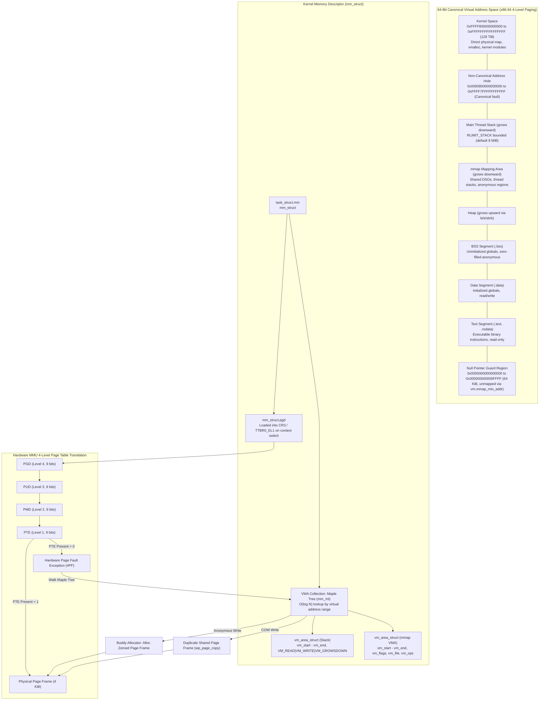
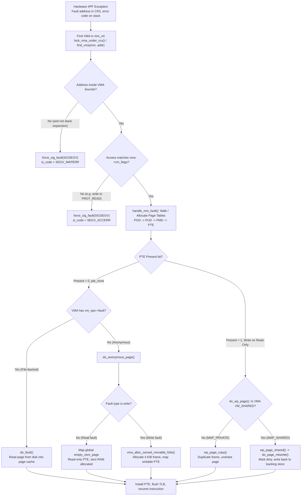
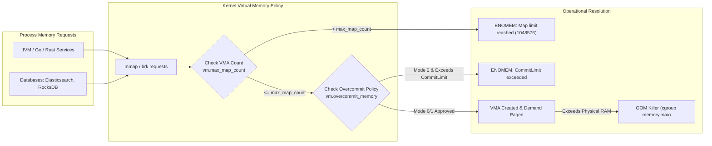

# Virtual Memory, Mmap, and Process Address Space

> [!summary] Claim:
> A process address space is an illusion constructed by the kernel and enforced by the hardware memory management unit (MMU) through hierarchical page tables.
> The kernel manages virtual intervals as Virtual Memory Areas (VMAs) indexed in a B-tree-like structure, deferring physical memory allocation until page faults occur.
> Memory mapping via `mmap` controls file and anonymous backing, sharing modes, and pre-faulting strategies, while copy-on-write semantics isolate write mutations between processes.
> Accurately sizing memory consumption requires distinguishing virtual allocation (VSZ) and mapped resident frames (RSS) from proportional sharing (PSS) and private dirty pages (USS).



## The Mechanism

The virtual memory subsystem decouples the linear address space seen by user code from the fragmented physical memory managed by the operating system.
Every memory reference executed by an instruction pipeline is a virtual address translated by the CPU memory management unit (MMU) using hierarchical page tables.
[[Processes-Fork-Exec-and-File-Descriptors]] details how processes are created and isolated; this note establishes the architectural mechanics of their address space layout, page tables, system calls, and sizing telemetry.

### 1. Process Address Space Architecture

On 64-bit architectures, virtual addresses are constrained to canonical address ranges rather than spanning the full 64-bit width.
Under x86-64 4-level paging (48-bit canonical addressing), bits 48 through 63 must be identical copies of bit 47.
This divides the $2^{64}$ theoretical address space into two 128 TiB canonical halves (`0x0000000000000000` to `0x00007FFFFFFFFFFF` for user space and `0xFFFF800000000000` to `0xFFFFFFFFFFFFFFFF` for kernel space) separated by a non-canonical gap from `0x0000800000000000` to `0xFFFF7FFFFFFFFFFF`.
Accessing any address inside this gap immediately causes a hardware general protection fault (#GP) on x86-64 or a translation fault on ARM64 without touching page tables.

```text
+-------------------------------------------------------------------+ 0xFFFFFFFFFFFFFFFF
| Kernel Space (128 TiB): Direct map, vmalloc, kernel code, BPF     |
+-------------------------------------------------------------------+ 0xFFFF800000000000
| Non-Canonical Gap (Canonical addressing hole, access triggers #GP)|
+-------------------------------------------------------------------+ 0x00007FFFFFFFFFFF
| Main Thread Stack: Grows downward towards lower addresses         |
+-------------------------------------------------------------------+
| Memory Mapping Segment: Dynamic libraries, thread stacks, mmap    |
| (Grows downward from mmap_base towards heap)                      |
+-------------------------------------------------------------------+
| Heap: Grows upward via brk() from end of BSS                      |
+-------------------------------------------------------------------+
| BSS Segment: Uninitialized globals, zero-filled anonymous pages   |
+-------------------------------------------------------------------+
| Data Segment: Initialized writable globals (.data)                |
+-------------------------------------------------------------------+
| Text Segment: Executable instructions and constants (.text, .rodata)|
+-------------------------------------------------------------------+
| Null-Pointer Guard: Lowest 64 KiB (mmap_min_addr, catches NULL)   |
+-------------------------------------------------------------------+ 0x0000000000000000
```

The binary executable's segments are loaded into user space from file containers described in [[ELF-Mach-O-and-PE-Object-Formats]], where `PT_LOAD` program headers define the virtual address offsets and access permissions.
Under modern 5-level paging (x86-64 LA57, merged in Linux 4.14), canonical addressing expands to 57 bits (128 PiB total), increasing user-space capacity to 64 PiB (`0x00FFFFFFFFFFFFFF`).
On ARM64, the address space is physically partitioned between two translation table base registers: `TTBR0_EL1` translates user addresses (`0x0000000000000000` to `0x0000FFFFFFFFFFFF`, 256 TiB under 48-bit VA where bits 63:48 are `0`), while `TTBR1_EL1` translates kernel addresses (`0xFFFF000000000000` to `0xFFFFFFFFFFFFFFFF`, 256 TiB where bits 63:48 are `1`).

Address Space Layout Randomization (ASLR) permutes the base offsets of the executable text, heap, memory-mapped libraries, and stack on every execution.
The kernel controls this behavior globally through `kernel.randomize_va_space`:
- `0`: ASLR is completely disabled.
- `1`: Conservative randomization; the stack, vDSO, and mmap regions are randomized, but the heap (`brk`) immediately follows the BSS segment.
- `2`: Full randomization; the heap base is also randomized with a variable offset above the BSS segment.

The degree of entropy injected into `mmap` offsets is tuned by the sysctl `vm.mmap_rnd_bits` (default 28 bits on x86-64, up to 32 bits; default 18 to 33 bits on ARM64).
An application or debugger can disable ASLR for its execution tree by setting the `ADDR_NO_RANDOMIZE` personality flag via `personality(2)` or executing under `setarch $(uname -m) -R`.

### 2. Kernel Memory Descriptors: `mm_struct` and VMAs

Within the Linux kernel, every process's virtual memory context is represented by `struct mm_struct`, referenced by `task_struct->mm`.
Threads sharing an address space via `clone(CLONE_VM)` point to the same `mm_struct` instance with an incremented reference count `mm_users`.
The `mm_struct` tracks:
- `pgd`: Pointer to the top-level Page Global Directory table, loaded into CPU control register `CR3` on x86-64 or `TTBR0_EL1` on ARM64 during a context switch.
- `mmap_lock`: A read-write semaphore protecting the VMA collection against concurrent modifications during `mmap`, `munmap`, `mprotect`, and page faults.
- `mm_mt`: A Maple Tree data structure (which replaced the augmented red-black tree and linked list in Linux 6.1) that indexes all virtual memory areas by virtual address range.
- `map_count`: The total number of active VMAs, enforced against the administrative ceiling `vm.max_map_count`.
- Memory bounds: `start_code`, `end_code`, `start_data`, `end_data`, `start_brk`, `brk`, `start_stack`.

```c
struct vm_area_struct {
    unsigned long vm_start;         /* Inclusive start virtual address, page-aligned */
    unsigned long vm_end;           /* Exclusive end virtual address, page-aligned */
    struct mm_struct *vm_mm;        /* Associated memory descriptor */
    pgprot_t vm_page_prot;          /* Hardware PTE architectural protection bits */
    unsigned long vm_flags;         /* Architecture-independent VMA flags (VM_READ, VM_WRITE, etc.) */
    const struct vm_operations_struct *vm_ops; /* Fault and lifecycle handlers */
    unsigned long vm_pgoff;         /* File offset in page units (PAGE_SHIFT) */
    struct file *vm_file;           /* Backing struct file pointer (NULL for anonymous) */
    void *vm_private_data;          /* Driver/subsystem private context */
    struct anon_vma *anon_vma;      /* Reverse-mapping tree for anonymous page tracking */
};
```

A Virtual Memory Area (`vm_area_struct`, or VMA) represents a contiguous range of virtual addresses with uniform protection permissions and backing properties.
When `mmap` creates adjacent mappings with identical permissions, flags, and contiguous file offsets, the kernel coalesces them into a single VMA (`vma_merge()` in `mm/mmap.c` through Linux 6.8, `vma_merge_new_range()` in `mm/vma.c` from 6.12), bounding memory descriptor overhead.
Conversely, calling `mprotect` or `munmap` on a sub-range within an existing VMA splits the node into two or three distinct VMAs, consuming additional entries toward `vm.max_map_count`.

### 3. Hardware Translation and the Page Table Walk

The hardware MMU translates virtual addresses to physical page frames using a multi-level radix tree.
On x86-64 with standard 48-bit addressing and 4 KiB base pages, translation traverses four distinct levels:

```text
63            47           38           29           20           11          0
+-------------+------------+------------+------------+------------+-----------+
| Sign Extend | PGD Index  | PUD Index  | PMD Index  | PTE Index  | Page Off  |
|   16 bits   |   9 bits   |   9 bits   |   9 bits   |   9 bits   |  12 bits  |
+-------------+------------+------------+------------+------------+-----------+
                     |            |            |            |           |
CR3 Register ------>[ ]          |            |            |           |
                     |           |            |            |           |
                     +--------->[ ]           |            |           |
                                 |            |            |           |
                                 +----------->[ ]          |           |
                                              |            |           |
                                              +----------->[ ]         |
                                                           |           |
Physical Frame Base ---------------------------------------+-----------+
```

1. Bits 47:39 index the Page Global Directory (PGD), containing 512 8-byte entries covering 512 GiB each.
2. Bits 38:30 index the Page Upper Directory (PUD), containing 512 entries covering 1 GiB each.
3. Bits 29:21 index the Page Middle Directory (PMD), containing 512 entries covering 2 MiB each.
4. Bits 20:12 index the Page Table Entry (PTE) array, containing 512 entries mapping individual 4 KiB physical page frames.
5. Bits 11:0 provide the byte offset directly within the mapped 4096-byte physical frame.

Huge pages bypass lower radix levels:
A 2 MiB huge page sets the Page Size (`PS`) bit in the PMD entry, pointing directly to a contiguous 2 MiB physical frame and eliminating the PTE level entirely.
A 1 GiB huge page sets the `PS` bit in the PUD entry, eliminating both the PMD and PTE levels.
This compression reduces translation lookaside buffer (TLB) misses by three orders of magnitude for large contiguous memory working sets.

Every PTE contains hardware-enforced attribute flags:
- `P` (Present, bit 0): Set if the physical page frame resides in RAM; cleared if the page is swapped, unpopulated, or non-resident.
- `R/W` (Read/Write, bit 1): Set for writable pages; cleared for read-only pages.
- `U/S` (User/Supervisor, bit 2): Set for user-space access; cleared to restrict access to ring 0 kernel mode.
- `NX` / `XD` (No-Execute / Execute-Disable, bit 63): Hardware enforcement preventing instruction fetching from data, heap, and stack pages.
- `A` (Accessed, bit 5) and `D` (Dirty, bit 6): Hardware-updated flags indicating page read access and write mutation.

### 4. Page Fault Handling and Demand Paging

When an instruction accesses an unmapped virtual address, attempts to write to a read-only page, or executes code on an NX page, the MMU halts execution and triggers hardware exception vector 14 (`#PF`).
The CPU loads the faulting virtual address into control register `CR2` and pushes an architectural error code onto the kernel stack encoding fault characteristics (Present, Write, User, Instruction Fetch).

The Linux architecture fault handler (`do_user_addr_fault()` in `arch/x86/mm/fault.c` or `do_page_fault()` in `arch/arm64/mm/fault.c`) validates the VMA and dispatches to `handle_mm_fault()` in `mm/memory.c`:



#### Minor versus Major Page Faults

Page faults are categorized by whether physical secondary storage I/O is required:
- **Minor Page Fault (`ru_minflt`):** The physical page frame is already available in RAM and can be mapped immediately without blocking on disk.
  Examples include allocating a fresh zero-filled anonymous page, mapping a file page that is already resident in the kernel page cache, or breaking a copy-on-write page sharing reference.
  Minor faults typically resolve in hundreds of nanoseconds.
- **Major Page Fault (`ru_majflt`):** The requested page frame is absent from physical RAM.
  The kernel must initiate blocking disk or network storage I/O to read file blocks into the page cache or swap an evicted anonymous page back into RAM.
  Major faults block thread execution for milliseconds, inducing severe latency spikes in performance-critical paths.

#### Demand Paging and Anonymous Zero Pages

When an application calls `mmap(NULL, size, PROT_READ | PROT_WRITE, MAP_PRIVATE | MAP_ANONYMOUS, -1, 0)`, the kernel does not allocate physical memory.
It allocates a new `vm_area_struct`, inserts it into `mm->mm_mt`, and returns a virtual address pointer.
Virtual address space (VSZ) increases immediately, while resident physical memory (RSS) remains completely unchanged.

When a thread first reads from an unallocated anonymous page, `do_anonymous_page()` maps the virtual address to the globally shared, read-only `empty_zero_page`.
Millions of read-only virtual pages can map to this single physical 4 KiB frame, consuming no unique memory.
Only when a thread attempts to write to that virtual address does the MMU trigger another page fault.
The kernel intercepts the write protection violation, allocates an independent zeroed physical page frame from the buddy allocator, points the PTE to the new frame, marks it writable, and invalidates the local TLB entry.

### 5. Memory Mapping Flags: Semantics and Mechanics

The `mmap(2)` system call creates virtual memory mappings with precise behavioral semantics determined by flag arguments:

```c
void *mmap(void *addr, size_t length, int prot, int flags, int fd, off_t offset);
```

#### `MAP_PRIVATE` versus `MAP_SHARED`
- `MAP_PRIVATE`: Creates a copy-on-write mapping.
  Writes to the mapped virtual memory are never committed to the underlying file or shared with other processes.
  The kernel duplicates modified pages into private anonymous frames.
- `MAP_SHARED`: Creates a cooperative shared mapping.
  Writes to the virtual memory region are immediately visible to all other processes mapping the identical range of the same file.
  Dirty pages are scheduled for asynchronous writeback to disk by kernel flusher threads or synchronized synchronously via `msync(2)`.
- `MAP_SHARED_VALIDATE` (Linux 4.15+): Functions identically to `MAP_SHARED`, but strictly validates unknown flag bits.
  Standard `mmap` silently ignores unrecognized flags, creating silent compatibility hazards; `MAP_SHARED_VALIDATE` fails with `EOPNOTSUPP` if an unsupported flag is provided.

#### Anonymous versus File-Backed Mappings
- `MAP_ANONYMOUS` (or `MAP_ANON`): The mapping is backed by RAM and swap space rather than an inode on a filesystem.
  The `fd` argument is ignored (portably passed as `-1`), and `offset` must be zero.
  Anonymous memory hosts process heaps, thread stacks, and runtime arena allocations.
- File-Backed Mappings: The mapping is linked directly to a filesystem inode via `struct file`.
  The kernel page cache acts as the physical memory store; virtual addresses map directly to page cache frames holding file content.

#### Advanced Allocation and Pre-faulting Flags
- `MAP_POPULATE` (Linux 2.5.46+): Eagerly pre-faults page tables for the mapping during the `mmap` system call itself.
  For file mappings, it triggers sequential readahead from disk into the page cache.
  For anonymous mappings, it allocates and maps physical zeroed frames immediately, eliminating runtime page faults during subsequent execution.
- `MAP_LOCKED` (Linux 2.5.37+): Pins mapped physical pages in RAM, preventing them from being swapped out, identical to calling `mlock(2)` on the range.
- `MAP_FIXED` versus `MAP_FIXED_NOREPLACE`:
  `MAP_FIXED` forces the kernel to place the mapping at exactly `addr`.
  If the requested range overlaps any existing VMA, the overlapping pages are silently discarded and unmapped without warning.
  This behavior frequently corrupts thread stacks, dynamic linker metadata, and memory allocators.
  `MAP_FIXED_NOREPLACE` (Linux 4.17+) provides atomic address placement: if the requested range overlaps any existing mapping, the system call fails safely with `EEXIST`.

### 6. Copy-on-Write (COW) Mechanics Across Fork

When a process invokes `fork(2)`, duplicating the entire physical address space of a multi-gigabyte process would be computationally prohibitive and exhaust physical RAM.
Instead, the kernel executes `dup_mmap()`:
1. It copies each `vm_area_struct` from the parent's Maple tree into the child's `mm_struct`.
2. It duplicates the parent's page tables into the child.
3. For every private writable page (`VM_WRITE && !VM_SHARED`), the kernel clears the hardware write flag (`PTE_WRITE`) in both the parent's and the child's PTEs.
4. It increments the reference count (`_refcount`) of each underlying physical `struct page`.

Both parent and child initially execute with shared, read-only page table entries pointing to identical physical page frames.
When either process attempts to write to any page, the hardware MMU triggers a page fault due to the missing write permission.
The kernel's `do_wp_page()` inspects the page reference count:
- If `page_count(page) > 1`: The page is actively shared.
  The kernel allocates a new physical frame from the buddy allocator, copies the 4 KiB content from the original page into the new frame, updates the faulting process's PTE to point to the new frame, marks the PTE writable, and decrements the original page's reference count.
- If `page_count(page) == 1`: The other process has already copied or unmapped the page.
  The kernel marks the existing PTE writable in place without allocating or copying memory.

### 7. Memory Metrics: VSZ, RSS, PSS, and USS

Operational monitoring tools report radically different memory metrics depending on which page tables and counters they inspect:

```text
+-----------------------------------------------------------------------------------+
| Virtual Set Size (VSZ): All allocated VMAs (16384 kB)                             |
+-----------------------------------------------------------------------------------+
| Resident Set Size (RSS): Physical frames in RAM (8192 kB)                         |
+-------------------------------------------------+---------------------------------+
| Unique Set Size (USS): Private to this process  | Shared Pages: Mapped in N tasks |
| Private_Clean + Private_Dirty (4096 kB)         | Shared_Clean + Shared_Dirty     |
+-------------------------------------------------+---------------------------------+
| Proportional Set Size (PSS): USS + (Shared / N)                                   |
+-----------------------------------------------------------------------------------+
```

- **VSZ (Virtual Memory Size):** The total aggregate size of all virtual address space ranges mapped in the process's Maple tree (`mm->total_vm`).
  VSZ includes demand-paged anonymous regions that have never been written to, shared libraries, memory-mapped read-only files, and guard pages.
  A process mapping a 1 TiB sparse file has a VSZ of 1 TiB even if physical memory usage is 4 KiB.
- **RSS (Resident Set Size):** The total amount of physical RAM currently mapped into the process's page tables (`Private_Clean + Private_Dirty + Shared_Clean + Shared_Dirty`).
  The critical flaw of RSS is that it double-counts shared memory: if 50 worker processes each map a 200 MiB shared library or read-only dataset, each worker reports 200 MiB of RSS, erroneously suggesting 10 GiB of memory consumption when total physical RAM usage is only 200 MiB.
- **PSS (Proportional Set Size):** Measures a process's true proportional share of physical RAM.
  Private pages are counted at full value, while shared pages are divided by the exact number of processes mapping them:
  $$\text{PSS} = \text{Private\_Clean} + \text{Private\_Dirty} + \sum_{i=1}^{M} \frac{\text{Shared\_Page}_i}{N_i}$$
  Summing the PSS across all active processes on a system equals the exact amount of physical memory utilized by user space.
- **USS (Unique Set Size):** The memory exclusively mapped by this process (`Private_Clean + Private_Dirty`).
  USS represents the exact volume of physical RAM that would be immediately reclaimed by the kernel if the process were terminated.

These values are exposed through `/proc/[pid]/smaps` and pre-aggregated for high-speed retrieval in `/proc/[pid]/smaps_rollup`, which are parsed alongside process credentials as detailed in [[Proc-Filesystem-and-Process-Credentials]].

## Commands and Numbers to Know

Every engineer debugging memory pressure or configuring systems must know the following parameters and platform thresholds:

| Parameter / Metric | Scope / Target | Default Value | Mechanism and Operational Impact |
| :--- | :--- | :--- | :--- |
| `PAGE_SIZE` | Both | `4096` B (Linux x86/ARM), `16384` B (macOS ARM) | Fundamental MMU allocation quantum (as of 2026-11, Both). |
| `kernel.randomize_va_space` | Linux | `2` (Full ASLR) | Randomizes stack, mmap area, vDSO, and `brk` heap base (as of 2026-11, Linux). |
| `vm.mmap_rnd_bits` | Linux | `28` (x86-64), `18`-`33` (ARM64) | Bits of entropy used for randomizing mmap base addresses (as of 2026-11, Linux). |
| `vm.max_map_count` | Linux | `65530` (Upstream), `1048576` (Ubuntu 24.04/Fedora) | Maximum number of VMAs per `mm_struct`; limits mmap allocations (as of 2026-11, Linux). |
| `vm.overcommit_memory` | Linux | `0` (Heuristic overcommit) | `0`=heuristic, `1`=always allow, `2`=strict enforcement via CommitLimit (as of 2026-11, Linux). |
| `vm.overcommit_ratio` | Linux | `50` (%) | Physical RAM percentage applied to CommitLimit under mode 2 (as of 2026-11, Linux). |
| `vm.mmap_min_addr` | Linux | `65536` (x86-64), `32768` (ARM64), `4096` (Upstream) | Lowest virtual address unprivileged code can map; prevents NULL exploits (as of 2026-11, Linux). |
| `RLIMIT_AS` | Both | `unlimited` | Soft/hard ceiling on process virtual memory size (VSZ) (as of 2026-11, Both). |
| `RLIMIT_DATA` | Both | `unlimited` | Maximum size of process data segment and heap (`brk`) (as of 2026-11, Both). |
| `RLIMIT_STACK` | Both | `8388608` B (8 MiB, Linux), `8372224` B (8176 KiB, macOS) | Maximum size of main thread stack segment before SIGSEGV (as of 2026-11, Both). |
| `MAP_FAILED` | Both | `((void *) -1)` | Sentinel return value indicating mmap system call failure (as of 2026-11, Both). |
| `phys_footprint` | macOS | Dynamic / Tracked via `task_info` | Internal memory counter used by Jetsam to trigger process termination (as of 2026-11, macOS). |

The CommitLimit equation enforced when `vm.overcommit_memory = 2` is:
$$\text{CommitLimit} = (\text{MemTotal} - \text{HugePages\_Total} \times \text{Hugepagesize}) \times \left(\frac{\text{vm.overcommit\_ratio}}{100}\right) + \text{SwapTotal}$$

If total committed memory (`Committed_AS` in `/proc/meminfo`) exceeds `CommitLimit`, any allocation requesting private writable memory fails with `ENOMEM`.

## Multi-Language Comparison

Operating systems expose memory primitives through C system calls, but higher-level language runtimes wrap, cache, and abstract them differently:

| Dimension | C++ (POSIX / Clang / GCC) | Rust (Edition 2024 / rustc) | Python (CPython 3.12 / 3.13) |
| :--- | :--- | :--- | :--- |
| **Direct Mapping API** | `mmap(2)` / `munmap(2)` via `<sys/mman.h>`. | `memmap2` crate (`Mmap`, `MmapMut`) or `libc::mmap`. | `mmap.mmap()` standard library module. |
| **Heap Memory Management** | `malloc` / `operator new` backed by arena allocators (glibc ptmalloc, jemalloc, mimalloc). | `std::alloc::System` (delegating to `libc::malloc`) or custom global allocator (jemalloc, mimalloc). | Small objects ($\le 512$ B) via `pymalloc` arenas (1 MiB on 64-bit, 256 KiB on 32-bit; `mimalloc` in 3.13 free-threaded); larger objects via `malloc`. |
| **Large Allocation Strategy** | Allocations above `M_MMAP_THRESHOLD` (default 128 KiB to 32 MiB dynamic on 64-bit) bypass heap and use `mmap`. | `System` allocator inherits `libc::malloc` threshold; jemalloc switches from small slab to large extent classes above 14 KiB within `mmap`-backed extents. | Delegates allocations exceeding 512 bytes (`SMALL_REQUEST_THRESHOLD`) to system `malloc`, which uses `mmap` above `M_MMAP_THRESHOLD`. |
| **Zero-Copy Serialization** | Raw pointer reinterpretation over file mapping (`reinterpret_cast<const Header*>(ptr)`). | Safe slices via `bytemuck` or `zerocopy` over mapped memory slices (`&[u8]`). | `memoryview` or `numpy.memmap` reading structured binary files without user-space buffer copies. |
| **Memory Reclamation** | Explicit `madvise(MADV_DONTNEED)` or `madvise(MADV_FREE)` to release physical pages. | Drops memory wrappers calling `munmap`; manual `madvise` via `libc::madvise`. | Refcount drops invoke allocator free; Python runtime rarely returns virtual space to OS immediately. |
| **Safety Guarantees** | None; pointer arithmetic, file truncation (`SIGBUS`), and data race UB are unmanaged. | `memmap2` marks file mapping creation `unsafe` due to external file truncation UB hazards. | Encapsulated; slices validate bounds, but underlying file truncation crashes interpreter with `SIGBUS`. |

## Worked Lab Example

The companion lab `code/00-Program-Execution/mmap_rss_vsz/` provides a self-contained, reproducible C program verifying demand paging, page fault rates, eager pre-population, copy-on-write page isolation, `MADV_DONTNEED` reclamation, and `MAP_SHARED` versus `MAP_PRIVATE` file semantics.

The lab harness configures `prctl(PR_SET_THP_DISABLE, 1, 0, 0, 0)` to prevent Transparent Huge Page (THP) multi-size folios from collapsing fault metrics, ensuring that every page fault corresponds to an exact 4096-byte hardware translation.
With that call removed, the same container served Step 2 in 512 faults instead of 2,048 and Step 3 in 256 instead of 1,024 (mutation run, `linux-aarch64`, as of 2026-11), so the call is load-bearing.

### Execution Steps

```bash
cd code/00-Program-Execution/mmap_rss_vsz
bash run.sh
```

### Verified Output

Recorded (as of 2026-11) from `expected/linux-aarch64.txt`, produced inside the Linux container (`toolchain-labs:f39efe0ff57b`, `linux-aarch64`, VM kernel 7.2.12-orbstack); the fault counts and VMA sizes depend on the kernel and page size, so other platforms may print different numbers:

```text
Page size: 4096 bytes

--- Step 1: Anonymous Private Allocation (16 MiB) ---
VMA Size:          16384 kB
VMA RSS:           0 kB
VMA PSS:           0 kB
VMA Private_Dirty: 0 kB
Demand paging verified: virtual range mapped with zero physical resident pages.

--- Step 2: Write to 2048 Pages (8 MiB) ---
Minor page faults incurred: 2048
VMA RSS:                    8192 kB
VMA PSS:                    8192 kB
VMA Private_Dirty:          8192 kB
Page fault allocation verified: exactly touched pages became resident and dirty.

--- Step 3: MAP_POPULATE Eager Allocation (4 MiB) ---
Minor faults during mmap: 1024
VMA Size:                 20480 kB
VMA RSS:                  12288 kB
VMA Private_Dirty:        12288 kB
Eager population verified: physical pages populated synchronously without user touch.

--- Step 4: Fork and Copy-on-Write (COW) Mechanics ---
[Child post-fork before write]
VMA RSS:           8192 kB
VMA PSS:           4096 kB
VMA Shared_Dirty:  8192 kB
VMA Private_Dirty: 0 kB
[Child after writing 256 pages (1 MiB)]
Minor faults on write: 256
VMA RSS:               8192 kB
VMA PSS:               4608 kB
VMA Shared_Dirty:      7168 kB
VMA Private_Dirty:     1024 kB
[Parent after child exit]
VMA RSS:           8192 kB
VMA PSS:           8192 kB
VMA Shared_Dirty:  0 kB
VMA Private_Dirty: 8192 kB
COW verified: child unshares only modified pages; PSS reflects proportional ownership.

--- Step 5: MADV_DONTNEED Page Reclamation ---
Byte before MADV_DONTNEED:             0x5A
VMA RSS after MADV_DONTNEED:           0 kB
VMA Private_Dirty after MADV_DONTNEED: 0 kB
Re-read byte value:                    0x00
MADV_DONTNEED verified: resident frames released; re-read returns zeroed page.

--- Step 6: File-backed MAP_SHARED vs MAP_PRIVATE ---
File byte after MAP_SHARED write:  'B'
Private mapping byte after its write: 'C'
File byte after MAP_PRIVATE write: 'B'
File-backed semantics verified: MAP_SHARED mutates the file; MAP_PRIVATE isolates changes.
```

### Analysis of Output Mechanics

1. **Step 1 (Demand Paging):** Allocating 16 MiB with `mmap` increases VMA size to 16,384 KiB, but RSS, PSS, and Private_Dirty remain 0 kB because no physical frames have been populated.
2. **Step 2 (Fault Allocation):** Writing across 2,048 sequential pages incurs exactly 2,048 minor page faults, allocating 8,192 KiB of resident RAM.
3. **Step 3 (VMA Merge & Eager Population):** The lab places a 4 MiB `MAP_POPULATE` mapping directly below `p1` with `MAP_FIXED_NOREPLACE` (which fails with `EEXIST` rather than replacing a mapping, so adjacency never depends on default top-down placement).
   Because protection and flags match, the kernel's VMA merge (`vma_merge_new_range()` on Linux 6.12 and later) yields a single 20,480 KiB VMA, and all 1,024 pages fault synchronously during `mmap`.
4. **Step 4 (Copy-on-Write):** Post-fork, the child shares the parent's 8,192 KiB resident pages (`Shared_Dirty = 8192 kB`, `Private_Dirty = 0 kB`); PSS is exactly halved to 4,096 KiB.
   Writing to 256 pages breaks COW for only those pages, triggering 256 minor faults and converting 1,024 KiB into `Private_Dirty`.
5. **Step 5 (Page Eviction):** The lab first stores the marker `0x5A` in page 0, then calls `madvise(MADV_DONTNEED)`, which immediately drops the physical frames (RSS and Private_Dirty fall to 0 kB); a subsequent read maps the shared zero page and returns `0x00`, so the changed byte cannot be a leftover of the original contents.
6. **Step 6 (Backing Store Isolation):** A write through a `MAP_SHARED` mapping changes the file's contents as seen by `pread(2)`, while a write through a `MAP_PRIVATE` mapping is visible only to its writer (`'C'`) and leaves the file at `'B'`, even after `msync`.
   `pread(2)` reads through the page cache, so the lab proves file-content visibility, not that the block reached the storage device; `msync(MS_SYNC)` is what requests that writeback.

## Pitfalls

> [!warning] Pitfall: Calling MADV_DONTNEED on private anonymous memory destroys application data
> Many developers assume `MADV_DONTNEED` is a non-destructive caching hint that merely advises the kernel to deprioritize pages.
> On Linux, calling `madvise(..., MADV_DONTNEED)` on private anonymous memory immediately zaps the page table entries and frees the physical frames.
> Subsequent reads to that memory do not restore the previous contents; the kernel silently maps the zero page, returning zeroed bytes.
> To asynchronously release memory under pressure while retaining contents if memory remains available, use `MADV_FREE` (Linux 4.5+).

> [!warning] Pitfall: MAP_FIXED silently overwrites existing mappings
> Calling `mmap` with `MAP_FIXED` forces placement at the specified target address.
> If the requested interval overlaps existing text, heap, thread stack, or shared library mappings, the kernel silently unmaps the overlapping range.
> This creates catastrophic memory corruption, random segmentation faults, or silent security vulnerabilities.
> Always use `MAP_FIXED_NOREPLACE` (Linux 4.17+) when attempting fixed address placement, which guarantees atomic reservation or returns `EEXIST`.

> [!warning] Pitfall: SIGBUS crashes caused by file truncation
> When mapping a file with `mmap`, the VMA bounds are rounded up to the nearest page size.
> Bytes in the final partial page past end-of-file read as zeros, and writes there are never written back to the file (`mmap(2)`).
> An access to a page that lies entirely beyond end-of-file raises a bus error (`SIGBUS` with `BUS_ADRERR`), which happens when the mapping is longer than the file.
> Similarly, if another process truncates a memory-mapped file while your process is actively reading or writing it, subsequent accesses to the now-vanished pages abort with `SIGBUS`.
> Resilient memory-mapped file engines must install a `SIGBUS` signal handler or validate file size invariants before reading.

> [!warning] Pitfall: Exhausting vm.max_map_count under high thread counts or memory-mapped stores
> Every thread stack allocated with a guard page, every JIT compilation slab, and every RocksDB/Lucene segment mapping consumes at least one VMA descriptor.
> Under heavy thread counts or thousands of open database tables, `mm->map_count` hits `vm.max_map_count` (upstream default `65530`).
> Once exhausted, all subsequent calls to `mmap`, `pthread_create`, or memory allocators fail with `ENOMEM`, despite gigabytes of free physical RAM.
> Production database nodes and Java services must explicitly tune `vm.max_map_count=1048576`.

> [!warning] Pitfall: Massive mmap_lock contention stalling concurrent multithreaded allocations
> The kernel protects a process's VMA tree with `mm->mmap_lock`; `mmap`, `munmap`, `mprotect`, and `brk` acquire it in exclusive write mode (`down_write`).
> Before Linux 6.4, every page fault took `mmap_lock` in read mode, so one thread's `mmap` blocked all other threads from resolving minor faults.
> Since 6.4, most faults first try a per-VMA lock (`lock_vma_under_rcu()`) and touch `mmap_lock` only when that fails, so a writer stalls faults only on the VMA it is modifying, or on fault paths not yet converted.
> On older kernels, and for faults that fall back, threads concurrently allocating memory via `mmap` still block other threads' faults.
> This creates severe multi-millisecond tail latency spikes; production systems resolve this by utilizing jemalloc or TCMalloc with large pre-allocated memory arenas.

> [!warning] Pitfall: Fork latency and memory exhaustion in massive in-memory databases
> Calling `fork(2)` in a process utilizing 200 GiB of RAM requires duplicating 400 MiB of page table structures.
> The CPU must sequentially traverse and modify millions of PTEs to mark them read-only for copy-on-write.
> This operation can pause the parent process for hundreds of milliseconds, breaching real-time SLA thresholds.
> Furthermore, if the child or parent subsequently mutates memory during a background persistence dump (e.g. Redis RDB snapshots), COW duplication rapidly exhausts physical RAM, triggering the OOM killer.

## At Scale

At enterprise scale (1,000 to 50,000 engineers and tens of thousands of production nodes), virtual memory configurations govern infrastructure cost and multi-tenant reliability.

### 1. Fleet-Wide VMA and Memory Overcommit Policies

Default Linux sysctl values are engineered for generic desktop environments and fail catastrophically under modern containerized workloads.



Organizations must establish standardized kernel sysctl profiles distributed via host orchestration:
- **`vm.max_map_count = 1048576`**: Mandated across all Kubernetes nodes.
  Eliminates spurious `ENOMEM` startup crashes in Elasticsearch, OpenSearch, Kafka, Cassandra, and Java runtimes utilizing thread pools.
- **`vm.overcommit_memory = 0` (Default)** for microservice hosts: Balances sparse address allocation against runaway memory consumption.
- **`vm.overcommit_memory = 2` with `vm.overcommit_ratio = 80`** for high-reliability bare-metal storage engines:
  Prevents the kernel from over-promising memory.
  Applications receive immediate, catchable `ENOMEM` errors at allocation time rather than being asynchronously executed by the kernel Out-Of-Memory (OOM) killer mid-transaction.

### 2. Cgroup v2 Memory Accounting

In modern containerized deployments, Kubernetes enforces memory isolation via Linux control groups (`cgroup v2`).
The kernel tracks container memory consumption through `/sys/fs/cgroup/memory.*`:
- `memory.current`: Total resident memory utilized by all processes in the cgroup (anonymous memory, page cache, swap).
- `memory.min`: Hard memory protection.
  If usage is below this threshold, the kernel never reclaims page cache or unmaps pages from the container.
- `memory.high`: Throttling boundary.
  Exceeding this value forces processes in the cgroup into kernel reclaim routines, slowing execution down to prevent sudden OOM termination.
- `memory.max`: Absolute hard limit.
  If exceeded and memory cannot be reclaimed via page cache eviction, the kernel invokes the OOM killer, selecting processes based on `oom_score_adj`.

Engineers must monitor container health using PSS and working set size (`memory.current - inactive_file`) rather than raw RSS.
Container monitoring agents that inspect host `/proc/meminfo` or process-level RSS report false OOM warnings by aggregating shared library pages across multiple containers.

### 3. Transparent Huge Pages (THP) Strategy

Transparent Huge Pages automatically collapse 512 contiguous 4 KiB pages into a single 2 MiB physical frame to accelerate TLB hit rates.
However, in high-scale latency-critical systems, THP introduces two severe anti-patterns:
- **Allocation Latency Spikes:** When physical memory is fragmented, allocating a synchronous 2 MiB contiguous block blocks the thread in direct memory compaction.
- **Memory Bloat:** Touching a single 4 KiB byte sequence in a sparse 2 MiB region forces the kernel to back the entire 2 MiB, expanding memory footprints by up to 512x.

**Organizational Paved Road:**
Set system-wide THP to `madvise` mode (`echo madvise > /sys/kernel/mm/transparent_hugepage/enabled`).
Services with dense memory accesses (e.g. high-performance caches, analytical vector databases) explicitly opt in to 2 MiB pages via `madvise(..., MADV_HUGEPAGE)`, while general microservices avoid compaction pauses and memory bloat.

## Practice Drill

> [!tip] Practice Drill:
> Write a standalone C program to predict and verify address space layout permutations and VMA coalescing:
> 1. Print the addresses of a text function (`main`), an initialized global (`data`), an uninitialized global (`bss`), a heap buffer allocated with `malloc(64)`, an anonymous mapping returned by `mmap`, and a local stack variable.
> 2. Run the program ten times sequentially under normal execution, and record the variance in virtual base addresses.
> 3. Execute the binary under `setarch $(uname -m) -R ./a.out` and confirm that all addresses remain completely invariant across successive runs.
> 4. Modify the program to allocate two adjacent 1 MiB blocks with identical permissions using `mmap`:
>    `void *p1 = mmap(NULL, 1048576, PROT_READ | PROT_WRITE, MAP_PRIVATE | MAP_ANONYMOUS, -1, 0);`
>    `void *p2 = mmap((char *)p1 - 1048576, 1048576, PROT_READ | PROT_WRITE, MAP_PRIVATE | MAP_ANONYMOUS | MAP_FIXED_NOREPLACE, -1, 0);`
> 5. Inspect `/proc/self/maps` and verify that the kernel merged both blocks into a single 2 MiB VMA.
> 6. Call `mprotect(p1, 4096, PROT_READ)` on a sub-range within that mapping, and observe `/proc/self/maps` split the single VMA into three distinct entries.

```bash
cat << 'EOF' > vma_drill.c
#define _GNU_SOURCE
#include <stdio.h>
#include <stdlib.h>
#include <unistd.h>
#include <sys/mman.h>

int global_init = 42;
int global_bss;

int main(void) {
    int stack_var = 10;
    void *heap_var = malloc(64);
    void *mmap_var = mmap(NULL, 4096, PROT_READ | PROT_WRITE, MAP_PRIVATE | MAP_ANONYMOUS, -1, 0);

    printf("Text (main):   %p\n", (void *)main);
    printf("Data:          %p\n", (void *)&global_init);
    printf("BSS:           %p\n", (void *)&global_bss);
    printf("Heap:          %p\n", heap_var);
    printf("mmap:          %p\n", mmap_var);
    printf("Stack:         %p\n", (void *)&stack_var);

    free(heap_var);
    munmap(mmap_var, 4096);
    return 0;
}
EOF

gcc -O2 vma_drill.c -o vma_drill
echo "=== ASLR Enabled (Notice varying base addresses) ==="
./vma_drill
./vma_drill

echo "=== ASLR Disabled via setarch -R (Notice identical addresses) ==="
setarch $(uname -m) -R ./vma_drill
setarch $(uname -m) -R ./vma_drill
rm -f vma_drill vma_drill.c
```

## Interview Questions

> [!question] L5: Distinguish between VSZ, RSS, PSS, and USS.
> If a fleet of 32 worker processes reports an individual RSS of 2 GiB each on a 32 GiB server, why is the machine not experiencing out-of-memory errors?
>
> > [!success]- Answer
> > VSZ is total virtual address space allocated; RSS is physical memory currently mapped in page tables; PSS is resident memory adjusted proportionally for sharing across processes; USS is private memory exclusively owned by the single process.
> > The 32 worker processes were spawned via `fork(2)` from a master process or share large read-only memory mappings (such as shared libraries, shared data models, or read-only memory-mapped files).
> > RSS double-counts every shared physical page in each process's metric.
> > If 1.8 GiB of the 2 GiB RSS consists of shared read-only pages and only 200 MiB is private dirty memory (USS), the total physical memory consumed by all 32 workers is $1.8\text{ GiB} + (32 \times 0.2\text{ GiB}) = 8.2\text{ GiB}$, which easily fits within the 32 GiB server RAM.
> > Inspecting PSS or `/proc/self/smaps_rollup` reveals the true 8.2 GiB footprint.

> [!question] L5 (Predict the output): Predict the output and minor page fault transitions when executing this C program:
> ```c
> int main() {
>     size_t sz = 4096 * 10; // 10 pages
>     char *p = mmap(NULL, sz, PROT_READ|PROT_WRITE, MAP_PRIVATE|MAP_ANONYMOUS, -1, 0);
>     p[0] = 'X';
>     p[4096] = 'Y';
>     madvise(p, 4096, MADV_DONTNEED);
>     printf("%c\n", p[0]);
>     return 0;
> }
> ```
>
> > [!success]- Answer
> > The program prints `\0` (an empty/null character with ASCII value 0), not `'X'`.
> > Allocating with `MAP_ANONYMOUS | MAP_PRIVATE` creates a demand-paged VMA with 0 resident pages.
> > Writing `p[0] = 'X'` triggers 1 minor page fault and allocates 1 physical frame.
> > Writing `p[4096] = 'Y'` triggers 1 minor page fault and allocates a second physical frame.
> > Calling `madvise(p, 4096, MADV_DONTNEED)` instructs the kernel to immediately release the physical frame backing the first page and clear its PTE.
> > Reading `p[0]` in `printf` triggers a fresh read page fault; because the region is anonymous private memory, the kernel maps the global zero page, returning byte `0x00`.

> [!question] L6 (Debug this): A high-performance analytical service crashes with `ENOMEM` during startup when spawning its 1,000th worker thread, even though `free -m` reports 120 GiB of available RAM and `ulimit -v` is unlimited.
> How do you diagnose and fix the failure?
>
> > [!success]- Answer
> > The failure is caused by exhausting `vm.max_map_count` or hitting strict overcommit ceilings, not by physical RAM exhaustion.
> > Each thread spawned via `pthread_create` creates a stack allocation accompanied by a `PROT_NONE` guard page, which splits the memory mapping segment and consumes at least two distinct VMAs.
> > Furthermore, memory allocators or analytical storage engines map many sparse arena chunks.
> > Inspect the process's active VMA count with `wc -l /proc/[pid]/maps` and check the kernel limit with `sysctl vm.max_map_count`.
> > If `map_count` equals `vm.max_map_count` (upstream default 65530), the next `mmap` inside `pthread_create` returns `ENOMEM`.
> > To remediate, increase the sysctl limit: `sysctl -w vm.max_map_count=1048576`.
> > If VMA count is low, check if `vm.overcommit_memory = 2` is set; if total virtual commitments (`Committed_AS` in `/proc/meminfo`) exceed `CommitLimit`, allocations fail with `ENOMEM` regardless of free RAM.

> [!question] L6: Walk through the exact hardware and kernel state transitions when a thread executes a write instruction against an address mapped with `MAP_PRIVATE` pointing to an existing file in the page cache.
>
> > [!success]- Answer
> > 1. The CPU MMU traverses the hardware page tables (PGD -> PUD -> PMD -> PTE) using the virtual address.
> > 2. The PTE for the address has `Present = 1` pointing to the file's page cache frame, but `Write = 0` because the mapping was created with `MAP_PRIVATE`.
> > 3. The CPU halts instruction execution and raises hardware exception vector 14 (#PF) with error code indicating a write violation on a present page; the fault address is stored in `CR2`.
> > 4. The kernel page fault handler (`handle_mm_fault`) walks the process's Maple tree, finds the matching VMA, and validates that `vma->vm_flags` contains `VM_WRITE`.
> > 5. Because the mapping is `MAP_PRIVATE` and the underlying page is shared or file-backed, the kernel invokes `do_wp_page()` and `wp_page_copy()`.
> > 6. The kernel allocates a new physical frame from the buddy allocator via `vma_alloc_folio()` (historically `alloc_page_vma()`).
> > 7. It copies the 4 KiB content from the page cache frame into the newly allocated frame via `folio_mc_copy()` (`copy_user_highpage()`).
> > 8. It updates the process's PTE to point to the new physical frame, sets the `Write` bit, sets `Dirty` and `Accessed` flags, and decrements the page cache frame's reference count.
> > 9. It flushes the local CPU TLB for that virtual address and returns from the interrupt, resuming the write instruction successfully against the private frame.

> [!question] L6: Why is `MAP_FIXED` hazardous in production C/C++ software, and how does `MAP_FIXED_NOREPLACE` eliminate the danger?
>
> > [!success]- Answer
> > `MAP_FIXED` enforces address placement strictly at `addr`.
> > If any existing virtual memory mapping overlaps the specified `[addr, addr + len)` range, the kernel unilaterally and silently unmaps the overlapping portion before creating the new mapping.
> > In complex multithreaded programs or libraries, an inadvertent `MAP_FIXED` can overwrite parts of another thread's stack, glibc's internal metadata, or an active shared library mapping, resulting in erratic crashes or exploitable memory corruption.
> > `MAP_FIXED_NOREPLACE` (introduced in Linux 4.17) guarantees atomic placement without destruction: if the target address range conflicts with any existing VMA in the process's address space, the system call refuses to alter existing memory and immediately fails with `EEXIST`.

> [!question] L7: In a high-throughput multi-threaded C++ trading engine, memory allocations via `malloc` occasionally trigger multi-millisecond latency spikes.
> Explain how `mm->mmap_lock` contention causes this phenomenon and how to design around it.
>
> > [!success]- Answer
> > In Linux, all VMAs belonging to an `mm_struct` are protected by a single read-write semaphore: `mmap_lock`.
> > Any system call that creates, destroys, resizes, or reprotects VMAs (`mmap`, `munmap`, `mprotect`, `brk`, `mremap`) must acquire `mmap_lock` in exclusive write mode (`down_write`), and write-locks each VMA it changes.
> > Before Linux 6.4, resolving page faults (demand paging, COW) always took `mmap_lock` in shared read mode (`down_read`), so a background `mmap`, `munmap`, or heap expansion blocked every subsequent fault in the process.
> > Since 6.4, most faults first take only the faulting VMA's per-VMA lock under RCU (`lock_vma_under_rcu()`), so a writer stalls faults on the VMAs it is modifying and on fault paths that fall back to `mmap_lock`, not all faults.
> > The spike remains on older kernels, and on current ones when worker threads touch memory in the very VMA the allocator is growing or splitting (glibc heap expansion with `brk`, or `munmap` and `mprotect` on a shared arena), where they wait on the VMA lock or `down_read(&mm->mmap_lock)` for milliseconds.
> > **Mitigations:**
> > 1. Use pre-allocated memory pools and ring buffers created at process initialization.
> > 2. Pre-fault all memory during startup using `MAP_POPULATE` and lock it into RAM with `mlockall(MCL_CURRENT | MCL_FUTURE)`.
> > 3. Configure memory allocators like jemalloc with static arenas (`arenas.narenas`) and disable runtime dynamic purging (`dirty_decay_ms = -1`).
> > 4. Avoid runtime `pthread_create` by using pinned thread pools with pre-sized stacks.

> [!question] L7+: Explain how the Linux kernel implements Copy-on-Write (COW) at the physical `struct page` level.
> What is the precise failure mode and latency impact of calling `fork()` in a 500 GiB in-memory cache, and how do modern architectures eliminate it?
>
> > [!success]- Answer
> > In `fork()`, the kernel duplicates all VMA descriptors and page table structures via `dup_mmap()`.
> > For every private writable page, the kernel clears the `PTE_WRITE` bit in both parent and child PTEs, sets `pte_wrprotect()`, and increments `page->_refcount`.
> > In a 500 GiB process using standard 4 KiB pages, there are 131,072,000 PTEs, requiring approximately 1 GiB of physical memory just to store page table pages.
> > Traversing and copying 131 million PTEs during `fork()` requires hundreds of milliseconds of sequential CPU processing, during which the parent process is completely frozen.
> > If the child or parent subsequently modifies memory (e.g. during background disk persistence), the subsequent write faults trigger 131 million COW duplications, rapidly exceeding physical RAM and provoking the OOM killer.
> > **Mitigations:**
> > 1. Use Transparent Huge Pages (2 MiB) or HugeTLB (1 GiB): reduces the total PTE count from 131 million to 256,000, shrinking page table copy time to under 2 milliseconds.
> > 2. Avoid `fork()` entirely for process spawning: use `posix_spawn()` (on glibc 2.24 and later it always uses `CLONE_VM | CLONE_VFORK`, so `POSIX_SPAWN_USEVFORK` has no effect) or `vfork()`, which avoids page table duplication by suspending the parent until `execve()`.
> > 3. For persistence snapshots, utilize modern user-space asynchronous I/O (`io_uring`) or file system snapshotting rather than `fork`-based background dumping.

> [!question] L7+: A high-throughput database engine maps a 2 TiB data file with `mmap(MAP_SHARED)`.
> During an abrupt power outage, data committed minutes earlier is corrupted or missing on disk.
> Explain the page cache writeback architecture, why this occurs, and how to guarantee durability.
>
> > [!success]- Answer
> > Writing to a `MAP_SHARED` memory mapping only modifies the physical page frames in the kernel page cache; it does not synchronously issue disk I/O.
> > The hardware MMU sets the `Dirty` bit in the PTE.
> > When the kernel cleans PTEs or scans memory, it transfers the dirty status to the `struct page` flags (`SetPageDirty`).
> > Actual persistence to non-volatile storage is deferred to kernel flusher background threads (`bdi-writeback`), governed by sysctls `vm.dirty_background_ratio` and `vm.dirty_expire_centisecs` (default 30 seconds).
> > If power is lost before the flusher threads write the dirty pages to disk, all unwritten data in the volatile page cache is lost.
> > Furthermore, even if data reaches the drive controller, on-disk volatile write caches may fail to persist it without a flush command.
> > **Durability Guarantee:**
> > The application must explicitly call `msync(addr, length, MS_SYNC)`.
> > `MS_SYNC` blocks the calling thread until the kernel writes all dirty pages in the range to the block device and issues a hardware cache flush (SYNCHRONIZE CACHE).
> > For persistent memory (PMEM / DAX), the mapping must use `MAP_SYNC` (Linux 4.15+) combined with user-space cache flush instructions (`clwb` / `sfence`).

## Further Reading

- Michael Kerrisk, *The Linux Programming Interface*, Chapters 49-50: Definitive reference on `mmap`, `mprotect`, `madvise`, and memory locking primitives.
- Mel Gorman, *Understanding the Linux Virtual Memory Manager* (2004): Comprehensive architectural analysis of page table management, buddy allocator, and zone mechanics.
- Ulrich Drepper, *What Every Programmer Should Know About Memory* (2007): Classic paper explaining CPU cache hierarchies, TLB translation costs, and hardware page walks.
- Liam R. Howlett and Matthew Wilcox, *The Maple Tree* (Linux Kernel 6.1+): Technical design documentation explaining the replacement of red-black trees with B-trees for VMA range indexing.
- System V Application Binary Interface AMD64 Architecture Processor Supplement: Normative specification for 64-bit user address space memory models, code models, and calling conventions.
- Brendan Gregg, *Systems Performance: Enterprise and the Cloud*, 2nd Edition, Chapter 7: Industry-standard methodology for memory profiling, paging diagnostics, and performance analysis.

## Related

- Prerequisites: [[Processes-Fork-Exec-and-File-Descriptors]]
- Next: [[Program-Startup-C-Runtime-Init-and-Auxiliary-Vectors]]
- See also: [[01-CS-Foundations/Operating-Systems/GIOS/Part-3-Resource-Management/P3L2-Memory-Management|P3L2 Memory Management]], [[02-Programming-Languages/C++/CPP_Zero_to_Godhood/Volume_08_Advanced_Systems/Chapter_99_High_Performance_IO/Chapter_99_High_Performance_IO_io_uring_mmap_Zero_Copy|Chapter_99_High_Performance_IO_io_uring_mmap_Zero_Copy]]
- Lab: `code/00-Program-Execution/mmap_rss_vsz/` (requires: linux)
