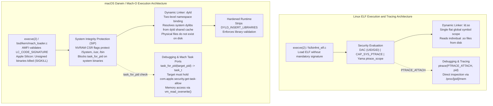

# macOS vs Linux Toolchain Mechanics

> [!summary] Claim:
> Linux execution boundaries rely on Discretionary Access Control, capability sets (CAP_SYS_PTRACE), the Yama LSM, and unauthenticated ELF binaries reading individual shared libraries from disk.
> macOS replaces this model with a hybrid Mach/BSD kernel (XNU) enforcing mandatory code signing via AppleMobileFileIntegrity, immutable filesystem protection via System Integrity Protection (SIP) NVRAM flags, and Mach task-port capability tokens (`task_for_pid`) gated by entitlements (`com.apple.security.get-task-allow`).
> At runtime, dyld isolates symbol lookups with two-level namespaces and resolves all system libraries out of a monolithic in-memory dyld shared cache where on-disk files no longer exist, while Hardened Runtime sanitizes environment variables unless explicitly permitted by entitlement flags.



## The Mechanism

The Linux and macOS developer toolchains diverge fundamentally in kernel architecture, object format guarantees, debugging security models, and dynamic linker assumptions.
Where Linux implements a monolithic POSIX kernel with discretionary credentials, macOS executes atop XNU, a hybrid kernel blending Mach 3.0 microkernel message-passing, BSD POSIX process semantics, the I/O Kit driver framework, and AppleMobileFileIntegrity (AMFI).
Understanding these mechanisms prevents catastrophic failures when migrating build systems, debugging agents, profilers, and deployment pipelines between platforms.

### 1. Kernel Execution Boundaries and Code Signing Enforcement

On Linux, `execve(2)` delegates binary parsing to `fs/binfmt_elf.c`.
Unless an explicit Linux Security Module (LSM) such as IMA/EVM (Integrity Measurement Architecture) or `dm-verity` is configured in production, the standard Linux kernel executes any binary whose execute bits (`S_IXUSR`) are set, without validating digital signatures or cryptographic hashes.

On macOS, `execve(2)` enters `bsd/kern/mach_loader.c` and immediately interfaces with AMFI (`AppleMobileFileIntegrity.kext`).
Mach-O binaries store cryptographic hashes of each code page within a `CodeDirectory` structure located in the `LC_CODE_SIGNATURE` linkedit slice, as detailed in [[ELF-Mach-O-and-PE-Object-Formats]].
On Apple Silicon (arm64/ARM64e), the XNU kernel strictly requires that every executable Mach-O binary must be signed before launch.
If a binary has its signature stripped or invalidated, kernel execution fails during `execve(2)` with immediate termination via `SIGKILL` (`kill -9`, exit code 137).
Local development binaries satisfy this requirement through ad-hoc code signing (`codesign -s -`), where the linker computes valid SHA-256 page hashes and embeds an ad-hoc signature (`flags=0x20002`) without requiring an Apple Developer certificate.

```text
Mach-O Binary (LC_CODE_SIGNATURE)
+-------------------------------------------------------------+
| SuperBlob (Magic: 0xfade0cc0, Length)                       |
|   Index 0: CSSLOT_CODEDIRECTORY (CodeDirectory Blob)        |
|     - Version: 0x20400                                      |
|     - Flags: CS_RUNTIME (0x10000), CS_ADHOC (0x2)           |
|     - Hash Type: SHA-256 (Page Size: 4096 / 16384 B)        |
|     - Page Hash Array: [Hash(P0), Hash(P1), ... Hash(Pn)]   |
|   Index 1: CSSLOT_REQUIREMENTS (Code Requirements)          |
|   Index 5: CSSLOT_ENTITLEMENTS (XML / DER Property List)     |
+-------------------------------------------------------------+
```

### 2. System Integrity Protection (SIP) and Filesystem Immobility

Linux implements Discretionary Access Control (DAC) supplemented by Linux capabilities (`capabilities(7)`), detailed in [[Proc-Filesystem-and-Process-Credentials]].
A root user (`UID 0`) possessing `CAP_DAC_OVERRIDE` and `CAP_SYS_ADMIN` can modify any file, trace any process, reload kernel modules, and re-mount storage filesystems.

macOS introduces System Integrity Protection (SIP, historically called "rootless"), establishing an immutable security plane strictly above `root` (UID 0).
SIP is enforced directly by the XNU kernel and kernel extensions, configured via bitwise NVRAM CSR (Configurable Security Restrictions) flags defined in `bsd/sys/csr.h`:

- `CSR_ALLOW_UNRESTRICTED_FS (1 << 1)`: Protects `/System`, `/usr` (except `/usr/local`), `/bin`, `/sbin`, and pre-installed Apple applications.
  Even root cannot create, modify, or delete files in these paths.
  On modern macOS, the root filesystem is mounted from a cryptographic, read-only Signed System Volume (SSV) sealed by an APFS Merkle tree.
- `CSR_ALLOW_TASK_FOR_PID (1 << 2)`: Blocks process debugging and runtime memory inspection of Apple-protected system processes.
- `CSR_ALLOW_UNRESTRICTED_DTRACE (1 << 5)`: Restricts DTrace probes and kernel observability tools from inspecting SIP-protected executables.
- `CSR_ALLOW_UNAPPROVED_KEXTS (1 << 9)`: Prohibits loading third-party kernel extensions without user approval and device management enrollment.

Because of SIP, build tools, compiler installations, and package managers must never install tools into `/usr/bin` or `/usr/lib`.
Standard developer toolchains operate strictly within `/usr/local`, `/opt/homebrew`, or isolated user directories.

### 3. Process Introspection: ptrace vs Mach Task Ports

Debugging and runtime inspection expose the sharpest architectural division between Linux and macOS.

#### The Linux Model: ptrace and /proc/[pid]/mem

Linux debugging centers entirely on the `ptrace(2)` system call (`PTRACE_ATTACH`, `PTRACE_PEEKDATA`, `PTRACE_POKEDATA`), documented in [[Diagnose-Dynamic-Linker-and-ABI-Failures]].
Attaching to an existing process requires matching the target's UID or holding `CAP_SYS_PTRACE`.
The Yama Linux Security Module (LSM), managed via `/proc/sys/kernel/yama/ptrace_scope`, restricts tracing capabilities into four distinct operational modes:

- `0 (classic)`: A process can attach to any other process owned by the same user.
- `1 (restricted)`: A process can only trace its own direct descendants spawned via `fork(2)`, unless the target explicitly issues `prctl(PR_SET_PTRACER, pid, 0, 0, 0)`.
- `2 (admin-only)`: Only processes with `CAP_SYS_PTRACE` (root) may trace other processes.
- `3 (no-attach)`: System-wide ptrace is disabled; no process (including root) can trace, and the setting cannot be undone without a reboot.

Once attached, Linux debuggers like GDB and LLDB read and write target process memory directly through `/proc/[pid]/mem`.

#### The macOS Model: Mach Task Ports and task_for_pid

On macOS, `ptrace(2)` exists solely as a legacy BSD compatibility layer and is intentionally crippled.
The BSD `ptrace` call on macOS implements `PT_DENY_ATTACH` (request 31), which sets the `P_LNOATTACH` flag on the target process.
If a debugger attempts to attach to a process that called `PT_DENY_ATTACH`, the target terminates immediately, or the debugger receives `ENOTSUP` or `EPERM`.

Instead of `ptrace`, native debugging on macOS operates through the Mach microkernel subsystem.
A Mach task represents an active process address space, thread collection, and capability port table.
Obtaining control of a target process requires acquiring a send right to its Mach task port (`task_t`) via `task_for_pid(mach_task_self(), target_pid, &task_port)`.
With the task port held, the debugger directly executes Mach VM system calls:

- `vm_read_overwrite()` / `mach_vm_read_overwrite()`: Copies virtual memory pages from the target task into the caller buffer.
- `vm_write()` / `mach_vm_write()`: Writes instructions or breakpoints into the target task virtual memory.
- `thread_create_running()`, `thread_suspend()`, `thread_resume()`: Manipulates CPU execution context and register states.

To prevent arbitrary code injection between user processes, XNU subjects `task_for_pid()` to a rigorous three-tiered kernel authorization check:

```text
Caller invokes task_for_pid(mach_task_self(), target_pid, &task_port)
  |
  +--> Check 1: Target PID == 0?
  |      YES -> Return KERN_FAILURE (kernel task is strictly protected)
  |      NO  -> Continue
  |
  +--> Check 2: Credential match (task_for_pid_posix_check)?
  |      Target UID != Caller UID and Caller not root -> Return KERN_FAILURE
  |      Matches -> Continue
  |
  +--> Check 3: AMFI Policy Check (mac_proc_check_get_task)
         Has target process enabled debugging?
         - Does target embed `com.apple.security.get-task-allow = true`?
         - OR does caller hold `com.apple.security.cs.debugger`?
         - OR is SIP task_for_pid disabled (CSR_ALLOW_TASK_FOR_PID)?
         NO  -> Return KERN_FAILURE (Error 5: (os/kern) failure)
         YES -> Return KERN_SUCCESS (task_port capability granted)
```

The entitlement `com.apple.security.get-task-allow` is a boolean XML/DER key embedded into the Mach-O code signature.
Without this entitlement, even a debugger running as root cannot inspect a process under SIP.
Xcode injects this entitlement into debug builds automatically and strips it during production archive builds, as Apple Notarization explicitly rejects any binary embedding `com.apple.security.get-task-allow`.

### 4. Hardened Runtime and Dynamic Loader Environment Sanitization

Dynamic library interposition and debugging tools frequently manipulate environment variables to trace execution.
Linux and macOS secure dynamic loading through completely distinct mechanisms.

On Linux, the dynamic linker `ld.so(8)` inspects the `AT_SECURE` auxiliary vector flag, detailed in [[Program-Startup-C-Runtime-Init-and-Auxiliary-Vectors]].
When `AT_SECURE` is set (for `setuid`, `setgid`, or capability-bearing binaries), `ld.so` sanitizes the environment by ignoring `LD_PRELOAD`, `LD_LIBRARY_PATH`, and `LD_AUDIT`.
Normal unprivileged binaries unconditionally process `LD_PRELOAD`.

On macOS, Apple implements the Hardened Runtime (`codesign --options runtime`), designated by flag bit `0x10000` (`CS_RUNTIME`) in the `CodeDirectory`.
When Hardened Runtime is enabled:

1. **Environment Sanitization:** The dynamic linker `dyld` ignores all `DYLD_*` environment variables, including `DYLD_INSERT_LIBRARIES`, `DYLD_LIBRARY_PATH`, and `DYLD_FRAMEWORK_PATH`.
2. **Library Validation:** The kernel and `dyld` enforce `CS_REQUIRE_LV`, rejecting any dynamic library that is not signed by Apple or signed with the identical Apple Developer Team ID as the host binary.
3. **Memory Integrity:** Enforces strict W^X (Write XOR Execute) memory policies, preventing execution of writable memory pages unless `com.apple.security.cs.allow-unsigned-executable-memory` is declared.

To permit debugging, testing, and dynamic tracing in Hardened Runtime binaries, the author must explicitly sign the binary with targeted bypass entitlements:

- `com.apple.security.cs.allow-dyld-environment-variables`: Re-enables `DYLD_*` environment variables.
- `com.apple.security.cs.disable-library-validation`: Disables Team ID validation, permitting third-party and ad-hoc dylibs to be loaded.

```xml
<?xml version="1.0" encoding="UTF-8"?>
<!DOCTYPE plist PUBLIC "-//Apple//DTD PLIST 1.0//EN" "http://www.apple.com/DTDs/PropertyList-1.0.dtd">
<plist version="1.0">
<dict>
    <key>com.apple.security.cs.allow-dyld-environment-variables</key>
    <true/>
    <key>com.apple.security.cs.disable-library-validation</key>
    <true/>
</dict>
</plist>
```

### 5. Dynamic Linking: Two-Level Namespaces vs Flat Symbol Preemption

In standard Linux ELF dynamic linking, covered in [[Dynamic-Linking-PLT-GOT-and-Loaders]], symbols are resolved using a single flat global namespace.
When an executable imports a symbol `malloc`, `ld.so` searches the global symbol table starting from the executable, through any preloaded libraries (`LD_PRELOAD`), and then across each `DT_NEEDED` library in breadth-first load order.
This makes symbol interposition trivial: placing a custom `malloc` in an `LD_PRELOAD` shared object preempts all calls across all loaded libraries.

In macOS Mach-O binaries, Apple's dynamic linker `dyld` enforces a **two-level namespace** by default (`MH_TWOLEVEL` flag in `mach_header_64`).
Every imported symbol table entry records not only the symbol name, but also a two-level ordinal indicating the specific library (`LC_LOAD_DYLIB`) that must provide it at runtime.
Because symbol resolution binds directly to the recorded library install name, defining a same-named symbol in another library or injecting a dylib with `DYLD_INSERT_LIBRARIES` has no effect on two-level symbol lookups!

To interpose functions on macOS without recompiling the entire application tree with `-flat_namespace`, the developer must use macOS dynamic interposition.
The interposing library declares an array of pointer tuples placed into a dedicated Mach-O section named `__DATA,__interpose` using the macro `DYLD_INTERPOSING` from `<mach-o/dyld-interposing.h>`:

```c
#include <mach-o/dyld-interposing.h>
#include <unistd.h>

static int my_close(int fd) {
    // Custom tracing logic
    return close(fd);
}

// Emits replacement and target pointers into __DATA,__interpose
DYLD_INTERPOSING(my_close, close);
```

When `dyld` loads a library containing a `__DATA,__interpose` section, it updates its internal binding tables so that all calls across all two-level images targeting `close` route to `my_close`.

### 6. The dyld Shared Cache Architecture

On Linux, every shared library is an individual ELF file residing in the filesystem (`/lib64/libc.so.6`, `/usr/lib/x86_64-linux-gnu/libstdc++.so.6`).
The loader `ld.so` invokes `openat(2)`, `stat(2)`, and `mmap(2)` on each distinct file on disk, validating headers and creating private copy-on-write mappings for data segments.

On macOS (introduced in macOS 11 Big Sur and continued through modern macOS versions), system libraries such as `/usr/lib/libSystem.B.dylib`, `/usr/lib/libc++.1.dylib`, and all system frameworks **do not exist as standalone files on the filesystem**.
Instead, the entire system library corpus is pre-linked, optimized, and serialized into monolithic shared cache files (`dyld_shared_cache_*`) mapped into virtual memory during system boot.

```text
Process Virtual Memory Map (vmmap)
+-------------------------------------------------------------+
| 0x0000000100000000 - Main Executable (__TEXT, __DATA)       |
| ...                                                         |
| 0x0000000180000000 - dyld shared cache (1.6+ GiB mapping)   |
|   |-- /usr/lib/system/libdyld.dylib                         |
|   |-- /usr/lib/libc++.1.dylib                               |
|   |-- /usr/lib/libSystem.B.dylib                            |
|   |-- /System/Library/Frameworks/CoreFoundation.framework    |
|   `-- dyld shared cache combined __LINKEDIT                 |
+-------------------------------------------------------------+
```

Because system dylibs are absent from disk, calling `stat(2)`, `access(2)`, or `open(2)` on `/usr/lib/libSystem.B.dylib` fails with `ENOENT` (Error 2: No such file or directory).
However, invoking `dlopen("/usr/lib/libSystem.B.dylib", RTLD_NOW)` succeeds instantly.
The dynamic linker intercepts the path, consults the in-memory shared cache image directory, and returns a library handle without touching the physical filesystem.
Furthermore, modern Darwin binaries use Chained Fixups (`LC_DYLD_CHAINED_FIXUPS`), storing rebase offsets, dynamic symbol bindings, and ARM Pointer Authentication (PAC) discriminators directly inside data segment pointer words, eliminating bulky Mach-O relocation tables as analyzed in [[Hardware-Security-ABIs-PAC-BTI-CET-and-RELRO]].

## Commands and Numbers to Know

Every entry below identifies its target platform and is stamped with its verified behavior (as of 2026-11).

| Tool / Mechanism | Command / Parameter | Platform | Meaning and Behavior |
| :--- | :--- | :--- | :--- |
| Ad-hoc signing | `codesign -s - <bin>` | macOS | Embeds SHA-256 page hashes and ad-hoc signature (`0x20400`); required to run on arm64 (as of 2026-11, macOS). |
| Signature removal | `codesign --remove-signature <bin>` | macOS | Strips `LC_CODE_SIGNATURE`; causes arm64 kernel `execve` to abort with `SIGKILL` (as of 2026-11, macOS). |
| Hardened Runtime | `codesign --options runtime <bin>` | macOS | Sets `CS_RUNTIME` (`0x10000`); strips `DYLD_*` variables and enforces library validation (as of 2026-11, macOS). |
| Inspect signature | `codesign -dvvv <bin>` | macOS | Dumps CodeDirectory version, flags, hash type, and signature slice metadata (as of 2026-11, macOS). |
| Inspect entitlements | `codesign -d --entitlements :- <bin>` | macOS | Extracts and prints embedded XML/DER entitlements dictionary (as of 2026-11, macOS). |
| Debug entitlement | `com.apple.security.get-task-allow` | macOS | Entitlement required for `task_for_pid()` to succeed without SIP disablement (as of 2026-11, macOS). |
| Environment bypass | `com.apple.security.cs.allow-dyld-environment-variables` | macOS | Hardened Runtime entitlement permitting `DYLD_INSERT_LIBRARIES` evaluation (as of 2026-11, macOS). |
| Library validation bypass | `com.apple.security.cs.disable-library-validation` | macOS | Hardened Runtime entitlement permitting dylibs with mismatched Team IDs to load (as of 2026-11, macOS). |
| Mach success code | `KERN_SUCCESS (0)` | macOS | Returned by Mach kernel APIs when an operation succeeds (as of 2026-11, macOS). |
| Mach failure code | `KERN_FAILURE (5)` | macOS | Returned by `task_for_pid()` when entitlement or credential check fails (as of 2026-11, macOS). |
| Anti-debug request | `ptrace(PT_DENY_ATTACH, 0, 0, 0)` | macOS | BSD ptrace request 31; sets `P_LNOATTACH` to crash debuggers attempting attach (as of 2026-11, macOS). |
| SIP status | `csrutil status` | macOS | Checks if System Integrity Protection is enabled in NVRAM (as of 2026-11, macOS). |
| SIP FS flag | `CSR_ALLOW_UNRESTRICTED_FS (0x02)` | macOS | Bit 1 of NVRAM CSR flags; disables filesystem immobility for `/System` and `/usr` (as of 2026-11, macOS). |
| SIP task flag | `CSR_ALLOW_TASK_FOR_PID (0x04)` | macOS | Bit 2 of NVRAM CSR flags; permits `task_for_pid()` on un-entitled processes (as of 2026-11, macOS). |
| Yama ptrace scope | `/proc/sys/kernel/yama/ptrace_scope` | Linux | 0=classic, 1=restricted child, 2=admin-only (`CAP_SYS_PTRACE`), 3=no attach (as of 2026-11, Linux). |
| Linux anti-debug | `prctl(PR_SET_DUMPABLE, 0)` | Linux | Marks process un-dumpable; blocks non-root `PTRACE_ATTACH` under classic Yama (as of 2026-11, Linux). |
| Linux crash delegation | `prctl(PR_SET_PTRACER, pid)` | Linux | Explicitly permits named process to attach under Yama scope 1 (as of 2026-11, Linux). |
| Mach-O header flag | `MH_TWOLEVEL (0x80)` | macOS | Mach-O header flag designating two-level namespace symbol resolution (as of 2026-11, macOS). |
| System dylib stat | `stat("/usr/lib/libSystem.B.dylib")` | macOS | Returns `ENOENT` (-1, errno 2); file does not exist on disk in macOS 11+ (as of 2026-11, macOS). |
| System dylib dlopen | `dlopen("/usr/lib/libSystem.B.dylib", ...)` | macOS | Returns valid pointer; intercepted and resolved via in-memory shared cache (as of 2026-11, macOS). |

## Multi-Language Comparison: C++ / Python / Rust

Developer toolchain discrepancies manifest distinct runtime behaviors across programming languages.

| Language / Domain | Linux Implementation | macOS Darwin Implementation | Architectural Consequence |
| :--- | :--- | :--- | :--- |
| **C++ Dynamic Libraries** | Built with `-shared -fPIC -Wl,-soname,libfoo.so`. Runtime search paths use `$ORIGIN` in `DT_RUNPATH`. Symbols interpose globally by default. | Built with `-dynamiclib -install_name @rpath/libfoo.dylib`. Runtime search paths use `@loader_path` and `@executable_path`. Enforces `MH_TWOLEVEL` namespace. | On macOS, interposing standard functions requires emitting pointer pairs into `__DATA,__interpose` via `<mach-o/dyld-interposing.h>`. |
| **C++ Exception Unwinding** | Uses `.eh_frame` and DWARF Call Frame Information parsed by `libgcc_s` or `libc++abi`, as detailed in [[Stack-Unwinding-CFI-and-Exception-ABI]]. | Uses `__compact_unwind` section encoding register layouts into a 32-bit compact word, falling back to DWARF only for complex frames. | Compact unwinding executes in microseconds without allocating memory, preventing unwinding aborts inside signal handlers. |
| **Python C Extensions** | Extension modules compile as `.so`. Shared library vendoring handled by `auditwheel`, which uses `patchelf` to rewrite `DT_NEEDED` and `RUNPATH`. | Extension modules compile as `.so` or `.dylib`. Vendoring handled by `delocate`, which uses `install_name_tool` to rewrite Mach-O load commands. | `delocate` copies dylibs into `.dylibs/` and rewrites `@loader_path`; modifying signed binaries invalidates their code signature and requires re-signing. |
| **Python Library Probing** | `ctypes.util.find_library('c')` locates the physical file on disk (e.g. `/lib64/libc.so.6`). `os.path.exists()` confirms library presence. | `ctypes.util.find_library('c')` returns `/usr/lib/libSystem.B.dylib`. `os.path.exists()` returns `False`, but `ctypes.CDLL()` loads successfully. | Scripts validating physical disk paths prior to calling `dlopen()` abort prematurely on macOS 11+ unless updated to probe via `dlopen()`. |
| **Rust Executable Output** | `rustc` emits unsigned ELF executables by default. The binary runs immediately without host signature checks. | `rustc` invokes Apple `ld64` or `lld`, which automatically applies an ad-hoc code signature (`codesign -s -`) to the Mach-O binary. | If post-build tools strip debug symbols or patch binary sections without re-running `codesign`, the binary terminates with `SIGKILL` on arm64. |
| **Rust Debugging Workflow** | Debuggers attach via `ptrace` using standard PID lookups. Debug symbols reside in `.debug_info` or `.dwo` files as described in [[DWARF-Debug-Information-and-Symbol-Bundles]]. | LLDB attaches via Mach task ports. Debug builds require `get-task-allow`. Symbols reside in a companion `.dSYM` bundle generated by `dsymutil`. | If a developer invokes `strip` on a Mach-O binary without running `dsymutil` first, DWARF debug information is permanently destroyed. |

## Worked Lab Example

The companion lab `code/00-Program-Execution/macos_codesign_entitlements/` demonstrates and mechanically proves:
1. Kernel `SIGKILL` execution refusal of unsigned binaries on Apple Silicon.
2. The `task_for_pid()` authorization boundary separating un-entitled binaries from those embedding `com.apple.security.get-task-allow`.
3. In-memory virtual memory inspection via `vm_read_overwrite()`.
4. Hardened Runtime sanitization of `DYLD_INSERT_LIBRARIES` and its entitlement bypass.
5. Dyld shared cache resolution of non-existent on-disk system dylib paths.

### Executing the Lab

To run the verification suite directly:

```bash
cd code
python3 -m _harness.verify 00-Program-Execution/macos_codesign_entitlements/
```

### Verified Platform Output

The following deterministic output was recorded directly on macOS Darwin (as of 2026-11, darwin-arm64):

```text
UNSIGNED_EXEC: status=KILLED_SIGKILL
SIGNED_EXEC: status=SUCCESS
TASK_FOR_PID_UNENTITLED: kr=5 ((os/kern) failure)
TASK_FOR_PID_ENTITLED: kr=0 ((os/kern) successful)
VM_READ: token=0xADDR
ADHOC_DYLD_INSERT: HOOK_EXECUTED, MAIN_EXECUTED
HARDENED_DYLD_INSERT: MAIN_EXECUTED
ENTITLED_HARDENED_DYLD_INSERT: HOOK_EXECUTED, MAIN_EXECUTED
DYLD_SHARED_CACHE_DISK_STAT: ENOENT
DYLD_SHARED_CACHE_DLOPEN: SUCCESS
```

### Dissecting the Trace

1. **`UNSIGNED_EXEC: status=KILLED_SIGKILL`**:
   The lab compiled a minimal C program and stripped its code signature via `codesign --remove-signature`.
   When launched on Apple Silicon arm64, the kernel AMFI driver intercepted `execve(2)`, identified the missing `LC_CODE_SIGNATURE`, and terminated the process with `SIGKILL` (status 9).
   Ad-hoc signing via `codesign -s -` restored execution (`SIGNED_EXEC: status=SUCCESS`).
2. **`TASK_FOR_PID_UNENTITLED: kr=5 ((os/kern) failure)`**:
   An unprivileged tracer program called `task_for_pid()` against a target running an ad-hoc signed binary without entitlements.
   Because SIP was enabled, the XNU kernel refused to issue a Mach task port, returning `kr=5` (`KERN_FAILURE`).
3. **`TASK_FOR_PID_ENTITLED: kr=0 ((os/kern) successful)` & `VM_READ`**:
   The target binary was re-signed embedding `com.apple.security.get-task-allow`.
   The kernel granted the Mach task port (`kr=0`), allowing the tracer to invoke `vm_read_overwrite()` and extract the 64-bit secret token directly from the target address space.
4. **`ADHOC_DYLD_INSERT` vs `HARDENED_DYLD_INSERT`**:
   Executing the un-hardened binary with `DYLD_INSERT_LIBRARIES=libhook.dylib` caused the library constructor to execute prior to `main()`.
   When the target was signed with `--options runtime`, `dyld` stripped the environment variable, preventing the hook from executing.
   When re-signed with both `com.apple.security.cs.allow-dyld-environment-variables` and `com.apple.security.cs.disable-library-validation`, the hook ran successfully under Hardened Runtime.
5. **`DYLD_SHARED_CACHE_DISK_STAT: ENOENT` & `DLOPEN: SUCCESS`**:
   Invoking `stat()` on `/usr/lib/libSystem.B.dylib` returned `ENOENT` because the physical file does not exist on disk.
   Calling `dlopen("/usr/lib/libSystem.B.dylib", RTLD_NOW)` succeeded because `dyld` resolved the library directly from the in-memory shared cache.

## Pitfalls

> [!warning] Pitfall: Assuming `root` (UID 0) can debug or inject code into any process on macOS
> On Linux, a process executing as root possessing `CAP_SYS_PTRACE` can inspect and modify any running process unless Yama scope 3 is permanently enabled.
> On macOS, System Integrity Protection (SIP) and AMFI place an insurmountable security boundary around processes.
> If a target binary lacks the `com.apple.security.get-task-allow` entitlement and SIP is active, `task_for_pid()` fails with `KERN_FAILURE` (error 5) even when invoked by `root` (UID 0).
> Writing system daemons or diagnostic agents that assume root privileges guarantee process introspection will fail in production macOS environments.

> [!warning] Pitfall: Attempting symbol interposition via DYLD_INSERT_LIBRARIES without __DATA,__interpose
> Linux engineers accustomed to `LD_PRELOAD` often attempt symbol preemption on macOS by compiling a dylib with a matching symbol name (e.g. `malloc`) and injecting it via `DYLD_INSERT_LIBRARIES`.
> Under Mach-O's default two-level namespace (`MH_TWOLEVEL`), all call sites bind directly to the specific dylib recorded in `LC_LOAD_DYLIB`.
> The injected symbol is completely ignored by `dyld` unless the dylib declares an explicit interposing pair inside the `__DATA,__interpose` section using `<mach-o/dyld-interposing.h>`, or the host executable was linked with `-flat_namespace`.

> [!warning] Pitfall: Verifying system library existence on disk before calling dlopen()
> Build scripts, plugin loaders, and cross-platform runtimes frequently probe whether a required system dylib is available by calling `access(path, F_OK)` or `os.path.exists(path)`.
> On macOS 11 Big Sur and newer, system dylibs reside exclusively within the pre-linked `dyld_shared_cache` and are physically absent from the filesystem.
> Checking disk paths for `/usr/lib/libc++.1.dylib` or `/usr/lib/libSystem.B.dylib` returns `ENOENT`, causing defensive file checks to falsely report missing libraries.
> The correct cross-platform pattern is to invoke `dlopen()` directly and check for a non-null handle.

> [!warning] Pitfall: Shipping release or notarized binaries with com.apple.security.get-task-allow enabled
> Developers troubleshooting release builds sometimes leave `com.apple.security.get-task-allow` embedded in their signing configuration to enable remote LLDB attachment.
> Apple's automated Notarization service (`xcrun notarytool`) scans all embedded entitlements and automatically rejects any binary that includes `com.apple.security.get-task-allow`.
> Leaving this entitlement active in production creates a critical security vulnerability by allowing any unprivileged process running under the same user account to inject code and read memory.

> [!warning] Pitfall: Forgetting Library Validation when enabling DYLD environment variables
> When configuring Hardened Runtime binaries for local integration testing, engineers often add `com.apple.security.cs.allow-dyld-environment-variables` and expect `DYLD_INSERT_LIBRARIES` to succeed.
> Hardened Runtime simultaneously enforces Library Validation (`CS_REQUIRE_LV`).
> Even though `dyld` parses `DYLD_INSERT_LIBRARIES`, it immediately aborts process launch when it discovers that the inserted dylib is not signed with the same Apple Developer Team ID as the host executable.
> Test configurations must supply both `com.apple.security.cs.allow-dyld-environment-variables` and `com.apple.security.cs.disable-library-validation`.

## At Scale

At large technology companies operating fleets of 1,000 to 50,000 engineers, managing the tension between Linux production servers and macOS developer laptops is a primary toolchain challenge.

```text
Fleet Build & Execution Matrix
+---------------------------------------------------------------------------------+
| Dimension              | Linux Production Fleet      | macOS Developer Fleet    |
+------------------------+-----------------------------+--------------------------+
| Hermetic Sandboxing    | Linux Namespaces & cgroups  | sandbox-exec (Seatbelt)  |
| Remote Build Execution | OCI / Docker Containers     | Bare-metal Mac Farms     |
| Runtime Code Signing   | Unsigned / Optional dm-verity| Mandatory Notarization   |
| Continuous Profiling   | eBPF & perf_event_open      | Instruments & DTrace     |
+---------------------------------------------------------------------------------+
```

### Hermetic Build Sandboxing

Modern distributed build systems like Bazel and Buck2 guarantee hermetic builds by sandboxing every compiler action:

- On Linux, build workers use kernel user namespaces, mount namespaces, and network namespaces (`unshare(CLONE_NEWNS | CLONE_NEWUSER | CLONE_NEWNET)`) to present a pristine, isolated filesystem and network-free environment to each compilation task.
- On macOS, Linux namespaces do not exist.
  Build systems must invoke Apple's `sandbox-exec` utility using custom Seatbelt profile definitions (`.sb` files) that restrict file writes to the designated action output directory and deny arbitrary network sockets.

### Remote Build Execution (RBE) Infrastructure

Because Linux runs natively in lightweight Linux containers, horizontal autoscaling of build worker pools on Kubernetes is cheap and instant.
In contrast, macOS licensing agreements strictly prohibit virtualizing macOS on non-Apple hardware.
Large organizations must deploy and manage specialized physical datacenters composed of racked Mac mini or Mac Studio clusters running hypervisors like Tart or Anka, driving significantly higher infrastructure CapEx and maintenance overhead.

### Decision Rules for Cross-Platform Engineering Fleets

1. **Rule 1 (Debug vs Release Signing):** In Bazel or CMake build rules, never apply Hardened Runtime flags (`--options runtime`) to local developer fast-iteration builds.
   Preserve `com.apple.security.get-task-allow` in debug profiles so LLDB, Instruments, and sanitizers attach without friction; enforce Hardened Runtime and Notarization exclusively in CI release tagging pipelines.
2. **Rule 2 (SDK Stub Linking):** Never allow build scripts to hardcode absolute paths to `/usr/lib/*.dylib` or `/System/Library/Frameworks/*.framework`.
   Always link against Apple's Text-Based Dynamic Library stubs (`.tbd`) located inside the Xcode SDK (`xcrun --show-sdk-path`), ensuring linking succeeds regardless of on-disk shared cache state.
3. **Rule 3 (Universal Hidden Visibility):** Compile all shared C++ libraries on both platforms with `-fvisibility=hidden` and `-fvisibility-inlines-hidden`.
   Explicitly export public APIs using macro annotations (`__attribute__((visibility("default")))`).
   This prevents accidental symbol preemption bugs on Linux and eliminates dynamic table bloat on macOS two-level namespace Mach-O images, as codified in [[Program-Execution-Decision-Records]].

> [!tip] Practice Drill: Interpose a system library call across Linux and macOS
> 1. On Linux, implement a shared library `libinterpose.so` intercepting `open(2)` by calling `dlsym(RTLD_NEXT, "open")`.
>    Compile with `gcc -shared -fPIC libinterpose.c -o libinterpose.so -ldl`.
>    Run against an unprivileged test binary using `LD_PRELOAD=./libinterpose.so ./test_bin` and observe the intercepted call.
> 2. On macOS, implement `libinterpose.dylib` using `<mach-o/dyld-interposing.h>` and `DYLD_INTERPOSING(my_open, open)`.
>    Compile with `cc -dynamiclib libinterpose.c -o libinterpose.dylib`.
>    Sign ad-hoc: `codesign -s - libinterpose.dylib`.
>    Run against an unhardened test executable using `DYLD_INSERT_LIBRARIES=./libinterpose.dylib ./test_bin` and observe the interception.
> 3. Re-sign `test_bin` with `codesign -s - -f --options runtime ./test_bin`.
>    Re-run the command and prove that `dyld` silently ignores the insertion.
>    Re-sign `test_bin` with the bypass entitlements plist from the lab and prove that interposition resumes.

## Interview Questions

> [!question] L5: Why does `stat("/usr/lib/libSystem.B.dylib")` fail with `ENOENT` on modern macOS, while `dlopen("/usr/lib/libSystem.B.dylib", RTLD_NOW)` succeeds?
>
> > [!success]- Answer
> > Since macOS 11 Big Sur, Apple removed standalone dynamic libraries from the physical filesystem to optimize launch performance and memory footprint.
> > All system dynamic libraries and frameworks are merged into a single monolithic pre-linked image called the `dyld_shared_cache` located in virtual memory.
> > File-system APIs like `stat(2)`, `open(2)`, and `access(2)` interact with the APFS filesystem volume, which no longer contains these files, returning `ENOENT` (Error 2: No such file or directory).
> > In contrast, `dlopen(3)` is handled by `dyld`.
> > The dynamic linker intercepts the path, detects that it matches a known system library signature, and resolves the image directly from the in-memory shared cache tables without accessing disk.

> [!question] L5: How does symbol interposition via `LD_PRELOAD` on Linux differ fundamentally from `DYLD_INSERT_LIBRARIES` on macOS?
>
> > [!success]- Answer
> > Linux ELF uses a single flat global symbol namespace by default.
> > When `LD_PRELOAD` injects a library, its symbols are placed at the head of the global symbol search order.
> > When any subsequently loaded library calls a function like `malloc()`, `ld.so` resolves the call to the first matching symbol found in the global lookup, preempting the original definition across all libraries.
> > macOS Mach-O binaries use a two-level namespace (`MH_TWOLEVEL`) by default.
> > Each symbol reference records both the symbol name and the specific dylib install name that must satisfy it.
> > Injecting a dylib with `DYLD_INSERT_LIBRARIES` does not preempt two-level symbol lookups unless the injected dylib explicitly defines an interposing tuple in the `__DATA,__interpose` section using `<mach-o/dyld-interposing.h>`, or the main binary was built with `-flat_namespace`.

> [!question] L6: Predict the output when an unsigned binary is executed on Apple Silicon arm64 versus x86-64 Linux.
>
> > [!success]- Answer
> > On x86-64 Linux, the unsigned binary executes normally and exits with status 0 (assuming normal execution).
> > Linux `execve(2)` does not check code signatures unless custom LSMs like IMA/EVM are explicitly active.
> > On Apple Silicon arm64 macOS, the kernel AMFI (`AppleMobileFileIntegrity`) subsystem intercepts `execve(2)`.
> > Because arm64 Darwin requires all executable pages to have valid hashes in an embedded `LC_CODE_SIGNATURE`, the kernel refuses execution and immediately terminates the process with `SIGKILL` (signal 9, exit code 137).
> > The binary prints no output and standard shells report `Killed: 9`.

> [!question] L6: Walk through the kernel checks XNU executes when user space calls `task_for_pid(mach_task_self(), target_pid, &task_port)`. Under what conditions does it return `KERN_FAILURE`?
>
> > [!success]- Answer
> > In XNU (`osfmk/kern/ipc_tt.c` and `bsd/kern/mach_process.c`), the kernel executes three checks:
> > 1. Target PID verification: If `target_pid == 0` (kernel task), the call unconditionally returns `KERN_FAILURE` (5).
> > 2. Credential validation: The caller's effective UID must match the target's UID, or the caller must be root (`task_for_pid_posix_check`).
> >    If mismatched, it returns `KERN_FAILURE`.
> > 3. AMFI MAC policy check (`mac_proc_check_get_task`):
> >    Under SIP, the kernel checks whether the target binary contains the code signing entitlement `com.apple.security.get-task-allow = true`.
> >    If the target lacks this entitlement, the call fails with `KERN_FAILURE` unless the caller possesses the privileged entitlement `com.apple.security.cs.debugger` (held by Apple debuggers like Xcode/lldb with developer tools access) or SIP's `CSR_ALLOW_TASK_FOR_PID` flag is disabled.

> [!question] L7: A diagnostic memory profiler works via `DYLD_INSERT_LIBRARIES` on local debug builds, but fails to inject into release builds with no error printed. Diagnose the root cause and provide the fix.
>
> > [!success]- Answer
> > The release binary was signed with Hardened Runtime (`codesign --options runtime`), whereas the local debug build was not.
> > When Hardened Runtime (`CS_RUNTIME`) is enabled, `dyld` automatically sanitizes the environment and ignores all `DYLD_*` variables, including `DYLD_INSERT_LIBRARIES`, silently launching the process without the profiler.
> > To fix this for internal profiling builds:
> > 1. Re-sign the target binary embedding two specific entitlements: `com.apple.security.cs.allow-dyld-environment-variables` (permitting `dyld` to process the injection flag) and `com.apple.security.cs.disable-library-validation` (preventing dyld from rejecting the profiler dylib due to mismatched Team IDs).
> > 2. Command: `codesign -s - -f --options runtime --entitlements profiling_entitlements.plist target_binary`.
> > 3. For public distribution, the binary must remain hardened and un-entitled; memory profiling must run via Instruments/DTrace using Mach task ports on developer-entitled builds.

> [!question] L7: Why does macOS provide `ptrace(PT_DENY_ATTACH)` and how does it interact with Mach task ports? How does Linux achieve equivalent anti-debugging?
>
> > [!success]- Answer
> > `PT_DENY_ATTACH` is an anti-debugging mechanism in the BSD layer of XNU.
> > When a process invokes `ptrace(PT_DENY_ATTACH, 0, 0, 0)`, the kernel sets the `P_LNOATTACH` flag in `p_lflag`.
> > If a debugger is already attached via `ptrace`, the process immediately terminates with status 45.
> > If a debugger subsequently attempts to attach via `ptrace` or request the task port via `task_for_pid()`, the kernel denies the request.
> > On Linux, processes achieve equivalent protection by invoking `prctl(PR_SET_DUMPABLE, 0)`.
> > This clears the `dumpable` attribute, which causes the Linux kernel to reject `PTRACE_ATTACH` from any non-root process.
> > Alternatively, a Linux process can `ptrace(PTRACE_TRACEME, 0, 0, 0)` itself; because Linux only allows a single tracer per task, subsequent attach attempts by external debuggers fail with `EPERM`.

> [!question] L8+: Design a cross-platform continuous profiling agent (CPU and memory allocation) that runs with minimal perturbation across both a Linux server fleet and developer macOS workstations.
>
> > [!success]- Answer
> > Architecture must be decoupled by platform kernel interfaces:
> > - **Linux Subsystem:**
> >   - CPU Profiling: Deploy an in-kernel eBPF agent using `perf_event_open()` attaching to `BPF_PROG_TYPE_PERF_EVENT` on hardware PMU or timer interrupts.
> >     The eBPF program walks frame pointers (`RBP`) or reads DWARF CFI tables to record stack traces into a BPF ring buffer.
> >   - Allocation Profiling: Attach uprobes to `malloc`/`free` or leverage an LD_PRELOAD interposer library writing events to shared memory.
> >   - Privileges required: `CAP_SYS_ADMIN` or `CAP_BPF` + `CAP_PERFMON`.
> > - **macOS Subsystem:**
> >   - CPU Profiling: eBPF is not available in userland Darwin.
> >     The agent must use the Mach thread sampling interface (`thread_get_state()`) or trace via DTrace (`profile-997` provider) if SIP allows, or utilize the Apple `xctrace` / Instruments Recording framework.
> >   - Allocation Profiling: `LD_PRELOAD` does not work.
> >     The agent must inject a dylib defining `__DATA,__interpose` tuples for memory allocation symbols.
> >   - Privileges required: On macOS, target processes must embed `com.apple.security.get-task-allow` in development, or the profiler agent itself must hold the Apple-granted entitlement `com.apple.security.cs.debugger` and have Developer Mode enabled in macOS Settings.
> > - **Overhead Mitigation:** Both platforms must avoid symbolication in the collection thread.
> >   Collect raw instruction pointers and resolve symbols asynchronously offline using Split DWARF on Linux and `.dSYM` bundles on macOS.

> [!question] L8+: Your organization builds a monorepo spanning Linux microservices and macOS desktop clients using Bazel. Explain how hermetic sandboxing, dynamic library resolution (`@rpath` vs `$ORIGIN`), and release code signing differ in your CI execution cluster.
>
> > [!success]- Answer
> > The CI architecture differs across three critical dimensions:
> > 1. **Sandboxing Isolation:**
> >    - Linux CI workers run in ephemeral Docker/K8s containers.
> >      Bazel applies Linux sandbox mechanisms (`linux-sandbox`) utilizing user and mount namespaces (`unshare`) to construct hermetic read-only views of the repository.
> >    - macOS CI workers cannot run inside Docker containers due to macOS kernel licensing.
> >      Workers run on physical Mac hardware (Mac minis) utilizing ephemeral VMs (e.g. Tart/Anka).
> >      Bazel invokes `darwin-sandbox`, utilizing macOS `sandbox-exec` and Seatbelt `.sb` profiles to enforce filesystem write restrictions.
> > 2. **Runpath Resolution:**
> >    - Linux builds configure ELF binaries with `-Wl,-rpath,'$ORIGIN/../lib'`.
> >      The dynamic linker expands `$ORIGIN` relative to the binary path at runtime, permitting portable directory tarballs.
> >    - macOS builds configure Mach-O binaries with `-Wl,-rpath,'@loader_path/../lib'` and `-Wl,-rpath,'@executable_path/../Frameworks'`.
> >      Shared libraries must have their `install_name` configured as `@rpath/libname.dylib`.
> > 3. **Release Gating and Signing:**
> >    - Linux releases package stripped ELF binaries into container images or deb/rpm packages without mandatory cryptographic signatures.
> >    - macOS releases require a multi-stage signing pipeline: compile -> embed production entitlements (stripping `get-task-allow`) -> sign with Apple Developer ID Application certificate and Hardware Security Module (HSM) -> submit to Apple Notary Service (`notarytool`) -> staple notarization ticket (`stapler`) to the DMG or app bundle.

## Further Reading

- Apple Inc., `xnu-13432.41.4` Kernel Source: Specifically `bsd/kern/mach_loader.c`, `bsd/kern/mach_process.c`, and `osfmk/kern/ipc_tt.c` for execution and task port authorization.
- Apple Inc., `dyld` Dynamic Linker Source: Implementation of two-level namespace resolution, `__DATA,__interpose` processing, and the dyld shared cache.
- Apple Developer Documentation, *Hardened Runtime and Entitlements*: Authoritative specification of runtime flags and bypass entitlements.
- Jonathan Levin, *Mac OS X and iOS Internals: To the Apple's Core*, Vol I & II: Comprehensive architectural analysis of XNU, Mach traps, and AMFI.
- Kees Cook, Linux Kernel Documentation: `Documentation/admin-guide/LSM/Yama.rst` for ptrace restriction architecture.
- Michael Kerrisk, *The Linux Programming Interface*, Chapters 41-43: Normative reference for Linux ELF dynamic linking, capabilities, and ptrace mechanisms.

## Related

- Prerequisites: [[Dynamic-Linking-PLT-GOT-and-Loaders]], [[ELF-Mach-O-and-PE-Object-Formats]]
- Next: [[Program-Execution-Decision-Records]]
- See also: [[19-Shell-and-Unix-Engineering/20-Observability-and-Incident-Response/macOS-Diagnostics|macOS Diagnostics]]
- Lab: `code/00-Program-Execution/macos_codesign_entitlements/` (requires: macos)
