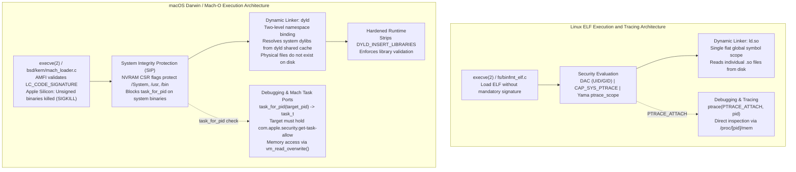

# macOS vs Linux Toolchain Mechanics

> [!summary] Claim:
> Linux execution boundaries rely on Discretionary Access Control, capability sets (CAP_SYS_PTRACE), the Yama LSM, and unauthenticated ELF binaries reading individual shared libraries from disk.
> macOS replaces this model with a hybrid Mach/BSD kernel (XNU) enforcing mandatory code signing via AppleMobileFileIntegrity, immutable filesystem protection via System Integrity Protection (SIP) NVRAM flags, and Mach task-port capability tokens (`task_for_pid`) gated by entitlements (`com.apple.security.get-task-allow`).
> At runtime, dyld isolates symbol lookups with two-level namespaces and resolves all system libraries out of a monolithic in-memory dyld shared cache where on-disk files no longer exist, while Hardened Runtime sanitizes environment variables unless explicitly permitted by entitlement flags.



## The Mechanism

The Linux and macOS developer toolchains diverge fundamentally in kernel architecture, object format guarantees, debugging security models, and dynamic linker assumptions.
Where Linux implements a monolithic POSIX kernel with discretionary credentials, macOS executes atop XNU, a hybrid kernel blending Mach 3.0 microkernel message-passing, BSD POSIX process semantics, the I/O Kit driver framework, and AppleMobileFileIntegrity (AMFI).
Understanding these mechanisms prevents catastrophic failures when migrating build systems, debugging agents, profilers, and deployment pipelines between platforms.

### 1. Kernel Execution Boundaries and Code Signing Enforcement

On Linux, `execve(2)` delegates binary parsing to `fs/binfmt_elf.c`.
Unless an explicit Linux Security Module (LSM) such as IMA/EVM (Integrity Measurement Architecture) or `dm-verity` is configured in production, the standard Linux kernel executes any binary whose execute bits (`S_IXUSR`) are set, without validating digital signatures or cryptographic hashes.

On macOS, `execve(2)` reaches `exec_mach_imgact()` in `bsd/kern/kern_exec.c`, which calls `load_machfile()` in `bsd/kern/mach_loader.c`; `load_code_signature()` there registers the signature blob, and AMFI (`AppleMobileFileIntegrity.kext`) vets it through MAC policy hooks (xnu main, as of 2026-11).
Mach-O binaries store cryptographic hashes of each code page within a `CodeDirectory` structure located in the `LC_CODE_SIGNATURE` linkedit slice, as detailed in [[ELF-Mach-O-and-PE-Object-Formats]].
On Apple Silicon (arm64/ARM64e), the XNU kernel strictly requires that every executable Mach-O binary must be signed before launch.
If a binary has its signature stripped or invalidated, kernel execution fails during `execve(2)` with immediate termination via `SIGKILL` (`kill -9`, exit code 137).
Local development binaries satisfy this requirement through ad-hoc signatures, which need no Apple Developer certificate.
The arm64 linker signs every output itself (`codesign -dvvv` reports `flags=0x20002(adhoc,linker-signed)`, 4 KiB page hashes), and `codesign -s -` replaces that with a plain ad-hoc signature (`flags=0x2(adhoc)`, 16 KiB page hashes), both observed with Xcode clang on macOS 27.2 arm64 (as of 2026-11).

```text
Mach-O Binary (LC_CODE_SIGNATURE)
+-------------------------------------------------------------+
| SuperBlob (Magic: 0xfade0cc0, Length)                       |
|   Index 0: CSSLOT_CODEDIRECTORY (CodeDirectory Blob)        |
|     - Version: 0x20400 (0x20500 with CS_RUNTIME)            |
|     - Flags: CS_RUNTIME (0x10000), CS_ADHOC (0x2)           |
|     - Hash Type: SHA-256 (Page Size: 4096 / 16384 B)        |
|     - Page Hash Array: [Hash(P0), Hash(P1), ... Hash(Pn)]   |
|   Slot 2: CSSLOT_REQUIREMENTS (Code Requirements)           |
|   Slot 5: CSSLOT_ENTITLEMENTS (XML Property List)           |
|   Slot 7: CSSLOT_DER_ENTITLEMENTS (DER Property List)       |
+-------------------------------------------------------------+
(slot values from osfmk/kern/cs_blobs.h; versions from codesign -dvvv, macOS 27.2)
```

### 2. System Integrity Protection (SIP) and Filesystem Immobility

Linux implements Discretionary Access Control (DAC) supplemented by Linux capabilities (`capabilities(7)`), detailed in [[Proc-Filesystem-and-Process-Credentials]].
A root user (`UID 0`) holding the full capability set (`CAP_DAC_OVERRIDE` for files, `CAP_SYS_PTRACE` for tracing, `CAP_SYS_MODULE` for kernel modules, `CAP_SYS_ADMIN` for mounts) can modify any file, trace any process, reload kernel modules, and re-mount storage filesystems (`capabilities(7)`).

macOS introduces System Integrity Protection (SIP, historically called "rootless"), establishing an immutable security plane strictly above `root` (UID 0).
SIP is enforced directly by the XNU kernel and kernel extensions, configured via bitwise NVRAM CSR (Configurable Security Restrictions) flags defined in `bsd/sys/csr.h`.
Each `CSR_ALLOW_*` bit names an exception: with SIP fully enabled every bit is clear and the protection applies, and setting a bit (by partially disabling SIP from recoveryOS) lifts that one protection:

- `CSR_ALLOW_UNRESTRICTED_FS (1 << 1)`: While clear, protects `/System`, `/usr` (except `/usr/local`), `/bin`, `/sbin`, `/var`, and pre-installed Apple applications (Apple Support 102149).
  Even root cannot create, modify, or delete files in these paths.
  On modern macOS, the root filesystem is mounted from a cryptographic, read-only Signed System Volume (SSV) sealed by an APFS Merkle tree, governed by the separate `CSR_ALLOW_UNAUTHENTICATED_ROOT (1 << 11)` bit.
- `CSR_ALLOW_TASK_FOR_PID (1 << 2)`: One of the bits `csrutil disable` sets (`CSR_DISABLE_FLAGS`, `bsd/sys/csr.h`).
  Its effect is enforced in closed-source AMFI: the public xnu `task_for_pid` path in `bsd/kern/kern_proc.c` never tests it, and Apple publishes no description, so this note does not state what setting it changes (xnu main, as of 2026-11).
- `CSR_ALLOW_UNRESTRICTED_DTRACE (1 << 5)`: While clear, restricts DTrace probes from inspecting SIP-protected executables.
- `CSR_ALLOW_UNAPPROVED_KEXTS (1 << 9)`: While clear, third-party kernel extensions need explicit user approval before they load.

Because of SIP, build tools, compiler installations, and package managers must never install tools into `/usr/bin` or `/usr/lib`.
Standard developer toolchains operate strictly within `/usr/local`, `/opt/homebrew`, or isolated user directories.

### 3. Process Introspection: ptrace vs Mach Task Ports

Debugging and runtime inspection expose the sharpest architectural division between Linux and macOS.

#### The Linux Model: ptrace and /proc/[pid]/mem

Linux debugging centers entirely on the `ptrace(2)` system call (`PTRACE_ATTACH`, `PTRACE_PEEKDATA`, `PTRACE_POKEDATA`), documented in [[Diagnose-Dynamic-Linker-and-ABI-Failures]].
Attaching to an existing process requires matching the target's UID with a dumpable target, or holding `CAP_SYS_PTRACE` (`ptrace(2)`, "Ptrace access mode checking").
The Yama Linux Security Module (LSM), managed via `/proc/sys/kernel/yama/ptrace_scope`, restricts tracing capabilities into four distinct operational modes (Yama.rst):

- `0 (classic)`: A process can attach to any other process running under the same uid, as long as the target is dumpable.
- `1 (restricted)`: A process can only `PTRACE_ATTACH` to its own descendants, unless the target explicitly issues `prctl(PR_SET_PTRACER, pid, 0, 0, 0)`; `PTRACE_TRACEME` is unchanged.
- `2 (admin-only)`: Only processes with `CAP_SYS_PTRACE` may use ptrace, either with `PTRACE_ATTACH` or through children calling `PTRACE_TRACEME`.
- `3 (no-attach)`: No process (including root) may use `PTRACE_ATTACH` or `PTRACE_TRACEME`, and once set the sysctl value cannot be changed until reboot.

Once attached, Linux debuggers read and write target memory with `PTRACE_PEEKDATA`/`PTRACE_POKEDATA`, `process_vm_readv(2)`, or `/proc/[pid]/mem`; GDB uses `/proc/[pid]/mem`.

#### The macOS Model: Mach Task Ports and task_for_pid

On macOS, `ptrace(2)` exists solely as a legacy BSD compatibility layer and is intentionally crippled: `bsd/kern/mach_process.c` handles no memory read or write requests, only attach, detach, kill, step, continue, and `PT_THUPDATE`.
The BSD `ptrace` call on macOS implements `PT_DENY_ATTACH` (request 31, `<sys/ptrace.h>`), which sets the `P_LNOATTACH` flag on the calling process.
If the caller is already traced, the kernel instead exits it with status `ENOTSUP` (45).
A later `PT_ATTACH` against a `P_LNOATTACH` process fails with `EBUSY`, and the kernel sends `SIGSEGV` to the would-be debugger (xnu main `bsd/kern/mach_process.c`, as of 2026-11); the lab shows the exit status 45 case with a child that calls `PT_TRACE_ME` first.
`PT_DENY_ATTACH` does not gate `task_for_pid()`: in the lab, a `get-task-allow` target that had called it still returned `kr=0` and a correct `vm_read_overwrite()`, while a `PT_ATTACH` against it killed the attacher with `SIGSEGV` (macOS 27.2 arm64, as of 2026-11).

Instead of `ptrace`, native debugging on macOS operates through the Mach microkernel subsystem.
A Mach task represents an active process address space, thread collection, and capability port table.
Obtaining control of a target process requires acquiring a send right to its Mach task port (`task_t`) via `task_for_pid(mach_task_self(), target_pid, &task_port)`.
With the task port held, the debugger directly executes Mach VM system calls:

- `vm_read_overwrite()` / `mach_vm_read_overwrite()`: Copies virtual memory pages from the target task into the caller buffer.
- `vm_write()` / `mach_vm_write()`: Writes instructions or breakpoints into the target task virtual memory.
- `thread_create_running()`, `thread_suspend()`, `thread_resume()`: Manipulates CPU execution context and register states.

To prevent arbitrary code injection between user processes, XNU subjects `task_for_pid()` (in `bsd/kern/kern_proc.c`, xnu main as of 2026-11) to a rigorous three-tiered kernel authorization check, followed by an optional `taskgated` upcall:

```text
Caller invokes task_for_pid(mach_task_self(), target_pid, &task_port)
  |
  +--> Check 1: Target PID == 0?
  |      YES -> Return KERN_FAILURE (kernel task is strictly protected)
  |      NO  -> Continue
  |
  +--> Check 2: Credential match (task_for_pid_posix_check)?
  |      Caller root, or target is caller -> pass
  |      Target euid, ruid, or svuid != caller euid -> fail
  |      Target groups not a subset of caller groups -> fail
  |      Target switched credentials (P_SUGID) -> fail
  |      Fail -> Return KERN_FAILURE
  |
  +--> Check 3: MAC policy check (mac_proc_check_get_task, AMFI)
  |      Policy lives in closed-source AMFI; Apple documents that the
  |      target must embed `com.apple.security.get-task-allow = true`
  |      even when the caller holds `com.apple.security.cs.debugger`
  |      Deny -> Return KERN_FAILURE (Error 5: (os/kern) failure)
  |
  +--> Then: if the target has a task access port, taskgated is asked
         Allow -> Return KERN_SUCCESS (task_port capability granted)
```

The entitlement `com.apple.security.get-task-allow` is a boolean XML/DER key embedded into the Mach-O code signature.
Apple documents that without this entitlement even a debugger holding `com.apple.security.cs.debugger` cannot get the task port of a SIP-protected process (Apple, com.apple.security.cs.debugger, as of 2026-11).
This note makes no claim about root against an un-entitled third-party target: root passes `task_for_pid_posix_check` outright, the AMFI policy that follows is closed source, and the lab runs unprivileged.
Xcode injects this entitlement into debug builds automatically (`CODE_SIGN_INJECT_BASE_ENTITLEMENTS=YES`) and strips it when archiving (Xcode 10.2+) or exporting, because notarization fails for any binary still embedding `com.apple.security.get-task-allow` (Apple, Resolving common notarization issues, as of 2026-11).

### 4. Hardened Runtime and Dynamic Loader Environment Sanitization

Dynamic library interposition and debugging tools frequently manipulate environment variables to trace execution.
Linux and macOS secure dynamic loading through completely distinct mechanisms.

On Linux, the dynamic linker `ld.so(8)` inspects the `AT_SECURE` auxiliary vector flag, detailed in [[Program-Startup-C-Runtime-Init-and-Auxiliary-Vectors]].
When `AT_SECURE` is set (for `setuid`, `setgid`, or capability-bearing binaries), `ld.so` runs in secure-execution mode: it ignores `LD_LIBRARY_PATH` and restricts `LD_PRELOAD` and `LD_AUDIT` to set-user-ID libraries in the standard search directories (`ld.so(8)`, man-pages 6.19).
Normal unprivileged binaries unconditionally process `LD_PRELOAD`.

On macOS, Apple implements the Hardened Runtime (`codesign --options runtime`), designated by flag bit `0x10000` (`CS_RUNTIME`) in the `CodeDirectory`, which `codesign` then emits at version `0x20500` (`CS_SUPPORTSRUNTIME`, `osfmk/kern/cs_blobs.h`).
When Hardened Runtime is enabled:

1. **Environment Sanitization:** The dynamic linker `dyld` ignores all `DYLD_*` environment variables, including `DYLD_INSERT_LIBRARIES`, `DYLD_LIBRARY_PATH`, and `DYLD_FRAMEWORK_PATH`.
2. **Library Validation:** The kernel and `dyld` enforce library validation (the policy the separate `CS_REQUIRE_LV`, `0x2000`, flag requests on its own), rejecting any dynamic library that is not signed by Apple or signed with the identical Apple Developer Team ID as the main executable (Apple, com.apple.security.cs.disable-library-validation, as of 2026-11).
3. **Memory Integrity:** Enforces strict W^X (Write XOR Execute) memory policies, preventing execution of writable memory pages unless `com.apple.security.cs.allow-jit` (for `MAP_JIT`) or `com.apple.security.cs.allow-unsigned-executable-memory` is declared.

To permit debugging, testing, and dynamic tracing in Hardened Runtime binaries, the author must explicitly sign the binary with targeted bypass entitlements:

- `com.apple.security.cs.allow-dyld-environment-variables`: Re-enables `DYLD_*` environment variables.
- `com.apple.security.cs.disable-library-validation`: Disables Team ID validation, permitting third-party and ad-hoc dylibs to be loaded.

```xml
<?xml version="1.0" encoding="UTF-8"?>
<!DOCTYPE plist PUBLIC "-//Apple//DTD PLIST 1.0//EN" "http://www.apple.com/DTDs/PropertyList-1.0.dtd">
<plist version="1.0">
<dict>
    <key>com.apple.security.cs.allow-dyld-environment-variables</key>
    <true/>
    <key>com.apple.security.cs.disable-library-validation</key>
    <true/>
</dict>
</plist>
```

### 5. Dynamic Linking: Two-Level Namespaces vs Flat Symbol Preemption

In standard Linux ELF dynamic linking, covered in [[Dynamic-Linking-PLT-GOT-and-Loaders]], symbols are resolved using a single flat global namespace.
When an executable imports a symbol `malloc`, `ld.so` searches the global symbol table starting from the executable, through any preloaded libraries (`LD_PRELOAD`), and then across each `DT_NEEDED` library in breadth-first load order.
This makes symbol interposition trivial: placing a custom `malloc` in an `LD_PRELOAD` shared object preempts all calls across all loaded libraries.

In macOS Mach-O binaries, Apple's dynamic linker `dyld` enforces a **two-level namespace** by default (`MH_TWOLEVEL` flag in `mach_header_64`).
Every imported symbol table entry records not only the symbol name, but also a two-level ordinal indicating the specific library (`LC_LOAD_DYLIB`) that must provide it at runtime.
Because symbol resolution binds directly to the recorded library install name, defining a same-named symbol in another library or injecting a dylib with `DYLD_INSERT_LIBRARIES` has no effect on two-level symbol lookups!

To interpose functions on macOS without recompiling the entire application tree with `-flat_namespace`, the developer must use macOS dynamic interposition.
The interposing library declares an array of pointer tuples placed into a dedicated Mach-O section named `__DATA,__interpose` using the macro `DYLD_INTERPOSE(_replacement, _replacee)` from `<mach-o/dyld-interposing.h>`.
That header ships in the dyld open-source tree (`include/mach-o/dyld-interposing.h`), not in the Xcode macOS SDK (as of 2026-11, macOS 27.2 SDK), so copy it into the project or declare the section by hand, as the lab does with a `{ replacement, replacee }` struct in `__DATA,__interpose`:

```c
#include "dyld-interposing.h"  // copied from apple-oss-distributions/dyld
#include <unistd.h>

static int my_close(int fd) {
    // Custom tracing logic
    return close(fd);
}

// Emits replacement and target pointers into __DATA,__interpose
DYLD_INTERPOSE(my_close, close);
```

When `dyld` loads a library containing a `__DATA,__interpose` section, it updates its internal binding tables so that all calls across all two-level images targeting `close` route to `my_close`.
The lab proves the three-way contrast with `getppid()`: a dylib that merely defines a same-named `getppid` changes nothing in a two-level app, the same dylib does change an app linked with `-Wl,-flat_namespace`, and a dylib with an interpose tuple changes the two-level app (macOS 27.2 arm64, as of 2026-11).

### 6. The dyld Shared Cache Architecture

On Linux, every shared library is an individual ELF file residing in the filesystem (`/lib64/libc.so.6`, `/usr/lib/x86_64-linux-gnu/libstdc++.so.6`).
The loader `ld.so` invokes `openat(2)`, `stat(2)`, and `mmap(2)` on each distinct file on disk, validating headers and creating private copy-on-write mappings for data segments.

On macOS (since macOS 11.0.1 Big Sur, per its release notes, and continued through modern macOS versions), system libraries such as `/usr/lib/libSystem.B.dylib`, `/usr/lib/libc++.1.dylib`, and all system frameworks **do not exist as standalone files on the filesystem**.
The shared cache itself is much older; what Big Sur changed is that the cache became the only copy.
The entire system library corpus is pre-linked, optimized, and serialized into shared cache files (`dyld_shared_cache_arm64e` plus numbered subcaches, about 6.7 GiB under `/System/Volumes/Preboot/Cryptexes/OS/System/Library/dyld/` on macOS 27.2 arm64, as of 2026-11) that are mapped into each process's shared region, based at `0x180000000` on arm64 (`SHARED_REGION_BASE_ARM64`, `<mach/shared_region.h>`).

```text
Process Virtual Memory Map (vmmap)
+-------------------------------------------------------------+
| 0x0000000100000000 - Main Executable (__TEXT, __DATA)       |
| ...                                                         |
| 0x0000000180000000 - dyld shared cache (multi-GiB mapping)  |
|   |-- /usr/lib/system/libdyld.dylib                         |
|   |-- /usr/lib/libc++.1.dylib                               |
|   |-- /usr/lib/libSystem.B.dylib                            |
|   |-- /System/Library/Frameworks/CoreFoundation.framework    |
|   `-- dyld shared cache combined __LINKEDIT (1.6 GiB alone) |
+-------------------------------------------------------------+
(vmmap of a lab target, macOS 27.2 arm64, as of 2026-11)
```

Because system dylibs are absent from disk, calling `stat(2)`, `access(2)`, or `open(2)` on `/usr/lib/libSystem.B.dylib` fails with `ENOENT` (Error 2: No such file or directory).
However, invoking `dlopen("/usr/lib/libSystem.B.dylib", RTLD_NOW)` succeeds instantly.
The dynamic linker intercepts the path, consults the in-memory shared cache image directory, and returns a library handle without touching the physical filesystem.
This also holds for a cache library the process has not linked: in the lab, `dlopen("/usr/lib/libz.1.dylib", RTLD_NOW)` returns a handle from a binary with no `libz` load command, `stat(2)` on the same path gives `ENOENT`, and `dlopen` of a path that is not in the cache fails (macOS 27.2 arm64, as of 2026-11).
Furthermore, modern Darwin binaries use Chained Fixups (`LC_DYLD_CHAINED_FIXUPS`, the only fixup command in a default Xcode clang link on macOS 27.2), storing rebase targets, bind ordinals, and on arm64e the Pointer Authentication (PAC) key and diversity bits directly inside data segment pointer words, replacing the older `LC_DYLD_INFO` rebase and bind opcode streams as analyzed in [[Hardware-Security-ABIs-PAC-BTI-CET-and-RELRO]].

## Commands and Numbers to Know

Every entry below identifies its target platform and is stamped with its verified behavior (as of 2026-11).

| Tool / Mechanism | Command / Parameter | Platform | Meaning and Behavior |
| :--- | :--- | :--- | :--- |
| Ad-hoc signing | `codesign -s - <bin>` | macOS | Embeds SHA-256 page hashes and an ad-hoc signature (`flags=0x2`, CodeDirectory version `0x20400`); some signature is required to run on arm64 (as of 2026-11, macOS). |
| Signature removal | `codesign --remove-signature <bin>` | macOS | Strips `LC_CODE_SIGNATURE`; causes arm64 kernel `execve` to abort with `SIGKILL` (as of 2026-11, macOS). |
| Hardened Runtime | `codesign --options runtime <bin>` | macOS | Sets `CS_RUNTIME` (`0x10000`, CodeDirectory version `0x20500`); strips `DYLD_*` variables and enforces library validation (as of 2026-11, macOS). |
| Inspect signature | `codesign -dvvv <bin>` | macOS | Dumps CodeDirectory version, flags, hash type, and signature slice metadata (as of 2026-11, macOS). |
| Inspect entitlements | `codesign -d --entitlements - --xml <bin>` | macOS | Prints the embedded entitlements as XML; the older `--entitlements :-` form now warns that `:` is deprecated (as of 2026-11, macOS 27.2). |
| Debug entitlement | `com.apple.security.get-task-allow` | macOS | Entitlement required for `task_for_pid()` to succeed without SIP disablement (as of 2026-11, macOS). |
| Environment bypass | `com.apple.security.cs.allow-dyld-environment-variables` | macOS | Hardened Runtime entitlement permitting `DYLD_INSERT_LIBRARIES` evaluation (as of 2026-11, macOS). |
| Library validation bypass | `com.apple.security.cs.disable-library-validation` | macOS | Hardened Runtime entitlement permitting dylibs with mismatched Team IDs to load (as of 2026-11, macOS). |
| Mach success code | `KERN_SUCCESS (0)` | macOS | Returned by Mach kernel APIs when an operation succeeds (as of 2026-11, macOS). |
| Mach failure code | `KERN_FAILURE (5)` | macOS | Returned by `task_for_pid()` when entitlement or credential check fails (as of 2026-11, macOS). |
| Anti-debug request | `ptrace(PT_DENY_ATTACH, 0, 0, 0)` | macOS | BSD ptrace request 31; sets `P_LNOATTACH`, so a later `PT_ATTACH` fails with `EBUSY` and the attaching process gets `SIGSEGV`; `task_for_pid()` is not blocked (as of 2026-11, macOS). |
| SIP status | `csrutil status` | macOS | Checks if System Integrity Protection is enabled in NVRAM (as of 2026-11, macOS). |
| SIP FS flag | `CSR_ALLOW_UNRESTRICTED_FS (0x02)` | macOS | Bit 1 of NVRAM CSR flags; when set, lifts filesystem immobility for `/System` and `/usr` (as of 2026-11, macOS). |
| SIP task flag | `CSR_ALLOW_TASK_FOR_PID (0x04)` | macOS | Bit 2 of NVRAM CSR flags, set by `csrutil disable`; enforced in closed-source AMFI, so its exact effect is not documented here (as of 2026-11, macOS). |
| Yama ptrace scope | `/proc/sys/kernel/yama/ptrace_scope` | Linux | 0=classic, 1=restricted child, 2=admin-only (`CAP_SYS_PTRACE`), 3=no attach (as of 2026-11, Linux). |
| Linux anti-debug | `prctl(PR_SET_DUMPABLE, 0)` | Linux | Marks process un-dumpable; blocks `PTRACE_ATTACH` from callers lacking `CAP_SYS_PTRACE` in the target's user namespace, at every Yama scope (as of 2026-11, Linux). |
| Linux crash delegation | `prctl(PR_SET_PTRACER, pid)` | Linux | Explicitly permits named process to attach under Yama scope 1 (as of 2026-11, Linux). |
| Mach-O header flag | `MH_TWOLEVEL (0x80)` | macOS | Mach-O header flag designating two-level namespace symbol resolution (as of 2026-11, macOS). |
| System dylib stat | `stat("/usr/lib/libSystem.B.dylib")` | macOS | Returns `ENOENT` (-1, errno 2); file does not exist on disk in macOS 11+ (as of 2026-11, macOS). |
| System dylib dlopen | `dlopen("/usr/lib/libSystem.B.dylib", ...)` | macOS | Returns valid pointer; intercepted and resolved via in-memory shared cache (as of 2026-11, macOS). |

## Multi-Language Comparison: C++ / Python / Rust

Developer toolchain discrepancies manifest distinct runtime behaviors across programming languages.

| Language / Domain | Linux Implementation | macOS Darwin Implementation | Architectural Consequence |
| :--- | :--- | :--- | :--- |
| **C++ Dynamic Libraries** | Built with `-shared -fPIC -Wl,-soname,libfoo.so`. Runtime search paths use `$ORIGIN` in `DT_RUNPATH`. Symbols interpose globally by default. | Built with `-dynamiclib -install_name @rpath/libfoo.dylib`. Runtime search paths use `@loader_path` and `@executable_path`. Enforces `MH_TWOLEVEL` namespace. | On macOS, interposing standard functions requires emitting pointer pairs into `__DATA,__interpose` via `<mach-o/dyld-interposing.h>`. |
| **C++ Exception Unwinding** | Uses `.eh_frame` and DWARF Call Frame Information parsed by `libgcc_s` or LLVM `libunwind` (with `libstdc++`/`libc++abi` as the C++ ABI layer), as detailed in [[Stack-Unwinding-CFI-and-Exception-ABI]]. | Object files carry `__LD,__compact_unwind`; the linker folds it into `__TEXT,__unwind_info`, encoding most frames as a 32-bit compact word and falling back to `__eh_frame` DWARF only for frames the encoding cannot describe. | Unwinders and profilers ported from Linux must read `__unwind_info` first; parsing only `.eh_frame` misses most macOS frames. |
| **Python C Extensions** | Extension modules compile as `.so`. Shared library vendoring handled by `auditwheel`, which uses `patchelf` to rewrite `DT_NEEDED` and `RUNPATH`. | Extension modules also compile as `.so` (`EXT_SUFFIX` is `.cpython-315-darwin.so` for CPython 3.15 on macOS 27.2). Vendoring handled by `delocate`, which uses `install_name_tool` to rewrite Mach-O load commands. | `delocate` copies dylibs into `.dylibs/` and rewrites `@loader_path`; modifying signed binaries invalidates their code signature and requires re-signing. |
| **Python Library Probing** | `ctypes.util.find_library('c')` returns only the file name (`'libc.so.6'`), not a path; `ctypes.CDLL()` then lets `ld.so` search for it. | `ctypes.util.find_library('c')` returns `/usr/lib/libc.dylib` (Python docs; observed with CPython 3.15 on macOS 27.2). `os.path.exists()` on it returns `False`, but `ctypes.CDLL()` loads successfully. | Scripts validating physical disk paths prior to calling `dlopen()` abort prematurely on macOS 11+ unless updated to probe via `dlopen()`. |
| **Rust Executable Output** | `rustc` emits unsigned ELF executables by default. The binary runs immediately without host signature checks. | `rustc` links through the system `cc` (rustc 1.99.0 reports `"linker-flavor": "darwin-cc"` in its macOS target spec), and Apple's arm64 linker applies an ad-hoc linker signature (`flags=0x20002`) to the Mach-O binary. | Apple's `strip` and `install_name_tool` regenerate a linker signature, so the binary keeps running; once the binary carries a `codesign` signature, `install_name_tool` warns that it invalidates it and the next exec is killed with `SIGKILL` (both observed on macOS 27.2 arm64). |
| **Rust Debugging Workflow** | Debuggers attach via `ptrace` using standard PID lookups. Debug symbols reside in `.debug_info` or `.dwo` files as described in [[DWARF-Debug-Information-and-Symbol-Bundles]]. | LLDB attaches via Mach task ports. Debug builds require `get-task-allow`. Symbols reside in a companion `.dSYM` bundle generated by `dsymutil`. | The linked Mach-O holds only a debug map pointing at the `.o` files that keep the DWARF; `strip` removes that map, so run `dsymutil` before `strip` or the DWARF can no longer be collected. |

## Worked Lab Example

The companion lab `code/00-Program-Execution/macos_codesign_entitlements/` demonstrates and mechanically proves:
1. Kernel `SIGKILL` execution refusal of unsigned binaries on Apple Silicon.
2. The `task_for_pid()` authorization boundary separating un-entitled binaries from those embedding `com.apple.security.get-task-allow`.
3. In-memory virtual memory inspection via `vm_read_overwrite()`, with the token compared inside the tracer.
4. `PT_DENY_ATTACH`: the traced-caller exit status, the `SIGSEGV` sent to an attacher, and the unchanged `task_for_pid()` result.
5. Hardened Runtime sanitization of `DYLD_INSERT_LIBRARIES`, the environment-only entitlement that still fails library validation, and the full entitlement bypass.
6. Two-level namespace versus `__DATA,__interpose` versus `-flat_namespace`.
7. Dyld shared cache resolution of non-existent on-disk dylib paths, for a linked library, an unlinked one, and a negative control.

The lab is recorded only for `darwin-arm64`: `UNSIGNED_EXEC` is a `SIGKILL` only on Apple Silicon, and the harness has no architecture requirement, so another platform reports a missing `expected/<platform>.txt` instead of a pass.

### Executing the Lab

To run the verification suite directly:

```bash
cd code
python3 -m _harness.verify 00-Program-Execution/macos_codesign_entitlements/
```

### Verified Platform Output

The following deterministic output was recorded directly on macOS Darwin (as of 2026-11, darwin-arm64):

```text
UNSIGNED_EXEC: status=KILLED_SIGKILL
SIGNED_EXEC: status=SUCCESS
TASK_FOR_PID_UNENTITLED: kr=5 ((os/kern) failure)
TASK_FOR_PID_ENTITLED: kr=0 ((os/kern) successful)
VM_READ: token_match=YES
TRACED_DENY_ATTACH: exit=45
PT_ATTACH_CONTROL: rc=0 errno=0
PT_ATTACH_DENIED: attacher=SIGSEGV
DENY_ATTACH_TASK_FOR_PID: kr=0 ((os/kern) successful)
DENY_ATTACH_VM_READ: token_match=YES
ADHOC_DYLD_INSERT: HOOK_EXECUTED, MAIN_EXECUTED
HARDENED_DYLD_INSERT: MAIN_EXECUTED
ENV_ONLY_HARDENED_DYLD_INSERT: MAIN_EXECUTED
ENTITLED_HARDENED_DYLD_INSERT: HOOK_EXECUTED, MAIN_EXECUTED
NO_INSERT: PPID_FAKE=0
TWO_LEVEL_PLAIN_DEFINITION: PPID_FAKE=0
TWO_LEVEL_INTERPOSE: PPID_FAKE=1
FLAT_NAMESPACE_PLAIN_DEFINITION: PPID_FAKE=1
LIBSYSTEM_STAT: ENOENT
LIBSYSTEM_DLOPEN: SUCCESS
UNLINKED_LIBZ_LINKED: NO
UNLINKED_LIBZ_STAT: ENOENT
UNLINKED_LIBZ_DLOPEN: SUCCESS
ABSENT_LIB_STAT: ENOENT
ABSENT_LIB_DLOPEN: FAILED
```

### Dissecting the Trace

1. **`UNSIGNED_EXEC: status=KILLED_SIGKILL`**:
   The lab compiled a minimal C program and stripped its code signature via `codesign --remove-signature`.
   When launched on Apple Silicon arm64, the kernel AMFI driver intercepted `execve(2)`, identified the missing `LC_CODE_SIGNATURE`, and terminated the process with `SIGKILL` (status 9).
   Ad-hoc signing via `codesign -s -` restored execution (`SIGNED_EXEC: status=SUCCESS`).
2. **`TASK_FOR_PID_UNENTITLED: kr=5 ((os/kern) failure)`**:
   An unprivileged tracer program (uid 501, same user as the target, so `task_for_pid_posix_check` passes) called `task_for_pid()` against a target running an ad-hoc linker-signed binary without entitlements.
   With SIP enabled and the entitlement absent, the XNU kernel refused to issue a Mach task port, returning `kr=5` (`KERN_FAILURE`).
3. **`TASK_FOR_PID_ENTITLED: kr=0 ((os/kern) successful)` & `VM_READ`**:
   The target binary was re-signed embedding `com.apple.security.get-task-allow`.
   The kernel granted the Mach task port (`kr=0`) to the same unprivileged tracer, with Developer Mode disabled, allowing it to invoke `vm_read_overwrite()` and read the 64-bit token directly from the target address space.
   The harness rewrites every 8-16 digit hex value to `0xADDR`, so the tracer prints a boolean instead: `VM_READ: token_match=YES` means the 8 bytes read equal `0xDEADC0DECAFEFEED`, and a wrong address or value prints `token_match=NO`.
4. **`TRACED_DENY_ATTACH`, `PT_ATTACH_CONTROL`, `PT_ATTACH_DENIED`, `DENY_ATTACH_*`**:
   A child that calls `PT_TRACE_ME` and then `PT_DENY_ATTACH` exits with status 45 (`ENOTSUP`).
   `PT_ATTACH` to a `get-task-allow` target succeeds (`rc=0`), but against a target that called `PT_DENY_ATTACH` the attacher is killed by `SIGSEGV`.
   That same deny target still grants `task_for_pid()` (`kr=0`) and a matching token, so the flag does not gate Mach task ports.
5. **`ADHOC_DYLD_INSERT` vs `HARDENED_DYLD_INSERT` vs `ENV_ONLY_HARDENED_DYLD_INSERT`**:
   Executing the un-hardened binary with `DYLD_INSERT_LIBRARIES=libhook.dylib` caused the library constructor to execute prior to `main()`.
   When the target was signed with `--options runtime`, `dyld` stripped the environment variable, preventing the hook from executing.
   With only `com.apple.security.cs.allow-dyld-environment-variables`, the hook still did not run and the process exited normally: library validation rejected the ad-hoc dylib silently.
   When re-signed with both `com.apple.security.cs.allow-dyld-environment-variables` and `com.apple.security.cs.disable-library-validation`, the hook ran successfully under Hardened Runtime.
6. **`NO_INSERT`, `TWO_LEVEL_PLAIN_DEFINITION`, `TWO_LEVEL_INTERPOSE`, `FLAT_NAMESPACE_PLAIN_DEFINITION`**:
   The app prints `PPID_FAKE=1` only when `getppid()` returns the injected 4242.
   A plain same-named definition injected into a two-level app changes nothing, an interpose tuple does, and a plain definition does when the app is linked with `-Wl,-flat_namespace`.
7. **`LIBSYSTEM_*`, `UNLINKED_LIBZ_*`, `ABSENT_LIB_*`**:
   Invoking `stat()` on `/usr/lib/libSystem.B.dylib` returned `ENOENT` because the physical file does not exist on disk, yet `dlopen()` succeeded because `dyld` resolved the library from the in-memory shared cache.
   `libSystem` is already loaded in every process, so that pair alone does not show a lookup by path.
   `libz` is also absent from disk and is not among the probe binary's load commands (`UNLINKED_LIBZ_LINKED: NO`, checked with `otool -L`), and `dlopen` of it succeeds.
   `ABSENT_LIB_DLOPEN: FAILED` is the negative control: a path that is not in the cache is not found.

## Pitfalls

> [!warning] Pitfall: Assuming `root` (UID 0) can debug or inject code into any process on macOS
> On Linux, a process executing as root possessing `CAP_SYS_PTRACE` can inspect and modify any running process unless Yama scope 3 is permanently enabled.
> On macOS, System Integrity Protection (SIP) and AMFI place an insurmountable security boundary around processes.
> If a target binary lacks the `com.apple.security.get-task-allow` entitlement and SIP is active, `task_for_pid()` fails with `KERN_FAILURE` (error 5) for an unprivileged caller (lab), and Apple documents that a debugger entitlement does not bypass this.
> Apple states that SIP restricts the root user and that only Apple-signed processes with special entitlements may modify the protected parts of the system (Apple Support 102149, as of 2026-11).
> The lab runs unprivileged, so this note does not claim how `root` fares against an un-entitled third-party target.
> Treat root as no guarantee of process introspection on macOS and test the exact target and signing configuration, instead of porting a Linux root-can-ptrace-anything assumption.

> [!warning] Pitfall: Attempting symbol interposition via DYLD_INSERT_LIBRARIES without __DATA,__interpose
> Linux engineers accustomed to `LD_PRELOAD` often attempt symbol preemption on macOS by compiling a dylib with a matching symbol name (e.g. `malloc`) and injecting it via `DYLD_INSERT_LIBRARIES`.
> Under Mach-O's default two-level namespace (`MH_TWOLEVEL`), all call sites bind directly to the specific dylib recorded in `LC_LOAD_DYLIB`.
> The injected symbol is completely ignored by `dyld` unless the dylib declares an explicit interposing pair inside the `__DATA,__interpose` section using `<mach-o/dyld-interposing.h>`, or the host executable was linked with `-flat_namespace`.

> [!warning] Pitfall: Verifying system library existence on disk before calling dlopen()
> Build scripts, plugin loaders, and cross-platform runtimes frequently probe whether a required system dylib is available by calling `access(path, F_OK)` or `os.path.exists(path)`.
> On macOS 11 Big Sur and newer, system dylibs reside exclusively within the pre-linked `dyld_shared_cache` and are physically absent from the filesystem.
> Checking disk paths for `/usr/lib/libc++.1.dylib` or `/usr/lib/libSystem.B.dylib` returns `ENOENT`, causing defensive file checks to falsely report missing libraries.
> The correct cross-platform pattern is to invoke `dlopen()` directly and check for a non-null handle.

> [!warning] Pitfall: Shipping release or notarized binaries with com.apple.security.get-task-allow enabled
> Developers troubleshooting release builds sometimes leave `com.apple.security.get-task-allow` embedded in their signing configuration to enable remote LLDB attachment.
> Apple's automated Notarization service (`xcrun notarytool`) fails notarization for any binary that still includes `com.apple.security.get-task-allow` (Apple, Resolving common notarization issues).
> Leaving this entitlement active in production creates a critical security vulnerability by allowing any unprivileged process running under the same user account to obtain the task port and read memory; the lab proves this for a uid 501 tracer with Developer Mode disabled (macOS 27.2 arm64, as of 2026-11).

> [!warning] Pitfall: Forgetting Library Validation when enabling DYLD environment variables
> When configuring Hardened Runtime binaries for local integration testing, engineers often add `com.apple.security.cs.allow-dyld-environment-variables` and expect `DYLD_INSERT_LIBRARIES` to succeed.
> Hardened Runtime simultaneously enforces Library Validation (`CS_REQUIRE_LV`).
> Even though `dyld` now honors `DYLD_*` variables, it refuses an inserted dylib that is not signed by Apple or with the host's Team ID (Apple, com.apple.security.cs.allow-dyld-environment-variables).
> The failure is silent: in the lab (`ENV_ONLY_HARDENED_DYLD_INSERT`, macOS 27.2 arm64) the ad-hoc hook never loaded and the process ran to completion with no error.
> Test configurations must supply both `com.apple.security.cs.allow-dyld-environment-variables` and `com.apple.security.cs.disable-library-validation`.

## At Scale

At large technology companies operating fleets of 1,000 to 50,000 engineers, managing the tension between Linux production servers and macOS developer laptops is a primary toolchain challenge.

```text
Fleet Build & Execution Matrix
+---------------------------------------------------------------------------------+
| Dimension              | Linux Production Fleet      | macOS Developer Fleet    |
+------------------------+-----------------------------+--------------------------+
| Hermetic Sandboxing    | Linux Namespaces & cgroups  | sandbox-exec (Seatbelt)  |
| Remote Build Execution | OCI / Docker Containers     | Bare-metal Mac Farms     |
| Runtime Code Signing   | Unsigned / Optional dm-verity| Mandatory Notarization   |
| Continuous Profiling   | eBPF & perf_event_open      | Instruments & DTrace     |
+---------------------------------------------------------------------------------+
```

### Hermetic Build Sandboxing

Modern distributed build systems like Bazel and Buck2 guarantee hermetic builds by sandboxing every compiler action:

- On Linux, build workers use kernel user namespaces, mount namespaces, and network namespaces (`unshare(CLONE_NEWNS | CLONE_NEWUSER | CLONE_NEWNET)`) to present a pristine, isolated filesystem and network-free environment to each compilation task.
- On macOS, Linux namespaces do not exist.
  Build systems must invoke Apple's `sandbox-exec` utility using custom Seatbelt profile definitions (`.sb` files) that restrict file writes to the designated action output directory and deny arbitrary network sockets; Bazel's `darwin-sandbox` strategy does exactly this (Bazel sandboxing docs), even though `sandbox-exec(1)` marks the command DEPRECATED (as of 2026-11, macOS 27.2).

### Remote Build Execution (RBE) Infrastructure

Because Linux runs natively in lightweight Linux containers, horizontal autoscaling of build worker pools on Kubernetes is cheap and instant.
In contrast, the macOS 27 license grants a copy only for Apple-branded computers (Section 2B(i)-(ii)), allows virtual instances only as up to two additional copies on an Apple-branded computer already running macOS (Section 2B(iii)), and bars installing, using, or running macOS on any non-Apple-branded computer (Section 2J) (Apple, macOS 27 SLA, as of 2026-11).
Large organizations must deploy and manage specialized physical datacenters composed of racked Mac mini or Mac Studio clusters running hypervisors like Tart or Anka, driving significantly higher infrastructure CapEx and maintenance overhead.

### Decision Rules for Cross-Platform Engineering Fleets

1. **Rule 1 (Debug vs Release Signing):** In Bazel or CMake build rules, never apply Hardened Runtime flags (`--options runtime`) to local developer fast-iteration builds.
   Preserve `com.apple.security.get-task-allow` in debug profiles so LLDB, Instruments, and sanitizers attach without friction; enforce Hardened Runtime and Notarization exclusively in CI release tagging pipelines.
2. **Rule 2 (SDK Stub Linking):** Never allow build scripts to hardcode absolute paths to `/usr/lib/*.dylib` or `/System/Library/Frameworks/*.framework`.
   Always link against Apple's Text-Based Dynamic Library stubs (`.tbd`) located inside the Xcode SDK (`xcrun --show-sdk-path`), ensuring linking succeeds regardless of on-disk shared cache state.
3. **Rule 3 (Universal Hidden Visibility):** Compile all shared C++ libraries on both platforms with `-fvisibility=hidden` and `-fvisibility-inlines-hidden`.
   Explicitly export public APIs using macro annotations (`__attribute__((visibility("default")))`).
   This prevents accidental symbol preemption bugs on Linux and eliminates dynamic table bloat on macOS two-level namespace Mach-O images, as codified in [[Program-Execution-Decision-Records]].

> [!tip] Practice Drill: Interpose a system library call across Linux and macOS
> 1. On Linux, implement a shared library `libinterpose.so` intercepting `open(2)` by calling `dlsym(RTLD_NEXT, "open")`.
>    Compile with `gcc -shared -fPIC libinterpose.c -o libinterpose.so -ldl`.
>    Run against an unprivileged test binary using `LD_PRELOAD=./libinterpose.so ./test_bin` and observe the intercepted call.
> 2. On macOS, implement `libinterpose.dylib` using `dyld-interposing.h` (copied from the dyld source tree) and `DYLD_INTERPOSE(my_open, open)`.
>    Compile with `cc -dynamiclib libinterpose.c -o libinterpose.dylib`.
>    Sign ad-hoc: `codesign -s - libinterpose.dylib`.
>    Run against an unhardened test executable using `DYLD_INSERT_LIBRARIES=./libinterpose.dylib ./test_bin` and observe the interception.
> 3. Re-sign `test_bin` with `codesign -s - -f --options runtime ./test_bin`.
>    Re-run the command and prove that `dyld` silently ignores the insertion.
>    Re-sign `test_bin` with the bypass entitlements plist from the lab and prove that interposition resumes.

## Interview Questions

> [!question] L5: Why does `stat("/usr/lib/libSystem.B.dylib")` fail with `ENOENT` on modern macOS, while `dlopen("/usr/lib/libSystem.B.dylib", RTLD_NOW)` succeeds?
>
> > [!success]- Answer
> > Since macOS 11.0.1 Big Sur, Apple removed standalone dynamic libraries from the physical filesystem; the release notes tell code to check presence with `dlopen()` instead of looking for a file.
> > All system dynamic libraries and frameworks are merged into the pre-linked `dyld_shared_cache`, stored as a main cache file plus subcaches (under `/System/Volumes/Preboot/Cryptexes/OS/System/Library/dyld/` on macOS 27.2) and mapped into every process's shared region.
> > File-system APIs like `stat(2)`, `open(2)`, and `access(2)` interact with the APFS filesystem volume, which no longer contains these files, returning `ENOENT` (Error 2: No such file or directory).
> > In contrast, `dlopen(3)` is handled by `dyld`.
> > The dynamic linker intercepts the path, finds it in the shared cache's image list, and resolves the image directly from the mapped cache without opening a per-library file.

> [!question] L5: How does symbol interposition via `LD_PRELOAD` on Linux differ fundamentally from `DYLD_INSERT_LIBRARIES` on macOS?
>
> > [!success]- Answer
> > Linux ELF uses a single flat global symbol namespace by default.
> > When `LD_PRELOAD` injects a library, its symbols are placed at the head of the global symbol search order.
> > When any subsequently loaded library calls a function like `malloc()`, `ld.so` resolves the call to the first matching symbol found in the global lookup, preempting the original definition across all libraries.
> > macOS Mach-O binaries use a two-level namespace (`MH_TWOLEVEL`) by default.
> > Each symbol reference records both the symbol name and the specific dylib install name that must satisfy it.
> > Injecting a dylib with `DYLD_INSERT_LIBRARIES` does not preempt two-level symbol lookups unless the injected dylib explicitly defines an interposing tuple in the `__DATA,__interpose` section using `<mach-o/dyld-interposing.h>`, or the main binary was built with `-flat_namespace`.

> [!question] L6: Predict the output when an unsigned binary is executed on Apple Silicon arm64 versus x86-64 Linux.
>
> > [!success]- Answer
> > On x86-64 Linux, the unsigned binary executes normally and exits with status 0 (assuming normal execution).
> > Linux `execve(2)` does not check code signatures unless custom LSMs like IMA/EVM are explicitly active.
> > On Apple Silicon arm64 macOS, the kernel AMFI (`AppleMobileFileIntegrity`) subsystem intercepts `execve(2)`.
> > Because arm64 Darwin requires all executable pages to have valid hashes in an embedded `LC_CODE_SIGNATURE`, the kernel refuses execution and immediately terminates the process with `SIGKILL` (signal 9, exit code 137).
> > The binary prints no output and standard shells report `Killed: 9`.

> [!question] L6: Walk through the kernel checks XNU executes when user space calls `task_for_pid(mach_task_self(), target_pid, &task_port)`, and under what conditions does it return `KERN_FAILURE`?
>
> > [!success]- Answer
> > In XNU (`task_for_pid()` and `task_for_pid_posix_check()` in `bsd/kern/kern_proc.c`, xnu main as of 2026-11), the kernel executes three checks:
> > 1. Target PID verification: If `target_pid == 0` (kernel task), the call unconditionally returns `KERN_FAILURE` (5).
> > 2. Credential validation (`task_for_pid_posix_check`): root passes outright; otherwise the target's euid, ruid, and saved uid must all equal the caller's euid, the target's groups must be a subset of the caller's, and the target must not have switched credentials (`P_SUGID`).
> >    If any test fails, it returns `KERN_FAILURE`.
> > 3. AMFI MAC policy check (`mac_proc_check_get_task`):
> >    Under SIP, AMFI checks whether the target binary contains the code signing entitlement `com.apple.security.get-task-allow = true`.
> >    Apple documents that a debugger holding `com.apple.security.cs.debugger` still cannot get the task port of a target without `get-task-allow`, and that a non-root user running such a debugger gets an administrator authorization prompt.
> > After these checks, if the target has a task access port, the kernel asks `taskgated` before returning the port.

> [!question] L7: A diagnostic memory profiler works via `DYLD_INSERT_LIBRARIES` on local debug builds, but fails to inject into release builds with no error printed, and what are the root cause and the fix?
>
> > [!success]- Answer
> > The release binary was signed with Hardened Runtime (`codesign --options runtime`), whereas the local debug build was not.
> > When Hardened Runtime (`CS_RUNTIME`) is enabled, `dyld` automatically sanitizes the environment and ignores all `DYLD_*` variables, including `DYLD_INSERT_LIBRARIES`, silently launching the process without the profiler.
> > To fix this for internal profiling builds:
> > 1. Re-sign the target binary embedding two specific entitlements: `com.apple.security.cs.allow-dyld-environment-variables` (permitting `dyld` to process the injection flag) and `com.apple.security.cs.disable-library-validation` (preventing dyld from rejecting the profiler dylib due to mismatched Team IDs).
> > 2. Command: `codesign -s - -f --options runtime --entitlements profiling_entitlements.plist target_binary`.
> > 3. For public distribution, the binary must remain hardened and un-entitled; memory profiling must run via Instruments/DTrace using Mach task ports on developer-entitled builds.

> [!question] L7: Why does macOS provide `ptrace(PT_DENY_ATTACH)` and how does it interact with Mach task ports, and how does Linux achieve equivalent anti-debugging?
>
> > [!success]- Answer
> > `PT_DENY_ATTACH` is an anti-debugging mechanism in the BSD layer of XNU.
> > When a process invokes `ptrace(PT_DENY_ATTACH, 0, 0, 0)`, the kernel sets the `P_LNOATTACH` flag in `p_lflag`.
> > If a debugger is already attached via `ptrace`, the process immediately terminates with exit status `ENOTSUP` (45).
> > If a debugger subsequently attempts `PT_ATTACH`, the call fails with `EBUSY` and the kernel sends `SIGSEGV` to the debugger (`bsd/kern/mach_process.c`).
> > It does not interact with Mach task ports: `task_for_pid()` against a `get-task-allow` target that called `PT_DENY_ATTACH` still returned `kr=0` and a correct memory read (lab, macOS 27.2 arm64), so the flag only stops `ptrace`-based attach.
> > On Linux, processes achieve equivalent protection by invoking `prctl(PR_SET_DUMPABLE, 0)`.
> > This clears the `dumpable` attribute, which causes the Linux kernel to reject `PTRACE_ATTACH` from any process lacking `CAP_SYS_PTRACE` in the target's user namespace (`ptrace(2)`).
> > Alternatively, a Linux process can `ptrace(PTRACE_TRACEME, 0, 0, 0)` itself; because Linux only allows a single tracer per task, subsequent attach attempts by external debuggers fail with `EPERM`.

> [!question] L8+: Design a cross-platform continuous profiling agent (CPU and memory allocation) that runs with minimal perturbation across both a Linux server fleet and developer macOS workstations.
>
> > [!success]- Answer
> > Architecture must be decoupled by platform kernel interfaces:
> > - **Linux Subsystem:**
> >   - CPU Profiling: Deploy an in-kernel eBPF agent using `perf_event_open()` attaching to `BPF_PROG_TYPE_PERF_EVENT` on hardware PMU or timer interrupts.
> >     The eBPF program walks frame pointers (`RBP`) or reads DWARF CFI tables to record stack traces into a BPF ring buffer.
> >   - Allocation Profiling: Attach uprobes to `malloc`/`free` or leverage an LD_PRELOAD interposer library writing events to shared memory.
> >   - Privileges required: `CAP_SYS_ADMIN` or `CAP_BPF` + `CAP_PERFMON`.
> > - **macOS Subsystem:**
> >   - CPU Profiling: eBPF is not available in userland Darwin.
> >     The agent must use the Mach thread sampling interface (`thread_get_state()`) or trace via DTrace (`profile-997` provider) if SIP allows, or utilize the Apple `xctrace` / Instruments Recording framework.
> >   - Allocation Profiling: `LD_PRELOAD` does not work.
> >     The agent must inject a dylib defining `__DATA,__interpose` tuples for memory allocation symbols.
> >   - Privileges required: On macOS, target processes must embed `com.apple.security.get-task-allow` in development; per Apple, holding `com.apple.security.cs.debugger` does not remove that requirement, and it triggers an administrator authorization prompt for non-root users.
> >     Same-user task-port access to a `get-task-allow` target did not need Developer Mode in the lab (macOS 27.2 arm64, as of 2026-11).
> > - **Overhead Mitigation:** Both platforms must avoid symbolication in the collection thread.
> >   Collect raw instruction pointers and resolve symbols asynchronously offline using Split DWARF on Linux and `.dSYM` bundles on macOS.

> [!question] L8+: Your organization builds a monorepo spanning Linux microservices and macOS desktop clients using Bazel, and how do hermetic sandboxing, dynamic library resolution (`@rpath` vs `$ORIGIN`), and release code signing differ in your CI execution cluster?
>
> > [!success]- Answer
> > The CI architecture differs across three critical dimensions:
> > 1. **Sandboxing Isolation:**
> >    - Linux CI workers run in ephemeral Docker/K8s containers.
> >      Bazel applies Linux sandbox mechanisms (`linux-sandbox`) utilizing user and mount namespaces (`unshare`) to construct hermetic read-only views of the repository.
> >    - macOS CI workers cannot run inside Docker containers: containers share the host's Linux kernel and there is no macOS container runtime, so macOS guests run only as full VMs on Apple hardware.
> >      Workers run on physical Mac hardware (Mac minis) utilizing ephemeral VMs (e.g. Tart/Anka).
> >      Bazel invokes `darwin-sandbox`, utilizing macOS `sandbox-exec` and Seatbelt `.sb` profiles to enforce filesystem write restrictions.
> > 2. **Runpath Resolution:**
> >    - Linux builds configure ELF binaries with `-Wl,-rpath,'$ORIGIN/../lib'`.
> >      The dynamic linker expands `$ORIGIN` relative to the binary path at runtime, permitting portable directory tarballs.
> >    - macOS builds configure Mach-O binaries with `-Wl,-rpath,'@loader_path/../lib'` and `-Wl,-rpath,'@executable_path/../Frameworks'`.
> >      Shared libraries must have their `install_name` configured as `@rpath/libname.dylib`.
> > 3. **Release Gating and Signing:**
> >    - Linux releases package stripped ELF binaries into container images or deb/rpm packages without mandatory cryptographic signatures.
> >    - macOS releases require a multi-stage signing pipeline: compile -> embed production entitlements (stripping `get-task-allow`) -> sign with Apple Developer ID Application certificate and Hardware Security Module (HSM) -> submit to Apple Notary Service (`notarytool`) -> staple notarization ticket (`stapler`) to the DMG or app bundle.

## Further Reading

- Apple Inc., XNU Kernel Source (main branch; latest public tag `xnu-12377.121.6` as of 2026-11): Specifically `bsd/kern/kern_exec.c` and `bsd/kern/mach_loader.c` for execution, `bsd/kern/kern_proc.c` for task port authorization, and `bsd/kern/mach_process.c` for `ptrace`.
- Apple Inc., `dyld` Dynamic Linker Source: Implementation of two-level namespace resolution, `__DATA,__interpose` processing, and the dyld shared cache.
- Apple Developer Documentation, *Hardened Runtime and Entitlements*: Authoritative specification of runtime flags and bypass entitlements.
- Jonathan Levin, *Mac OS X and iOS Internals: To the Apple's Core* (Wiley, 2012) and its successor series *\*OS Internals*, Volumes I-III: Comprehensive architectural analysis of XNU, Mach traps, and AMFI.
- Kees Cook, Linux Kernel Documentation: `Documentation/admin-guide/LSM/Yama.rst` for ptrace restriction architecture.
- Michael Kerrisk, *The Linux Programming Interface*, Chapters 39 (capabilities) and 41-42 (shared libraries): Normative reference for Linux ELF dynamic linking and capabilities; for ptrace use the current `ptrace(2)` man page.

## Related

- Prerequisites: [[Dynamic-Linking-PLT-GOT-and-Loaders]], [[ELF-Mach-O-and-PE-Object-Formats]]
- Next: [[Program-Execution-Decision-Records]]
- See also: [[19-Shell-and-Unix-Engineering/20-Observability-and-Incident-Response/macOS-Diagnostics|macOS Diagnostics]]
- Lab: `code/00-Program-Execution/macos_codesign_entitlements/` (requires: macos)
