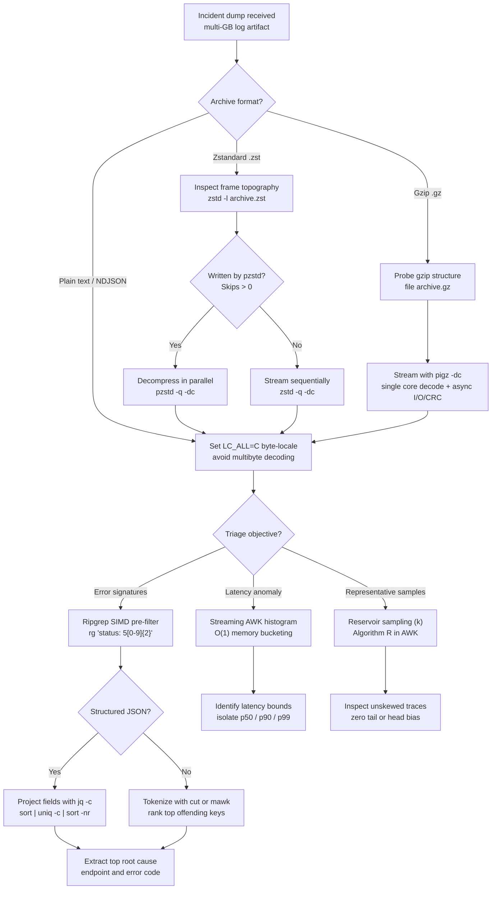

# Analyze Gigabyte Terminal Logs

> [!summary] Scope
> Owns the operational runbook for high-throughput log analysis on gigabyte-to-terabyte incident dumps directly in the terminal.
> Details pipeline architectures utilizing LC_ALL=C byte-locale bypass, fast decompression (pzstd, which parallelizes only archives that pzstd itself wrote with skippable size headers, and pigz, which decompresses on one thread plus I/O and checksum threads), ripgrep pre-filtering into streaming mawk/gawk and jq, reservoir sampling, and numeric histogram aggregation.
> Reaches Use and Debug, putting the text-processing and buffering concept notes into emergency incident production practice.

High-throughput stream filtering is grounded by [[Ripgrep-Internals-and-Fast-Text-Search]].
Pipeline buffer management and backpressure dynamics are owned by [[Pipe-Buffering-and-Stdbuf]].
Byte-level character classification and collation semantics are governed by [[Locale-Collation-and-Unicode-in-CLI-Tools]].
Structured JSON transformations and coreutils primitives belong to [[Structured-Data-Wrangling-Jq-Yq-and-Coreutils]].
Stream-oriented pattern parsing and record splitting are analyzed in [[Sed-and-Awk-Stream-Processing]].
This playbook operationalizes these mechanisms into a deterministic runbook for active incident triage directly in the terminal.

## Trigger and Symptoms

Activate this playbook when an ongoing production outage requires immediate diagnosis from local or remote multi-gigabyte log artifacts and centralized indexing clusters are unavailable, throttled, or lagging behind real time.

- Centralized observability platforms (Elasticsearch, OpenSearch, Loki, or Cloud Logging) report high ingestion lag, index rate limits, or query timeouts during an active incident.
- A production node, container, or edge host dumps raw unindexed access logs, application traces, or heap crash logs ranging from 2 GB to 500 GB on local NVMe or ephemeral storage.
- Standard shell commands freeze or thrash: running `grep "ERROR" /var/log/app.log` or `jq . /var/log/app.json` exhausts available system memory, triggers the Linux OOM killer (`SIGKILL` / exit status 137), or stalls on disk I/O.
- Decompressing compressed archives (`.log.gz` or `.log.zst`) with `gzip -d` or `zstd -d` fails due to `No space left on device` or consumes tens of minutes decompressing redundant lines.
- Triage commands return exit status 141 (`SIGPIPE`) when piping output into downstream inspection tools such as `head`, breaking automated incident triage scripts running under `set -o pipefail`.

## Decision Tree



## Prerequisites

Ensure the following tools and environment settings are verified before executing triage pipelines on production hosts.

- Operating system: Linux (2.6.35+ for `/proc/sys/fs/pipe-max-size` and `F_SETPIPE_SZ`, per pipe(7)) or macOS (Darwin arm64 / x86-64).
- Core inspection binaries: `rg` (ripgrep 14.0+), `zstd` (1.5+), `pzstd` (Parallel Zstandard), `pigz` (2.4+), `awk` (`gawk` 5.0+ or `mawk` 1.3.4+), `jq` (1.6+), and GNU `coreutils` (`sort`, `cut`, `head`, `tail`, `wc`).
  The minimum versions are recommendations, not documented floors; the lab was run with ripgrep 15.2.0, zstd 1.5.7, jq 1.8.2, and BWK awk 20200816 on macOS (as of 2026-11).
- Ephemeral storage check: verify that `/tmp` or the active working directory has sufficient space for intermediate sorting if external sort merges are required.
- Pipe buffer capacity: verify Linux pipe buffer ceiling in `/proc/sys/fs/pipe-max-size` (default is 1048576 bytes / 1 MiB on modern Linux; standard pipe buffer capacity is 64 KiB).
- Execution shell configuration: avoid running incident triage pipelines inside automated scripts that configure `set -e` without explicit `SIGPIPE` handling.

## Commands and Numbers to Know

The following reference metrics and parameters govern high-throughput terminal log processing (as of 2026-11):

| Parameter / Metric | Platform | Standard Value | Incident Significance |
| :--- | :--- | :--- | :--- |
| Default pipe capacity | Linux | 65,536 bytes (64 KiB) | Capacity of kernel buffer between adjacent pipeline processes; fills when consumer is slower than producer. |
| Max unprivileged pipe size | Linux | 1,048,576 bytes (1 MiB) | Maximum pipe buffer capacity configurable via `fcntl(fd, F_SETPIPE_SZ, size)` without `CAP_SYS_RESOURCE`. |
| Default pipe capacity | macOS | 65,536 bytes (64 KiB) | Measured by filling a non-blocking pipe; xnu `bsd/sys/pipe.h` starts the buffer at `PIPE_SIZE` (16,384) and grows it to `BIG_PIPE_SIZE` (64 KiB). |
| `LC_ALL=C` throughput gain | Both | Workload-dependent; 42x measured for GNU sort | GNU sort 9.12 sorted 1.2 million NDJSON lines in 0.13 s under `C` and 5.3 s under `en_US.UTF-8` (macOS); the gain comes from `memcmp` replacing `strcoll`-style collation. |
| `zstd` magic number | Both | `0x28B52FFD` | 4-byte little-endian header identifying a standard Zstandard compressed frame (RFC 8878 Section 3.1.1). |
| `zstd` skippable magic range | Both | `0x184D2A50` - `0x184D2A5F` | 4-byte little-endian header for skippable metadata frames (RFC 8878 Section 3.1.2); `pzstd` writes one before each data frame holding that frame's compressed size. |
| `pigz` decompression threads | Both | 1 worker + 3 helper | Decompression core is single-threaded due to DEFLATE sliding-window dependencies; helpers handle read, write, and check calculation, and `-dp 1` turns them off. |
| `pigz -i` (`--independent`) | Both | Independent blocks | Drops the 32 KiB preset dictionary from the previous block so blocks can be decompressed independently for damage recovery or random access; `pigz` itself still decompresses serially. |
| Ripgrep SIMD engine | Both | SSSE3 or AVX2 / NEON (Teddy) | The Teddy multi-literal prefilter in the `aho-corasick` crate runs on x86_64 with SSSE3 or AVX2 and on aarch64 with NEON, using 16-byte or 32-byte vectors. |
| GNU `sort -S` default | Both | max(available RAM, total RAM / 8) | `default_sort_size()` in `sort.c`, also capped at half of `RLIMIT_DATA`/`RLIMIT_AS`; the buffer fills before temporary runs spill to disk. |
| `jq` memory per object | Both | ~10x raw JSON (measured) | `jq -s` on a 108.6 MB NDJSON file reached 1.13 GB maximum RSS (jq 1.8.2, macOS); slurping a 10 GB file needs about 100 GB of RAM. |
| `SIGPIPE` signal exit code | Both | 141 (128 + 13) | Shell status of a writer killed by `SIGPIPE` after its reader closed; Rust tools such as ripgrep ignore the signal and exit 0 or 1 instead. |

## Step-by-Step Execution

### Step 1: Inspect Archive Frame Topography and Compression Format

Never run blind decompression commands (`tar -xzf`, `gunzip`, or `unzstd`) directly onto the filesystem during an incident.
Decompressing a 50 GB archive onto disk risks filling root or ephemeral partitions, thrashing page caches, and wasting minutes of time.
First inspect whether the compressed archive contains segmented frames that support multi-threaded stream decompression.

```bash
# Inspect Zstandard frame structure without decompressing payload data
zstd -l incident_logs.zst
```

For Zstandard archives, `zstd -l` parses the frame headers defined in RFC 8878.
If `Skips` is greater than 0, the archive was most likely written by `pzstd`.
`zstd -l` counts the skippable frames in `Frames` as well, so a 522 MiB file compressed with `pzstd -p 8` listed `Frames 132, Skips 66` (zstd 1.5.7, macOS, as of 2026-11).
In this structure, each data frame represents an independently decodable chunk preceded by a skippable frame (`0x184D2A5?`) recording the compressed size of the next frame (`contrib/pzstd/SkippableFrame.h`).
Only these size headers let `pzstd -d` hand frames to its worker threads.
On any other input, including a concatenation of plain `zstd` frames, `Pzstd.cpp` logs "Input not in pzstd format, falling back to serial decompression".
Measured on that 522 MiB file, `pzstd -p 8 -dc` took 0.29 s real and 0.30 s user on 8 concatenated plain frames, and 0.05 s real and 0.31 s user on the `pzstd`-written archive.
If `Skips` is 0 (one frame, several plain frames, or a `zstd -T` multithreaded archive, which is still one frame), decompression runs sequentially on a single CPU core.

For gzip archives, inspect the format using `file` and test whether independent members exist:

```bash
# Check gzip metadata and member concatenation
file incident_logs.gz
```

Standard gzip files use the DEFLATE algorithm (RFC 1951).
Because DEFLATE relies on a sliding window of up to 32 KiB where back-references point to previously decompressed bytes, a generic gzip stream cannot be decoded from an arbitrary offset in parallel.
`pigz -d` therefore runs the DEFLATE decompression loop on a single core, while offloading disk read I/O, stdout write I/O, and CRC-32 checksum calculations to three separate background threads.

#### Verification

Verify archive properties with a deterministic awk query against `zstd -l`:

```bash
zstd -l incident_logs.zst | awk 'NR==2 { printf "frames=%d skips=%d check=%s\n", $1, $2, $(NF-1) }'
```

Expected output shape:

```text
frames=4 skips=0 check=XXH64
```

This lab archive is four concatenated plain `zstd` frames, so `skips=0` means `pzstd` decompresses it serially.
The lab then proves the contrast: it re-compresses the same records with `pzstd` and prints the three facts below (darwin-arm64, zstd 1.5.7, as of 2026-11).

```text
pzstd_written: skips>0
serial_fallback: plain=1 pzstd_written=0
decoded_streams_identical: yes
```

`serial_fallback` counts the `Input not in pzstd format, falling back to serial decompression` line that `pzstd -vvv` logs for the plain archive and not for the `pzstd`-written one.
The lab establishes the precondition for parallel decoding and identical output, not a speedup; the timings in this step come from a separate 1.01 GiB measurement.

### Step 2: Establish the Streaming Pipeline and Bypass Multibyte Locale

Before launching any text processing tool (`grep`, `rg`, `awk`, `sed`, `sort`, `cut`), force the execution environment to the C/POSIX byte locale.

```bash
export LC_ALL=C
```

In standard UTF-8 environments (`LC_ALL=en_US.UTF-8` or `LANG=en_US.UTF-8`), string processing utilities interpret input as characters according to `LC_CTYPE`, as POSIX requires.
Implementations decode multibyte sequences (for example with `mbrtowc(3)`) to find where each 1-to-4 byte UTF-8 character ends.
Furthermore, GNU `sort` compares with locale collation (`xmemcoll0`, built on `strcoll(3)`) rather than `memcmp(3)` whenever `LC_COLLATE` is a non-C locale (`hard_LC_COLLATE` in `sort.c`), evaluating multi-level collation tables, accent weights, and case rules.
In `LC_ALL=C`, every byte from `0x00` to `0xFF` represents an independent, fixed 8-bit character.
Regular expression engines can match on single bytes without multibyte decoding, and `sort` falls back to `memcmp(3)`.
The gain is workload-dependent: GNU sort 9.12 sorted 1.2 million NDJSON lines in 0.13 s under `LC_ALL=C` and 5.3 s under `en_US.UTF-8`, about 42x (macOS, as of 2026-11).

`decompress_stream` prefers `pzstd`, which only runs in parallel on archives that `pzstd` wrote (Step 1).

To safely stream decompression without creating intermediate disk files, define a parallel-aware decompression stream:

```bash
decompress_stream() {
    if command -v pzstd >/dev/null 2>&1; then
        pzstd -q -dc "$1"
    else
        zstd -q -dc "$1"
    fi
}
```

#### Verification

Verify streaming decompression under `LC_ALL=C` by counting total lines without materializing files on disk:

```bash
TOTAL_COUNT=$(decompress_stream incident_logs.zst | wc -l | tr -d " ")
echo "total_records_decompressed: ${TOTAL_COUNT}"
```

Expected output, preceded by a byte-order probe that only passes when `LC_ALL=C` is in effect (`.` and `_` sort before lowercase letters, and uppercase before lowercase; macOS, as of 2026-11):

```text
byte_order_sort: .d A B _c a b 
total_records_decompressed: 25000
```

The probe line ends with a trailing space, as `tr` leaves it.
On a host whose login locale is already `C`, the probe cannot detect a missing `export`.

### Step 3: Execute High-Throughput SIMD Line Elimination with Ripgrep

High-level interpreters (`awk`, `python`, `jq`, `perl`) incur substantial per-line overhead due to memory allocation, tokenization, and string copying.
Never feed uncompressed log streams directly into `jq` or Python.
Insert `ripgrep` (`rg`) at the head of the pipeline immediately following the decompressor to eliminate non-incident lines at multi-gigabyte-per-second speeds (4.2 GB/s on a cached 1.08 GB file, macOS, as of 2026-11).

```bash
# Filter stream for HTTP 5xx errors or specific panic signatures
decompress_stream incident_logs.zst | rg '"status":\s*5[0-9]{2}' > incident_filtered.jsonl
```

Ripgrep uses the Rust `regex` crate, built on `regex-automata`, which extracts literal substrings and searches for them with SIMD prefilters (`memchr`, and the Teddy algorithm from the `aho-corasick` crate on x86_64 SSSE3/AVX2 and aarch64 NEON).
It scans raw memory buffers in 16-byte or 32-byte chunks without validating UTF-8 boundaries, quickly dropping lines that do not contain the target substring.
If 99% of log lines represent successful HTTP 200 requests and 1% represent HTTP 5xx errors, ripgrep eliminates 99% of the volume before downstream tools run.

#### Verification

Measure the reduction ratio by comparing filtered output to the total record count:

```bash
INCIDENT_COUNT=$(rg -c '"status":\s*5[0-9]{2}' incident_filtered.jsonl)
echo "filtered_5xx_records: ${INCIDENT_COUNT}"
```

Expected output:

```text
filtered_5xx_records: 209
```

### Step 4: Extract Statistically Uniform Incident Samples via Streaming Reservoir Sampling

During major incidents, error logs may contain millions of matching failure lines.
Inspecting the first 50 lines using `head -n 50` introduces severe recency bias, capturing only the first few seconds of an incident before cascading downstream dependencies fail.
Inspecting the last 50 lines using `tail -n 50` captures only the recovery phase or trailing connection resets.
Loading all matching lines into memory to shuffle them using `shuf -n 50` or `sort -R` exhausts memory and spills to disk.

Instead, execute Algorithm R (due to Alan Waterman, as presented in Vitter 1985, Section 2) in streaming AWK.
Algorithm R maintains a reservoir array of size $k$.
For the first $k$ lines, it fills the reservoir directly.
For each subsequent line $n > k$, it generates a uniform random integer $r \in [1, n]$.
If $r \le k$, the new line replaces element $r$ in the reservoir; otherwise, it is discarded.
Because the probability of replacing any existing element is precisely $k/n \times 1/k = 1/n$, by mathematical induction every line in an arbitrarily large stream of unknown length $N$ has an exact, uniform $k/N$ probability of appearing in the final reservoir.

```bash
# Sample k=5 uniform random lines from the filtered incident stream
decompress_stream incident_logs.zst | rg '"status":\s*5[0-9]{2}' | awk '
BEGIN {
    seed = 42;
    k = 5;
    n = 0;
}
function lcg_rand() {
    seed = (seed * 48271) % 2147483647;
    return seed / 2147483647;
}
{
    n++;
    if (n <= k) {
        res[n] = $0;
    } else {
        r = int(lcg_rand() * n) + 1;
        if (r <= k) {
            res[r] = $0;
        }
    }
}
END {
    for (i = 1; i <= k; i++) {
        print res[i];
    }
}' | jq -r '"sample_\(input_line_number): id=\(.id) path=\(.path) status=\(.status) latency=\(.latency_ms)ms error=\(.error)"'
```

AWK numbers are IEEE doubles, which hold integers exactly up to 2^53.
`lcg_rand` is the Park-Miller "minimal standard" generator (multiplier 48271, modulus 2^31 - 1), so `seed * 48271` stays below 2^47 and every step is exact integer arithmetic.
The lab confirmed that BWK awk 20200816, `gawk`, and `gawk -M` (arbitrary precision) all print the same five samples.
The earlier multiplier 1103515245 with modulus 2^31 exceeds 2^53 in the product and makes `gawk -M` disagree with plain `gawk`.
The five samples are one fixed draw.
Uniformity is checked separately by lab Stage 4b, which runs the same recurrence and reservoir update 4000 times over 100 items with k=5 and counts how often each item lands in the reservoir:

```text
=== STAGE 4b: Reservoir Inclusion Uniformity (k=5, n=100, 4000 trials) ===
expected_per_item=200 min=169 max=231
first_half_share=0.496 (ideal 0.500)
uniform: yes
```

The check passes when every item's count is within 40% of the expected 200 and the first half of the stream holds between 47% and 53% of the slots; it is a coarse sanity check, not a statistical test.

#### Verification

Verify that exactly $k = 5$ sampled incident traces are output with valid JSON properties:

Expected output:

```text
sample_1: id=23528 path=/api/v1/checkout status=502 latency=518.56ms error=database_timeout
sample_2: id=9649 path=/healthz status=500 latency=111.69ms error=oom_worker_killed
sample_3: id=11683 path=/api/v1/cart status=500 latency=210.14ms error=connection_refused
sample_4: id=18157 path=/healthz status=500 latency=277.36ms error=database_timeout
sample_5: id=7768 path=/api/v1/cart status=500 latency=1018.13ms error=database_timeout
```

### Step 5: Compute Real-Time Latency Percentiles and ASCII Histograms in AWK

When investigating latency spikes, sorting hundreds of millions of numeric values with `sort -n` consumes tens of gigabytes of RAM and triggers expensive external disk merges.
In an incident, an exact percentile down to the sixth decimal place is unnecessary; what is required is instant, actionable visibility into distribution skew and tail latency (p50, p90, p99).

Execute a single-pass streaming histogram aggregator in AWK.
The script extracts the numeric latency field, updates running min, max, count, and sum metrics, and increments fixed boundary buckets in $O(1)$ memory.
At stream termination (`END`), it traverses cumulative counts to identify percentile buckets and renders a terminal ASCII bar chart.

```bash
# Streaming single-pass latency distribution and ASCII histogram
decompress_stream incident_logs.zst | awk -F'"latency_ms": *' '
BEGIN {
    count = 0; sum = 0; min = 999999; max = 0;
    b_limit[1] = 25; b_limit[2] = 50; b_limit[3] = 100; b_limit[4] = 250; b_limit[5] = 500;
    b_name[1] = "   0 -  25 ms";
    b_name[2] = "  25 -  50 ms";
    b_name[3] = "  50 - 100 ms";
    b_name[4] = " 100 - 250 ms";
    b_name[5] = " 250 - 500 ms";
    b_name[6] = "      >=500 ms";
    num_b = 5;
}
NF > 1 {
    split($2, parts, "[,}]");
    val = parts[1] + 0;
    count++;
    sum += val;
    if (val < min) min = val;
    if (val > max) max = val;
    b = num_b + 1;
    for (i = 1; i <= num_b; i++) {
        if (val <= b_limit[i]) { b = i; break; }
    }
    b_count[b]++;
}
END {
    printf "metrics: count=%d min=%.2f mean=%.2f max=%.2f\n", count, min, sum/count, max;
    cum = 0; p50 = ""; p90 = ""; p99 = "";
    for (i = 1; i <= num_b + 1; i++) {
        c = b_count[i] + 0;
        cum += c;
        if (p50 == "" && cum >= count * 0.50) p50 = b_name[i];
        if (p90 == "" && cum >= count * 0.90) p90 = b_name[i];
        if (p99 == "" && cum >= count * 0.99) p99 = b_name[i];
        pct = (c / count) * 100;
        bar_len = int(pct / 2.5);
        bar = "";
        for (j = 0; j < bar_len; j++) bar = bar "#";
        printf "%s | %5d (%5.1f%%) | %s\n", b_name[i], c, pct, bar;
    }
    printf "percentile_est: p50_bucket=\"%s\" p90_bucket=\"%s\" p99_bucket=\"%s\"\n", p50, p90, p99;
}'
```

#### Verification

Verify that metrics, bucket frequencies, and percentile estimates are computed without disk spillage:

Expected output:

```text
metrics: count=25000 min=1.00 mean=20.48 max=2928.67
   0 -  25 ms | 19760 ( 79.0%) | ###############################
  25 -  50 ms |  3992 ( 16.0%) | ######
  50 - 100 ms |   996 (  4.0%) | #
 100 - 250 ms |   104 (  0.4%) | 
 250 - 500 ms |    64 (  0.3%) | 
      >=500 ms |    84 (  0.3%) | 
percentile_est: p50_bucket="   0 -  25 ms" p90_bucket="  25 -  50 ms" p99_bucket=" 100 - 250 ms"
```

### Step 6: Aggregate Root-Cause Error Signatures with Streaming JSON Projection

Once the incident population is isolated to 5xx error events, identify the root cause by projecting the tuple of status code, request path, and error string.
Never slurp the stream with `jq -s`; use `jq -c` to emit one compact string per record, then pipe to `sort | uniq -c | sort -nr`.

```bash
# Extract top offending endpoint and error signatures
decompress_stream incident_logs.zst \
  | rg '"status":\s*5[0-9]{2}' \
  | jq -r '"\(.status) \(.path) \(.error)"' \
  | sort \
  | uniq -c \
  | sort -nr \
  | head -n 3 \
  | awk '{ printf "rank_%d: count=%d status=%s path=%s error=%s\n", NR, $1, $2, $3, $4 }'
```

Because `rg` reduced the input volume to only failing events, the downstream `jq` parser handles only hundreds or thousands of records rather than tens of millions.
The resulting strings are grouped and counted using standard POSIX sorting semantics, surfacing the dominant failure signature immediately.

#### Verification

Verify that the ranked error breakdown pinpoints the primary failing endpoint:

Expected output:

```text
rank_1: count=12 status=504 path=/api/v1/auth error=database_timeout
rank_2: count=6 status=504 path=/api/v1/checkout error=oom_worker_killed
rank_3: count=6 status=504 path=/api/v1/checkout error=connection_refused
```

## Worked Example: Large Log Pipeline Lab

The complete laboratory implementation resides in `code/01-Command-Line/large_log_pipeline/`.
It generates a 25,000-line synthetic structured JSON log stream divided across 4 independent Zstandard frames, compresses them, and runs 6 pipeline stages plus a reservoir uniformity check deterministically.

To run verification against the lab harness:

```bash
cd code && python3 -m _harness.verify 01-Command-Line/large_log_pipeline/
```

### Verified output

The following output is byte-identical to `code/01-Command-Line/large_log_pipeline/expected/darwin-arm64.txt`, recorded on macOS arm64 (darwin-arm64) with zstd 1.5.7, ripgrep 15.2.0, jq 1.8.2, and BWK awk 20200816 (as of 2026-11).
No linux recording exists, so the output is verified on that one platform.
The lab needs `python3`, `zstd`, `pzstd`, `rg`, `jq`, and `awk` on `PATH` and exits with `missing required tool` when one is absent.

```text
=== STAGE 1: Zstandard Frame Verification ===
frames=4 skips=0 check=XXH64
pzstd_written: skips>0
serial_fallback: plain=1 pzstd_written=0
decoded_streams_identical: yes
=== STAGE 2: Streaming Decompression (LC_ALL=C) ===
byte_order_sort: .d A B _c a b 
total_records_decompressed: 25000
=== STAGE 3: Fast SIMD Pre-Filtering (Ripgrep) ===
filtered_5xx_records: 209
=== STAGE 4: Streaming Reservoir Sampling (k=5, LCG PRNG) ===
sample_1: id=23528 path=/api/v1/checkout status=502 latency=518.56ms error=database_timeout
sample_2: id=9649 path=/healthz status=500 latency=111.69ms error=oom_worker_killed
sample_3: id=11683 path=/api/v1/cart status=500 latency=210.14ms error=connection_refused
sample_4: id=18157 path=/healthz status=500 latency=277.36ms error=database_timeout
sample_5: id=7768 path=/api/v1/cart status=500 latency=1018.13ms error=database_timeout
=== STAGE 4b: Reservoir Inclusion Uniformity (k=5, n=100, 4000 trials) ===
expected_per_item=200 min=169 max=231
first_half_share=0.496 (ideal 0.500)
uniform: yes
=== STAGE 5: Streaming Latency Histogram & Percentiles ===
metrics: count=25000 min=1.00 mean=20.48 max=2928.67
   0 -  25 ms | 19760 ( 79.0%) | ###############################
  25 -  50 ms |  3992 ( 16.0%) | ######
  50 - 100 ms |   996 (  4.0%) | #
 100 - 250 ms |   104 (  0.4%) | 
 250 - 500 ms |    64 (  0.3%) | 
      >=500 ms |    84 (  0.3%) | 
percentile_est: p50_bucket="   0 -  25 ms" p90_bucket="  25 -  50 ms" p99_bucket=" 100 - 250 ms"
=== STAGE 6: Incident Root Cause Frequency Aggregation ===
rank_1: count=12 status=504 path=/api/v1/auth error=database_timeout
rank_2: count=6 status=504 path=/api/v1/checkout error=oom_worker_killed
rank_3: count=6 status=504 path=/api/v1/checkout error=connection_refused
```

## Rollback Procedure

When an ad-hoc pipeline hangs, consumes excessive CPU or memory, or fills ephemeral storage:

1. Terminate runaway pipeline process groups:
   Do not simply press Ctrl-C if the command was executed in the background or via an SSH subshell.
   Identify and terminate all child processes belonging to the pipeline's process group.
   `$$` is the shell's own PID, and an interactive shell with job control runs each pipeline in its own process group, so `kill -- -$$` does not reach the pipeline.
   Find the group from any stage's PID and signal it, or match exact process names (ripgrep's process is named `rg`):
   ```bash
   PGID=$(ps -o pgid= -p "<pid of any pipeline stage>" | tr -d ' ')
   kill -TERM -- -"$PGID" 2>/dev/null || pkill -TERM -x 'pzstd|zstd|rg|gawk|mawk|jq'
   ```
2. Remove spilled external sort temporary files:
   GNU `sort` places temporary run files in `$TMPDIR` or `/tmp` when data exceeds `-S`.
   If aborted abruptly, orphaned spill files can linger.
   Clean up temporary spill files:
   ```bash
   rm -f "${TMPDIR:-/tmp}"/sort?????? ./incident_filtered.jsonl
   ```
3. Restore user locale settings:
   If `export LC_ALL=C` was applied to an interactive shell session rather than prefixing individual commands, restore the system default:
   ```bash
   unset LC_ALL
   ```

## Failure Modes of the Procedure

### 1. Broken Pipe `SIGPIPE` / Exit Code 141 in Strict Shell Scripts

When triage pipelines are scripted with `set -e` and `set -o pipefail`, piping high-throughput output into limiting utilities like `head -n 10` causes the script to abort immediately with exit status 141.
The mechanism: `head` reads 10 lines and immediately terminates, closing its stdin file descriptor.
When the upstream producer (for example `pzstd`) next attempts to execute `write()` on the pipe, the kernel detects that the reader is gone and raises signal 13 (`SIGPIPE`).
The default disposition of `SIGPIPE` is process termination.
Because `set -o pipefail` records the exit status of the rightmost failing command in a pipeline, the shell captures 128 + 13 = 141 and exits.
A Rust producer behaves differently: the Rust runtime ignores `SIGPIPE`, so ripgrep sees `EPIPE` and exits instead (`crates/core/main.rs`).
With ripgrep 15.2.0 reading stdin, `zstd -dc f.zst | rg X | head -n 5` returned `PIPESTATUS` `141 1 0`, so the pipeline status is 1, not 141 (measured, macOS, as of 2026-11).
Remediation: consume the stream cleanly or intercept `SIGPIPE` by wrapping consumers, e.g., `{ head -n 10; cat > /dev/null; }` or appending `|| true` on exploratory pipelines.

### 2. Out of Memory (`SIGKILL` / Exit 137) from JSON Slurping

Using `jq -s` (slurp) loads all JSON objects into a single contiguous array in RAM.
Because `jq` represents every object as an AST of dynamically allocated `jv` structs (allocating distinct heap nodes for dictionaries, keys, numbers, and strings), memory consumption expands by about 10x relative to raw JSON on disk (108.6 MB of NDJSON reached 1.13 GB maximum RSS under `jq -s`, jq 1.8.2, macOS, as of 2026-11).
A 15 GB NDJSON log will need on the order of 150 GB of heap, triggering the kernel OOM killer.
Remediation: never slurp large logs; use line-by-line `jq -c` streaming or pre-filter with `rg` before invoking `jq`.

### 3. Decompression Thread Stalling on Monolithic Archives

Attempting to run `pzstd -p 16 -d` on a compressed file that `pzstd` did not write (a single `zstd` frame, a `zstd -T` archive, or concatenated plain frames) will run on only one CPU core.
The process monitor will show 100% CPU on one core while 15 cores remain idle.
Remediation: verify with `zstd -l` first; if `Skips` is 0, accept that decompression is single-threaded and bottlenecked on that core, or compress with `pzstd` during archival.

### 4. Locale Collation Mismatch Corrupting Aggregation

Mixing locales between `sort` and an order-dependent consumer breaks that consumer's assumption about its input.
`uniq -c` counts survive the mix: identical lines compare equal under any collation, and GNU sort's last-resort bytewise comparison (disabled only by `-s`) keeps them adjacent.
On glibc 2.36 (GNU sort 9.1), `sort` under `en_US.UTF-8` piped to `uniq -c` under `C`, and the reverse, both gave the same counts as an all-`C` pipeline.
The damage lands on `join`, `comm`, and `sort -m`, which need input sorted in the collating order they themselves use.
glibc's `en_US.UTF-8` ignores punctuation at the first collation level, so `apple`, `Banana`, `_cherry`, `.date` is sorted there but out of order in the C locale.
Remediation: always ensure `export LC_ALL=C` is uniform across the entire pipeline.

## Pitfalls

> [!warning] Pitfalls:
> 1. **Useless Use of `cat`:**
>    Writing `cat access.log | rg pattern` adds a redundant process context switch, an unnecessary anonymous pipe, and double memory copying (kernel page cache -> cat userspace buffer -> pipe buffer -> rg userspace buffer).
>    Use input redirection `rg pattern < access.log` or pass the path directly `rg pattern access.log`.
> 2. **Sorting Before Filtering:**
>    Running `decompress | sort | uniq -c | rg "500"` forces the system to sort every line, for example 100 million lines spilled to disk.
>    Filtering first with `decompress | rg "500" | sort | uniq -c` shrinks the sort input to the matching lines (100,000 in that example, 1000x fewer), typically turning an external disk merge into an in-memory sort; the timings depend on hardware and are not measured here.
> 3. **Assuming `pigz -d` Scales Linearly Across All Cores:**
>    Setting `pigz -p 32 -d` does not decompress across 32 cores.
>    Standard gzip streams cannot be decompressed in parallel; `pigz -d` uses one decompression thread plus three helpers (read, write, check) regardless of `-p`, and `-dp 1` drops the helpers (`pigz.c` header comment).
> 4. **Relying on Head or Tail for Root-Cause Analysis:**
>    Using `head` or `tail` samples unrepresentative slices of an outage.
>    Always use streaming Reservoir Sampling (Algorithm R) to inspect uniform random selections across the full timeline.
> 5. **Unbuffered Stdio Thrashing:**
>    Piping tools that emit single-byte writes or unbuffered stdout across pipes incurs heavy system call overhead.
>    Ensure tools operate with default block buffering when processing streams; stdio sizes the buffer from `st_blksize`, which is 65,536 bytes for a macOS pipe (measured, as of 2026-11).

## At Scale

Log analysis dynamics change dramatically as volume expands from gigabytes to terabytes across production fleets:

### 1. Fleet Log Architecture

At single-node scale (1 GB to 20 GB), the speed of a terminal pipeline (`pzstd | rg | awk | jq`) is set by its slowest stage once the file is in the page cache.
Measured on a 1.01 GiB NDJSON file (10 million records, 83,600 matching), `pzstd -p 8 -dc | rg | wc -l` finished in 0.31 s wall time against a `pzstd`-written archive (Apple M3 Pro, 12 cores, rg 15.2.0, zstd 1.5.7, macOS, as of 2026-11).
Nothing larger was measured, so any size beyond that is extrapolation.
The same file through the Stage 5 AWK histogram took 35 s with BWK awk 20200816 and 31 s with gawk, about 3.1 to 3.5 microseconds per record, so any AWK stage must sit behind the `rg` filter.
At cluster scale (100 GB to 10 TB across 1,000 nodes), shipping raw logs across the network during an outage saturates top-of-rack switches and overwhelms ingest queues.
Production architectures deploy local node triage agents that execute pre-filtering and reservoir sampling locally on the node, shipping only structured summary metrics and sampled error traces to central storage.

### 2. Page Cache Economics and Direct I/O

When scanning a 200 GB log file on a node with 64 GB of RAM, the Linux page cache is evicted and thrashing occurs, evicting active application binaries and working sets from memory.
To prevent log triage from degrading the running production workload:
- Use `fadvise` via GNU `dd iflag=nocache` (Linux; "Request to drop cache" in coreutils 9.1 `dd --help`) or a small C wrapper invoking `posix_fadvise(fd, 0, 0, POSIX_FADV_DONTNEED)` after streaming to immediately release read pages from kernel memory.
- Scanning speed depends on the stage, not the disk: `rg -c` over a 1.08 GB file in the page cache took 0.26 s, about 4.2 GB/s (macOS, as of 2026-11), while AWK stages ran at about 31 MB/s, which is why the filter belongs first.
  No NVMe array and no distributed query engine was measured, so this note makes no claim about either.

### 3. Decision Rules

- **< 1 GB logs:** Run ad-hoc `rg` and `jq` directly; memory consumption is trivial.
- **1 GB to 50 GB logs:** Apply `LC_ALL=C`, verify `zstd -l` frame structure, pre-filter with `rg`, and aggregate with streaming AWK.
- **50 GB to 500 GB single-node logs:**
  Never decompress to disk.
  Stream via `pzstd -dc` or `pigz -dc`, enforce Reservoir Sampling, avoid `jq -s`, and spill external sorts to high-speed NVMe (`sort -T /mnt/nvme/tmp`).
- **> 500 GB fleet-wide logs:** Execute parallel triage jobs across worker nodes using SSH multiplexing or distributed execution (`parallel --sshloginfile`), aggregating pre-filtered summary histograms centrally.

## Practice Drill

Execute this hands-on diagnostic drill to reinforce streaming triage reflexes:

1. Clone or generate the lab files in `code/01-Command-Line/large_log_pipeline/`.
2. Inspect the frame topography of `incident_logs.zst` using `zstd -l`.
3. Construct a pipeline that extracts requests where `latency_ms` exceeds 500 ms and status is 504.
4. Using streaming AWK, compute the exact percentage of 504 timeout requests caused by `database_timeout` versus `connection_refused`.
5. Implement Algorithm R in AWK to output exactly 3 sample records from this high-latency population, verifying that memory usage remains constant throughout execution.

## Interview Questions

> [!question] L5
> What is the exact performance mechanism behind setting `LC_ALL=C` when running text processing utilities like `grep`, `awk`, and `sort`, and what output changes occur?
>
> > [!success]- Answer
> > In multi-byte UTF-8 locales (`en_US.UTF-8`), POSIX tools interpret input as characters per `LC_CTYPE`, so implementations decode character boundaries with `mbrtowc` or equivalent state machines.
> > GNU `sort` compares with `xmemcoll0`/`strcoll`, which map strings to multi-level collation weights, case rules, and (on glibc) first-level punctuation omission.
> > Under `LC_ALL=C`, every byte from `0x00` to `0xFF` is treated as a single, independent character.
> > Regular expression engines can match bracket expressions (e.g., `[a-z]`) on single bytes, skipping multi-byte decoding.
> > GNU `sort` falls back to `memcmp` byte comparisons (`sort.c`, `hard_LC_COLLATE` false); the speedup is workload-dependent, about 42x measured for GNU sort 9.12 on 1.2 million NDJSON lines (macOS, as of 2026-11).
> > The output change: characters sort strictly by ASCII ordinal value (e.g., uppercase `B` (ASCII 66) precedes lowercase `a` (ASCII 97), and `.` (ASCII 46) precedes `_` (ASCII 95)), and non-ASCII UTF-8 sequences are treated as arbitrary raw byte sequences rather than typographic glyphs.

> [!question] L5
> Predict the output of the following command sequence in a standard terminal:
> ```bash
> printf "apple\nBanana\n_cherry\n.date\n" | LC_ALL=C sort
> printf "===\n"
> printf "apple\nBanana\n_cherry\n.date\n" | LC_ALL=en_US.UTF-8 sort
> ```
> Explain why the sort order differs between the two invocations.
>
> > [!success]- Answer
> > The exact output on macOS (`sort` 2.3-Apple, measured as of 2026-11) is:
> > ```text
> > .date
> > Banana
> > _cherry
> > apple
> > ===
> > _cherry
> > .date
> > apple
> > Banana
> > ```
> > On glibc 2.36 (Debian 12, GNU sort 9.1, measured), the second block is instead `apple`, `Banana`, `_cherry`, `.date`.
> > Under `LC_ALL=C`, sorting is performed strictly by byte ASCII value: `.` (0x2E / 46), `B` (0x42 / 66), `_` (0x5F / 95), `a` (0x61 / 97).
> > Under `LC_ALL=en_US.UTF-8`, sorting uses the platform's locale collation tables, and the platforms disagree.
> > glibc ignores punctuation at the first collation level and compares letters case-insensitively there, so the words order as apple, Banana, cherry, date.
> > macOS still compares letters case-insensitively (`a` before `B`) but sorts the punctuation-led lines first.

> [!question] L6
> An engineer debugs a pipeline inside an incident automation script containing `set -euo pipefail`:
> ```bash
> zstd -dc /var/log/incident.zst | rg "CRITICAL" | head -n 5
> ```
> The script intermittently crashes with exit status 141.
> What is the root cause, why does it happen intermittently, and what is the production fix?
>
> > [!success]- Answer
> > Exit status 141 corresponds to 128 + 13, where 13 is `SIGPIPE`.
> > `head -n 5` reads the first 5 matching lines from its standard input and terminates immediately, closing its read end of the pipe.
> > When the upstream writer (`rg` or `zstd`) attempts to execute a subsequent `write()` system call on the pipe, the kernel detects that no read file descriptors remain open and raises `SIGPIPE`.
> > By default, `SIGPIPE` terminates the process.
> > Because `set -o pipefail` is active, the pipeline's exit status is set to the exit code of the last failing command rather than the final command (`head`, which exited 0).
> > ripgrep ignores `SIGPIPE` (Rust runtime default) and exits on `EPIPE`; ripgrep 15.2.0 on stdin exits 1 there, so this exact pipeline returned `PIPESTATUS` `141 1 0` and status 1 (measured, macOS, as of 2026-11), while `zstd -dc | head` alone returns 141.
> > The failure is intermittent because if `zstd` finishes decompressing and writing before `head` terminates, or if fewer than 5 matching lines exist, no `write()` occurs on a closed pipe.
> > The production fix is to either disable pipefail for that specific pipeline segment, swallow `SIGPIPE`, or ensure downstream consumers consume the stream cleanly.
> > Testing `$? -eq 141` is not enough, because the rightmost failure here is ripgrep's 1:
> > ```bash
> > ( set +o pipefail; zstd -dc /var/log/incident.zst | rg "CRITICAL" | head -n 5 )
> > ```
> > The downside is that a genuine `zstd` failure (a corrupt archive) is also hidden; to keep it, inspect `PIPESTATUS` and accept only 141 from `zstd` and 0 or 1 from `rg`.

> [!question] L6
> Why does `pzstd -d` scale decompression across all CPU cores on some `.zst` files while running completely single-threaded on others?
> How can you verify this before launching decompression?
>
> > [!success]- Answer
> > `pzstd` decompresses in parallel only archives that `pzstd` itself wrote ("PZstandard supports parallel decompression of files compressed with PZstandard", `contrib/pzstd/README.md`).
> > Standard `zstd` compression creates a single monolithic frame by default (also with `-T`), where entropy tables and LZ77 back-references form a continuous sequential dependency graph.
> > `pzstd` compresses input by dividing the data stream into chunks, compressing each chunk into an independent Zstandard frame, and preceding each with a skippable frame (`0x184D2A5?`) that stores the next frame's compressed size.
> > When `pzstd -d` reads those skippable frames, it knows each frame's extent without parsing it and assigns frames across its worker thread pool.
> > On any other input, including several concatenated plain `zstd` frames, it logs "Input not in pzstd format, falling back to serial decompression" (`Pzstd.cpp`); a measured 8-frame concatenation decompressed with 0.29 s real and 0.30 s user time, against 0.05 s real for the same data written by `pzstd`.
> > You verify this without decompressing by running `zstd -l file.zst`: if `Skips` is 0, decompression will be single-threaded whatever `Frames` says; if `Skips` > 0, the archive came from `pzstd` and decompression will scale across cores.

> [!question] L6
> Why is `pigz` capable of multi-threaded compression but restricted to single-threaded decompression on standard gzip files?
> What do the auxiliary threads in `pigz -d` actually do?
>
> > [!success]- Answer
> > The DEFLATE algorithm (RFC 1951) uses LZ77 sliding-window compression with up to a 32 KiB history buffer.
> > In standard gzip files, compressed blocks contain backward pointer references to strings decoded in earlier blocks without synchronization markers.
> > Therefore, a decompressor cannot jump into the middle of a standard gzip file and begin decompressing without knowing the uncompressed dictionary state immediately preceding it.
> > `pigz` decompression (`pigz -d`) runs the core DEFLATE decompression loop on a single main thread.
> > However, `pigz -d` spawns three auxiliary threads, which "can speed up decompression under some circumstances" (`pigz.c`).
> > In a measurement here they did not: building pigz 2.8 from source, decompressing a 72 MiB gzip of the 1.01 GiB file to `/dev/null` took 0.38 s for `pigz -dc`, 0.30 s for `pigz -dc -p 1`, and 0.27 s for Apple gzip 487.40.2 (macOS, as of 2026-11), so the helper threads cost more than they saved when the page cache serves the reads and the sink is free.
> > The helpers are:
> > 1. A read thread that prefetches compressed data from storage into memory buffers.
> > 2. A write thread that sequences and flushes uncompressed blocks to standard output.
> > 3. A check calculation thread that computes the CRC-32 checksum asynchronously.
> > This decouples disk I/O and checksum computation from the CPU-bound decompression core.

> [!question] L6
> Explain the mathematical mechanism of Reservoir Sampling (Algorithm R).
> Prove why every line in an input stream of unknown length $N$ has an identical probability $k/N$ of being selected in a reservoir of size $k$.
>
> > [!success]- Answer
> > Algorithm R maintains an array $R[1..k]$.
> > It places the first $k$ items directly into $R$.
> > For every subsequent item $n > k$, it generates a uniform random integer $r \in [1, n]$.
> > If $r \le k$, item $n$ replaces $R[r]$; otherwise, it is ignored.
> > Proof by induction on $n$:
> > Base case: For $n = k$, every item is in the reservoir with probability $k/k = 1$.
> > Inductive step: Assume that after $n - 1$ items, every item has probability $k / (n - 1)$ of being in the reservoir.
> > When item $n$ arrives, it is selected to enter the reservoir with probability $P(\text{enter}) = k/n$.
> > An existing item in the reservoir survives if either:
> > 1. Item $n$ does not enter the reservoir (probability $1 - k/n$), OR
> > 2. Item $n$ enters the reservoir (probability $k/n$), but replaces one of the other $k - 1$ items (probability $(k - 1)/k$).
> > The probability of an existing item surviving step $n$ is:
> > $P(\text{survive}) = (1 - k/n) + (k/n) \cdot ((k - 1)/k) = 1 - k/n + (k - 1)/n = 1 - 1/n = (n - 1)/n$.
> > Therefore, the probability that an item is in the reservoir after step $n$ is:
> > $P(\text{in reservoir at } n) = P(\text{in reservoir at } n - 1) \cdot P(\text{survive}) = \frac{k}{n - 1} \cdot \frac{n - 1}{n} = \frac{k}{n}$.
> > By induction, for any final stream length $N \ge k$, every item has probability $k/N$.
> > This guarantees a statistically unbiased sample in $O(N)$ time and $O(k)$ memory.

> [!question] L7
> An on-call engineer attempts to triage a 200 GB NDJSON access log using the command:
> ```bash
> jq -s 'map(select(.latency_ms > 1000))' /var/log/access.json
> ```
> The process is killed after 45 seconds with exit code 137.
> Detail the internal memory model of `jq` that caused this crash, and architect an incident pipeline that extracts the target records in under 60 seconds without exceeding 100 MiB of RAM.
>
> > [!success]- Answer
> > Exit code 137 represents 128 + 9 (`SIGKILL`), issued by the Linux Out-Of-Memory (OOM) killer.
> > The `-s` (`--slurp`) flag forces `jq` to read the entire JSON input stream into a single in-memory array before applying any filter.
> > Internally, `jq` allocates each JSON node as a reference-counted `jv` C structure.
> > An object requires distinct heap allocations for its type tag, reference count, hash map buckets, string keys, and values.
> > This introduces about a 10x memory inflation factor over raw text (108.6 MB of NDJSON reached 1.13 GB maximum RSS under `jq -s`, jq 1.8.2, macOS, as of 2026-11): a 200 GB JSON log requires about 2 TB of resident memory.
> > The production pipeline architecture:
> > 1. SIMD pre-filter: use `rg` to extract only lines matching high latency before JSON parsing:
> > ```bash
> > rg '"latency_ms":\s*[1-9][0-9]{3,}' /var/log/access.json
> > ```
> > 2. Streaming projection: pipe filtered lines into `jq -c` (without `-s`), which parses and frees one value at a time (3.3 MB maximum RSS on the same 108.6 MB file, measured):
> > ```bash
> > export LC_ALL=C
> > rg '"latency_ms":\s*[1-9][0-9]{3,}' /var/log/access.json \
> >   | jq -c 'select(.latency_ms > 1000)'
> > ```
> > Ripgrep scanned a 1.08 GB cached file at about 4.2 GB/s (0.26 s, macOS, as of 2026-11; an NVMe-bound read would be limited by the drive instead), passing only matching records to `jq`.
> > Memory consumption is bounded by the size of a single JSON record (< 64 KiB), well below the 100 MiB limit.

> [!question] L7
> Design an in-terminal, zero-dependency streaming latency distribution profiler in AWK that handles 100 million log lines in a single pass without disk spill, computing min, mean, max, and percentiles (p50, p90, p99).
> Contrast fixed-width linear buckets with exponential (logarithmic) buckets for production incident triage.
>
> > [!success]- Answer
> > The streaming AWK design allocates a fixed array of counters corresponding to latency buckets:
> > ```awk
> > BEGIN {
> >     min = 1e9; max = 0; sum = 0; count = 0;
> >     # Logarithmic buckets: powers of 2 (1ms, 2ms, 4ms, 8ms, 16ms, ..., 16384ms)
> >     for (i = 0; i <= 14; i++) b_limit[i] = 2^i;
> > }
> > {
> >     v = $NF + 0;
> >     count++; sum += v;
> >     if (v < min) min = v;
> >     if (v > max) max = v;
> >     # Binary or sequential bucket mapping
> >     b = 15;
> >     for (i = 0; i <= 14; i++) {
> >         if (v <= b_limit[i]) { b = i; break; }
> >     }
> >     buckets[b]++;
> > }
> > END {
> >     cum = 0;
> >     for (i = 0; i <= 15; i++) {
> >         cum += buckets[i];
> >         if (!p50 && cum >= count * 0.50) p50 = b_limit[i];
> >         if (!p90 && cum >= count * 0.90) p90 = b_limit[i];
> >         if (!p99 && cum >= count * 0.99) p99 = b_limit[i];
> >     }
> >     printf "count=%d min=%.1f mean=%.1f max=%.1f p50<=%s p90<=%s p99<=%s\n",
> >            count, min, sum/count, max, p50, p90, p99;
> > }
> > ```
> > Linear buckets (e.g., 10ms, 20ms, 30ms) provide uniform resolution but fail on wide-dynamic-range incident data: either high-latency outliers (> 30,000ms) collapse into an uninformative overflow bucket, or the script requires thousands of buckets.
> > Exponential buckets (e.g., powers of 2 or powers of 10) provide constant relative error across multiple orders of magnitude (1 ms to 60,000 ms) using fewer than 20 buckets, maintaining $O(1)$ memory.
> > Per-record cost is not free: the linear 5-bucket Stage 5 program cost 3.1 to 3.5 microseconds per record in AWK (10 million records, gawk and BWK awk 20200816, macOS, as of 2026-11), so filter with `rg` before bucketing.

> [!question] L8+
> Architect a node-local log triage strategy for a fleet of 10,000 bare-metal Kubernetes nodes experiencing a cascading network partition where central observability (Elasticsearch/Loki) is completely unreachable.
> How do you prevent local triage commands from crashing production services or degrading disk arrays?
>
> > [!success]- Answer
> > Under network partition, 10,000 nodes accumulate logs locally on NVMe drives while central ingest is unreachable.
> > If engineers execute uncontrolled ad-hoc SSH sweeps running `grep` or `tar`, the resulting disk read saturation and page cache thrashing will evict production working sets, exacerbating the outage.
> > The architecture enforces:
> > 1. Bounded local storage:
> >    Configure container runtimes with log rotation capped at fixed sizes (e.g., 5 files x 2 GB) utilizing local circular ring buffers to prevent disk exhaustion.
> > 2. Cache-isolated execution:
> >    Enforce `posix_fadvise(fd, 0, 0, POSIX_FADV_DONTNEED)` via a standardized triage binary or `dd iflag=nocache` wrapper.
> >    This instructs the kernel to drop read pages immediately after consumption, preserving application page cache.
> > 3. I/O and CPU cgroups:
> >    Confine triage commands to a dedicated debugging slice (e.g., `systemd-run --slice=triage.slice --property=CPUQuota=200% --property=IOWeight=10`), where `CPUQuota=200%` caps the transient unit at two CPUs and `IOWeight=10` (valid range 1 to 10000, default 100) lowers its share of block I/O only under contention and only with the unified cgroup hierarchy (`systemd.resource-control(5)`, `systemd-run(1)`; not run here, as the test host is macOS).
> > 4. Edge reduction:
> >    Execute local SIMD filtering (`rg`) and streaming AWK bucketing locally on each node, transmitting only 1 KiB summary histograms and reservoir-sampled error traces back over limited emergency management networks.

## Further Reading

- RFC 8878: Zstandard Compression and The 'application/zstd' Media Type, IETF, https://www.rfc-editor.org/rfc/rfc8878.html.
  Defines the Zstandard frame format, magic numbers `0x28B52FFD`, and skippable frame ranges `0x184D2A50`-`0x184D2A5F`.
- Facebook/Meta zstd repository, contrib/pzstd, https://github.com/facebook/zstd/tree/dev/contrib/pzstd.
  Implementation details of chunked multi-frame parallel compression and decompression in C++11.
- Mark Adler, pigz manual and source code, https://zlib.net/pigz/.
  Documents why DEFLATE decompression cannot be parallelized across arbitrary streams and details the 3-helper thread architecture.
- POSIX.1-2024 Base Definitions Chapter 7: Locale, https://pubs.opengroup.org/onlinepubs/9799919799/basedefs/V1_chap07.html.
  Authoritative specification of the C/POSIX locale, byte character classification, and collation ordering.
- GNU Coreutils sort invocation manual, https://www.gnu.org/software/coreutils/manual/html_node/sort-invocation.html.
  Covers buffer sizing (`-S`), parallel thread allocation (`--parallel`), and temporary spill directories (`-T`).
- Andrew Gallant, ripgrep User Guide and Architecture, https://github.com/BurntSushi/ripgrep/blob/master/GUIDE.md.
  User-facing guide to flags, filtering, encodings, and line-oriented searching; the Teddy SIMD literal matcher is documented in the `aho-corasick` crate's `DESIGN.md`, https://github.com/BurntSushi/aho-corasick/blob/master/DESIGN.md.
- Jeffrey S. Vitter, Random Sampling with a Reservoir, ACM TOMS, 1985, https://doi.org/10.1145/3147.3165.
  Presents Algorithm R (credited there to Alan Waterman) as the baseline reservoir algorithm and introduces the faster Algorithms X, Y, and Z, with Z as the main result.
- Michael Kerrisk, pipe(7) - Linux man pages, https://man7.org/linux/man-pages/man7/pipe.7.html.
  Kernel pipe buffer capacity, `F_SETPIPE_SZ`, and `SIGPIPE` signal semantics.

## Related

- Prerequisites: [[Structured-Data-Wrangling-Jq-Yq-and-Coreutils]], [[Ripgrep-Internals-and-Fast-Text-Search]], [[Locale-Collation-and-Unicode-in-CLI-Tools]], [[Pipe-Buffering-and-Stdbuf]]
- Next: [[Tmux-Architecture-and-Session-Persistence]]
- See also: [[19-Shell-and-Unix-Engineering/20-Observability-and-Incident-Response/Log-Triage-Pipelines|Log Triage Pipelines]], [[19-Shell-and-Unix-Engineering/20-Observability-and-Incident-Response/Sixty-Second-Linux-Analysis|Sixty Second Linux Analysis]]
- Lab: `code/01-Command-Line/large_log_pipeline/`
