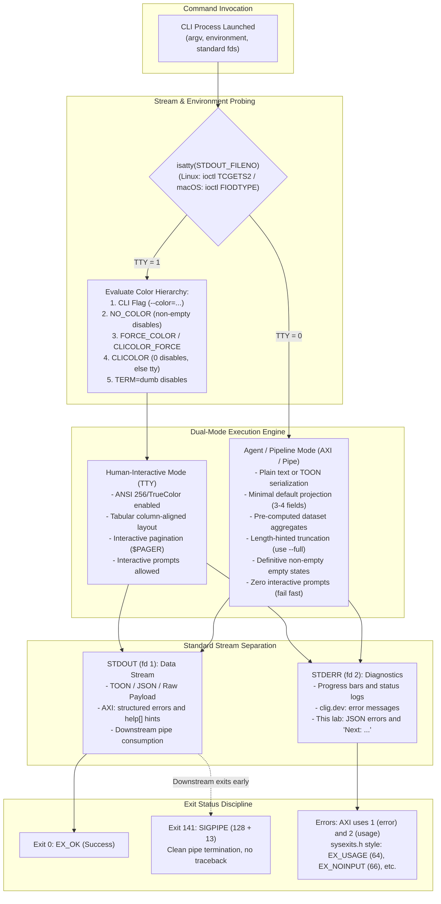

# CLI Design and Agent-Friendly Interfaces (AXI)

> [!summary] Claim:
> Production command-line interfaces require a dual-mode operational contract that adapts seamlessly between human-interactive terminals and autonomous AI agent execution loops.
> Traditional POSIX conventions govern standard stream separation (stdout for pipeline data, stderr for diagnostics), terminal detection via `isatty(3)`, `<sysexits.h>` exit code semantics, and clean `SIGPIPE` termination.
> The Agent eXperience Interface (AXI) paradigm extends these UNIX foundations with ten machine-centric principles: token-efficient TOON serialization, minimal default schemas, length-hinted content truncation, pre-computed aggregates, definitive empty states, structured non-interactive errors, ambient context, content-first defaults, contextual next-step disclosure, and concise subcommand help.
> Together, these standards prevent agent context exhaustion and silent retry loops; TOON alone is quoted at about 40% fewer tokens than equivalent JSON (axi.md; the TOON README benchmark reports 42.6%, as of 2026-11), and minimal schemas cut further.



## The Mechanism

Every command-line program operates within a process execution context established by the operating system kernel and its parent shell.
Understanding CLI interface design requires analyzing how file descriptors, terminal devices, environment variables, and signal handlers interact at the POSIX system call level.
When extending CLIs for autonomous AI agents, these low-level mechanisms dictate whether an LLM agent succeeds in parsing data or becomes paralyzed by context exhaustion, unhandled exceptions, and interactive prompt deadlocks.

### 1. The Classical POSIX and UNIX Stream Foundation

A POSIX process inherits three standard file descriptors from its parent process upon execution:
- `STDIN_FILENO` (fd 0): The standard input stream.
- `STDOUT_FILENO` (fd 1): The standard output stream.
- `STDERR_FILENO` (fd 2): The standard error stream.

The core rule codified by `clig.dev` and the GNU Coding Standards is strict stream separation.
The primary data payload of the utility belongs exclusively on `STDOUT_FILENO`.
Diagnostic output, progress bars, debug traces, and error notifications belong exclusively on `STDERR_FILENO`.

This separation is rooted in the architecture of kernel pipelines, as established in [[Pipelines-Subshells-Redirection-and-Process-Substitution]].
When a user or agent executes a command pipeline such as `tool1 | tool2`, the shell creates an anonymous pipe using the `pipe(2)` system call.
The shell replaces file descriptor 1 of `tool1` with the write end of the pipe, and replaces file descriptor 0 of `tool2` with the read end of the pipe.
Critically, file descriptor 2 (`STDERR_FILENO`) remains attached to the invoking terminal or log collector unless explicitly combined via `2>&1`.

If a tool violates this contract by writing informational logs (such as `Fetching resources...` or `[INFO] Initializing connection`) to `STDOUT_FILENO`, downstream parsers like `jq`, `awk`, or an LLM parser fail immediately.
The downstream tool attempts to parse the informational header as data, yielding syntax errors and broken pipelines.

#### Terminal Detection and Stdio Buffering

The behavior of the C standard I/O library (`stdio`) changes fundamentally depending on whether `STDOUT_FILENO` refers to an interactive terminal or a file/pipe.
POSIX defines the `isatty(3)` library function to query the underlying device:

```c
#include <unistd.h>
int isatty(int fd);
```

Under Linux glibc (`sysdeps/unix/sysv/linux/isatty.c`, glibc master as of 2026-11), `__isatty` executes `ioctl(fd, TCGETS2, &k_termios)` and returns whether it succeeded; the generic `sysdeps/posix/isatty.c` calls `tcgetattr` instead.
Under macOS Libc (`gen/FreeBSD/isatty.c`), `isatty` first asks `ioctl(fd, FIODTYPE, &type)` for the device type and compares it with `D_TTY`, falling back to `tcgetattr` only when that ioctl fails.
If the file descriptor references a terminal device (pty or tty), the probe succeeds and `isatty` returns 1.
If the descriptor references a pipe, regular file, or socket, the probe fails or reports a non-tty type, `errno` is set to `ENOTTY` (Inappropriate ioctl for device), and `isatty` returns 0.

This detection directly controls stream buffering modes in the C runtime (`setvbuf(3)`), as explored in [[Pipe-Buffering-and-Stdbuf]]:
- When `isatty(fileno(stdout))` is true, the runtime defaults to line buffering (`_IOLBF`), flushing bytes to the terminal upon encountering each newline character (`\n`).
- When `isatty(fileno(stdout))` is false (e.g. redirected to a pipe or agent capture harness), the runtime switches to block buffering (`_IOFBF`), buffering writes into an internal block buffer sized from the descriptor's `st_blksize`: 16,384 bytes for a pipe on macOS (measured on darwin-arm64: `fstat` reports `st_blksize` 16384 and a C `putchar` loop flushed in 16 KiB chunks, as of 2026-11); 4,096 bytes on Linux (measured on Ubuntu 24.04, aarch64, 4 KiB pages: `os.fstat` on a pipe reports `st_blksize` 4096, and a glibc `putchar` loop reached the reader in 4,096-byte chunks, as of 2026-11; the pipe `st_blksize` is the kernel page size).
- `stderr` is never fully buffered (ISO C), and glibc and macOS Libc leave it unbuffered (`_IONBF`) by default, so diagnostics reach the user or log immediately.

A dual-mode CLI leverages `isatty(STDOUT_FILENO)` to switch rendering engines automatically.
When connected to a human terminal, it renders padded ASCII columns, interactive pager prompts, and ANSI color highlights.
When connected to a pipe or an AI agent harness, it switches to unadorned, machine-readable serialization formats.

### 2. Process Exit Discipline and Status Code Semantics

The only deterministic signal of program success or failure returned to the calling shell or supervisor process is the 8-bit unsigned exit status.
When a process calls `exit(status)` or returns from `main()`, the kernel stores the low-order 8 bits (`status & 0xFF`) in the process table.
The parent process retrieves this byte via the `wait4(2)` or `waitpid(2)` system call.

POSIX and UNIX standards establish clear exit status bands:
- `0`: Complete success (`EXIT_SUCCESS` or `EX_OK`).
- `1`: Generic operational failure or general runtime exception.
- `2`: Misuse of shell built-in command or argument syntax error (POSIX / Bash convention).
- `64` through `78`: Standardized domain errors codified by BSD `<sysexits.h>`.
- `126`: Command found but not executable (permission denied, execve failed).
- `127`: Command not found in `PATH`.
- `128 + N`: Fatal termination by signal `N`.

The BSD `<sysexits.h>` header first appeared in 4BSD (FreeBSD `sysexits(3)` HISTORY; the macOS SDK copy carries a 1987, 1993 Regents copyright) and is mail-delivery flavored; the header's own `EX_TEMPFAIL` comment uses sendmail as its example (macOS SDK `sysexits.h`), and this note makes no claim about its original author or year.
It ships in the macOS SDK (`usr/include/sysexits.h`, values below confirmed against it) and in glibc (the Ubuntu 24.04 `libc6-dev` package ships `/usr/include/sysexits.h`, confirmed with `dpkg -S`, as of 2026-11).
FreeBSD's man page now states that "this interface has been deprecated and is retained only for compatibility" and that "its use is discouraged" (as of 2026-11), and AXI itself specifies only 0, 1, and 2; treat the codes as an optional richer vocabulary, not a standard every tool follows.
It provides fine-grained exit semantics:

| Symbolic Constant | Numeric Code | Semantic Meaning | Recommended Agent Action |
| :--- | :--- | :--- | :--- |
| `EX_OK` | 0 | Successful termination | Proceed to next step |
| `EX_USAGE` | 64 | Command line syntax error or invalid flag | Correct command arguments; do not retry identical command |
| `EX_DATAERR` | 65 | Input data in invalid format or corrupt | Validate or re-encode payload |
| `EX_NOINPUT` | 66 | Input file or target resource not found | Verify identifier or check prerequisites |
| `EX_UNAVAILABLE` | 69 | Service, subsystem, or API unavailable | Back off and retry with exponential jitter |
| `EX_SOFTWARE` | 70 | Internal logic error or unhandled assertion | File bug report or trigger fallback worker |
| `EX_OSERR` | 71 | System error (e.g. cannot fork, pipe table full) | Halt execution and alert infrastructure operator |
| `EX_CANTCREAT` | 73 | Cannot create specified output file or resource | Check permissions and path existence |
| `EX_TEMPFAIL` | 75 | Temporary failure (retry is recommended) | Safe to retry immediately or after short delay |
| `EX_NOPERM` | 77 | Permission denied or unauthorized operation | Escalate credentials or report access violation |
| `EX_CONFIG` | 78 | Configuration file error or missing parameter | Inspect and repair configuration files |

Autonomous agents depend critically on `<sysexits.h>` distinction.
If a CLI collapses every error into exit code `1`, an agent cannot distinguish between a transient network timeout (`EX_TEMPFAIL` 75), a missing configuration (`EX_CONFIG` 78), and an invalid CLI flag (`EX_USAGE` 64).
This forces the agent to inspect unstructured English error messages, introducing brittle regex matching and non-deterministic recovery paths.

### 3. Signal Delivery and Pipeline Interruption

When a CLI tool generates streaming data into a downstream utility that terminates early (such as `mytool list | head -n 5`), kernel signal delivery semantics govern process termination.
After `head` consumes five lines from the pipe, it calls `exit(0)` and closes its read file descriptor.
The pipe's reader reference count drops to zero in the kernel.

When `mytool` next calls `write(2)` on that pipe, the kernel detects that no read end exists.
The kernel immediately delivers the `SIGPIPE` signal (signal 13) to `mytool`.
By default in POSIX systems, `SIGPIPE` causes abnormal process termination without generating a core dump.
The process terminates with exit status `128 + 13 = 141`.

However, higher-level runtime environments alter this behavior:
- In CPython, the interpreter installs `SIG_IGN` for `SIGPIPE` at startup "so write errors on pipes and sockets can be reported as ordinary Python exceptions" (`signal` docs).
  When Python writes to a closed pipe, the kernel `write(2)` syscall fails and returns `-1` with `errno = EPIPE` (Broken pipe).
  The Python I/O subsystem converts `EPIPE` into a `BrokenPipeError` exception.
  If the application fails to catch it, Python prints a traceback to `sys.stderr`; the shutdown flush of the still-buffered `sys.stdout` then fails too (`Exception ignored while flushing sys.stdout`), and the exit status becomes `120` (`sys.exit` docs, changed in 3.6; measured on CPython 3.15.2, darwin-arm64, as of 2026-11).
- In Go, a write to a broken pipe on fd 1 or 2 makes the program exit with `SIGPIPE`; on any other descriptor the write fails with `syscall.EPIPE` (`os/signal` docs).
- In Rust, `std::io::Write` methods return an `Err(std::io::ErrorKind::BrokenPipe)` instead of terminating.

Emitting a stack trace to `stderr` and exiting non-zero on a broken pipe is an egregious CLI bug.
It breaks automated shell scripts running under `set -e` and corrupts agent error telemetry.
Production CLI tools either restore `SIGPIPE` to `SIG_DFL` (the shell then reports `141`) or catch `EPIPE`, redirect stdout to `/dev/null`, and exit quietly.
The Python docs recommend the second form (they exit `1`) and warn against `SIG_DFL` in programs that also write to sockets, because an interrupted connection would then kill the process.

### 4. Color and Terminal Capability Precedence

Modern command-line tools support ANSI escape sequences for text styling, bold emphasis, and 24-bit TrueColor.
However, uncontrolled escape sequences injected into pipes corrupt data parsing in tools like `grep`, `sed`, and LLM context windows.
An LLM ingesting `\033[32mhealthy\033[0m` reads 9 extra escape bytes around a 7-byte word, and an exact-match `grep -x healthy` no longer matches the line.

There is no single industry-wide precedence; the order below is the one the `clicolors` standard (bixense.com) and this note's lab use.
Node.js inverts the top of it: when `FORCE_COLOR` is set to a supported value, "both the `NO_COLOR`, and `NODE_DISABLE_COLORS` environment variables are ignored" (Node.js v26 CLI docs, as of 2026-11).

```text
Precedence Evaluation (Highest to Lowest):
1. Command Line Flag: --color=always | --color=never | --color=auto
2. NO_COLOR Environment Variable: If set and non-empty (len > 0), DISABLE color
3. FORCE_COLOR or CLICOLOR_FORCE: If set and != "0", ENABLE color
4. CLICOLOR Environment Variable: If == "0", DISABLE; if != "0", ENABLE only if isatty()
5. TERM Environment Variable: If TERM == "dumb", DISABLE color
6. Standard Stream Fallback: ENABLE only if isatty(STDOUT_FILENO) is true
```

The `NO_COLOR` standard at `no-color.org` was proposed in 2017 and is informal: it uses "should", not MUST.
Its core sentence: software that adds ANSI color by default "should check for a NO_COLOR environment variable that, when present and not an empty string (regardless of its value), prevents the addition of ANSI color."
It also says "user-level configuration files and per-instance command-line arguments should override" `NO_COLOR`, which is why a `--color=always` flag sits above it.
The `clicolors` standard gives `NO_COLOR` priority over `CLICOLOR_FORCE` and over `FORCE_COLOR` treated as its alias; Node.js, as noted, does the opposite.

### 5. The Agent eXperience Interface (AXI) Paradigm

Command-line interfaces designed between 1975 and 2020 were optimized for two distinct consumers:
1. Interactive human operators viewing an 80-column to 120-column terminal window.
2. Rigid POSIX shell scripts performing text processing with `grep`, `awk`, and `cut`.

Autonomous AI agents (such as LLM coding agents operating in autonomous loops) represent an entirely new class of CLI consumer with radically different operational economics:
- **Token Budget Constraints:** An agent pays monetary costs and context window capacity for every token emitted by a CLI tool.
  Dumping 500 lines of JSON containing 40 fields per item consumes far more context than the same rows projected to a few fields (see Question 7 for measured byte counts), rapidly pushing the agent toward context compaction or truncation boundaries.
- **Round-Trip Latency:** Every extra call costs a full inference turn (the AXI GitHub benchmark averages 15.7 to 34.2 seconds per task across conditions, axi.md, as of 2026-11).
  If a CLI requires four separate queries to discover counts, filter items, and inspect status, the workflow suffers severe latency degradation.
- **Vulnerability to Interactive Prompts:** An agent operates with a redirected or non-interactive standard input stream.
  If a CLI stops execution to prompt `Are you sure you want to proceed? [y/N]`, the agent subshell blocks indefinitely until hitting a harness timeout.
- **Susceptibility to Hallucination from Ambiguity:** If a tool returns an empty standard output (0 bytes) upon finding no records, the agent cannot distinguish whether the search succeeded with zero results, the tool silently crashed, or output redirection swallowed the payload.

The Agent eXperience Interface (AXI) standards, published by Kun Chen at `axi.md` with the full text in the `kunchenguid/axi` skill, formalize ten design principles to solve these operational bottlenecks (as of 2026-11).


### 6. The 10 Principles of an Agent-Friendly CLI

Every toolchain utility designed for agent environments must adhere to these ten principles:

#### Principle 1: Token-Efficient Output (TOON Serialization)
JSON is universally supported by applications but deeply inefficient for LLMs due to repeated dictionary keys, quotation marks, and curly braces across every record.
For uniform arrays of data objects, the tool must format output using Token-Oriented Object Notation (TOON) or clean columnar tables when stdout is not a TTY.
TOON replaces repetitive object syntax with a single schema header declaring row counts and column names, followed by comma-delimited data rows.
AXI quotes "approximately 40% token savings over equivalent JSON"; the TOON README benchmark reports 42.6% fewer tokens than formatted JSON overall and 58.7% on flat data, but 1.6% more than compact JSON on mixed structures, and notes that "for deeply nested or non-uniform data, JSON may be more efficient" (as of 2026-11).

#### Principle 2: Minimal Default Schemas
When listing resources (such as tasks, git commits, or cloud instances), the default query must project only 3 to 4 essential identifying fields (e.g. `id`, `title`, `status`, `priority`).
Secondary fields (such as user avatars, timestamps, raw URLs, and metadata blobs) must be omitted from list views.
Comprehensive fields are revealed only when querying an individual item via `show <id>` or passing an explicit projection flag (`--full` or `--fields=...`).

#### Principle 3: Content Truncation with Size Hints
Multi-line text fields (such as git commit bodies, issue descriptions, stack traces, and diffs) must be truncated at a configurable boundary; the AXI skill suggests 500 to 1,500 characters for detail views, while this note's lab uses 1 line or 60 characters to keep its output short.
Crucially, truncation must never be silent.
The tool must append an explicit, machine-readable size hint indicating exactly what was omitted and how to retrieve it:
`[truncated 4 lines; use --full to view all 5 lines]`.
This gives the agent immediate awareness of hidden data and the exact flag needed to retrieve it.

#### Principle 4: Pre-Computed Aggregates
Autonomous agents frequently require summary statistics to decide next steps (e.g. determining if any tests failed or how many tasks remain open).
Without aggregates, an agent must fetch every record and compute counts in its own context window, wasting turns and tokens.
A command listing resources must emit a compact aggregate summary header, such as AXI's `count: 30 of 847 total` or the lab's `summary(total:3,open:2,closed:1)` (a lab convention, not TOON syntax).
The agent parses the aggregate in a single turn without traversing pagination.

#### Principle 5: Definitive Empty States
When a query returns zero matching records, a traditional UNIX utility exits with status 0 and emits 0 bytes on stdout.
In an autonomous agent loop, 0 bytes creates catastrophic ambiguity: did the tool succeed, did it fail silently, or was the filter malformed?
An AXI tool must emit an explicit, deterministic confirmation string, such as the AXI example `tasks: 0 closed tasks found in this repository`.
The lab prints `tasks: []` followed by `result: 0 tasks matching filter status=closed`: TOON spec v4.4 encodes an empty array as `key: []` and encoders "MUST NOT" emit the legacy `key[0]:` form, so the confirmation is a separate key rather than text after a `[0]` header.
This definitive confirmation halts unnecessary agent retries immediately.

#### Principle 6: Structured Errors and Standard Exit Codes
Interactive confirmation prompts (such as `Do you want to proceed? [y/N]`) must never be displayed in non-interactive mode.
If an operation requires user confirmation or a mandatory flag is missing, the tool must fail immediately with a usage error.
AXI specifies exit `0` for success (including no-ops), `1` for errors, and `2` for usage errors and unknown flags; a tool built on `<sysexits.h>`, like this note's lab, uses `EX_USAGE` (64) and its neighbours instead.
Mutations must be idempotent: AXI makes the no-op path the default (closing an already closed item exits `0`), and flags such as `--ignore-missing` or `--if-not-exists` are one way to express it.
AXI writes errors "to stdout (not stderr)" in the same structured format as normal output, with an actionable suggestion, and rejects unknown flags by name.
clig.dev instead sends error messages to `stderr`; the lab follows clig.dev and writes a JSON object with an error code, message, and exit status to `stderr`:
`{"error":"ERR_NOT_FOUND","message":"Task 999 not found","exit_code":66}`.

#### Principle 7: Ambient Context
Agents require immediate awareness of workspace context upon entering a session (such as active branch, pending tasks, or quota runway).
AXI's pattern is an explicit, idempotent setup command that installs a session-start hook (Claude Code, Codex, and OpenCode by default), which runs the tool and injects a compact, directory-scoped dashboard; an installable skill is the secondary path.

#### Principle 8: Content-First Execution
Executing a CLI command without arguments traditionally dumps help documentation: `gh` and `kubectl` print 72 lines and `docker` 101 lines (measured locally on darwin-arm64, as of 2026-11).
In an agent context, this help dump consumes context capacity when the agent merely wanted to inspect active state.
Running an AXI tool with no arguments must execute its primary read operation (e.g. listing active tasks or workspace status).
Documentation is reserved for explicit `--help` flags.

#### Principle 9: Contextual Disclosure
Following list and mutation output, AXI appends a few concrete next-step `help[]` lines to stdout, with placeholders such as `<id>` for runtime values, and omits them when the output is self-contained.
The lab writes its hint to `stderr` instead, to demonstrate stream separation:
`Next: run 'tool show 4' to inspect or 'tool close 4' to complete`.
AXI notes that agents do not read `stderr`, so a production AXI tool keeps the hint on stdout.
This contextual suggestion guides the agent's planning loop without requiring a separate help lookup.

#### Principle 10: Consistent and Concise Help
Every subcommand must support `--help` with a concise, complete reference: flags with defaults, required arguments, and 2-3 usage examples, scoped to the requested subcommand (AXI skill).
AXI sets no line budget; the 40-line ceiling used in this note's governance checks is a house rule.
AXI also asks the no-argument home view to print the executable path and a one-sentence description, and `-v`, `-V`, and `--version` to print the bare version and exit `0`.

### 7. Token-Oriented Object Notation (TOON)

TOON is an open-source data serialization format hosted under `github.com/toon-format/spec` (spec v4.4, Working Draft, 2026-10-08, as of 2026-11).
It was designed specifically as an alternative to JSON for passing structured data into LLM prompt contexts, and its README says it "excels with arrays of uniform objects".

#### TOON Grammar and Structural Rules

TOON combines YAML-style indentation for key-value maps with CSV-style tabular layouts for uniform arrays:
1. **Maps and Key-Value Pairs:** Represented using indentation (2 spaces per level by default; tabs are forbidden) without outer braces, and with strings left unquoted unless they need quoting:
   ```yaml
   task:
     id: 1
     title: Audit SSH bastion host configs
     status: open
   ```
2. **Uniform Arrays:** Represented with an explicit array declaration specifying the collection name, item count `[N]`, and field schema `{col1,col2,...}`:
   ```yaml
   tasks[3]{id,title,status,priority}:
     1,Audit SSH bastion host configs,open,high
     2,Migrate pipeline to Nix flakes,open,medium
     3,Fix broken pipe in log exporter,closed,low
   ```
3. **Escaping and Delimiters:** Commas separate fields by default; a header can switch the row delimiter to tab or pipe (`[N|]{a|b}`).
   A string that contains the active delimiter, a colon, a double quote, a backslash, brackets, braces, or control characters must be double-quoted, and the only valid escapes are `\\`, `\"`, `\n`, `\r`, `\t`, and `\uXXXX`; decoders reject anything else, so `\,` is invalid.
   Newlines inside a value are written as `\n` in a quoted string; TOON has no YAML-style `|` block scalar.
   The lab follows both rules: a title such as `Fix, then ship: "v2"` is written as a quoted, escaped scalar (phase 10), and `show --full` prints the description as one quoted string with `\n` escapes.
4. **Length Invariants:** The `[N]` bracket syntax acts as an explicit guardrail.
   A strict-mode decoder must error when the number of rows differs from `N`, which detects truncated responses or incomplete stream generation.

## Commands and Numbers to Know

The following reference metrics, environment variables, exit codes, and operational parameters govern production CLI and AXI implementations:

| Constant or Variable | Standard Value or Range | Platform | Standard or Authority | Operational Purpose |
| :--- | :--- | :--- | :--- | :--- |
| `STDIN_FILENO` | `0` | Both | POSIX.1-2024 `unistd.h` | Standard input file descriptor |
| `STDOUT_FILENO` | `1` | Both | POSIX.1-2024 `unistd.h` | Standard output data file descriptor |
| `STDERR_FILENO` | `2` | Both | POSIX.1-2024 `unistd.h` | Standard error diagnostic descriptor |
| `EX_OK` | `0` | Both | BSD `<sysexits.h>` | Successful command termination |
| `EX_USAGE` | `64` | Both | BSD `<sysexits.h>` | Command line syntax or argument error |
| `EX_DATAERR` | `65` | Both | BSD `<sysexits.h>` | Input data format or syntax error |
| `EX_NOINPUT` | `66` | Both | BSD `<sysexits.h>` | Resource or input file missing |
| `EX_TEMPFAIL` | `75` | Both | BSD `<sysexits.h>` | Temporary failure; safe for agent retry |
| `SIGPIPE` Exit Status | `141` (`128 + 13`) | Both | Shell `$?` convention (POSIX requires only > 128) | Process terminated by broken pipe signal |
| `SIGINT` Exit Status | `130` (`128 + 2`) | Both | Shell `$?` convention (POSIX requires only > 128) | Process interrupted via keyboard / supervisor |
| CPython unflushable stdout at exit | `120` | Both | `sys.exit` docs (since 3.6, as of 2026-11) | Exit status after an uncaught `BrokenPipeError` |
| `NO_COLOR` | Any non-empty string | Both | `no-color.org` (as of 2026-11) | Disables ANSI text styling; flags and config may override |
| `FORCE_COLOR` | `1`, `true`, `''`, `2`, `3` | Both | Node.js CLI docs (as of 2026-11) | Forces color; in Node.js it overrides `NO_COLOR` |
| `CLICOLOR_FORCE` | Any non-empty value | Both | bixense `clicolors`; macOS `ls(1)` (as of 2026-11) | Forces color when not a TTY, unless `NO_COLOR` is set |
| `CLICOLOR` | `0` or non-empty | Both | bixense `clicolors`; macOS `ls(1)` (as of 2026-11) | `0` disables (clicolors); otherwise color only on a TTY |
| Stdio Buffer (TTY) | Line-buffered (`_IOLBF`) | Both | Implementation practice (ISO C forbids only full buffering) | Flushes output on each newline byte |
| Stdio Buffer (Pipe) | Block-buffered (`_IOFBF`), 16,384 B macOS (measured); 4,096 B Linux (measured, 4 KiB pages) | Both | `st_blksize` of the pipe (as of 2026-11) | Accumulates data until buffer boundary |
| Default AXI Schema Width | 3-4 fields | Both | AXI skill (as of 2026-11) | Minimal projection for list commands |
| AXI exit codes | `0` success or no-op, `1` error, `2` usage or unknown flag | Both | axi.md and AXI skill (as of 2026-11) | Distinct from the `<sysexits.h>` 64-78 range |
| Default Help Budget | Concise per-subcommand reference with 2-3 examples (no line limit) | Both | AXI skill (as of 2026-11) | Token-efficient command documentation |

## Multi-Language Comparison: C++ / Python / Rust

The following comparative table illustrates how low-level stream management, terminal capability probing, and signal mechanics are implemented across modern systems languages:

| Architectural Concern | Modern C++ (C++20 / C++23) | Python 3 (3.11 - 3.15) | Modern Rust (1.70+) |
| :--- | :--- | :--- | :--- |
| **Standard Stream Routing** | `std::cout << data;`<br/>`std::cerr << diag;` | `sys.stdout.write(data)`<br/>`sys.stderr.write(diag)` | `io::stdout().write_all(d);`<br/>`io::stderr().write_all(e);` |
| **Terminal Detection** | `::isatty(fileno(stdout))` (POSIX)<br/>or `ioctl(1, TIOCGWINSZ, ...)` | `sys.stdout.isatty()`<br/>or `os.isatty(sys.stdout.fileno())` | `use std::io::IsTerminal;`<br/>`std::io::stdout().is_terminal()`<br/>(Stabilized in Rust 1.70.0) |
| **NO_COLOR Evaluation** | `const char* nc = std::getenv("NO_COLOR");`<br/>`bool no_col = (nc && nc[0] != '\0');` | `nc = os.environ.get("NO_COLOR")`<br/>`no_col = bool(nc and len(nc) > 0)` | `env::var("NO_COLOR")`<br/>`.map(\|v\| !v.is_empty()).unwrap_or(false)` |
| **SIGPIPE Recovery** | `std::signal(SIGPIPE, SIG_DFL);`<br/>Restores default OS termination | `signal.signal(signal.SIGPIPE, signal.SIG_DFL)`<br/>Prevents unhandled `BrokenPipeError`; the docs prefer `except BrokenPipeError` plus `os.dup2` to `/dev/null` | Reset signal via `libc::signal(libc::SIGPIPE, libc::SIG_DFL);` or match `ErrorKind::BrokenPipe` |
| **Exit Code Dispatch** | `#include <sysexits.h>`<br/>`std::exit(EX_USAGE);` | `import os`<br/>`sys.exit(64) # EX_USAGE` | `std::process::exit(64);`<br/>or custom `Termination` enum |
| **Structured Serialization** | Compile-time `std::format` / `nlohmann::json` / custom TOON encoder | Built-in `json.dumps()` or custom string joiner for TOON | `serde_json` or custom struct formatter emitting TOON |

## Worked Lab Example

The companion lab located at `code/01-Command-Line/axi_cli_tool/` provides a complete, runnable reference implementation of a dual-mode CLI tool (`axi_task.py`) and an automated verification test suite (`run.sh`).
It demonstrates principles 1 to 6, 8, 9, and 10 alongside classical POSIX stream, signal, and color mechanics; it has no session hook, so principle 7 is out of scope for the lab.
It follows clig.dev and `<sysexits.h>` where AXI differs: errors and hints go to `stderr`, and usage errors exit 64 rather than AXI's 2.

To run the lab and verify execution:

```bash
cd code
python3 -m _harness.verify 01-Command-Line/axi_cli_tool/
```

The script `run.sh` points the tool at a JSON file in a fresh temporary directory and systematically executes eleven verification phases:
1. **Content-First Default Execution:** Proves that invoking `axi_task.py` with no arguments prints the same task list as `list` and contains no help text.
2. **Minimal Default Schema and Aggregates:** Emits the pre-computed summary header `summary(total:3,open:2,closed:1)`, checks that the `tasks[N]` count matches the rows, that each row has four fields, and that `description` is absent.
3. **Content Truncation and Escape Hatch:** Truncates long task descriptions with an explicit size hint, then displays the complete body as one quoted TOON string when `--full` is supplied.
4. **Definitive Empty State:** Proves that querying a closed task filter when no closed tasks exist returns `tasks: []` plus `result: 0 tasks matching filter status=closed` rather than silent empty output.
5. **Structured Errors and Exit Codes:** Triggers `EX_USAGE` (64) on a missing flag and on an unknown flag, and `EX_NOINPUT` (66) on a missing ID, emitting structured JSON errors to `stderr`; an `--ignore-missing` delete exits 0.
6. **Contextual Disclosure and Stream Separation:** Validates that primary data is emitted to `stdout` while diagnostic next steps (`Next: run 'axi-task show 3' ...`) are written to `stderr`.
7. **Color Hierarchy Precedence:** Runs five cases in a minimal environment: no variables, `FORCE_COLOR=1`, `NO_COLOR=1` alone, both variables (the lab's policy: `NO_COLOR` wins), and `NO_COLOR=1` with `--color=always` (the flag wins).
8. **Payload Size, Projection vs Format:** Reports five byte counts and separates the effect of projecting to four fields (principle 2) from the effect of the format (principle 1); it counts bytes, not tokens.
9. **SIGPIPE Smoke Test:** Pipes a 6,000-task list (over 64 KiB, larger than a Linux pipe buffer) into `head -n 1` and asserts the tool is killed by signal 13 (`returncode == -13`) with no `BrokenPipeError` on `stderr`; a control run with the `SIG_DFL` line neutralized must exit 1 or 120 and print `BrokenPipeError`.
10. **TOON Quoting:** Creates a task titled `Fix, then ship: "v2"` and checks that its list row quotes and escapes the title.
11. **Help:** Checks that `--help` exits 0, writes to `stdout` only, stays short, and includes examples.

The exact execution output recorded on macOS (`darwin-arm64`) is reproduced below:

```text
=== 1. Content-First Default (Principle 8) ===
summary(total:3,open:2,closed:1)
tasks[3]{id,title,status,priority}:
  1,Audit SSH bastion host configs,open,high
  2,Migrate pipeline to Nix flakes,open,medium
  3,Fix broken pipe in log exporter,closed,low
no-args output equals 'list': True
no-args output contains help text: False

=== 2. Minimal Default Schema & Aggregates (Principles 1, 2, 4) ===
summary(total:3,open:2,closed:1)
tasks[3]{id,title,status,priority}:
row count matches tasks[N]: True
fields per list row: 4
description in list output: False

=== 3. Content Truncation & --full Escape Hatch (Principle 3) ===
--- Default Truncated View ---
task:
  id: 1
  title: Audit SSH bastion host configs
  status: open
  priority: high
  description: "Perform comprehensive audit of /etc/ssh/sshd_config across f [truncated 4 lines; use --full to view all 5 lines]"
--- Full Untruncated View ---
task:
  id: 1
  title: Audit SSH bastion host configs
  status: open
  priority: high
  description: "Perform comprehensive audit of /etc/ssh/sshd_config across fleet.\nEnforce HostKeyAlgorithms and KexAlgorithms per security policy.\nDisable interactive password authentication and root login.\nEnsure AuthorizedKeysCommand verifies cryptographic certificates.\nDeploy automated verification probes across all staging zones."

=== 4. Definitive Empty State (Principle 5) ===
summary(total:3,open:2,closed:1)
tasks[1]{id,title,status,priority}:
  3,Fix broken pipe in log exporter,closed,low
summary(total:2,open:2,closed:0)
tasks: []
result: 0 tasks matching filter status=closed

=== 5. Structured Errors and Standard Exit Codes (Principle 6) ===
--- Missing Required Flag (EX_USAGE = 64) ---
{"error":"ERR_MISSING_REQUIRED_FIELD","message":"Missing required flag: --title","exit_code":64}
exit_status: 64
--- Unknown Flag Rejected By Name (EX_USAGE = 64) ---
{"error":"ERR_UNKNOWN_FLAG","message":"Unrecognized option: --bogus","exit_code":64}
exit_status: 64
--- Non-Existent Resource (EX_NOINPUT = 66) ---
{"error":"ERR_NOT_FOUND","message":"Task 999 not found","exit_code":66}
exit_status: 66
--- Idempotent Deletion (Success = 0) ---
deleted: task:999
exit_status: 0

=== 6. Contextual Disclosure & Stream Separation (Principle 9 & Streams) ===
stdout (data):
created: task:3
stderr (diagnostics & guidance):
Next: run 'axi-task show 3' to inspect or 'axi-task close 3' to complete

=== 7. Color Precedence (NO_COLOR vs FORCE_COLOR) ===
piped, no variables: ANSI escapes: False
FORCE_COLOR=1: ANSI escapes: True
NO_COLOR=1 alone: ANSI escapes: False
FORCE_COLOR=1 and NO_COLOR=1 (this lab: NO_COLOR wins): ANSI escapes: False
NO_COLOR=1 and --color=always (flag wins): ANSI escapes: True

=== 8. Payload Size: Projection vs Format (Principles 1 and 2) ===
JSON, all fields, indented: 981 bytes
JSON, 4 fields, indented: 456 bytes
JSON, 4 fields, compact: 297 bytes
TOON, 4 fields: 195 bytes
Projection alone (all fields -> 4 fields, indented JSON): 53.5%
Format alone (4-field indented JSON -> TOON): 57.2%
Format alone (4-field compact JSON -> TOON): 34.3%

=== 9. SIGPIPE Pipeline Resilience ===
list output exceeds 64 KiB: True
pipeline head received: summary(total:6000,open:6000,closed:0)
tool killed by SIGPIPE (returncode == -13): True
no BrokenPipeError on stderr: True
control without SIG_DFL exits 1 or 120: True
control without SIG_DFL prints BrokenPipeError: True

=== 10. TOON Quoting of Delimiters, Colons, and Quotes ===
  4,"Fix, then ship: \"v2\"",open,medium

=== 11. Help Is Explicit and Concise (Principle 10) ===
exit_status: 0
help on stdout: True
help stderr empty: True
help lines: 27
help has examples: True
```

In phase 8, the full indented JSON (every field, including `description`) is 981 bytes and the TOON list is 195 bytes, but the two payloads do not carry the same data.
Projecting the JSON to the same four fields cuts it to 456 bytes (53.5%), and TOON then saves a further 57.2% against that indented JSON but only 34.3% against compact JSON (297 bytes).
So most of the headline 80.1% comes from principle 2, and the format-only saving depends on which JSON you compare with (bytes, `darwin-arm64`, as of 2026-11).
In phase 9, the 6,000-task list is the smallest that makes the mechanism observable: with the roughly 200-byte default list the tool exits before `head` closes the pipe, and no SIGPIPE can occur.

## Pitfalls

> [!warning] Pitfalls:
> 
> 1. **Polluting `STDOUT_FILENO` with Informational Messages:**
>    Writing initialization notices (`Connecting to host...`), progress spinners, or human success summaries (`Done!`) to stdout breaks downstream pipelines.
>    Any program piping into `jq`, `tr`, or an LLM parser will ingest the diagnostic string as data, failing with syntax errors.
>    Diagnostics, progress indicators, and telemetry must route strictly to `STDERR_FILENO`.
> 
> 2. **Defaulting to Unhandled `SIGPIPE` in High-Level Runtimes:**
>    Runtimes such as Python ignore `SIGPIPE` and raise `BrokenPipeError` from the failed write.
>    When an automated pipeline executes `tool | head -n 1` on output larger than the stdout buffer, the downstream tool exits, the next write throws an unhandled exception traceback to `stderr`, and CPython exits with status 120 once the shutdown flush also fails (status 1 if it does not).
>    This triggers false alarms in monitoring harnesses and halts shell scripts running under `set -e`.
>    Catch the broken pipe exception, redirect stdout to `/dev/null`, and exit quietly (the Python docs' pattern), or restore `SIG_DFL` in a tool that writes no sockets so the shell reports 141.
> 
> 3. **The Silent Empty-State Trap:**
>    Returning an empty 0-byte output when a search query or filter returns zero records causes autonomous agents to hallucinate.
>    The agent cannot verify whether the query executed successfully or failed silently, triggering repeated redundant retries.
>    Always emit a definitive empty-state confirmation: `0 results matching query`.
> 
> 4. **Blocking Non-Interactive Agent Loops with Interactive Prompts:**
>    Prompting `Are you sure you want to delete this resource? (y/n)` when standard input is not a terminal halts automated workflows indefinitely until a timeout occurs.
>    Commands must either accept `--yes` / `--force`, require non-interactive flags, or fail fast with a usage error (`2` in AXI, `EX_USAGE` 64 in a sysexits-based tool).
> 
> 5. **Unprojected Monolithic Data Dumps:**
>    Dumping complete API payloads containing dozens of unused metadata keys (such as node IDs, gravatar URLs, and raw timestamps) blows past agent context budgets.
>    A tool listing items must emit a projected minimal schema by default, reserving full objects for explicit item lookups.
> 
> 6. **ANSI Color Pollution in Pipelines:**
>    Injecting raw ANSI terminal escape sequences (`\033[31m`) into piped streams corrupts automated text search tools (`grep`, `awk`) and inflates LLM token usage.
>    Tools must verify `isatty(STDOUT_FILENO)` and honor `NO_COLOR` before injecting escape codes.

## At Scale

At the scale of an enterprise engineering organization (1,000 to 50,000 developers and autonomous agent fleets), CLI design decisions directly impact infrastructure costs, system reliability, and developer velocity.

### Autonomous Agent Fleet Economics

Consider an organization deploying autonomous coding agents across 2,000 repositories, executing an aggregate of 500,000 tool invocations daily (every input in this model is an illustrative assumption, not a measurement; the arithmetic is checked).
If internal tools return standard verbose JSON payloads averaging 1,200 tokens per invocation, the fleet ingests:
$$500{,}000 \times 1{,}200 = 600{,}000{,}000 \text{ prompt tokens daily}$$
At an enterprise inference rate of $2.50 per million tokens, raw JSON CLI output costs $1,500 daily ($547,500 annually) purely in formatting overhead.

By enforcing AXI Principle 1 (TOON serialization) and Principle 2 (minimal default schemas), payload sizes drop from 1,200 tokens to 240 tokens (an assumed 80% reduction; TOON alone benchmarks near 40%, so the rest must come from projection):
$$500{,}000 \times 240 = 120{,}000{,}000 \text{ prompt tokens daily}$$
This reduces daily prompt costs to $300 ($109,500 annually), realizing direct savings of $438,000 per year while simultaneously preventing agents from reaching context compaction limits.

### Organizational Governance and Automated Linting

To maintain CLI interface discipline across thousands of internal microservices and developer tools, engineering organizations must enforce automated interface contracts in CI:

1. **The CLI Contract Test Suite:**
   Every internal utility must run an automated compliance harness verifying:
   - `tool --help` emits under 40 physical lines and exits with code 0.
   - `tool` (no arguments) exits cleanly and displays live status or recent items (content-first).
   - Piping `tool list | head -n 1` exits with code 141 (or 0) without emitting a stack trace to stderr.
   - Setting `NO_COLOR=1` strips 100% of ANSI escape characters from stdout and stderr.
   - Executing invalid syntax triggers the organization's chosen usage code (`2` per AXI, or 64 `EX_USAGE`) with a structured error on the agreed stream (stdout per AXI).
   - Querying a non-existent item triggers exit code 66 (`EX_NOINPUT`).
2. **Paved-Road Framework Templates:**
   Rather than building CLI argument parsers from scratch, teams must use blessed organizational libraries (such as Go Cobra or Rust Clap) wrapped with standardized AXI middleware.
   The middleware automatically binds `isatty`, intercepts `SIGPIPE`, registers `--format=toon`, and enforces `<sysexits.h>` exit code mappings across all binaries.

### Decision Rules: When to Build Dual-Mode Interfaces

```text
Decision Matrix for CLI Interface Architecture:
IF the tool is an ephemeral single-user script (< 100 lines, run only manually):
  -> Use standard POSIX shell conventions with ShellCheck validation.
  -> Rely on standard stdout / stderr printing.
IF the tool is consumed by both human engineers and automated CI / AI agent harnesses:
  -> Implement Dual-Mode CLI architecture.
  -> Check isatty(1) on startup to toggle human tables vs TOON serialization.
  -> Enforce <sysexits.h> status codes and strict non-interactive error schemas.
IF the tool generates large streaming collections (> 1,000 records):
  -> Default to minimal projected schemas (3-4 fields).
  -> Implement length-hinted content truncation.
  -> Add pre-computed aggregate headers to eliminate pagination round trips.
```

## Practice Drill

> [!tip] Practice Drill: Dual-Mode CLI Hardening
> 
> Build a dual-mode log query utility named `axi-log` in Python, Rust, or C++ that demonstrates complete stream separation and AXI compliance:
> 
> 1. **Implement Dual-Mode Stream Formatting:**
>    - When `stdout` is connected to a TTY (`isatty == true`), format log entries as colorized ASCII rows: `TIMESTAMP [LEVEL] MESSAGE`.
>    - When `stdout` is a pipe (`isatty == false`), format output in TOON format:
>      ```yaml
>      summary(total:N,errors:E,warnings:W)
>      logs[N]{timestamp,level,message}:
>        2026-11-07T03:00:00Z,ERROR,Database connection timeout
>      ```
> 2. **Add Environment Precedence:**
>    - Ensure `NO_COLOR=1` disables color unless `--color=always` is passed (no-color.org lets command-line arguments override it).
>    - Ensure `FORCE_COLOR=1` enables ANSI codes when piped, unless `NO_COLOR` is present.
> 3. **Harden Against SIGPIPE:**
>    - Test the pipeline: `./axi-log stream | head -n 2`.
>    - Confirm that `./axi-log` terminates cleanly with status 141 and prints zero tracebacks to `stderr`.
> 4. **Validate Exit Codes:**
>    - Running `./axi-log query --level=INVALID` must exit with code 65 (`EX_DATAERR`).
>    - Running `./axi-log query --missing-flag` must exit with code 64 (`EX_USAGE`).
>    - Running `./axi-log query --level=FATAL` when no fatal logs exist must output `logs: []` and `result: 0 logs matching filter level=FATAL` and exit with code 0.

## Interview Questions

### L5: Foundational Stream and Terminal Mechanics

#### Question 1: Stream Separation and Downstream Pipelines
Why must diagnostic progress bars, connection logs, and status updates never be written to `STDOUT_FILENO` in a command-line tool?
Explain the exact failure mode that occurs in a downstream pipeline when this rule is violated.

> [!success]- Answer
> In POSIX systems, pipelines created via `cmd1 | cmd2` connect `STDOUT_FILENO` (fd 1) of `cmd1` directly to `STDIN_FILENO` (fd 0) of `cmd2` via a kernel pipe buffer.
> `STDERR_FILENO` (fd 2) remains unredirected and connects directly to the terminal or supervisor stream.
> 
> If `cmd1` writes diagnostic text (e.g. `Connecting to server...` or progress indicators) to stdout, those characters enter the pipe buffer alongside legitimate data payloads.
> When `cmd2` (such as `jq`, `awk`, or a JSON parser) reads its standard input, it encounters the human-readable diagnostic text preceding the structured payload.
> The parser fails immediately with a syntax or deserialization error.
> Keeping diagnostics strictly on `STDERR_FILENO` guarantees that only valid machine-readable data enters the pipeline, preserving composability.

#### Question 2: `isatty(3)` and Standard I/O Buffer Flushing
How does the C standard I/O library (`stdio`) alter its internal buffer allocation and flushing strategy when `isatty(fileno(stdout))` evaluates to false?
What operational issue does this introduce in streaming pipelines, and how can it be mitigated?

> [!success]- Answer
> The standard I/O library checks `isatty(fileno(stream))` during stream initialization.
> If the stream is connected to an interactive terminal, `stdio` assigns line buffering (`_IOLBF`).
> Output is written to the underlying file descriptor whenever a newline character (`\n`) is encountered, or when the buffer fills.
> 
> If the stream is connected to a pipe, socket, or block file (`isatty == 0`), `stdio` assigns full block buffering (`_IOFBF`), sized from `st_blksize` (16,384 bytes for a pipe on macOS, measured on darwin-arm64 as of 2026-11).
> In a streaming pipeline (e.g. `producer | consumer`), the producer does not flush its buffer to the pipe until it has filled that buffer or terminates.
> This introduces severe latency lag: the consumer appears frozen and receives zero data for seconds or minutes.
> 
> To mitigate this issue:
> 1. Explicitly flush the stream after each record using `fflush(stdout)` (C/C++), `sys.stdout.flush()` (Python), or `io::stdout().flush()` (Rust).
> 2. Change the stream buffering mode via `setvbuf(stdout, NULL, _IOLBF, 0)`.
> 3. Use the external `stdbuf` utility (`stdbuf -oL -eL command`) to inject an LD_PRELOAD library that overrides buffer settings, as detailed in [[Pipe-Buffering-and-Stdbuf]].

### L6: Signal Delivery, Dual-Mode Design, and Agent Ergonomics

#### Question 3: Predict the Output and Exit Status
Examine the following shell pipeline executed in a POSIX bash shell:

```bash
python3 -c '
import sys, os, signal
signal.signal(signal.SIGPIPE, signal.SIG_DFL)
for i in range(100000):
    sys.stdout.write(f"row_{i}\n")
' | head -n 2
echo "pipeline_exit: ${PIPESTATUS[0]}, ${PIPESTATUS[1]}"
```

Predict:
1. The exact output displayed on standard output.
2. The exit codes stored in `PIPESTATUS[0]` (the Python process) and `PIPESTATUS[1]` (the `head` process).
3. How the output and exit status would differ if the `signal.signal(signal.SIGPIPE, signal.SIG_DFL)` line were omitted.

> [!success]- Answer
> 1. **Standard Output:**
>    ```text
>    row_0
>    row_1
>    pipeline_exit: 141, 0
>    ```
> 2. **Exit Codes:**
>    - `PIPESTATUS[1]` (`head -n 2`) reads 2 lines, writes them to terminal stdout, and exits successfully with code `0`.
>    - `PIPESTATUS[0]` (Python) keeps flushing full stdout buffers into the pipe; the first flush after `head` has exited hits a pipe with no reader.
>      Because `SIGPIPE` was reset to `SIG_DFL`, the operating system delivers signal 13 (`SIGPIPE`).
>      The process terminates immediately by signal 13, and bash reports `128 + 13 = 141` (measured: `141, 0` on CPython 3.15.2, darwin-arm64, as of 2026-11).
>    - The output size matters: with `range(1000)` the program writes only 7,890 bytes, which fit in Python's stdout buffer and are flushed once at exit into the pipe before `head` closes it, so both versions report `0, 0` (measured).
> 3. **Omission Difference:**
>    If `signal.signal(signal.SIGPIPE, signal.SIG_DFL)` were omitted:
>    - Python's startup handler ignores `SIGPIPE`, so the failed write raises a `BrokenPipeError` exception.
>    - Python prints an unhandled exception traceback to `stderr`:
>      `Traceback (most recent call last): ... BrokenPipeError: [Errno 32] Broken pipe`, followed by `Exception ignored while flushing sys.stdout: BrokenPipeError: [Errno 32] Broken pipe` when the shutdown flush fails again.
>    - Because that cleanup flush fails, CPython sets the exit status to `120` (`sys.exit` docs, changed in 3.6).
>    - `PIPESTATUS[0]` reports `120` instead of `141` (measured on CPython 3.15.2, darwin-arm64, as of 2026-11).

#### Question 4: Debug-This Scenario - Non-Interactive Script Hang
An autonomous AI agent harness executes an internal infrastructure tool via a background bash subshell:

```bash
deploy-tool rollback --service=auth-api
```

In automated test runs, the command execution hangs indefinitely until the harness times out after 15 minutes.
However, when an engineer runs the exact same command in their interactive terminal, the rollback completes in 4 seconds.
Diagnose the root cause of the hang, explain how to inspect the running process, and provide the code changes required in `deploy-tool` to make it AXI-compliant.

> [!success]- Answer
> **Diagnosis:**
> In an interactive terminal, `deploy-tool` prompts the user for confirmation:
> `Rollback requested for auth-api. Confirm? [y/N]: `
> The engineer types `y` and presses Enter, allowing execution to proceed.
> In the agent harness, the subshell is non-interactive (`STDIN_FILENO` is connected to `/dev/null` or an empty pipe).
> The program blocks on a blocking read system call (`read(0, ...)`), waiting for input that will never arrive.
> 
> **Process Inspection:**
> Inspect the wedged process using `ps` and `lsof` as detailed in [[System-Inspection-and-Syscall-Tracing-From-the-Shell]]:
> ```bash
> ps -ef | grep deploy-tool
> lsof -p <PID>  # Shows fd 0 attached to pipe or /dev/null
> strace -p <PID> # Under Linux: shows process blocked in read(0, ...)
> ```
> 
> **Remediation:**
> 1. Check `isatty(STDIN_FILENO)`.
>    If stdin is not an interactive terminal, never prompt.
> 2. Require an explicit non-interactive flag: `--yes` or `--non-interactive`.
> 3. If confirmation is required and no flag is provided in a non-interactive shell, fail fast immediately:
>    ```python
>    if not sys.stdin.isatty() and not args.yes:
>        emit_structured_error(
>            "ERR_NON_INTERACTIVE_CONFIRMATION_REQUIRED",
>            "Interactive prompt disabled; pass --yes to confirm rollback.",
>            exit_code=64 # EX_USAGE
>        )
>    ```

#### Question 5: The AXI Definitive Empty-State Paradox
Why does returning an empty string (0 bytes) with exit code 0 when a search returns no items cause severe degradation in autonomous agent loops?
How does an AXI-compliant interface resolve this issue?

> [!success]- Answer
> Human engineers understand that commands like `grep` or `find` return 0 bytes when no matches exist.
> However, an autonomous LLM agent processes command outputs through a prompt observation window.
> When the agent observes an empty string (0 bytes), it encounters a high-entropy state:
> - Did the query succeed and find 0 matches?
> - Did the query crash before emitting output?
> - Was stdout mistakenly redirected to a file or swallowed by a pipeline stage?
> - Did the CLI fail to parse the filter flag?
> 
> This ambiguity frequently triggers agent retry loops, where the agent issues repeated variations of the same query or hallucinates that the system is malfunctioning.
> 
> An AXI interface resolves this by emitting a definitive, non-empty confirmation on stdout, in the style of the AXI example `tasks: 0 closed tasks found in this repository`:
> `items: 0 results matching filter 'status=pending'`
> This deterministic string confirms three facts in a single turn:
> 1. The command executed successfully to completion.
> 2. The filter criteria were recognized and applied.
> 3. Exactly zero items match the criteria.
> The agent advances to the next step immediately without hesitation or retries.

#### Question 6: Content Truncation with Size Hints
Explain why simply truncating long strings (e.g. `description[:100] + "..."`) in a CLI list view is insufficient for autonomous agents, and how the AXI length-hinting pattern solves it.

> [!success]- Answer
> Simply appending an ellipsis (`...`) informs the agent that text was cut off, but provides zero information regarding:
> 1. The volume of omitted information (was it 2 lines or 5,000 lines?).
> 2. How to retrieve the omitted content.
> 
> In response, the agent may attempt blind exploration, guessing flags like `--expand`, `--verbose`, or running ad-hoc shell commands.
> 
> The AXI pattern mandates an explicit, structured size hint:
> `[truncated 45 lines; use --full to view all 50 lines]`
> This provides two critical data points:
> 1. **Quantification:** The agent knows the total size of the resource, allowing it to judge whether fetching the full text is worth the token expense.
> 2. **Remediation Command:** The agent is explicitly told the exact flag (`--full`) required to view the entire body, eliminating trial-and-error exploration.

### L7+: Enterprise Governance, Architecture, and Token Economics

#### Question 7: Token Economics of TOON vs JSON in Agent Fleets
An enterprise coding agent runs in an automated loop where it repeatedly queries a git repository status tool.
The JSON output contains 50 commits, each represented with 12 fields (hash, short_hash, author_name, author_email, committer_name, committer_email, date, message, tree, parent_hashes, verification_status, signatures).
Compare the size of this JSON payload against a minimal AXI TOON projection, and explain where the savings come from.

> [!success]- Answer
> **JSON Overhead Analysis:**
> Standard JSON repeats dictionary keys on every row:
> ```json
> {
>   "commits": [
>     {
>       "hash": "e1f2...",
>       "short_hash": "e1f2",
>       "author_name": "Alice Smith",
>       "author_email": "alice@example.com",
>       "committer_name": "Alice Smith",
>       "committer_email": "alice@example.com",
>       "date": "2026-11-07T00:00:00Z",
>       "message": "Update dependencies",
>       "tree": "a3b4...",
>       "parent_hashes": ["c5d6..."],
>       "verification_status": "verified",
>       "signatures": []
>     }
>   ]
> }
> ```
> This is measured in bytes, not tokens: tokenizer counts depend on the model, so treat bytes as a proxy.
> The payload is 50 synthetic commits with 40-hex SHA-1 values for `hash`, `tree`, and `parent_hashes` (generated with Python's `hashlib`; the sizes are for that exact generator, as of 2026-11).
> - Full JSON, all 12 fields, indented: 27,571 bytes.
> - The same JSON projected to 4 fields (`hash`, `author`, `date`, `message`), indented: 6,821 bytes, a 75.3% cut from projection alone.
> 
> **AXI TOON Projection:**
> Applying Principle 2 (minimal default schema: short hash, author, date, message) and Principle 1 (TOON serialization):
> ```yaml
> commits[50]{hash,author,date,message}:
>   e1f2,Alice Smith,2026-11-07,Update dependencies
>   f3a1,Bob Jones,2026-11-07,Fix memory leak in buffer pool
> ```
> - Keys are declared exactly once in the schema header (the hashes in the example rows are abbreviated).
> - The 50-row TOON payload is 2,688 bytes.
> 
> **Net Result:**
> Bytes drop from 27,571 to 2,688 (a 90.3% reduction): 75.3 points from dropping 8 of 12 fields, then a further 60.6% of what remains from the format (against indented JSON; against compact JSON the format saving is smaller, as the lab's phase 8 shows).
> The TOON README's measured format-only saving is 42.6% in tokens versus formatted JSON (as of 2026-11).
> The agent retains context capacity for reasoning and avoids context window truncation.
> This note does not claim a wall-clock speedup, because it depends on the model and harness.

#### Question 8: Idempotent CLI Mutation Design for Distributed Agents
When autonomous agents execute operations in multi-agent environments, network drops or tool timeout retries can cause identical commands to be executed multiple times.
Design an idempotent CLI interface contract for creating, updating, and deleting cloud infrastructure resources that prevents duplicate resource creation and state corruption.

> [!success]- Answer
> An idempotent CLI guarantees that executing a mutation multiple times produces the identical system state as executing it once, returning a deterministic success code on subsequent invocations.
> 
> **Interface Design Contracts:**
> 1. **Resource Creation (`create`):**
>    - Require a client-supplied unique identifier or name (`--name=vpc-prod-01`), avoiding random server-generated IDs as the primary key.
>    - Support `--if-not-exists`:
>      If the resource already exists with matching parameters, the command succeeds (`EX_OK` 0), returning:
>      ```yaml
>      status: existing
>      resource: vpc-prod-01
>      ```
>    - If the resource exists but with conflicting parameters, fail with `EX_DATAERR` (65) or `EX_CONFIG` (78) detailing the discrepancy.
> 2. **Resource Deletion (`delete`):**
>    - Support `--ignore-missing`:
>      If the target resource does not exist, the command exits with `EX_OK` (0) and outputs:
>      ```yaml
>      deleted: 0
>      status: not_found
>      ```
>    - Without `--ignore-missing`, attempting to delete a non-existent resource exits with `EX_NOINPUT` (66).
> 3. **Resource Updates (`apply` or `set`):**
>    - Follow declarative reconciliation semantics (similar to `kubectl apply`):
>      Compare desired state against current state; if no diff exists, exit `EX_OK` (0) with `status: unchanged`.
> 4. **Structured Mutation Telemetry:**
>    Emit machine-readable mutation state on `stdout` and next-step disclosure on `stderr`:
>    ```bash
>    # stdout:
>    resource: vpc-prod-01
>    action: none
>    state: reconciled
>    # stderr:
>    Next: run 'cloud-cli vpc show vpc-prod-01' to inspect subnets
>    ```

## Further Reading

- Aanand Prasad, Ben Firshman, Carl Tashian, and Eva Parish, *Command Line Interface Guidelines*, `clig.dev`, repository created 2020-04-25.
  The definitive open-source guide establishing modern UNIX CLI standards for human usability, stream discipline, and configuration.
- IEEE and The Open Group, *IEEE Std 1003.1-2024 (POSIX.1-2024) Base Specifications Issue 8*, IEEE / The Open Group, 2024.
  The authoritative standard for POSIX utility syntax guidelines, terminal interfaces, standard streams, and process exit statuses.
- FreeBSD Project, *sysexits(3)*, FreeBSD Manual Pages (header first appeared in 4BSD).
  The C header defining domain exit codes (64-78) shipped on BSD, macOS, and Linux, now marked deprecated by FreeBSD.
- NO_COLOR contributors, *NO_COLOR*, `no-color.org`, proposed 2017.
  The community standard defining the environment variable contract for suppressing ANSI text styling.
- TOON Format Contributors, *Token-Oriented Object Notation Specification* v4.4, `github.com/toon-format/spec`, 2026.
  The formal syntax and grammar specification for token-efficient tabular LLM serialization.
- Free Software Foundation, *GNU Coding Standards: Standards for Command Line Interfaces*, GNU Project, 2024.
  The classic guidelines defining `--help`, `--version`, and standard option parsing conventions.

## Related

- Prerequisites: [[Pipelines-Subshells-Redirection-and-Process-Substitution]]
- Next: [[Command-Line-Decision-Records]]
- See also: [[13-Agentic-AI/Agentic-Harness/components/axi|axi]], [[02-Programming-Languages/Python/Python_Zero_to_Godhood/Chapter_47_Command_Line_Interfaces_argparse_cmd_shlex|Chapter_47_Command_Line_Interfaces_argparse_cmd_shlex]], [[Pipe-Buffering-and-Stdbuf]], [[Robust-Shell-Scripting-and-ShellCheck]], [[Structured-Data-Wrangling-Jq-Yq-and-Coreutils]]
- Lab: `code/01-Command-Line/axi_cli_tool/`
