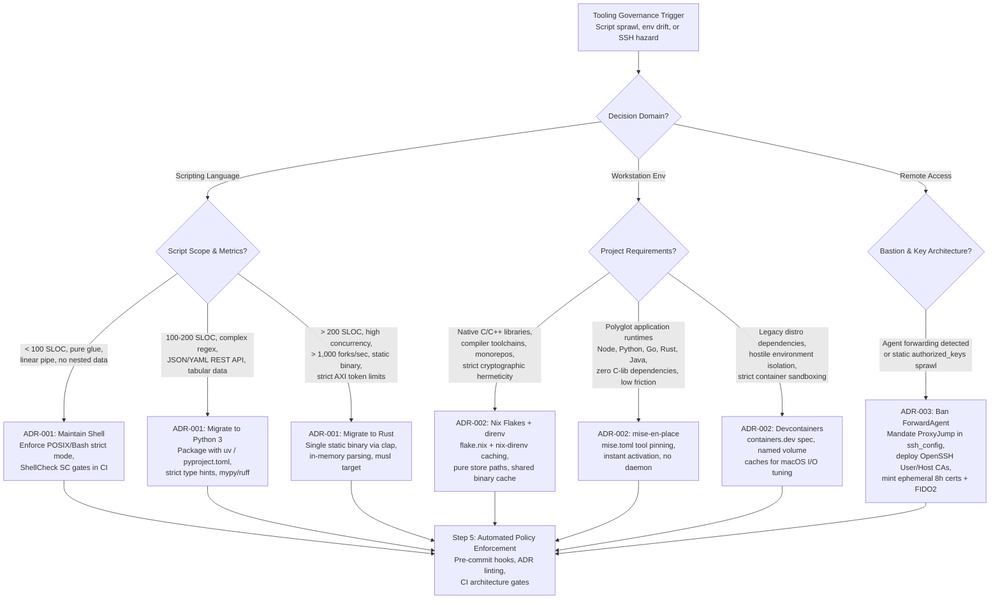
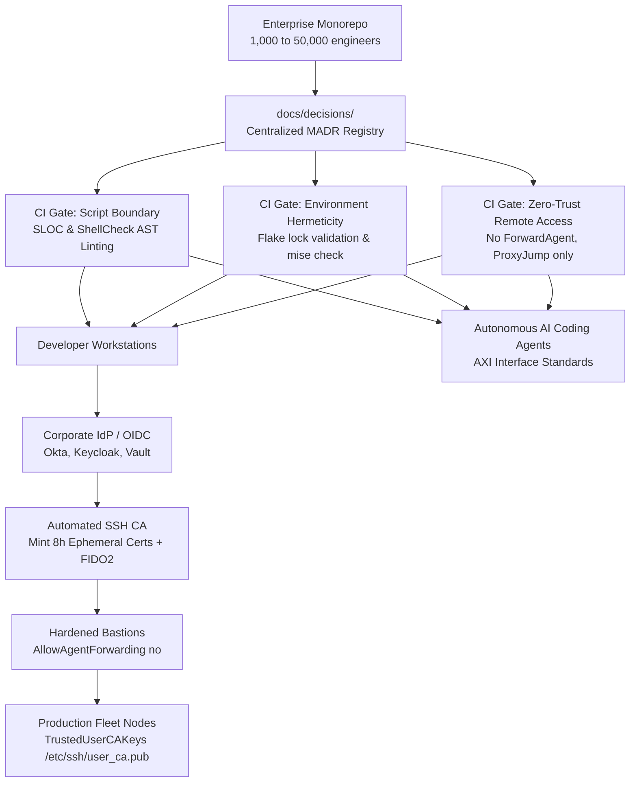

# Command Line Decision Records

> [!summary] Claim:
> Tooling standards decay into unmaintainable sprawl when governed by folklore rather than version-controlled Architectural Decision Records (ADRs).
> A distinguished engineer codifies language boundaries, workstation environments, and remote access policies as machine-enforceable ADRs evaluated against concrete mechanical metrics.
> Rewriting shell scripts into Python or Rust hinges on line count, cyclomatic complexity, AST data nesting, and fork/exec latency.
> Workstation parity balances Nix flakes, mise shims, and Devcontainers against macOS filesystem virtualization penalties.
> Zero-trust remote access mandates ProxyJump and ephemeral OpenSSH Certificate Authorities while strictly eliminating SSH agent forwarding hazards.

This playbook establishes the operational procedure for authoring, evaluating, and enforcing corporate command-line Architectural Decision Records across an engineering fleet.
Scripting robustness and static analysis are owned by [[Robust-Shell-Scripting-and-ShellCheck]].
Workstation environment mechanisms are owned by [[Dotfiles-Nix-Direnv-Mise-and-Devcontainers]] and [[Nix-Store-Derivations-and-Flakes-Internals]].
SSH transport internals and cryptographic authorities are owned by [[SSH-In-Depth-Keys-Forwarding-Certificates-and-FIDO2]] and [[Harden-SSH-Access-With-Certificates-and-Hardware-Keys]].
CLI ergonomics and AI agent interfaces are owned by [[CLI-Design-and-Agent-Friendly-Interfaces-AXI]].
This playbook unifies these foundations to reach Decide at Scale across multi-thousand-engineer organizations.

## Trigger and Symptoms

Activate this playbook when an engineering organization experiences any of the following operational triggers:

- **Shell Script Degradation:** Core build, CI, or release scripts exceed 100-200 lines, exhibit nested associative arrays, suffer from race conditions in trap handlers, or fail intermittently due to quoting bugs (ShellCheck SC2086, SC2155).
- **Toolchain Inconsistency:** Engineers across macOS (Apple Silicon) and Linux (x86_64/ARM64) report "works on my machine" failures caused by conflicting system package versions, unpinned compilers, or divergent bash versions (macOS default `/bin/bash` 3.2 vs Linux modern bash 5.x).
- **Workstation Virtualization Latency:** Teams migrating to containerized development environments report severe build stalls on macOS laptops caused by hypervisor filesystem bind-mount translation overhead (VirtioFS / gRPC FUSE).
- **SSH Credential and Bastion Exposure:** Security audits or penetration tests detect widespread `ForwardAgent yes` or `ssh -A` in developer dotfiles, exposing local agent sockets on compromised intermediate jump hosts, alongside unrotated, perpetual `~/.ssh/authorized_keys` files.
- **Folklore Tooling Governance:** Architectural tooling choices are made in informal chat channels or private wikis without recorded trade-offs, structured evaluation criteria, or automated CI enforcement gates.

## Decision Tree



## Prerequisites

Execute this procedure on an administrative workstation or platform engineering triage system with the following tooling installed:

```bash
command -v bash zsh python3 cargo shellcheck nix direnv mise ssh ssh-keygen
```

Ensure the following tools, configurations, and permissions are verified:

1. **Static Analysis & Linting:** ShellCheck 0.9.0 or later for shell script inspection (ShellCheck 0.11.0 verified on macOS arm64 as of 2026-11).
2. **Environment Management:** Nix with `experimental-features = nix-command flakes` (unquoted; quoting makes Nix warn `unknown experimental feature '"nix-command'`, checked with Determinate Nix 2.34.7 as of 2026-11) enabled, `direnv` 2.30+ with `nix-direnv`, and `mise` 2024.1+ (mise 2026.11.3 verified as of 2026-11).
3. **OpenSSH Tooling:** OpenSSH 7.3 or later for `ProxyJump` support, OpenSSH 8.2 or later for FIDO2 hardware keys (`ed25519-sk`), and OpenSSH Certificate Authority signing capability (OpenSSH 10.6p2 verified as of 2026-11).
4. **Repository Privileges:** Maintainer or Owner permissions in the target source repositories to commit Architectural Decision Records under `docs/decisions/` and configure branch protection rules.

**Verification:**

```bash
shellcheck --version | head -n 2
python3 --version
cargo --version
nix --version
mise --version
ssh -V
```

The verification command must confirm all CLI binaries are available in `PATH` and exit with status 0.

## Commands and Numbers to Know

| Item | Platform | Value `(as of 2026-11)` | Why it matters |
| :--- | :--- | :--- | :--- |
| Google Shell Style Guide length limit | Both | 100 lines | Hard threshold where shell scripts must be evaluated for rewrite into Python or Rust. |
| External binary fork+exec latency | macOS arm64 | ~1,700 us (~1.7 ms) | Measured: bash 5.3 loop of 1,000 `/usr/bin/true` took 1.68 s on macOS 27.2 arm64; the same loop with the `:` builtin took 9 ms. |
| External binary fork+exec latency | Linux | ~185 us (linux/arm64 in an OrbStack VM on Apple silicon) | Measured as 1,000 `/bin/true` in a bash loop in `debian:stable-slim`, three runs of 183 to 188 us per call; bare-metal and x86_64 Linux were not measured, so this is a VM figure only. |
| In-memory Python iteration overhead | macOS arm64 | ~6 ns per iteration | Measured `python3 -m timeit 'for i in range(10_000_000): pass'` = 60.2 ms on Python 3.15.2 (the earlier ~17 ns was not reproduced); ~280,000x cheaper than one fork+exec. |
| In-memory Rust function call overhead | macOS arm64 | ~2.5 ns per call | Measured `#[inline(never)]` call on a loop-carried `u64` through `black_box`, 1e9 iterations, `rustc -O` 1.99.0, twice 2.53 ns; an inlined call has no call overhead at all. |
| `ARG_MAX` (`getconf ARG_MAX`) | Linux | 2,097,152 bytes (2 MiB) | Measured in `debian:stable-slim` with an 8 MiB stack limit; Linux derives it from one quarter of `ulimit -s`, so it is not a fixed constant. `execve` fails with `E2BIG` beyond it; the shell's own expansion does not crash. |
| `ARG_MAX` (`getconf ARG_MAX`) | macOS arm64 | 1,048,576 bytes (1 MiB) | Measured on macOS 27.2; half the Linux default; commands passing thousands of files via globbing fail with `Argument list too long`. |
| `nix-direnv` re-evaluation trigger | Both | On change to `.envrc`, `flake.nix`, or `flake.lock` | The README says it is "significantly faster after the first run by caching" the environment and gives no timings; for `use flake` it reloads when those files change and falls back to the last working shell if evaluation fails. |
| macOS Devcontainer bind-mount latency penalty | macOS | ~2.7x slower (stat walk of 20,000 files) | Measured `find -exec stat` over 20,000 empty files in a `virtiofs` bind mount (40 to 48 ms) vs a copy on the container's own filesystem (15 to 17 ms), OrbStack on Apple silicon; metadata-bound compiles degrade by a workload-dependent factor, so measure your own tree. |
| OpenSSH `ProxyJump` introduction | Both | OpenSSH 7.3 (August 2016) | Standardized end-to-end SSH tunneling via `-J`; renders insecure `ForwardAgent yes` obsolete. |
| OpenSSH Certificate format introduction | Both | OpenSSH 5.4 (March 2010) | Replaces static `~/.ssh/authorized_keys` with cryptographically signed user and host certificates. |
| OpenSSH FIDO2 hardware key support | Both | OpenSSH 8.2 (February 2020) | Native support for `ed25519-sk` and `ecdsa-sk` hardware-backed resident keys. |
| Developer certificate TTL in ADR-003 | Both | 8 hours (policy of this note) | Not an OpenSSH recommendation: `ssh-keygen -s` without `-V` mints `Valid: forever` (shown by the lab), so a short TTL must be set explicitly. |
| OpenSSH ssh-agent RCE vulnerability | Both | CVE-2023-38408 (CVSS 9.8) | PKCS#11 provider abuse under `ForwardAgent yes`; fixed in OpenSSH 9.3p2. |

## Step-by-Step Execution

Follow these steps sequentially to establish, formalize, and enforce command-line architectural decision records across the organization.

### Step 1: Initialize the ADR Repository and Automated Linter

Create a version-controlled decision registry in the root of the engineering monorepo or infrastructure repository adapted from the Markdown Architectural Decision Record format (MADR 4.0.0, released 2024-09-17).
Upstream MADR keeps `status` in YAML front matter and `Confirmation` as an H3 under `Decision Outcome` (MADR 3.0 called it `Validation`); this template promotes both to H2 sections so the linter below can find them.

```bash
mkdir -p docs/decisions
cat <<'EOF' > docs/decisions/adr-template.md
# [Short title of solved problem and found solution]

## Status

[draft | proposed | accepted | rejected | deprecated | superseded by [ADR-0000](0000-title.md)]

## Context and Problem Statement

[What is the context framing the problem? What are the technological, operational, or organizational forces at play?]

## Decision Drivers

- [Driver 1: e.g., execution latency, memory footprint, onboarding time]
- [Driver 2: e.g., security posture, credential hygiene, cross-platform portability]

## Considered Options

- [Option 1: e.g., Native Shell / Bash]
- [Option 2: e.g., Python 3 with uv packaging]
- [Option 3: e.g., Compiled Rust static binary]

## Decision Outcome

Chosen option: "[Option chosen]", because [justification linking directly to drivers].

### Consequences

- Good: [Positive impact, e.g., deterministic execution, type safety]
- Bad: [Negative trade-off, e.g., compilation step required, increased binary size]
- Neutral: [Operational consequences, e.g., migration effort]

## Confirmation

[How will this decision be verified in code review, CI pipelines, or automated linters?]

## More Information

- Related ADRs: [[ADR-0000]]
- References: [Links to specifications, benchmarks, or standards]
EOF
```

Scaffold the decision registry index and automated validation script:

```bash
cat <<'EOF' > docs/decisions/index.md
# Architectural Decision Records

| ADR | Title | Status | Date |
| :--- | :--- | :--- | :--- |
| [[0001-tooling-language-boundary\|ADR-0001]] | Tooling Language Boundaries: Shell vs Python vs Rust | accepted | 2026-11-07 |
| [[0002-workstation-environment-standardization\|ADR-0002]] | Workstation Environments: Nix Flakes vs mise vs Devcontainers | accepted | 2026-11-07 |
| [[0003-zero-trust-remote-access\|ADR-0003]] | Zero-Trust Remote Access: Bastion ProxyJump and SSH CAs | accepted | 2026-11-07 |
EOF

cat <<'EOF' > docs/decisions/lint-adrs.py
#!/usr/bin/env python3
import sys, re, pathlib

REQUIRED_SECTIONS = [
    r"^#\s+.+",
    r"^##\s+Status",
    r"^##\s+Context and Problem Statement",
    r"^##\s+Decision Drivers",
    r"^##\s+Considered Options",
    r"^##\s+Decision Outcome",
    r"^##\s+Confirmation",
]
ALLOWED_STATUSES = {"draft", "proposed", "accepted", "rejected", "deprecated", "superseded"}

def lint_file(path: pathlib.Path) -> list[str]:
    errors = []
    text = path.read_text(encoding="utf-8")
    for sec_pattern in REQUIRED_SECTIONS:
        if not re.search(sec_pattern, text, re.MULTILINE):
            errors.append(f"Missing required section matching pattern: {sec_pattern}")
    status_match = re.search(r"^##\s+Status\s*\n+\[?([a-zA-Z]+)", text, re.MULTILINE)
    if not status_match or status_match.group(1).lower() not in ALLOWED_STATUSES:
        errors.append(f"Invalid or missing status in {path.name}. Must be one of: {sorted(ALLOWED_STATUSES)}")
    return errors

if __name__ == "__main__":
    adr_dir = pathlib.Path("docs/decisions")
    files = [f for f in adr_dir.glob("*.md") if f.name not in {"adr-template.md", "index.md"}]
    total_errors = 0
    for f in sorted(files):
        errs = lint_file(f)
        if errs:
            total_errors += len(errs)
            for e in errs:
                print(f"ERROR: {f.name}: {e}", file=sys.stderr)
    if total_errors > 0:
        sys.exit(1)
    print(f"PASS: {len(files)} ADRs validated successfully.")
EOF
chmod +x docs/decisions/lint-adrs.py
```

**Verification:**

```bash
python3 docs/decisions/lint-adrs.py
```

Expected output: `PASS: 0 ADRs validated successfully.` with exit status 0.

### Step 2: Codify and Execute ADR-001 (Scripting Language Boundaries)

Formalize the organizational boundary separating shell scripts from structured Python and compiled Rust.

```bash
cat <<'EOF' > docs/decisions/0001-tooling-language-boundary.md
# ADR-001: Tooling Language Boundaries - Shell vs Python vs Rust

## Status

accepted

## Context and Problem Statement

Engineering teams frequently author critical CI/CD pipelines, release orchestrators, and developer utilities in Bash.
As these scripts grow past 100 lines, they suffer from unhandled exit codes, complex word splitting bugs, brittle signal trap cleanup, and massive fork/exec performance bottlenecks.
Conversely, rewriting every trivial three-line wrapper into a compiled binary introduces unnecessary compilation and packaging friction.
We must establish strict, measurable boundaries defining when automation remains in Shell, when it migrates to Python, and when it requires Rust.

## Decision Drivers

- Execution safety: Structured error handling, explicit type systems, and deterministic exit statuses.
- Performance: Minimizing fork/exec kernel overhead in loops and high-throughput pipelines.
- Data complexity: Parsing structured formats (JSON, YAML, TOML) without vulnerable subshell string manipulations.
- Distribution: Zero-dependency distribution across developer machines and autonomous AI coding agents.

## Considered Options

- Option 1: Maintain Bash/POSIX shell for all CLI scripts with mandatory ShellCheck gates.
- Option 2: Migrate all scripts exceeding 100 lines to Python 3 managed with uv.
- Option 3: Migrate performance-critical, high-concurrency, or agent-facing CLI tools to compiled Rust binaries.

## Decision Outcome

Chosen option: A multi-tiered boundary policy governed by mechanical metrics:
1. Shell (POSIX sh / Bash) is restricted to simple glue utilities:
   - Must be <= 100 Source Lines of Code (SLOC).
   - Must pass ShellCheck at its default severity with zero findings (plain `shellcheck`; `-S error` would pass SC2155, a `warning`, and SC2086, an `info`).
   - Must use strict mode (`set -euo pipefail`) and safe signal traps.
   - Prohibited from implementing nested data structures or floating-point arithmetic.
2. Python 3 (packaged via uv and pyproject.toml) is mandatory when:
   - The script exceeds 100 SLOC.
   - The task requires complex JSON, YAML, or REST API wrangling beyond single-expression jq.
   - The script involves multi-step data pipelines or complex regular expressions.
3. Rust (compiled static binaries using clap) is mandatory when:
   - Execution performance requires > 1,000 operations per second or fork/exec overhead exceeds 50 ms.
   - The tool must be distributed as a standalone, zero-dependency binary (musl static linking).
   - The tool interfaces with autonomous AI coding agents (AXI standard) requiring minimal token output and < 15 ms startup latency.

### Consequences

- Good: Eliminates production outages caused by shell quoting and trap errors; speeds up pipelines by orders of magnitude.
- Bad: Requires teams to maintain Python virtual environments or Rust compilation toolchains for complex tools.
- Neutral: Shell remains accessible for lightweight wrappers under 100 lines.

## Confirmation

Enforced via `scripts/audit-tooling-language.sh` in pre-commit hooks and CI pull request gates.

## More Information

- Related: [[Robust-Shell-Scripting-and-ShellCheck]], [[CLI-Design-and-Agent-Friendly-Interfaces-AXI]]
EOF
```

Implement the automated audit scanner that parses shell scripts and flags ADR-001 boundary violations.
Three details are load-bearing and were verified by running the script (bash 5.3.15, macOS arm64, as of 2026-11): `find` prints paths with a leading `./`, so the skip pattern must include it; `((VIOLATIONS++))` returns status 1 when the counter is 0, which under `set -e` kills the audit after the first violation and before the `FAILED` summary; and an unanchored `declare\s+-A` pattern matches the scanner's own message string, so the scanner flagged itself.

```bash
mkdir -p scripts
cat <<'EOF' > scripts/audit-tooling-language.sh
#!/usr/bin/env bash
set -euo pipefail

MAX_SHELL_SLOC=100
VIOLATIONS=0

echo "Auditing shell scripts against ADR-001 boundaries..."
while IFS= read -r script; do
    # Skip ignored directories (find prints paths with a leading ./)
    [[ "$script" =~ ^\./(\.git|\.direnv|\.devenv|vendor|node_modules)/ ]] && continue

    # Count non-blank, non-comment lines; grep -c exits 1 on a zero count
    SLOC=$(grep -c -v -E '^\s*(#|$)' "$script" || true)

    # Check for forbidden constructs: associative arrays or manual JSON parsing
    FORBIDDEN=""
    if grep -q -E '^[[:space:]]*(declare|typeset|local)[[:space:]]+-[[:alpha:]]*A' "$script"; then
        FORBIDDEN="Associative arrays detected (declare -A)"
    elif grep -q -E '(awk|sed).*"\{.*:.*\}' "$script"; then
        FORBIDDEN="Manual JSON stream manipulation via regex"
    fi

    if (( SLOC > MAX_SHELL_SLOC )); then
        echo "VIOLATION [SLOC]: $script has $SLOC lines (exceeds maximum of $MAX_SHELL_SLOC lines)."
        VIOLATIONS=$((VIOLATIONS + 1))
    fi

    if [[ -n "$FORBIDDEN" ]]; then
        echo "VIOLATION [PATTERN]: $script - $FORBIDDEN. Must migrate to Python or Rust."
        VIOLATIONS=$((VIOLATIONS + 1))
    fi
done < <(find . -type f \( -name "*.sh" -o -name "*.bash" \) | sort)

if (( VIOLATIONS > 0 )); then
    echo "FAILED: $VIOLATIONS ADR-001 violations detected. Migrate offending scripts." >&2
    exit 1
fi
echo "PASS: All shell scripts conform to ADR-001 boundaries."
EOF
chmod +x scripts/audit-tooling-language.sh
```

**Verification:**

```bash
bash scripts/audit-tooling-language.sh
```

Expected output: `PASS: All shell scripts conform to ADR-001 boundaries.` with exit status 0.

### Step 3: Codify and Execute ADR-002 (Workstation Environment Standardization)

Formalize the evaluation matrix and deployment blueprints for developer workstation environments.

```bash
cat <<'EOF' > docs/decisions/0002-workstation-environment-standardization.md
# ADR-002: Workstation Environment Standardization - Nix Flakes vs mise vs Devcontainers

## Status

accepted

## Context and Problem Statement

Engineering onboarding time currently averages 3.5 days due to divergent host operating systems (macOS Darwin ARM64, Ubuntu 24.04 x86_64), unpinned language runtimes, and conflicting C-library dependencies (OpenSSL 1.1 vs 3.0, CMake, Protobuf compilers).
Development teams have split between three competing paradigms:
1. Pure cryptographic isolation via Nix flakes.
2. Lightweight polyglot version shims via mise.
3. Full OCI container isolation via Devcontainers.
We must establish an authoritative taxonomy defining which workstation profile applies to each project category.

## Decision Drivers

- Onboarding latency: Time required for a new engineer to achieve a working build from `git clone`.
- System-level hermeticity: Ability to pin native C/C++ libraries, compilers, and system headers across platforms.
- Filesystem performance: Avoiding catastrophic macOS bind-mount I/O degradation during compiles.
- Maintenance overhead: Cognitive load and disk footprint imposed on engineers.

## Considered Options

- Option 1: Standardize exclusively on Devcontainers (`devcontainer.json`).
- Option 2: Standardize exclusively on mise (`mise.toml`).
- Option 3: Standardize exclusively on Nix Flakes with direnv (`flake.nix` + `nix-direnv`).
- Option 4: Tiered workload assignment matching projects to profile strengths.

## Decision Outcome

Chosen option: Option 4 - Tiered workload assignment governed by technical constraints:

1. Nix Flakes + direnv (Profile A) is mandatory for:
   - Monorepos, systems engineering, C/C++, Rust, and Go services requiring specific native libraries (OpenSSL, LibPQ, Protoc).
   - Projects requiring byte-for-byte reproducible development environments across macOS and Linux without VM overhead.
   - Evaluated via `flake.nix` and cached with `nix-direnv` to eliminate prompt latency.
2. mise (Profile B) is mandatory for:
   - Application-layer polyglot services (Node.js, Python, Ruby, Terraform) that rely exclusively on standard pre-compiled binaries and host libc.
   - Zero Docker daemon dependency; instantaneous onboarding via `mise install`.
3. Devcontainers (Profile C) is restricted to:
   - Legacy services with hard Linux kernel or distribution-specific dependencies (e.g., systemd, glibc-specific binary blobs).
   - Strict container sandboxing requirements.
   - On macOS hosts, projects using Devcontainers MUST mount target build caches (e.g., `target/`, `node_modules/`) onto named Docker volumes to bypass VirtioFS bind-mount latency.

### Consequences

- Good: Eliminates onboarding failures; guarantees native performance on macOS while preserving hermeticity.
- Bad: Requires platform engineers to maintain Nix expressions for systems repositories and mise configs for app repositories.
- Neutral: Teams stop guessing or reinventing local environment configurations.

## Confirmation

Enforced by checking for the presence of a valid `flake.nix`, `mise.toml`, or `.devcontainer/devcontainer.json` matching the repository classification.

## More Information

- Related: [[Dotfiles-Nix-Direnv-Mise-and-Devcontainers]], [[Nix-Store-Derivations-and-Flakes-Internals]], [[Containers-and-VMs-for-macOS-Development]]
EOF
```

Deploy standard configuration blueprints for Profile A (Nix Flakes) and Profile B (mise):

```bash
# Profile A: Minimal Hermetic flake.nix
cat <<'EOF' > flake.nix
{
  description = "Standardized Hermetic Developer Environment";

  inputs = {
    nixpkgs.url = "github:NixOS/nixpkgs/nixos-unstable";
    flake-utils.url = "github:numtide/flake-utils";
  };

  outputs = { self, nixpkgs, flake-utils }:
    flake-utils.lib.eachDefaultSystem (system:
      let
        pkgs = nixpkgs.legacyPackages.${system};
      in
      {
        devShells.default = pkgs.mkShell {
          buildInputs = with pkgs; [
            bashInteractive
            shellcheck
            python3
            cargo
            rustc
          ];
          shellHook = ''
            export TOOLCHAIN_PROFILE="nix-hermetic"
          '';
        };
      }
    );
}
EOF

# Profile A: Cached direnv integration
cat <<'EOF' > .envrc
if ! has nix_direnv_version || ! nix_direnv_version 3.0.4; then
  source_url "https://raw.githubusercontent.com/nix-community/nix-direnv/3.0.4/direnvrc" "sha256-DzlYZ33mWF/Gs8DDeyjr8mnVmQGx7ASYqA5WlxwvBG4="
fi
use flake
EOF

# Profile B: Standard mise.toml
cat <<'EOF' > mise.toml
[tools]
python = "3.12"
node = "20"
shellcheck = "0.10.0"

[env]
TOOLCHAIN_PROFILE = "mise-standard"

[tasks.build]
description = "Execute standardized project build"
run = "echo 'Executing project build...'"
EOF
```

**Verification:**

```bash
mise trust mise.toml
mise config ls
mise ls --current
```

The verification command checks that `mise.toml` parses correctly and lists the active pinned runtimes.
mise 2026.11.3 has no `validate` subcommand (`mise validate` is read as a task name and fails with `no tasks defined`), so the earlier `mise validate ... ||` form always fell through.
Checked as of 2026-11: `mise config ls` lists `mise.toml  python, node, shellcheck`, and `mise ls --current` lists the three pins, marked `(missing)` until `mise install`.
The sha256 in `.envrc` above is the SRI hash of the 3.0.4 `direnvrc`, recomputed from the file (the earlier value did not match it); the nix-direnv README now pins 3.2.0.

### Step 4: Codify and Execute ADR-003 (Zero-Trust Remote Access Architecture)

Formalize the ban on SSH Agent Forwarding and deploy end-to-end `ProxyJump` and OpenSSH Certificate Authorities.

```bash
cat <<'EOF' > docs/decisions/0003-zero-trust-remote-access.md
# ADR-003: Zero-Trust Remote Access - Bastion ProxyJump and SSH CAs

## Status

accepted

## Context and Problem Statement

Engineering workflows historically relied on SSH Agent Forwarding (`ssh -A` or `ForwardAgent yes`) to hop through intermediate bastion servers to internal production nodes.
Agent forwarding exposes the client's local UNIX-domain authentication socket (`$SSH_AUTH_SOCK`) on the remote bastion.
Any process with root privileges on that bastion can hijack the forwarded socket to authenticate to arbitrary downstream systems as the victim.
Worse, CVE-2023-38408 (fixed in OpenSSH 9.3p2) let an attacker-controlled host that received a forwarded agent achieve remote code execution in the client's ssh-agent through PKCS#11 provider loading.
Furthermore, static `~/.ssh/authorized_keys` deployed across thousands of servers suffer from zero revocation capabilities and lack identity lifecycle expiration.
We must replace insecure agent forwarding with end-to-end encrypted tunnels and replace static keys with short-lived cryptographically signed certificates.

## Decision Drivers

- Security boundary: Eliminating socket hijacking and credential exposure on intermediate jump hosts.
- Blast radius reduction: Enforcing short-lived credentials with automated expiration (8 hours).
- Cryptographic provenance: Enforcing Hardware Security Keys (FIDO2 / WebAuthn) for administrative access.
- Auditability: Cryptographically logging user identities in server authentication logs via Certificate Key IDs.

## Considered Options

- Option 1: Retain Agent Forwarding with host-level socket permissions and strict bastion auditing.
- Option 2: Mandate OpenSSH `ProxyJump` (`-J`) while retaining static `authorized_keys`.
- Option 3: Mandate OpenSSH `ProxyJump` and deploy an OpenSSH Certificate Authority (SSH CA) issuing short-lived user and host certificates.

## Decision Outcome

Chosen option: Option 3 - Mandate ProxyJump and deploy an OpenSSH Certificate Authority:

1. Immediate Fleet-Wide Ban on Agent Forwarding:
   - `ForwardAgent no` is enforced globally in client `~/.ssh/config`.
   - `AllowAgentForwarding no` is enforced on all bastion and production `sshd_config` daemons; sshd_config(5) notes this does not improve security unless users are also denied shell access, so jump-only bastions also need `PermitTTY no` and no shell.
2. End-to-End Bastion Traversal via ProxyJump:
   - All internal host access routes through intermediate bastions using `ProxyJump` (`-J`).
   - The bastion forwards encrypted TCP streams without terminating the end-to-end SSH transport or viewing client credentials.
3. Ephemeral OpenSSH Certificate Infrastructure:
   - Static `authorized_keys` are deprecated and replaced with `TrustedUserCAKeys /etc/ssh/user_ca.pub`.
   - User certificates are minted via automated corporate OIDC/SSO workflows with an 8-hour maximum TTL.
   - User certificates explicitly strip agent forwarding permissions via `-O clear -O permit-pty -O permit-port-forwarding`.
   - Host CAs (`@cert-authority`) are deployed to client `known_hosts` to eliminate Trust-On-First-Use (TOFU) man-in-the-middle risks.
   - High-privilege production access requires FIDO2 hardware resident keys (`ed25519-sk`).

### Consequences

- Good: Complete elimination of bastion socket theft; credentials automatically expire without manual key rotation.
- Bad: Requires deployment of automated certificate signing services or integration with IdP tools (e.g., Vault, Teleport).
- Neutral: Transparent developer experience once `ProxyJump` and SSO minting are configured.

## Confirmation

Verified by client configuration audits and certificate inspection via `ssh-keygen -L -f ~/.ssh/id_ed25519-cert.pub`.

## More Information

- Related: [[SSH-In-Depth-Keys-Forwarding-Certificates-and-FIDO2]], [[Harden-SSH-Access-With-Certificates-and-Hardware-Keys]]
EOF
```

Deploy the standardized client SSH configuration and demonstrate the CA minting mechanism:

```bash
mkdir -p "$HOME/.ssh"
cat <<'EOF' > "$HOME/.ssh/config.corp-standard"
# Corporate Zero-Trust Standard SSH Configuration (ADR-003)

# Global Defaults: Strict Host Checking, No Agent Forwarding
Host *
    ForwardAgent no
    PasswordAuthentication no
    PubkeyAuthentication yes
    ServerAliveInterval 60
    ServerAliveCountMax 3
    AddKeysToAgent yes
    IdentitiesOnly yes

# Corporate Bastion Definition
Host bastion.corp.internal
    HostName bastion.corp.internal
    User jumpuser
    IdentityFile ~/.ssh/id_ed25519
    CertificateFile ~/.ssh/id_ed25519-cert.pub

# Internal Secure Fleet routed via ProxyJump
Host *.prod.corp.internal *.corp.internal !bastion.corp.internal
    ProxyJump bastion.corp.internal
    User dev-user
    IdentityFile ~/.ssh/id_ed25519
    CertificateFile ~/.ssh/id_ed25519-cert.pub
EOF
```

Generate a test CA, sign an ephemeral user certificate with stripped permissions, and verify its cryptographic properties:

```bash
mkdir -p /tmp/ssh-ca-test
(
  cd /tmp/ssh-ca-test
  # 1. Generate User and CA keys
  ssh-keygen -q -N "" -t ed25519 -f ca_user_key -C "Corporate User CA"
  ssh-keygen -q -N "" -t ed25519 -f dev_user_key -C "alice@corp.internal"

  # 2. Sign user key with 8-hour validity and restricted extensions
  ssh-keygen -s ca_user_key \
             -I "alice@corp.internal" \
             -n "dev-user,alice" \
             -V "+8h" \
             -z "2026110701" \
             -O clear \
             -O permit-pty \
             -O permit-port-forwarding \
             dev_user_key.pub

  # 3. Inspect certificate structure
  ssh-keygen -L -f dev_user_key-cert.pub
)
```

**Verification:**

Inspect the certificate output to verify that:
1. `Type` is `ssh-ed25519-cert-v01@openssh.com user certificate`.
2. `Valid` window is strictly bounded (8 hours plus at most a few minutes; OpenSSH 10.6p2 backdates the start to the previous minute).
3. `Principals` contains the approved usernames.
4. `Extensions` contains ONLY `permit-port-forwarding` and `permit-pty`, confirming `permit-agent-forwarding` has been explicitly revoked.

The lab `code/01-Command-Line/adr_gates/` runs this recipe in a scratch directory with OpenSSH 10.6p2 on macOS arm64 (as of 2026-11) and prints the block below, byte-identical to an excerpt of its `expected/darwin-arm64.txt`.
The lab masks the key fingerprints and the two timestamps, which change on every run, and checks the span between them separately (it printed `validity span within 8h to 8h05m: True`).
`ssh-keygen -L` echoes the path it was given, so the first line is the relative file name.
Without `-O clear` the same key is signed with the default set `permit-X11-forwarding`, `permit-agent-forwarding`, `permit-port-forwarding`, `permit-pty`, and `permit-user-rc`, and without `-V` it is `Valid: forever`; the lab prints both.

```text
dev_user_key-cert.pub:
        Type: ssh-ed25519-cert-v01@openssh.com user certificate
        Public key: ED25519-CERT SHA256:...
        Signing CA: ED25519 SHA256:... (using ssh-ed25519)
        Key ID: "alice@corp.internal"
        Serial: 2026110701
        Valid: from START to END
        Principals: 
                dev-user
                alice
        Critical Options: (none)
        Extensions: 
                permit-port-forwarding
                permit-pty
```

### Step 5: Implement Automated Architecture Decision Gating in CI and Pre-Commit

Enforce all three ADRs automatically at the git boundary by assembling a pre-commit check and CI workflow.

```bash
mkdir -p .githooks
cat <<'EOF' > .githooks/pre-commit
#!/usr/bin/env bash
set -euo pipefail

echo "==> Running Architectural Decision Record (ADR) Pre-Commit Gates..."

# 1. Validate ADR Markdown syntax and metadata
python3 docs/decisions/lint-adrs.py

# 2. Audit Shell Script Boundaries (ADR-001)
bash scripts/audit-tooling-language.sh

# 3. Audit SSH Configuration for forbidden ForwardAgent (ADR-003)
if find . -type f \( -name "*.conf" -o -name "config*" -o -name "*.sh" \) -exec grep -Hn "ForwardAgent.*yes" {} +; then
    echo "ERROR: Forbidden 'ForwardAgent yes' detected in repository. Refer to ADR-003." >&2
    exit 1
fi

echo "==> All Architectural Decision Record checks passed."
EOF
chmod +x .githooks/pre-commit
```

Configure git to execute the unified hook:

```bash
git config core.hooksPath .githooks
```

**Verification:**

```bash
bash .githooks/pre-commit
```

Expected output (lab output, platform darwin-arm64):
```text
==> Running Architectural Decision Record (ADR) Pre-Commit Gates...
PASS: 3 ADRs validated successfully.
Auditing shell scripts against ADR-001 boundaries...
PASS: All shell scripts conform to ADR-001 boundaries.
==> All Architectural Decision Record checks passed.
```
Exit status must be 0.
The block above is byte-identical to an excerpt of `code/01-Command-Line/adr_gates/expected/darwin-arm64.txt` (platform darwin-arm64, bash 5.3.15, Python 3.15.2, as of 2026-11), which the lab produces by extracting the Step 1 to 5 files verbatim from this note's heredocs into a scratch git repository and running each gate.
The same lab adds a `ssh/config.bad` file containing `ForwardAgent yes`: the hook then prints `./ssh/config.bad:2:    ForwardAgent yes` and exits 1, and a real `git commit` of that file through `core.hooksPath` is rejected.
It also feeds the linter an ADR with an invalid status and one without `## Confirmation`, and feeds the audit a 120-line script with `declare -A` plus an oversized script under `node_modules/`; each gate fails or skips exactly as the steps claim.

## Rollback Procedure

When a decision record, language migration, or environment deployment fails or introduces an unforeseen regression, execute the corresponding rollback step cleanly:

1. **Rollback ADR-001 (Scripting Language Migration):**
   - If a newly rewritten Python or Rust tool breaks backward compatibility in CI, immediately revert the dispatch wrapper in `bin/` to invoke the archived shell script: `git checkout HEAD~1 -- bin/deploy-service`.
   - Update the status in `docs/decisions/0001-tooling-language-boundary.md` to `proposed` or amend the SLOC threshold.
   - **Check:** `bin/deploy-service --help` outputs the previous stable interface.
2. **Rollback ADR-002 (Workstation Environments):**
   - If a Nix flake evaluation fails or Darwin sandbox incompatibility breaks developer builds, revert the directory hook: `rm -f .envrc && rm -rf .direnv` (`.direnv` is a directory, so `rm -f` alone fails on it) and restore `mise.toml`.
   - In Devcontainers, if named volume mount permissions lock up on macOS, recreate the container from scratch with `devcontainer up --remove-existing-container`, or fall back to host native execution with Profile A or B.
   - **Check:** Running `cargo check` or `pytest` executes successfully on host bare metal.
3. **Rollback ADR-003 (Zero-Trust Remote Access / SSH CAs):**
   - If the SSH Certificate Authority private key is compromised or the OIDC signing service experiences an outage, activate the break-glass offline emergency key.
   - On production servers, deploy emergency break-glass static authorized keys to a file that `AuthorizedKeysFile` actually reads (the sshd_config(5) default is only `.ssh/authorized_keys .ssh/authorized_keys2`, so `/etc/ssh/authorized_keys` is ignored unless listed): `echo "$BREAK_GLASS_PUBKEY" | sudo tee -a ~dev-user/.ssh/authorized_keys`.
   - If `ProxyJump` drops active sessions due to network proxy issues, temporarily bypass ProxyJump by connecting to direct VPN addresses using `ssh -o ProxyJump=none user@host` (ssh_config(5): setting the host to `none` disables the option).
   - **Check:** `ssh -F none -o IdentitiesOnly=yes -i ~/.ssh/break_glass_key dev-user@bastion.corp.internal` establishes access; `-F none` skips the corporate config and its `CertificateFile` lines (`CertificateFile none` is not a documented special value, and `ssh -G` reports it as a literal file name).
4. **Rollback ADR Linting and Pre-Commit Hooks:**
   - If an emergency hotfix is blocked by strict pre-commit ADR validation, bypass locally using `git commit --no-verify -m "EMERGENCY: hotfix"` and immediately open a tracking issue to remediate the compliance gap.
   - Restore default hooks path with `git config --unset core.hooksPath`.
   - **Check:** `git config core.hooksPath` returns empty.

## Failure Modes of the Procedure

| Failure | How it shows up | Recovery |
| :--- | :--- | :--- |
| ADR metadata validation failure | `lint-adrs.py` fails with `Missing required section` or `Invalid status` | Review `docs/decisions/adr-template.md` and ensure H2 headings and Status exactly match this template (an H2 adaptation of MADR 4.0.0, which keeps status in front matter). |
| Shell script SLOC boundary breach | `audit-tooling-language.sh` fails reporting script exceeds 100 SLOC | Refactor monolithic script into modular sub-functions or split execution logic into Python (`uv`) or Rust (`cargo`). |
| Incompatible CLI flag in rewritten binary | Migrated Python/Rust CLI rejects legacy shell script flags | Implement argument compatibility alias layers using `clap` aliases in Rust or `argparse` fallback parsers in Python. |
| Nix flake evaluation timeout on macOS | `nix develop` hangs or takes > 30 seconds to evaluate expressions | Ensure `nix-direnv` is sourced in `.envrc` and configure binary substituters in `/etc/nix/nix.conf`. |
| mise runtime glibc mismatch | `mise install` fails on older Linux distros with `version GLIBC_X.XX not found` | Build the runtime from source (for Python, `MISE_PYTHON_COMPILE=1 mise install python`, the env form of the `python.compile` setting; mise 2026.11.3 has no `install --compile` flag) or deploy Profile A (Nix) which packages its own glibc. |
| Devcontainer macOS filesystem freeze | `docker build` or compilation hangs on macOS during heavy I/O | Move compilation target (`target/`, `.venv/`) to an internal Docker named volume rather than an APFS bind mount. |
| Expired SSH User Certificate | The client sees `Permission denied (publickey)`; sshd logs `Refusing certificate ID ... : Certificate invalid: expired` (reason string from `sshkey.c`) | Re-authenticate via the corporate IdP CLI to refresh the 8-hour certificate from the SSH CA. |
| ProxyJump connection reset | SSH connection terminates with `kex_exchange_identification: Connection closed` | Check bastion TCP connection limits and configure `ServerAliveInterval 30` in `~/.ssh/config`. |
| Stripped agent forwarding blocks nested jump | User attempts to jump from node to node and receives `Permission denied (publickey)` | Educate user that lateral hopping is blocked by design; configure client-side multi-hop `ProxyJump bastion,intermediate host`. |

## Pitfalls

> [!warning] Premature shell rewrite trap
> Rewriting a stable, 30-line POSIX shell script into a 400-line Python or Rust project introduces unnecessary dependency management, virtual environments, and compilation overhead.
> Keep shell scripts that are pure glue, execute sequentially, and do not manipulate complex data structures.
> Only trigger migration when scripts cross the 100 SLOC threshold or exhibit fragile string/trap operations.

> [!warning] The macOS bind-mount performance illusion
> Assuming Devcontainers perform identically across Linux and macOS workstations is a recipe for developer mutiny.
> On macOS, all bind mounts cross hypervisor translation layers (VirtioFS / gRPC FUSE), imposing a measurable latency penalty on directory traversal and file metadata (`stat`) queries (about 2.7x for a 20,000-file stat walk on `virtiofs` under OrbStack, macOS arm64, as of 2026-11; the factor depends on the engine and the workload).
> Never place high-churn directories like `node_modules/`, `target/`, or `.git/` on raw macOS host bind mounts inside a Devcontainer.

> [!warning] Agent forwarding habituation and socket theft
> Developers frequently retain `ssh -A` aliases out of muscle memory, believing they are harmless because the bastion is an internal server.
> A compromised bastion allows any root or co-located process to hijack `$SSH_AUTH_SOCK` while the user is connected, pivoting laterally into production environments.
> Enforce `ForwardAgent no` in client configurations and strip `permit-agent-forwarding` from issued SSH certificates.

> [!warning] Nix flake impure escapes
> Using `builtins.fetchGit` without revision hashes or running `nix --impure` introduces hidden host contamination into supposedly hermetic environments.
> Commit both `flake.nix` and `flake.lock` to the repository, and ensure all native libraries reference pinned Nixpkgs derivations.

> [!warning] SSH CA clock drift and validity windows
> Minting short-lived certificates with tight 8-hour validity windows fails catastrophically if workstation or server clocks drift by more than a few minutes.
> Synchronize all fleet nodes and bastions using Chrony or NTP, and issue certificates with a 5-minute past backdate (`-V -5m:+8h`) to tolerate minor clock skew.

## At Scale

At an organizational scale of 1,000 to 50,000 engineers, command-line tooling standards cannot be sustained by manual code review; they must operate as automated paved roads integrated into monorepos, developer platforms, and AI coding agent harnesses.



### Monorepo Paved Roads and Automated Governance

- **Continuous Compliance Scanning:** Platform engineering teams run nightly static analysis across the entire monorepo, generating automated pull requests to migrate shell scripts crossing the 100 SLOC boundary into Python or Rust.
- **Unified Language Toolchains:** The organization standardizes on a single packaging tool per language: `uv` for Python (locking dependencies via `pyproject.toml`) and `cargo` for Rust (locking via `Cargo.lock`), eliminating ad-hoc package installations.
- **Centralized Binary Caching:** Nix store derivations are accelerated via internal binary caches (such as Attic, Harmonia, or Cachix), so that machines download prebuilt store paths instead of building them (the Nix manual describes substituters this way and gives no timings; measure your own fleet).

### Automated Ephemeral SSH Certificate Infrastructure

- **OIDC to SSH CA Federation:** Rather than manually generating keys, developers authenticate via browser-based Single Sign-On (OIDC) through tools like HashiCorp Vault, Teleport, or internal CLI bridges.
- **Hardware Token Attestation:** The CA enforces that user public keys originate from FIDO2 hardware authenticators (`ed25519-sk`) with user presence verified, preventing automated key exfiltration.
- **Audit Traceability:** The Certificate Key ID embeds the engineer's authenticated corporate email and employee ID, which `sshd` logs directly to system journals upon login, providing a tamper-proof audit trail for SOC 2 and ISO 27001 compliance.

### Autonomous AI Agent Integration (AXI Standards)

- Modern developer fleets increasingly incorporate autonomous AI coding agents operating directly in the terminal.
- Shell scripts with unpredictable exit codes, interactive prompts, or massive verbose text output exhaust LLM context windows and trigger agent execution loops.
- Adhering to [[CLI-Design-and-Agent-Friendly-Interfaces-AXI]], ADR-001 mandates that CLI tools written in Rust or Python provide token-efficient output (TOON/JSON), structured error codes, and non-interactive execution modes.

## Practice Drill

> [!tip] Practice Drill: Scaffold, audit, and enforce an organizational toolchain ADR
> In a local scratch directory, set up a project containing a sprawling shell script, audit it, execute an ADR migration, and enforce remote access hygiene:
> 1. Create a 120-line bash script that uses associative arrays (`declare -A`) and attempts manual JSON parsing via `sed`.
> 2. Run the audit script `scripts/audit-tooling-language.sh` and verify that it flags both the SLOC violation and the forbidden associative array pattern.
> 3. Rewrite the utility into a 25-line Python script utilizing `sys.stdin` and the standard `json` module, packaged with a minimal `pyproject.toml`.
> 4. Generate an OpenSSH CA keypair, sign a test user certificate with validity restricted to 8 hours (`-V +8h`) and stripped extensions (`-O clear -O permit-pty -O permit-port-forwarding`), and inspect it with `ssh-keygen -L -f`.
> 5. Create a client `.ssh/config` containing `ProxyJump` and verify that `ForwardAgent yes` is blocked by your pre-commit validation hook.
> Target completion time: Under 25 minutes.

## Interview Questions

> [!question] L5 (Predict the Output)
> Consider the following bash script snippet:
> ```bash
> #!/usr/bin/env bash
> set -euo pipefail
> 
> count=0
> echo "apple banana cherry" | tr ' ' '\n' | while read -r item; do
>     ((count++))
> done
> echo "Count: $count"
> ```
> What does this script output on standard POSIX bash, and why does this behavior drive ADR-001 scripting boundaries?
>
> > [!success]- Answer
> > On bash 5.3.15 (verified as of 2026-11) the script prints nothing and exits with status 1.
> > The first `((count++))` evaluates to 0 (post-increment returns the old value), so it returns status 1; `set -e` kills the loop's subshell, and `pipefail` makes the pipeline fail, so the parent exits before the final `echo`.
> > With `count=$((count + 1))` instead, bash prints (lab output, platform darwin-arm64, bash 5.3.15):
> > ```text
> > Count: 0
> > ```
> > In Bash, each command in a multi-stage pipeline executes within a separate subshell (POSIX permits, as an extension, running any pipeline command in the current environment; zsh runs the last one there and prints `Count: 3`).
> > The `while read` loop runs inside a subshell forked from the parent shell.
> > While `count` increments from 0 to 3 inside that subshell's private memory space, the subshell terminates when the pipeline finishes.
> > The parent shell's `count` variable remains unchanged at 0.
> > macOS `/bin/bash` 3.2.57 prints `Count: 0` even for the original snippet, so the same script behaves differently across the fleet.
> > Because Bash does not share memory across pipeline stages, developers frequently attempt workarounds (temporary files, process substitution `done < <(...)`, or `shopt -s lastpipe`, which only takes effect when job control is off).
> > Under ADR-001, any script requiring stateful accumulation, tabular reduction, or structured data transformations across loops must be rewritten in Python or Rust where in-memory state is explicit and safe.

> [!question] L5
> In shell scripting, why does ShellCheck issue warning SC2155 on `local my_var=$(command)`?
> How does splitting declaration and assignment fix this, and how is it codified in tooling ADRs?
>
> > [!success]- Answer
> > `local` is a shell built-in command that returns an exit status.
> > In the combined statement `local my_var=$(command)`, the exit status of the line is the exit status of `local` (which is almost always 0), not the exit status of the command substitution `$(command)`.
> > If `command` fails, `set -e` fails to trigger, and error handling is completely bypassed.
> > Splitting the statement into:
> > ```bash
> > local my_var
> > my_var=$(command)
> > ```
> > ensures that the assignment evaluates the command substitution in an isolated command context.
> > If `command` fails, its non-zero exit status immediately causes `set -e` to abort the script.
> > Tooling ADRs mandate zero ShellCheck findings at the default severity in CI precisely to prevent such silent error masking.
> > The severity floor matters: SC2155 is a `warning`, so `shellcheck -S error` exits 0 on it (verified with ShellCheck 0.11.0 as of 2026-11).

> [!question] L6 (Debug This)
> A developer's CI pipeline fails intermittently under `mise` and `direnv`.
> The top-level script executes cleanly, but a nested build tool invokes `/bin/sh` to run a sub-task, resulting in:
> `/bin/sh: node: command not found`
> even though `node` is pinned in `mise.toml` and works interactively.
> Diagnose the root cause and provide the architectural fix.
>
> > [!success]- Answer
> > Root cause:
> > Tools like `mise` and `direnv` modify environment variables (`PATH`, shims) in the context of interactive shell hooks or dynamic subshell exports.
> > When a parent process or build tool (such as Make or a build runner) forks a child command via `/bin/sh -c` or `execve("/bin/sh", ...)`, `/bin/sh` executes as a non-interactive, non-login POSIX shell.
> > It does not source `.zshrc`, `.bashrc`, or direnv hooks, and it strips unexported functions.
> > A child `/bin/sh` does inherit whatever `PATH` was exported when it was spawned, so the failure appears when the build tool was started outside an activated shell (CI runner, IDE, cron, launchd) or the tool resets the environment (`env -i`, `sudo` `secure_path`, an explicit `PATH=` in a Makefile).
> > If `mise` was configured to use prompt hooks (`mise activate`) rather than persistent shims, that hook never ran in those contexts, so `PATH` falls back to a system default such as `/usr/bin:/bin`, which lacks the pinned Node.js runtime.
> > Architectural fix:
> > 1. Configure `mise` to maintain static shims in a standardized location:
> >    `export PATH="$HOME/.local/share/mise/shims:$PATH"`
> >    and ensure this path is exported in `/etc/profile` or system-wide environment files.
> > 2. Alternatively, invoke the sub-task directly through `mise exec -- command` or wrap the execution in a Nix hermetic derivation where `/bin/sh` and all tool paths are explicitly resolved in the sandbox closure.

> [!question] L6
> Explain the security mechanism that makes SSH Agent Forwarding (`ForwardAgent yes` / `ssh -A`) hazardous.
> Contrast its attack surface with OpenSSH `ProxyJump` (`-J`).
>
> > [!success]- Answer
> > When Agent Forwarding is enabled, the SSH client creates a remote UNIX-domain socket on the jump host (stored in `$SSH_AUTH_SOCK`, e.g., `/tmp/ssh-XXXXXX/agent.PID`) and forwards agent protocol requests back over the SSH tunnel to the user's local `ssh-agent`.
> > Attack surface of Agent Forwarding:
> > 1. Any process running as `root` on the jump host (or having access to that socket) can connect to `$SSH_AUTH_SOCK` while the user's connection is active.
> > 2. The attacker cannot extract the private key bytes, but they can request the agent to sign authentication challenges, allowing the attacker to authenticate to any downstream server the victim has access to.
> > 3. Vulnerabilities like CVE-2023-38408 allow malicious jump hosts to abuse PKCS#11 provider loading to achieve Remote Code Execution on the client.
> > Contrast with `ProxyJump`:
> > `ProxyJump` sets an implicit `ProxyCommand` that runs `ssh -W` (see `ssh.c`) to request the intermediate bastion to establish a raw TCP stream forward to port 22 of the target server.
> > The client then establishes an end-to-end encrypted SSH session directly through that TCP stream.
> > The bastion sees only encrypted ciphertext packets; it never receives an agent socket, never terminates the transport layer, and cannot forge authentication requests.

> [!question] L7
> An engineering organization with 5,000 developers observes that C++ and Rust compilation on macOS laptops inside Devcontainers takes 4.5x longer than on bare-metal APFS.
> Explain the underlying storage virtualization mechanism and design an architectural migration to Nix flakes with direnv.
>
> > [!success]- Answer
> > Virtualization mechanism:
> > On macOS, Docker and container engines run inside a lightweight Linux hypervisor virtual machine (Virtualization.framework).
> > Host directories bind-mounted into the container must translate filesystem operations across the hypervisor boundary via VirtioFS or 9P protocols.
> > Compilers like `clang` and `rustc` perform tens of thousands of `stat()`, `open()`, and `close()` syscalls to resolve headers and module interfaces.
> > On native macOS, these execute against APFS in microseconds.
> > Across the hypervisor bind mount, each filesystem query incurs inter-process communication, memory copying, and macOS kernel permission checks, introducing a latency penalty (about 2.7x on a stat-only walk in the measurement above).
> > Architectural Migration (ADR-002):
> > 1. Migrate the project from a containerized environment to a native Nix flake (`flake.nix`).
> > 2. Define the compiler (`clang`, `rustc`), build systems (`cmake`, `ninja`), and native C-libraries (`openssl`, `boost`) as derivation inputs in Nixpkgs.
> > 3. On macOS, Nix realizes these packages natively in `/nix/store` as Mach-O ARM64 binaries linked against the native macOS Darwin SDK, completely bypassing the hypervisor.
> > 4. Integrate `direnv` and `nix-direnv` so that entering the directory instantly exports `PATH`, `CPATH`, and `LIBRARY_PATH` without VM translation overhead.
> > The result removes the hypervisor file-sharing hop from the compile path while preserving toolchain version pinning through `flake.lock`.

> [!question] L7
> Design an automated governance engine for a 10,000-engineer monorepo that continuously audits shell scripts, scores migration triggers, and gates pull requests violating tooling language boundaries.
>
> > [!success]- Answer
> > The governance engine operates as a multi-stage static analysis pipeline:
> > 1. Parser and Metrics Collector:
> >    A custom AST analyzer written in Rust parses all `.sh` and `.bash` files using `tree-sitter-bash`.
> >    It extracts:
> >    - Physical SLOC (excluding comments and whitespace).
> >    - Cyclomatic complexity (branching nodes: `if`, `case`, `while`, `until`).
> >    - Subshell fork frequency: count of pipelines, backticks, and `$()` command substitutions inside loops.
> >    - Data parsing indicators: usage of `jq`, `sed`, `awk`, or associative arrays (`declare -A`).
> > 2. Scoring Rubric:
> >    A composite fragility score is calculated:
> >    `Score = (SLOC / 100) + (Complexity / 10) + (ForksInLoops * 2) + (DataParsingFlags * 3)`.
> >    If `Score > 2.0`, the script is classified as "Debt: Must Migrate".
> > 3. CI Pull Request Gating:
> >    - Existing offending scripts are registered in a baseline allowlist (`.tooling-debt.json`).
> >    - Any PR modifying an existing debt script or introducing a new script with `Score > 1.0` is blocked by CI.
> >    - CI posts an automated review comment linking to ADR-001 and providing a scaffolded Python (`uv`) or Rust template.
> > 4. Deprecation Tracking:
> >    An automated dashboard tracks total monorepo shell debt over time, reporting quarterly migration progress to the Architecture Review Board.

> [!question] L8+
> Design a zero-trust remote access architecture for 30,000 engineers across global multi-cloud regions that completely eliminates static SSH keys, mandates hardware-backed FIDO2 authenticators, and provides offline disaster-recovery break-glass access.
>
> > [!success]- Answer
> > Architecture Specification:
> > 1. Cryptographic Identity & Ephemeral Certificate Minting:
> >    - Static `~/.ssh/authorized_keys` are wiped across the fleet and replaced with `TrustedUserCAKeys /etc/ssh/user_ca.pub` in `sshd_config`.
> >    - Engineers authenticate via WebAuthn SSO through their corporate IdP to an internal Certificate Authority service (e.g., HashiCorp Vault or custom OpenSSH CA microservice).
> >    - The CA signs user public keys originating strictly from FIDO2 hardware keys (`ed25519-sk`) with user presence verified.
> >    - Certificate validity is capped at 8 hours (`-V +8h`), with critical options stripping agent forwarding (`-O clear -O permit-pty -O permit-port-forwarding`).
> >    - Key ID embeds the authenticated user identity (`user@corp.com [employee_id]`) for audit immutability.
> > 2. Host Verification & Network Traversal:
> >    - All fleet servers deploy Host Certificates signed by a central Host CA.
> >    - Global `/etc/ssh/ssh_known_hosts` configures `@cert-authority *.internal.corp <HostCA_PublicKey>`, eliminating TOFU prompt poisoning.
> >    - Regional bastion clusters deployed in each cloud region accept connections exclusively via `ProxyJump` (`-J`).
> >    - Bastions enforce `AllowAgentForwarding no` and `PermitTTY no` for jump-only instances.
> > 3. Offline Break-Glass Disaster Recovery:
> >    - In the event of a global IdP or CA outage, break-glass access is achieved via a Shamir's Secret Sharing (3-of-5) master root key.
> >    - The root key signs a special 72-hour emergency certificate or decrypts a sealed static `authorized_keys` file provisioned to console access nodes.
> >    - Console logins trigger out-of-band alerts via satellite or independent cellular telemetry to the security operations center.

> [!question] L8+
> Formulate the 5-year organizational toolchain modernization ADR roadmap for an enterprise transitioning from legacy POSIX shell automation to agent-friendly CLIs (AXI) and hermetic build systems.
>
> > [!success]- Answer
> > The 5-year roadmap encompasses four distinct phases:
> > Phase 1 (Year 1): Stabilization and Boundary Enforcement (ADR-001, ADR-002, ADR-003)
> > - Codify MADR registry under `docs/decisions/`.
> > - Cap shell scripts at 100 SLOC; ban `ForwardAgent` fleet-wide and deploy `ProxyJump` with short-lived SSH CAs.
> > - Standardize developer environments on `mise` for polyglot runtimes and Nix flakes for systems repositories.
> > Phase 2 (Years 2-3): Autonomous AI Agent Readiness (AXI Compliance)
> > - Adopt the 10 AXI Principles across all internal developer CLIs.
> > - Rewrite legacy, chatty shell wrappers into compiled Rust static binaries (`clap`) that emit token-efficient output (TOON/compact JSON) with definitive empty states and structured error exit codes.
> > - Eliminate interactive prompts (`--yes` by default, idempotent mutations).
> > Phase 3 (Year 4): Hermetic Build Pipeline Unification
> > - Unify local development shells and CI/CD runners using shared Nix derivations and distributed binary caches.
> > - Eliminate CI drift: any command executed in CI runs inside the exact derivation closure defined in the developer's local `flake.nix`.
> > Phase 4 (Year 5): Sandboxed Agentic Orchestration
> > - Autonomous coding agents execute in ephemeral, sandboxed microVMs using short-lived cryptographic credentials.
> > - Internal tooling operates through formal schema-validated CLI interfaces, allowing agents to refactor, build, and deploy software with zero shell-quoting fragility and deterministic machine verification.

## Further Reading

- Michael Nygard, Documenting Architecture Decisions (2011), https://cognitect.com/blog/2011/11/15/documenting-architecture-decisions.
  The seminal essay introducing Architectural Decision Records (ADRs) as lightweight, version-controlled design artifacts.
- Oliver Kopp, Anita Armbruster, and Olaf Zimmermann, Markdown Architectural Decision Records (MADR), https://adr.github.io/madr/.
  The MADR specification (4.0.0 as of 2026-11) providing structured headings, decision drivers, and consequences.
- Google Inc., Google Shell Style Guide, https://google.github.io/styleguide/shellguide.html.
  Authoritative guidance establishing the 100-line limit and defining when to transition from shell to structured languages.
- OpenBSD Project, OpenSSH Manual Pages: ssh(1), sshd(8), ssh_config(5), ssh-keygen(1), https://man.openbsd.org/.
  Primary reference documentation for ProxyJump, Certificate Authorities, and key generation flags.
- Qualys Security Advisory, Remote Code Execution in OpenSSH ssh-agent (CVE-2023-38408), https://www.qualys.com/2023/07/19/cve-2023-38408/rce-openssh-ssh-agent.txt.
  Detailed technical analysis of PKCS#11 provider abuse under SSH Agent Forwarding.
- Development Containers Community, Development Containers Specification, https://containers.dev/implementors/spec/.
  Open specification for containerized developer environments and lifecycle hook execution order.
- Eelco Dolstra et al., Nix Reference Manual: Flakes, https://nix.dev/manual/nix/stable/command-ref/new-cli/nix3-flake.html.
  Technical specification for pure, reproducible package evaluation and cryptographic store closures.
- Jeff Dickey, mise-en-place Documentation, https://mise.jdx.dev/.
  Architecture and configuration manual for the Rust-based polyglot tool version manager.
- Vidar Holen, ShellCheck Wiki: Check Categories, https://github.com/koalaman/shellcheck/wiki.
  Authoritative taxonomy of shell parser defects, subshell error masking, and portability warnings.
- Command Line Interface Guidelines (clig.dev) and AXI Principles, https://clig.dev/.
  Design principles for ergonomic, robust command-line interfaces for both human engineers and AI coding agents.

## Related

- Prerequisites: [[Robust-Shell-Scripting-and-ShellCheck]], [[Dotfiles-Nix-Direnv-Mise-and-Devcontainers]], [[SSH-In-Depth-Keys-Forwarding-Certificates-and-FIDO2]]
- Next: [[Rebuild-a-Minimal-Shell-With-Job-Control]]
- Lab: `code/01-Command-Line/adr_gates/` (requires: macos)
- See also: [[13-Agentic-AI/Agentic-Harness/components/dotfiles-nix|dotfiles nix]]
