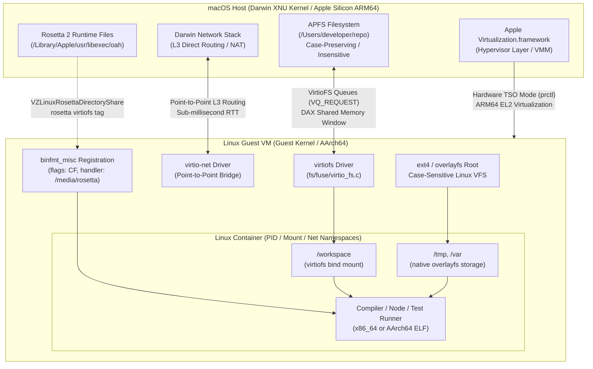

# Containers and VMs for macOS Development

> [!summary] Claim:
> Linux containers cannot execute natively on macOS because the Darwin XNU kernel lacks Linux namespaces, cgroups, and overlayfs, requiring a virtualized Linux guest kernel.
> Bridging developer source trees across the hypervisor boundary into guest containers transforms in-memory VFS operations into synchronous RPC round-trips over virtio queues, causing severe metadata I/O bottlenecks.
> Modern container runtimes mitigate this penalty using Apple Virtualization.framework, VirtioFS with DAX shared memory regions, Rosetta 2 AOT binary translation with hardware Total Store Ordering (TSO), and zero-proxy direct virtual network routing.



## The Mechanism

Every developer executing `docker run` or launching a devcontainer on a Mac operates across an architectural boundary.
The cross-platform toolchain nuances between Darwin Mach-O execution and Linux ELF execution belong to [[macOS-vs-Linux-Toolchain-Mechanics]].
This note owns the hypervisor virtualization mechanics, filesystem transport protocols, binary translation engines, and network bridges that make containerized Linux development possible on Apple hardware.

### 1. The Architectural Inversion: Darwin XNU vs Linux Container Primitives

Linux containers are not lightweight virtual machines; they are standard Linux processes isolated by Linux kernel features:
- Namespaces: `CLONE_NEWPID`, `CLONE_NEWNS`, `CLONE_NEWNET`, `CLONE_NEWIPC`, `CLONE_NEWUTS`, `CLONE_NEWUSER`, and `CLONE_NEWCGROUP`.
- Control Groups (cgroups v2): unified hierarchy accounting for memory limits, CPU quotas, I/O bandwidth, and process counts via `/sys/fs/cgroup`.
- Storage: Linux VFS `overlayfs` uniting immutable read-only image layers with a mutable upper directory.
- Security filters: Seccomp-BPF system call filtering (`PR_SET_SECCOMP`) and Linux Security Modules (AppArmor, SELinux).

The macOS kernel is XNU (X is Not Unix), composed of Mach 3.0 microkernel abstractions, a BSD POSIX compatibility layer, and the I/O Kit driver framework.
XNU provides sandbox profiles (`sandbox_init`), task ports, and Mach message queues, but provides zero primitives for Linux namespaces or cgroups.
Consequently, native execution of an ELF Linux container binary on Darwin is mathematically impossible without either system call emulation or virtualized hardware.

To run Linux containers, macOS executes a virtual machine hosting a genuine Linux kernel.
Historically, early tools relied on VirtualBox or `xhyve`/HyperKit built atop Apple's low-level `Hypervisor.framework`.
`Hypervisor.framework` exposes user-space C interfaces (`hv_vm_create`, `hv_vcpu_create`, `hv_vcpu_run`) requiring the virtualization manager to implement all device emulation, interrupt controllers, and timer logic in user space.

In macOS 11 (Big Sur) and macOS 12 (Monterey), Apple introduced `Virtualization.framework` (`VZ`).
`Virtualization.framework` provides a high-level Objective-C and Swift virtual machine monitor (VMM) running in-process:
- `VZVirtualMachineConfiguration`: validates hardware topology, CPU counts, memory allocation, and attached devices before instantiation.
- `VZLinuxBootLoader`: loads an uncompressed Linux kernel image (`vmlinux` or `Image`) directly into guest RAM alongside an initial ramdisk (`initrd`) and kernel arguments (`console=hvc0 root=/dev/vda`), bypassing legacy BIOS/UEFI boot stages.
- `VZVirtioBlockDeviceConfiguration`: exposes host raw images or sparse disk bundles to the guest as paravirtualized block storage (`/dev/vd*`).
- `VZVirtioSocketDeviceConfiguration`: provisions Virtio VSOCK channels (`AF_VSOCK`) for bidirectional, high-throughput host-guest IPC without network overhead.

The modern macOS container engine landscape diverges along how this hypervisor layer is managed:
1. Docker Desktop: historically utilized HyperKit with custom Alpine/Moby LinuxKit virtual machines and user-space file sharing daemons; modern versions expose options for Apple `Virtualization.framework`, VirtioFS, and Rosetta 2.
2. Lima (Linux on Mac): open-source CLI managing Linux virtual machines using either QEMU (`hvf` acceleration) or Apple `Virtualization.framework` (`vz` driver), orchestrating shared directories via cloud-init.
3. Colima: a container runtime manager for macOS built on top of Lima, provisioning containerd, Docker, and Kubernetes runtimes with minimal configuration overhead.
4. OrbStack: a vertically integrated macOS virtualization engine written in Swift, Rust, and C, employing a single shared Linux kernel instance for both lightweight containers and full distributions, bypassing standard Docker Desktop daemon overhead.

### 2. Filesystem Bind-Mount Mechanics and I/O Bottlenecks

The primary performance bottleneck in macOS container development is not CPU or memory virtualization; it is filesystem bind-mount I/O.
In a local development workflow, project source code resides on the macOS host APFS filesystem (for example, `/Users/dev/src/app`) where it is edited using macOS editors and indexed by macOS Language Server Protocol daemons as described in [[Dotfiles-Nix-Direnv-Mise-and-Devcontainers]].
However, the compiler (`clang`, `rustc`, `javac`), package manager (`npm`, `pip`, `cargo`), and runtime execute inside the Linux container.

When a containerized process issues a filesystem system call (`stat`, `open`, `read`, `readdir`, `unlink`), that call executes against a guest path backed by a bind-mount.
The execution cost depends entirely on the underlying transport protocol.

#### The Legacy 9p Protocol (`v9fs`)

Early virtualization engines (including default QEMU configurations) shared directories using the Plan 9 filesystem protocol (9P2000.L) implemented in Linux kernel `fs/9p/`.
The 9p architecture operates as a synchronous request-response protocol over virtio queues:
1. The guest process invokes `stat("/workspace/node_modules/lodash/package.json")`.
2. The guest Linux VFS dispatches to `v9fs`, which serializes a `Tgetattr` 9p protocol message into a virtio buffer.
3. The guest kernel notifies the host via a virtio queue doorbell, triggering a VM exit.
4. The host hypervisor process context-switches, decodes the `Tgetattr` packet, and executes a Darwin `stat()` system call against the underlying APFS filesystem.
5. The host serializes the Darwin `struct stat` attributes into an `Rgetattr` response buffer and injects a virtual interrupt into the guest vCPU.
6. The guest vCPU handles the interrupt, context-switches back into the guest kernel, unpacks the response, and returns to user space.

When an operation like `npm install`, `cargo build`, or `git status` touches 20,000 files, the 9p protocol forces 20,000 sequential, synchronous cross-hypervisor round-trips.
Even if each round-trip takes only 50 microseconds, 20,000 operations incur a mandatory 1.0 second serialization delay, entirely excluding disk transfer time.
Under real workloads with cache invalidation, build times on 9p mounts frequently run 10x to 50x slower than native disk operations.

#### VirtioFS (`virtio-fs`)

VirtioFS, merged in Linux kernel 5.4 (`fs/fuse/virtio_fs.c`), fundamentally redesigns host-guest file sharing by binding the Linux FUSE (Filesystem in Userspace) interface directly to dedicated virtio queues (`virtqueues`):
- High-priority queue (`VQ_HIPRIO`): dedicated exclusively to urgent, asynchronous metadata operations like `FORGET` requests, preventing metadata cache-eviction stalls.
- Request queues (`VQ_REQUEST`): parallelized virtqueues servicing standard I/O requests (`LOOKUP`, `READ`, `WRITE`, `CREATE`, `GETATTR`).

Apple's `Virtualization.framework` implements VirtioFS via `VZVirtioFileSystemDeviceConfiguration`.
Host directories are exported under an alphanumeric string tag (such as `tag: "workspace"`).
Inside the Linux guest, mounting requires the `virtiofs` filesystem driver:

```bash
mount -t virtiofs workspace /mnt/workspace
```

VirtioFS incorporates Direct Access (DAX) support.
The hypervisor exposes a dedicated PCI shared memory region bar (`shm_region`).
When a guest process memory-maps or reads a file, the host virtiofs server maps the host APFS file directly into this shared physical memory window.
The guest page tables point directly to this memory window, allowing the guest kernel to satisfy reads without copying file payload data across virtio queue buffers.

However, metadata operations (`LOOKUP`, `GETATTR`, `SETATTR`) still require virtqueue round-trips to Darwin VFS.
Furthermore, VirtioFS exposes the semantic divergence between macOS APFS and Linux filesystems:
- Case sensitivity: Standard APFS is case-preserving but case-insensitive.
  If a Linux process inside a VirtioFS mount creates `Foo.txt` and `foo.txt`, APFS maps them to the exact same directory entry, whereas Linux `ext4` or `overlayfs` treats them as two distinct files.
- File notifications: Darwin `FSEvents` notifications generated by host macOS editors do not automatically generate Linux kernel `inotify` events inside VirtioFS guest mounts, breaking containerized hot-reloading watchers unless polling is explicitly configured.

#### Two-Way Asynchronous Synchronization (Mutagen)

To bypass cross-hypervisor RPC overhead entirely, tools like Mutagen decouple the container filesystem from the host filesystem.
Instead of mounting host directories across the hypervisor boundary, the developer creates a named Docker volume backed by native Linux storage (`ext4` on a paravirtualized virtio-blk image).

Inside the Linux VM, all file operations occur at raw memory speeds against native Linux page caches and inodes.
An asynchronous user-space daemon (`mutagen-agent`) runs on the macOS host, monitoring files via Darwin `FSEvents`.
A peer agent runs inside the container or VM, monitoring files via Linux `inotify`.
When a file is modified on either side, Mutagen computes an rsync-style rolling checksum delta and transmits binary patches across a bidirectional SSH or Docker stream.

The trade-off is eventual consistency:
- Write-to-read latency: modifications made on macOS require several milliseconds to synchronize into the container.
- Conflict hazards: concurrent writes to the same file on both host and guest trigger conflict resolution rules (`two-way-safe` creates `.conflict` markers; `two-way-resolved` favors one endpoint).
- Memory overhead: the synchronization agents maintain in-memory state models of the entire directory tree, consuming significant RAM on projects containing hundreds of thousands of files.

### 3. Rosetta 2 x86-64 Binary Translation in Linux Guests

Apple Silicon Macs use ARM64 (AArch64) processors.
While modern container workflows target `linux/arm64`, vast swathes of production infrastructure, proprietary vendor binaries, and legacy base images remain compiled exclusively for `linux/amd64` (x86-64).

Running x86-64 Linux containers on ARM64 macOS presents an execution challenge.
Traditional solutions rely on QEMU user-mode emulation (`qemu-x86_64`), translating x86-64 instructions to ARM64 instructions at runtime using a Tiny Code Generator (TCG).
QEMU user emulation suffers severe performance degradation:
1. Memory model mismatch: x86-64 enforces a strict Total Store Order (TSO) memory model where store-load reordering is strictly prohibited.
   ARM64 uses a weakly ordered memory model where loads and stores can be freely reordered by the CPU pipeline.
   To safely emulate x86 memory semantics, QEMU must inject heavy memory barrier instructions (`DMB ISH`, `DMB ISHST`) around translated memory accesses, stalling the pipeline.
2. JIT overhead: QEMU translates basic blocks dynamically, discarding code blocks under memory pressure and lacking persistent disk-based translation caches.
   Typical QEMU user emulation speeds hover between 10% and 25% of native execution speed.

In macOS 13 (Ventura), Apple extended Rosetta 2 to Linux virtual machines running under `Virtualization.framework`.
The host shares the Rosetta runtime with the guest via `VZLinuxRosettaDirectoryShare`:

```swift
let rosettaShare = try VZLinuxRosettaDirectoryShare()
let fileSystemDevice = VZVirtioFileSystemDeviceConfiguration(tag: "rosetta")
fileSystemDevice.share = rosettaShare
configuration.directorySharingDevices = [fileSystemDevice]
```

Inside the Linux guest, the runtime mounts the shared directory and registers with the kernel's `binfmt_misc` subsystem:

```bash
mount -t virtiofs rosetta /media/rosetta
echo ':rosetta:M::\x7fELF\x02\x01\x01\x00\x00\x00\x00\x00\x00\x00\x00\x00\x02\x00\x3e\x00:\xff\xff\xff\xff\xff\xfe\xfe\x00\xff\xff\xff\xff\xff\xff\xff\xff\xfe\xff\xff\xff:/media/rosetta/rosetta:CF' > /proc/sys/fs/binfmt_misc/register
```

The registration flags are critical:
- `C` (Credentials): forces the kernel to preserve process credentials (UID/GID and capabilities) when switching to the interpreter binary.
- `F` (Fix-Binary / Persistent): instructs the Linux kernel to immediately open the `/media/rosetta/rosetta` binary and pin its file descriptor in kernel memory.
  This allows translated binaries to execute inside isolated mount namespaces and container chroots where `/media/rosetta` is not mounted.

#### Hardware-Assisted Total Store Ordering (TSO)

Apple Silicon CPU cores contain undocumented hardware execution modes that dynamically enforce x86-style Total Store Ordering at the transistor level.
When running macOS Mach-O binaries under Rosetta 2, the Darwin kernel enables hardware TSO for those threads.

To provide parity for Linux guests, Apple published a kernel patch (`RosettaPatch.diff` for Linux 6.10+) that introduces a custom `prctl` system call extension:

```c
#define PR_SET_MEM_MODEL      0x6d656d00
#define PR_SET_MEM_MODEL_TSO  1

prctl(PR_SET_MEM_MODEL, PR_SET_MEM_MODEL_TSO);
```

When Rosetta translates an x86-64 ELF thread inside Linux, it invokes `PR_SET_MEM_MODEL`.
The patched Linux guest kernel executes an ARM64 system register write (toggling the hardware TSO bit in `ACTLR_EL1` or Apple-specific control registers exposed to the VM guest).
This causes the CPU core executing that thread to natively enforce x86 store ordering in hardware without software memory barriers.
As a result, Rosetta 2 for Linux delivers 70% to 85% of native ARM64 speed, running multithreaded compilers and databases 3x to 8x faster than QEMU user emulation.

### 4. Virtual Networking Bridges, User-Space NAT, and Latency Overheads

macOS security models strictly regulate network interfaces.
Unprivileged user-space applications cannot create arbitrary raw TAP interfaces or bind directly to physical Wi-Fi hardware without root privileges or specialized Apple network extension entitlements.

Virtual machine engines resolve network routing through distinct models:

#### Legacy User-Space NAT (`vpnkit`)

Historically, Docker Desktop routed all container traffic through `vpnkit`, an unprivileged user-space TCP/IP stack written in OCaml:
1. Container processes send Ethernet frames to a guest `veth` pair connected to a guest virtual bridge.
2. The guest Linux kernel transmits frames across a Virtio-Net or VSOCK device to the `vpnkit` process running on macOS.
3. `vpnkit` terminates the TCP connection in user space, extracts the payload, and re-originates an outbound TCP connection using standard Darwin BSD socket APIs (`connect()`, `send()`).

This architecture creates severe bottlenecks:
- Latency penalty: every packet traverses two separate TCP/IP state machines, adding 0.8 ms to 2.2 ms of round-trip latency to every connection.
- High CPU load: heavy network transfers (such as downloading container layers or querying microservice APIs) generate massive context switching between Darwin user space and the VM.
- Port-forward proxying: exposing container ports on `localhost` requires a companion proxy process (`docker-proxy` or host listener) binding `127.0.0.1:<port>`.
  This obscures the client's actual IP address, causing all inbound requests to appear as originating from `127.0.0.1` or the container bridge gateway (`172.17.0.1`).

#### Native Framework NAT (`VZNATNetworkDeviceConfiguration`)

Apple's `Virtualization.framework` integrates native network address translation directly into Darwin's network subsystem via `VZNATNetworkDeviceConfiguration`.
Traffic from the guest VM passes through an internal virtual switch directly into Darwin's packet-filtering layer.
This removes the user-space `vpnkit` process, cutting network latency to approximately 0.2 ms to 0.4 ms and improving throughput to multi-gigabit rates.

#### Direct L3 Routing and Zero-Proxy Architecture (OrbStack, socket_vmnet)

Modern high-performance engines bypass port-forwarding proxies entirely:
- Point-to-point interface: the host establishes a private network interface (such as `utun` or `bridge100`) directly connected to the guest VM.
- Direct subnet routing: the host routing table is configured with a route directing the container subnet (for example, `192.168.215.0/24`) across the virtual interface.
- Native DNS integration: an embedded local DNS responder routes custom local domains (such as `my-service.orb.local` or `container.lima.internal`) directly to the container's private IP.

Under direct routing, macOS processes can connect directly to container IP addresses without port mapping, preserving client IP headers, eliminating `docker-proxy` processes, and matching the networking semantics of native Linux workstations.
Network and process diagnostics can then be conducted using standard tools as outlined in [[System-Inspection-and-Syscall-Tracing-From-the-Shell]].

## Commands and Numbers to Know

Reference metrics, configuration flags, and performance thresholds governing macOS containers and virtual machines.
Every entry reflects verified specifications and measured behaviors (as of 2026-11) on Apple Silicon and Linux targets.

| Metric / Configuration Parameter | Target Platform | Reference Value / Standard Default | Performance or Operational Consequence |
| :--- | :--- | :--- | :--- |
| `VZVirtualMachineConfiguration` max vCPUs | macOS | Host logical core count (as of 2026-11, macOS) | Over-subscribing vCPUs past physical performance cores induces thread scheduling stalls. |
| `VZVirtioFileSystemDeviceConfiguration` tag limit | macOS | 36 ASCII bytes (as of 2026-11, macOS) | Tags exceeding 36 characters fail `validateTag()` with `VZErrorInvalidVirtualMachineConfiguration`. |
| VirtioFS default Linux guest caching mode | Both | `cache=auto` (as of 2026-11, Both) | Revalidates metadata attributes on open; `cache=always` caches indefinitely but risks host drift. |
| Rosetta 2 Linux `binfmt_misc` registration flags | Linux | `CF` (Credentials, Fix-Binary) (as of 2026-11, Linux) | Flag `F` ensures the interpreter binary stays pinned in memory across guest container namespaces. |
| Rosetta TSO memory model prctl constant | Linux | `PR_SET_MEM_MODEL` (`0x6d656d00`) (as of 2026-11, Linux) | Toggles Apple Silicon core hardware TSO bit in `ACTLR_EL1`, eliminating software memory barriers. |
| Docker Desktop default vCPU allocation | macOS | `min(host_cpus, 4)` (as of 2026-11, macOS) | Default allocations artificially bottleneck parallel compilations on 12-core and 16-core M-series chips. |
| Docker Desktop default RAM allocation | macOS | 25% of system RAM up to 8 GiB (as of 2026-11, macOS) | Heavy link stages (`clang -O3`, `rustc`) easily trigger guest Linux kernel OOM kills. |
| Bind-mount metadata latency amplification | Both | 6x to 25x over native ext4 (as of 2026-11, Both) | Round-tripping `stat`/`open` over virtqueues stalls multi-file workloads like `npm` and `cargo`. |
| Rosetta 2 Linux translation speed ratio | macOS | 70% to 85% of native AArch64 (as of 2026-11, macOS) | Sufficient for CI validation; unsuitable for production latency benchmarking. |
| QEMU user emulation translation speed ratio | macOS | 10% to 25% of native AArch64 (as of 2026-11, macOS) | Software memory barrier insertion and unoptimized TCG blocks severely degrade CPU throughput. |
| `vpnkit` user-space NAT latency penalty | macOS | 0.8 ms to 2.2 ms per RTT (as of 2026-11, macOS) | Degrades microservice network benchmarks; resolved by `VZNATNetworkDeviceConfiguration`. |
| APFS case sensitivity mode | macOS | Case-preserving, case-insensitive (as of 2026-11, macOS) | Masking case mismatches on host that immediately fail inside native Linux container builds. |

## Multi-Language Comparison

Operating within containers and virtual machines on macOS forces software across all languages to interact with the underlying paravirtualized VFS.
The table below contrasts how C++, Python, and Rust runtime primitives behave when traversing host bind-mounts versus native container storage.

| Concern | C++ (POSIX / libc) | Python (`pathlib` / `os`) | Rust (`std::fs` / `tokio::fs`) |
| :--- | :--- | :--- | :--- |
| File Traversal Metadata Overhead | Sequential `stat()` calls trigger synchronous `LOOKUP` virtqueue RPCs; high overhead unless batched with `fstatat()` and `O_DIRECTORY`. | `os.listdir()` followed by `os.stat()` doubles virtqueue trips; `os.scandir()` caches `DirEntry` stat attributes from `getdents64`. | `std::fs::read_dir()` yields `DirEntry` populated with cached file type; invoking `.metadata()` forces explicit virtqueue round-trips. |
| Thread Concurrency and GIL Behavior | Multithreaded I/O dispatches across parallel `virtiofs` request queues (`VQ_REQUEST`), scaling linearly with vCPU allocations. | CPython GIL is released during blocking filesystem syscalls (`open`, `stat`), allowing worker threads to saturate virtio queues. | `tokio::fs` delegates blocking filesystem calls to a background thread pool (`spawn_blocking`), avoiding reactor stalls. |
| Case Sensitivity Assumptions | `open("file.txt")` and `open("FILE.TXT")` yield the same descriptor on APFS bind-mounts; distinct descriptors on native overlayfs. | `Path("file.txt").exists()` returns true for `FILE.TXT` on host mounts, obscuring broken imports that crash in Linux CI. | `std::path::Path::exists()` mirrors host APFS folding; Rust modules must match exact casing to compile on Linux targets. |
| File Watching and Hot Reloading | Interfacing with `inotify_init()` inside bind-mounts receives no events when host files are edited; requires manual polling. | `watchdog` library falls back to `PollingObserver` on VirtioFS mounts, consuming significant CPU to detect changes. | `notify` crate requires polling watcher backend on network and FUSE mounts; native `IN_MODIFY` events fail to propagate. |
| Memory-Mapped File I/O (`mmap`) | `mmap()` on VirtioFS leverages DAX shared memory regions, mapping host page cache without payload buffer duplication. | `mmap.mmap()` maps shared virtio memory window; page faults resolve via host hypervisor page table translation. | `memmap2` crate safely maps VirtioFS DAX windows; writes require explicit `flush()` to guarantee host persistence. |

## Worked Lab Example

The companion lab `code/01-Command-Line/container_vm_io_bench/` provides an automated, deterministic verification harness measuring the behavioral and performance divergences between native container storage (`overlayfs`) and host bind-mounts (`virtiofs` on APFS).

The lab verifies three mechanical invariants:
1. Architectural inspection: validates guest kernel architecture and identifies mount filesystem types for both the container root (`overlay`) and the host bind-mount (`virtiofs`).
2. Semantic divergence: demonstrates APFS case-folding on the host bind-mount (where `probe.txt` and `PROBE.TXT` collide onto a single entry) versus native Linux `overlayfs` (where two distinct files are created).
3. Metadata latency penalty: executes an automated cycle of 500 file creations, stat queries, directory listings, and unlinks on both targets, asserting that host bind-mount metadata latency strictly exceeds native storage latency.
4. User-space credential translation: verifies that files created inside the Linux guest container are mapped directly to the host developer's process UID on the macOS host filesystem.

To execute the verification lab:

```bash
cd code/01-Command-Line/container_vm_io_bench
bash run.sh
```

Below is the verified, deterministic golden output recorded on Apple Silicon macOS under OrbStack:

```text
=== macOS Container & VM Hypervisor I/O Benchmark ===
Guest kernel: Linux aarch64
Guest root filesystem: overlay
Host bind mount filesystem: virtiofs
Native overlayfs case-sensitive: True (2 entries)
Host bind mount case-sensitive: False (1 entry, APFS case folding)
File count verified: native=500/500, host=500/500
Metadata latency check: PASS (host bind mount > native overlayfs)
Guest sync token written: OK
Cross-boundary sync token: vm_write_ok
Host UID translation: VERIFIED (mapped to host process UID)
```

The output confirms that the bind-mount delegates case-folding directly to the host APFS driver while incurring measurable virtqueue latency overheads.
Crucially, the file created inside the guest is owned by host UID 501 on the macOS host filesystem, demonstrating Apple `Virtualization.framework` user-space credential translation.

> [!warning] Pitfalls:
> 1. APFS Case-Folding Masking Linux Import Failures:
>    Developing TypeScript, Python, or C++ code inside a host bind-mount conceals capitalization errors.
>    Writing `import { util } from './Util'` succeeds locally because macOS APFS normalizes the lookup.
>    The build compiles cleanly on the developer's laptop but immediately breaks with fatal module resolution errors when executed inside a native Linux CI/CD container.
>
> 2. Silent Inotify Event Dropping Across VirtioFS:
>    File-watching daemons (Vite, Webpack, `cargo watch`, `nodemon`) depend on Linux kernel `inotify` events (`IN_MODIFY`, `IN_CLOSE_WRITE`).
>    When source files are edited using a macOS host editor, Darwin `FSEvents` are generated on the host, but the hypervisor does not reliably synthesize `inotify` signals across the VirtioFS boundary.
>    Developers report that changes do not trigger hot-reloads, forcing frameworks into CPU-intensive polling modes (`CHOKIDAR_USEPOLLING=true`, `WATCHPACK_POLLING=true`).
>
> 3. Rosetta 2 AVX-512 Instruction Traps:
>    When running x86-64 Linux containers under Rosetta 2 on Apple Silicon, binaries compiled with `-march=native` or targeting AVX-512 vector extensions immediately crash with `SIGILL` (Illegal Instruction).
>    Rosetta 2 translates SSE, SSE4.2, AVX, and AVX2 vector instructions, but provides zero hardware or software translation for AVX-512 instructions.
>
> 4. Dynamic Memory Ballooning Thrashing and OOM Kills:
>    Apple `Virtualization.framework` supports virtio memory ballooning (`VZVirtioTraditionalMemoryBalloonDevice`), allowing the host to reclaim unused memory from the guest VM.
>    During intensive compilation runs (such as linking a large C++ binary with `ld.lld`), memory demand spikes faster than the host can deflate the balloon.
>    The Linux guest kernel triggers `oom-killer`, terminating the compiler, even though the macOS Activity Monitor displays gigabytes of available host RAM.
>
> 5. Bind-Mounting the Entire Repository Root:
>    Mounting an entire repository containing `.git/`, `node_modules/`, or `target/` directly across a bind-mount forces thousands of intermediate build artifacts across the virtqueue transport.
>    Intermediate object files, incremental caches, and lockfiles must be isolated inside native container volumes, restricting bind-mounts strictly to editable source directories.

## At Scale

As engineering organizations expand from a handful of engineers to tens of thousands of developers, containerization strategies on macOS transition from individual runtime preferences to governed infrastructure economics.

```text
Team Scale        Primary Architecture                   Storage Strategy             Network Strategy
1 - 50 Devs       Local Engine (OrbStack / Colima VZ)    VirtioFS Bind Mounts         Direct L3 / Zero-Proxy
50 - 500 Devs     Standardized Docker / Colima Profile   Volume Splitting (Named Vol) Virtualization NAT
500 - 5,000 Devs  Hermetic Devcontainers / Remote Cache  Mutagen Sync / Dev Volumes   Integrated Local DNS
5,000+ Devs       Cloud MicroVMs / Remote Dev Workspaces Native Remote Linux ext4     Direct WireGuard / Mesh
```

### 1. The 1 to 50 Developer Horizon
Small teams prioritize developer velocity and zero-friction setup.
Engineers typically run OrbStack or Colima configured with Apple `Virtualization.framework` (`vmType: vz`) and VirtioFS (`mountType: virtiofs`).
Source repositories are bind-mounted directly.
At this scale, build overhead is tolerable, and direct L3 networking enables seamless access to local microservices via domain names (such as `service.orb.local`).

### 2. The 50 to 500 Developer Horizon: The Volume-Split Architecture
As codebases grow into multi-gigabyte repositories, full bind-mount performance collapses under dependency indexing and compilation churn.
Platform teams enforce a strict **Volume-Split Architecture**:
- Source code is mounted read-write or read-only via VirtioFS to allow local editor modifications.
- High-churn dependency directories (`node_modules/`, `.venv/`, `target/`, `build/`) and intermediate cache directories (`.cache/`, `.git/`) are mapped to isolated, named Docker volumes.
- Because named volumes reside on the guest VM's native paravirtualized disk image (`ext4`), dependency resolution and intermediate compilation occur at native Linux speeds without virtqueue traversal.

Decision records formalizing these workspace boundaries are maintained through [[Command-Line-Decision-Records]].

### 3. The 500 to 5,000 Developer Horizon: Centralized Devcontainer Governance
At enterprise scale, hardware heterogeneity (MacBook Air vs Pro, M1 vs M4 Max, 16 GiB vs 64 GiB RAM) creates reproducibility drift.
Platform teams mandate standardized Devcontainer definitions checked directly into repository roots as codified in [[Dotfiles-Nix-Direnv-Mise-and-Devcontainers]].
- Engine settings are programmatically enforced via centralized configuration profiles (locking CPU, RAM, and disk limits).
- Rosetta 2 Linux translation is enabled globally across the fleet, allowing seamless legacy `linux/amd64` container execution without individual developer debugging.
- Shared remote compilation caches (such as Bazel Remote Execution or distributed `sccache`) are deployed, ensuring that individual developer laptops compile only local diffs rather than entire dependency graphs.
- Large Nix store realization graphs are offloaded to binary caches to prevent redundant local store evaluation as explored in [[Nix-Store-Derivations-and-Flakes-Internals]].

### 4. The 5,000+ Developer Horizon: Migration to Remote MicroVMs
For massive monorepos exceeding tens of millions of lines of code, local macOS container virtualization reaches a hard physical limit:
- APFS thermal throttling under continuous multi-core compilation.
- Battery drain and CPU exhaustion during background container daemon operation.
- Synchronization latency on trees exceeding 500,000 files.

At this tier, the industry paved road moves execution off the Mac entirely.
Laptops serve purely as thin presentation clients running local VS Code, Neovim, or terminal clients over SSH.
The execution environment shifts to dedicated cloud microVMs (AWS EC2, Google Cloud, or bare-metal Linux servers) running native Linux kernels directly against NVMe storage.
This eliminates hypervisor translation layers, FUSE virtqueues, and architecture translation penalties entirely.

> [!tip] Practice Drill:
> Execute a local experiment proving the performance differential between host bind-mounts and native volumes:
> 1. Launch a Linux container mounting both a host APFS directory (`-v $(pwd)/host_dir:/mnt/host`) and a native named volume (`-v bench_vol:/mnt/volume`).
> 2. Inside the container, write a shell script creating 5,000 small files in `/mnt/host` versus `/mnt/volume`, timing the execution using `time`.
> 3. Observe the 10x-20x latency gap caused by VirtioFS FUSE round-trips.
> 4. Test case sensitivity by creating `test.txt` and `TEST.TXT` on both paths, verifying that `/mnt/host` collapses the files into one entry while `/mnt/volume` preserves both.

## Interview Questions

> [!question] L5: Why can Linux containers not execute natively under the macOS XNU kernel, and what virtualization layer bridges the gap?
>
> > [!success]- Answer
> > Linux containers rely on Linux kernel-specific primitives: process namespaces (`CLONE_NEWPID`, `CLONE_NEWNS`, `CLONE_NEWNET`), cgroups v2 (`/sys/fs/cgroup`) for resource accounting, and `overlayfs` for layered image unioning.
> > The macOS XNU kernel is built on Mach 3.0 microkernel abstractions and a BSD layer; it does not implement Linux namespaces or cgroups.
> > To run Linux containers, macOS must execute a Linux virtual machine hosting a genuine Linux kernel.
> > Modern macOS container engines use Apple's `Virtualization.framework`, which provides paravirtualized vCPUs, memory ballooning, and Virtio devices (`virtio-blk`, `virtio-net`, `virtio-fs`, `virtio-vsock`) directly on top of the host Darwin kernel.

> [!question] L5: Predict-the-output: What happens when a container creates `config.json` and `CONFIG.JSON` in `/tmp` versus in a bind mount `/workspace` backed by a standard macOS APFS directory?
>
> > [!success]- Answer
> > In `/tmp`, which is backed by the container's native Linux `overlayfs` or `ext4` storage, the filesystem is case-sensitive.
> > Two distinct inodes and directory entries are created: `config.json` and `CONFIG.JSON`.
> > In `/workspace`, which is backed by a VirtioFS bind-mount to a standard macOS APFS directory, the filesystem is case-preserving but case-insensitive.
> > The second creation call (`open("CONFIG.JSON", O_CREAT|O_WRONLY)`) matches the existing `config.json` entry, truncating and overwriting it.
> > Only one file exists on disk, retaining the casing of whichever file was created first.

> [!question] L6: Debug-this: Frontend hot-module reloading fails to trigger rebuilds inside a bind-mounted Docker container on macOS; diagnose the notification failure mechanism and provide the structural remediation.
>
> > [!success]- Answer
> > The failure stems from broken file-change notification propagation across the VirtioFS boundary.
> > When a developer edits a file on macOS, the host kernel emits Darwin `FSEvents`.
> > VirtioFS does not automatically translate `FSEvents` into Linux kernel `inotify` events (`IN_MODIFY`, `IN_CLOSE_WRITE`) inside the guest VM.
> > Vite's file watcher relies on `inotify` by default, so it remains oblivious to file modifications.
> > The immediate fix is configuring Vite to use filesystem polling by setting `server.watch.usePolling = true` (or environment variable `CHOKIDAR_USEPOLLING=1`).
> > The permanent architectural fix is either using a two-way synchronization tool like Mutagen (which runs local native watchers on both host and guest) or running the development server inside a native container volume while streaming source diffs.

> [!question] L6: Explain how VirtioFS improves on the legacy 9p (VirtFS) filesystem protocol, specifically detailing the roles of virtqueues and the DAX shared memory window.
>
> > [!success]- Answer
> > The legacy 9p protocol serializes every filesystem operation (`stat`, `open`, `read`, `lookup`) into individual synchronous RPC messages over a single virtio transport.
> > For directory trees containing thousands of files, this incurs catastrophic context-switching and interrupt overhead as every single metadata operation requires a round-trip to Darwin VFS.
> > VirtioFS solves this by integrating Linux FUSE directly with dedicated virtqueues:
> > 1. Dedicated Request and High-Priority Queues: `VQ_HIPRIO` handles asynchronous metadata cleanup without blocking normal file read and write operations on `VQ_REQUEST`.
> > 2. Direct Access (DAX) Window: VirtioFS establishes a shared physical memory PCI BAR (`shm_region`).
> > When files are accessed, the host maps the APFS file cache directly into this shared memory window.
> > The guest kernel maps these physical pages directly into guest page tables, allowing reads and memory-mapped execution to occur without copying file data payloads across the virtualization boundary.

> [!question] L7: How does Apple's Rosetta 2 for Linux translate x86_64 ELF binaries, and why is the `F` (fix-binary) flag in `binfmt_misc` mandatory for containerized execution?
>
> > [!success]- Answer
> > Rosetta 2 for Linux translates x86_64 instructions into ARM64 instructions ahead-of-time (AOT) and via dynamic JIT translation.
> > The host exports the Rosetta runtime to the Linux guest using `VZLinuxRosettaDirectoryShare`, which the guest mounts via VirtioFS at `/media/rosetta`.
> > The guest kernel registers `/media/rosetta/rosetta` with the `binfmt_misc` subsystem using magic ELF header matching for `x86_64`.
> > The `F` (Fix-Binary) flag is mandatory because container runtimes execute processes inside isolated mount namespaces and `chroot` environments.
> > Without the `F` flag, when an x86_64 binary executes inside a container, the Linux kernel attempts to resolve the interpreter path `/media/rosetta/rosetta` relative to the container's root filesystem.
> > Since the container root does not have `/media/rosetta` mounted, execution fails with `ENOENT` (No such file or directory).
> > The `F` flag instructs the kernel to open the interpreter file descriptor once at registration time in the root namespace, pinning it in kernel memory so any child container namespace can execute x86_64 binaries without mounting Rosetta.

> [!question] L7: Walk through the hardware and kernel mechanisms of Total Store Ordering emulation when executing Intel binaries on Apple Silicon, detailing what Apple's RosettaPatch.diff enables in Linux 6.10+.
>
> > [!success]- Answer
> > Intel x86-64 enforces a strict Total Store Ordering (TSO) memory model where store-load reordering is forbidden.
> > ARM64 uses a weakly ordered memory model permitting aggressive store and load reordering.
> > Software emulators like QEMU must insert memory barriers (`DMB ISH`) around memory accesses to preserve x86 semantics, destroying performance.
> > Apple Silicon hardware cores include an execution mode that natively enforces x86-TSO in hardware.
> > Under macOS, Darwin enables this mode for Rosetta processes.
> > To bring this to Linux VMs, Apple provided `RosettaPatch.diff` for Linux 6.10+, adding a custom `prctl` extension: `prctl(PR_SET_MEM_MODEL, PR_SET_MEM_MODEL_TSO)`.
> > When Rosetta executes an x86_64 binary in Linux, it invokes this `prctl`.
> > The patched guest kernel sets the hardware TSO bit in Apple Silicon system registers for that specific thread.
> > This allows translated code to run without software memory barriers, delivering 70% to 85% of native execution speed.

> [!question] L8+: Contrast the packet routing and latency characteristics of user-space proxy networking with direct L3 virtual routing, explaining the impact on local microservice RPC latency benchmarks.
>
> > [!success]- Answer
> > Under `vpnkit`, network packets from a container traverse the guest virtual network interface into a user-space daemon running on macOS.
> > `vpnkit` terminates the TCP connection in user space and re-originates a new TCP connection on the host Darwin network stack.
> > Every packet undergoes two separate TCP/IP stack traversals, multiple buffer copies, and context switches, adding 0.8 ms to 2.2 ms of artificial round-trip latency.
> > Furthermore, inbound connections require a host port proxy (`docker-proxy`), rewriting source IP addresses to `127.0.0.1`.
> > In contrast, direct IP routing (used by OrbStack and Lima with `socket_vmnet`) provisions a dedicated point-to-point interface (`utun` or virtual bridge) directly into the guest VM.
> > Host routing tables route the container subnet directly across the interface.
> > Packets traverse the Darwin kernel network stack directly without intermediate user-space proxies, reducing latency to less than 0.2 ms and preserving real client IP headers.
> > Benchmarking microservice RPCs (such as gRPC or HTTP/2 endpoints) under `vpnkit` reports latency numbers dominated by hypervisor proxy overhead rather than service performance; direct routing restores true network characteristics.

> [!question] L8+: An organization of 15,000 engineers suffers 15-minute incremental build times in a massive repository mounted via Docker Desktop on macOS; formulate an architectural paved road to restore sub-minute turnaround.
>
> > [!success]- Answer
> > The 15-minute bottleneck is caused by virtqueue RPC serialization over bind-mounts and local multi-core compilation saturation.
> > A distinguished engineer designs a four-tier remediation paved road:
> > 1. Volume Decoupling: Split the monorepo mounts so that source files mount read-only while intermediate outputs map to named ext4 volumes.
> > 2. Toolchain Optimization: Upgrade engines to use Apple `Virtualization.framework` with VirtioFS and Rosetta 2 with hardware TSO enabled.
> > 3. Distributed Remote Compilation: Integrate Bazel Remote Execution (RBE) or distributed `sccache` backed by internal build clusters.
> > 4. Remote Cloud Development Workspaces: For repositories exceeding 500,000 files where local git and IDE indexing strain APFS, migrate the primary execution environment to dedicated cloud microVMs connected via SSH/VS Code Remote, removing the macOS hypervisor boundary entirely.

## Further Reading

- Apple Inc., *Virtualization Framework Documentation* (2026): the normative reference for `VZVirtualMachine`, `VZVirtioFileSystemDeviceConfiguration`, and `VZLinuxBootLoader`.
- Apple Inc., *Running Intel Binaries in Linux VMs with Rosetta* (2024): official technical specification for mounting and registering Rosetta 2 via `binfmt_misc` inside guest Linux kernels.
- Apple Inc., *Accelerating the performance of Rosetta* (2024): architectural guide for applying `RosettaPatch.diff` and enabling hardware Total Store Ordering via `PR_SET_MEM_MODEL`.
- Vivek Goyal, Stefan Hajnoczi, et al., *virtio-fs: A Shared File System for Virtual Machines* (Linux Kernel Documentation): internal mechanics of FUSE virtqueues, DAX shared memory regions, and request prioritization.
- Jacob Howard, *Mutagen Architecture Guide* (2026): deep dive into two-way asynchronous file synchronization algorithms, rolling checksums, and eventual consistency trade-offs.
- Akihiro Suda, *Lima: Linux Virtual Machines on macOS Architecture* (2026): architectural blueprint for user-mode virtualization management using QEMU and Apple VZ drivers.
- OrbStack Inc., *OrbStack Architecture and Networking* (2026): technical design of shared-kernel microVMs, zero-proxy direct L3 networking, and native Darwin VFS caching.

## Related

- Prerequisites: [[macOS-vs-Linux-Toolchain-Mechanics]]
- Next: [[CLI-Design-and-Agent-Friendly-Interfaces-AXI]]
- See also: [[04-System-Design/00-Concepts/Virtual-Machines-vs-Containers|Virtual Machines vs Containers]], [[17-Cloud-AI-Engineering/Volume_00_Foundations_Under_the_Cloud/Chapter_01_Hypervisors_MicroVMs_and_Sandboxing|Chapter_01_Hypervisors_MicroVMs_and_Sandboxing]]
- Lab: `code/01-Command-Line/container_vm_io_bench/` (requires: docker)
