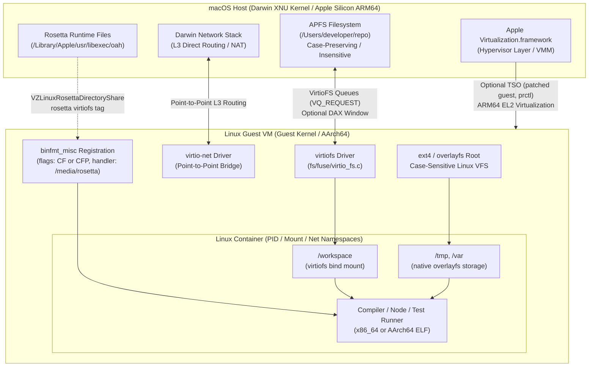

# Containers and VMs for macOS Development

> [!summary] Claim:
> Linux containers cannot execute natively on macOS because the Darwin XNU kernel lacks Linux namespaces, cgroups, and overlayfs, requiring a virtualized Linux guest kernel.
> Bridging developer source trees across the hypervisor boundary into guest containers transforms in-memory VFS operations into synchronous RPC round-trips over virtio queues, causing severe metadata I/O bottlenecks.
> Modern container runtimes mitigate this penalty using Apple Virtualization.framework, VirtioFS (with optional DAX shared memory windows where the host side supports them), Rosetta binary translation with optional hardware Total Store Ordering (TSO), and zero-proxy direct virtual network routing.



## The Mechanism

Every developer executing `docker run` or launching a devcontainer on a Mac operates across an architectural boundary.
The cross-platform toolchain nuances between Darwin Mach-O execution and Linux ELF execution belong to [[macOS-vs-Linux-Toolchain-Mechanics]].
This note owns the hypervisor virtualization mechanics, filesystem transport protocols, binary translation engines, and network bridges that make containerized Linux development possible on Apple hardware.

### 1. The Architectural Inversion: Darwin XNU vs Linux Container Primitives

Linux containers are not lightweight virtual machines; they are standard Linux processes isolated by Linux kernel features:
- Namespaces: `CLONE_NEWPID`, `CLONE_NEWNS`, `CLONE_NEWNET`, `CLONE_NEWIPC`, `CLONE_NEWUTS`, `CLONE_NEWUSER`, and `CLONE_NEWCGROUP`.
- Control Groups (cgroups v2): unified hierarchy accounting for memory limits, CPU quotas, I/O bandwidth, and process counts via `/sys/fs/cgroup`.
- Storage: Linux VFS `overlayfs` uniting immutable read-only image layers with a mutable upper directory.
- Security filters: Seccomp-BPF system call filtering (`PR_SET_SECCOMP`) and Linux Security Modules (AppArmor, SELinux).

The macOS kernel is XNU (X is Not Unix), composed of Mach 3.0 microkernel abstractions, a BSD POSIX compatibility layer, and the I/O Kit driver framework.
XNU provides sandbox profiles (`sandbox_init`), task ports, and Mach message queues, but provides zero primitives for Linux namespaces or cgroups.
Consequently, native execution of an ELF Linux container binary on Darwin is impossible without either system call emulation or virtualized hardware.

To run Linux containers, macOS executes a virtual machine hosting a genuine Linux kernel.
Historically, early tools relied on VirtualBox or `xhyve`/HyperKit built atop Apple's low-level `Hypervisor.framework`.
`Hypervisor.framework` exposes user-space C interfaces (`hv_vm_create`, `hv_vcpu_create`, `hv_vcpu_run`) requiring the virtualization manager to implement device emulation in user space; macOS 15 and later add an in-framework GICv3 interrupt controller (`hv_gic_create`, `API_AVAILABLE(macos(15.0))` in SDK header `hv_gic.h`, as of 2026-11).

In macOS 11 (Big Sur), Apple introduced `Virtualization.framework` (`VZ`); the `VZVirtualMachine` class is marked `API_AVAILABLE(macos(11.0))` in the SDK headers, and later releases added states and devices.
`Virtualization.framework` provides a high-level Objective-C and Swift virtual machine monitor (VMM) API:
- `VZVirtualMachineConfiguration`: validates hardware topology, CPU counts, memory allocation, and attached devices before instantiation.
- `VZLinuxBootLoader`: loads a Linux kernel image directly into guest RAM alongside an optional initial ramdisk (`initialRamdiskURL`) and kernel arguments (`commandLine`, for example `console=hvc0 root=/dev/vda`), bypassing BIOS/UEFI boot stages; it must be used with `VZGenericPlatformConfiguration` (SDK header `VZLinuxBootLoader.h`).
- `VZVirtioBlockDeviceConfiguration`: exposes host raw images or sparse disk bundles to the guest as paravirtualized block storage (`/dev/vd*`).
- `VZVirtioSocketDeviceConfiguration`: provisions Virtio VSOCK channels (`AF_VSOCK`) for bidirectional host-guest IPC without a network stack.

The modern macOS container engine landscape diverges along how this hypervisor layer is managed:
1. Docker Desktop: historically utilized HyperKit with custom LinuxKit virtual machines and user-space file sharing daemons; current versions offer the Apple Virtualization framework VMM and a beta Docker VMM, VirtioFS or gRPC FUSE file sharing, and an opt-in Rosetta setting that is disabled by default (Docker Desktop settings, as of 2026-11).
2. Lima (Linux on Mac): open-source CLI managing Linux virtual machines using either QEMU (`hvf` acceleration) or Apple `Virtualization.framework` (`vz` driver, the built-in default on macOS 13.5 and later), provisioning guests with cloud-init and sharing directories with `reverse-sshfs`, `9p`, or `virtiofs` (Lima `templates/default.yaml`, as of 2026-11).
3. Colima: a container runtime manager for macOS built on top of Lima, provisioning containerd, Docker, and Kubernetes runtimes with minimal configuration overhead.
4. OrbStack: a vertically integrated macOS virtualization engine whose services are written in Swift, Go, Rust, and C, running one lightweight Linux VM with a shared kernel for both containers and full distributions (OrbStack architecture docs, as of 2026-11).

### 2. Filesystem Bind-Mount Mechanics and I/O Bottlenecks

The primary performance bottleneck in macOS container development is usually not CPU or memory virtualization; it is filesystem bind-mount I/O.
In a local development workflow, project source code resides on the macOS host APFS filesystem (for example, `/Users/dev/src/app`) where it is edited using macOS editors and indexed by macOS Language Server Protocol daemons as described in [[Dotfiles-Nix-Direnv-Mise-and-Devcontainers]].
However, the compiler (`clang`, `rustc`, `javac`), package manager (`npm`, `pip`, `cargo`), and runtime execute inside the Linux container.

When a containerized process issues a filesystem system call (`stat`, `open`, `read`, `readdir`, `unlink`), that call executes against a guest path backed by a bind-mount.
The execution cost depends entirely on the underlying transport protocol.

#### The Legacy 9p Protocol (`v9fs`)

Earlier virtualization setups (including QEMU's `virtfs` sharing, still Lima's default `mountType` for QEMU since Lima v1.0) shared directories using the Plan 9 filesystem protocol (9P2000.L) implemented in Linux kernel `fs/9p/`.
The 9p architecture operates as a synchronous request-response protocol over virtio queues:
1. The guest process invokes `stat("/workspace/node_modules/lodash/package.json")`.
2. The guest Linux VFS dispatches to `v9fs`, which serializes a `Tgetattr` 9p protocol message into a virtio buffer.
3. The guest kernel notifies the host via a virtio queue doorbell, triggering a VM exit.
4. The host hypervisor process context-switches, decodes the `Tgetattr` packet, and executes a Darwin `stat()` system call against the underlying APFS filesystem.
5. The host serializes the Darwin `struct stat` attributes into an `Rgetattr` response buffer and injects a virtual interrupt into the guest vCPU.
6. The guest vCPU handles the interrupt, context-switches back into the guest kernel, unpacks the response, and returns to user space.

When an operation like `npm install`, `cargo build`, or `git status` touches 20,000 files, the 9p protocol forces 20,000 sequential, synchronous cross-hypervisor round-trips.
As an illustration (an assumed figure, not a measurement), at 50 microseconds per round-trip 20,000 operations would add 1.0 second of serialization delay, excluding disk transfer time.

#### VirtioFS (`virtio-fs`)

VirtioFS, merged in Linux kernel 5.4 (`fs/fuse/virtio_fs.c`; DAX support followed in 5.10, per KernelNewbies), redesigns host-guest file sharing by binding the Linux FUSE (Filesystem in Userspace) protocol directly to dedicated virtio queues (`virtqueues`):
- High-priority queue (`VQ_HIPRIO`): reserved for requests that have priority over normal requests, such as `FORGET`, so they can be sent even when the request queue is full (kernel `virtiofs.rst`).
- Request queues (`VQ_REQUEST`): one or more virtqueues, sized by the device's `num_request_queues` config field, servicing standard requests (`LOOKUP`, `READ`, `WRITE`, `CREATE`, `GETATTR`).

Apple's `Virtualization.framework` implements VirtioFS via `VZVirtioFileSystemDeviceConfiguration`.
Host directories are exported under a string tag (such as `tag: "workspace"`) that must be non-empty and less than 36 bytes when encoded in UTF-8 (SDK header `VZVirtioFileSystemDeviceConfiguration.h`, `validateTag:error:`).
Inside the Linux guest, mounting requires the `virtiofs` filesystem driver:

```bash
mount -t virtiofs workspace /mnt/workspace
```

VirtioFS defines optional Direct Access (DAX) support, enabled in the guest with `-o dax` or `-o dax=always|never|inode` (kernel `dax.rst`).
The device exposes a shared memory region (on PCI, a BAR described by a shared memory capability).
When DAX is enabled and the host server supports it, file contents are mapped from the host page cache into this window, so the guest can satisfy reads and `mmap` without copying file payload data through virtqueue buffers.
DAX is not the default: the OrbStack bind mount measured for this note is mounted `virtiofs rw,relatime` with no `dax` option (one-off `/proc/mounts` check on the lab host, as of 2026-11), and the macOS 27 SDK `Virtualization.framework` headers contain no DAX option.

However, metadata operations (`LOOKUP`, `GETATTR`, `SETATTR`) always require virtqueue round-trips to the host.
Furthermore, VirtioFS exposes the semantic divergence between macOS APFS and Linux filesystems:
- Case sensitivity: Standard APFS is case-preserving but case-insensitive.
  If a Linux process inside a VirtioFS mount creates `Foo.txt` and `foo.txt`, APFS maps them to the exact same directory entry, whereas Linux `ext4` or `overlayfs` treats them as two distinct files (proven by the lab below).
- File notifications: the VirtioFS protocol itself carries no change notifications, so host-side edits reach guest `inotify` watchers only if the engine forwards them.
  OrbStack does: a host edit to a bind-mounted file produced `IN_CREATE` and `IN_MODIFY|IN_CLOSE_WRITE` events inside the container (one-off probe on the lab host, not part of the lab, as of 2026-11).
  Lima ships this forwarding as `mountInotify`, experimental and disabled by default (Lima `templates/default.yaml`, as of 2026-11).

#### Two-Way Asynchronous Synchronization (Mutagen)

To bypass cross-hypervisor RPC overhead entirely, tools like Mutagen decouple the container filesystem from the host filesystem.
Instead of mounting host directories across the hypervisor boundary, the developer creates a named Docker volume backed by native Linux storage (`ext4` on a paravirtualized virtio-blk image).

Inside the Linux VM, all file operations run against native Linux page caches and inodes.
On the macOS side, the Mutagen daemon watches the local tree with the platform's native recursive watching (Mutagen watching docs: macOS and Windows provide it).
A Mutagen agent runs inside the container endpoint: Mutagen copies the agent binary in with `docker cp` and runs it with `docker exec`, talking to it over standard input and output (Mutagen Docker transport docs).
On Linux endpoints the default `portable` watching mode combines polling (10 seconds by default) with a restricted set of native watches on recently updated contents, because a watch per directory can exhaust descriptor quotas (Mutagen watching docs, as of 2026-11).
When a file is modified on either side, Mutagen transfers differential updates using an algorithm that, per its docs, "combines the performance of the rsync algorithm with bidirectionality and low-latency filesystem watching", over an SSH or Docker transport.

The trade-off is eventual consistency:
- Write-to-read latency: propagation is asynchronous, so a read on one side shortly after a write on the other can still see the old content.
- Conflict hazards: in `two-way-safe` mode (the default), conflicts are resolved automatically only when no data would be lost; the rest are kept in session state and reported by `mutagen sync list`, with no marker files written; in `two-way-resolved` mode the alpha endpoint wins every conflict (Mutagen synchronization docs, as of 2026-11).

### 3. Rosetta 2 x86-64 Binary Translation in Linux Guests

Apple Silicon Macs use ARM64 (AArch64) processors.
While modern container workflows target `linux/arm64`, much production infrastructure, proprietary vendor binaries, and legacy base images remain compiled exclusively for `linux/amd64` (x86-64).

Running x86-64 Linux containers on ARM64 macOS presents an execution challenge.
Traditional solutions rely on QEMU user-mode emulation (`qemu-x86_64`), translating x86-64 instructions to ARM64 instructions at runtime using the Tiny Code Generator (TCG).
QEMU user emulation suffers severe performance degradation:
1. Memory model mismatch: x86-64 enforces a Total Store Order (TSO) memory model in which only store-load reordering is permitted.
   ARM64 uses a weakly ordered memory model where loads and stores can be reordered by the CPU pipeline.
   To emulate x86 memory semantics on multithreaded code, a translator must insert memory barrier instructions (`DMB ISH`, `DMB ISHST`) or use acquire/release forms around translated memory accesses, stalling the pipeline.
2. JIT overhead: QEMU translates basic blocks dynamically, discarding code blocks under memory pressure and lacking persistent disk-based translation caches.

In macOS 13 (Ventura), Apple extended Rosetta to ARM Linux virtual machines running under `Virtualization.framework` (`VZLinuxRosettaDirectoryShare` is `API_AVAILABLE(macos(13.0))`).
In macOS 27 the translation support is built into macOS and no longer requires installing Rosetta (Apple, Running Intel Binaries in Linux VMs, as of 2026-11).
The host shares the Rosetta runtime with the guest via `VZLinuxRosettaDirectoryShare`:

```swift
let rosettaShare = try VZLinuxRosettaDirectoryShare()
let fileSystemDevice = VZVirtioFileSystemDeviceConfiguration(tag: "rosetta")
fileSystemDevice.share = rosettaShare
configuration.directorySharingDevices = [fileSystemDevice]
```

Inside the Linux guest, the runtime mounts the shared directory and registers with the kernel's `binfmt_misc` subsystem:

```bash
mount -t virtiofs rosetta /media/rosetta
echo ':rosetta:M::\x7fELF\x02\x01\x01\x00\x00\x00\x00\x00\x00\x00\x00\x00\x02\x00\x3e\x00:\xff\xff\xff\xff\xff\xfe\xfe\x00\xff\xff\xff\xff\xff\xff\xff\xff\xfe\xff\xff\xff:/media/rosetta/rosetta:CF' > /proc/sys/fs/binfmt_misc/register
```

The magic and mask match Apple's documented `update-binfmts` invocation.
Apple's current example uses `--credentials yes --preserve yes --fix-binary yes` (flags `CFP`) and says to set `preserve` to `no` (flags `CF`, as above) when using Rosetta in macOS 13.
The registration flags are critical (kernel `binfmt-misc.rst`):
- `C` (credentials): computes the new process's credentials and security token from the binary rather than from the interpreter, so setuid binaries keep their semantics; it implies `O` (open-binary).
- `F` (fix binary): opens the `/media/rosetta/rosetta` interpreter as soon as the emulation is installed and uses that opened image to spawn the emulator.
  This allows translated binaries to execute inside isolated mount namespaces and container chroots where `/media/rosetta` is not mounted.
- `P` (preserve-argv[0]): passes the original `argv[0]` to the interpreter as an extra argument.

In macOS 14 and later, Rosetta in Linux VMs can also use an ahead-of-time (AOT) translation cache served by a Rosetta daemon, configured with `VZLinuxRosettaUnixSocketCachingOptions` or `VZLinuxRosettaAbstractSocketCachingOptions` (Apple docs and SDK headers).

#### Hardware-Assisted Total Store Ordering (TSO)

Apple Silicon CPU cores contain an implementation-defined mode, controlled by the `ACTLR.TSOEN` bit, that switches the core to the x86-64 TSO memory model in hardware (Apple, Accelerating the performance of Rosetta).

To provide parity for Linux guests, Apple publishes a kernel patch (`RosettaPatch.diff`, which applies cleanly to Linux 6.10) that context-switches `ACTLR.TSOEN` per thread and adds a `prctl` mode for userspace to set it:

```c
/* Constants come from the patched kernel's include/uapi/linux/prctl.h. */
prctl(PR_SET_MEM_MODEL, PR_SET_MEM_MODEL_TSO);
```

Apple's page does not print the numeric value, and `RosettaPatch.zip` requires a developer login, so take the constants from the kernel tree you patch.
An Apple-authored LKML series from 2024-04 defines `PR_SET_MEM_MODEL` as `71` with `PR_SET_MEM_MODEL_TSO` as `1`, and neither is in mainline `include/uapi/linux/prctl.h` (as of 2026-11).
Apple's page says the app needs to call this `prctl` on each thread that needs TSO.
The patched Linux guest kernel then sets `ACTLR.TSOEN` for that thread, so the core enforces x86 store ordering in hardware without software memory barriers.
Apple notes that without selective enablement the system opts all processes into TSO, which slows native ARM processes.

### 4. Virtual Networking Bridges, User-Space NAT, and Latency Overheads

macOS security models strictly regulate network interfaces.
Bridging a guest onto a physical interface with `VZBridgedNetworkDeviceAttachment` requires the app to hold the `com.apple.vm.networking` entitlement (SDK header `VZBridgedNetworkDeviceAttachment.h`).

Virtual machine engines resolve network routing through distinct models:

#### Legacy User-Space NAT (`vpnkit`)

Historically, Docker Desktop routed all container traffic through `vpnkit`, an unprivileged user-space TCP/IP stack written in OCaml:
1. Container processes send Ethernet frames to a guest `veth` pair connected to a guest virtual bridge.
2. The guest Linux kernel transmits frames across a Virtio-Net or VSOCK device to the `vpnkit` process running on macOS.
3. `vpnkit` terminates the TCP connection in user space, extracts the payload, and re-originates an outbound TCP connection using standard Darwin BSD socket APIs (`connect()`, `send()`).

This architecture creates severe bottlenecks:
- Latency penalty: every packet traverses two separate TCP/IP state machines, adding round-trip latency to every connection.
- High CPU load: heavy network transfers (such as downloading container layers or querying microservice APIs) generate heavy context switching between Darwin user space and the VM.
- Port-forward proxying: exposing container ports on `localhost` requires a companion proxy process (`docker-proxy` or host listener) binding `127.0.0.1:<port>`.
  This obscures the client's actual IP address, so inbound requests can appear to originate from a gateway address rather than the real client.

#### Native Framework NAT (`VZNATNetworkDeviceAttachment`)

Apple's `Virtualization.framework` provides built-in network address translation through `VZNATNetworkDeviceAttachment`, attached to a `VZVirtioNetworkDeviceConfiguration`.
Traffic from the guest VM passes through a host virtual bridge (such as `bridge100`) into Darwin's network stack.
The translation is done by the host's networking stack rather than by a user-space proxy such as `vpnkit`.

#### Direct L3 Routing and Zero-Proxy Architecture (OrbStack, socket_vmnet)

Modern high-performance engines bypass port-forwarding proxies entirely:
- Point-to-point interface: the host establishes a private network interface (such as `utun` or `bridge100`) directly connected to the guest VM.
- Direct subnet routing: the host routing table is configured with a route directing the container subnet across the virtual interface (on the lab host, OrbStack's Docker `bridge` network is `192.168.215.0/24`, routed via `bridge101`, as of 2026-11).
- Native DNS integration: OrbStack gives each container a domain name, `container-name.orb.local`, or `service.project.orb.local` for Compose (OrbStack domains docs, as of 2026-11).

Under direct routing, macOS processes can connect directly to container IP addresses without port mapping, preserving client IP headers, eliminating `docker-proxy` processes, and matching the networking semantics of native Linux workstations.
Network and process diagnostics can then be conducted using standard tools as outlined in [[System-Inspection-and-Syscall-Tracing-From-the-Shell]].

## Commands and Numbers to Know

Reference metrics, configuration flags, and performance thresholds governing macOS containers and virtual machines.
Each row was checked against the sources listed or measured on the lab host (as of 2026-11).

| Metric / Configuration Parameter | Target Platform | Reference Value / Standard Default | Performance or Operational Consequence |
| :--- | :--- | :--- | :--- |
| `VZVirtualMachineConfiguration` max vCPUs | macOS | Class property `VZVirtualMachineConfiguration.maximumAllowedCPUCount`; measured 64 on a 12-logical-CPU Apple Silicon host (as of 2026-11, macOS) | The framework limit is not the host core count, so size vCPUs to the workload. |
| `VZVirtioFileSystemDeviceConfiguration` tag limit | macOS | Non-empty, less than 36 bytes in UTF-8 (as of 2026-11, macOS) | Check with `validateTag:error:`; an invalid tag fails configuration (`VZErrorInvalidVirtualMachineConfiguration` in Apple's sample). |
| VirtioFS caching mode | Both | Chosen by the host server, not a guest mount option; `virtiofsd` (QEMU's daemon) defaults to `--cache=auto` (virtiofsd README); the macOS 27 SDK `VZVirtioFileSystemDeviceConfiguration.h` has no cache option (as of 2026-11) | `auto` revalidates metadata attributes; `always` caches indefinitely but risks host drift. |
| Rosetta Linux `binfmt_misc` registration flags | Linux | `CFP` in Apple's current example; `CF` with Rosetta in macOS 13 (as of 2026-11, Linux) | Flag `F` opens the interpreter at registration so it works inside container mount namespaces. |
| Rosetta TSO memory model prctl constant | Linux | `PR_SET_MEM_MODEL` with `PR_SET_MEM_MODEL_TSO` (`1`); Apple's 2024 LKML series defines `PR_SET_MEM_MODEL` as `71`, not in mainline (as of 2026-11, Linux) | Sets the per-thread `ACTLR.TSOEN` bit on a kernel with `RosettaPatch.diff`, eliminating software memory barriers. |
| Docker Desktop CPU limit | macOS | Setting `CPU limit`, the maximum number of CPUs Docker Desktop uses; the settings page documents no default (as of 2026-11, macOS) | A low limit caps parallel compilation inside containers. |
| Docker Desktop default RAM allocation | macOS | 50% of host memory (as of 2026-11, macOS) | Heavy link stages (`clang -O3`, `rustc`) can still trigger guest Linux kernel OOM kills. |
| Bind-mount metadata latency amplification | macOS | 7.1x to 7.7x over native overlayfs for a 500-file create/stat/list/unlink cycle, OrbStack on the lab host (as of 2026-11, macOS) | Round-tripping `stat`/`open` over virtqueues stalls multi-file workloads like `npm` and `cargo`. |
| APFS case sensitivity mode | macOS | Case-preserving, case-insensitive by default (as of 2026-11, macOS) | Masks case mismatches on the host that fail inside native Linux container builds. |

## Multi-Language Comparison

Operating within containers and virtual machines on macOS forces software across all languages to interact with the underlying paravirtualized VFS.
The table below contrasts how C++, Python, and Rust runtime primitives behave when traversing host bind-mounts versus native container storage.

| Concern | C++ (POSIX / libc) | Python (`pathlib` / `os`) | Rust (`std::fs` / `tokio::fs`) |
| :--- | :--- | :--- | :--- |
| File Traversal Metadata Overhead | Each `stat()` can trigger `LOOKUP`/`GETATTR` virtqueue RPCs; `fstatat()` relative to an open directory fd avoids re-walking the path prefix but still costs one request per uncached entry. | `os.listdir()` followed by `os.stat()` adds one stat per entry; `os.scandir()` gets the file type from `getdents64`, so `is_dir()`/`is_file()` need no extra call, but on Unix `DirEntry.stat()` still requires a system call. | `std::fs::read_dir()` yields `DirEntry` populated with cached file type; invoking `.metadata()` forces explicit virtqueue round-trips. |
| Thread Concurrency and GIL Behavior | Multithreaded I/O can overlap requests on the virtiofs request queue(s) (`VQ_REQUEST`); scaling depends on how many request queues the device exposes. | CPython GIL is released during blocking filesystem syscalls (`open`, `stat`), allowing worker threads to keep multiple requests in flight. | `tokio::fs` delegates blocking filesystem calls to a background thread pool (`spawn_blocking`), avoiding reactor stalls. |
| Case Sensitivity Assumptions | `open("file.txt")` and `open("FILE.TXT")` resolve to the same file on APFS bind-mounts; distinct files on native overlayfs. | `Path("file.txt").exists()` returns true for `FILE.TXT` on host mounts, obscuring broken imports that crash in Linux CI. | `std::path::Path::exists()` mirrors host APFS folding; Rust modules must match exact casing to compile on Linux targets. |
| File Watching and Hot Reloading | `inotify` inside bind-mounts sees host edits only if the engine forwards them (OrbStack does; Lima's `mountInotify` is off by default); otherwise poll. | `watchdog` must fall back to `PollingObserver` on mounts without forwarded events, consuming CPU to detect changes. | `notify` crate needs its polling watcher on mounts without forwarded events; native `IN_MODIFY` events are absent there. |
| Memory-Mapped File I/O (`mmap`) | `mmap()` on VirtioFS can map host page cache through the DAX window only when mounted with `dax` and supported by the host; otherwise pages go through the guest page cache. | `mmap.mmap()` behaves the same way: DAX-backed only with `dax` enabled. | `memmap2` crate maps VirtioFS files like any other; writes require explicit `flush()` to guarantee persistence. |

## Worked Lab Example

The companion lab `code/01-Command-Line/container_vm_io_bench/` provides an automated verification harness measuring the behavioral and performance divergences between native container storage (`overlayfs`) and host bind-mounts (`virtiofs` on APFS).

The lab verifies four mechanical invariants:
1. Architectural inspection: validates guest kernel architecture and identifies mount filesystem types for both the container root (`overlay`) and the host bind-mount (`virtiofs`).
2. Semantic divergence: demonstrates case-folding on the host bind-mount (where `probe.txt` and `PROBE.TXT` collide onto a single entry, counted both by the guest and by macOS itself in the same directory) versus native Linux `overlayfs` (where two distinct files are created).
3. Metadata latency penalty: executes an automated cycle of 500 file creations, stat queries, directory listings, and unlinks on both targets, asserting that host bind-mount metadata latency is at least 2x the native storage latency (about 7x was observed under OrbStack); this is a thresholded wall-clock check, so its line depends on timing and a heavily loaded host can fail it.
4. Ownership: verifies that a file created inside the Linux guest container by the image's unprivileged `lab` user is owned on the macOS host by the UID of the process that ran the lab.

To execute the verification lab:

```bash
cd code/01-Command-Line/container_vm_io_bench
bash run.sh
```

Below is the verified golden output, `expected/darwin-arm64.txt`, recorded on Apple Silicon macOS (darwin-arm64) under OrbStack:

```text
=== macOS Container & VM Hypervisor I/O Benchmark ===
Guest kernel: Linux aarch64
Guest root filesystem: overlay
Host bind mount filesystem: virtiofs
Native overlayfs case-sensitive: True (2 entries)
Host bind mount case-sensitive: False (1 entry)
File count verified: native=500/500, host=500/500
Metadata latency check: PASS (host bind mount >= 2x native overlayfs)
Guest sync token written: OK
Host-side entries matching probe.txt: 1
Cross-boundary sync token: vm_write_ok
Host UID translation: VERIFIED (mapped to host process UID)
```

The output shows the bind mount collapsing both names into one entry, as seen from the guest and from macOS itself, while metadata operations cost at least twice as much as on native storage.
The file created inside the guest by the image's unprivileged `lab` user (the image sets `USER lab`, and `run.sh` passes no `--user`) is owned on the macOS host by the UID running the lab (`id -u`), because the host-side file server writes as the developer's user; the output is specific to OrbStack, and other engines may report a different bind-mount filesystem type.

> [!warning] Pitfalls:
> 1. APFS Case-Folding Masking Linux Import Failures:
>    Developing TypeScript, Python, or C++ code inside a host bind-mount conceals capitalization errors.
>    Writing `import { util } from './Util'` succeeds locally because macOS APFS normalizes the lookup.
>    The build compiles cleanly on the developer's laptop but immediately breaks with fatal module resolution errors when executed inside a native Linux CI/CD container.
>
> 2. Missing Inotify Events Across VirtioFS:
>    File-watching daemons (Vite, Webpack, `cargo watch`, `nodemon`) depend on Linux kernel `inotify` events (`IN_MODIFY`, `IN_CLOSE_WRITE`).
>    When source files are edited using a macOS host editor, Darwin `FSEvents` are generated on the host, and the guest sees `inotify` events only if the engine forwards them (OrbStack does, per a one-off probe; Lima's `mountInotify` is experimental and off by default).
>    Without forwarding, changes do not trigger hot-reloads, forcing frameworks into CPU-intensive polling modes (for Vite, `server.watch.usePolling`, which its docs note leads to high CPU utilization).
>
> 3. Rosetta AVX-512 Instruction Traps:
>    When running x86-64 Linux containers under Rosetta on Apple Silicon, binaries built for AVX-512 (for example with `-march=native` on an AVX-512 build machine) fail at the first AVX-512 instruction.
>    Apple documents that Rosetta translates all x86_64 instructions including AVX and AVX2 but does not support AVX-512 instructions, and tells code to check availability before running them (About the Rosetta translation environment, as of 2026-11; the page describes Rosetta on macOS and the Linux-guest page does not restate it).
>
> 4. Memory Ballooning and OOM Kills:
>    Apple `Virtualization.framework` supports virtio memory ballooning (`VZVirtioTraditionalMemoryBalloonDevice`), but it is host-driven: the host writes `targetVirtualMachineMemorySize`, and the guest returns or reclaims memory only when it handles the request (SDK header).
>    If an engine shrinks the guest and memory demand then spikes (such as linking a large C++ binary with `ld.lld`), the Linux guest kernel can trigger `oom-killer` and terminate the compiler.
>
> 5. Bind-Mounting the Entire Repository Root:
>    Mounting an entire repository containing `.git/`, `node_modules/`, or `target/` directly across a bind-mount forces thousands of intermediate build artifacts across the virtqueue transport.
>    Intermediate object files, incremental caches, and lockfiles must be isolated inside native container volumes, restricting bind-mounts strictly to editable source directories.

## At Scale

As engineering organizations expand from a handful of engineers to tens of thousands of developers, containerization strategies on macOS transition from individual runtime preferences to governed infrastructure economics.

```text
Team Scale        Primary Architecture                   Storage Strategy             Network Strategy
1 - 50 Devs       Local Engine (OrbStack / Colima VZ)    VirtioFS Bind Mounts         Direct L3 / Zero-Proxy
50 - 500 Devs     Standardized Docker / Colima Profile   Volume Splitting (Named Vol) Virtualization NAT
500 - 5,000 Devs  Hermetic Devcontainers / Remote Cache  Mutagen Sync / Dev Volumes   Integrated Local DNS
5,000+ Devs       Cloud MicroVMs / Remote Dev Workspaces Native Remote Linux ext4     Direct WireGuard / Mesh
```

### 1. The 1 to 50 Developer Horizon
Small teams prioritize developer velocity and zero-friction setup.
Engineers typically run OrbStack or Colima configured with Apple `Virtualization.framework` (`vmType: vz`) and VirtioFS (`mountType: virtiofs`).
Source repositories are bind-mounted directly.
At this scale, build overhead is tolerable, and direct L3 networking enables seamless access to local microservices via domain names (such as `service.project.orb.local`).

### 2. The 50 to 500 Developer Horizon: The Volume-Split Architecture
As codebases grow into multi-gigabyte repositories, full bind-mount performance collapses under dependency indexing and compilation churn.
Platform teams enforce a strict **Volume-Split Architecture**:
- Source code is mounted read-write or read-only via VirtioFS to allow local editor modifications.
- High-churn dependency directories (`node_modules/`, `.venv/`, `target/`, `build/`) and intermediate cache directories (`.cache/`, `.git/`) are mapped to isolated, named Docker volumes.
- Because named volumes reside on the guest VM's native paravirtualized disk image (`ext4`), dependency resolution and intermediate compilation occur at native Linux speeds without virtqueue traversal.

Decision records formalizing these workspace boundaries are maintained through [[Command-Line-Decision-Records]].

### 3. The 500 to 5,000 Developer Horizon: Centralized Devcontainer Governance
At enterprise scale, hardware heterogeneity (MacBook Air vs Pro, M1 vs M4 Max, 16 GiB vs 64 GiB RAM) creates reproducibility drift.
Platform teams mandate standardized Devcontainer definitions checked directly into repository roots as codified in [[Dotfiles-Nix-Direnv-Mise-and-Devcontainers]].
- Engine settings are programmatically enforced via centralized configuration profiles (locking CPU, RAM, and disk limits).
- Rosetta Linux translation is enabled globally across the fleet, allowing seamless legacy `linux/amd64` container execution without individual developer debugging.
- Shared remote compilation caches (such as Bazel Remote Execution or distributed `sccache`) are deployed, ensuring that individual developer laptops compile only local diffs rather than entire dependency graphs.
- Large Nix store realization graphs are offloaded to binary caches to prevent redundant local store evaluation as explored in [[Nix-Store-Derivations-and-Flakes-Internals]].

### 4. The 5,000+ Developer Horizon: Migration to Remote MicroVMs
For massive monorepos exceeding tens of millions of lines of code, local macOS container virtualization reaches a hard physical limit:
- Thermal throttling of the laptop under continuous multi-core compilation.
- Battery drain and CPU exhaustion during background container daemon operation.
- Synchronization latency on trees exceeding 500,000 files.

At this tier, the industry paved road moves execution off the Mac entirely.
Laptops serve purely as thin presentation clients running local VS Code, Neovim, or terminal clients over SSH.
The execution environment shifts to dedicated cloud microVMs (AWS EC2, Google Cloud, or bare-metal Linux servers) running native Linux kernels directly against NVMe storage.
This eliminates hypervisor translation layers, FUSE virtqueues, and architecture translation penalties entirely.

> [!tip] Practice Drill:
> Execute a local experiment proving the performance differential between host bind-mounts and native volumes:
> 1. Launch a Linux container mounting both a host APFS directory (`-v $(pwd)/host_dir:/mnt/host`) and a native named volume (`-v bench_vol:/mnt/volume`).
> 2. Inside the container, write a shell script creating 5,000 small files in `/mnt/host` versus `/mnt/volume`, timing the execution using `time`.
> 3. Observe the latency gap caused by VirtioFS FUSE round-trips (about 7x for the lab's 500-file cycle under OrbStack on the lab host, as of 2026-11; expect it to vary by engine).
> 4. Test case sensitivity by creating `test.txt` and `TEST.TXT` on both paths, verifying that `/mnt/host` collapses the files into one entry while `/mnt/volume` preserves both.

## Interview Questions

> [!question] L5: Why can Linux containers not execute natively under the macOS XNU kernel, and what virtualization layer bridges the gap?
>
> > [!success]- Answer
> > Linux containers rely on Linux kernel-specific primitives: process namespaces (`CLONE_NEWPID`, `CLONE_NEWNS`, `CLONE_NEWNET`), cgroups v2 (`/sys/fs/cgroup`) for resource accounting, and `overlayfs` for layered image unioning.
> > The macOS XNU kernel is built on Mach 3.0 microkernel abstractions and a BSD layer; it does not implement Linux namespaces or cgroups.
> > To run Linux containers, macOS must execute a Linux virtual machine hosting a genuine Linux kernel.
> > Modern macOS container engines use Apple's `Virtualization.framework`, which provides vCPUs, memory ballooning, and Virtio devices (`virtio-blk`, `virtio-net`, `virtio-fs`, `virtio-vsock`) on top of the host Darwin kernel.

> [!question] L5: Predict-the-output: What happens when a container creates `config.json` and `CONFIG.JSON` in `/tmp` versus in a bind mount `/workspace` backed by a standard macOS APFS directory?
>
> > [!success]- Answer
> > In `/tmp`, which is backed by the container's native Linux `overlayfs` or `ext4` storage, the filesystem is case-sensitive.
> > Two distinct inodes and directory entries are created: `config.json` and `CONFIG.JSON`.
> > In `/workspace`, which is backed by a VirtioFS bind-mount to a standard macOS APFS directory, the filesystem is case-preserving but case-insensitive.
> > The second creation call (`open("CONFIG.JSON", O_CREAT|O_WRONLY)`) matches the existing `config.json` entry, truncating and overwriting it.
> > Only one file exists on disk, retaining the casing of whichever file was created first (checked under OrbStack: one entry named `config.json` holding the second write, as of 2026-11).

> [!question] L6: Debug-this: Frontend hot-module reloading fails to trigger rebuilds inside a bind-mounted Docker container on macOS; diagnose the notification failure mechanism and provide the structural remediation.
>
> > [!success]- Answer
> > The failure stems from file-change notifications not crossing the VirtioFS boundary.
> > When a developer edits a file on macOS, the host kernel emits Darwin `FSEvents`.
> > The VirtioFS protocol carries no change notifications, so the guest sees Linux `inotify` events (`IN_MODIFY`, `IN_CLOSE_WRITE`) only if the engine forwards them; OrbStack does, while Lima's `mountInotify` forwarding is experimental and off by default.
> > Vite's file watcher relies on `inotify` by default, so without forwarding it remains oblivious to file modifications.
> > The immediate fix is configuring Vite to use filesystem polling by setting `server.watch.usePolling = true` (a chokidar option, per the Vite `server.watch` docs, which note high CPU utilization).
> > The permanent architectural fix is either enabling the engine's event forwarding, using a two-way synchronization tool like Mutagen (native recursive watching on macOS, polling plus a restricted set of native watches on Linux endpoints), or running the development server inside a native container volume while streaming source diffs.

> [!question] L6: Explain how VirtioFS improves on the legacy 9p (VirtFS) filesystem protocol, specifically detailing the roles of virtqueues and the DAX shared memory window.
>
> > [!success]- Answer
> > The legacy 9p protocol serializes every filesystem operation (`stat`, `open`, `read`, `lookup`) into individual synchronous RPC messages over a single virtio transport.
> > For directory trees containing thousands of files, this incurs heavy context-switching and interrupt overhead as every metadata operation requires a round-trip to the host VFS.
> > VirtioFS solves this by integrating Linux FUSE directly with dedicated virtqueues:
> > 1. Dedicated Request and High-Priority Queues: `VQ_HIPRIO` carries priority requests such as `FORGET` so they are not stuck behind a full `VQ_REQUEST` queue.
> > 2. Direct Access (DAX) Window: when mounted with `dax` and supported by the host, VirtioFS uses a shared memory region (a PCI BAR on virtio-pci).
> > The host maps file contents from its page cache into this shared memory window.
> > The guest kernel maps these pages directly into guest page tables, allowing reads and memory-mapped execution to occur without copying file data payloads across the virtualization boundary.

> [!question] L7: How does Apple's Rosetta for Linux translate x86_64 ELF binaries, and why is the `F` (fix-binary) flag in `binfmt_misc` mandatory for containerized execution?
>
> > [!success]- Answer
> > Rosetta for Linux translates x86_64 instructions into ARM64 instructions just in time, and in macOS 14 and later can also use an ahead-of-time translation cache served by a Rosetta daemon (`VZLinuxRosettaCachingOptions`).
> > The host exports the Rosetta runtime to the Linux guest using `VZLinuxRosettaDirectoryShare`, which the guest mounts via VirtioFS, conventionally at `/media/rosetta`.
> > The guest registers `/media/rosetta/rosetta` with the `binfmt_misc` subsystem using magic ELF header matching for `x86_64`.
> > The `F` (fix-binary) flag is mandatory because container runtimes execute processes inside isolated mount namespaces and `chroot` environments.
> > Without the `F` flag, when an x86_64 binary executes inside a container, the Linux kernel attempts to resolve the interpreter path `/media/rosetta/rosetta` relative to the container's root filesystem.
> > Since the container root does not have `/media/rosetta` mounted, execution fails with `ENOENT` (No such file or directory).
> > The `F` flag instructs the kernel to open the interpreter at registration time and use that opened image to spawn it, so any child container namespace can execute x86_64 binaries without mounting Rosetta.

> [!question] L7: Walk through the hardware and kernel mechanisms of Total Store Ordering emulation when executing Intel binaries on Apple Silicon, detailing what Apple's RosettaPatch.diff enables in Linux 6.10+.
>
> > [!success]- Answer
> > Intel x86-64 enforces a Total Store Ordering (TSO) memory model where only store-load reordering is permitted.
> > ARM64 uses a weakly ordered memory model permitting aggressive store and load reordering.
> > Software emulators like QEMU must insert memory barriers (`DMB ISH`) around memory accesses to preserve x86 semantics, destroying performance.
> > Apple Silicon cores include an implementation-defined mode, the `ACTLR.TSOEN` bit, that enforces x86-TSO in hardware.
> > To bring this to Linux VMs, Apple provides `RosettaPatch.diff` (applies cleanly to Linux 6.10), which context-switches `ACTLR.TSOEN` per thread and adds a `prctl` extension: `prctl(PR_SET_MEM_MODEL, PR_SET_MEM_MODEL_TSO)`.
> > Apple's page says the app calls this `prctl` on each thread that needs TSO.
> > The patched guest kernel sets `ACTLR.TSOEN` for that specific thread.
> > This allows translated code to run without software memory barriers.

> [!question] L8+: Contrast the packet routing and latency characteristics of user-space proxy networking with direct L3 virtual routing, explaining the impact on local microservice RPC latency benchmarks.
>
> > [!success]- Answer
> > Under `vpnkit`, network packets from a container traverse the guest virtual network interface into a user-space daemon running on macOS.
> > `vpnkit` terminates the TCP connection in user space and re-originates a new TCP connection on the host Darwin network stack.
> > Every packet undergoes two separate TCP/IP stack traversals, multiple buffer copies, and context switches, adding artificial round-trip latency.
> > Furthermore, inbound connections require a host port proxy (`docker-proxy`), rewriting source IP addresses to a gateway or loopback address.
> > In contrast, direct IP routing (used by OrbStack and Lima with `socket_vmnet`) provisions a dedicated point-to-point interface (`utun` or virtual bridge) directly into the guest VM.
> > Host routing tables route the container subnet directly across the interface.
> > Packets traverse the Darwin kernel network stack directly without intermediate user-space proxies and preserve real client IP headers.
> > Benchmarking microservice RPCs (such as gRPC or HTTP/2 endpoints) under `vpnkit` reports latency numbers dominated by proxy overhead rather than service performance; direct routing restores true network characteristics.

> [!question] L8+: An organization of 15,000 engineers suffers 15-minute incremental build times in a massive repository mounted via Docker Desktop on macOS; formulate an architectural paved road to restore sub-minute turnaround.
>
> > [!success]- Answer
> > The 15-minute bottleneck is caused by virtqueue RPC serialization over bind-mounts and local multi-core compilation saturation.
> > A distinguished engineer designs a four-tier remediation paved road:
> > 1. Volume Decoupling: Split the monorepo mounts so that source files mount read-only while intermediate outputs map to named ext4 volumes.
> > 2. Toolchain Optimization: Upgrade engines to use Apple `Virtualization.framework` with VirtioFS and Rosetta (with a TSO-patched guest kernel where the engine supports one) for `amd64` images.
> > 3. Distributed Remote Compilation: Integrate Bazel Remote Execution (RBE) or distributed `sccache` backed by internal build clusters.
> > 4. Remote Cloud Development Workspaces: For repositories exceeding 500,000 files where local git and IDE indexing strain APFS, migrate the primary execution environment to dedicated cloud microVMs connected via SSH/VS Code Remote, removing the macOS hypervisor boundary entirely.

## Further Reading

- Apple Inc., *Virtualization Framework Documentation* (2026): the normative reference for `VZVirtualMachine`, `VZVirtioFileSystemDeviceConfiguration`, and `VZLinuxBootLoader`.
- Apple Inc., *Running Intel Binaries in Linux VMs with Rosetta* (2026): official procedure for mounting and registering Rosetta via `binfmt_misc` inside guest Linux kernels, plus AOT caching options.
- Apple Inc., *Accelerating the performance of Rosetta* (2024): guide for applying `RosettaPatch.diff` and enabling hardware Total Store Ordering via `PR_SET_MEM_MODEL`.
- Vivek Goyal, Stefan Hajnoczi, et al., *virtio-fs: A Shared File System for Virtual Machines* (Linux Kernel Documentation): internal mechanics of FUSE virtqueues, DAX shared memory regions, and request prioritization.
- Jacob Howard, *Mutagen Architecture Guide* (2026): two-way asynchronous file synchronization, differential transfers, and conflict handling trade-offs.
- Akihiro Suda, *Lima: Linux Virtual Machines on macOS Architecture* (2026): architectural blueprint for user-mode virtualization management using QEMU and Apple VZ drivers.
- OrbStack Inc., *OrbStack Architecture and Networking* (2026): technical design of the shared-kernel VM, direct networking, and VirtioFS-based file sharing with dynamic caching.

## Related

- Prerequisites: [[macOS-vs-Linux-Toolchain-Mechanics]]
- Next: [[CLI-Design-and-Agent-Friendly-Interfaces-AXI]]
- See also: [[04-System-Design/00-Concepts/Virtual-Machines-vs-Containers|Virtual Machines vs Containers]], [[17-Cloud-AI-Engineering/Volume_00_Foundations_Under_the_Cloud/Chapter_01_Hypervisors_MicroVMs_and_Sandboxing|Chapter_01_Hypervisors_MicroVMs_and_Sandboxing]]
- Lab: `code/01-Command-Line/container_vm_io_bench/` (requires: docker, macos)
