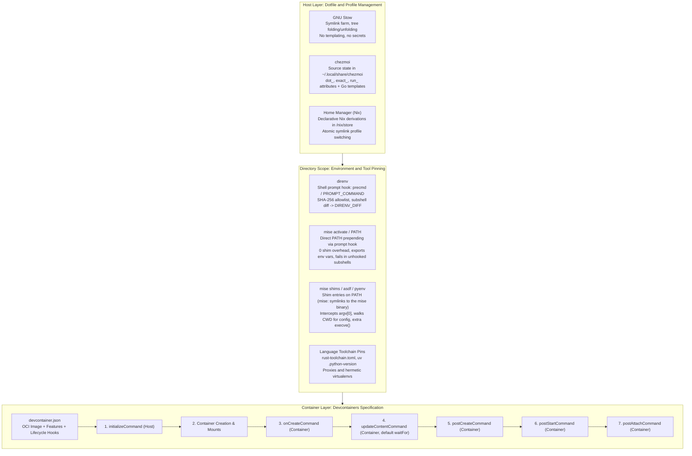
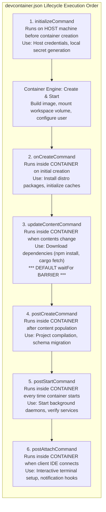
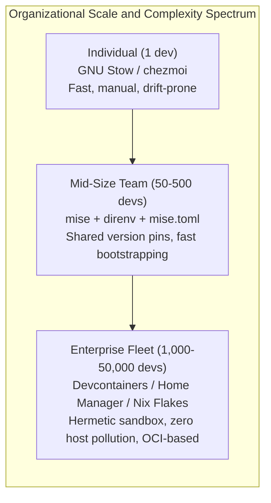

# Dotfiles, Nix, Direnv, Mise, and Devcontainers

> [!summary] Claim:
> Developer environment reproducibility spans three coupled layers: host configuration management, directory-scoped environment activation, and isolated container execution.
> Host dotfile managers progress from naive symlink farms (GNU Stow) and templated state synchronizers (chezmoi) to hermetic store derivations with atomic rollbacks (Home Manager).
> Runtime tool versioning divides into prompt-hooked PATH manipulation and static shim trampolines, trading subshell portability against fork-exec latency and environment variable propagation.
> The Development Containers specification unifies runtime dependencies via deterministic lifecycle hooks (`initializeCommand` through `postAttachCommand`) gated by strict synchronization barriers.



## The Mechanism

Modern developer workstations suffer from environmental drift: mismatched toolchain runtimes, colliding global state, uncommitted machine-specific configurations, and non-reproducible build side effects.
Solving environmental reproducibility requires analyzing four orthogonal technical layers:
1. Host dotfile managers that distribute configuration files.
2. Directory-scoped environment activators that mutate shell state upon filesystem traversal.
3. Runtime toolchain managers that resolve and dispatch language compilers.
4. Containerized development environments governed by formal lifecycle specifications.

### 1. Dotfile Management Architectures: Stow, chezmoi, and Home Manager

Dotfile management addresses how user configurations located in a version-controlled repository map to target locations in `$HOME`.
Three distinct architectures dominate production toolchains:

#### GNU Stow: Symlink Farms and Tree Folding
GNU Stow is an engine for managing symbolic link farms, originally written in Perl by Bob Glickstein.
Stow operates by populating a target directory (`-t <target>`, defaulting to the parent of the stow directory) with symlinks pointing to package directories within a repository (`-d <stow_dir>`).
The defining algorithmic characteristic of GNU Stow is tree folding.
When Stow encounters a directory within a package whose target counterpart does not exist, Stow creates a single symbolic link at the directory level rather than creating the subdirectory and populating it with file symlinks.
If the target counterpart already exists as a real directory, Stow descends into it and folds at the first level that does not exist (GNU Stow manual, "Tree folding").
For example, stowing a package containing `.config/nvim/init.lua` (stow directory `~/dotfiles`, target `~`) into an existing `~/.config` with no `nvim` entry produces the relative symlink:
`~/.config/nvim -> ../dotfiles/nvim/.config/nvim`.

Tree unfolding (the manual also calls it splitting open) occurs when a second package is installed that uses one or more of the folded subdirectories.
Stow removes the existing directory-level symlink, creates a true directory in its place (`mkdir`), and populates it with symlinks into both packages.
`--no-folding` does not unfold existing trees; it disables any further folding and refolding, so new subdirectories are created as real directories with leaf symlinks (GNU Stow manual, "Invoking Stow").
Tree folding introduces a severe failure mode in modern toolchains: if an application (such as Neovim or Fish) writes cache, undo history, or log files into a folded configuration directory, those runtime artifacts are written directly into the working tree of the git dotfiles repository.
Engineers must pass `--no-folding` (or put a `--no-folding` line in `~/.stowrc` or `./.stowrc`, which hold default command-line options, not key-value settings) to enforce physical directory creation with leaf-only file symlinks.

#### chezmoi: Target State Compilation and Script Execution
Written in Go by Tom Payne, chezmoi separates the source state (stored by default in `~/.local/share/chezmoi`) from the target state (the active filesystem, typically `$HOME`).
Unlike Stow, chezmoi does not rely on symbolic links.
It compiles the target state by evaluating filename attributes, templates, and execution scripts:
- `dot_` prefix: Maps to a leading dot in the target state (`dot_zshrc` becomes `~/.zshrc`), preventing git and file managers from hiding repository contents.
- `exact_` prefix: Enforces strict directory synchronization; any file present in the target directory that lacks a corresponding source entry is deleted during `chezmoi apply`.
- `run_` prefix: Identifies executable scripts that run during `chezmoi apply`.
  Plain `run_` scripts execute on every `chezmoi apply`; `run_once_` scripts execute only if a script with the same contents has not run successfully before, while `run_onchange_` scripts execute whenever their own contents change (embedding a template-computed hash of another file is the idiom for re-running on a watched file).
- `.tmpl` suffix: Instructs chezmoi to evaluate the file using Go's `text/template` engine with Sprig functions.
  Templates enable dynamic conditional evaluation of OS type, architecture, email identity, and direct API queries to secret managers including 1Password, Bitwarden, HashiCorp Vault, and local `age`/`gpg` keyrings.

When `chezmoi diff` is executed, chezmoi reads the target files from disk, compiles the in-memory expected state from source files and templates, and computes a unified diff.
When `chezmoi apply` runs on Unix, it writes target files atomically via temporary files followed by `rename()` system calls (`github.com/google/renameio/v2` in `internal/chezmoi/realsystem_unix.go`), ensuring that an interrupted execution never leaves corrupt, partially-written configuration files.

#### Home Manager: Hermetic Nix Store Derivations
Home Manager approaches user environment configuration through the purely functional paradigm of Nix.
Instead of mutating `$HOME` with mutable files or ad hoc symlinks, Home Manager evaluates a declarative Nix expression into an immutable derivation stored under `/nix/store/<hash>-home-manager-generation`.
Internal store architecture and cryptographic content addressing are owned by [[Nix-Store-Derivations-and-Flakes-Internals]].
From the configuration management perspective, Home Manager builds a forest of symlinks pointing to immutable store paths.
Activating a new generation via `home-manager switch` executes an activation script that:
1. Verifies that existing files in `$HOME` are managed symlinks pointing into the Nix store.
   If an unmanaged file exists at a declared path, activation aborts before changing anything ("Existing file ... is in the way") unless `home-manager switch -b <ext>` or `home.backupFileExtension` moves it aside, or the file option sets `force = true`.
2. Updates directory trees and replaces leaf symlinks with atomic pointer updates.
3. Atomically updates the generation profile symlink with `nix-env --profile "$HM_PROFILE_DIR/home-manager" --set <generation>`.
   The `home-manager` script picks `HM_PROFILE_DIR` as `${XDG_STATE_HOME:-$HOME/.local/state}/nix/profiles` when that directory exists, and otherwise `${NIX_STATE_DIR:-/nix/var/nix}/profiles/per-user/$USER` (`home-manager/home-manager`, `setHomeManagerPathVariables` and `doSwitch`, checked 2026-11).
4. Executes registered activation hooks (such as reloading systemd user daemons, desktop configurations, or font caches).

Rollback in Home Manager is fast and deterministic: `home-manager generations` lists the generations and `home-manager switch --rollback` re-activates the prior generation's existing store path without recompilation or network access (Home Manager manual, "Rollbacks").

### 2. Directory-Scoped Environment Activation: direnv Internals

`direnv` (maintained by zimbatm) dynamically alters environment variables based on the shell's current working directory.
It replaces manual `source .env` patterns with a secure, automated lifecycle hook.

```mermaid
sequenceDiagram
    autonumber
    actor Dev as Developer
    participant Shell as Interactive Shell (Bash/Zsh)
    participant Hook as direnv Hook (precmd/PROMPT_COMMAND)
    participant Subshell as Child bash (bash -c with stdlib)
    participant Reg as Allow Registry (~/.local/share/direnv/allow)

    Dev->>Shell: cd /workspace/project
    Shell->>Hook: Trigger prompt hook
    Hook->>Hook: Search parent directories for .envrc
    Hook->>Reg: Check SHA-256(canonical_path + "\n" + content)
    alt Hash not found in registry
        Reg-->>Hook: Blocked
        Hook-->>Shell: Output "direnv: error /path/.envrc is blocked. Run direnv allow to approve its content"
    else Hash matches allow file
        Reg-->>Hook: Approved
        Hook->>Subshell: bash -c with direnv stdlib, source .envrc
        Subshell-->>Hook: Dump resulting environment
        Hook->>Hook: Compute EnvDiff (p=previous values, n=next values)
        Hook->>Hook: JSON encode -> zlib -> URL-safe base64 -> DIRENV_DIFF
        Hook-->>Shell: eval "export DIRENV_DIFF=... VAR=..."
    end
    Dev->>Shell: cd /workspace (exit project)
    Shell->>Hook: Trigger prompt hook
    Hook->>Hook: Invert DIRENV_DIFF (restore old values, unset new keys)
    Hook-->>Shell: eval "unset VAR; unset DIRENV_DIFF"
```

#### Shell Prompt Hook Architecture
`direnv` integrates into interactive shells by attaching to the shell's prompt evaluation cycle:
- In **Bash**, it prepends `_direnv_hook` to `PROMPT_COMMAND` (as an array element when `PROMPT_COMMAND` is an array), per `direnv hook bash` output (direnv 2.37.1, as of 2026-11).
  Before rendering each primary prompt, Bash evaluates `PROMPT_COMMAND`, invoking `eval "$(direnv export bash)"` with `SIGINT` trapped off during the call.
- In **Zsh**, it prepends `_direnv_hook` to the `precmd_functions` and `chpwd_functions` arrays.
  Evaluating on `chpwd` catches directory changes immediately, while `precmd` guarantees re-evaluation before every prompt.
- In **Fish**, it registers `function __direnv_export_eval --on-event fish_prompt`, which in turn defines a `__direnv_cd_hook --on-variable PWD` handler whose behavior depends on `direnv_fish_mode`.

Detailed mechanics of shell startup scripts, expansion order, and hook registration are covered in [[POSIX-sh-Bash-Zsh-and-Fish-Compared]] and [[Shell-Parsing-Tokenization-and-Expansion-Order]].

#### Cryptographic Authorization Model
Allowing automated script execution upon entering arbitrary directories represents a severe remote code execution vector (such as cloning an untrusted git repository containing a malicious `.envrc`).
`direnv` mitigates this with a cryptographic allowlist stored at `${XDG_DATA_HOME:-$HOME/.local/share}/direnv/allow/`.
When an `.envrc` is detected, `direnv` computes a SHA-256 token over the canonical (symlink-resolved) path and its exact file contents (`fileHash` in `internal/cmd/rc.go`; reproduced locally with direnv 2.37.1 on macOS, where `/tmp` resolved to `/private/tmp`):

$$\text{AllowToken} = \text{SHA256}\left(\text{canonical\_path} \parallel \text{'\textbackslash n'} \parallel \text{content}\right)$$

`direnv` checks whether a file named after this 64-character hex string exists in the allow directory.
If the file does not exist, or if a single byte of `.envrc` changes, `direnv` refuses to evaluate the file and prints an authorization error.
The error alerts the engineer that `.envrc` is blocked until approved with `direnv allow`.
Running `direnv allow` writes the canonical path plus a trailing newline into `${XDG_DATA_HOME}/direnv/allow/<hash>`, authorizing execution (a sibling `direnv/deny/` directory records explicit `direnv deny` decisions).

#### Isolated Subshell Evaluation and Mathematical Diffing
When authorized, `direnv` does not source `.envrc` directly into the interactive shell.
Direct sourcing would risk polluting shell state with un-trappable functions, aliases, and shell options (`set -e`).
Instead, `direnv export` first reverts any previously loaded diff, then runs a child `bash -c 'eval "$(direnv stdlib)" && __main__ ...'` with that environment; the stdlib sources `.envrc` and dumps the resulting environment back to the parent `direnv` process (`internal/cmd/rc.go`).
(`direnv exec DIR CMD` is a separate user-facing command that loads an `.envrc` and then runs `CMD`; it is not part of the hook path.)
It records the delta as an `EnvDiff` struct with two maps (`internal/cmd/env_diff.go`):
- `p` (Prev): the previous values of every key the `.envrc` changed or removed.
- `n` (Next): the new values of every key the `.envrc` added or changed.
- A key present in `p` but absent from `n` was unset by `.envrc`; decoding a real `DIRENV_DIFF` after `unset USER_X` showed `USER_X` only under `p`.

The delta is serialized to JSON, compressed with zlib (not gzip, despite the package comment), and encoded with URL-safe `base64` (`gzenv/gzenv.go`: `compress/zlib`, `base64.URLEncoding`); every real token starts with `eJ`, the base64 of the zlib header `78 9c`.
The resulting compact token is exported into the caller shell as `DIRENV_DIFF`.
Companion variables include:
- `DIRENV_DIR`: The active directory always prefixed with `-` (for example `DIRENV_DIR=-/private/tmp/proj`).
- `DIRENV_FILE`: The absolute path of the loaded `.envrc`.
- `DIRENV_WATCHES`: The same zlib and URL-safe base64 encoding of a JSON list of `{path, modtime, exists}` records covering `.envrc`, its allow and deny files, and anything registered via the `watch_file` stdlib function.

On subsequent prompts, `direnv` inspects filesystem metadata of files in `DIRENV_WATCHES`.
If `PWD` has not crossed an `.envrc` boundary and no watched `mtime` has changed, `direnv export` prints nothing and does not re-evaluate `.envrc`; measured at 4.4 ms mean wall time per call, almost all process startup (hyperfine, 50 runs, direnv 2.37.1, macOS arm64, as of 2026-11).
When the user navigates out of the directory tree, `direnv` reads `DIRENV_DIFF`, calculates the inverse transformation (restoring every key in `p` to its previous value and unsetting keys that appear only in `n`), and unloads the environment cleanly.

### 3. Runtime Toolchain Pinning: Shims vs Dynamic PATH

Language runtime managers (mise, asdf, pyenv, rbenv, rustup) solve the multi-version problem: resolving which version of a compiler (`node 22.1.0`, `python 3.12.3`, `cargo 1.82.0`) should execute in a given project directory.
Two fundamentally conflicting mechanisms exist to achieve this resolution: static shims and dynamic PATH mutation.

```mermaid
flowchart TD
    subgraph SHIM_FLOW["Mechanism A: Static Shim Dispatch"]
        S_CALL["User runs: 'python main.py'"] --> S_LOOKUP["PATH lookup finds shim:<br/>~/.local/share/mise/shims/python"]
        S_LOOKUP --> S_FORK["Fork/exec shim process (Process 1)"]
        S_FORK --> S_WALK["Walk CWD upward for .tool-versions / .mise.toml"]
        S_WALK --> S_FIND["Locate target runtime binary"]
        S_FIND --> S_EXEC["execve(/tools/python-3.12/bin/python) (Process 2)"]
        S_EXEC --> S_FAIL["Limitation: Cannot set JAVA_HOME in caller shell<br/>Benefit: Functions in unhooked subshells and IDEs"]
    end

    subgraph PATH_FLOW["Mechanism B: Dynamic PATH Modification"]
        P_CD["User runs: 'cd /project'"] --> P_HOOK["Prompt hook executes: mise activate"]
        P_HOOK --> P_SCAN["Scan CWD upward for configuration"]
        P_SCAN --> P_MUT["Prepend to PATH: export PATH=/tools/python-3.12/bin:$PATH<br/>Export environment: export JAVA_HOME=..."]
        P_MUT --> P_RUN["User runs: 'python main.py'"]
        P_RUN --> P_DIRECT["Direct execve(/tools/python-3.12/bin/python) (0 shim overhead)"]
        P_DIRECT --> P_FAIL["Limitation: Fails in unhooked subshells / scripts<br/>Benefit: Zero trampoline latency, exports env vars"]
    end
```



#### Mechanism A: Static Shim Dispatch
Under the shim model (used by default in asdf and pyenv, and optionally in mise via `mise activate --shims` or by putting `~/.local/share/mise/shims` on `PATH`), a directory of shim entries is placed at the front of `$PATH`.
For every managed executable name (`node`, `npm`, `python`, `cargo`), a shim resides in the shims directory; asdf and pyenv shims are small scripts, while mise shims are symlinks to the `mise` binary itself (`~/.local/share/mise/shims/node -> /opt/homebrew/bin/mise` on this host, mise 2026.11.3, as of 2026-11).
When an engineer runs `node server.js`:
1. The shell performs `execve()` on `~/.local/share/mise/shims/node`.
2. The shim process intercepts `argv[0]`, reads its calling name, and inspects the current working directory.
3. The shim walks up the directory tree looking for `.tool-versions`, `.mise.toml`, `mise.toml`, or tool-specific version files.
4. It resolves the absolute path to the target binary in the tool storage directory (for example `~/.local/share/mise/installs/node/22.1.0/bin/node`).
5. It invokes `execve()` to replace itself with the real target binary, forwarding all arguments and standard streams.

The advantages of shims are ambient availability and universal subshell support.
Any subshell, background script, or GUI application that inherits the system `$PATH` automatically resolves the correct project version, even if the shell never sourced prompt activation hooks.
The architectural costs of shims are twofold:
1. **Fork-exec trampoline overhead:** Every invocation of every command requires launching the shim process, performing filesystem traversal to parse configuration files, and executing a second `execve()`.
   In tight compilation loops or recursive script execution (such as `npm run build` invoking hundreds of tiny node scripts), this roughly doubles per-invocation startup: `node --version` measured 27.8 ms through the mise shim versus 14.7 ms direct, about 13 ms of shim overhead per call (hyperfine, 30 runs, mise 2026.11.3, node 26.13.0, macOS arm64, as of 2026-11).
2. **Environment variable isolation:** A Unix child process cannot mutate the environment variables of its parent process.
   A shim cannot export companion environment variables (such as `JAVA_HOME`, `CPATH`, or `GOROOT`) into the calling interactive shell.
   If a compiler requires `JAVA_HOME` to match the active Java runtime, shims alone cannot satisfy that requirement.

#### Mechanism B: Dynamic PATH Manipulation (`mise activate`)
Under dynamic PATH activation (written in Rust by Jeff Dickey for `mise`, formerly `rtx`), the toolchain manager hooks the shell prompt (`eval "$(mise activate zsh)"`).
When the user changes directories or issues a prompt:
1. `mise` evaluates the active project configuration.
2. It prepends the exact `bin/` directories of the active tools directly into the shell's `$PATH` variable (for example `PATH="/home/user/.local/share/mise/installs/node/22.1.0/bin:$PATH"`).
3. It exports all declared environment variables from `[env]` sections into the active shell.

When the command `node server.js` executes, the shell locates the concrete binary directly.
The invocation executes with zero trampoline overhead in a single `execve()` call.
Companion environment variables (`JAVA_HOME`, `GOROOT`) are fully visible to the command.
The failure mode of dynamic PATH manipulation is that it requires an interactive shell hook.
If a background GUI tool, cron job, or service starts without ever passing through a hooked shell, `$PATH` remains at its default system value; a script started from a hooked shell inherits the activated `PATH` but never re-runs the hook, so a `cd` inside it does not switch versions.
The script fails to find project-specific tool versions unless wrapped with `mise exec -- <command>` or configured via shims.

#### Language-Specific Version Overrides
Modern language toolchains implement specialized internal resolution cascades:
- **Rust (`rustup`):**
  Rustup installs proxy shims in `~/.cargo/bin` (`rustc`, `cargo`, `rustfmt`).
  The rustup proxy resolves toolchains according to a strict five-tier precedence hierarchy:
  1. Explicit CLI argument override: `cargo +nightly build`.
  2. The `RUSTUP_TOOLCHAIN` environment variable.
  3. Directory override set via `rustup override set <toolchain>` (recorded in rustup's configuration file, `settings.toml` under `RUSTUP_HOME`, default `~/.rustup`).
  4. Toolchain file: `rust-toolchain.toml` or legacy `rust-toolchain` found by walking upward from `$PWD`.
  5. Global default toolchain (`rustup default`).

  Tiers 3 and 4 are both discovered by walking up the directory tree, so a `rust-toolchain.toml` closer to the current directory beats a directory override set on a farther ancestor (The rustup Book, "Overrides").
- **Python (`uv`):**
  `uv` (developed in Rust by Astral) manages Python interpreters hermetically (`uv python install`).
  It separates the version request from interpreter discovery.
  The version request resolves:
  1. CLI flag: `uv run --python 3.12`.
  2. Environment variable: `UV_PYTHON`, documented as equivalent to `--python`.
  3. Pinned project configuration: `.python-version` found by walking upward from `$PWD`, stopping at project or workspace boundaries, then the user configuration directory (pinned via `uv python pin`).
  4. Project definition: `requires-python` in `pyproject.toml`, used only when no version was otherwise requested.

  Interpreter discovery is a separate step: an active `$VIRTUAL_ENV` or a `.venv` in the current or a parent directory takes precedence over interpreters on `PATH`, then managed installations and `PATH` interpreters are searched, and a managed download is the last resort (uv docs, "Python versions", as of 2026-11).

### 4. Development Containers Specification (`devcontainer.json`)

When host-level isolation fails due to native OS package incompatibilities (such as Linux glibc dependencies or system services), developer environments shift into containerized sandboxes governed by the open Development Containers Specification (hosted at `containers.dev`).



#### Lifecycle Hooks Sequence and Execution Order
The `devcontainer.json` format defines an explicit execution sequence for lifecycle hooks:
1. **`initializeCommand`:** Executes on the **host machine** prior to container build or creation.
   Used to generate temporary local mounts, validate host prerequisites, or pull host credentials.
2. **Container Engine Build and Mount:** The container runtime creates the OCI container, injects mounts, sets user IDs, and initializes network namespaces.
3. **`onCreateCommand`:** Executes **inside the container** immediately following creation.
   Runs once when the container is first created.
   Used for container-specific system provisioning (`apt-get install`, directory permissions).
4. **`updateContentCommand`:** Executes **inside the container** after workspace files are available.
   Used to synchronize project dependencies (`npm install`, `go mod download`, `pip install`).
   By default, this is the barrier step that blocks client connection.
5. **`postCreateCommand`:** Executes **inside the container** after `updateContentCommand` completes and once the dev container has been assigned to a user for the first time (containers.dev JSON reference).
   Runs once during initial environment creation.
   Used for long-running build tasks, code generation, and test database population.
6. **`postStartCommand`:** Executes **inside the container** on **every start** of the container (both initial launch and subsequent resume/restart).
   Used to start background services, database processes, or check service health.
7. **`postAttachCommand`:** Executes **inside the container** when a client tool or editor UI (such as VS Code, JetBrains Gateway, or an agent terminal) attaches to the running container.

#### Command Formatting and Parallelism
Lifecycle hooks accept three distinct JSON data types:
- **String:** Evaluated as a single command string executed inside a shell (the spec says it "will be run in `/bin/sh`").
- **Array:** Evaluated as an explicit argument vector executed directly without a shell (`["npm", "install"]`).
- **Object:** Defines a map of named, parallel tasks executed concurrently:
  ```json
  "postCreateCommand": {
    "deps-node": "npm install",
    "deps-python": "pip install -r requirements.txt",
    "schema": "python manage.py migrate"
  }
  ```
  Every entry in an object executes in parallel.
  The spec states that if one lifecycle script fails, any subsequent scripts are not executed.
  The specification states that each command must exit successfully for the stage to be considered successful (containers.dev implementors spec, lifecycle scripts).
  It does not say whether the other entries of an object are cancelled when one fails, so do not rely on either behavior.

#### The `waitFor` Synchronization Barrier
Supporting IDEs and agent runners connect to containers while setup tasks run.
The `waitFor` property controls the barrier threshold that blocks client connection.
Allowed values are:
`initializeCommand`, `onCreateCommand`, `updateContentCommand`, `postCreateCommand`, and `postStartCommand` (the `waitFor` enum in `schemas/devContainer.base.schema.json`; `postAttachCommand` is not allowed).
The specification defines `updateContentCommand` as the default.
Commands configured after the `waitFor` threshold (such as `postCreateCommand`) execute asynchronously in the background while the engineer or agent already possesses terminal and editor access.
Configuring `waitFor: postCreateCommand` forces the client to block until all build and migration tasks have terminated cleanly.

#### Dotfiles Integration in Devcontainers
Personal dotfiles injection is not part of the `devcontainer.json` specification (the JSON reference never mentions dotfiles); it is implemented by supporting tools as user-level settings, such as the reference devcontainer CLI's dotfiles configuration (`repository`, `targetPath`, `installCommand` in `src/spec-common/dotfiles.ts`) and the matching VS Code Dev Containers settings:
- `dotfiles.repository`: Git URL of the developer's personal dotfiles repository, cloned with `git clone --depth 1`.
- `dotfiles.targetPath`: Destination directory inside the container (the devcontainer CLI option `--dotfiles-target-path` defaults to `~/dotfiles`, per `src/spec-node/devContainersSpecCLI.ts`, checked 2026-11).
- `dotfiles.installCommand`: Custom installation script executed inside the container after cloning; when unset, the CLI looks for `install.sh`, `install`, `bootstrap.sh`, `bootstrap`, `script/bootstrap`, `setup.sh`, `setup`, or `script/setup`, and otherwise symlinks the repository's dotfiles into `$HOME`.

This decouples project-specific dependencies (managed by `devcontainer.json`) from personal user ergonomics (shell aliases, keybindings, tmux configs managed by dotfiles).

## Commands and Numbers to Know

Reference specifications, default paths, environment variables, and execution characteristics across development toolchain managers.

| Component / Tool | Setting or Metric | Target Platform | Reference Value / Behavior (as of 2026-11) |
| :--- | :--- | :--- | :--- |
| GNU Stow | Default target directory `-t` | Both | Parent of current stow directory (e.g. `/usr/local` if dir is `/usr/local/stow`) |
| GNU Stow | Folding flag `--no-folding` | Both | Disables directory-level symlinks; creates physical directories with leaf symlinks |
| GNU Stow | Restow flag `--restow` | Both | Executes un-stow (`-D`) followed by fresh stow to recompute symlink farms |
| chezmoi | Source state location | Both | `${XDG_DATA_HOME:-~/.local/share}/chezmoi` |
| chezmoi | Target state location | Both | `${HOME}` |
| chezmoi | Modification attributes | Both | `dot_` (leading dot), `exact_` (prune untracked), `run_` (script), `.tmpl` (Go template) |
| Home Manager | Generation profile link | Linux / macOS | `${XDG_STATE_HOME:-~/.local/state}/nix/profiles/home-manager` when `.../nix/profiles` exists, else `/nix/var/nix/profiles/per-user/$USER/home-manager` |
| Home Manager | Rollback | Linux / macOS | `home-manager switch --rollback`; collisions abort unless `-b <ext>` or per-file `force = true` |
| Home Manager | Store derivation format | Linux / macOS | `/nix/store/<32-char-base32-hash>-home-manager-generation` |
| direnv | Allow token computation | Both | `SHA256(canonical_path + "\n" + content)` |
| direnv | Allow registry path | Both | `${XDG_DATA_HOME:-~/.local/share}/direnv/allow/<64-char-hex-hash>` |
| direnv | Diff encoding pipeline | Both | JSON `{"p": prev, "n": next}` $\rightarrow$ zlib compression $\rightarrow$ URL-safe `base64` string in `DIRENV_DIFF` (token starts `eJ`) |
| direnv | Watch registry | Both | Same encoding of `{path, modtime, exists}` records in `DIRENV_WATCHES` |
| direnv | No-op `direnv export` cost | macOS | 4.4 ms mean wall time on arm64, direnv 2.37.1 (measured with hyperfine) |
| mise | Shim overhead | macOS | About 13 ms per call on arm64 (`node --version` 27.8 ms via shim vs 14.7 ms direct, mise 2026.11.3) |
| mise | Shims directory | Both | `${XDG_DATA_HOME:-~/.local/share}/mise/shims` |
| mise | Installation root | Both | `${XDG_DATA_HOME:-~/.local/share}/mise/installs/<plugin>/<version>` |
| mise | Shell activation | Both | `eval "$(mise activate <shell>)"` |
| mise | Legacy `use mise` deprecation | Both | Deprecated and unsupported; `mise direnv` and `mise direnv activate` print a warning and are removed in mise `2027.10.4` |
| rustup | Precedence order | Both | 1. `+toolchain` 2. `RUSTUP_TOOLCHAIN` 3. `rustup override` 4. `rust-toolchain.toml` 5. default (3 and 4 compete by directory proximity) |
| uv | Version request order | Both | 1. `--python` 2. `UV_PYTHON` 3. `.python-version` 4. `requires-python`; interpreter discovery then prefers an active or `.venv` environment over `PATH` |
| devcontainer | Lifecycle hook order | Both | `initializeCommand` $\rightarrow$ `onCreate` $\rightarrow$ `updateContent` $\rightarrow$ `postCreate` $\rightarrow$ `postStart` $\rightarrow$ `postAttach` |
| devcontainer | Default `waitFor` | Both | `updateContentCommand` |
| devcontainer | Hook parallel syntax | Both | JSON object with named string/array tasks (all run concurrently) |

## Multi-Language Comparison: C++ / Python / Rust Toolchain Isolation

Different language ecosystems employ distinct strategies for managing compilers, dependency sandboxing, and environment variables.

| Dimension | C++ (Clang / GCC / CMake) | Python (uv / CPython) | Rust (rustup / Cargo) |
| :--- | :--- | :--- | :--- |
| **Toolchain Pinning** | System packages, Nix derivations, or CMake toolchain files (`CMAKE_TOOLCHAIN_FILE`) | `uv python pin 3.12` or `.python-version` file | `rust-toolchain.toml` with channel, date, and components |
| **Dispatch Mechanism** | Direct invocation via `$PATH` or wrapper build scripts | Virtual environment hashbangs (`.venv/bin/python`) or `uv run` | Proxy shims in `~/.cargo/bin` reading override hierarchy |
| **Dependency Sandboxing** | Prefix installations (`CMAKE_INSTALL_PREFIX`), vcpkg, Conan, or Nix store paths | Hermetic virtual environment (`.venv/`) isolated via `sys.prefix` | Cargo target directory (`target/`) with isolated Cargo home |
| **Environment Variables** | `CC`, `CXX`, `CFLAGS`, `LDFLAGS`, `CMAKE_PREFIX_PATH` | `VIRTUAL_ENV`, `PYTHONPATH`, `PYTHONHOME`, `UV_PYTHON` | `RUSTUP_TOOLCHAIN`, `CARGO_HOME`, `RUSTFLAGS`, `RUSTC_WRAPPER` |
| **Subshell Resilience** | Requires explicit environment export (via direnv or module systems) | Self-contained when executing `.venv/bin/python` directly | Universal through `~/.cargo/bin` proxy shims walking directory tree |
| **Hook Compatibility** | Native integration with `direnv` and Nix flakes (`nix develop`) | Fully supported via `layout python` in `direnv` or `uv run` | Native proxy support; optional `direnv` integration |

## Worked Lab Example

The companion lab `code/01-Command-Line/direnv_mise_shim/` runs a model of each mechanism through real processes: a child `bash` evaluates a real `.envrc`, a parent `sh` observes what a shim and a hook-style `eval` do to its environment, and a small lifecycle runner executes devcontainer hooks as processes.
It does not invoke the real `direnv`, `mise`, or a devcontainer engine, and it needs no network.

### Running the Lab Harness

To execute the lab and verify its deterministic output against the golden recording:

```bash
cd code
python3 -m _harness.verify 01-Command-Line/direnv_mise_shim/
```

The execution produces verified deterministic output on `darwin-arm64`, byte-identical to `expected/darwin-arm64.txt`:

```text
=== 1. direnv: allow token, env diff, and exit ===
Initial check: .envrc authorized = False
Computed SHA-256 allow token: 1df3e739824750e1c73246131ca0269497f9cb0f2e4a499a3443a438e9838685
After 'direnv allow': allow file created at allow/1df3e739824750e1...
Verification: .envrc authorized = True
After a one-byte edit: .envrc authorized = False
After moving the file: .envrc authorized = False

Environment delta captured from a child bash:
  p (previous values): ['PATH', 'USER']
  n (next values):     ['PATH', 'PROJECT_ENV']
  DIRENV_DIFF starts with: eJ (base64 of the zlib header 78 9c)
  DIRENV_DIFF uses the URL-safe alphabet ('-' and '_', never '+' or '/'): True
  Roundtrip decode integrity: OK (JSON -> zlib -> URL-safe base64 -> JSON verified)
Restoration upon directory exit: OK (environment restored to baseline)

=== 2. Runtime Tool Pinning: Shims vs Dynamic PATH ===
Mechanism A: Static Shim Dispatch
  Shim stderr: [shim-trampoline] intercepting 'tool-cli' -> dispatching to version 2.4.0
  Shim stdout: tool-cli version 2.4.0
  Shim stdout: tool-cli config  = attempted_from_shim
  Observed by the parent: TOOL_CONFIG_PROFILE=<unset>
  Script that cd's into another project: 1.18.0

Mechanism B: Dynamic PATH Modification (Prompt Hook)
  Direct PATH stdout: tool-cli version 2.4.0
  Direct PATH stdout: tool-cli config  = active_in_current_shell
  Observed by the parent: TOOL_CONFIG_PROFILE=active_in_current_shell
  Script that cd's into another project: 2.4.0 (the hook does not re-run)

Mechanism C: Non-Interactive Subshell Execution (No Shell Hook)
  Unhooked subshell with default PATH only: 1.18.0 (misses project pin)
  Unhooked subshell with shim in PATH:      2.4.0 (honors project pin)
  Unhooked subshell with no tool on PATH:   exit 127

=== 3. devcontainer.json Lifecycle Hook Execution Order ===
Order Lifecycle Hook         Context    Exit  Output
----- ---------------------- ---------- ----- ------------------------------
1     initializeCommand      HOST       0     host-prep
2     onCreateCommand        CONTAINER  0     $HOME
3     updateContentCommand   CONTAINER  0     a_saw_b + b_saw_a
4     postCreateCommand      CONTAINER  0     build
5     postStartCommand       CONTAINER  0     daemon
6     postAttachCommand      CONTAINER  0     attach
Array form is exec'd without a shell: onCreateCommand printed '$HOME'
String form runs in /bin/sh: `echo $HOME` would print /home/dev
Object form ran concurrently: each entry saw the other's start marker (a serial run times out)
Client unblocked after: updateContentCommand (default waitFor), hooks 1-3 of 6
With waitFor set: client unblocked after postCreateCommand
waitFor: postAttachCommand rejected (not in the allowed enum): True
When postCreateCommand exits 3, later hooks run: []
Object form with one failing entry: updateContentCommand exit 5, hooks run 3
```

### Analysis of the Experimental Output

The lab fails (non-zero exit with `LAB CHECK FAILED`) when a mechanism is wrong or absent; each check was mutation-tested.
The real-tool facts in The Mechanism section (hook text, `DIRENV_DIFF` contents, timings) come from separate runs of direnv 2.37.1 and mise 2026.11.3 on macOS arm64, not from this lab.

1. **Cryptographic Authorization:**
   The allow token `1df3e739824750e1c73246131ca0269497f9cb0f2e4a499a3443a438e9838685` is SHA-256 over `/workspaces/my-project/.envrc`, a newline, and the file content; the virtual path is fixed so the token is identical on every machine.
   The same construction over the real resolved path reproduced the token real direnv 2.37.1 wrote into its allow directory.
   The lab shows the three properties that matter: the token authorizes only the exact content (a one-byte edit is blocked again), only the exact path (the same content at another path is blocked), and `direnv allow` is modeled as writing the path plus a newline into a file named after the token.
2. **Delta Encoding:**
   A child `bash` sources the `.envrc` and dumps its environment; the lab diffs it against the environment after sourcing an empty file, so bash's own `PWD` and `SHLVL` changes cancel.
   The diff uses direnv's wire format: `p` holds the previous value of every changed or removed key (`PATH`, `USER`), `n` holds the new value of every added or changed key (`PATH`, `PROJECT_ENV`), serialized as compact JSON, compressed with zlib, and encoded with URL-safe base64, so the token starts with `eJ`.
   The lab does not print the compressed length because it depends on the zlib implementation.
   Decoding round-trips, and the modeled exit unsets keys that appear only in `n` and restores every key in `p` (all asserted).
3. **Shim vs PATH Architectural Trade-offs:**
   - In Mechanism A (Shim), the shim walks up from the working directory to find `.tool-versions` and `execv`s the pinned binary, which prints `2.4.0` and sees `TOOL_CONFIG_PROFILE=attempted_from_shim` only inside its own process.
     A parent `sh` prints its own `TOOL_CONFIG_PROFILE` after the tool returns and observes `<unset>`: the child could not mutate it.
     A script that `cd`s into a second project gets that project's pin (`1.18.0`) because the shim resolves again on every invocation.
   - In Mechanism B (PATH), the parent `sh` `eval`s the string a prompt hook would print (a `PATH` with `2.4.0` first and `TOOL_CONFIG_PROFILE`), so the tool sees `active_in_current_shell` and the parent still has it afterwards.
     The same script that `cd`s into the second project still runs `2.4.0`, because the hook does not re-run inside a script.
   - In Mechanism C (Unhooked Subshell), a process with only the default `PATH` runs `1.18.0`, the shim on `PATH` resolves `2.4.0`, and with no tool on `PATH` the command exits 127.
4. **Devcontainer Synchronization:**
   The lifecycle runner executes each hook as a process in specification order, labels `initializeCommand` as the only host-side hook, and applies the specification's rules: a string runs in `/bin/sh` while an array does not use a shell (`["echo", "$HOME"]` prints the literal `$HOME`), the object form runs its entries concurrently, `waitFor` defaults to `updateContentCommand` and rejects `postAttachCommand`, and a failed hook stops every later hook.
   Concurrency is proved by a rendezvous: each object entry waits for the other's start marker and exits non-zero after a bounded wait, so a serialized run fails the step.
   This is a model of the specification's semantics, not of a real engine's build, mount, or attach behavior.

## Pitfalls

> [!warning] Pitfall: GNU Stow Tree Folding Polluting Version Control
> When GNU Stow creates a directory-level symbolic link (e.g. `~/.config/fish -> ../dotfiles/fish/.config/fish`), any new file created by the application (history logs, socket files, temporary cache entries) is written directly into the dotfiles git repository.
> If unmonitored, these files can be accidentally committed and leaked into public repositories.
> Always execute Stow with `--no-folding` or add a `--no-folding` line to `~/.stowrc`.

> [!warning] Pitfall: Subshell Environment Amnesia under Dynamic PATH Manipulation
> When developers rely exclusively on `mise activate` or `direnv` without shims, non-interactive shell scripts (`#!/usr/bin/env bash`), cron jobs, and desktop GUI applications (such as VS Code or Git GUIs) fail to execute shell prompt hooks.
> Processes not launched from a hooked shell (cron, GUI apps, launchd or systemd services) inherit the global system `$PATH` and execute the wrong compiler or interpreter version.
> Scripts launched from a hooked shell inherit its already-activated `PATH`, so they keep the launching directory's pin even after they `cd` into a different project (reproduced with mise 2026.11.3: `bash -c 'cd /; node -v'` still printed the pinned version).
> For non-interactive scripts, wrap invocations with `mise exec -- <cmd>` or use direct interpreter paths (`./.venv/bin/python`).

> [!warning] Pitfall: The Shim Trampoline Storm in Build Pipelines
> Using shims for tools called thousands of times in compilation pipelines (such as `sed`, `awk`, `python`, or `git` invoked from Makefiles or build scripts) triggers a severe performance bottleneck.
> Every single command invocation forks the shim binary, walks the filesystem directory tree upward looking for configuration files, and issues an extra `execve()` system call.
> In high-throughput CI environments, configure dynamic PATH activation or invoke concrete binaries directly to eliminate shim trampolining overhead.

> [!warning] Pitfall: `DIRENV_DIFF` Truncation by Kernel Environment Limits
> Large `.envrc` files that declare or modify extensive path lists (e.g. appending hundreds of paths to `PATH` or exporting massive JSON strings) inflate `DIRENV_DIFF`.
> Linux kernels enforce an execve argument and environment size limit (`MAX_ARG_STRLEN`, 32 pages or 128 KiB per string with 4 KiB pages, and a total of one quarter of `RLIMIT_STACK`, per execve(2) "Limits on size of arguments and environment").
> If `DIRENV_DIFF` exceeds buffer limits, child process execution fails with `E2BIG` (Argument list too long).
> Keep `.envrc` files scoped to essential runtime switches; avoid dumping entire data payloads into environment variables.

> [!warning] Pitfall: Stale `direnv` Caches via Unmonitored Transitive Dependencies
> `direnv` monitors modification times of `.envrc` and files explicitly registered with `watch_file`.
> If an `.envrc` executes `source ./config/settings.sh` or evaluates a Nix flake without calling `watch_file ./config/settings.sh`, editing `settings.sh` does not invalidate `DIRENV_WATCHES`.
> `direnv` skips evaluation and continues using stale cached variables.
> Always register imported files using `watch_file <path>`.

> [!warning] Pitfall: Devcontainer `waitFor` Premature Client Attachment
> The Devcontainer specification defaults `waitFor` to `updateContentCommand`.
> If intensive compilation, database migrations, or code generation tasks are configured in `postCreateCommand`, client IDEs and agents connect before those tasks finish.
> Compilers will fail with missing build artifacts, and test suites will crash due to unmigrated databases.
> If tools require a fully compiled environment before opening, explicitly configure `"waitFor": "postCreateCommand"` in `devcontainer.json`.

## At Scale

At personal scale (1 developer, 1-2 machines), simple symlink managers like GNU Stow and local `direnv` hooks offer low friction and immediate ergonomics.
However, as organizations scale from 100 to 10,000+ engineers across heterogeneous operating systems (macOS laptops, Linux development servers, cloud dev environments), environment management transforms into an operational paved-road problem.



### Operational Decision Framework

| Fleet Dimension | Paved Road Architecture | Decision Rule | Primary Failure Mode |
| :--- | :--- | :--- | :--- |
| **Monorepo Polyglot (5,000+ devs)** | Devcontainers over Cloud VMs | Mandatory when C-extension libraries, database engines, or system glibc versions collide across microservices. | High disk footprint; requires container runtime daemon and volume performance tuning. |
| **Native macOS Workstations (1,000+ devs)** | Nix / Home Manager or mise | Use `mise` when teams require native macOS arm64 execution speed with low cognitive barrier; use Nix when strict byte-for-byte bit reproducibility is required. | Nix has a steep learning curve; unhooked subshells fail under mise PATH activation. |
| **CI/CD Build Runners** | Hermetic Containers or Nix Store | Never run interactive prompt hooks (`direnv`) in CI. Use static lockfiles (`uv.lock`, `Cargo.lock`) and container images. | CI latency spikes from downloading runtime tool managers on ephemeral runners. |
| **Secret Management Across Fleets** | chezmoi with Vault/1Password or SOPS | Never commit secrets or raw `.envrc` tokens into dotfile repositories. Use encrypted templates or runtime credential helpers. | Accidental git commits of plaintext API keys in unencrypted dotfiles repos. |

### Enterprise Paved Road Rules

1. **The Subshell Invariant:** Build systems, pre-commit hooks, and CI pipelines must never assume shell prompt hooks are active.
   Pre-commit scripts must invoke tools via explicit relative paths (`./.venv/bin/ruff`) or language dispatchers (`cargo run`, `uv run`) rather than relying on ambient interactive shell state.
2. **Container Volume Performance on macOS:** When deploying Devcontainers on macOS host machines, standard Docker bind mounts suffer severe performance penalties due to VirtioFS and FUSE filesystem overhead.
   Organizations must configure named Docker volumes or SSH-based remote container servers for high-throughput I/O repositories.
   See [[Containers-and-VMs-for-macOS-Development]] for virtualization trade-offs.
3. **Automated Deprecation Gates:** Tool versions declared in `.mise.toml`, `rust-toolchain.toml`, or `.python-version` must be validated against organizational security lifecycles.
   Automated bots (Renovate, Dependabot) should open automated upgrade pull requests, blocking deprecated runtimes before security vulnerabilities enter production.

## Practice Drill

> [!tip] Practice Drill: Rebuilding an Isolated Environment Engine
> Execute the following sequence to build a hands-on understanding of environment diffing, allowlist security, and shim trampolining:
>
> 1. **Implement a Minimal direnv Hook in Pure Bash:**
>    Write a 30-line bash script that attaches to `PROMPT_COMMAND`.
>    Make it check `$PWD` for a file named `.local_env`.
>    Implement a SHA-256 allowlist check stored in `/tmp/fake_direnv/allow/`.
>    If allowed, export a variable `LOCAL_PROJECT_NAME=$(basename $PWD)` and store the prior value in a shadow variable `_SAVED_LOCAL_PROJECT_NAME`.
>    Verify that navigating to `$HOME` unsets the variable and restores the clean environment.
>
> 2. **Construct a Static Python Shim:**
>    Create a directory `/tmp/test_shims/`.
>    Write an executable script `/tmp/test_shims/mycompiler` that reads a file `.compiler-version` in `$PWD` or any parent directory.
>    If the file contains `v1`, execute `/bin/echo "Compiler v1 executing"`.
>    If the file contains `v2`, execute `/bin/echo "Compiler v2 executing"`.
>    Prepend `/tmp/test_shims` to `$PATH`.
>    Verify that changing directories changes the output of `mycompiler` without modifying `$PATH` or executing shell prompt hooks.
>
> 3. **Devcontainer Parallel Hook Simulation:**
>    Write a Python script that parses a mock `devcontainer.json` containing an object-based `postCreateCommand`:
>    `{"build": "sleep 1 && echo BUILD_DONE", "test": "sleep 1 && echo TEST_DONE"}`.
>    Execute both tasks concurrently using `subprocess.Popen`.
>    Assert that total wall-clock execution time is approximately 1 second rather than 2 seconds.

## Interview Questions

> [!question] L5: In GNU Stow, what is tree folding, when does Stow unfold a tree, and what failure mode does folding create for dotfiles?
>
> > [!success]- Answer
> > Tree folding is an optimization in GNU Stow where Stow creates a single symbolic link pointing to an entire directory rather than creating a physical directory populated with individual file symlinks.
> > Stow folds a tree when the target directory does not yet exist; if it already exists as a real directory, Stow descends into it and folds at the first level that does not exist.
> > Stow unfolds the tree (splits it open) when another package is installed that needs to place files inside that same directory, replacing the directory symlink with a real physical directory (`mkdir`) and symlinking the individual files from both packages.
> > The failure mode occurs when applications (like Neovim, Tmux, or Fish) write runtime files (state, undo logs, cache files) into that folded directory.
> > Because the directory is a symlink directly into the dotfiles git repository, those runtime files are created inside the version-controlled repository, risking accidental commits of private or ephemeral data.
> > Passing `--no-folding` prevents this for new stows by disabling folding and refolding, forcing Stow to create real directories and link only leaf files; already-folded links must be restowed to change.

> [!question] L5 (Predict the output): Consider the following terminal session where `mise` uses dynamic PATH activation (`mise activate`) and a subshell script is executed:
> ```bash
> mkdir -p /tmp/demo && cd /tmp/demo
> echo "node 22.0.0" > .tool-versions
> # Host system has node 18.0.0 in /usr/bin/node
> # mise has node 22.0.0 installed in ~/.local/share/mise/installs/node/22.0.0/bin/node
> eval "$(mise activate bash)"
> node -v
> bash -c 'node -v'
> ```
> What does `node -v` print in the interactive shell versus inside `bash -c 'node -v'`, and why?
>
> > [!success]- Answer
> > In the interactive shell, `node -v` prints `v22.0.0`.
> > In the subshell executed by `bash -c 'node -v'`, it also prints `v22.0.0`, because the child inherits the parent's exported, already-activated `$PATH`.
> > The trap appears when the subshell changes directory or when a process does not inherit that environment:
> > The interactive shell hook does not execute inside non-interactive subshells (`PROMPT_COMMAND` is not evaluated).
> > Therefore, any directory change inside a subshell or non-interactive script fails to trigger version switching under dynamic PATH manipulation; `bash -c 'cd /other-project; node -v'` still prints `v22.0.0` (reproduced with mise 2026.11.3 and node 26.13.0 standing in for 22.0.0, as of 2026-11).
> > If shims (`~/.local/share/mise/shims`) were used instead, the shim would execute on every invocation and dynamically resolve the new directory's `.tool-versions`.

> [!question] L6: Walk through the exact security and evaluation sequence of `direnv` when a user enters a directory containing a newly cloned `.envrc`.
>
> > [!success]- Answer
> > 1. The shell's prompt hook (`PROMPT_COMMAND` in Bash or `precmd`/`chpwd` in Zsh) triggers `direnv export <shell>`.
> > 2. `direnv` searches current and parent directories for `.envrc`.
> > 3. Upon finding `.envrc`, it computes the authorization token: $\text{SHA256}(\text{canonical\_path} \parallel \text{'\textbackslash n'} \parallel \text{file\_content})$.
> > 4. It checks for the existence of `${XDG_DATA_HOME:-~/.local/share}/direnv/allow/<token>`.
> > 5. Because the file is newly cloned, the hash file does not exist.
> > `direnv` refuses to source the file, prints the blocked error message, and exits without modifying the environment.
> > 6. When the user reviews the code and runs `direnv allow`, `direnv` writes the canonical path into the hash file in the allow registry.
> > 7. On the next prompt, the hash matches.
> >    `direnv` reverts any previous diff, runs a child `bash -c` that loads the direnv stdlib and sources `.envrc`, receives the dumped post-execution environment, and computes the diff (`p` previous values, `n` next values).
> > 8. It serializes the diff into JSON, compresses it with zlib, encodes it in URL-safe `base64`, and prints shell instructions exporting the changed variables along with `DIRENV_DIFF`, `DIRENV_DIR`, `DIRENV_FILE`, and `DIRENV_WATCHES`.
> > 9. The caller shell evaluates this output via `eval`, loading the project environment.

> [!question] L6 (Debug this): A developer reports that their team's project relies on `direnv` to load `AWS_PROFILE=staging` via `.envrc`.
> When they run their integration tests via an automated VS Code task or a git pre-commit hook, the tests fail with `AWS_PROFILE: unbound variable`, yet running the test manually in their interactive zsh terminal passes.
> What is the root cause and how do you resolve it?
>
> > [!success]- Answer
> > Root cause:
> > `direnv` operates via interactive shell prompt hooks (`precmd_functions` in Zsh or `PROMPT_COMMAND` in Bash).
> > Git pre-commit hooks and many VS Code background task runners spawn non-interactive, non-login subshells (e.g. `/bin/sh` or `/bin/bash` without prompt hooks).
> > Because prompt hooks never execute in non-interactive subshells, `direnv export` is never invoked, and the environment variables declared in `.envrc` are never populated.
> > Resolution options:
> > 1. In the pre-commit hook or task runner, explicitly wrap the command using `direnv exec . <command>`, which evaluates `.envrc` in a dedicated subshell before launching the command.
> > 2. In VS Code, install a direnv extension or configure the terminal to launch as an interactive login shell.
> > 3. Source environment variables explicitly inside the test script if `.envrc` is present using a fallback loader.

> [!question] L7: Compare static shims versus dynamic PATH modification across fork/exec system call count, latency in tight loops, and environment variable inheritance.
>
> > [!success]- Answer
> > Static shims (asdf, pyenv, mise `--shims`):
> > - Syscall count: Every command execution requires a `fork()` / `execve()` of the shim binary, followed by filesystem directory traversal (`stat()` / `open()` / `read()`) to find configuration files, followed by a second `execve()` to launch the target binary.
> > - Latency: Measured at about 13 ms per invocation for the mise shim (`node --version` 27.8 ms via shim vs 14.7 ms direct, mise 2026.11.3, macOS arm64, as of 2026-11).
> > In tight loops (such as executing a script calling `sed` or `python` 1,000 times), that rate adds about 13 seconds of purely wasted trampoline overhead.
> > - Environment inheritance: Because a child process cannot modify parent process environment variables, a shim cannot export companion environment variables (like `JAVA_HOME` or `GOROOT`) into the calling interactive shell.
> >
> > Dynamic PATH modification (`mise activate`, direnv):
> > - Syscall count: Prompt hooks update `$PATH` once when changing directories.
> > Subsequent command executions issue a single `execve()` directly to the target binary with zero intermediate shim processes.
> > - Latency: 0 ms invocation overhead during command execution.
> > The only latency is paid during prompt rendering: measured 4.4 ms for a no-op `direnv export bash` (direnv 2.37.1) and 7.9 ms for `mise hook-env -s bash` (mise 2026.11.3), both mean wall time on macOS arm64 (as of 2026-11).
> > - Environment inheritance: Operates directly inside the caller shell via `eval`, enabling full export of arbitrary environment variables (`JAVA_HOME`, `CPATH`).
> > - Trade-off: Dynamic PATH fails to activate in unhooked non-interactive subshells or GUI apps that do not evaluate prompt hooks.

> [!question] L7: In the Devcontainer specification, explain the exact chronological execution order of all lifecycle hooks, which hook acts as the default `waitFor` barrier, and how object syntax enables parallel execution.
>
> > [!success]- Answer
> > Chronological execution order:
> > 1. `initializeCommand`: Runs on the host machine before the container is created or built.
> > 2. Container engine builds the OCI image, creates container namespaces, and mounts workspace volumes.
> > 3. `onCreateCommand`: Runs inside the container immediately after creation (system provisioning).
> > 4. `updateContentCommand`: Runs inside the container after workspace files are available (dependency downloads).
> > 5. `postCreateCommand`: Runs inside the container once initial setup finishes (project compilation, database migrations).
> > 6. `postStartCommand`: Runs inside the container every time the container starts or restarts (background daemons).
> > 7. `postAttachCommand`: Runs inside the container when a client or IDE connects to the container.
> >
> > Default `waitFor` barrier:
> > `updateContentCommand` is the default value for `waitFor`.
> > Client tools (VS Code, JetBrains, agent harnesses) block connection until `updateContentCommand` finishes.
> > Commands occurring after the `waitFor` barrier (such as `postCreateCommand`) can run asynchronously in the background while the user or agent already has active terminal access.
> >
> > Object syntax for parallelism:
> > If a hook is defined as a JSON object (e.g. `{"taskA": "cmdA", "taskB": "cmdB"}`), each key-value pair represents a distinct named command executed concurrently.
> > Each command must exit successfully for the stage to be considered successful, and a failed lifecycle script stops every later script (containers.dev JSON reference and spec).

> [!question] L8+: Design a developer environment paved-road architecture for an enterprise with 15,000 engineers developing across macOS laptops and cloud Linux development servers in a polyglot monorepo.
>
> > [!success]- Answer
> > Architecture:
> > 1. Host Baseline Layer:
> >    - Use `chezmoi` for user dotfile configuration with enterprise templates (`.tmpl`) integrated with corporate SSO / secret management (HashiCorp Vault or 1Password CLI).
> >    - Enforce immutable base images on macOS via Nix or managed Homebrew, providing base tools (git, shell, mise, docker).
> > 2. Runtime and Tooling Layer:
> >    - Standardize on `mise` with a root `.mise.toml` tracking pinned core toolchains (`node`, `go`, `python`, `rust`).
> >    - Use `mise activate` for zero-overhead interactive shells, but deploy static shims into `/etc/environment` or default user paths to support IDEs, GUI clients, and git hooks.
> >    - Replace ad hoc `.envrc` files with `mise.toml` `[env]` directives, eliminating security allowlist prompts while maintaining directory-scoped environment variables.
> > 3. Sandbox / Heavy Service Layer:
> >    - Deploy the Dev Containers Specification (`devcontainer.json`) backed by remote Linux cloud development instances (e.g. Kubernetes pods or AWS EC2 instances).
> >    - Keep source code on remote high-speed NVMe filesystems mounted directly into containers, eliminating the severe VirtioFS/FUSE performance bottleneck on macOS.
> >    - Structure lifecycle hooks deterministically: `updateContentCommand` for package fetching with named object parallelism; `postCreateCommand` for pre-indexing and build artifact compilation; `waitFor: postCreateCommand` to guarantee cold starts open to a fully built repository.
> > 4. Observability and Governance:
> >    - Implement telemetry on tool execution and shell startup latency (capping prompt hook execution at <10 ms; measured no-op baselines are 4.4 ms for direnv 2.37.1 and 7.9 ms for mise 2026.11.3 on macOS arm64, as of 2026-11).
> >    - Enforce automated dependency scanning and deprecation warnings via automated PR bots updating `.mise.toml` and container images.

> [!question] L8+: An audit reveals that an engineer's workstation was compromised after cloning an open-source repository.
> Analyze the threat vectors associated with `direnv`, `mise`, and `devcontainer.json`, and define organizational security controls to eliminate them.
>
> > [!success]- Answer
> > Threat vectors:
> > 1. `direnv`: Malicious `.envrc` executing arbitrary bash commands upon directory entry.
> > This vector is mitigated by the SHA-256 allowlist, but vulnerable if an engineer habitually runs `direnv allow` without reviewing contents, or if a script writes into an existing approved `.envrc` path.
> > 2. `mise` / `asdf`: Malicious `.mise.toml` or `.tool-versions` specifying a custom unverified plugin repository URL or executing arbitrary shell commands via custom plugin download/install scripts.
> > 3. `devcontainer.json`: The `initializeCommand` runs on the **host machine** with the host user's full privileges before any container boundary is created.
> > An unvetted devcontainer configuration can execute host-level malware during the initial container provisioning phase.
> >
> > Organizational Security Controls:
> > 1. Disable ambient auto-approval: Enforce strict enterprise policies preventing automatic `direnv allow` aliases or flags.
> > 2. Plugin Allowlisting: In `mise`, restrict plugin backends to official, cryptographically verified registries (e.g. `core` and trusted GitHub organizations), forbidding arbitrary git URLs for plugin sources.
> > 3. Sandboxed Container Provisioning: For Devcontainers, mandate that client engines execute in isolated VMs or cloud runners where host `initializeCommand` execution is strictly audited or sandboxed.
> > 4. Pre-clone Scanning: Deploy git pre-clone or pre-commit hooks that scan repositories for hidden `.envrc`, `.mise.toml`, and `.devcontainer` files, alerting engineers to embedded executable instructions before directory traversal.

## Further Reading

- Development Containers Specification (containers.dev): the normative specification for `devcontainer.json`, lifecycle hook ordering, and synchronization barriers.
- `direnv` Reference Manual and stdlib documentation: prompt hook mechanics, allowlist security models, and environment diff serialization.
- `mise` Documentation (Jeff Dickey): architecture of static shims versus dynamic shell activation, tool backends, and environment variable management.
- GNU Stow Manual (FSF, Edition 2.4.1, updated 8 September 2024, per `doc/version.texi` in `stow-2.4.1.tar.gz` on ftp.gnu.org, the latest release listed there as of 2026-11): symlink farm management, tree folding algorithms, and conflicts resolution.
- `chezmoi` Documentation (Tom Payne): source vs target state architecture, filename attributes, and Go template evaluation.
- Home Manager Manual (Nix Community): declarative user environments, generation derivations, and atomic profile switching.
- Astral `uv` Documentation: Python discovery order, hermetic version management, and virtual environment resolution.
- The `rustup` Book: toolchain override hierarchy, proxy shims, and target architecture dispatching.

## Related

- Prerequisites: none
- Next: [[Nix-Store-Derivations-and-Flakes-Internals]]
- See also: [[13-Agentic-AI/Agentic-Harness/components/dotfiles-nix|dotfiles nix]], [[Containers-and-VMs-for-macOS-Development]], [[POSIX-sh-Bash-Zsh-and-Fish-Compared]], [[Pipelines-Subshells-Redirection-and-Process-Substitution]]
- Lab: `code/01-Command-Line/direnv_mise_shim/`
