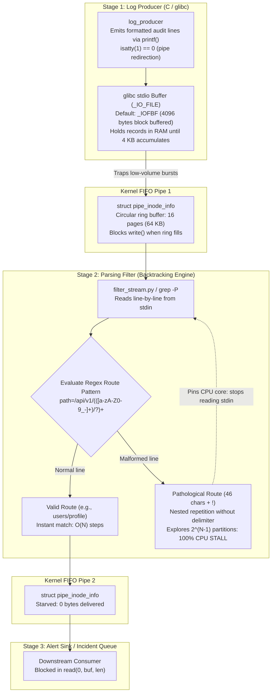

# Drill: Catastrophic Backtracking and Stream Bottleneck

> [!summary] Scope
> Timed problem drill presenting a real-time log ingestion pipeline that hangs under production traffic due to catastrophic regex backtracking in a parsing filter combined with libc stdio block-buffering stalls.
> Challenges the engineer to detect a saturated CPU core, isolate the exponential backtracking pattern, rewrite the regex for linear execution or replace it with ripgrep, and unbuffer stream pipes using stdbuf.
> Reaches Debug, validating Regex-Engines-Automata-Backtracking-and-ReDoS.md and Pipe-Buffering-and-Stdbuf.md.

Automata theory and backtracking regular expression vulnerabilities are owned by [[Regex-Engines-Automata-Backtracking-and-ReDoS]].
Kernel pipe buffers and standard C library stream buffering modes are owned by [[Pipe-Buffering-and-Stdbuf]].
SIMD prefiltering and deterministic linear search engines are owned by [[Ripgrep-Internals-and-Fast-Text-Search]].
This problem drill trains the engineer to triage and resolve compound stream processing outages where two decoupled failure modes create indistinguishable pipeline stalls: an intermediate parsing filter pinning a CPU core in catastrophic backtracking, and standard library I/O layers trapping log records inside 4096-byte memory buffers.



## 1. Reproduction

The reproduction environment models a real-time security telemetry ingestion pipeline.
A log producer generates structured web service access logs emitting timestamps, HTTP methods, API route paths, status codes, and request latencies.
An intermediate stream filter parses each incoming log line using a regular expression to extract the endpoint route and validate response codes.
Downstream consumers ingest parsed records to drive operational alerting and latency dashboards.
All source files and orchestration scripts are located in `code/01-Command-Line/drill_redos_stream/`.

The pipeline consists of three core components:
1. `log_producer.c`: A compiled C binary that emits structured log records using standard library `printf()` calls without explicit flushes.
2. `filter_stream.py`: A stream filter parsing lines from `sys.stdin` using a regular expression designed to match resource routes.
3. `probe_delivery.py`: A probe that reads a FIFO and timestamps the first byte and the EOF, to tell real-time delivery from delivery at exit.

Three helpers support the checks.
`emit_py.py` writes five records through Python's own `sys.stdout`, `measure_backtrack.py` times the lab's two regexes, and `stall_probe.py` samples `/proc` for the wedged filter.
The probe opens the FIFO itself, so the writer's redirection blocks until the probe is ready to read and there is no start-up race.
A FIFO is the same kernel pipe as `a | b`, so glibc sees a FIFO and picks the same buffer.

The parsing filter in the vulnerable pipeline uses the following regular expression:
```python
r"^\[(?P<time>[^\]]+)\]\s+GET\s+path=/api/v1/(?P<route>(([a-zA-Z0-9_-]+)/?)+)\s+status=(?P<status>[0-9]{3})\s+latency=(?P<lat>[0-9]+)ms$"
```

The route capturing group contains a nested quantifier: `(([a-zA-Z0-9_-]+)/?)+`.
The inner term `[a-zA-Z0-9_-]+` matches one or more alphanumeric characters, underscores, or dashes.
The inner slash delimiter `/?` is optional.
The outer group `(...)+` repeats the entire sequence one or more times.

To execute the reproduction and benchmark harness, run:
```bash
bash code/01-Command-Line/drill_redos_stream/run.sh
```

## 2. Observed Symptom

When the ingestion pipeline runs under production traffic, two distinct failure modes occur.
First, low-volume log streams fail to appear downstream in real time.
Second, the arrival of a single malformed request causes the filter to stop processing entirely, pinning a CPU core at 100% utilization while downstream consumers starve.

The harness produces the following output on `linux-aarch64`:

```text
=== PHASE 1: STDIO PIPE BUFFERING AND STDBUF OVERRIDE ===
--- Direct pipe buffer check ---
STREAM_STDOUT_ISATTY: 0
STREAM_STDOUT_BUFFER_MODE: BLOCK_BUFFERED
STREAM_STDOUT_BUFFER_BYTES: 4096
--- stdbuf -oL pipe buffer check ---
STREAM_STDOUT_ISATTY: 0
STREAM_STDOUT_BUFFER_MODE: LINE_BUFFERED
STREAM_STDOUT_BUFFER_BYTES: 4096
--- Real-time delivery probe without stdbuf ---
PIPELINE_DELIVERY_MODE: BLOCK_BUFFERED_STALL
EARLY_ARRIVALS_DURING_PRODUCER_RUN: False
TOTAL_RECORDS_RECEIVED: 5
--- Real-time delivery probe with stdbuf -oL ---
PIPELINE_DELIVERY_MODE: REALTIME_STREAMING
EARLY_ARRIVALS_DURING_PRODUCER_RUN: True
TOTAL_RECORDS_RECEIVED: 5
--- Python sys.stdout probe without -u ---
PIPELINE_DELIVERY_MODE: BLOCK_BUFFERED_STALL
EARLY_ARRIVALS_DURING_PRODUCER_RUN: False
TOTAL_RECORDS_RECEIVED: 5
--- Python sys.stdout probe under stdbuf -oL (no -u) ---
PIPELINE_DELIVERY_MODE: BLOCK_BUFFERED_STALL
EARLY_ARRIVALS_DURING_PRODUCER_RUN: False
TOTAL_RECORDS_RECEIVED: 5
--- Python sys.stdout probe with -u ---
PIPELINE_DELIVERY_MODE: REALTIME_STREAMING
EARLY_ARRIVALS_DURING_PRODUCER_RUN: True
TOTAL_RECORDS_RECEIVED: 5

=== PHASE 2: CATASTROPHIC BACKTRACKING COMPLEXITY ===
CLOSED-FORM BRANCH COUNTS (arithmetic, not measured):
N_CHARS | NESTED_BRANCHES | LINEAR_STEPS | RATIO
      5 |              16 |            6 |        2.7x
     10 |             512 |           11 |       46.5x
     15 |           16384 |           16 |     1024.0x
     20 |          524288 |           21 |    24966.1x

MEASURED ON THE LAB PATTERNS (CPython re, best of 3, N = 16, 18, 20, 22):
VULN_PATTERN_TIME_GROWS_4X_PER_2_CHARS: True
LINEAR_PATTERN_TIME_DOUBLES_WITH_INPUT: True

--- GNU grep -P (PCRE2) safety limit evaluation ---
GREP_PCRE_NORMAL_EXIT: 0
grep: (standard input): exceeded PCRE's backtracking limit
GREP_PCRE_VULN_EXIT: 2
GREP_PCRE_LINEAR_EXIT: 1

=== PHASE 3: PRODUCTION PIPELINE STALL REPRODUCTION ===
[PARSED] status=200 route=users/profile_1
[PARSED] status=200 route=users/profile_2
[PARSED] status=200 route=users/profile_3
[PARSED] status=200 route=users/profile_4
[PARSED] status=200 route=users/profile_5
VULNERABLE_PIPELINE_EXIT: 124
--- Wedged filter /proc probe ---
FILTER_ALIVE_AFTER_1S: True
FILTER_STATE_IS_RUNNING: True
FILTER_IN_SYSCALL: False
FILTER_CPU_FRACTION_AT_LEAST_0.9: True

=== PHASE 4: REMEDIATED PIPELINE EXECUTION ===
[PARSED] status=200 route=users/profile_1
[PARSED] status=200 route=users/profile_2
[PARSED] status=200 route=users/profile_3
[PARSED] status=200 route=users/profile_4
[PARSED] status=200 route=users/profile_5
[REJECTED] malformed_or_unauthorized_route
[PARSED] status=200 route=billing/invoice_7
[PARSED] status=200 route=billing/invoice_8
[PARSED] status=200 route=billing/invoice_9
[PARSED] status=200 route=billing/invoice_10
[PARSED] status=200 route=billing/invoice_11
[SUMMARY] total_processed=11 valid=10 rejected=1
--- End-to-end delivery through the unremediated pipeline ---
PIPELINE_DELIVERY_MODE: BLOCK_BUFFERED_STALL
EARLY_ARRIVALS_DURING_PRODUCER_RUN: False
TOTAL_RECORDS_RECEIVED: 6
--- End-to-end delivery through the remediated pipeline ---
PIPELINE_DELIVERY_MODE: REALTIME_STREAMING
EARLY_ARRIVALS_DURING_PRODUCER_RUN: True
TOTAL_RECORDS_RECEIVED: 6
DRILL_STATUS: PASS
```

In Phase 1, `log_producer` reports that `stdout` is not a terminal (`STREAM_STDOUT_ISATTY: 0`).
It reads the mode through the public `__flbf` and `__fbufsize` calls of glibc's `stdio_ext.h`, not private `_flags` bits.
Standard C library initialization sets the buffering mode to `BLOCK_BUFFERED` with a 4096-byte buffer, and `stdbuf -oL` flips only the mode to `LINE_BUFFERED`.
During the first delivery probe, `EARLY_ARRIVALS_DURING_PRODUCER_RUN` is `False`: the producer writes one record every 100 ms, yet all five arrive only when it exits and flushes.
The same probe on `stdbuf -oL ./log_producer` sees the first byte about 400 ms before EOF.
The next three probes use Python's own `sys.stdout`: it stalls by default, still stalls under `stdbuf -oL` (Python's `TextIOWrapper` buffer is not glibc's), and delivers in real time only with `python3 -u`.

In Phase 2, the table is the closed form $2^{N-1}$ printed by `measure_backtrack.py`, not a measurement.
The two booleans under it are measured on the lab's own `PATTERN_VULN` and `PATTERN_LINEAR`: the first is `True` when every step of N = 16, 18, 20, 22 multiplies the best-of-3 time by 2.5 to 6 (expected about 4 per two characters), the second when doubling a 100,000-character route multiplies the linear pattern's time by 1.3 to 3.2.
A separate timing of the vulnerable pattern in CPython 3.12.3 (linux-aarch64 container, as of 2026-11) gave 2.8 ms at $N = 16$, 44.2 ms at $N = 20$, and 704 ms at $N = 24$, a factor of 3.96 to 4.01 per two extra characters; those numbers are not printed because they vary by machine.
When evaluated with GNU `grep -P` (grep 3.11, PCRE2 10.42), PCRE2 exhausts its default match limit (`PCRE2_CONFIG_MATCHLIMIT`), printing `grep: (standard input): exceeded PCRE's backtracking limit` and aborting with exit code 2.
The abort is fatal for the whole stream: fed the pathological line followed by a valid one, grep 3.11 exits 2 after about 15 ms wall time including startup and never prints the valid line (measured, linux-aarch64, as of 2026-11).
The error string is present in the grep 3.11 binary of the lab image; the `pcresearch.c` source itself was not reachable, so the exit-2 and stop-reading behavior rests on this measurement.

In Phase 3, the production pipeline processes the first five valid records.
Upon encountering the pathological record `auth_service_v2_internal_token_validation_dump!`, the filter hangs inside the regex engine, and the harness timeout kills it after one second with exit code 124.
The remaining five valid records in the stream are never processed.
`stall_probe.py` then runs the same pipeline and samples `/proc/<PID>` of the filter after one second: it is alive, its state is `R`, `/proc/<PID>/syscall` reads `running` (no system call in progress), and over a further 0.5 s it used at least 90% of one core.

In Phase 4, the remediated filter parses 10 records and rejects the pathological one, with a 10 s `timeout` so a regression to the vulnerable regex fails instead of hanging.
The `--mode=burst` output is identical with or without `stdbuf -oL` and `-u`, because the filter flushes after every line, so that part proves the regex fix only.
The two end-to-end probes run `log_producer --mode=stream` through the filter into the delivery probe: without `stdbuf -oL` on the producer the filtered records all arrive at exit, with it they stream.
`TOTAL_RECORDS_RECEIVED: 6` counts five `[PARSED]` lines and the final `[SUMMARY]` line.
`-u` on the filter does not change that result because the filter calls `flush()` itself; the Python probes in Phase 1 are what prove `-u`.

## 3. Progressive Hint Ladder

> [!tip]- Hint 1: Differentiating CPU saturation from I/O deadlocks
> When a multi-stage shell pipeline stops producing output, inspect the process states using `ps -o pid,state,%cpu,comm` or `pidstat 1`.
> A process in state `S` (interruptible sleep) consuming 0.0% CPU is blocked on I/O, waiting on an empty pipe read or a full pipe write.
> A process in state `R` (running) consuming 100.0% CPU on a single core indicates a CPU-bound compute loop.
> Trace the process with `strace -p <PID>`: if `strace` prints nothing at all, the process is executing user-space instructions without making system calls.
> This confirms that the pipeline is wedged in computational CPU saturation rather than kernel synchronization.
> Measured on a wedged CPython `re` match (Ubuntu 24.04 container, as of 2026-11): `ps` showed state `R` at 100% CPU, `strace -p` printed only the attach and detach lines, and `pidstat -p <PID> 1` showed 100% `%usr` and 0% `%system`.

> [!tip]- Hint 2: Deconstructing the regular expression grammar
> Examine the regex pattern `/api/v1/(([a-zA-Z0-9_-]+)/?)+`.
> Focus on the interaction between the inner quantifier `+`, the optional delimiter `/?`, and the outer quantifier `+`.
> What happens when an input contains a long sequence of alphanumeric characters without a single slash, followed by a non-matching character?
> Because the slash is optional, each character in the alphanumeric string can either be consumed by the inner repetition or initiate a new iteration of the outer repetition.
> For an input of length $N$, calculate how many distinct ways the engine can partition the string into nested repetitions.
> When the end of the string fails to match, a backtracking engine must test every possible partition before reporting failure.

> [!tip]- Hint 3: Eliminating libc stdio block buffering stalls
> Check standard input and output buffering across each pipeline segment.
> In standard C programs, `stdout` defaults to line buffering (`_IOLBF`) when connected to an interactive terminal, but downgrades to fully block-buffered (`_IOFBF`, 4096 bytes) when connected to a pipe or file.
> Interpose GNU `stdbuf -oL` on the producer to inject `libstdbuf.so` via `LD_PRELOAD`, forcing `stdout` to line buffering before `main()` executes.
> For Python intermediate filters, ensure Python runs with unbuffered text I/O using `python3 -u` or setting `PYTHONUNBUFFERED=1`.

> [!tip]- Hint 4: Choosing between regex rewriting and automata engines
> Two orthogonal paths resolve catastrophic backtracking.
> Path A rewrites the regex to ensure disjoint transitions: enforce that path segments must be separated by mandatory slashes, such as `/api/v1/([a-zA-Z0-9_-]+(?:/[a-zA-Z0-9_-]+)*)/?`.
> Because a slash cannot match `[a-zA-Z0-9_-]`, there is exactly one way to parse the string, collapsing the search from $O(2^N)$ to $O(N)$.
> Path B replaces the backtracking engine entirely with an automata-based engine such as [[Ripgrep-Internals-and-Fast-Text-Search|ripgrep]] or Google RE2.
> Automata engines compile patterns into Thompson NFAs and Lazy DFAs, guaranteeing $O(M \cdot N)$ execution time regardless of pattern structure or adversarial input; ripgrep's FAQ states its default engine has "linear worst case time complexity", which does not hold for `rg -P` (PCRE2).

## 4. Model Solution

> [!success]- Solution: Complete Diagnosis and Remediation
> The incident stems from two compounding mechanisms operating at different layers of the Unix execution stack.
> 
> ### Root Cause 1: Catastrophic Regex Backtracking (ReDoS)
> Backtracking regular expression engines (CPython `re` via `Modules/_sre/sre.c` and `Modules/_sre/sre_lib.h` since 3.11, PCRE2, Perl) implement depth-first search with backtracking frames.
> Consider the vulnerable pattern:
> ```regex
> ^\[([^]]+)\]\s+GET\s+path=/api/v1/(([a-zA-Z0-9_-]+)/?)+\s+status=([0-9]{3})\s+latency=([0-9]+)ms$
> ```
> The sub-expression `(([a-zA-Z0-9_-]+)/?)+` contains nested quantifiers with overlapping match domains.
> When evaluating the input:
> ```text
> path=/api/v1/auth_service_v2_internal_token_validation_dump! status=403 latency=99ms
> ```
> The payload contains 46 valid alphanumeric characters followed by an exclamation mark `!`.
> Because `/?` is optional, the outer `+` can partition the 46 characters across an arbitrary number of inner groups.
> The number of compositions of an integer $N$ into positive parts is mathematically:
> $$\sum_{k=1}^N \binom{N-1}{k-1} = 2^{N-1}$$
> For $N = 46$, the engine must explore $2^{45} \approx 3.51 \times 10^{13}$ branch states before concluding that the trailing `!` prevents a match.
> In Python `re`, this single evaluation consumes weeks of CPU time: extrapolating the measured 704 ms at $N = 24$ by $2^{22}$ gives about $3 \times 10^6$ s, roughly 34 days (CPython 3.12.3, linux-aarch64 container on Apple silicon, as of 2026-11).
> 
> ### Root Cause 2: Standard I/O Pipe Block Buffering
> In glibc (`libio/filedoalloc.c`), `_IO_file_doallocate()` queries the file descriptor using `fstat()`.
> It allocates `BUFSIZ` (8192) bytes, or `st_blksize` when that is smaller, which is 4096 bytes for a Linux pipe; it sets `_IO_LINE_BUF` only when the descriptor is a character device that `isatty()` accepts, so a pipe stays fully buffered (glibc 2.39 `libio/filedoalloc.c`; measured: 4095 bytes held, 4097 bytes deliver 4096 early).
> Standard library output functions (`printf`, `fputs`) accumulate data in user-space memory and invoke the `write(2)` system call only when the 4096-byte threshold is reached.
> In low-volume streams, valid logs remain trapped in the producer's memory for minutes or hours, creating the illusion of a frozen pipeline even before pathological traffic arrives.
> 
> ### Step-by-Step Remediation
> 
> #### Step 1: Rewrite the Regex for Deterministic Linear Execution
> Restructure the route regex so that path segments are strictly delimited by mandatory slashes.
> The first segment matches `[a-zA-Z0-9_-]+`.
> Subsequent segments require a leading slash followed by characters: `(?:/[a-zA-Z0-9_-]+)*`.
> An optional trailing slash `/?` is placed outside the repetition:
> ```python
> PATTERN_LINEAR = re.compile(
>     r"^\[(?P<time>[^\]]+)\]\s+GET\s+path=/api/v1/(?P<route>[a-zA-Z0-9_-]+(?:/[a-zA-Z0-9_-]+)*)/?\s+status=(?P<status>[0-9]{3})\s+latency=(?P<lat>[0-9]+)ms$"
> )
> ```
> Because `[a-zA-Z0-9_-]` cannot match `/`, the character sets are disjoint.
> The search contains zero ambiguity, guaranteeing strict $O(N)$ linear matching.
> 
> #### Step 2: Unbuffer Upstream and Downstream Streams
> Interpose `stdbuf -oL` on the compiled C producer to force line buffering on `stdout`.
> Run the Python filter with `-u` to ensure `sys.stdout` uses unbuffered raw binary streams.
> 
> Execute the remediated pipeline:
> ```bash
> stdbuf -oL ./log_producer --mode=burst | python3 -u filter_stream.py --mode=linear
> ```
> 
> #### Verification Output
> As demonstrated in Phase 4 of the harness run on `linux-aarch64` (the block ends at the last line of the recording):
> ```text
> === PHASE 4: REMEDIATED PIPELINE EXECUTION ===
> [PARSED] status=200 route=users/profile_1
> [PARSED] status=200 route=users/profile_2
> [PARSED] status=200 route=users/profile_3
> [PARSED] status=200 route=users/profile_4
> [PARSED] status=200 route=users/profile_5
> [REJECTED] malformed_or_unauthorized_route
> [PARSED] status=200 route=billing/invoice_7
> [PARSED] status=200 route=billing/invoice_8
> [PARSED] status=200 route=billing/invoice_9
> [PARSED] status=200 route=billing/invoice_10
> [PARSED] status=200 route=billing/invoice_11
> [SUMMARY] total_processed=11 valid=10 rejected=1
> --- End-to-end delivery through the unremediated pipeline ---
> PIPELINE_DELIVERY_MODE: BLOCK_BUFFERED_STALL
> EARLY_ARRIVALS_DURING_PRODUCER_RUN: False
> TOTAL_RECORDS_RECEIVED: 6
> --- End-to-end delivery through the remediated pipeline ---
> PIPELINE_DELIVERY_MODE: REALTIME_STREAMING
> EARLY_ARRIVALS_DURING_PRODUCER_RUN: True
> TOTAL_RECORDS_RECEIVED: 6
> DRILL_STATUS: PASS
> ```
> The pathological record is rejected in about 2 microseconds (1.99 us mean over 200,000 `timeit` runs, CPython 3.12.3, linux-aarch64, as of 2026-11; not measured by the lab), and all 10 valid records are parsed.
> The burst run proves the regex fix only: it emits all records at once and the filter flushes after every line, so its output is identical with or without `stdbuf -oL` and `-u`.
> The two end-to-end probes at the end prove the unbuffering: the same pipeline stalls without `stdbuf -oL` on the producer and streams with it.

## 5. Core Takeaway

Stream pipeline reliability depends on maintaining non-blocking guarantees across both the computational parsing layer and the operating system transport layer.
A single regular expression containing nested or overlapping quantifiers evaluated by a backtracking engine exposes infrastructure to catastrophic CPU saturation, turning trivial network payloads into denial-of-service vulnerabilities.
Simultaneously, libc's automatic downgrade from line buffering to block buffering introduces silent delivery latency whenever commands are connected via pipes.

Always adhere to two fundamental stream processing rules:
1. Parse untrusted or high-throughput streams exclusively using non-backtracking automata engines (RE2, [[Ripgrep-Internals-and-Fast-Text-Search|ripgrep]]) or strictly unnested, disjoint regular expressions validated for $O(N)$ execution.
2. Explicitly control stream buffering across intermediate pipeline stages using `stdbuf -oL`, `python3 -u`, or explicit application-level `fflush()` invocations as established in [[Pipe-Buffering-and-Stdbuf]].

## Commands and Numbers to Know

The following reference metrics, default buffer limits, and diagnostic commands govern stream pipeline engineering (as of 2026-11):

| Parameter / Tool / Flag | Value / Command | Target Platform | Mechanism and Operational Significance |
|:---|:---|:---|:---|
| glibc stdio Block Buffer | 4096 bytes on a pipe (`min(BUFSIZ, st_blksize)`) | Linux | Default `_IOFBF` size allocated by `_IO_file_doallocate()` when `isatty(1) == 0`; measured with glibc 2.39. |
| macOS Libc Block Buffer | 16384 bytes (16 KB) on a pipe | macOS | Default `__smakebuf()` block buffer size allocated on Darwin when `isatty(1) == 0`; pipe `st_blksize` is 16384 and 16383 bytes stay buffered (measured, macOS 27.2). |
| Linux Pipe Ring Capacity | 65536 bytes (64 KB) | Linux | Default capacity of `struct pipe_inode_info` (`PIPE_DEF_BUFFERS` 16 pages of 4096 bytes) since Linux 2.6.11; resizable with `F_SETPIPE_SZ` since 2.6.35. |
| POSIX `PIPE_BUF` | 4096 bytes (Linux) / 512 bytes (POSIX min) | Both | Maximum byte size guaranteed to be written atomically to a pipe without interleaving. |
| GNU `stdbuf -oL` | `stdbuf -oL <cmd>` | Linux / Both | Preloads `libstdbuf.so` to invoke `setvbuf(stdout, NULL, _IOLBF, 0)` before `main()`. |
| GNU `stdbuf -o0` | `stdbuf -o0 <cmd>` | Linux / Both | Preloads `libstdbuf.so` to invoke `setvbuf(stdout, NULL, _IONBF, 0)` (unbuffered). |
| Python Unbuffered Stream | `python3 -u` or `PYTHONUNBUFFERED=1` | Both | Makes `sys.stdout` and `sys.stderr` unbuffered (text layer too, since 3.7); no effect on `sys.stdin`. |
| PCRE2 Default Match Limit | 10,000,000 calls of the internal match function | Both | `PCRE2_CONFIG_MATCHLIMIT`; GNU `grep -P` 3.11 prints the error, exits 2, and stops reading the stream. |
| Inspect Wedged Process Syscalls | `strace -p <PID>` | Linux | Shows active system calls; prints zero output if process is trapped in CPU ReDoS. |
| Inspect Process CPU Saturation | `pidstat -p <PID> 1` | Linux | Displays user vs system CPU percentage per task (`-t` for per thread); ReDoS shows 100% `%usr`. |
| Inspect Open Pipe File Descriptors | `lsof -p <PID> -a -d 0,1,2` | Both | Identifies connected pipes, FIFOs, and files on stdin, stdout, and stderr. |
| Inspect Kernel Pipe Fill Level | `ls -l /proc/<PID>/fd` and `/proc/sys/fs/pipe-max-size` | Linux | `/proc/<PID>/fd` shows which `pipe:[inode]` each fd is, not its fill level (read that with `ioctl(fd, FIONREAD)`); `pipe-max-size` defaults to 1048576 bytes (1 MiB), the unprivileged `F_SETPIPE_SZ` ceiling. |

## Pitfalls

> [!warning] Pitfalls:
> 1. **Assuming PCRE2 Match Limits Prevent Service Degradation:** PCRE2's match limit prevents indefinite execution, but each bad record still burns CPU up to the limit, and in GNU `grep -P` 3.11 the limit is fatal: grep prints `exceeded PCRE's backtracking limit`, exits 2, and drops every later line (measured, linux-aarch64, as of 2026-11; about 15 ms wall for the lab payload including process startup).
>    A library caller that skips the record instead pays that cost per malformed record, so a burst of them still stalls the stage and pushes backpressure upstream.
> 2. **Wrapping Statically Linked Binaries in `stdbuf`:** `stdbuf` relies strictly on dynamic linker interposition via `LD_PRELOAD`.
>    A statically linked binary runs no `ld.so`, so nothing reads `LD_PRELOAD`; Go and Rust programs are unaffected even when dynamically linked, because they do not write through glibc `FILE*` streams.
>    The command runs without warning, leaving buffering unaltered.
> 3. **Relying on `stdbuf` to Unbuffer Python 3:** Python 3 implements its own virtual I/O stack (`io.TextIOWrapper`) on top of file descriptors.
>    While `stdbuf` reconfigures the underlying C library `FILE*`, Python's `TextIOWrapper` retains its internal buffer (measured on a Linux pipe with CPython 3.12.3: 4200 bytes held, 8200 bytes delivered, so text writes wait for 8192 bytes) unless Python is explicitly invoked with `python3 -u` or `PYTHONUNBUFFERED=1`.
> 4. **Nested Groups in Obscure Alternations:** Engineers frequently eliminate obvious nested repetitions like `(a+)+` while overlooking overlapping alternations such as `(a|b|ab)*` or `(https?://)?([^/]+/?)+`. Any grammar where an arbitrary string prefix can be parsed through multiple distinct branching paths is vulnerable to catastrophic backtracking when the suffix fails to match.
> 5. **Bidirectional Pipeline Deadlocks:** When chaining commands where Stage A and Stage B communicate bidirectionally (or when Stage A drives Stage B while reading its output via process substitution), block buffering combined with a full 64 KB pipe buffer causes permanent mutual deadlock.
>    Both processes block in the kernel: Stage A in `write(2)` waiting for pipe buffer space, and Stage B in `read(2)` waiting for an unflushed block buffer.

## At Scale: Real-Time Stream Ingestion Architecture

Scaling high-throughput text and log processing across tens of thousands of hosts requires eliminating nondeterministic algorithmic complexity and hidden memory buffering.
At scale, engineering teams must establish architectural paved roads that enforce bounded execution:

1. **Mandatory Non-Backtracking Automata Engines:**
   For all stream filtering, routing, and WAF rules, forbid regex engines that use recursive backtracking (Python `re`, PCRE2, Perl).
   Mandate finite-automata engines such as [[Ripgrep-Internals-and-Fast-Text-Search|ripgrep]], Google RE2, or the Rust `regex` crate.
   Because Thompson NFAs simulate all possible state transitions concurrently, matching complexity is strictly bounded by $O(M \cdot N)$, where $M$ is pattern length and $N$ is text length.
   Pathological payloads cost no more than the $O(M \cdot N)$ bound allows, eliminating exponential ReDoS; large patterns and lazy DFA cache thrash can still make matching slow, so the bound is not "the same rate as normal traffic".

2. **Automated Static Analysis in CI/CD:**
   Integrate a static regular expression vulnerability analyzer into build pipelines.
   Reject pull requests that introduce nested quantifiers (`(a+)+`), overlapping alternations (`(a|a)+`), or unanchored prefix repetitions.

3. **Transport Layer Protocol Discipline:**
   Replace raw byte streams flowing through unbuffered shell pipelines with structured streaming frameworks (e.g., Vector, Fluent Bit, or native gRPC/Kafka forwarders) that manage explicit buffer flushes and backpressure.
   When shell pipelines are unavoidable in container entrypoints or cron tasks, standardize on wrapper scripts that set `PYTHONUNBUFFERED=1` and enforce `stdbuf -oL -eL` across all coreutils stages as codified in [[Robust-Shell-Scripting-and-ShellCheck]].

4. **Resource Quotas and Kernel Pipe Sizing:**
   In Linux container environments, pipe buffer capacities can be adjusted using `fcntl(fd, F_SETPIPE_SZ, size)`.
   For high-bandwidth pipelines where batch throughput matters more than interactive latency, expand the pipe buffer from the default 64 KB to 1 MB to minimize context switches between producers and consumers.
   Conversely, for real-time alerting systems, enforce line buffering and bind stream workers to dedicated CPU cores with strict execution timeouts.

## Practice Drill

> [!tip] Practice Drill:
> 1. Clone the drill lab directory and inspect `log_producer.c`, `filter_stream.py`, and `measure_backtrack.py`.
> 2. Modify `log_producer.c` to emit 100-character lines and measure the exact number of lines required to naturally trigger a glibc stdio buffer flush without `stdbuf` (calculate `4096 / line_length`).
> 3. Construct three distinct regular expressions that match email addresses, and use `measure_backtrack.py` to identify which pattern suffers from catastrophic backtracking when given an invalid domain containing 30 repeated characters.
> 4. Rewrite the vulnerable email regex using disjoint character classes and verify that execution scales strictly linearly.
> 5. Implement a pure C filter using POSIX `regcomp(3)` with `REG_EXTENDED` and test whether glibc's regex engine is vulnerable to ReDoS compared to Python `re`.

## Interview Questions

### Question 1 (Level 5): stdio Pipe Buffering Mechanics
Why does a pipeline like `tail -f app.log | grep ERROR | awk '{print $1}'` fail to display matching errors immediately on the terminal, whereas running `tail -f app.log | grep ERROR` displays them in real time?
How does `stdbuf -oL` solve this issue?

> [!success]- Answer:
> Standard C I/O (`FILE*`) streams implement three distinct buffering modes defined by POSIX and ISO C:
> 1. Fully buffered (`_IOFBF`): Characters are saved in a block-sized memory buffer (typically 4096 bytes on Linux glibc, 16384 bytes on macOS Darwin) and written only when the buffer is full.
> 2. Line buffered (`_IOLBF`): Characters are accumulated until a newline character (`\n`) is encountered, at which point the buffer is flushed via `write(2)`.
> 3. Unbuffered (`_IONBF`): Each output operation immediately invokes `write(2)`.
> 
> During initialization, libc queries the stream's file descriptor using `isatty(fileno(stream))`.
> When `grep ERROR` outputs directly to the terminal, `isatty(1)` returns true, and stdout defaults to line buffering (`_IOLBF`).
> Each matching line ends with a newline and is printed instantly.
> 
> However, when `grep ERROR` is piped to `awk '{print $1}'`, stdout is connected to a Unix pipe FIFO.
> `isatty(1)` returns false, causing glibc to switch stdout from line buffering to fully block-buffered (`_IOFBF`).
> Matching lines are trapped in `grep`'s 4096-byte memory buffer until 4 KB of error messages accumulate.
> In this pipeline `awk`'s stdout is the terminal, so awk's output is line buffered; the stage holding the data is `grep`, whose stdout is the pipe (a second block-buffering stage appears only when awk's stdout is also redirected, as in Question 4).
> 
> GNU `stdbuf -oL grep ERROR` resolves this by configuring the dynamic linker (`ld.so`) via `LD_PRELOAD` to load `libstdbuf.so` before the target program executes.
> An ELF constructor in `libstdbuf.so` reads the environment variable `_STDBUF_O=L` and invokes `setvbuf(stdout, NULL, _IOLBF, 0)` before `grep`'s `main()` function begins.
> This forces `grep`'s stdout to remain line-buffered even when piped.

### Question 2 (Level 5): Predict the Output (Buffering and Grep)
Consider the following two commands executed in a bash terminal:
```bash
# Command A:
python3 -c 'import time; [print(f"val {i}") or time.sleep(0.05) for i in range(3)]' | grep "val"

# Command B:
python3 -u -c 'import time; [print(f"val {i}") or time.sleep(0.05) for i in range(3)]' | grep --line-buffered "val"
```
Predict the observable difference in output timing between Command A and Command B.
What internal stdio structures govern this difference?

> [!success]- Answer:
> **Prediction:**
> In Command A, nothing appears on the terminal for about 150 milliseconds.
> At $t \approx 150\text{ ms}$, when the Python process finishes and exits, all three lines (`val 0`, `val 1`, `val 2`) appear simultaneously in an instantaneous burst.
> 
> In Command B, each line appears individually in real time: `val 0` at $t = 0\text{ ms}$, `val 1` at about $50\text{ ms}$, and `val 2` at about $100\text{ ms}$.
> Measured through a pseudo-terminal on the Ubuntu 24.04 container (3 runs, CPython 3.12.3, grep 3.11, as of 2026-11): A delivered one burst 155 to 158 ms after launch; B delivered `val 0` at 5 ms, `val 1` 50 to 57 ms later, and `val 2` 102 to 109 ms after the first.
> The commands use `print(...) or time.sleep(...)` because `sys.stdout.write()` returns a nonzero length, which would short-circuit the `or` and skip the sleep.
> 
> **Governing Mechanisms:**
> In Command A, Python's `sys.stdout` detects that its output is piped to `grep` (`sys.stdout.isatty()` is `False`).
> Python's text I/O layer wraps `sys.stdout.buffer` in a block-buffered `_io.BufferedWriter` rather than an unbuffered stream.
> The three lines total 18 bytes, well below the 8192-byte threshold at which CPython 3.12's text layer passes pending writes down (measured on a Linux pipe: 4200 bytes held, 8200 delivered).
> Data is flushed to the pipe only at interpreter shutdown, when `flush_std_files()` in `Python/pylifecycle.c` calls `sys.stdout.flush()`.
> Furthermore, `grep`'s stdout is connected to a terminal, so `grep` would print line-by-line if data arrived, but it receives zero bytes until Python terminates.
> 
> In Command B, the `-u` flag instructs Python to use unbuffered binary streams (`sys.stdout.buffer` is instantiated as raw `_io.FileIO`).
> Each `sys.stdout.write()` invokes an immediate `write(1, ...)` system call.
> Downstream, GNU `grep --line-buffered` explicitly calls `fflush(stdout)` after every matching line, guaranteeing end-to-end zero-latency delivery to the terminal.

### Question 3 (Level 6): Catastrophic Backtracking Root Cause
Mathematically analyze why the regular expression `^([a-zA-Z0-9]+_?)+$` exhibits catastrophic backtracking when evaluated against the string `aaaaaaaaaaaaaaaaaaaaaaaa!` (24 `a` characters followed by `!`), whereas the pattern `^[a-zA-Z0-9]+(_[a-zA-Z0-9]+)*$` evaluates in linear time.

> [!success]- Answer:
> **Vulnerable Pattern Analysis:**
> In `^([a-zA-Z0-9]+_?)+$`, let $S$ be a string of $N$ alphanumeric characters without any underscores (`_`).
> The inner sub-pattern `[a-zA-Z0-9]+` matches one or more characters.
> The delimiter `_?` is optional and matches the empty string $\epsilon$.
> The outer quantifier `(...)+` repeats the inner expression.
> 
> Because `_?` can match $\epsilon$, any partition of the $N$ characters into non-empty chunks constitutes a valid match for the outer repetition.
> For example, a 3-character string `aaa` can be matched as:
> 1. `("aaa")` (1 chunk)
> 2. `("aa", "a")` (2 chunks)
> 3. `("a", "aa")` (2 chunks)
> 4. `("a", "a", "a")` (3 chunks)
> 
> The number of ways to partition a sequence of length $N$ into $k$ non-empty parts is given by the binomial coefficient $\binom{N-1}{k-1}$.
> Summing over all possible part counts $k \in \{1, \dots, N\}$ yields:
> $$\sum_{k=1}^N \binom{N-1}{k-1} = 2^{N-1}$$
> 
> When the string ends in `!`, the terminal anchor `$` cannot match.
> A recursive backtracking engine (such as CPython `re` or PCRE2) must explore every possible partition of the 24 characters before it can definitively determine that the match fails.
> For $N = 24$, the backtracker evaluates $2^{23} = 8,388,608$ branch states.
> Each branch involves saving and restoring backtracking frames, pinning the CPU core for hundreds of milliseconds (measured 581 ms at $N = 24$, CPython 3.12.3, linux-aarch64 container, as of 2026-11).
> For $N = 35$, the branches reach $2^{34} \approx 1.72 \times 10^{10}$; extrapolating the measured doubling per character gives about 20 minutes on the same host.
> 
> **Linear Pattern Analysis:**
> In `^[a-zA-Z0-9]+(_[a-zA-Z0-9]+)*$`, the leading segment greedily consumes all alphanumeric characters.
> Subsequent segments require a mandatory leading underscore `_`.
> Because `[a-zA-Z0-9]` and `_` are disjoint sets, an alphanumeric character can never initiate a new iteration of the `(_[a-zA-Z0-9]+)*` group.
> There is exactly one deterministic path through the state machine.
> The engine scans each character in the string exactly once: $N$ comparisons to consume `a`...`a`, one comparison discovering that `!` is neither `_` nor `$`, and immediate rejection.
> Execution complexity is strictly $O(N)$ with zero backtracking frames.

### Question 4 (Level 6): Debug This Pipeline (The Wedged Log Forwarder)
You are called to triage a production incident where an operational log forwarding pipeline on a Linux server has stopped delivering logs:
```bash
tail -F /var/log/app.log | grep -P '^\[\d+\]\s+path=/api/(([a-zA-Z0-9]+)/?)+\s+auth=OK' | awk '{print $2}' >> /var/log/filtered.log
```
The application continues writing 500 lines/second to `app.log`, but `filtered.log` has had zero writes for 20 minutes.
When an operator killed the pipeline with `kill -15`, a large burst of 40 lines suddenly appeared in `filtered.log`.
Describe your step-by-step triage procedure to isolate the root cause and provide the production fix.

> [!success]- Answer:
> **Step 1: Inspect Process States and CPU Consumption**
> Run `ps aux | grep -E 'tail|grep|awk'` or `pidstat 1`.
> Check the `%CPU` and `STAT` columns for each process in the pipeline.
> Two possible states will be observed:
> - Case A (ReDoS): `grep` is in state `R` (running) with `%CPU` pinned at 100.0% on a single core, while `tail` and `awk` are in state `S` (interruptible sleep) at 0.0% CPU.
>   With GNU `grep -P` this case is short-lived: PCRE2's match limit makes grep 3.11 exit 2 within milliseconds on this pattern (measured), so a long-lived pinned core points to an engine without a limit, such as Python `re`.
> - Case B (Buffering): All three processes (`tail`, `grep`, `awk`) are in state `S` with 0.0% CPU.
> 
> **Step 2: Trace System Calls**
> Attach `strace` to the `grep` process: `strace -p <GREP_PID>`.
> - If `strace` prints nothing at all, `grep` is executing an infinite user-space CPU loop without issuing system calls.
>   This proves catastrophic backtracking (ReDoS) triggered by a malformed path line in `app.log`.
> - If `strace` shows `grep` blocked in `read(0, ...)` or `write(1, ...)`, the issue is kernel pipe buffering.
> 
> **Step 3: Analyze the Sudden Flush on Exit**
> The fact that killing the pipeline caused 40 lines to flush confirms that libc block buffering was active.
> `grep`'s stdout was connected to a pipe, so glibc allocated a 4096-byte `_IOFBF` buffer.
> `awk`'s stdout was connected to a file, so it also allocated a block buffer.
> The 40 lines totaled ~2500 bytes, which did not fill the 4096-byte buffer.
> `SIGTERM` with its default disposition terminates a process without running `exit()`, so a process killed that way loses its stdio buffer (measured: killing `grep` directly left 0 bytes in its output file).
> The burst appears because `tail` died first: `grep` then read EOF, returned from `main()`, and `exit()` ran `_IO_cleanup()` to flush; `awk` saw EOF next and flushed the same way.
> 
> **Step 4: Identify the Compound Failure**
> The pipeline suffered from both failure modes simultaneously:
> 1. Low-volume filtered matches were held in `awk`'s and `grep`'s 4 KB buffers.
> 2. When a malformed line arrived, `grep` entered catastrophic backtracking on `(([a-zA-Z0-9]+)/?)+`, freezing stream consumption completely.
> While `grep` was stuck in the CPU loop, it stopped reading from `tail`.
> Eventually `tail` filled the 64 KB kernel pipe buffer and blocked in `write(2)`.
> With `grep -P` specifically, the second mode ends quickly instead of stalling: grep 3.11 hits PCRE2's match limit, exits 2, `tail` dies of `SIGPIPE` on its next write, and `awk` flushes on EOF; a 20-minute stall with every process alive therefore points to buffering, and the ReDoS line shows up as `exceeded PCRE's backtracking limit` on stderr.
> 
> **Step 5: Production Remediation**
> 1. Rewrite the regex to eliminate nested quantifiers:
>    `^\[\d+\]\s+path=/api/([a-zA-Z0-9]+(?:/[a-zA-Z0-9]+)*)/?\s+auth=OK`
> 2. Force line buffering across both intermediate stages using `stdbuf`:
> ```bash
> tail -F /var/log/app.log | \
>   stdbuf -oL grep -P '^\[\d+\]\s+path=/api/([a-zA-Z0-9]+(?:/[a-zA-Z0-9]+)*)/?\s+auth=OK' | \
>   stdbuf -oL awk '{print $2}' >> /var/log/filtered.log
> ```
> Alternatively, replace `grep -P` with `rg --line-buffered` for guaranteed linear-time matching; `stdbuf` has no effect on ripgrep, which is written in Rust and does not use glibc stdio, so its own `--line-buffered` flag is required (ripgrep 15.2.0 `rg --help`).

### Question 5 (Level 6): Automata vs Backtracking Regex Engines
Explain why finite automata engines (like RE2 and the Rust `regex` engine used by `ripgrep`) cannot support backreferences (e.g., `([a-z]+)\1`), whereas backtracking engines (PCRE2, Python `re`) can.
How does this theoretical limitation relate to ReDoS immunity?

> [!success]- Answer:
> **Theoretical Foundations:**
> Regular expressions in formal language theory define regular languages, which are recognized by Finite State Automata (DFA and NFA).
> An NFA with $M$ states processes an input string of length $N$ by maintaining a set of currently active states.
> In Thompson's NFA simulation (PikeVM), each character transition advances the set of active states, taking at most $O(M)$ operations per character.
> The worst-case time complexity is strictly bounded by $O(M \cdot N)$, and memory is bounded by $O(M)$.
> 
> **Why Backreferences Break Automata:**
> A backreference like `([a-z]+)\1` matches the exact string that was previously matched by the first capture group.
> This requires matching strings of the form $\{ w w \mid w \in \Sigma^+ \}$.
> By the Pumping Lemma for Regular Languages, the language $\{ w w \}$ is non-regular (it is context-sensitive).
> A finite automaton cannot recognize $\{ w w \}$ because a finite state machine possesses only bounded memory (its finite state set) and cannot remember an arbitrary substring $w$ of unbounded length.
> Matching regular expressions with backreferences is NP-complete (Russ Cox, "Regular Expression Matching Can Be Simple And Fast", section "Real world regular expressions").
> 
> **The Backtracking Trade-Off:**
> Backtracking engines support backreferences by abandoning finite automata and using recursive depth-first trial-and-error search.
> When evaluating a pattern, the engine stores the matched substring for group 1 on a backtracking frame stack, advances, and tests whether the subsequent text matches that saved string.
> If it fails, the engine unwinds its stack and tries alternate choices for group 1.
> 
> **ReDoS Relationship:**
> Supporting non-regular features requires maintaining a state history and backtracking through alternate decision branches.
> This DFS architecture inherently permits worst-case exponential branching $O(2^N)$ on nested or overlapping quantifiers.
> By strictly rejecting backreferences and arbitrary lookaround assertions, automata engines guarantee that every state transition depends solely on the current active states and the current input byte, making catastrophic backtracking mathematically impossible.

### Question 6 (Level 7): Kernel Pipe Buffering and Deadlocks
Detail what occurs inside the Linux kernel (`fs/pipe.c`) when a pipeline stage freezes in a ReDoS loop while the upstream producer continues writing.
How do kernel ring buffer capacity, atomic write guarantees (`PIPE_BUF`), and bidirectional piping create deadlocks?

> [!success]- Answer:
> **Linux Kernel Pipe Architecture:**
> In the Linux kernel, an anonymous pipe is represented by `struct pipe_inode_info`.
> The pipe buffer is implemented as a circular ring of page references, allocated at pipe creation (Linux 6.8 `include/linux/pipe_fs_i.h`):
> `struct pipe_buffer *bufs;` with `unsigned int ring_size;` slots.
> Since Linux 2.6.11 the default is 16 slots (`#define PIPE_DEF_BUFFERS 16`); since 2.6.35 `F_SETPIPE_SZ` can resize it.
> On a system with 4096-byte pages (x86_64, and aarch64 kernels built for 4 KB pages; 16 KB and 64 KB aarch64 kernels exist), default pipe capacity is $16 \times 4096 = 65,536\text{ bytes}$ (64 KB).
> 
> **Upstream Backpressure Cascade:**
> When Stage 2 (the filter) halts inside a CPU-bound ReDoS loop, it stops issuing the `read(2)` system call.
> Stage 1 (the producer) continues issuing `write(2)` calls.
> Kernel function `pipe_write()` copies user bytes into the available pages of `pipe_inode_info`.
> Once all 16 pages are full (64 KB accumulated), `pipe_write()` checks the file descriptor flags:
> - If `O_NONBLOCK` is not set (default), the kernel places the calling task into state `TASK_INTERRUPTIBLE` sleep, queuing it on `pipe->wr_wait`.
> - The producer thread deschedules.
> In `ps` or `top`, the producer shows 0.0% CPU in state `S`.
> A stack trace (`/proc/<PID>/stack`) reveals the task sleeping inside `pipe_write()`.
> 
> **Atomic Writes and `PIPE_BUF`:**
> POSIX requires that any `write(2)` of $B \le \text{PIPE\_BUF}$ bytes must be written atomically to the pipe without interleaving with data from other processes.
> On Linux, `PIPE_BUF` is 4096 bytes.
> If space in the pipe ring is less than $B$, a blocking write waits until it can transfer all $B$ bytes at once.
> For writes where $B > \text{PIPE\_BUF}$, the kernel may split the write into multiple partial transfers, interleaving chunks if multiple writers exist.
> 
> **Bidirectional Deadlocks:**
> Bidirectional deadlocks occur when two processes communicate via two pipes (e.g., $P_1 \to \text{Pipe A} \to P_2$ and $P_2 \to \text{Pipe B} \to P_1$), or when a single shell script writes to a subshell via process substitution `<(cmd)` while waiting for its output.
> If Process 1 writes to Pipe A using libc block buffering (`_IOFBF`), Process 2 receives nothing and blocks in `read(Pipe A)`.
> If Process 1 then attempts to read from Pipe B, it blocks in `read(Pipe B)`.
> Alternatively, if Process 1 writes more than 64 KB to Pipe A without Process 2 draining it because Process 2 is blocked writing to Pipe B, both processes enter `pipe_write()` sleep simultaneously.
> Neither process can wake the other, creating a permanent kernel-level deadlock that only an external signal breaks; any fatal signal works (both sleeps are `TASK_INTERRUPTIBLE`), not only `SIGKILL`.

### Question 7 (Level 7): Limitations of Dynamic Linker Interposition
Under what architectural conditions will GNU `stdbuf` silently fail to modify standard stream buffering?
How can an engineer achieve line buffering when `stdbuf` is ineffective?

> [!success]- Answer:
> **Failure Conditions for `stdbuf`:**
> `stdbuf` operates by setting environment variables (`_STDBUF_I`, `_STDBUF_O`, `_STDBUF_E`) and configuring `LD_PRELOAD=/usr/libexec/coreutils/libstdbuf.so`.
> This mechanism fails under four distinct scenarios:
> 
> 1. **Statically Linked Binaries:**
>    Statically compiled binaries (such as Go executables, statically linked Rust applications, or musl-libc static binaries) have no `PT_INTERP` program header, so `execve(2)` starts them without the dynamic linker (`ld.so`).
>    No `ld.so` runs, so nothing ever reads `LD_PRELOAD`.
> 
> 2. **Setuid and Setgid Binaries:**
>    For security reasons, when executing binaries with elevated privileges (`AT_SECURE` auxiliary vector is set), the dynamic linker runs in secure-execution mode: it ignores preload pathnames containing slashes and preloads only from the standard search directories, and only objects with the set-user-ID bit (ld.so(8)), so `stdbuf`'s preload of `/usr/libexec/coreutils/libstdbuf.so` is dropped.
> 
> 3. **Non-C Runtimes and Independent Virtual I/O Layers:**
>    `libstdbuf.so` interposes by executing an ELF constructor that calls glibc's `setvbuf(stdout, NULL, mode, size)`.
>    This modifies only glibc's internal `FILE*` structure.
>    Languages that implement their own user-space buffering bypass glibc stdio:
>    - **Python 3:** Uses `io.TextIOWrapper` wrapping `io.BufferedWriter`. Unless Python is invoked with `python3 -u` or `PYTHONUNBUFFERED=1`, Python maintains its internal 8 KB buffer regardless of `stdbuf` (measured 8192-byte threshold, CPython 3.12.3 on a Linux pipe).
>    - **Rust:** `std::io::Stdout` is a `LineWriter<StdoutRaw>` whether or not it is a terminal (`library/std/src/io/stdio.rs`, with a FIXME to switch on tty state), so `println!` output is already line buffered when piped; explicit `std::io::BufWriter` wrappers keep their own buffer and call `write(2)` directly, and `stdbuf` reaches neither.
>    - **Go:** Standard `bufio.NewWriter()` manages an in-memory byte slice (default 4 KB) and executes raw `SYS_write` syscalls via assembly, bypassing libc entirely.
> 
> 4. **Binaries that Explicitly Override Buffering in `main()`:**
>    If an application explicitly calls `setvbuf(stdout, NULL, _IOFBF, 8192)` inside its own `main()` function, it overwrites the configuration previously applied by `libstdbuf.so`'s constructor.
> 
> **Alternative Unbuffering Strategies:**
> When `stdbuf` is ineffective:
> 1. **Pseudo-Terminal Allocation (`pty`):** Tools like `script -q /dev/null <cmd>` (BSD and macOS syntax; util-linux uses `script -q -c '<cmd>' /dev/null`), `unbuffer` (Expect), or `socat` allocate a real pseudo-terminal (PTY) slave for the command's stdout.
>    Because `isatty(1)` returns true inside a PTY, all runtimes and standard libraries automatically preserve line buffering.
> 2. **Native Language Flags:** Use runtime-specific flags (`python3 -u`, `perl -e '$| = 1;'`, `grep --line-buffered`, `sed --unbuffered`, `awk '{fflush()}'`).

### Question 8 (Level 7+): Fleet-Scale Log Ingestion Architecture
Design an architecture for an enterprise ingestion tier that processes 500,000 log records/second across 10,000 microservice pods, where developer-authored regex routing rules are applied to HTTP request streams.
How do you guarantee that a single malicious or poorly authored regex cannot degrade pipeline throughput or cause memory exhaustion?

> [!success]- Answer:
> **1. Regex Engine Selection and Grammar Sandboxing:**
> Ban backtracking engines (PCRE, Python `re`, Perl) across the ingestion tier.
> Mandate a linear-time automata engine: Google RE2 or the Rust `regex` engine.
> - Automata engines compile regular expressions into Thompson NFAs and Deterministic Finite Automata (Lazy DFA).
> - Execution time is strictly guaranteed to be $O(M \cdot N)$ where $M$ is pattern length and $N$ is payload size.
> - Reject patterns requiring backreferences or generalized lookaround during rule compilation.
> 
> **2. Compilation Budgeting and Memory Quotas:**
> Automata construction can experience state-space explosion during powerset construction (DFA compilation):
> - Bound regex compilation memory: in RE2, configure `RE2::Options::set_max_mem` (default `8<<20`, 8 MiB, in `re2/re2.h`); in Rust `regex`, configure `RegexBuilder::size_limit` and `dfa_size_limit` (there is no `max_mem`).
>   When RE2's DFA fills its budget it flushes its cache, and if that happens too often it falls back to the NFA rather than allocating unbounded heap memory.
> - Enforce pattern length limits (the 500-node figure is an illustrative budget, not a measured one).
> 
> **3. Multi-Tenant Worker Isolation and Pre-filtering:**
> Structure log routing into a two-tiered filter architecture:
> - **Tier 1 (SIMD Literal Extraction):** Use Aho-Corasick or Teddy SIMD literal prefilters to search for mandatory raw string prefixes (e.g., `/api/v1/`).
>   If the literal is absent, skip regex evaluation entirely.
> - **Tier 2 (Sandboxed Evaluation Workers):** Run regex evaluation in worker thread pools isolated by tenant or service domain.
> 
> **4. Thread-Level Timeout and Circuit Breakers:**
> Even linear automata engines incur $O(M \cdot N)$ CPU cost on multi-megabyte payloads.
> - Impose strict byte limits on incoming header/path fields (illustrative: truncate routes at 1024 bytes).
> - Execute rule evaluations under strict time budgets (illustrative: 50 microseconds per log line; tune it by measuring your own rule set).
> - If a rule exceeds its budget or trips errors, trigger an automated circuit breaker: disable the offending rule, divert traffic to a dead-letter queue (DLQ), and emit an alert to the rule author with exact telemetry.
> 
> **5. End-to-End Transport Unbuffering:**
> Eliminate intermediate Unix pipes and shell wrappers in container entrypoints.
> Transmit records over a transport with explicit backpressure, such as a shared-memory ring buffer or a framed socket protocol, with configurable watermarks.
> Downstream consumers drain batches using vectored I/O (`readv`/`writev`) with explicit latency timeouts (illustrative: flush every 5 milliseconds or every 64 KB, whichever comes first), eliminating both pipe stalls and interactive latency lag.

## Further Reading

- Padraig Brady, *stdbuf - Run a command with modified buffering operations for its standard streams*, GNU Coreutils Manual, 2023. Explains the command-line interface, syntax, and operational flags for modifying stream buffer modes.
- Ulrich Drepper and Roland McGrath, *libio/filedoalloc.c and libio/fileops.c*, The GNU C Library (glibc) source code, 2024. Primary source showing how glibc queries `fstat` and configures `_IOFBF` vs `_IOLBF` based on `isatty`.
- Linus Torvalds, *fs/pipe.c*, Linux Kernel source tree, 2024. Documents `struct pipe_inode_info`, the circular ring buffer implementation, and kernel blocking semantics during pipe reads and writes.
- Russ Cox, *Regular Expression Matching Can Be Simple And Fast (but is slow in Java, Perl, PHP, Python, Ruby, ...)*, 2007. The foundational paper contrasting Thompson NFA simulation with recursive backtracking and analyzing ReDoS vulnerabilities.
- Andrew Gallant, *ripgrep User Guide and FAQ*, 2024. The guide covers usage; the FAQ states that the default engine guarantees linear worst-case time and that `-P` (PCRE2) does not.
  Lazy DFA and Teddy internals are in the `regex-automata` crate documentation, not the guide.
- John Graham-Cumming, *Details of the Cloudflare outage on July 2, 2019*, The Cloudflare Blog, 2019. Detailed postmortem of a global production outage caused by a single backtracking regular expression pegging CPU cores across an edge network.

## Related

- Prerequisites: [[Regex-Engines-Automata-Backtracking-and-ReDoS]], [[Pipe-Buffering-and-Stdbuf]], [[Ripgrep-Internals-and-Fast-Text-Search]]
- Next: [[Drill-Command-Line-SSH-Multiplexing-and-Broken-PTY]]
- See also: [[19-Shell-and-Unix-Engineering/08-Coreutils-and-the-Userland/stdio-Buffering-and-stdbuf|stdio Buffering and stdbuf]], [[19-Shell-and-Unix-Engineering/07-Regex-and-Text-Processing/ReDoS|ReDoS]]
- Lab: `code/01-Command-Line/drill_redos_stream/` (requires: linux)
