# Drill: Quoting and Signal Trap Race

> [!summary] Scope
> Guided problem drill presenting a brittle deployment shell script plagued by quoting mistakes, IFS word splitting errors, command substitution exit code masking (SC2155), and leaked background child processes on SIGTERM.
> Guides the engineer through isolating the failures using ShellCheck and execution traces, fixing subshell scopes, and implementing idempotent signal cleanup traps.
> Reaches Debug and Use, reinforcing Robust-Shell-Scripting-and-ShellCheck.md.

Shell word expansion rules, parameter evaluation, and parsing stages are owned by [[Shell-Parsing-Tokenization-and-Expansion-Order]].
Subshell fork semantics, pipeline architecture, and input redirection are owned by [[Pipelines-Subshells-Redirection-and-Process-Substitution]].
Defensive shell idioms, strict error options, and static analysis warning categories are owned by [[Robust-Shell-Scripting-and-ShellCheck]].
This problem drill guides the engineer through isolating, debugging, and repairing four critical failure modes common to continuous delivery and cluster operations shell scripts: exit code masking under declaration builtins, whitespace-induced word splitting, variable mutation loss across pipeline subshell boundaries, and asynchronous process leaks caused by non-idempotent signal trap races.

```mermaid
flowchart TD
    subgraph BRITTLE["Brittle Deployment Execution"]
        B1["local cluster_config=$(cat config.cfg)<br/>SC2155: local returns 0; masks missing config error"] --> B2["for pkg in $(ls *.tar.gz)<br/>SC2045/SC2086: IFS splits 'data service.tar.gz' into two files"]
        B2 --> B3["find . | while read line; do COUNT++; done<br/>SC2030/SC2031: while loop runs in subshell; COUNT lost"]
        B3 --> B4["./daemon.sh & (DAEMON_PID)<br/>Naive trap: rm -rf workspace; exit 1<br/>SIGTERM arrives: DAEMON_PID NEVER SIGNALED"]
        B4 --> B_LEAK["Daemon Orphaned to init (PID 1)<br/>Workspace deleted while daemon writes<br/>Exit code 1 (fails signal propagation)"]
    end

    subgraph FIXED["Robust Deployment Execution"]
        F1["local cluster_config<br/>cluster_config=$(cat config.cfg)<br/>set -e catches failure immediately"] --> F2["shopt -s nullglob<br/>pkgs=(./*.tar.gz)<br/>for pkg in '${pkgs[@]}'<br/>Preserves spaces, handles empty sets safely"]
        F2 --> F3["while IFS= read -r -d '' f; do COUNT++; done < <(find ... -print0)<br/>Process substitution runs loop in parent shell; COUNT preserved"]
        F3 --> F4["trap cleanup EXIT; trap 'handle_signal TERM' TERM<br/>De-arm traps: trap '' EXIT TERM<br/>kill -TERM $DAEMON_PID && wait $DAEMON_PID"]
        F4 --> F_CLEAN["Daemon cleanly terminated<br/>Workspace safely unlinked<br/>Re-raise signal: kill -s TERM $$ -> Exit 143"]
    end
```



## 1. Reproduction

The reproduction environment models an automated service deployment orchestrator.
The deployment script (`deploy_brittle.sh`) prepares configuration data, unpacks staged application tarballs, tallies deployed artifacts, and runs a long-lived telemetry daemon in the background to monitor rollout health.
All orchestration scripts and harness configurations reside in `code/01-Command-Line/drill_quoting_traps/`.

The script enables strict error checking with `set -e`.
However, it violates fundamental POSIX and Bash execution invariants:
1. It executes `local cluster_config=$(cat "$config_path")`, inadvertently masking non-zero exit codes behind the `local` builtin.
2. It expands `$(ls $src_dir/*.tar.gz)` unquoted inside a `for` loop, causing Internal Field Separator (IFS) word splitting when filenames contain spaces.
3. It pipes `find` into a `while read` loop to count extracted files, executing the worker loop inside an isolated child subshell.
4. It spawns a background worker (`./worker_daemon.sh &`) and registers a naive trap (`trap 'rm -rf "$workspace"; exit 1' INT TERM`) that fails to terminate child processes or propagate signal exit statuses.

To execute the automated reproduction harness across all failure stages, run the verification harness:

```bash
cd code && python3 -m _harness.verify 01-Command-Line/drill_quoting_traps/
```

## 2. Observed Symptom

### Symptom 1: Silent Error Masking via SC2155 and Word Splitting

When the orchestrator executes with a missing configuration file, the script fails to abort despite `set -e`.
Instead, it proceeds with an empty string and reports a successful return code:

```text
(darwin-arm64)
=== Stage 2: Command Substitution Masking (SC2155) & Word Splitting ===
--- Testing SC2155 exit code masking on missing config ---
Loaded cluster config: []
Brittle script exit code with missing config: 0 (masked failure)
Fixed script exit code with missing config: 1 (aborted as expected)
```

Immediately following configuration loading, the script attempts to extract staged service archives.
When processing an archive named `data service-v2.1.tar.gz`, the unquoted expansion splits on whitespace:

```text
(darwin-arm64)
--- Testing IFS word splitting on artifact extraction ---
Brittle artifact extraction:
Processing artifact: ./test_stage/data
ERROR: failed to extract ./test_stage/data
Processing artifact: service-v2.1.tar.gz
ERROR: failed to extract service-v2.1.tar.gz
Processing artifact: ./test_stage/web_frontend.tar.gz
Fixed artifact extraction:
Processing artifact: ./test_stage/data service-v2.1.tar.gz
Processing artifact: ./test_stage/web_frontend.tar.gz
```

The brittle script attempted to extract two non-existent files (`./test_stage/data` and `service-v2.1.tar.gz`), failing deployment of the core service while allowing execution to proceed.

### Symptom 2: Subshell Variable Mutation Loss and Leaked Background Daemons on SIGTERM

Following extraction, the script audits the deployed artifacts by streaming filenames into a counter loop.
Despite successfully unpacking `web_frontend.tar.gz`, the counter reports zero:

```text
(darwin-arm64)
=== Stage 3: Subshell Scoping & Background Child Leaks ===
--- Testing pipeline subshell variable modification ---
Brittle subshell count:
Total deployed count: 0
Fixed subshell count:
Total deployed count: 2
```

Finally, the deployment script launches a background monitoring process and waits.
When the continuous integration runner cancels the job by sending `SIGTERM`, the deployment script terminates, but the telemetry worker is orphaned:

```text
(darwin-arm64)
--- Testing background daemon cleanup on SIGTERM ---
Testing brittle deployment script trap behavior:
Brittle deploy script exit status: 1
Brittle workspace after SIGTERM: REMOVED
Brittle daemon state after SIGTERM: LEAKED (process still running)
Testing fixed deployment script trap behavior:
Fixed deploy script exit status: 143 (128 + 15 = 143 SIGTERM)
Fixed workspace after SIGTERM: REMOVED
Fixed daemon state after SIGTERM: TERMINATED (cleanly shut down)
--- Testing the SIGINT and re-entrancy paths of the fixed script ---
Fixed deploy script exit status after SIGINT: 130 (128 + 2 = 130 SIGINT)
Fixed workspace after SIGINT: REMOVED
Fixed daemon state after SIGINT: TERMINATED (cleanly shut down)
Fixed deploy script exit status after TERM then HUP during cleanup: 143 (128 + 15 = 143 SIGTERM)
Fixed cleanup runs after TERM then HUP: 1
Fixed workspace after TERM then HUP: REMOVED
Fixed daemon state after TERM then HUP: TERMINATED (cleanly shut down)
```

The orphaned worker daemon continues running in the background, waking every 0.2 seconds to append to a log inside the workspace the trap already deleted.
The lab confirms the workspace is gone while the daemon is alive (`Brittle workspace after SIGTERM: REMOVED`).
The fixed script is also driven with SIGINT (exit 130) and with a second signal sent while its cleanup is running: cleanup runs once and the daemon is gone.
The lab daemon takes 0.5 seconds to shut down after SIGTERM, which gives the second signal a deterministic window, and `run.sh` waits for the script's own readiness line instead of sleeping a guessed time.
Furthermore, the brittle script exited with status `1` instead of `143`, misleading the upstream job supervisor into treating an administrative cancellation as an internal application failure.

## 3. Progressive Hint Ladder

> [!tip]- Hint 1: Static Analysis with ShellCheck
> Run `shellcheck deploy_brittle.sh` to identify syntax and semantic pitfalls before runtime.
> Examine the warnings associated with variable declaration (`SC2155`), command output looping (`SC2045`), and variable quoting (`SC2086`).
> Notice the notes regarding variable modifications in subshells (`SC2030` and `SC2031`).

> [!tip]- Hint 2: The Return Value Contract of Builtin Declarations
> In GNU Bash and modern Bourne-compatible shells, `local`, `export`, and `readonly` are built-in declaration commands (`export` and `readonly` are POSIX special built-ins, whereas `local` is a widely supported shell extension).
> What is the exit status of `local x=$(false)`?
> The command substitution `$(false)` exits with status 1, but the `local` builtin itself completes successfully, returning status 0.
> Because `set -e` evaluates only the exit status of the overall pipeline or command, combining declaration with assignment masks the failure.
> How must the statement be structured so that the assignment's exit code is evaluated directly by `set -e`?

> [!tip]- Hint 3: Word Splitting vs Pathname Expansion (Globbing)
> When `$src_dir/*.tar.gz` is passed unquoted to `ls`, the shell performs pathname expansion (globbing).
> The output of `$(ls ...)` is then subjected to field splitting according to `$IFS` (space, tab, newline).
> If a filename contains a space, field splitting breaks the single filename into multiple distinct argument tokens.
> Why is `ls` redundant here, and how does native Bash array population with `shopt -s nullglob` prevent both word splitting and unmatched literal patterns?

> [!tip]- Hint 4: Pipeline Subshell Fork Boundaries
> POSIX.1-2024 Section 2.13 puts each command of a multi-command pipeline (`cmd1 | cmd2`) in a subshell environment, but permits any of them to run in the current environment as an extension.
> Bash (without `lastpipe`) and dash run every element in a subshell; zsh runs the last element in the current shell.
> In `find ... | while read line; do count=$((count + 1)); done`, the `while` loop runs in a child process forked from the main shell.
> Mutations to shell variables inside the loop modify memory in the child process image only.
> When the pipeline terminates, the subshell exits and its memory is discarded.
> How can process substitution `< <(cmd)` with input redirection be used to keep the `while` loop inside the parent shell environment?

> [!tip]- Hint 5: Signal Trap Idempotency and Async Process Tree Termination
> A terminal-generated `SIGINT` (Ctrl+C) goes to every process in the foreground process group, but a supervisor's `kill -TERM <pid>` reaches only the one process it names.
> Background processes spawned with `&` do not automatically terminate when the parent script exits.
> A robust cleanup trap must explicitly signal tracked child process IDs using `kill -TERM "$DAEMON_PID"` and collect them with `wait "$DAEMON_PID"`.
> To prevent infinite signal loops or race conditions if a secondary signal arrives during cleanup, how should the trap handler de-arm its own handlers (`trap '' ...`) upon entry?
> Finally, why must the trap handler reset its disposition and re-raise the signal (`kill -s TERM $$`) rather than calling `exit 1`?

## 4. Model Solution

> [!success]- Solution
> The failure sequence stems from four classic shell architecture anti-patterns:
>
> 1. **Exit Code Masking (SC2155):**
>    Under `set -e`, the shell aborts immediately if a simple command fails with a non-zero exit code.
>    However, in `local var=$(failing_command)`, the command executed by the shell interpreter is the builtin `local`.
>    According to the GNU Bash Reference Manual (Section 4.2), the return status of `local` is 0 unless `local` is used outside a function, an invalid name is supplied, or the name is a readonly variable.
>    The exit code of `failing_command` is overwritten by the return status of `local`.
>    To preserve error detection under `set -e`, variable declaration and command substitution assignment must occur on separate physical lines:
>    ```bash
>    local cluster_config
>    cluster_config=$(cat "$config_path")
>    ```
>
> 2. **IFS Word Splitting and Fragile Parsing (SC2045, SC2086):**
>    Evaluating `for pkg in $(ls $src_dir/*.tar.gz)` forces the shell through multiple expansion phases: pathname expansion of the glob, command execution of `ls`, command substitution, word splitting on `$IFS`, and filename generation.
>    When an archive contains a space (`data service-v2.1.tar.gz`), word splitting fragments the single pathname into `data` and `service-v2.1.tar.gz`.
>    The correct Bash pattern avoids `ls` entirely and utilizes native shell arrays with `nullglob` (arrays and `nullglob` are Bash extensions, not POSIX):
>    ```bash
>    local -a pkgs
>    shopt -s nullglob
>    pkgs=("$src_dir"/*.tar.gz)
>    shopt -u nullglob
>    for pkg in "${pkgs[@]}"; do
>        tar -xzf "$pkg" -C "$dest_dir"
>    done
>    ```
>
> 3. **Pipeline Subshell Isolation (SC2030, SC2031):**
>    POSIX.1-2024 Section 2.13 specifies that each command of a multi-command pipeline is in a subshell environment, and allows any or all of them to run in the current environment as an extension.
>    In Bash, every element of a multi-command pipeline executes in a forked subshell unless `shopt -s lastpipe` is enabled with job control disabled.
>    Variable assignments made inside a subshell do not propagate back to the parent process environment.
>    By redirecting standard input from a process substitution (`< <(find ...)`), the `while` loop executes directly within the current shell environment, preserving variable state:
>    ```bash
>    local deployed_count=0
>    while IFS= read -r -d '' _entry; do
>        deployed_count=$((deployed_count + 1))
>    done < <(find "$target_dir" -type f -name "*.txt" -print0)
>    ```
>
> 4. **Asynchronous Child Leaks and Trap Races:**
>    When a shell receives `SIGTERM`, background processes spawned with `&` are not terminated by default.
>    If the script registers a naive `trap 'rm -rf "$dir"; exit 1' TERM`, the workspace is deleted while the child continues writing, and the child process is reparented to `init` (PID 1) or the container runtime subreaper.
>    Furthermore, calling `exit 1` masks the termination signal, preventing process supervisors from detecting that the process died from `SIGTERM`.
>    A production-grade signal trap must:
>    - De-arm active traps immediately upon entry (`trap '' EXIT HUP INT TERM`) to prevent re-entrancy and race conditions.
>    - Signal active child processes explicitly (`kill -TERM "$DAEMON_PID"`).
>    - Reclaim child exit statuses (`wait "$DAEMON_PID" 2>/dev/null`).
>    - Clean resources safely (`rm -rf -- "$ACTIVE_WORKSPACE"`).
>    - Reset the signal handler to default (`trap - "$SIGNAL"`) and re-raise the signal to self (`kill -s "$SIGNAL" "$$"`) so the process terminates with status $128 + N$ (143 for SIGTERM).

The complete, refactored implementation is provided in `deploy_fixed.sh`:

```bash
#!/bin/bash
set -euo pipefail

# Robust deployment script resolving quoting hazards,
# exit code masking, subshell scoping, and signal cleanup races.

STAGE_DIR="${STAGE_DIR:-./staging}"
RELEASE_DIR="${RELEASE_DIR:-./release}"
WORK_DIR="${WORK_DIR:-./tmp_workspace}"
CONFIG_FILE="${CONFIG_FILE:-./cluster.cfg}"

# Global process tracking and cleanup synchronization
DAEMON_PID=""
CLEANUP_INVOKED=0
ACTIVE_WORKSPACE=""
TERMINATING_SIGNAL=""

cleanup() {
    local exit_code=$?
    # Immediately de-arm traps to prevent re-entrant execution or trap race
    trap '' EXIT HUP INT TERM

    if [ "$CLEANUP_INVOKED" -eq 1 ]; then
        return
    fi
    CLEANUP_INVOKED=1

    # Terminate tracked background daemon if alive
    if [ -n "$DAEMON_PID" ] && kill -0 "$DAEMON_PID" 2>/dev/null; then
        echo "[Robust Cleanup] Terminating background daemon..."
        kill -TERM "$DAEMON_PID" 2>/dev/null || true
        wait "$DAEMON_PID" 2>/dev/null || true
    fi

    # Clean temporary scratch workspace
    if [ -n "$ACTIVE_WORKSPACE" ] && [ -d "$ACTIVE_WORKSPACE" ]; then
        rm -rf -- "$ACTIVE_WORKSPACE"
    fi

    # If terminated by a trapped signal, re-raise the signal to preserve exit status (128+N)
    if [ -n "$TERMINATING_SIGNAL" ]; then
        trap - "$TERMINATING_SIGNAL"
        kill -s "$TERMINATING_SIGNAL" "$$"
    fi

    exit "$exit_code"
}

handle_signal() {
    TERMINATING_SIGNAL="$1"
    cleanup
}

trap cleanup EXIT
trap 'handle_signal HUP' HUP
trap 'handle_signal INT' INT
trap 'handle_signal TERM' TERM

init_config() {
    local config_path="$1"
    # Separate declaration and assignment to preserve command exit status
    local cluster_config
    cluster_config=$(cat "$config_path")
    echo "Loaded cluster config: [${cluster_config}]"
}

unpack_artifacts() {
    local src_dir="$1"
    local dest_dir="$2"
    mkdir -p "$dest_dir"

    # Use nullglob and array expansion with strict quoting to handle spaces and empty sets
    local -a pkgs
    shopt -s nullglob
    pkgs=("$src_dir"/*.tar.gz)
    shopt -u nullglob

    if [ "${#pkgs[@]}" -eq 0 ]; then
        echo "No artifacts found in $src_dir"
        return 0
    fi

    for pkg in "${pkgs[@]}"; do
        echo "Processing artifact: $pkg"
        tar -xzf "$pkg" -C "$dest_dir"
    done
}

count_deployed() {
    local target_dir="$1"
    local deployed_count=0

    # Process substitution: loop executes in parent shell, preserving variable modifications
    # while IFS= read -r -d '' ensures safe NUL-delimited stream parsing without backslash escaping
    while IFS= read -r -d '' _entry; do
        deployed_count=$((deployed_count + 1))
    done < <(find "$target_dir" -type f -name "*.txt" -print0)

    echo "Total deployed count: $deployed_count"
}

start_background_telemetry() {
    local workspace="$1"
    ACTIVE_WORKSPACE="$workspace"
    mkdir -p "$workspace"

    ./worker_daemon.sh "$workspace/daemon.log" &
    DAEMON_PID=$!
    echo "$DAEMON_PID" > "$workspace/daemon.pid"

    echo "Deploy script running with background daemon (PID: tracked)"
    wait "$DAEMON_PID"
}

case "${1:-all}" in
    test-sc2155)
        init_config "$2"
        ;;
    test-word-split)
        unpack_artifacts "$2" "$3"
        ;;
    test-subshell)
        count_deployed "$2"
        ;;
    test-trap-leak)
        start_background_telemetry "$2"
        ;;
    all)
        init_config "$CONFIG_FILE"
        unpack_artifacts "$STAGE_DIR" "$RELEASE_DIR"
        count_deployed "$RELEASE_DIR"
        start_background_telemetry "$WORK_DIR"
        ;;
    *)
        echo "Usage: $0 {test-sc2155|test-word-split|test-subshell|test-trap-leak|all}"
        exit 1
        ;;
esac
```

Executing the verification harness confirms that all stages succeed without errors (ShellCheck 0.11.0, macOS `/bin/bash` 3.2.57, as of 2026-11):

```text
(darwin-arm64)
=== Stage 1: Static Analysis with ShellCheck ===
ShellCheck version: 0.11.0
--- ShellCheck analysis of deploy_brittle.sh ---
deploy_brittle.sh:15:11: warning: Declare and assign separately to avoid masking return values. [SC2155]
deploy_brittle.sh:25:16: error: Iterating over ls output is fragile. Use globs. [SC2045]
deploy_brittle.sh:25:21: note: Double quote to prevent globbing and word splitting. [SC2086]
deploy_brittle.sh:27:18: note: Double quote to prevent globbing and word splitting. [SC2086]
deploy_brittle.sh:37:54: note: read without -r will mangle backslashes. [SC2162]
deploy_brittle.sh:37:59: warning: line appears unused. Verify use (or export if used externally). [SC2034]
deploy_brittle.sh:38:9: note: Modification of DEPLOYED_COUNT is local (to subshell caused by pipeline). [SC2030]
deploy_brittle.sh:41:33: note: DEPLOYED_COUNT was modified in a subshell. That change might be lost. [SC2031]
--- ShellCheck analysis of deploy_fixed.sh ---
deploy_fixed.sh ShellCheck exit code: 0 (clean, 0 warnings)
```

## 5. Core Takeaway

Writing distinguished-level shell scripts requires recognizing that the shell is not an ordinary programming language, but a command macro preprocessor coupled to Unix kernel process semantics.
Command substitutions embedded directly in declaration statements (`local`, `export`, `readonly`) silently nullify `set -e` error handling because built-in commands establish their own successful exit status.
Whitespace and arbitrary characters in inputs will inevitably fracture unquoted expansions through `$IFS` field splitting unless enclosed in double quotes or processed via native array globs.
Pipelines inevitably fork subshell processes that discard mutated state unless structured with process substitutions.
Finally, signal cleanup requires strict re-entrancy protection, explicit child process tree management, and proper signal re-raising to preserve POSIX exit conventions ($128 + N$).

## Commands and Numbers to Know

The following table summarizes critical shell behavior controls, built-in flags, and exit code specifications across POSIX systems:

| Command or Variable | Default Value | Mechanism and Scope | Platform |
| :--- | :--- | :--- | :--- |
| `set -e` (`errexit`) | Disabled | Exits immediately if a pipeline, list, or compound command returns non-zero, subject to conditional context exceptions | Both `(as of 2026-11)` |
| `set -u` (`nounset`) | Disabled | Treats unset variables and parameters as errors during word expansion and aborts execution | Both `(as of 2026-11)` |
| `set -o pipefail` | Disabled | Returns exit status of rightmost command in pipeline that failed, or zero if all succeeded | Both `(as of 2026-11)` |
| `shopt -s nullglob` | Disabled | Expands non-matching pathname patterns to an empty list rather than retaining the literal pattern string | Both `(as of 2026-11)` |
| `shopt -s lastpipe` | Disabled | Executes last command of a pipeline in the calling shell environment if job control is inactive | Linux Bash; macOS only with a newer Bash, since `/bin/bash` 3.2.57 rejects it `(as of 2026-11)` |
| `IFS` | `$' \t\n'` | Field delimiter characters used during word splitting and `read` tokenization | Both `(as of 2026-11)` |
| `Exit 130` | N/A | Process termination via `SIGINT` (Signal 2): $128 + 2 = 130$ | Both `(as of 2026-11)` |
| `Exit 143` | N/A | Process termination via `SIGTERM` (Signal 15): $128 + 15 = 143$ | Both `(as of 2026-11)` |
| `kill 0` | N/A | Delivers signal to all processes in the caller's process group (`getpgrp()`), including the caller, and its parent when the script did not get its own group | Both `(as of 2026-11)` |
| `pkill -P $$` | N/A | Delivers signal to direct child processes whose PPID matches the invoking shell | Both `(as of 2026-11)` |

## Pitfalls

> [!warning] Pitfalls:
> 1. **Masked Command Failures via `local` and `export` (SC2155):**
>    Writing `local token=$(get_auth_token)` swallows network, authentication, and I/O failures.
>    The `local` command returns 0, and `$token` becomes an empty string.
>    Subsequent operations run against unauthenticated endpoints or operate on blank paths.
> 2. **Unquoted Glob Expansion and Word Splitting (SC2086, SC2046):**
>    Passing unquoted `$dir` or `$(find ...)` to `rm -rf $dir/*` can lead to catastrophic data loss if `$dir` contains spaces or is empty (resolving to `rm -rf /*`).
>    Always double-quote expansions: `"${dir:?}"/*`.
> 3. **The `while read` Pipeline Trap (SC2030, SC2031):**
>    Writing `cat file.txt | while read line; do sum=$((sum + 1)); done` executes the loop inside a subshell.
>    The variable `$sum` in the parent shell remains unchanged.
>    Use process substitution `< <(cmd)` or here-strings instead.
> 4. **PID Recycling Races in Cleanup Handlers:**
>    Tracking process IDs in naive arrays and executing `kill -9 "${pids[@]}"` during cleanup can kill innocent, recycled system processes if child processes completed earlier during a long-running batch job.
>    Verify process liveness with `kill -0 "$pid"` and reap child exit codes using `wait "$pid"` before unsetting tracked variables.
> 5. **Non-Idempotent Signal Traps:**
>    If a trap handler does not de-arm itself (`trap '' EXIT INT TERM`) immediately upon entry, a second signal (repeated Ctrl+C or a repeated SIGTERM from an orchestrator) runs the cleanup body again, and the `exit` at the end of a signal trap fires the EXIT trap, so the same cleanup runs twice and deletes or kills twice.
>    Bash 3.2.57 and 5.3.15 both print the output of `trap 'echo term; exit 1' TERM` followed by that of `trap 'echo cleanup' EXIT` when sent SIGTERM.
> 6. **Swallowing Signal Exit Codes:**
>    Exiting with `exit 1` or `exit 0` from a `SIGINT` or `SIGTERM` handler breaks process supervisor contracts.
>    systemd counts death by SIGHUP, SIGINT, SIGTERM, or SIGPIPE as a clean exit for services other than `Type=oneshot`, but exit 1 as a failure (systemd.service(5) `SuccessExitStatus=`).
>    Any parent that reads the wait status sees 1 instead of 143 and loses the fact that the job was cancelled, as Stage 3 of the lab shows for `deploy_brittle.sh`.
>    Re-raise the signal using `trap - "$sig"; kill -s "$sig" "$$"`.

## At Scale: Enterprise Shell Automation and CI/CD Orchestration

When shell scripts scale from personal workstation utilities to deployment engines running across thousands of production machines, operational discipline shifts from clever syntax to defensive contracts:

### 1. Mandatory ShellCheck Gates in CI
Every shell script checked into a shared repository must pass strict ShellCheck linting as a blocking pull request gate.
CI configurations should execute:
```bash
shopt -s globstar   # in Bash, ** recurses only with globstar set
shellcheck --enable=all --severity=style **/*.sh
```
Teams should enforce zero warnings, disallowing `# shellcheck disable` directives unless accompanied by a mandatory architectural justification comment citing an unavoidable portability constraint.

### 2. Container PID 1 and Process Group Contracts
In containerized environments (Docker, Kubernetes), the container entrypoint process runs as PID 1 unless wrapped with an init system like `tini` or `dumb-init`.
Under Linux kernel semantics, signals sent to PID 1 from inside its PID namespace are dropped unless PID 1 has installed a handler, and from an ancestor namespace only `SIGKILL` and `SIGSTOP` are forced through, so an unhandled `SIGTERM` is ignored either way (pid_namespaces(7)).
If a shell script serves as PID 1, background daemons spawned by the script will not receive `SIGTERM` when Kubernetes sends a pod termination notice.
Furthermore, PID 1 is responsible for reaping orphaned zombie child processes (`waitpid()`).
Standard practice mandates:
- Running containers with an explicit init supervisor: `docker run --init` (Docker uses the first `docker-init` executable on the daemon's path, which is tini), or `ENTRYPOINT [TINI, "--", "/deploy.sh"]` where the path depends on how the image installs tini: `/usr/bin/tini` from the Debian `tini` package, `/sbin/tini` from Alpine `apk add tini`, or `/tini` for a release binary the Dockerfile adds itself (tini README and Debian package file list, as of 2026-11, Linux).
- Managing background worker lifecycles by delivering signals to the entire process group (`kill -- -$$ 2>/dev/null` or `kill 0`), which is safe only when the script leads its own process group, as a container entrypoint does.

### 3. Hermetic Paved-Road Script Templates
Organizations must provide validated, standard script headers that enforce strict mode and idempotent cleanup out of the box:
```bash
#!/usr/bin/env bash
set -euo pipefail
IFS=$'\n\t'
umask 077
```
Standardizing the cleanup trap skeleton ensures that temporary directories created with `mktemp -d` and spawned background daemons are guaranteed to be cleaned up regardless of how the script terminates.

## Practice Drill

> [!tip] Practice Drill:
> 1. Clone the reproduction environment in `code/01-Command-Line/drill_quoting_traps/`.
> 2. Open `deploy_brittle.sh` and introduce a new subshell bug using command grouping: `( cd "$STAGE_DIR" && export DEPLOY_STAGE="active" )`.
> 3. Observe using `echo "Stage: $DEPLOY_STAGE"` why the environment variable fails to persist in the main execution thread.
> 4. Modify the background daemon test in `run.sh` to simulate a rapid double-signal condition (`kill -TERM "$pid"; kill -HUP "$pid"`).
>    A background job started with `&` by a non-interactive shell that has job control off gets SIGINT ignored (POSIX.1-2024 Section 2.12), and Bash refuses to trap a signal ignored on entry (bash(1) `trap`).
>    `run.sh` therefore starts the script under `set -m`, which is why its SIGINT test reaches the trap and exits 130; delete the `set -m` and that test hangs, because the ignored SIGINT never reaches the script (the harness timeout then fails the lab).
> 5. Confirm that `deploy_fixed.sh` handles the re-entrant signals idempotently without crashing or deadlocking.

## Interview Questions

### Level 5 (L5)

> [!question] L5: Predict-the-output
> What is the exact output and return status of executing the following script under GNU Bash?
> ```bash
> #!/bin/bash
> set -e
>
> run_check() {
>     local status=$(echo "disk full" >&2; exit 2)
>     echo "Check completed: [${status}]"
> }
>
> run_check
> echo "Pipeline finished successfully"
> ```
>
> > [!success]- Answer
> > **Output:**
> > ```text
> > disk full
> > Check completed: []
> > Pipeline finished successfully
> > ```
> > **Exit Status:** `0`
> >
> > **Mechanism:**
> > Despite `set -e` (`errexit`) being active, the script does not abort when `exit 2` executes.
> > The command executed on line 5 is the builtin command `local`.
> > In Bash (`local` is not in POSIX.1-2024, which lists it among command names with unspecified results), `local` returns status `0` upon successfully binding the variable name within the function's local scope, completely overwriting the non-zero exit status (`2`) of the command substitution `$(...)`.
> > Because the last evaluated command of line 5 is `local` (which returned 0), `set -e` does not trigger.
> > The variable `status` evaluates to an empty string because the subshell terminated with an error before writing stdout.
> > The function completes and prints `Check completed: []`, followed by `Pipeline finished successfully`.

> [!question] L5: What are the differences between `$*`, `$@`, `"$*"`, and `"$@"` in POSIX shell argument expansion?
> Why is `"$@"` universally mandated when passing arguments to downstream commands?
>
> > [!success]- Answer
> > The four expansion forms exhibit critical differences during word splitting:
> >
> > - `$*`: Expands all positional parameters as unquoted words.
> >   The resulting string is subjected to field splitting according to `$IFS` and pathname expansion (globbing).
> >   Any argument containing whitespace is split into multiple distinct words.
> > - `$@`: Expands all positional parameters as unquoted words, identically to `$*`.
> >   Subject to field splitting and globbing.
> > - `"$*"`: Expands all positional parameters into a single, double-quoted string.
> >   Parameters are separated by the first character of `$IFS` (typically space).
> >   Does not undergo field splitting, but merges multiple distinct arguments into a single compound token.
> > - `"$@"`: Expands each positional parameter into a separate, individually double-quoted string: `"$1"` `"$2"` `"$3"` ...
> >   Preserves the exact boundary, whitespace, and empty strings of every original argument without undergoing field splitting or globbing.
> >
> > `"$@"` is mandated because it forwards arguments to child processes with 100% lexical fidelity.

### Level 6 (L6)

> [!question] L6: Debug-this
> A deployment engineer notices that the following build script succeeds, but the aggregated failure count is always reported as zero:
> ```bash
> #!/bin/bash
> set -euo pipefail
>
> FAILURES=0
> cat targets.txt | while IFS= read -r target; do
>     if ! ping -c 1 "$target" >/dev/null 2>&1; then
>         echo "Target $target unreachable"
>         FAILURES=$((FAILURES + 1))
>     fi
> done
>
> echo "Total unreachable targets: $FAILURES"
> if [ "$FAILURES" -gt 0 ]; then
>     exit 1
> fi
> ```
> Diagnose the root cause, identify the relevant ShellCheck warnings, and provide two idiomatic, robust refactoring solutions.
>
> > [!success]- Answer
> > **Root Cause:**
> > In Bash and dash, each command in a pipeline (`cat targets.txt | while ...`) executes within a separate subshell environment created by `fork()` (POSIX.1-2024 Section 2.13 allows, and zsh uses, running the last element in the current shell).
> > The variable mutation `FAILURES=$((FAILURES + 1))` occurs inside the memory image of the child subshell.
> > When `targets.txt` reaches EOF, the child subshell exits.
> > In the parent shell, `FAILURES` remains at its initial value (`0`).
> > The script prints `Total unreachable targets: 0` and exits 0, even if every ping failed.
> > ShellCheck flags this with `SC2030` ("Modification of FAILURES is local (to subshell caused by pipeline)") and `SC2031` (an info-level note that subshell modifications might be lost in the parent environment).
> >
> > **Refactoring 1: Process Substitution (Idiomatic Bash):**
> > Feed the `while` loop using input redirection from a process substitution.
> > The loop executes in the calling shell environment, preserving variable state:
> > ```bash
> > FAILURES=0
> > while IFS= read -r target; do
> >     if ! ping -c 1 "$target" >/dev/null 2>&1; then
> >         echo "Target $target unreachable"
> >         FAILURES=$((FAILURES + 1))
> >     fi
> > done < <(cat targets.txt)
> > ```
> >
> > **Refactoring 2: Direct File Redirection (POSIX Compatible):**
> > Avoid `cat` entirely and redirect input directly from the file into the compound command:
> > ```bash
> > FAILURES=0
> > while IFS= read -r target; do
> >     if ! ping -c 1 "$target" >/dev/null 2>&1; then
> >         echo "Target $target unreachable"
> >         FAILURES=$((FAILURES + 1))
> >     fi
> > done < targets.txt
> > ```

> [!question] L6: Explain the difference between `trap ... EXIT`, `trap ... INT`, and `trap ... TERM`.
> What happens if a shell script waiting inside `wait $PID` receives `SIGTERM`?
>
> > [!success]- Answer
> > - `trap ... EXIT` (or pseudo-signal `0`):
> >   Executes whenever the shell interpreter exits, whether normally through end-of-script / `exit`, or abnormally due to `set -e` failure.
> >   Whether it runs when an untrapped fatal signal (like `SIGTERM`) kills the shell is shell-specific: Bash 3.2.57 and 5.3.15 run the `EXIT` trap and then die with status 143, while dash and zsh die without running it, so portable scripts trap the signals explicitly.
> > - `trap ... INT`: Executes when `SIGINT` (Signal 2) is delivered to the shell; Ctrl+C sends it to the whole foreground process group.
> > - `trap ... TERM`: Executes when `SIGTERM` (Signal 15) is delivered to request graceful termination.
> >
> > **Behavior of `wait` during signal delivery:**
> > POSIX.1-2024 Section 2.12 specifies that if `wait` is interrupted by a trapped signal, `wait` returns immediately with an exit status greater than 128; Bash returns $128 + \text{signal}$ (158 for `SIGUSR1`, signal 30 on macOS, checked with Bash 5.3.15).
> > The shell then immediately executes the trap action.
> > In contrast, if the shell is executing an external foreground command (like `sleep 100`), the shell waits until the external utility finishes before executing the trap action.

> [!question] L6: Why must a signal cleanup trap de-arm itself (`trap '' EXIT HUP INT TERM`) and subsequently re-raise the signal (`kill -s TERM $$`)?
>
> > [!success]- Answer
> > 1. **De-arming Prevents Re-Entrancy and Deadlocks:**
> >    If the trap is triggered by `SIGTERM`, and an external supervisor or user sends another `SIGTERM` or `SIGINT` while cleanup is underway, a naive trap re-invokes the cleanup function from the beginning.
> >    This re-entrancy can cause double-free errors, race conditions during `rm -rf`, or infinite loops.
> >    Setting `trap '' EXIT HUP INT TERM` sets the disposition of those signals to ignored (`SIG_IGN`) and clears the EXIT action for the duration of the cleanup routine.
> >
> > 2. **Re-raising Preserves Process Status Contracts (WIFSIGNALED / $128 + N$):**
> >    If a trap handler terminates with `exit 1`, upstream process callers (Docker, Kubernetes, systemd, parent Bash scripts) see an exit code of 1.
> >    In POSIX Unix semantics, parent processes inspecting child termination via `waitpid()` evaluate `WIFEXITED()` vs `WIFSIGNALED()`.
> >    A process terminating via signal has `WIFSIGNALED` set to true and `WTERMSIG` equal to 15.
> >    In shell scripting, this corresponds to exit code $128 + 15 = 143$.
> >    By resetting the trap handler to default (`trap - TERM`) and sending the signal to itself (`kill -s TERM "$$"`), the shell terminates natively from the signal, establishing correct `WIFSIGNALED` semantics and status 143.

### Level 7 (L7+)

> [!question] L7: In high-concurrency systems, why is tracking background PIDs in a shell array (`PIDS+=($!)`) vulnerable to PID recycling races?
> How can process groups or Linux PID namespaces be leveraged to guarantee race-free cleanup?
>
> > [!success]- Answer
> > **The PID Recycling Race:**
> > On Linux, `/proc/sys/kernel/pid_max` defaults to 32,768, raised at boot to 1,024 per possible CPU on larger machines, with a ceiling of 4,194,304 on 64-bit kernels (`PID_MAX_DEFAULT`, `PIDS_PER_CPU_DEFAULT`, and `PID_MAX_LIMIT` in the kernel source; Linux, as of 2026-11).
> > In high-churn microservice nodes spawning hundreds of short-lived processes per second, PIDs wrap around quickly.
> > If a shell script launches a background process (`worker & PIDS+=($!)`), and the worker finishes normally while the script continues, the kernel recycles that PID.
> > If an unrelated system process (such as a database client or SSH session) is subsequently allocated the recycled PID, a later script failure invoking `kill "${PIDS[@]}"` will terminate the innocent system process.
> >
> > **Race-Free Remediation Strategies:**
> > 1. **Process Groups (`kill 0` or `kill -- -$$`):**
> >    A non-interactive Bash script does not call `setpgid()` on itself; it leads its own process group only when its parent put it there (a job-control shell, `setsid`, or a container runtime).
> >    In that case, `kill -TERM 0` delivers the signal to every process sharing the script's PGID, the script included, without referencing individual PID numbers; otherwise it also signals the parent and its siblings.
> > 2. **Linux PID Namespaces:**
> >    Running the workload inside an isolated PID namespace (`unshare --pid --fork`, as root or with `--map-root-user`).
> >    When the namespace init process terminates, the kernel sends `SIGKILL` to every process in the namespace (pid_namespaces(7)), eliminating process leaks by design.
> > 3. **Linux cgroups v2 (`cgroup.kill`):**
> >    Writing `1` to `/sys/fs/cgroup/<slice>/cgroup.kill` kills every process in that cgroup and its descendant cgroups with `SIGKILL`, regardless of namespace or PID recycling.

> [!question] L7: Analyze the interaction between `set -e`, functions, and conditional execution.
> Why does `set -e` fail to abort inside a function called within an `if` statement or `&&` chain?
>
> > [!success]- Answer
> > POSIX.1-2024 Section 2.15 (the `set` special built-in) specifies severe exceptions to `set -e` (`errexit`):
> > The shell does NOT exit if the failed command is:
> > 1. Part of the compound list following `if`, `elif`, `while`, or `until`.
> > 2. Part of any command in an `&&` or `||` list, except the command following the final `&&` or `||`.
> > 3. Preceded by the pipeline inverter `!`.
> >
> > **The Function Trap:**
> > If a function contains commands that fail, but the function is invoked in a conditional context:
> > ```bash
> > deploy_worker() {
> >     cat /nonexistent
> >     echo "Worker continued!"
> > }
> > if deploy_worker; then
> >     echo "Success"
> > fi
> > ```
> > The `set -e` flag is disabled throughout the entire dynamic execution scope of `deploy_worker()`.
> > Even though `cat /nonexistent` returns 1, the shell does not abort because the caller is an `if` condition.
> > Execution continues to `echo "Worker continued!"`, causing catastrophic hidden state propagation.
> > Deep dive mechanisms of `errexit` exceptions are codified in [[19-Shell-and-Unix-Engineering/03-POSIX-Shell-Language/errexit-Semantics-and-Exceptions|errexit Semantics and Exceptions]].

> [!question] L7+: Design an enterprise CI/CD deployment wrapper script in Bash that guarantees atomic teardown of deep process hierarchies, prevents subshell state bugs, and enforces strict exit status accounting across all POSIX signals.
>
> > [!success]- Answer
> > A distinguished-level implementation integrates process group scoping, re-entrancy guards, signal re-raising, and NUL-delimited stream parsing:
> >
> > ```bash
> > #!/usr/bin/env bash
> > set -euo pipefail
> > IFS=$'\n\t'
> >
> > declare -i CLEANUP_DONE=0
> > declare TERMINATING_SIG=""
> > declare SCRATCH_DIR=""
> >
> > cleanup() {
> >     local -i initial_exit=$?
> >     # Prevent recursive signal invocation
> >     trap '' EXIT HUP INT QUIT TERM
> >
> >     if (( CLEANUP_DONE == 1 )); then
> >         return
> >     fi
> >     CLEANUP_DONE=1
> >
> >     # Terminate entire child process group gracefully; requires that this
> >     # script leads its own process group (setsid), or the caller is signaled too
> >     trap '' TERM
> >     kill -TERM 0 2>/dev/null || true
> >     sleep 0.1
> >     # SIGKILL to group 0 would also kill this shell, so escalate on children only
> >     pkill -KILL -P "$$" 2>/dev/null || true
> >
> >     # Safely unlink scratch assets
> >     if [ -n "$SCRATCH_DIR" ] && [ -d "$SCRATCH_DIR" ]; then
> >         rm -rf -- "$SCRATCH_DIR"
> >     fi
> >
> >     # Re-raise terminating signal to set WIFSIGNALED and 128+N exit code
> >     if [ -n "$TERMINATING_SIG" ]; then
> >         trap - "$TERMINATING_SIG"
> >         kill -s "$TERMINATING_SIG" "$$"
> >     fi
> >
> >     exit "$initial_exit"
> > }
> >
> > on_signal() {
> >     TERMINATING_SIG="$1"
> >     cleanup
> > }
> >
> > trap cleanup EXIT
> > trap 'on_signal HUP' HUP
> > trap 'on_signal INT' INT
> > trap 'on_signal QUIT' QUIT
> > trap 'on_signal TERM' TERM
> >
> > SCRATCH_DIR=$(mktemp -d "/tmp/deploy.XXXXXX")
> >
> > # Core workload executing in parent shell with strict array expansions
> > deploy_artifacts() {
> >     local target_dir="$1"
> >     local -a artifacts=()
> >     shopt -s nullglob
> >     artifacts=("$target_dir"/*.pkg)
> >     shopt -u nullglob
> >
> >     for art in "${artifacts[@]}"; do
> >         printf 'Deploying artifact: %s\n' "$art"
> >     done
> > }
> >
> > deploy_artifacts "$SCRATCH_DIR"
> > ```
> >
> > Architectural standards for robust shell deployment and command-line interfaces are codified in [[CLI-Design-and-Agent-Friendly-Interfaces-AXI]].

## Further Reading

- IEEE Std 1003.1-2024 (POSIX.1-2024) Shell Command Language, Chapter 2.
  The normative international standard specifying token recognition, word expansions, signal traps, and subshell execution environments.
- Chet Ramey, *GNU Bash Reference Manual*, Edition 5.3, Free Software Foundation, 2025.
  The authoritative reference for Bash builtins, `set -e` edge cases, process substitution `<()`, and array expansions.
- Vidar Holen, *ShellCheck Wiki: Checks and Design Rationales*, 2026.
  Exhaustive explanations of shell anti-patterns, including SC2155 (exit code masking), SC2086 (quoting), and SC2030 (subshell scope leaks).
- Michael Kerrisk, *The Linux Programming Interface*, No Starch Press, 2010 (Chapters 20-22 and 34).
  In-depth analysis of Unix signals, signal handler re-entrancy, process groups, and process lifecycles.
- David A. Wheeler, *Filenames and Pathnames in Shell: How to do it Correctly*, 2025.
  The definitive guide on handling spaces, leading hyphens, and newlines in Unix pathnames.

## Related

- Prerequisites: [[Shell-Parsing-Tokenization-and-Expansion-Order]], [[Robust-Shell-Scripting-and-ShellCheck]]
- Next: [[Drill-Command-Line-Catastrophic-Backtracking-and-Stream-Bottleneck]]
- See also: [[19-Shell-and-Unix-Engineering/03-POSIX-Shell-Language/errexit-Semantics-and-Exceptions|errexit Semantics and Exceptions]]
- Lab: `code/01-Command-Line/drill_quoting_traps/`
