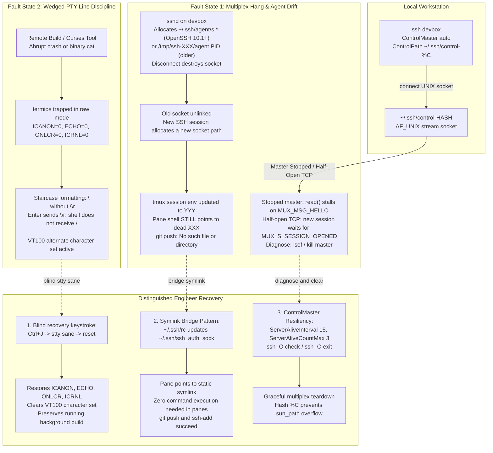
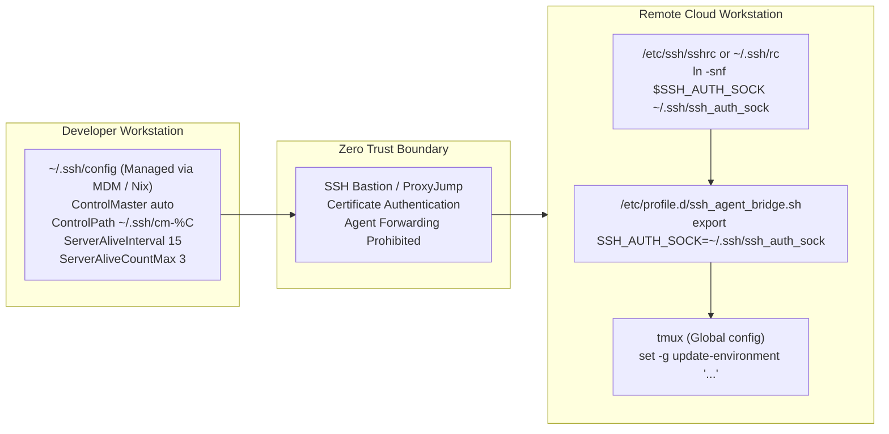

# Drill: SSH Multiplexing and Broken PTY

> [!summary] Scope
> Blind problem drill presenting a broken remote developer session with a hung ControlMaster master socket, a stale SSH_AUTH_SOCK within a reattached tmux session, and a corrupted raw-mode terminal displaying control garbage and suppressed newlines.
> Challenges the engineer to diagnose the master socket lockup, fix the agent socket symlink, and recover terminal line discipline without terminating the remote job.
> Reaches Debug, testing SSH-In-Depth-Keys-Forwarding-Certificates-and-FIDO2.md and Tmux-Architecture-and-Session-Persistence.md.

SSH cryptographic handshakes, agent forwarding mechanics, host authentication, and OpenSSH client configuration are owned by [[SSH-In-Depth-Keys-Forwarding-Certificates-and-FIDO2]].
Terminal multiplexer client-server architecture, window hierarchies, and socket persistence are owned by [[Tmux-Architecture-and-Session-Persistence]].
Job control, process group signals, and interactive shell process scheduling are owned by [[Rebuild-a-Minimal-Shell-With-Job-Control]].
Diagnostic process tracing, file descriptor inspection, and `/proc` filesystem navigation are owned by [[System-Inspection-and-Syscall-Tracing-From-the-Shell]].
Defensive script execution, signal traps, and exit handling are owned by [[Robust-Shell-Scripting-and-ShellCheck]].
Human ergonomics and machine-readable command-line interface design are owned by [[CLI-Design-and-Agent-Friendly-Interfaces-AXI]].
This problem drill trains the engineer to diagnose, isolate, and recover from three cascading failures that cripple remote developer environments: an unresponsive OpenSSH ControlMaster UNIX domain socket causing connection hangs, an environment variable drift inside reattached `tmux` panes leaving forwarded SSH agent requests broken, and a wedged pseudo-terminal (PTY) line discipline where suppressed carriage returns, disabled echo, and corrupted character sets trap the operator in an unresponsive shell without killing running compilation jobs.



## 1. Reproduction

The reproduction environment models a distributed developer workstation connected to a remote compute instance hosting a continuous compilation daemon inside `tmux`.
All executable reproduction harnesses, protocol mock servers, and validation scripts reside in `code/01-Command-Line/drill_ssh_mux_pty/`.

The drill executes in three distinct stages:
1. `mux_server.py`: A mock `PROTOCOL.mux` master driven by the real `ssh -O check`, `ssh -O exit`, and `ssh -O stop` clients.
   It models a dead socket inode (`ECONNREFUSED`), a master frozen with `SIGSTOP` (process state `T`) that catches `SIGTERM` the way the real client loop does (`clientloop.c`), and a live master that answers `MUX_C_ALIVE_CHECK`, `MUX_C_TERMINATE`, and `MUX_C_STOP_LISTENING`.
   It does not model a half-open TCP connection; that case is argued from `mux.c` in the symptom text and Question 7, not measured.
2. `agent_bridge.sh`: Starts real `ssh-agent` processes that each hold a throwaway key, plus an isolated `tmux` server whose pane shell inherits agent 1 at start-up.
   It kills agent 1, then attaches a real `tmux` client on a pseudo-terminal (`attach_client.py`) with agent 2 in its environment, so `update-environment` itself updates the session.
   Every `ssh-add -l` runs inside the pane, the repair is the note's own `export` line, and the bridge is repointed by running the note's `~/.ssh/rc` (`ssh_rc.sh`) against a scratch home directory.
3. `pty_drill.py`: Allocates a pseudo-terminal pair via `pty.openpty()`, forces the slave line discipline into raw mode (`termios` flags `ECHO=0`, `ICANON=0`, `ONLCR=0`, `ICRNL=0`), and demonstrates the output staircase.
   A real `bash` process runs the `read` builtin on the slave to show that a canonical-style reader ignores a bare carriage return, then `stty sane` restores the discipline and the same reader accepts `Enter`.

Every status line the lab prints is computed from a measured value and asserted, so a mismatch exits non-zero instead of printing a stale label.
The lab needs `ssh`, `ssh-agent`, `ssh-add`, `ssh-keygen`, `tmux`, `stty`, `ps`, `python3`, and `bash` on `PATH`; the harness has no requirement keyword for them.
Only `expected/darwin-arm64.txt` is recorded (OpenSSH 10.6p2, tmux 3.8, as of 2026-11); no Linux output has been recorded.

To run the complete automated test suite locally, execute:

```bash
bash code/01-Command-Line/drill_ssh_mux_pty/run.sh
```

## 2. Observed Symptom

The operator experiences three compounding obstacles in rapid sequence:

First, attempting to connect to the remote host via `ssh devbox` hangs indefinitely without printing a password prompt, banner, or remote shell prompt.
When interrupting the command with `Ctrl+C` and running an explicit multiplex check `ssh -S ~/.ssh/control-master -O check devbox`, the client blocks with zero output because the master process is not servicing its event loop (for example stopped in state `T`), so it never answers the `MUX_MSG_HELLO` exchange.
A master that is merely stuck on a half-open TCP connection still answers `ssh -O check` locally with `Master running`; there the hang appears only on a new session, which waits for a `MUX_S_SESSION_OPENED` reply that `mux.c` sends only after the remote side confirms the channel.
If the master process had crashed previously leaving an orphaned socket file on disk, `ssh -O check` returns exit status 255 with `Connection refused`.

Second, after bypassing or killing the hung master and reattaching to the remote `tmux` session (`tmux attach -t dev`), the engineer runs `git push` or `ssh-add -l` in pane 0 where a critical five-hour model compilation job is currently running in the background.
The command fails immediately:

```text
Error connecting to agent: No such file or directory
```

Inspecting the session environment with `tmux show-environment SSH_AUTH_SOCK` reveals that `tmux` knows about the newly forwarded socket allocated by the latest SSH session.
However, inspecting `echo $SSH_AUTH_SOCK` inside pane 0 reveals that the running shell process still points to the stale socket path from the previous session that `sshd` unlinked upon disconnect.

Third, the long-running job in pane 0 encounters a compiler warning that triggers a pager crash, or an operator accidentally prints binary data to the terminal.
The terminal stops echoing typed characters.
Output text begins staircasing diagonally across the display because line feeds no longer return the cursor to column 0.
Pressing `Enter` produces no response from the shell prompt.
Typing commands outputs box-drawing glyphs and graphics symbols instead of ASCII letters.

The recorded test output from `code/01-Command-Line/drill_ssh_mux_pty/expected/darwin-arm64.txt` (as measured on macOS Darwin arm64) captures this exact sequence:

```text
=== Stage 1: OpenSSH ControlMaster Lockup and Multiplex Diagnostics ===
--- 1.1 Dead Master Socket Detection ---
Control socket connect(<stage>/dead_control.sock): Connection refused
Dead master check exit code: 255 (Connection refused)
Orphan socket inode still on disk: yes

--- 1.2 Stopped Master Socket Stall & Recovery ---
Master process state: T (stopped by SIGSTOP)
Stopped master alive check: TIMED OUT after 0.5s (multiplex client wedged), status 124
After kill -TERM: state T (SIGTERM stays pending while the process is stopped)
After kill -KILL: process gone: yes
Orphan socket inode after the kill: yes
Alive check after the kill: exit 255 (Connection refused)

--- 1.3 Active OpenSSH PROTOCOL.mux Communication ---
Master running (pid=PID)
Reported pid equals the master process pid: yes
Exit request sent.
Master process gone after -O exit: yes
Control socket removed after -O exit: yes

--- 1.4 Stop Listening Versus Exit ---
Stop listening request sent.
Control socket removed after -O stop: yes
Master process still running after -O stop: yes

=== Stage 2: Stale SSH_AUTH_SOCK in Reattached tmux Session ===
--- 1. Initial Remote Session and tmux Pane Initialization ---
Pane SSH_AUTH_SOCK is agent 1: yes
Pane ssh-add -l before disconnect: exit 0, key listed: yes

--- 2. Client Disconnect and Stale Socket Drift ---
Agent 1 socket after disconnect: exists=no
tmux session environment after real tmux attach is agent 2: yes
Pane shell still holds agent 1 path: yes
Pane ssh-add -l with stale variable (exit 2):
Error connecting to agent: No such file or directory
Long-running background job status: alive

--- 3. In-Place Environment Repair Without Terminating Pane ---
Pane ssh-add -l after exporting from tmux show-environment: exit 0, key listed: yes

--- 4. Architectural Paved Road: Persistent Symlink Bridge ---
Pane ssh-add -l via bridge to agent 2: exit 0
Pane ssh-add -l via bridge after agent 2 died, before ~/.ssh/rc ran (exit 2):
Error connecting to agent: No such file or directory
~/.ssh/rc repointed the bridge at agent 3: yes
Pane ssh-add -l via bridge after re-attach, no export in the pane: exit 0

=== Stage 3: Corrupted PTY Line Discipline and Blind Recovery ===
--- 1. Baseline Canonical Terminal Discipline ---
Baseline flags: ECHO=1 ICANON=1 ISIG=1 ONLCR=1 ICRNL=1 OPOST=1
Baseline output mapping (NL -> CR+NL active): True
Baseline input mapping (Enter \r translated to NL): True
Baseline echo of typed input: 'deploy\r\n'

--- 2. Corrupted Raw Mode Discipline ---
Corrupted flags: ECHO=0 ICANON=0 ISIG=0 ONLCR=0 ICRNL=0 OPOST=0
Corrupted output raw bytes: 'step1\nstep2\nstep3\n'
Staircase symptom present (raw NL without CR): True
Corrupted input with Enter key (\r): b'ls\r'
Corrupted input with Ctrl+J (\n): b'ls\n'
Typed input echoed back to the terminal: False
Reader still waiting after Enter (\r): True
Reader result after Ctrl+J (\n): 'LEN=3\n'

--- 3. Terminal Line Discipline Recovery ---
Recovered flags (stty sane): ECHO=1 ICANON=1 ISIG=1 ONLCR=1 ICRNL=1 OPOST=1
Recovered output formatting (CR+NL restored): True
Recovered reader after Enter (\r): 'ls\r\nLEN=2\r\n'
```

## 3. Progressive Hint Ladder

> [!tip]- Hint 1: Inspect the Multiplex Socket Inode and Process State
> Do not immediately delete `~/.ssh/control-*` files without inspection.
> Use `ssh -O check -S <path> <host>` to determine if the master is responding to `PROTOCOL.mux` messages.
> If the command hangs, identify the process holding the listening socket with `lsof <path>` on macOS or `ss -xlp` / `fuser <path>` on Linux.
> Check the process state in `ps -p <pid> -o pid,stat,wchan,command`.
> A master socket whose process died returns `ECONNREFUSED` (code 255); a master whose process is frozen in state `T` accepts UNIX socket connections into the kernel backlog but never sends the `MUX_MSG_HELLO` handshake packet (reproduced in the lab with `SIGSTOP`).
> A plain `kill -TERM` does not end a stopped master, because the signal stays pending until `kill -CONT`.
> A master stuck only on a dead TCP connection still answers `-O check`, because the mux exchange is local; the hang shows up when a new session waits for `MUX_S_SESSION_OPENED`.

> [!tip]- Hint 2: Distinguish Session Environment from Process Environment in tmux
> In `tmux`, `set -g update-environment "SSH_AUTH_SOCK ..."` ensures that when an SSH client attaches, the `tmux` server copies those variables into the session environment (not the global environment), per tmux(1); `SSH_AUTH_SOCK` is in the default list.
> You can verify this by querying `tmux show-environment SSH_AUTH_SOCK`.
> However, no POSIX API lets another process rewrite the `environ` of an already running child shell in a pane (short of a debugger writing its memory through `ptrace`).
> The child shell retains the `SSH_AUTH_SOCK` value that was pushed onto its stack at `fork()` and `execve()` time.
> How can a running process resolve an updated dynamic socket without changing its own environment variable?

> [!tip]- Hint 3: Understand the Difference Between ASCII 10 and ASCII 13 Under ICRNL
> When a terminal line discipline has `ICRNL` (Input Carriage Return to Newline) cleared in `c_iflag`, pressing the physical `Enter` key transmits byte `0x0D` (`\r`, ASCII carriage return).
> In canonical mode with `ICRNL=1`, the kernel line discipline driver translates `0x0D` to `0x0A` (`\n`, ASCII line feed) before placing it in the input queue.
> When `ICRNL=0` and the reader uses canonical input (a shell without line editing such as `dash` or `bash --noediting`, the `read` builtin, or most non-shell programs), `\r` is an ordinary character and the line is never delivered.
> GNU Readline and zsh ZLE bind both `^M` and `^J` to `accept-line`, so an interactive `bash` or `zsh` prompt still accepts `Enter`; measured in a PTY after `stty -icrnl` for `bash` on macOS and Debian aarch64 and `zsh` on macOS, while `dash` and `bash --noediting` did not execute the line (as of 2026-11; `zsh` was not available in the Linux container, so its Linux behavior is not measured).
> What keystroke on a standard QWERTY keyboard transmits byte `0x0A` directly without relying on `ICRNL` translation?
> Recall the ASCII control character mapping where `Ctrl` subtracts 64 (`0x40`) from the uppercase letter code: `J` is ASCII 74 (`0x4A`), so `Ctrl+J` is `0x4A - 0x40 = 0x0A` (`\n`).

> [!tip]- Hint 4: The Blind Recovery Sequence and the Symlink Bridge
> If echo is disabled and the terminal is outputting staircase lines, you must type blindly.
> The sequence `<Ctrl+J>stty sane<Ctrl+J>` immediately restores kernel line discipline flags (`ECHO=1`, `ICANON=1`, `ISIG=1`, `ONLCR=1`, `ICRNL=1`).
> Follow this with `reset<Ctrl+J>` or `printf '\033c\033(B\033[m'<Ctrl+J>` to clear the VT100 alternate character set and reset hardware terminal attributes.
> For persistent agent forwarding, configure the remote host's `~/.ssh/rc` to link the dynamic `$SSH_AUTH_SOCK` to a static path `~/.ssh/ssh_auth_sock`, and point your shell dotfiles permanently to that symlink.

## 4. Model Solution

> [!success]- Solution
> The complete resolution requires three precise, non-destructive actions.
> 
> ### Step 1: Diagnose and Clear the Wedged ControlMaster Socket
> 
> When `ssh devbox` hangs due to a stalled multiplex master, execute an alive check:
> 
> ```bash
> ssh -O check -S ~/.ssh/control-%C devbox
> ```
> 
> If the command returns `Connection refused`, the master process terminated abnormally, leaving an orphaned socket inode.
> OpenSSH unlinks a stale socket automatically on `ECONNREFUSED` whenever `ControlMaster` is not `no` (`mux.c` logs `Stale control socket ..., unlinking` at debug level); with `-O check` alone it only reports the error.
> However, if the command hangs indefinitely, the master process is still alive but unresponsive.
> 
> Identify the PID holding the control socket:
> 
> ```bash
> # macOS
> lsof ~/.ssh/control-%C
> 
> # Linux
> ss -xlp src ~/.ssh/control-%C
> # or: fuser ~/.ssh/control-%C
> ```
> 
> Inspect the process status:
> 
> ```bash
> ps -p <PID> -o pid,stat,time,command
> ```
> 
> If the process is hung in state `D` (uninterruptible disk sleep) or state `T` (stopped by signal), or wedged on a half-open TCP socket following a client network transition, start with `kill -TERM <PID>`.
> A stopped master does not act on it: `ssh` catches `SIGTERM` (`clientloop.c`), so the signal stays pending until the process is continued.
> The lab measures state `T` still showing after `kill -TERM` (macOS, as of 2026-11).
> Send `kill -CONT <PID>` to let the pending `SIGTERM` run, or issue `kill -KILL <PID>` directly, which acts on a stopped process; the lab shows the orphaned socket inode surviving the `SIGKILL`.
> Remove the socket file afterwards (a process in state `D` does not act on `SIGKILL` until it leaves the uninterruptible wait):
> 
> ```bash
> rm -f ~/.ssh/control-%C
> ```
> 
> Connect directly while bypassing multiplexing to reach the remote box immediately:
> 
> ```bash
> ssh -o ControlMaster=no -o ControlPath=none devbox
> ```
> 
> ### Step 2: Recover the Blind Raw-Mode Terminal Without Terminating Jobs
> 
> When reattaching to `tmux` reveals disabled echo, missing carriage returns (staircasing), and mangled font glyphs, do not press `Ctrl+C` or kill the pane, which would abort the long-running compilation.
> 
> Type the following blind recovery sequence exactly:
> 
> ```text
> <Ctrl+J>stty sane<Ctrl+J>
> ```
> 
> Why this works at the system call level:
> - `<Ctrl+J>` transmits ASCII byte `0x0A` (Line Feed).
>   Because raw mode clears `ICRNL` in `struct termios.c_iflag`, the physical `Enter` key transmits byte `0x0D` (Carriage Return), which a canonical-mode reader (a shell without line editing, `read`, or a program that left the terminal in cooked mode with `-icrnl`) treats as an ordinary character.
>   `Ctrl+J` delivers literal `\n`, which every reader accepts as end of line; Readline and ZLE accept `\r` as well, so `Ctrl+J` is the keystroke that works in every case.
> - `stty sane` reads the attributes with `tcgetattr()` and writes them with `tcsetattr()`; GNU coreutils uses `TCSADRAIN` by default, while FreeBSD-derived `stty` (macOS) passes `0` (`TCSANOW`).
>   POSIX.1-2024 defines `sane` only as "Reset all modes to some reasonable, unspecified, values", so the exact bits are implementation-defined:
>   - `c_lflag |= (ECHO | ICANON | ISIG | IEXTEN)`: Re-enables character echo, line-buffered canonical input, signal generation (`^C` -> `SIGINT`), and extended characters (set by both GNU and macOS `stty sane`).
>   - `c_oflag |= (OPOST | ONLCR)`: Re-enables output post-processing and translates newline `\n` to carriage return plus newline `\r\n`, eliminating the staircase effect.
>   - `c_iflag |= ICRNL`: Re-enables carriage-return translation; macOS `stty sane` also sets `IXON` (software flow control), while GNU `stty sane` leaves `IXON` unchanged (measured on macOS and coreutils 9.4, as of 2026-11).
> 
> If the terminal continues to display graphics symbols or line-drawing characters (VT100 Alternate Character Set), emit the hardware reset string:
> 
> ```bash
> printf '\033c\033(B\033[m'
> ```
> 
> - `\033c`: Full terminal reset (RIS: Reset to Initial State).
> - `\033(B`: Selects standard US ASCII character set for G0 (cancels VT100 line drawing `\033(0`).
> - `\033[m`: Resets all character rendition attributes (bold, inverse, underline, color).
> 
> ### Step 3: Repair Stale `SSH_AUTH_SOCK` in the Running Pane
> 
> To restore agent connectivity in the existing pane immediately:
> 
> ```bash
> export SSH_AUTH_SOCK=$(tmux show-environment SSH_AUTH_SOCK | cut -d= -f2-)
> ssh-add -l
> ```
> 
> ### Step 4: Implement the Architectural Paved Road
> 
> To prevent these failures permanently across the engineering organization:
> 
> 1. **Client SSH Multiplex Hardening (`~/.ssh/config`):**
>    Use hash token `%C` to prevent UNIX domain socket path length overflow, and configure active keepalives to tear down half-open TCP connections automatically:
> 
>    ```sshconfig
>    Host *
>        ControlMaster auto
>        ControlPath ~/.ssh/cm-%C
>        ControlPersist 10m
>        ServerAliveInterval 15
>        ServerAliveCountMax 3
>        TCPKeepAlive yes
>    ```
> 
> 2. **Remote Symlink Bridge (`~/.ssh/rc` on the remote host):**
>    Create or edit `~/.ssh/rc` (which `sshd` runs with `sh(1)` before the user's shell or command for every session when `PermitUserRC` allows it; if it exists, `/etc/ssh/sshrc` is skipped and `sshd` no longer runs `xauth` itself, so X11 users must add the cookie in this file, per sshd(8)):
> 
>    ```bash
>    #!/bin/sh
>    if [ -n "$SSH_AUTH_SOCK" ] && [ "$SSH_AUTH_SOCK" != "$HOME/.ssh/ssh_auth_sock" ]; then
>        mkdir -p "$HOME/.ssh"
>        ln -snf "$SSH_AUTH_SOCK" "$HOME/.ssh/ssh_auth_sock"
>    fi
>    ```
> 
> 3. **Remote Shell Configuration (`~/.bashrc` / `~/.zshrc`):**
>    Export the canonical symlink path in the shell startup profile:
> 
>    ```bash
>    export SSH_AUTH_SOCK="$HOME/.ssh/ssh_auth_sock"
>    ```
> 
> With this configuration, every new SSH connection updates the symlink atomically.
> All existing and newly spawned `tmux` panes reference `~/.ssh/ssh_auth_sock`, ensuring seamless `git` and `ssh` authentication across reconnects without running manual export commands.

## 5. Core Takeaway

Remote development sessions bridge three independent state machines: the local OpenSSH client multiplexing state machine, the remote kernel pseudo-terminal (PTY) line discipline state machine, and the remote user-space `tmux` environment table.

1. **Multiplexing State:** OpenSSH `ControlMaster` multiplexes multiple logical channels over a single cryptographic transport stream using UNIX domain stream sockets.
   If the master connection experiences an ungraceful network failure (such as laptop sleep or Wi-Fi migration), the master process remains wedged on a half-open TCP socket unless `ServerAliveInterval` and `ServerAliveCountMax` enforce application-layer heartbeats.
   Subsequent multiplexed sessions block in `read()` on the local UNIX socket awaiting `MUX_S_SESSION_OPENED`, which the master sends only after the remote side confirms the channel; a master that is stopped outright never even completes the `MUX_MSG_HELLO` exchange.
2. **Environment Isolation:** A process's environment variables (`char **environ`) are copied onto the new process stack from the `envp` argument of `execve()`.
   No POSIX mechanism allows an external server (including `tmux`) to inject environment variables into an already running child process.
   Therefore, relying on dynamic per-connection agent paths (`~/.ssh/agent/s.*` since OpenSSH 10.1, `/tmp/ssh-*/agent.*` before it) inside long-lived shell sessions is an architectural anti-pattern.
   The canonical solution is indirection via a stable filesystem symlink (`~/.ssh/ssh_auth_sock`) atomically updated on connection.
3. **PTY Line Discipline:** A terminal is not a dumb character pipe; it is a kernel device managed by the `termios` subsystem.
   When an interactive application terminates prematurely without executing its cleanup handlers, the PTY remains trapped in raw mode.
   Understanding ASCII control codes allows an engineer to submit commands blindly via `<Ctrl+J>` (`0x0A` Line Feed) when `Enter` (`0x0D` Carriage Return) is not recognized by a canonical-mode reader because `ICRNL` is disabled.

For deep architectural internals of these subsystems, see [[SSH-In-Depth-Keys-Forwarding-Certificates-and-FIDO2]] and [[Tmux-Architecture-and-Session-Persistence]].

## Commands and Numbers to Know

Reference parameters, socket buffer constraints, and termios bitmasks across operating systems (as of 2026-11):

| Parameter or Mechanism | Value or Default | Target Platform | Description |
| :--- | :--- | :--- | :--- |
| `sizeof(sun_path)` Linux | 108 bytes | Linux | Maximum UNIX domain socket path length in `struct sockaddr_un` (as of 2026-11) |
| `sizeof(sun_path)` macOS | 104 bytes | macOS | Maximum UNIX domain socket path length in `sys/un.h` (as of 2026-11) |
| OpenSSH `%C` token | 40-character SHA-1 hex | Both | Hash of a delimited concatenation of `%l%h%p%r%j` (ssh_config(5)), avoiding `sun_path` length overflow (as of 2026-11) |
| `MUX_MSG_HELLO` | `0x00000001` | Both | Initial OpenSSH multiplex handshake wire message type (as of 2026-11) |
| `MUX_C_ALIVE_CHECK` | `0x10000004` | Both | Multiplex alive check request sent by `ssh -O check` (as of 2026-11) |
| `MUX_S_ALIVE` | `0x80000005` | Both | Multiplex alive response containing request ID and server PID (as of 2026-11) |
| `MUX_C_TERMINATE` | `0x10000005` | Both | Multiplex graceful termination request sent by `ssh -O exit` (as of 2026-11) |
| `MUX_C_STOP_LISTENING` | `0x10000009` | Both | Multiplex stop listening request sent by `ssh -O stop` (as of 2026-11) |
| `ServerAliveInterval` | `0` (disabled) | Both | OpenSSH default seconds between client application keepalives (as of 2026-11) |
| `ServerAliveCountMax` | `3` | Both | OpenSSH default missed keepalive threshold before client drops TCP (as of 2026-11) |
| ASCII Line Feed (LF) | `10` (`0x0A`, `\n`, `^J`) | Both | POSIX newline delimiter accepted by shells regardless of `ICRNL` (as of 2026-11) |
| ASCII Carriage Return (CR) | `13` (`0x0D`, `\r`, `^M`) | Both | Standard keyboard Enter key output, mapped to LF only when `ICRNL=1` (as of 2026-11) |
| `ECHO` flag bitmask | `0x00000008` (Linux) / `0x00000008` (macOS) | Both | `c_lflag` bit controlling local input character echo (as of 2026-11) |
| `ICANON` flag bitmask | `0x00000002` (Linux asm-generic, e.g. x86-64 and arm64) / `0x00000100` (macOS) | Both | `c_lflag` bit controlling line-buffered canonical input editing; some Linux arches (powerpc, alpha) use BSD-style values (as of 2026-11) |
| `ONLCR` flag bitmask | `0x00000004` (Linux) / `0x00000002` (macOS) | Both | `c_oflag` bit mapping output `\n` to `\r\n` to prevent staircasing (as of 2026-11) |
| `ICRNL` flag bitmask | `0x00000100` (Linux) / `0x00000100` (macOS) | Both | `c_iflag` bit mapping input `\r` to `\n` (as of 2026-11) |

## Pitfalls

> [!warning] Pitfalls: Dangerous Anti-Patterns in Remote Sessions
> - **Running `killall -9 tmux` or Closing the Window:**
>   Killing the `tmux` server or destroying the terminal window destroys all child processes and running jobs across all windows and panes.
>   A wedged PTY or broken agent socket can always be recovered in place without terminating background compilers or test suites.
> - **Hardcoding Dynamic Agent Sockets:**
>   Adding `export SSH_AUTH_SOCK=$(ls -t /tmp/ssh-*/agent.* | head -n 1)` to `~/.bashrc` is a security and operational hazard.
>   On multi-user systems the glob walks other users' private (mode `0700`) socket directories, and it readily picks up a stale dead socket left behind by an aborted session; since OpenSSH 10.1 it also matches nothing, because sockets moved to `~/.ssh/agent/`.
> - **Omitting Keepalives with ControlPersist:**
>   Configuring `ControlPersist yes` without `ServerAliveInterval 15` invites client lockups when roaming between Wi-Fi networks, because `ServerAliveInterval` defaults to `0` (disabled).
>   The local master process holds the UNIX socket while its TCP connection silently dies in the kernel, leaving future `ssh` commands hanging forever.
> - **Using Verbose Socket Paths Without `%C`:**
>   Using `ControlPath ~/.ssh/control-%r@%h:%p` easily exceeds the 104-byte `sun_path` limit on macOS and BSD systems when connecting to fully qualified domain names (FQDNs), causing cryptic `unix_listener: path "..." too long for Unix domain socket` failures when the master listens, or `ControlPath too long ('...' >= 104 bytes)` when a client connects (`misc.c`, `mux.c`).
> - **Running `reset` Without Restoring Echo:**
>   On certain minimal terminal emulators or serial consoles, `reset` fails if the terminfo database is missing or corrupt.
>   Always execute `stty sane` first to ensure the kernel line discipline is functional before relying on terminfo escape sequences.

## At Scale: Enterprise Remote Development Architecture

When architecting remote development infrastructure (such as cloud workstations, devboxes, and bastion clusters) for thousands of engineers, manual recovery commands do not scale.
Distinguished engineering teams implement standardized paved roads across client configurations, remote host operating systems, and session orchestrators:



### 1. Centralized Client SSH Policy Enforcement
Organizations distribute hardened SSH client templates via device management (Nix, Chef, or MDM).
The configuration mandates:
- `ControlPath ~/.ssh/cm-%C`: Guarantees deterministic, collision-free, 40-character socket names whose length no longer depends on hostname length; the total is `$HOME` plus 49 bytes, plus a 17-byte random suffix while the master binds its temporary socket (`muxserver_listen` in `mux.c`), so very long home directories can still overflow.
- `ControlPersist 15m`: Reduces SSH key exchange and authentication overhead across continuous Git operations and toolchain invocations.
- `ServerAliveInterval 15` with `ServerAliveCountMax 3`: Instructs the OpenSSH client to send an encrypted heartbeat every 15 seconds.
  If the remote host fails to respond to 3 consecutive probes (45 seconds), the kernel TCP socket is torn down, preventing hung multiplex masters when laptops close lids or switch networks.

### 2. Automated Symlink Bridging in Enterprise Images
Golden machine images for cloud devboxes bake the symlink bridge directly into the SSH and shell start-up files:
- An `/etc/ssh/sshrc` script executes automatically on every user login that has no `~/.ssh/rc` of its own (sshd(8) runs one or the other, never both), atomically updating `/run/user/$UID/ssh_auth_sock` or `$HOME/.ssh/ssh_auth_sock`.
- System profile scripts (`/etc/profile.d/ssh_agent_bridge.sh`) set `export SSH_AUTH_SOCK="$HOME/.ssh/ssh_auth_sock"` for every login shell that reads `/etc/profile`.
- This eliminates agent socket drift across `tmux`, `screen`, and VS Code remote server worker processes without requiring individual developer configuration.

### 3. Agent Forwarding Elimination via Hardware Keys and ProxyJump
Forwarding an SSH agent (`ssh -A`) introduces significant lateral movement security risks: any root user or malicious process on the remote machine can access the forwarded UNIX domain socket to sign requests on the developer's behalf.
Modern enterprise architectures phase out SSH agent forwarding entirely:
- Bastion navigation is executed via `ProxyJump` or `ProxyCommand`, creating end-to-end encrypted transport directly from workstation to target devbox without exposing credentials to intermediate jump hosts.
- Workstations utilize FIDO2 hardware security keys (`ed25519-sk`) requiring user presence verification (touch) or short-lived OpenSSH certificates minted via corporate OIDC identity providers as mastered in [[Harden-SSH-Access-With-Certificates-and-Hardware-Keys]].

## Practice Drill

> [!tip] Practice Drill: Automate the Terminal and Agent Recovery Hook
> 1. In your local development environment or test VM, create a corrupted terminal scenario:
>    ```bash
>    stty -echo -icanon -onlcr -icrnl
>    ```
> 2. Observe that typing does not appear on screen, pressing Enter produces no newlines, and running `printf "line1\nline2\n"` staircases across the terminal.
> 3. Blindly execute `<Ctrl+J>stty sane<Ctrl+J>` and confirm that normal echoing and carriage-return line endings are restored immediately.
> 4. Author a shell helper function `tmux-refresh-agent` in your dotfiles that updates `SSH_AUTH_SOCK` in the current shell from `tmux show-environment` and verify its behavior with `ssh-add -l`.

## Interview Questions

### Question 1 (L5): Predict the Output under Disabled `ONLCR`
Predict the exact visual layout on a standard terminal emulator when executing the following shell command after running `stty -onlcr`:

```bash
printf "BUILD START\nCOMPILING\nLINKING\nSUCCESS\n"
```

Explain the precise mechanism governing this rendering.

> [!success]- Answer
> Under `stty -onlcr`, the kernel terminal driver disables the output translation of newline (`\n`, ASCII `0x0A`, Line Feed) to carriage return plus newline (`\r\n`, CR-LF).
> 
> A standard physical terminal or terminal emulator interprets raw Line Feed (`\n`) as "move the active cursor down by one row while maintaining the current horizontal column position".
> Carriage Return (`\r`, ASCII `0x0D`) is the explicit instruction to "move the active cursor to column 0 (the leftmost margin)".
> 
> When `ONLCR` is cleared, `printf` emits raw `\n` without preceding `\r`.
> Consequently, each subsequent line begins printing immediately below where the previous line ended, producing the classic "staircase effect":
> 
> ```text
> BUILD START
>            COMPILING
>                     LINKING
>                            SUCCESS
> ```
> 
> Normal POSIX terminal output relies on `OPOST | ONLCR` in `struct termios.c_oflag` so that applications emitting standard UNIX C newlines (`\n`) have them automatically converted to `\r\n` by the line discipline.

### Question 2 (L5): The `ICRNL` Translation and `<Ctrl+J>` Mechanism
Why does pressing the physical `Enter` key fail to submit a command when an interactive shell is trapped in raw mode, whereas pressing `<Ctrl+J>` successfully submits the command?

> [!success]- Answer
> On standard computer keyboards, pressing the physical `Enter` key emits ASCII byte `13` (`0x0D`, Carriage Return, `\r`), not byte `10` (`0x0A`, Line Feed, `\n`).
> 
> In normal canonical terminal mode, the kernel line discipline has the `ICRNL` bit enabled in `struct termios.c_iflag`.
> The line discipline driver intercepts byte `0x0D` and translates it to `0x0A` before placing it into the terminal input buffer.
> A canonical-mode reader (a shell without line editing such as `dash` or `bash --noediting`, the `read` builtin, or the kernel's own cooked-mode line assembly) treats only `0x0A` (`\n`), `EOL`, and `EOF` as line terminators.
> 
> When a crashed curses application leaves the terminal with `ICRNL` cleared (`0`), pressing `Enter` delivers literal byte `0x0D` to the reader.
> Because `0x0D` is not translated to `0x0A`, a canonical-mode reader does not recognize it as an end-of-line delimiter and does not execute the line.
> GNU Readline and zsh ZLE are the exception: they bind both `^M` and `^J` to `accept-line`, so an interactive `bash` or `zsh` prompt still accepts `Enter` (measured after `stty -icrnl` for `bash` on macOS and Linux and `zsh` on macOS only, as of 2026-11), and the visible symptom there is mostly missing echo and staircased output.
> 
> In contrast, ASCII control characters correspond to their position in the ASCII table offset by `0x40` (64).
> The letter `J` is ASCII `74` (`0x4A`).
> Pressing `<Ctrl+J>` sends byte `0x4A - 0x40 = 0x0A` (Line Feed).
> Because the transmitted byte is ALREADY `0x0A`, it requires no translation by `ICRNL`.
> The kernel passes `0x0A` directly to the shell, which immediately triggers command execution.

### Question 3 (L5): Debugging Stale Agent Sockets in Reattached `tmux`
A developer connects to a remote development server via SSH with agent forwarding enabled (`ssh -A`), starts a `tmux` session, and runs a compilation.
The next day, they connect from a different workstation, reattach to the `tmux` session with `tmux attach`, and run `git pull`.
The command fails with `Permission denied (publickey)`, and `ssh-add -l` in the same pane prints `Error connecting to agent: No such file or directory`.
Explain why this happens despite `tmux` having `update-environment` enabled by default, and provide the command to resolve it inside the running pane.

> [!success]- Answer
> When the developer reconnects in a new SSH session, `sshd` creates a brand new UNIX domain socket (for example, `/tmp/ssh-NewHost/agent.1234`, or a path under `~/.ssh/agent/` since OpenSSH 10.1) and sets `SSH_AUTH_SOCK` in the new login shell.
> The previous socket (`/tmp/ssh-OldHost/agent.5678`) was unlinked by `sshd` when the first SSH connection closed.
> `ssh-add` prints `Could not open a connection to your authentication agent.` only when `SSH_AUTH_SOCK` is unset or empty (`SSH_ERR_AGENT_NOT_PRESENT` in `authfd.c`); a set but dead path gives `Error connecting to agent: No such file or directory`, and `ssh` under `git` silently falls back to on-disk keys.
> 
> When `tmux attach` runs, `tmux`'s `update-environment` feature inspects the incoming client's environment and updates its internal session environment dictionary.
> However, POSIX kernels do not provide an API for a parent or monitoring process (`tmux`) to alter the environment variable memory (`char **environ`) of an already running process (the shell inside the pane).
> 
> Consequently, the pane's shell continues to hold the obsolete string `SSH_AUTH_SOCK=/tmp/ssh-OldHost/agent.5678`.
> When `git` or `ssh` attempts to connect to that nonexistent socket path, the `connect()` system call fails with `ENOENT` (`No such file or directory`).
> 
> To resolve it inside the running pane without restarting the shell:
> 
> ```bash
> export SSH_AUTH_SOCK=$(tmux show-environment SSH_AUTH_SOCK | cut -d= -f2-)
> ```
> 
> This queries `tmux`'s updated session dictionary and updates the running shell's environment.

### Question 4 (L6): OpenSSH Multiplexing Wire Protocol: `stop` vs `exit`
In OpenSSH connection multiplexing (`ssh -O ctl_cmd`), what is the precise behavioral and wire protocol difference between `ssh -O stop` and `ssh -O exit`?

> [!success]- Answer
> Both commands communicate with the background multiplex master process over the UNIX domain socket defined by `ControlPath`, sending framed binary messages defined in OpenSSH's `PROTOCOL.mux`.
> 
> 1. `ssh -O stop` sends message type `MUX_C_STOP_LISTENING` (`0x10000009`):
>    - Instructs the master process to stop listening for new client connections on the UNIX domain control socket.
>    - The master process unlinks (deletes) the control socket from the filesystem immediately (`client_stop_mux()` in `clientloop.c`).
>    - Existing in-flight multiplexed sessions, forwarded channels, and interactive windows sharing the master connection continue operating completely undisturbed.
>    - With `ControlPersist` (or no shell of its own), the master exits when the last active channel closes; a foreground master lives until its own session ends.
> 
> 2. `ssh -O exit` sends message type `MUX_C_TERMINATE` (`0x10000005`):
>    - Requests the master process to shut down immediately.
>    - The master sets `quit_pending`, replies with `MUX_S_OK` (`0x80000001`), and exits, tearing down every multiplexed session and forwarding that shares the connection (`mux_master_process_terminate()` in `mux.c`).
>    - There is no open-channels refusal; the only refusal is `MUX_S_PERMISSION_DENIED` (`0x80000002`) when `ControlMaster ask` or `autoask` is set and the user declines the confirmation prompt.
> 
> Understanding this distinction is critical during automation: `ssh -O stop` is safe to invoke in deployment scripts to gracefully drain an SSH master without interrupting concurrent sibling tasks.

### Question 5 (L6): POSIX `sun_path` Limitations and the OpenSSH `%C` Token
Why did OpenSSH introduce the `%C` configuration token for `ControlPath`, and what specific operating system failure occurs if an engineer uses a naive pattern like `ControlPath ~/.ssh/control-%r@%h:%p`?

> [!success]- Answer
> OpenSSH multiplexing communicates over UNIX domain sockets (`AF_UNIX`).
> In POSIX C library networking, binding or connecting to a UNIX domain socket requires populating `struct sockaddr_un`, defined in `<sys/un.h>`.
> 
> The path buffer in this structure, `sun_path`, has a rigid, operating system-enforced compile-time size limit:
> - On macOS, FreeBSD, and OpenBSD: `sizeof(sun_path)` is exactly 104 bytes.
> - On Linux: `sizeof(sun_path)` is exactly 108 bytes.
> 
> When using a template like `ControlPath ~/.ssh/control-%r@%h:%p`, the expanded path string combines the home directory, username, full remote hostname, and port.
> In enterprise environments using fully qualified domain names (e.g., `alice@kubernetes-worker-us-east-1-zone-b.compute.internal.bigcorp.com:22`, 72 bytes), the expanded path is about 98 bytes under `/Users/alice/.ssh/control-`, and the master binds a temporary name with a 17-byte random suffix first, which pushes it to about 115 bytes.
> OpenSSH checks the length itself with `strlcpy()` before calling `bind()` or `connect()`: the listener sets `errno` to `ENAMETOOLONG` and logs the first message below, and the mux client calls `fatal()` with the second (`misc.c`, `mux.c`):
> 
> ```text
> unix_listener: path "..." too long for Unix domain socket
> ControlPath too long ('...' >= 104 bytes)
> ```
> 
> OpenSSH introduced the `%C` token to permanently eliminate this class of bug.
> `%C` computes a cryptographic hash (SHA-1) of the concatenated connection tuple: `%l%h%p%r%j` (local host, remote host, port, remote user, proxyjump target).
> The resulting hash is a fixed-width 40-character hexadecimal string.
> A path like `~/.ssh/cm-%C` is the home directory plus 49 bytes (66 more during the temporary bind), so for `/Users/alice` it is 61 bytes (78 during bind), easily fitting within the 104-byte limit while uniquely identifying the connection; only an unusually long `$HOME` can still overflow it.

### Question 6 (L6): Pseudo-Terminal (PTY) Master vs Slave Architecture
Explain the architectural boundary between a PTY master and PTY slave in the context of an SSH and `tmux` session.
Which process holds which file descriptor, and where does kernel line discipline processing occur?

> [!success]- Answer
> A pseudo-terminal (PTY) is a bidirectional inter-process communication channel provided by the kernel that emulates a hardware terminal device.
> It consists of two paired endpoints:
> 
> 1. **PTY Master (File Descriptor endpoint):**
>    - Held by the terminal-driving program: in an SSH session, `sshd` holds the master; in a `tmux` session, the `tmux` server process holds a master file descriptor for each window pane.
>    - The driving program reads output generated by the application from the master, frames it into protocol packets (SSH encrypted packets or tmux window buffers), and writes user input bytes into the master.
> 
> 2. **PTY Slave (Device Node in `/dev/pts/N` or `/dev/ttysNNN`):**
>    - Opened by the child shell or application (`bash`, `vim`, `python`).
>    - The child process duplicates the slave file descriptor onto its standard input, standard output, and standard error (file descriptors 0, 1, 2) and calls `ioctl(TIOCSCTTY)` to make the slave its controlling terminal.
> 
> 3. **Line Discipline Processing:**
>    - Line discipline processing (`struct termios`) occurs entirely within the kernel's TTY subsystem between the master and slave buffers.
>    - When `sshd` or `tmux` writes bytes into the PTY master, the kernel TTY driver inspects input flags (`c_iflag`).
>      If `ICRNL` is enabled, the kernel transforms `\r` to `\n`.
>      If `ECHO` is enabled in `c_lflag`, the kernel automatically reflects those characters back into the master's read queue so the user sees what they typed.
>    - When the application writes bytes into the slave, the kernel inspects output flags (`c_oflag`).
>      If `ONLCR` is enabled, the kernel injects `\r` before every `\n`.
>    - In raw mode, the kernel disables all these transformations, passing raw byte streams verbatim between master and slave.

### Question 7 (L7): Root Cause Analysis of a Frozen Multiplex Connection
An engineer on a laptop working via an SSH ControlMaster connection closes their laptop lid, walks to a conference room, and opens the lid.
Their terminal is dead.
Opening a new local terminal tab and running `ssh devbox` hangs indefinitely.
However, running `ssh -o ControlMaster=no devbox` connects almost immediately.
Perform a root cause analysis: trace the kernel network socket states, explain why the local master process does not exit, and explain why subsequent client commands hang.

> [!success]- Answer
> This is a reasoned scenario built from `mux.c` and the OpenSSH manual pages; the lab does not model a half-open TCP connection, and the timings are illustrative.
> 
> **Incident Root Cause:**
> 1. **Network Disruption and Half-Open TCP Socket:**
>    When the laptop closed its lid, the active Wi-Fi interface was torn down without sending TCP `FIN` or `RST` packets to the remote server.
>    Upon reconnecting in the conference room, the laptop was assigned a new IP address or NAT port mapping.
>    The existing TCP connection between the local SSH master process and the remote server is now "half-open": the local kernel socket still believes it is in the `ESTABLISHED` state.
> 
> 2. **Lack of Application-Layer Keepalives:**
>    Because OpenSSH defaults to `ServerAliveInterval 0`, the client does not send periodic encrypted heartbeats.
>    TCP keepalives (`SO_KEEPALIVE`), if enabled, rely on kernel defaults that typically wait 7,200 seconds (2 hours) before probing.
>    The local master process remains alive in user space, waiting for network packets that will never arrive.
> 
> 3. **The Multiplex Client Deadlock:**
>    Because the local master process is alive, the UNIX domain control socket file (`~/.ssh/cm-HASH`) remains open and valid.
>    When the engineer types `ssh devbox` in a new tab:
>    - The new `ssh` client executes `connect()` against `~/.ssh/cm-HASH`.
>      The kernel succeeds the `connect()` call because the local master process is actively listening on the UNIX socket backlog.
>    - The client and master exchange `MUX_MSG_HELLO` normally, because that exchange is purely local; this is why `ssh -O check` still reports `Master running`.
>    - The client then sends `MUX_C_NEW_SESSION`; the master queues a channel-open request onto the dead TCP connection and replies `MUX_S_SESSION_OPENED` only from its channel-confirm callback (`mux.c`), which never fires.
>    - The new client hangs in `read()` until the master's own TCP stack or keepalive logic gives up.
> 
> 4. **Why `ControlMaster=no` Succeeded:**
>    Passing `-o ControlMaster=no` bypasses the local UNIX control socket completely, causing the client to initiate an independent TCP handshake directly to `devbox` over the new Wi-Fi network, completing authentication in the usual fraction of a second.
> 
> **Permanent Remediation:**
> Set `ServerAliveInterval 15` and `ServerAliveCountMax 3` in `~/.ssh/config`.
> When 3 probes (45 seconds) go unacknowledged, the OpenSSH client logs `Timeout, server <host> not responding.` and calls `cleanup_exit(255)`, which unlinks the control socket before exiting (`clientloop.c`).

### Question 8 (L7+): Zero-Drift Remote Development Platform Architecture
You are the principal architect designing a remote cloud development environment for 15,000 engineers.
Engineers access persistent remote Linux instances hosting heavy build toolchains and `tmux` sessions from macOS laptops that frequently sleep and roam across corporate Wi-Fi, VPNs, and mobile hotspots.
How do you design connection multiplexing, SSH agent lifecycle management, and terminal session recovery to guarantee zero hung sockets, zero credential leaks, and zero broken PTYs without requiring manual developer intervention?

> [!success]- Answer
> An enterprise-grade remote development architecture solves these challenges through layered infrastructure contracts rather than developer documentation:
> 
> 1. **Transport Resilience via Mobile Shell (Mosh) or Paved SSH Multiplexing:**
>    - For standard terminal editing, provide a dual-transport path: evaluated Mosh/Eternal Terminal (ET) over UDP for roam-tolerant terminal sessions, paired with an automated OpenSSH wrapper.
>    - In `~/.ssh/config`, mandate:
>      - `ControlMaster auto`, `ControlPath ~/.ssh/cm-%C`, `ControlPersist 10m`.
>      - Aggressive heartbeats: `ServerAliveInterval 10`, `ServerAliveCountMax 3`, `TCPKeepAlive yes`.
>      - Connect timeout: `ConnectTimeout 5`.
>    - Implement an enterprise CLI wrapper (`dev connect`) that executes `ssh -O check` with a 1-second timeout before invoking SSH.
>      If the alive check times out or fails with `Connection refused`, the wrapper unlinks the stale socket and kills the orphan master before spawning the connection.
> 
> 2. **Elimination of Agent Forwarding Hazards:**
>    - Prohibit `ForwardAgent yes` globally via corporate SSH policy to prevent credential theft via remote UNIX sockets.
>    - Instead, deploy an isolated authentication bridge:
>      - On the workstation, short-lived SSH certificates (12-hour validity) are signed via automated WebAuthn/OIDC authentication.
>      - For Git operations inside the remote devbox, deploy Git Credential Manager configured with workload identity federation (e.g., GCP Workload Identity or AWS IAM Roles for Service Accounts) or GitHub App installation tokens minted dynamically via a local daemon.
>      - If agent forwarding is strictly necessary for legacy repositories, implement the canonical symlink bridge in `/etc/ssh/sshrc`:
>        ```sh
>        mkdir -p /run/user/$UID
>        ln -snf "$SSH_AUTH_SOCK" "/run/user/$UID/ssh_auth_sock"
>        ```
>        And export `SSH_AUTH_SOCK=/run/user/$(id -u)/ssh_auth_sock` from a login-shell hook such as `/etc/profile.d/ssh_agent_bridge.sh`, so every new login shell, and every pane started from one, resolves the live socket without manual intervention.
> 
> 3. **PTY Protection and Session Orchestration:**
>    - Configure `tmux` in `/etc/tmux.conf` with clean terminal initialization overrides:
>      ```tmux
>      set -g default-terminal "tmux-256color"
>      set -ag terminal-overrides ",xterm-256color:RGB"
>      ```
>    - Wrap shell execution in a defensive trap hook inside `/etc/profile.d/interactive_recovery.sh`:
>      ```bash
>      # Reset termios on prompt return if line discipline was corrupted by background processes
>      _tty_recover() { stty icanon echo onlcr icrnl 2>/dev/null || true; }
>      if [ -n "$ZSH_VERSION" ]; then precmd_functions+=(_tty_recover)
>      elif [ -n "$BASH_VERSION" ]; then PROMPT_COMMAND="_tty_recover${PROMPT_COMMAND:+;$PROMPT_COMMAND}"; fi
>      ```
>      This automatically restores canonical mode and output carriage returns before each prompt display without human action.
>      `precmd` is a zsh hook; bash runs `PROMPT_COMMAND` instead, and zsh does not read `/etc/profile.d` unless the distribution's `/etc/zprofile` sources it.

## Further Reading

- IEEE Std 1003.1-2024 (POSIX.1-2024), *General Terminal Interface* (`<termios.h>`).
  The binding international standard defining `c_iflag`, `c_oflag`, `c_cflag`, `c_lflag`, control characters, and line discipline behaviors.
- OpenBSD Project, *OpenSSH Multiplexing Protocol Specification* (`PROTOCOL.mux`).
  Source documentation detailing the binary wire protocol exchanged between multiplex clients and the `ControlMaster` server over UNIX domain sockets.
- W. Richard Stevens and Stephen A. Rago, *Advanced Programming in the UNIX Environment* (3rd Edition, Addison-Wesley, 2013).
  Chapters 18 and 19 provide the definitive systems programming treatment of terminal device drivers, baud rates, raw modes, and pseudo-terminal master/slave pairs.
- Michael Kerrisk, *The Linux Programming Interface* (No Starch Press, 2010).
  Chapters 62 and 64 cover terminal attributes, signal handling during canonical processing, and pseudo-terminal allocation mechanics.
- Nicholas Marriott, *tmux(1) Manual Page*.
  Explains the socket server architecture, client connection lifecycle, and session environment handling.
- Thomas E. Dickey, *XTerm Control Sequences*.
  The comprehensive specification for VT100, VT220, and XTerm escape sequences, including RIS (`\033c`) and character set selection (`\033(B`).

## Related

- Prerequisites: [[SSH-In-Depth-Keys-Forwarding-Certificates-and-FIDO2]], [[Tmux-Architecture-and-Session-Persistence]], [[TTYs-PTYs-and-Line-Discipline]]
- See also: [[19-Shell-and-Unix-Engineering/11-Networking-and-SSH/SSH-Multiplexing-ControlMaster|SSH Multiplexing ControlMaster]], [[19-Shell-and-Unix-Engineering/02-Terminals-and-Job-Control/termios-and-stty|termios and stty]]
- Lab: `code/01-Command-Line/drill_ssh_mux_pty/`
