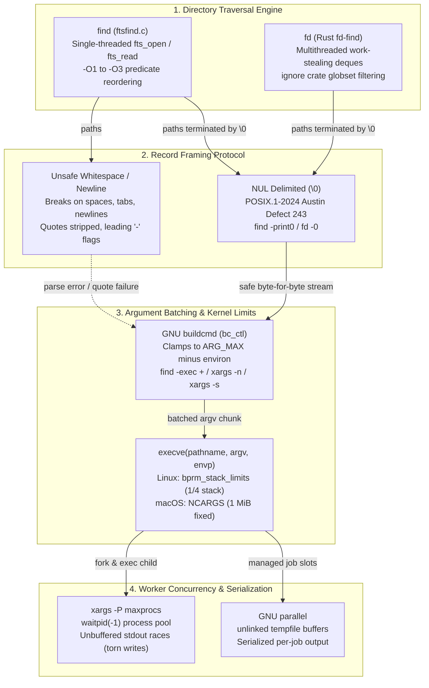
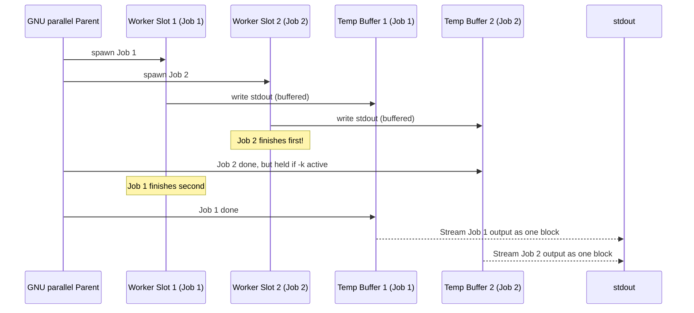

# File Discovery and Batch Execution: Find, Fd, Xargs, Parallel

> [!summary] Claim:
> Filesystem discovery and batch processing require rigorous record delimitation to prevent whitespace splitting, quote stripping, and command option injection.
> Standard Unix pathnames admit any byte sequence except NUL and slash, necessitating NUL-delimited framing (`-print0`, `-0`) across directory walkers and argument batchers.
> Batch execution engines amortize process invocation overhead against kernel `ARG_MAX` and `MAX_ARG_STRLEN` boundaries via `find -exec ... +`, `xargs`, or `fd -X`.
> Scaling to concurrent execution pools demands process slot management with `xargs -P` or stream serialization via GNU `parallel` to avoid torn terminal output and interleaving races.



## The Mechanism

Batch file discovery and execution orchestrates two distinct operating system domains: filesystem tree traversal across the virtual filesystem (VFS) and process execution across the `execve(2)` system call boundary.
A pipeline such as `find . -type f | xargs rm` passes through path generation, stream serialization, argument parsing, argument batching, and process spawning.
Understanding this pipeline requires analyzing the directory traversal engine, record framing protocols, kernel argument limits, process slot scheduling, and output stream serialization.

### 1. Filesystem Traversal Engines: fts vs Multithreaded Work-Stealing

A directory tree traversal navigates a hierarchical directed graph stored on disk.
Traditional directory traversal relies on POSIX library calls: `opendir(3)`, `readdir(3)`, and `closedir(3)`, which map to kernel system calls `openat(2)` and `getdents64(2)`.

```
POSIX Traversal Loop:
  dirfd = openat(AT_FDCWD, path, O_RDONLY | O_DIRECTORY | O_CLOEXEC)
  while ((nread = getdents64(dirfd, buf, BUFSIZ)) > 0)
      for dirent in buf:
          if dirent.d_type == DT_DIR:
              descend_recursively(dirent.d_name)
```

In GNU findutils, `find` is implemented primarily in `find/ftsfind.c`, which delegates directory walking to gnulib's `fts(3)` implementation (`fts_open`, `fts_read`, `fts_set`, and `fts_close`).
The traversal engine maintains an `FTS` state structure containing the current stream context and an array of `FTSENT` structures representing visited nodes.
GNU `find` applies these optimizations and safeguards during directory walking:

1. The `d_type`dirent optimization:
   Traditional Unix filesystems require an explicit `lstat(2)` system call on every directory entry to determine its file type.
   Modern filesystems (such as Linux ext4, XFS, btrfs, and macOS APFS) return the file type directly in `dirent->d_type` (for example, `DT_REG`, `DT_DIR`, `DT_LNK`, `DT_FIFO`).
   When `d_type != DT_UNKNOWN`, GNU `find` can skip the `lstat(2)` system call for tests that only check file types (`-type f`, `-type d`); the build reports this as `Features enabled: D_TYPE` (findutils 4.11.0 `doc/find.texi`, "d_type Optimisation").
   The size of the saving depends on the file system and tree shape and is not quantified here.

2. Directory leaf optimization (`LEAF_OPTIMISATION`):
   On classic Unix filesystems, a directory's hard link count (`st_nlink`) equals 2 plus the number of subdirectories contained within it (one link for the directory name, one for `.`, and one for `..` inside each child directory).
   The classic pre-fts `find` used this count to stop calling `stat(2)` once all subdirectories of a directory had been seen.
   In findutils 4.11.0 the optimisation lives in gnulib `fts.c`: with `FTS_NOSTAT` and `FTS_PHYSICAL`, a directory whose `st_nlink` equals `MIN_DIR_NLINK` (2) is known to have no subdirectories, so `fts_build` does not descend into it to look for any.
   `find/util.c` turns the check off when built without `LEAF_OPTIMISATION`, and `-noleaf` turns it off at run time.
   gnulib `leaf_optimization()` allows it only on Linux, and only after `fstatfs(2)` reports a file system type other than unknown, AFS, CIFS, NFS, or proc; on every other platform, macOS included, it returns `NO_LEAF_OPTIMIZATION`.
   File systems that report `st_nlink = 1` for directories (btrfs does) never match the `== 2` test, so they cannot be pruned falsely and need no blocklist entry (findutils 4.11.0 `gl/lib/fts.c`, `leaf_optimization` and `fts_build`).

3. The Cost-Based Optimizer (CBO):
   GNU `find` compiles command-line expressions into a predicate evaluation tree (`find/tree.c`).
   Each predicate node carries an evaluation cost (`p_cost`) and an estimated success rate (`est_success_rate`) (findutils 4.11.0 `find/defs.h`).
   Under optimisation level 1 (`-O1`, the default), `find` only moves tests based solely on file names (such as `-name` or `-regex`) first.
   `-O2` additionally places `-type` and `-xtype` after the name tests but before tests that need the inode.
   Only `-O3` enables the full cost-based optimiser, which orders tests by cost band and, within a band, by likelihood of success; predicates with side effects (such as `-exec`) are never reordered relative to each other (findutils 4.11.0 `doc/find.texi`, "Optimisation Options").

4. Cycle detection and symlink modes:
   Filesystems with cyclic symbolic links can trap traversers in infinite loops.
   POSIX defines `-H` and `-L`, and specifies that with neither the link itself is evaluated; GNU and BSD `find` add `-P` to request that default explicitly:
   - `-P` (Physical): Never follow symbolic links (the default mode in `find`).
     The link itself is evaluated.
   - `-L` (Logical): Dereference all symbolic links encountered.
   - `-H` (Command-line): Dereference symbolic links passed as positional arguments on the command line, but do not follow links encountered during recursive traversal.
   To prevent infinite recursion under `-L`, gnulib fts (used by GNU `find`) tracks the active directories in a hash table of `(dev_t, ino_t)` tuples whenever `FTS_LOGICAL` or `FTS_TIGHT_CYCLE_CHECK` is set (`gl/lib/fts-cycle.c`); otherwise it falls back to the cheaper `gl/lib/cycle-check.c` detector.
   When fts reports a cycle (`FTS_DC`), `find/ftsfind.c` prints "File system loop detected" and does not descend that branch; POSIX.1-2024 (Austin Group Defect 1606) requires the final exit status to be non-zero in that case.

In contrast to `find`, `fd` (`fd-find`) is written in Rust and utilizes a multithreaded work-stealing architecture.
Instead of walking the tree with a single thread, `fd` runs the `ignore` crate's `WalkParallel` with a thread count defaulting to the number of available CPU cores (`fd --help`, `-j/--threads`); `fd` 10.5.0 does not depend on `rayon` (`Cargo.toml`).
Each walker thread owns a LIFO `crossbeam_deque` deque of pending directories, works depth-first from it, and steals from the other threads' deques when its own is empty (`ignore/src/walk.rs`).
Worker threads call `read_dir`, use the returned file type where available, and push discovered subdirectories onto their own deque; `fd` sends matching results to its output thread over a `crossbeam-channel` channel.
Crucially, `fd` integrates Andrew Gallant's `ignore` crate (the same engine powering `ripgrep`, detailed in [[Ripgrep-Internals-and-Fast-Text-Search]]).
The `ignore` crate compiles the glob patterns from `.gitignore`, `.ignore`, and `fd`'s `.fdignore` into `globset` matchers, one set per directory level.
Each child entry is checked against those matchers (and the hidden-file rule) before it is queued as work.
If a directory such as `node_modules/` or `target/` is ignored, or `.git/` is skipped as hidden, `fd` never issues `openat(2)` or `getdents64(2)` on that subtree.

### 2. Record Delimitation and Framing: Why Newlines Break Unix Pipelines

A fundamental Unix design tenet states that pathnames are arbitrary byte streams.
According to the POSIX specification, a valid pathname component consists of 1 to `NAME_MAX` bytes, containing any byte value except the null byte (`0x00`) and the forward slash (`0x2F`, `/`).
Consequently, valid Unix filenames can legally contain spaces, horizontal tabs, carriage returns, newlines (`0x0A`), single quotes (`0x27`), double quotes (`0x22`), backslashes (`0x5C`), and leading hyphens (`-`).

When tools communicate over standard pipes (as detailed in [[Pipelines-Subshells-Redirection-and-Process-Substitution]]), they transmit an unformatted byte stream.
Traditional Unix command lines use whitespace (spaces, tabs, and newlines) as token delimiters.
The POSIX specification for `xargs` mandates that without specific flags:
- Input is split on spaces, tabs, and newlines.
- Single quotes (`'`) and double quotes (`"`) are treated as quoting characters; whitespace inside quotes is preserved, and the enclosing quotes are stripped.
- Backslashes (`\`) are treated as escape characters.

This parsing behavior produces catastrophic failures when processing real-world filesystem paths:

```
Vulnerability 1: Word Splitting on Whitespace
  Filename: "backup 2026.tar.gz"
  Stream:   backup 2026.tar.gz\n
  xargs:    argv[1] = "backup", argv[2] = "2026.tar.gz"
  Result:   rm attempts to delete "backup" and "2026.tar.gz" separately.

Vulnerability 2: Unterminated Quote Abort
  Filename: "contract's_draft.pdf"
  Stream:   contract's_draft.pdf\n
  xargs:    Detects single quote without closing quote.
  Result:   xargs: unterminated quote (pipeline aborts with non-zero exit code).

Vulnerability 3: Option Injection Attack
  Filename: "-rf" or "--checkpoint-action=exec=sh shell.sh"
  Stream:   -rf\n
  xargs:    argv[1] = "-rf"
  Result:   The target utility interprets the filename as a command-line flag!
```

To establish a hermetic, binary-safe record protocol, POSIX.1-2024 officially adopted Austin Group Defect 243, standardizing the NUL delimiter protocol (the same defect also added `xargs -r`):
- `find -print0`: Emits each pathname followed by a single ASCII NUL byte (`\0`).
- `xargs -0` (or `--null`): Configures `xargs` to delimit records strictly by NUL bytes.
  All whitespace splitting, quote stripping, and backslash escape interpretation are completely disabled.
- `fd -0`: Emits NUL-terminated paths.

Because NUL is the one byte prohibited from appearing inside any Unix pathname component, a NUL-delimited stream achieves 100% framing fidelity across process boundaries.

```
Safe Framing Protocol:
  Path:   ./file with spaces\nand 'quotes'.txt
  Stream: ./file with spaces\nand 'quotes'.txt\0
  xargs:  argv[1] = "./file with spaces\nand 'quotes'.txt"
```

To eliminate option injection attacks, paths must never begin with an unadorned hyphen.
`fd` implements a built-in safety defense: by default, whenever `-x`, `-X`, or `-0` is given, `fd` prefixes relative paths with `./` (for example, `./-rf.txt`), and `--strip-cwd-prefix[=<when>]` changes this (`fd --help`, fd 10.5.0).
Even with `--strip-cwd-prefix=always`, fd keeps the `./` on a name that would otherwise start with `-` (`src/dir_entry.rs`, `stripped_path`, fd v10.5.0; the lab prints both cases).
When using `find`, passing `.` or `./` as the starting search path guarantees that all generated pathnames begin with `./`, ensuring utilities parse them as positional arguments rather than options.
Alternatively, the POSIX double-dash delimiter (`--`) signals the end of command-line flags to target utilities:

```bash
find . -type f -print0 | xargs -0 rm --
```

### 3. Kernel execve Boundaries: ARG_MAX, Stack Limits, and Argument Chunking

When a program invokes a subprocess, it issues the `execve(2)` system call:

```c
int execve(const char *pathname, char *const argv[], char *const envp[]);
```

The kernel must copy the caller's argument vector (`argv`) and environment variable array (`envp`) into the new process's virtual address space before executing the binary.
Tracing system calls using `strace -f` on Linux or `dtruss` on macOS (detailed in [[System-Inspection-and-Syscall-Tracing-From-the-Shell]]) reveals the exact argument strings, pointer arrays, and environment vectors passed during `execve(2)` invocations.
This memory is allocated at the top of the newly mapped user-space stack.
Operating systems enforce strict upper limits on this payload to prevent unprivileged processes from consuming kernel memory or exhausting the stack.

In the Linux kernel (`fs/exec.c`), argument handling is governed by `bprm_stack_limits()` and `MAX_ARG_STRLEN`:

1. Single argument limit (`MAX_ARG_STRLEN`):
   Defined in `include/uapi/linux/binfmts.h` as `(PAGE_SIZE * 32)`.
   On standard architectures with 4 KiB pages, this limits any single argument string or environment variable string to exactly 128 KiB (131,072 bytes).
   If a single filename or string exceeds 128 KiB, `valid_arg_len()` fails inside `copy_strings()` and `execve(2)` returns `E2BIG` ("Argument list too long").

2. Total argument limit (`ARG_MAX`):
   Since Linux 2.6.23, the maximum total size for all strings in `argv` plus `envp` scales with the stack limit; in v6.12 `bprm_stack_limits()` computes it as:

$$\text{limit} = \max\left(\min\left(\tfrac{3}{4}\,\text{\_STK\_LIM},\ \frac{\text{rlimit}(\text{RLIMIT\_STACK})}{4}\right),\ \text{ARG\_MAX}\right) - \text{ptr\_size}$$

   Here `_STK_LIM` is 8 MiB, the kernel's `ARG_MAX` constant is a 128 KiB floor, and `ptr_size` is `(max(argc, 1) + envc) * sizeof(void *)` for the pointer arrays (v6.12 `fs/exec.c`).
   With a default 8 MiB stack (`ulimit -s 8192`), the string ceiling is 2 MiB (2,097,152 bytes) minus the pointer arrays, and no stack limit raises it above 6 MiB.
   POSIX guarantees that `_POSIX_ARG_MAX` is at least 4,096 bytes across all compliant systems.

3. macOS limits (`NCARGS`):
   On macOS, the kernel limits the combined size of arguments and environment variables to a fixed constant `NCARGS`, defined in `<sys/param.h>` as `ARG_MAX`, which `<sys/syslimits.h>` sets to `(1024 * 1024)`, 1,048,576 bytes (exactly 1 MiB).
   This limit is queryable at runtime via `sysconf(_SC_ARG_MAX)`; `getconf ARG_MAX` prints `1048576` on macOS 27.2 arm64.

If an engineer executes a shell glob expansion over 100,000 files (`rm *.log`), the shell expands all paths into a single command line.
When the payload size exceeds `ARG_MAX`, the shell's `execve(2)` call fails with `E2BIG`, and zero files are deleted.

Batch processing engines resolve `ARG_MAX` boundaries by chunking arguments across multiple `execve(2)` invocations:

In GNU findutils, `xargs` and `find -exec ... +` share the same underlying library (`lib/buildcmd.c`).
The subsystem initializes a control structure (excerpt of `lib/buildcmd.h`; the real struct also holds `posix_arg_size_min`, `rplen`, `replace_pat`, `initial_argc`, `exec_callback`, `args_per_exec`, and more):

```c
struct buildcmd_control {
    size_t posix_arg_size_max;   /* System limit from sysconf(_SC_ARG_MAX) */
    size_t arg_max;              /* Effective clamped buffer limit */
    size_t max_arg_count;        /* Clamped by -n or system limits */
    int exit_if_size_exceeded;   /* -x option */
};
```

When `xargs` boots, `bc_init_controlinfo()` subtracts the byte size of the inherited environment strings (`bc_size_of_environment()`, each string plus its NUL) and a safety margin (`XARGS_POSIX_HEADROOM`, an enum of 2,048 bytes in `xargs/xargs.c`; `find -exec +` passes the same `2048u` from `find/parser.c`) from the system limit.
Pointer arrays are not charged against the byte budget; instead `max_arg_count` is capped at `posix_arg_size_max / sizeof(char *) - 2`.
`bc_use_sensible_arg_max()` then clamps the working buffer to 128 KiB (`131072` bytes) by default, which `gxargs --show-limits` reports as "Size of command buffer we are actually using: 131072" (findutils 4.11.0).
As records arrive from standard input, `bc_push_arg()` copies each string into the argument buffer and appends a pointer to the current argument vector.
When the next string would push the accumulated string bytes past `arg_max`, or the argument count reaches `-n <max-args>`, `xargs` calls `bc_do_exec()` to fork and spawn the target utility.
It then resets its buffer and continues reading, guaranteeing that `execve(2)` is never called with arguments exceeding `ARG_MAX`.

The in-engine batching mechanisms compare as follows:

- `find -exec rm {} \;`:
  Executes `fork(2)` and `execve(2)` once for EVERY matching file.
  Processing 10,000 files requires 10,000 process spawns, context switches, and page table allocations, resulting in extreme execution latency.

- `find -exec rm {} +`:
  Aggregates pathnames in memory and invokes `rm` with as many paths as can fit within kernel limits in a single `execve(2)` call.
  Processing 10,000 files typically collapses into 1 or 2 process invocations: 10,000 paths of about 20 bytes ran as 1 invocation with macOS `find` and as 2 (6,552 + 3,448) with GNU `find` 4.11.0, whose 128 KiB buffer is the tighter bound.
  POSIX specifies that if any invocation returns a non-zero exit status, `find` must return a non-zero exit status.

- `fd -X <cmd>` (`--exec-batch`):
  Aggregates discovered paths into batches.
  The `--batch-size <size>` option sets a ceiling on the number of arguments per command (defaulting to 0, which fills up to the OS command-line length limit).

### 4. Process Pool Concurrency: xargs -P Worker Pools vs GNU parallel

CPU core counts on modern workstations and servers routinely exceed 16 to 128 hardware threads.
Running batch execution serially leaves 90% or more of compute capacity idle.

To utilize multi-core parallelism, `xargs` provides the `-P <maxprocs>` (`--max-procs`) option.
When `-P N` is specified, `xargs` maintains a concurrent pool of up to $N$ worker processes:

1. `xargs` reads arguments from standard input and constructs a command line.
2. If fewer than $N$ child processes are running, `xargs` calls `fork(2)` and `execve(2)` to launch the worker and records its PID in an internal process table.
3. If $N$ processes are already active, `xargs` halts input reading and calls:

```c
pid_t child = waitpid(-1, &status, 0);
```

4. Upon receiving `SIGCHLD` and reaping an exited child, `xargs` inspects its exit status, removes the child PID from the pool, and immediately spawns the next worker.

#### The Output Interleaving Hazard

While `xargs -P` parallelizes execution, it lacks output stream coordination.
All $N$ child processes inherit standard output and standard error file descriptors from the parent `xargs` process.
When worker processes write concurrently to standard output:
- Standard I/O library block buffering vs line buffering (analyzed in [[Pipe-Buffering-and-Stdbuf]]) determines when write buffers flush across file descriptors.
- If the output is connected to a pipe, POSIX guarantees atomic writes only for payloads up to `PIPE_BUF` bytes (512 bytes on macOS, 4,096 bytes on Linux).
  Writes larger than `PIPE_BUF` can have their byte chunks interleaved.
- If the output is connected to a regular file or terminal, there is no atomicity guarantee whatsoever.
  Two processes writing simultaneously will interleave lines, split characters, and corrupt JSON or structured log streams.

```
Process A write: [2026-11-07 12:00:01 INFO Task A finished successfully]\n
Process B write: [2026-11-07 12:00:01 ERROR Task B failed with timeout]\n

Torn stdout in xargs -P:
[2026-11-07 12:00:01 [2026-11-07 12:00:01 ERROR INFO Task B failed with Task A finished timeout]
successfully]
```

#### Exit Status Discipline in xargs

POSIX mandates exit status propagation for `xargs`, and GNU refines the 1-125 band:
- POSIX: if an invocation of the utility exits with a status of 255, `xargs` stops processing input; GNU `xargs` then exits `124`, BSD/macOS `xargs` exits `1` after running invocations finish.
- POSIX: a failed invocation or other error yields a status in 1-125; GNU `xargs` uses `123` when any invocation exited 1-125, BSD/macOS uses `1`.
- POSIX: if a command was found but cannot be run (for example, permission denied, `EACCES`), `xargs` exits with `126`.
- POSIX: if the command binary cannot be found (`ENOENT`), `xargs` exits with `127`.
- GNU only: if a command is killed by a signal, `xargs` exits with `125`.
- All five GNU codes were reproduced locally with `gxargs` 4.11.0 (123, 124, 125, 126, 127), and the BSD codes are from macOS `xargs(1)`.

### 5. Distributed Execution and Stream Serialization: GNU parallel Internals

GNU `parallel`, architected by Ole Tange, was designed specifically to address the architectural deficiencies of `xargs -P`.
Its internals prioritize deterministic output serialization, stream chunking, system load management, and distributed execution.

#### Output Serialization via Unlinked Temporary Files

GNU `parallel` guarantees that job output appears identical to sequential execution, preventing output interleaving:
1. For each job, GNU `parallel` creates temporary files in `$TMPDIR` (set by `--tmpdir`), one each for stdout and stderr.
2. As detailed in the GNU `parallel_design` documentation ("Buffering on disk"), the job's stdout and stderr are redirected into these temporary buffers.
3. The files "are removed as soon as they are created, but which are kept open."
   Because the file descriptor remains open, the disk blocks stay allocated until the last descriptor closes, so even after a crash or power outage "there will be no files to clean up afterwards"; the file system reclaims the orphaned blocks itself.
   Only under `--compress` does the small `cattail` Perl helper appear: it reads the compressed temp file like `cat` then `tail -f` and removes it once the first byte is read (`parallel_design`, "Output: --compress").
4. When a job completes, GNU `parallel` copies the buffered output to stdout as one contiguous block (`--group`, the default).
   Under `--keep-order` (`-k`), `parallel` holds the output until all earlier-submitted jobs have completed and printed, guaranteeing strictly deterministic sequential output order regardless of execution completion timing.



#### Advanced Replacements and Stream Slicing

GNU `parallel` provides advanced token expansion:
- `{}`: The complete input record.
- `{/}`: Basename of the path (strips directory path).
- `{//}`: Directory name of the path.
- `{.}`: Path with the trailing file extension stripped.
- `{/.}`: Basename with the file extension stripped.
- `{#}`: Global job sequence number.
- `{%}`: Job slot number (from 1 to $N$).

Under `--pipe`, GNU `parallel` shifts from processing discrete arguments to splitting continuous standard input streams, enabling parallel log triage workflows (detailed in [[Analyze-Gigabyte-Terminal-Logs]]).
It reads massive input streams (such as multi-gigabyte server logs), splits them into blocks (`--block`, default 1M, for example `--block 10M`) strictly along record boundaries (newlines by default), and streams each chunk into the standard input of a separate worker process.

#### Distributed Scheduling via SSH

GNU `parallel` extends across networked clusters using SSH:

```bash
parallel --sshlogin 8/node1,8/node2 --transfer --return {.}.out --cleanup "process_data {} > {.}.out" ::: *.raw
```

The master process runs jobs over SSH and can reuse one multiplexed connection per host with `--controlmaster` (`-M`, ssh's ControlMaster, detailed in [[SSH-In-Depth-Keys-Forwarding-Certificates-and-FIDO2]]); it transfers input files to remote nodes, runs up to the given number of jobs per host (`8/` in the example), transfers result files back to the master workstation, and removes remote artifacts (`--cleanup`; `--trc <file>` is shorthand for `--transfer --return <file> --cleanup`).

## Commands and Numbers to Know

The following reference metrics, system limits, and flag defaults govern file discovery and batch execution operations across Linux and macOS.

| Parameter / Configuration | Value / Default | Platform | Mechanism and Operational Scope |
| :--- | :--- | :--- | :--- |
| `_POSIX_ARG_MAX` | `4096` bytes | Both | Minimum allowable upper limit for arguments and environment strings across all POSIX compliant systems (as of 2026-11). |
| `sysconf(_SC_ARG_MAX)` (macOS) | `1048576` bytes (1 MiB) | macOS | Fixed compile-time kernel parameter `NCARGS` (= `ARG_MAX`, `1024 * 1024` in `<sys/syslimits.h>`) defining total argument plus environment ceiling; `getconf ARG_MAX` on macOS 27.2 (as of 2026-11). |
| `sysconf(_SC_ARG_MAX)` (Linux) | Dynamic (`RLIMIT_STACK / 4`, typically `2097152` B) | Linux | Reported by the C library from the soft stack limit; the kernel enforces it in `bprm_stack_limits()` as min(1/4 of `RLIMIT_STACK`, 3/4 of `_STK_LIM`), floored at 128 KiB, under Linux 6.12 (as of 2026-11). |
| `MAX_ARG_STRLEN` (Linux) | `131072` bytes (128 KiB) | Linux | Maximum byte size of a *single* individual argument string in `execve()`, defined as `(PAGE_SIZE * 32)`, so 128 KiB with 4 KiB pages (as of 2026-11). |
| `PIPE_BUF` atomic write limit | `512` B (macOS), `4096` B (Linux) | Both | Maximum atomic write payload to an uncoordinated pipe before POSIX permits interleaved writes; macOS value from `<sys/syslimits.h>` and `getconf PIPE_BUF /` (as of 2026-11). |
| `LINE_MAX` | `2048` bytes | Both | POSIX minimum (`_POSIX2_LINE_MAX`) for utility input line length, and the macOS value in `<sys/syslimits.h>` (as of 2026-11). |
| `XARGS_POSIX_HEADROOM` | `2048` bytes | Both | Safety margin subtracted by GNU `xargs` (`xargs/xargs.c`, findutils 4.11.0) from the available argument space to prevent kernel `E2BIG` errors (as of 2026-11). |
| `xargs` default buffer size | `131072` bytes (128 KiB) | Both | GNU `xargs` (on either OS) default working argument buffer limit set by `bc_use_sensible_arg_max()`; BSD/macOS `xargs` instead sizes batches from `ARG_MAX` less the environment and caps them at 5000 arguments (`-n` default in `xargs(1)`); measured 1,034 args of 1,000 bytes per invocation on macOS 27.2 (as of 2026-11). |
| `xargs` empty input behavior | Run once (GNU default) / No run (BSD default) | Both | GNU xargs runs `echo` once if stdin is empty unless `-r` (`--no-run-if-empty`) is set; BSD/macOS never runs on empty (as of 2026-11). |
| `xargs` exit code 123 | Status `123` | Both | Exit status returned by GNU `xargs` (the Linux default; `gxargs` on macOS) when any child process invocation exits with status 1-125; BSD/macOS `xargs` returns `1` (as of 2026-11). |
| `xargs` exit code 127 | Status `127` | Both | Standard POSIX exit status returned when the utility binary cannot be found (`ENOENT`) (as of 2026-11). |
| `fd` default concurrency | Available CPU core count | Both | Default `-j/--threads` value for `fd`'s parallel walk through the `ignore` crate's `WalkParallel`, fd 10.5.0 (as of 2026-11). |
| `fd` default path prefixing | Prepend `./` on `-x`, `-X`, `-0` | Both | Automatic mitigation in `fd` 10.5.0 against option injection on relative filenames starting with `-`; `--strip-cwd-prefix` removes it except from names that would start with `-` (as of 2026-11). |
| `GNU parallel` default jobs | 1 per CPU thread (`-j 100%`) | Both | Default concurrency, one job per CPU thread on each machine, GNU parallel 20261022 (as of 2026-11). |

## Multi-Language Comparison: C++ / Python / Rust

File discovery, argument batching, and concurrent process execution require distinct library abstractions across modern systems programming languages.

| Mechanism | C++ (C++20 / C++23) | Python (Python 3.12+) | Rust (Rust 1.82+) |
| :--- | :--- | :--- | :--- |
| **Directory Traversal** | `std::filesystem::recursive_directory_iterator(path, directory_options::none)` | `os.scandir(path)` yields `DirEntry` with cached `is_dir(follow_symlinks=False)` | `ignore::WalkBuilder::new(path).build()` or `walkdir::WalkDir::new(path)` |
| **d_type Metadata Check** | `entry.is_regular_file()`, `entry.is_directory()` query dirent cache | `entry.is_file()`, `entry.is_dir()` avoid `stat()` if filesystem provides `d_type` | `entry.file_type().unwrap()` queries dirent type without `stat` syscall |
| **Record Delimitation** | Stream reading until `\0` using `std::getline(stream, str, '\0')` | `sys.stdin.buffer.read().split(b'\0')` or `open(..., errors="surrogateescape")` | `std::io::BufRead::split(0)` yields `Result<Vec<u8>, Error>` |
| **ARG_MAX Calculation** | `sysconf(_SC_ARG_MAX)` with manual environment size subtraction | `os.sysconf("SC_ARG_MAX")` with `len(os.environ)` byte calculation | `libc::sysconf(libc::_SC_ARG_MAX)` with environment and headroom offsets |
| **Batch Spawning** | `posix_spawn()` or `fork()` + `execve()` passing chunked `char* argv[]` | `subprocess.Popen([cmd, *chunk])` with manual chunk slicing | `std::process::Command::new(cmd).args(chunk).spawn()` |
| **Concurrency Pool** | Thread pool with `std::async` or `waitpid(-1)` child process tracking | `concurrent.futures.ProcessPoolExecutor(max_workers=N)` | `rayon::iter::ParallelIterator` or `tokio::process::Command` |
| **Output Serialization** | Per-worker temporary files via `mkstemp()` unlinked immediately | `subprocess.PIPE` buffered into memory or temp files per process | Per-task channel buffer or unlinked tempfile streaming |

## Worked Lab Example

The companion lab in `code/01-Command-Line/batch_find_xargs/` proves three foundational batch mechanisms:
1. Hazardous filename handling (spaces, tabs, newlines, single quotes, double quotes, backslashes, and leading hyphens) comparing raw `xargs` against NUL-delimited `find -print0 | xargs -0`, `fd -0 | xargs -0`, and `fd -X`, plus the `./` prefix that `fd` gives to leading-dash names.
2. Process invocation batching efficiency across 1,000 files comparing `find -exec ... \;`, `find -exec ... +`, `xargs -n 250`, `xargs -s 4096`, and `fd -X --batch-size 250`.
3. Parallel execution pools (`xargs -P 4`, with a measured peak of concurrent workers), exit status 255 fast abort behavior, and non-zero exit code propagation.

### Verified output

```
=== Part 1: Filename Hazard Handling and Delimiter Safety ===
Raw xargs without -0: FAILED (aborted on unescaped quote in filename)
find -print0 | xargs -0: PROCESSED 7/7 hazardous files successfully
fd -0 | xargs -0: PROCESSED 7/7 hazardous files successfully
fd -X batch dispatch: received 7 files in 1 execution
fd -X from the current directory: arguments are ./-rf.txt ./ok.txt
fd -X --strip-cwd-prefix=always: arguments are ./-rf.txt ok.txt

=== Part 2: Argument Batching and Kernel Limits ===
System ARG_MAX: 1048576 bytes
find -exec ... ; invocations: 1000 (files per process: 1)
find -exec ... + invocations: 1 (batched 1000 files into 1 execve)
xargs -n 250 invocations: 4 (chunks: 250 250 250 250)
xargs -s 4096 invocations: 7 (chunks: 163 163 163 163 163 163 22)
fd -X --batch-size 250 invocations: 4 (chunks: 250 250 250 250)

=== Part 3: Concurrency and Exit Code Discipline ===
xargs -P 4 concurrent pool: completed 8/8 tasks
xargs -P 4 peak concurrent workers: 4
xargs exit 255 abort: exit_code=1, executed=[task1], aborted_remaining=3
xargs error propagation: exit_code=1 (non-zero error detected and propagated)
```
*(Recorded on darwin-arm64, macOS 27.2, with BSD `find`/`xargs` and fd 10.5.0; matches `expected/darwin-arm64.txt`; the lab is `# requires: macos` and needs `fd` on PATH; re-verified 2026-11-07)*

### Reading the result

1. Filename safety in Part 1:
   The raw `find hazard_test -type f | xargs -n 1` command fails immediately with `xargs: unterminated quote` when it encounters `quote'single.txt`.
   Because raw `xargs` strips quotes and splits on whitespace, it cannot safely handle paths with spaces, newlines, or quotation marks.
   In contrast, both `find -print0 | xargs -0` and `fd -0 | xargs -0` process all 7 hazardous files without a single parsing defect.
   `fd -X` collects all 7 files and passes them directly to `arg_counter` in a single execution.
   Because the lab passes the explicit search path `hazard_test`, `fd` emits `hazard_test/-rf_leading_dash.txt`, which already cannot be read as an option.
   The `./` prefix is exercised separately from inside `prefix_test`: `fd -u . -X printf '%s\n'` receives `./-rf.txt ./ok.txt`, and with `--strip-cwd-prefix=always` it receives `./-rf.txt ok.txt`, so the prefix is dropped from the ordinary name but never from the name that starts with `-`.

2. Invocations and batching in Part 2:
   Operating on 1,000 files, `find -exec ... \;` issues 1,000 separate `execve(2)` calls.
   Using `find -exec ... +` collapses the operation into exactly 1 `execve(2)` call carrying all 1,000 files.
   Setting `xargs -n 250` and `fd -X --batch-size 250` divides the workload into exactly 4 chunks of 250 arguments each.
   Setting `xargs -s 4096` constrains the combined argument length to 4 KiB per execution.
   Because each filename `batch_test/item_XXXX.dat` occupies 25 bytes (24 characters plus the null terminator), BSD `xargs` packs exactly 163 arguments per chunk: $163 \times 25 + 14 = 4089$ bytes including `./arg_counter` and its terminator, while 164 would need 4114, requiring 7 executions ($163 \times 6 + 22 = 1000$).
   GNU `xargs` accounts differently, so this split is specific to the recorded macOS host.

3. Concurrency and abort discipline in Part 3:
   `xargs -P 4` dispatches 8 tasks with up to 4 worker processes at once; the first check shows that all 8 complete.
   The second runs 8 `slow_worker` processes that each log a start and an exit to an `O_APPEND` file and wait until 4 starts are logged; replaying the log gives a peak of 4 workers alive at once, and `-P 1` would leave the peak at 1.
   When `worker` encounters the `abort` directive and exits with status 255, `xargs` immediately aborts: `task1` executes, while `task2`, `task3`, and `task4` are never started.
   When `worker` exits with non-zero status 42, BSD `xargs` detects the child failure and exits with status 1 (GNU `xargs` would exit 123, and 124 for the 255 case), guaranteeing that error conditions are propagated up the automation hierarchy.

> [!warning] Pitfalls:
> 1. Unquoted whitespace pipeline splitting:
>    Writing `find . -name "*.txt" | xargs rm` will delete random files or fail if filenames contain spaces or single quotes.
>    Always pair `-print0` with `xargs -0` or use `find -exec ... +`.
> 2. Option injection via unadorned relative paths:
>    Executing `find * -type f -print0 | xargs -0 rm` allows a file named `-rf` to be interpreted as a flag by `rm`.
>    Always start searches with `./` or terminate command flags with `--` (`xargs -0 rm --`).
> 3. Torn outputs in concurrent pools:
>    Invoking `xargs -P 16` on scripts that write unstructured log output to stdout will interleave lines and corrupt logs.
>    Direct worker output to dedicated log files (`xargs -0 -n 1 -P 16 sh -c 'worker.sh "$1" > "logs/$$.log" 2>&1' sh`, where `$$` expands inside each child shell) or use GNU `parallel` with automatic output buffering.
> 4. Directory removal ordering hazards:
>    Attempting to delete a directory tree with `find . -type d -exec rmdir {} +` fails because parent directories are processed before child directories.
>    Use `find . -depth -type d -exec rmdir {} +` to enforce post-order traversal (children before parents).
> 5. GNU xargs empty input execution:
>    By default, GNU `xargs` executes the target command once with zero arguments if standard input is empty (e.g., `find ... | xargs rm` runs bare `rm`).
>    Always supply `-r` (`--no-run-if-empty`) when using GNU `xargs` in portable shell scripts.
> 6. Infinite symlink recursion loops:
>    Traversing trees with `find -L` on filesystems containing circular symlinks makes GNU `find` report "File system loop detected" and exit non-zero, and a naive hand-written `readdir` walker recurses until path or stack limits are reached.
>    Rely on `find`'s cycle detection, and use `find -P` (the default) unless dereferencing is strictly necessary.

## At Scale

As an organization grows from a single engineer to tens of thousands of developers, filesystem traversal and batch execution strategies must evolve to prevent severe productivity and infrastructure bottlenecks.

| Dimension | Small Team (1-10 Engineers) | Mid-Scale (10-500 Engineers) | Hyper-Scale (1,000-50,000 Engineers) |
| :--- | :--- | :--- | :--- |
| **Filesystem Scale** | $< 100,000$ files (laptop SSD) | $1,000,000$ files (monorepo / CI) | $50,000,000+$ files (monorepo / virtual VFS) |
| **Discovery Tooling** | `fd` for interactive search; `find -print0 \| xargs -0` in scripts | `fd` with mandatory `.gitignore` filtering; hermetic CI scripts | Index-backed queries (Watchman, EdenFS, git index) |
| **Execution Engine** | Serial `find -exec +` or local `xargs -P 4` | GNU `parallel` or `xargs -P $(nproc)` with logging | Distributed execution frameworks (Bazel, Slurm, Celery) |
| **Static Verification** | Manual ad hoc shell review | Mandatory `ShellCheck` rules (SC2038, SC2086) in pre-commit | Abstract syntax tree linters blocking unquoted batch pipelines |
| **Storage Bottleneck** | Local NVMe IOPS | CI runner disk saturation and inode exhaustion | Network filesystem (NFS/Ceph) metadata RPC storms |

### Decision Rules for Large Codebases

1. Interactive developer workflow:
   Standardize on `fd`.
   Its default multithreaded directory walk and automatic `.gitignore` parsing avoid descending into `node_modules/`, `.git/`, or `target/`, reducing interactive discovery latency from minutes to milliseconds.

2. Production automation and CI/CD pipelines:
   Use `find -print0 | xargs -0 -r` or `find ... -exec ... +`.
   Do not depend on non-POSIX extensions or external package installations in production container entrypoints.
   Enforce the presence of `-0` and `-r` in CI code reviews using static analysis linters (such as ShellCheck rules SC2038 and SC2086, detailed in [[Robust-Shell-Scripting-and-ShellCheck]]) to guarantee safety against spaces, quotes, and empty search sets.
   Designing batch scripts for autonomous workflows requires implementing deterministic delimiters and structured output streams aligned with agent interface principles (detailed in [[CLI-Design-and-Agent-Friendly-Interfaces-AXI]]).

3. CPU-bound batch processing on multi-core servers:
   If jobs write stdout or stderr, use GNU `parallel` (`parallel -j $(nproc) --keep-order`).
   Its unlinked temporary buffer architecture prevents line tearing and guarantees reproducible logging.
   If jobs write only to isolated target files (such as compiling or converting formats) and emit no console output, `xargs -P $(nproc) -n 1` provides minimal invocation overhead.

4. Monorepos exceeding 10 million files:
   Prohibit recursive directory traversal across the live filesystem.
   Traversing 50 million files via `find` or `fd` on virtualized or network-attached filesystems (such as NFS, Lustre, or EdenFS) causes metadata RPC storms that degrade storage cluster performance.
   Instead, query in-memory index servers (such as Facebook Watchman or the git index via `git ls-files -z`) to retrieve file lists without re-walking the tree, piping the resulting NUL-delimited stream directly into `xargs -0`.

> [!tip] Practice Drill:
> Write a hardened, race-free cleanup script that finds all `.tmp` files older than 14 days under a target directory, excluding any directories named `.git` or `cache`, and deletes them in batches of at most 500 files per `rm` invocation.
> Guarantee that:
> 1. Filenames containing newlines, single quotes, double quotes, and leading dashes are handled safely without errors.
> 2. The script does not execute `rm` if no matching files are found.
> 3. Pruned subtrees are skipped entirely without issuing `stat` calls on their children.
> 
> *Solution:*
> ```bash
> #!/usr/bin/env bash
> set -euo pipefail
> 
> TARGET_DIR="${1:-.}"
> 
> # -prune prevents descending into .git or cache directories
> find "${TARGET_DIR}" \
>     \( -name ".git" -o -name "cache" \) -prune \
>     -o -type f -name "*.tmp" -mtime +14 -print0 | \
>     xargs -0 -r -n 500 rm --
> ```

## Interview Questions

### L5: Predict the output

Consider the following terminal commands executed in an empty directory:

```bash
touch "alpha.txt" "beta test.txt" "gamma's.txt"
find . -type f -name "*.txt" | xargs wc -c
```

What is the exact terminal behavior, and what error or output is produced?

> [!success]- Answer
> The command fails with an unhandled quoting error and prints an error message to standard error:
> ```
> xargs: unterminated quote
> ```
> Because `find` outputs unescaped filenames separated by newlines, `xargs` processes the stream using default POSIX whitespace and quote rules.
> When `xargs` encounters the single quote in `gamma's.txt`, it expects a matching closing quote.
> Reaching the end of the input stream without finding a closing single quote causes `xargs` to abort execution immediately without invoking `wc -c` on any remaining files.
> Furthermore, even if `gamma's.txt` were absent, `beta test.txt` would be split into two separate arguments: `argv[1] = "beta"` and `argv[2] = "test.txt"`, causing `wc` to report `No such file or directory` for both tokens.
> The correct invocation requires NUL separation:
> ```bash
> find . -type f -name "*.txt" -print0 | xargs -0 wc -c
> ```

### L5: System call overhead of find -exec

Explain the precise difference in system call execution and kernel overhead between:
1. `find . -type f -name "*.log" -exec rm {} \;`
2. `find . -type f -name "*.log" -exec rm {} +`

> [!success]- Answer
> 1. With `-exec ... \;`, `find` executes a separate `fork(2)` (or `clone(2)`), `execve(2)`, and `waitpid(2)` sequence for *every single matching file*.
>    For 10,000 matching files, this causes 10,000 process creations, 10,000 program binary loads, 10,000 page table allocations, and 10,000 context switches.
> 2. With `-exec ... +`, `find` aggregates matching pathnames in memory up to system `ARG_MAX` and environment limits.
>    It then executes `rm` with all accumulated paths passed simultaneously in a single `execve(2)` call.
>    For 10,000 matching files, this reduces process invocations from 10,000 down to typically 1 or 2, speeding up execution by multiple orders of magnitude.

### L6: Debug this pipeline

A platform engineering team deployed the following nightly log compression script on an 8-core production server:

```bash
find /var/log/app -name "*.log" | xargs -P 8 gzip
```

During incident triage, three defects are discovered:
1. Some log filenames with spaces fail to compress and generate syntax errors.
2. If zero `.log` files are found, `gzip` still runs once with no file operands.
3. If a file begins with `-`, `gzip` fails with an invalid option error.
Rewrite the pipeline to fix all three bugs and explain the remediation.

> [!success]- Answer
> The hardened rewrite is:
> ```bash
> find /var/log/app -type f -name "*.log" -print0 | xargs -0 -r -P 8 gzip --
> ```
> Remediation breakdown:
> 1. `-print0` paired with `-0` ensures that filenames containing spaces, newlines, or quotes are framed safely by NUL bytes, preventing argument splitting.
> 2. Adding `-r` (`--no-run-if-empty`, standardized in POSIX.1-2024) prevents GNU `xargs` from executing `gzip` with zero arguments when no matching files are found.
>    GNU `xargs` redirects the child's stdin from `/dev/null`, so the bare `gzip` does not hang; it compresses empty input to stdout, or refuses to write compressed data to a terminal (child stdin behavior checked with `gxargs` 4.11.0).
> 3. Adding the double-dash `--` tells `gzip` that all subsequent arguments are file paths, preventing leading hyphens in filenames from being interpreted as CLI flags.

### L6: Kernel limits and E2BIG

How does `xargs` determine the maximum argument size to pass to `execve(2)`, and what specific kernel boundaries in Linux govern `ARG_MAX` and `MAX_ARG_STRLEN`?

> [!success]- Answer
> `xargs` calculates its command-line size limit by querying `sysconf(_SC_ARG_MAX)`.
> In GNU findutils (`lib/buildcmd.c`), it computes the total byte length of all current environment variables (`environ`), adds pointer table overhead (`sizeof(char*) * (argc + 1)`), subtracts a safety margin (`XARGS_POSIX_HEADROOM`, 2,048 bytes), and clamps the default buffer to 128 KiB (`131072` bytes) unless overridden by `-s`.
> In the Linux kernel (`fs/exec.c`), two distinct limits are enforced:
> 1. `MAX_ARG_STRLEN`: Defined in `include/uapi/linux/binfmts.h` as `(32 * PAGE_SIZE)`, which hard-caps any single argument or environment string to 128 KiB on 4 KiB page systems.
> 2. `bprm_stack_limits()`: Enforces that the aggregate size of all arguments and environment strings cannot exceed 1/4 of the current stack size limit (`RLIMIT_STACK`), capping total size at typically 2 MiB under default 8 MiB stacks.
> If either boundary is breached during `execve(2)`, the kernel aborts with `E2BIG`.

### L6: Leaf optimization mechanics

Explain the leaf optimization (`LEAF_OPTIMISATION`) in GNU `find`.
Why does it rely on `st_nlink = 2 + subdirs`, and why must it be disabled on filesystems like btrfs and XFS?

> [!success]- Answer
> In traditional Unix filesystems (UFS, ext2/3/4), a directory's inode contains a hard link count (`st_nlink`) equal to $2 + \text{number of subdirectories}$:
> - 1 link from the parent directory entry.
> - 1 link from the directory's own `.` entry.
> - 1 link from each child subdirectory's `..` entry.
> Classic `find` inspected `st_nlink` on entering a directory, counted subdirectories down as it met them, and stopped calling `stat(2)` once all were seen, because every remaining entry had to be a leaf.
> In findutils 4.11.0 this lives in gnulib `fts.c`: under `FTS_NOSTAT` and `FTS_PHYSICAL`, a directory with `st_nlink == 2` (`MIN_DIR_NLINK`) has no subdirectories, so `fts_build` skips reading it for subdirectories.
> The premise fails wherever `st_nlink` does not follow the convention: file system types gnulib cannot identify, AFS (mount points act as directories but are not counted), CIFS, NFS, and `/proc`.
> On those `find` would wrongly treat a directory as subdirectory-free and miss descendants, so gnulib `leaf_optimization()` checks the type with `fstatfs(2)` and returns `NO_LEAF_OPTIMIZATION` for them; `-noleaf` forces it off, and on non-Linux hosts (macOS included) it is always off.
> btrfs reports `st_nlink = 1` for directories, which never equals 2, so the test is simply never true there and nothing is pruned; the question's premise that btrfs and XFS need special disabling is not what the code does (findutils 4.11.0 `gl/lib/fts.c`).

### L7: Pipe buffer atomicity and torn output

Why does `xargs -P` fail to guarantee atomic console logging when worker processes write output larger than `PIPE_BUF`, and how does GNU `parallel` resolve this using unlinked temporary files?

> [!success]- Answer
> Under POSIX, write calls to a shared pipe file descriptor are guaranteed to be atomic (never interleaved with writes from other processes) only if the payload size is less than or equal to `PIPE_BUF` (512 bytes on macOS, 4,096 bytes on Linux), and buffered stdio may split one logical record across several `write(2)` calls anyway.
> When multiple child processes managed by `xargs -P` write output streams or log messages exceeding `PIPE_BUF`, the operating system scheduler can interleave byte chunks from different processes, resulting in torn output, split JSON records, and garbled logs.
> GNU `parallel` eliminates this concurrency hazard by redirecting stdout and stderr for each job into an isolated temporary file in `$TMPDIR`.
> The files are removed as soon as they are created but kept open, so nothing is left to clean up even after a crash or power outage (`parallel_design`, "Buffering on disk").
> When a worker job completes, the single GNU `parallel` parent copies the temporary buffer to standard output as one contiguous block, so no other job's output can land inside it.
> If `--keep-order` (`-k`) is specified, GNU `parallel` buffers outputs and emits them strictly in input submission order.

### L7: Filesystem option injection attack

Describe how a malicious actor can exploit a vulnerable `find ... | xargs` administrative job to achieve arbitrary code execution via option injection, and explain the two defensive techniques that prevent it.

> [!success]- Answer
> If an administrator runs a job that emits bare relative names, for example:
> ```bash
> cd /tmp/uploads && find . -type f | sed 's|^\./||' | xargs tar -czf /root/backup.tar.gz
> ```
> (or the equivalent `ls | xargs tar ...`), an attacker with write access to `/tmp/uploads` can create files named:
> ```bash
> touch -- "/tmp/uploads/--checkpoint=1"
> touch -- '/tmp/uploads/--checkpoint-action=exec="sh malicious.sh"'
> ```
> Plain `find /tmp/uploads | xargs tar ...` is not exploitable this way, because every path begins with `/tmp/uploads/`.
> When `xargs` constructs the argument list, its quote processing strips the embedded double quotes, so it passes `--checkpoint=1` and the single argument `--checkpoint-action=exec=sh malicious.sh` to `tar` (the unquoting was checked with both BSD `xargs` and `gxargs` 4.11.0).
> GNU `tar` parses these tokens as operational flags rather than filenames, triggering checkpoint execution and running `malicious.sh` with administrative privileges.
> Reproduced with GNU tar 1.34 (debian:bookworm container, no network): `find . -type f | sed 's|^\./||' | xargs tar -czf out.tgz` ran `malicious.sh`, while `find /tmp/uploads ...` and `find . ...` (every path prefixed) did not run it and tar reported the two option-like names as missing files (as of 2026-11).
> Two defensive techniques prevent this vulnerability:
> 1. Path prefixing: Ensuring paths always start with `./` or an absolute path (e.g. `find /tmp/uploads ...`).
>    `fd` does this automatically for relative paths by prefixing `./` on `-x`, `-X`, or `-0`.
>    A file named `./--checkpoint` cannot be parsed as a command-line flag because it starts with `./`.
> 2. The double-dash delimiter: Passing `--` immediately before input arguments tells the target utility to treat all subsequent arguments strictly as positional parameters:
>    ```bash
>    find /tmp/uploads -type f -print0 | xargs -0 tar -czf backup.tar.gz --
>    ```

### L8+: Monorepo file discovery architecture

You are designing the build and lint orchestration pipeline for a monorepo containing 50 million files spanning 500 GiB across a distributed filesystem.
Compare recursive traversal (`fts`/`fd`), kernel event monitoring (`fanotify`/`inotify`), and index-backed query engines (Watchman/git-index).
Provide the production architecture for sub-second file discovery.

> [!success]- Answer
> At 50 million files, recursive directory traversal (`fts` in `find` or multithreaded work-stealing in `fd`) is fundamentally unviable for interactive tasks:
> - Issuing 50 million `readdir` and `stat` calls across a distributed or virtualized filesystem causes metadata RPC storms, saturating metadata servers and requiring minutes to complete.
> - Kernel event monitors (`inotify` on Linux) fail at scale because they require allocating an inotify watch per directory.
>   Tracking millions of directories exhausts kernel memory (`fs.inotify.max_user_watches`) and requires rebuilding the watch tree on every mount.
>   `fanotify` with filesystem-wide marks (`FAN_MARK_FILESYSTEM`) solves watch limits, but event queues can overflow during massive branch checkouts, requiring full rescans.
> 
> Production Architecture:
> 1. Virtual Filesystem & State Tracking:
>    Deploy a virtual filesystem layer (such as EdenFS or VFS for Git) paired with an incremental change daemon (Facebook Watchman).
> 2. In-Memory View of the Watched Tree:
>    Watchman maintains an in-memory view of the watched root, populated by an initial crawl of the directory (`website/docs/cmd/watch.md`).
>    That view orders files in a linked recency index and hierarchically from the root (`watchman/InMemoryView.h`, `ViewDatabase`); the source describes no trie, and `suffix` queries compare each file's base name against a set of suffixes (`watchman/query/suffix.cpp`).
>    It stays current from kernel notifications (inotify, FSEvents, kqueue) or from the Eden watcher (`watchman/watcher/`), not from source control hooks.
> 3. Index-Backed Query Engine:
>    Build systems and lint runners query Watchman over its UNIX domain socket with JSON-encoded commands:
>    ```json
>    ["query", "/repo", {"suffix": "cc", "fields": ["name", "exists"]}]
>    ```
>    Watchman answers such queries from its in-memory view without re-crawling the tree; the socket carries newline-terminated JSON requests as arrays (`website/docs/socket-interface.md`).
>    No latency figure is claimed here; measure it on your own tree.
> 4. Execution Partitioning:
>    The resulting NUL-delimited path list is piped into a distributed task runner that chunks tasks across worker pools, avoiding local `ARG_MAX` bottlenecks and saturating distributed compute workers.

## Further Reading

- IEEE Std 1003.1-2024 (POSIX.1-2024), Shell and Utilities volume: Detailed specifications for the `find` and `xargs` utilities, including Austin Group Defect 243 standardizing `-print0` and `-0`.
- GNU findutils Manual: Finding Files (v4.11.0): Authoritative documentation on directory traversal algorithms, expression tree evaluation, and Cost-Based Optimizer internals.
- Linux Kernel Source (`fs/exec.c` and `include/uapi/linux/binfmts.h`): Core implementation of `execve(2)`, argument vector stack copying, `bprm_stack_limits()`, and `MAX_ARG_STRLEN`.
- Andrew Gallant, `ignore` crate architecture: High-performance work-stealing parallel directory traversal and `globset`-based gitignore filtering.
- Ole Tange, "GNU Parallel - The Command-Line Power Tool", ;login: The USENIX Magazine (2011): Seminal paper introducing the architecture, motivation, and design constraints of GNU `parallel`.
- Ole Tange, `man parallel_design`: Technical documentation explaining on-disk output buffering in unlinked temporary files, the `cattail` helper used by `--compress`, and process group signal management.

## Related

- Prerequisites: [[Pipelines-Subshells-Redirection-and-Process-Substitution]]
- Next: [[Locale-Collation-and-Unicode-in-CLI-Tools]]
- See also: [[19-Shell-and-Unix-Engineering/08-Coreutils-and-the-Userland/find-Expressions|find Expressions]], [[19-Shell-and-Unix-Engineering/08-Coreutils-and-the-Userland/find-print0-and-exec-Plus|find print0 and exec Plus]], [[19-Shell-and-Unix-Engineering/08-Coreutils-and-the-Userland/xargs-and-Argument-Batching|xargs and Argument Batching]], [[19-Shell-and-Unix-Engineering/15-Concurrency-and-Scheduling/GNU-parallel|GNU parallel]], [[19-Shell-and-Unix-Engineering/15-Concurrency-and-Scheduling/xargs-P|xargs P]]
- Lab: `code/01-Command-Line/batch_find_xargs/`
