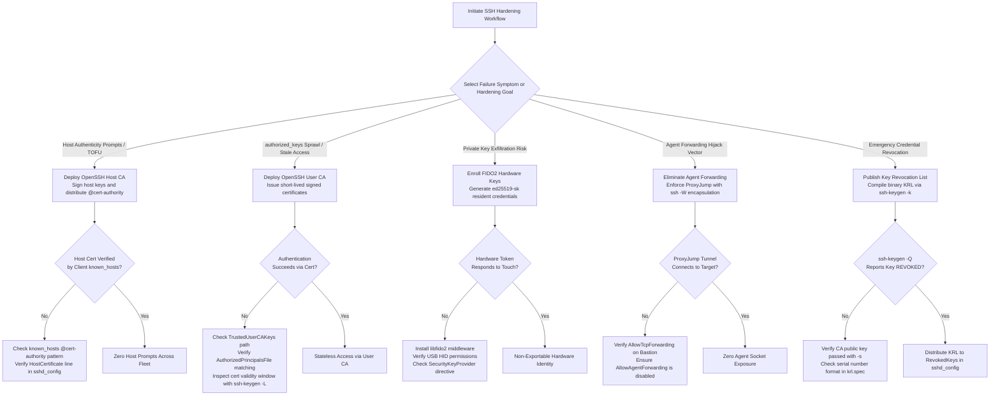
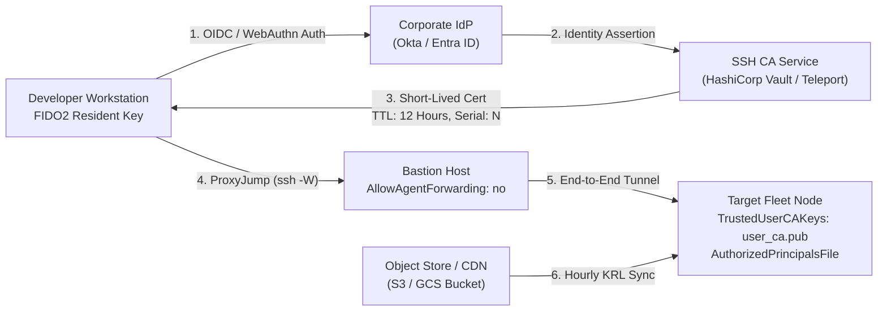

# Harden SSH Access With Certificates and Hardware Keys

> [!summary] Scope
> Owns the production runbook for hardening corporate SSH infrastructure.
> Details procedures for establishing OpenSSH User and Host Certificate Authorities, issuing time-bounded signed certificates with principal restrictions, publishing Key Revocation Lists (KRL), eliminating agent forwarding via ProxyJump bastions, and configuring FIDO2 resident hardware keys.
> Reaches Use and Debug, putting SSH-In-Depth-Keys-Forwarding-Certificates-and-FIDO2.md into operational practice.

The cryptographic theory, transport layer protocol, and key exchange primitives are owned by [[SSH-In-Depth-Keys-Forwarding-Certificates-and-FIDO2]].
Network-level bastion routing and dynamic proxying are owned by [[19-Shell-and-Unix-Engineering/11-Networking-and-SSH/SSH-Config-and-ProxyJump|SSH Config and ProxyJump]].
Terminal multiplexer session retention across remote hops is owned by [[Tmux-Architecture-and-Session-Persistence]].
Recovery from hanging multiplexing sockets is owned by [[Drill-Command-Line-SSH-Multiplexing-and-Broken-PTY]].
This playbook owns the end-to-end production operational runbook for deploying, configuring, verifying, and debugging OpenSSH Certificate Authorities, FIDO2 hardware keys, and Key Revocation Lists across an engineering fleet.

## Trigger and Symptoms

Activate this playbook when legacy SSH authentication mechanisms create administrative bottlenecks, audit failures, or credential leakage across your engineering fleet.

- `authorized_keys` sprawl: Fleet nodes accumulate thousands of unmanaged public keys without expiration dates, turning server decommissioning and employee offboarding into complex distributed file-deletion tasks.
- Blind Trust On First Use (TOFU) prompts: Engineers routinely click through "The authenticity of host cannot be established" prompts on dynamic cloud nodes, creating vulnerability to DNS hijacking and man-in-the-middle attacks.
- Agent forwarding credential theft: Developers run `ssh -A` across shared bastion hosts, creating forwarded agent UNIX domain sockets (under `~/.ssh/agent/` since OpenSSH 10.1, `/tmp/ssh-*/agent.*` before; `AgentSocketPath` since 10.6) that any local root process or anyone running as that user can hijack to impersonate the user.
- Private key exfiltration: Unencrypted or weakly passphrased Ed25519 or RSA private keys on developer laptops are copied by infostealer malware, granting persistent unauthorized access to infrastructure.
- Inability to revoke credentials instantly: An employee device is lost or compromised, but revoking access requires scanning and modifying thousands of remote `authorized_keys` files across multiple virtual private clouds.
- Compliance mandate enforcement: PCI DSS v4.0.1 requirement 8.4.2 reads "MFA is implemented for all non-console access into the CDE", and FedRAMP Rev 5 control IA-2(1) requires multi-factor authentication for privileged accounts, which FedRAMP's guidance says must be phishing-resistant (as of 2026-11, both).
  Neither text names SSH, a token type, or a certificate lifetime, so an internal policy has to map them onto hardware token backing (FIDO2), user presence (touch), user verification (PIN), and short certificate lifetimes.

## Decision Tree



## Prerequisites

Execute this procedure from an administrative workstation or dedicated bastion host.
Do not generate Certificate Authority private keys on unhardened developer laptops or ephemeral CI containers.

### Required Software Binaries

```bash
command -v ssh sshd ssh-keygen ssh-add
```

On macOS 15+ systems, OpenSSH is installed natively in `/usr/bin/ssh` and `/usr/sbin/sshd`, with Homebrew providing modern OpenSSH under `/opt/homebrew/bin/ssh` and `/opt/homebrew/sbin/sshd` (as of 2026-11, macOS).
On Ubuntu 24.04 and Debian 12 systems, these utilities are supplied by the `openssh-client` and `openssh-server` packages (packages.ubuntu.com lists 1:9.6p1-3ubuntu13 on noble and packages.debian.org lists 1:9.2p1-2+deb12u10 on bookworm; as of 2026-11, Linux).
Both `openssh-client` packages depend on `libfido2-1` (>= 1.8.0), so the client side of FIDO2 support is already installed there.
FIDO2 hardware key operations need `libfido2` (or a `SecurityKeyProvider` middleware) only on the client workstation that talks to the token (`brew install libfido2` on macOS, `apt-get install libfido2-1` on Linux); `sshd` verifies `sk-*` signatures in its own code and needs no token library (OpenSSH `ssh-ed25519-sk.c`, `ssh-ecdsa-sk.c`).
The macOS system `/usr/bin/ssh` (OpenSSH 10.5p1 with LibreSSL 3.3.6 on this host) lists the `sk-*` key types in `ssh -Q key` (as of 2026-11, macOS).

### File Permissions and Directory Constraints

- OpenSSH Certificate Authority private keys (`user_ca`, `host_ca`) must be stored with mode `0600` and owned strictly by root or a dedicated air-gapped CA management account.
- Server configuration files (`/etc/ssh/sshd_config` and drop-in directories `/etc/ssh/sshd_config.d/*.conf`) must be owned by `root:root` with mode `0644`.
- Host private keys (`/etc/ssh/ssh_host_*_key`) must be mode `0600` and owned by `root:root`.
- The `AuthorizedPrincipalsFile` target directory (for example `/etc/ssh/principals/`) must be owned by `root:root` with mode `0755`, and individual principal files must be mode `0644`.
- Binary Key Revocation List files (`/etc/ssh/revoked.krl`) must be mode `0644` and owned by root; the privileged `sshd` monitor reads them during authentication, and sshd_config(5) states that if the file is not readable, public key authentication is refused for all users.

**Verification:**

```bash
ssh -V
ssh-keygen --help 2>&1 | grep -qE 'ecdsa-sk|ed25519-sk' && echo "FIDO2-SUPPORT-OK"
```

OpenSSH 8.2 and later prints `OpenSSH_8.2` or higher and outputs `FIDO2-SUPPORT-OK`.
The `-E` matters: in a basic regular expression `|` is a literal character, so the pattern never matches (checked locally, as of 2026-11).
The usage line only proves the key types are known; `ssh -Q key | grep sk-` confirms the build accepts them.
The lab environment on this workstation was verified with OpenSSH 10.6p2 and OpenSSL 4.1.0 on `darwin-arm64` (as of 2026-11, macOS).

## Commands and Numbers to Know

| Item | Platform | Value `(as of 2026-11)` | Why it matters |
| :--- | :--- | :--- | :--- |
| `TrustedUserCAKeys` default | Both | `none` (`sshd -T` on OpenSSH 10.6p2) | File specifying CA public keys trusted to sign user certificates. |
| `RevokedKeys` default | Both | `none` | Path to binary Key Revocation List (KRL) or flat list rejected by `sshd`. |
| `RevokedHostKeys` default | Both | `none` | Path in `ssh_config` rejected by the client when verifying server host keys. |
| `AuthorizedPrincipalsFile` | Both | `none` | Points to allowed principals; supports `%u` (local user) and the other sshd_config(5) TOKENS. |
| `@cert-authority` marker | Both | Directive prefix in `known_hosts` | Authorizes an SSH host public key as a trusted CA for a domain pattern. |
| `@revoked` marker | Both | Directive prefix in `known_hosts` | Explicitly revokes a compromised host key or CA key directly in `known_hosts`. |
| KRL Magic Header | Both | `SSHKRL\n\0` (8 bytes) | Binary magic bytes starting every OpenSSH Key Revocation List file. |
| KRL Section: Certificates | Both | `1` (`KRL_SECTION_CERTIFICATES`) | Embeds CA public key and nested subsections revoking serials or IDs. |
| KRL Section: Explicit Key | Both | `2` (`KRL_SECTION_EXPLICIT_KEY`) | Revokes plain public keys by embedding their full raw wire-format blobs. |
| KRL Section: SHA256 Hash | Both | `5` (`KRL_SECTION_FINGERPRINT_SHA256`) | Compactly revokes keys by 32-byte SHA-256 fingerprint; KRLs using it are not supported before OpenSSH 7.9 (ssh-keygen(1) `hash:`). |
| Certificate Type: User | Both | `1` (`SSH_CERT_TYPE_USER`) | Certifies user identity to servers; evaluated against `TrustedUserCAKeys`. |
| Certificate Type: Host | Both | `2` (`SSH_CERT_TYPE_HOST`) | Certifies server identity to clients; evaluated against `known_hosts` CA lines. |
| FIDO2 Algorithm: Ed25519-SK | Both | `sk-ssh-ed25519@openssh.com` | Hardware-backed Ed25519 key; needs an authenticator that implements EdDSA, which CTAP does not mandate (YubiKey firmware 5.2.3 or newer). |
| FIDO2 Algorithm: ECDSA-SK | Both | `sk-ecdsa-sha2-nistp256@openssh.com` | Hardware-backed NIST P-256 key; the fallback for tokens without EdDSA, including U2F-only keys. |
| FIDO2 User Presence Flag | Both | `0x01` (`SSH_SK_USER_PRESENCE_REQD`) | Key flag requiring a physical touch on the authenticator during signing. |
| FIDO2 User Verification Flag | Both | `0x04` (`SSH_SK_USER_VERIFICATION_REQD`) | Key flag requiring a PIN or biometric check inside the authenticator. |
| `ProxyJump` Flag | Both | `-J` | Transparently proxies SSH traffic through a jump bastion via `ssh -W`. |
| Recommended User Cert TTL | Both | `8h` to `16h` (1 work shift) | Limits window of vulnerability if a temporary private key is leaked. |

## Step-by-Step Execution

Follow these steps sequentially to establish OpenSSH Certificate Authorities, issue constrained credentials, eliminate agent forwarding, and enforce revocation.
Do not skip verification checks; if a verification check fails, consult Failure Modes.

### Step 1: Establish Isolated User and Host Certificate Authorities

Generate two separate cryptographic authority keypairs using Ed25519: one exclusively for User certificates, and one exclusively for Host certificates.
Never use the same private key for both User and Host certification authorities.

```bash
sudo mkdir -p /etc/ssh/ca
sudo chmod 700 /etc/ssh/ca

# Generate User Certificate Authority keypair
sudo ssh-keygen -t ed25519 \
    -f /etc/ssh/ca/user_ca \
    -C "user-ca@corp.internal" \
    -N "" \
    -q

# Generate Host Certificate Authority keypair
sudo ssh-keygen -t ed25519 \
    -f /etc/ssh/ca/host_ca \
    -C "host-ca@corp.internal" \
    -N "" \
    -q

sudo chmod 600 /etc/ssh/ca/user_ca /etc/ssh/ca/host_ca
sudo chmod 644 /etc/ssh/ca/user_ca.pub /etc/ssh/ca/host_ca.pub
```

In high-assurance production environments, protect these keys using Hardware Security Modules (PKCS#11 via `-D`) or air-gapped signing machines.
The public keys `/etc/ssh/ca/user_ca.pub` and `/etc/ssh/ca/host_ca.pub` are safe for public distribution.

**Verification:**

```bash
ssh-keygen -l -f /etc/ssh/ca/user_ca.pub
ssh-keygen -l -f /etc/ssh/ca/host_ca.pub
```

Both commands output `256 SHA256:<fingerprint> <comment> (ED25519)`, for example `256 SHA256:k/oY... user-ca@corp.internal (ED25519)` (checked locally on OpenSSH 10.6p2, as of 2026-11).

### Step 2: Deploy Host Certificates to Eliminate Fleet-Wide TOFU Prompts

Sign the host key of each target server using the Host CA.
This replaces per-host fingerprint prompting with mathematical signature validation.

On each fleet server (for example `target.corp.internal`):

```bash
# Generate the host Ed25519 key if not present (ssh-keygen prompts before overwriting an existing key)
[ -f /etc/ssh/ssh_host_ed25519_key ] || sudo ssh-keygen -t ed25519 -f /etc/ssh/ssh_host_ed25519_key -N "" -q

# Sign the host public key using the Host CA
# For production automation, transfer ssh_host_ed25519_key.pub to the CA signer
sudo ssh-keygen -s /etc/ssh/ca/host_ca \
    -I "host-target.corp.internal" \
    -h \
    -n "target.corp.internal,10.0.1.50,127.0.0.1" \
    -V "-5m:+52w" \
    -z 2001 \
    /etc/ssh/ssh_host_ed25519_key.pub
```

The `-h` flag marks the output as an `SSH_CERT_TYPE_HOST` certificate.
The `-n` flag specifies the valid hostnames and IP addresses the client will use to contact this node.
The `-z 2001` flag records a 64-bit serial number for revocation tracking.
The resulting file is `/etc/ssh/ssh_host_ed25519_key-cert.pub`.

Configure the server daemon in `/etc/ssh/sshd_config`:

```text
HostKey /etc/ssh/ssh_host_ed25519_key
HostCertificate /etc/ssh/ssh_host_ed25519_key-cert.pub
```

On client workstations, append the Host CA public key to global `/etc/ssh/ssh_known_hosts` or `~/.ssh/known_hosts` using the `@cert-authority` directive:

```text
@cert-authority *.corp.internal,10.0.1.* ssh-ed25519 AAAAC3NzaC1lZDI1NTE5AAAA... host-ca@corp.internal
```

**Verification:**

```bash
ssh-keygen -L -f /etc/ssh/ssh_host_ed25519_key-cert.pub
```

The output confirms `Type: ssh-ed25519-cert-v01@openssh.com host certificate`, `Serial: 2001`, and lists the authorized domain names under `Principals:`.
When connecting from a client with `StrictHostKeyChecking yes`, the client connects without prompting for fingerprint confirmation.

### Step 3: Configure Fleet Servers to Enforce User CA and Principals

To eliminate `~/.ssh/authorized_keys` files on fleet nodes, configure `sshd` to delegate trust directly to `user_ca.pub`.

1. Distribute `/etc/ssh/ca/user_ca.pub` to `/etc/ssh/user_ca.pub` on all fleet nodes.
2. Create the central principals directory:

```bash
sudo mkdir -p /etc/ssh/principals
sudo chmod 755 /etc/ssh/principals
```

3. Populate allowed principals for each local user account.
For example, to permit engineers presenting the `admin` principal to log into the local `ubuntu` account:

```bash
echo "admin" | sudo tee /etc/ssh/principals/ubuntu
sudo chmod 644 /etc/ssh/principals/ubuntu
```

4. Configure `/etc/ssh/sshd_config` (or a drop-in such as `/etc/ssh/sshd_config.d/10-ca-auth.conf`; `sshd` keeps the first value it reads for most keywords, so a drop-in must sort before any file that sets the same keyword, for example cloud-init's `50-cloud-init.conf`).
`UsePAM no` below also disables PAM account and session modules (limits, systemd-logind sessions); keep `UsePAM yes` on distributions that depend on them and rely on `KbdInteractiveAuthentication no` to stop PAM prompts.

```text
# Enforce Certificate Authority Authentication
TrustedUserCAKeys /etc/ssh/user_ca.pub
AuthorizedPrincipalsFile /etc/ssh/principals/%u

# Disable legacy password and interactive fallbacks
PasswordAuthentication no
KbdInteractiveAuthentication no
UsePAM no
```

5. Test the configuration syntax and reload the daemon:

```bash
sudo sshd -t
sudo systemctl reload sshd || sudo service ssh reload
```

**Verification:**

```bash
sudo sshd -T | grep -iE 'trustedusercakeys|authorizedprincipalsfile'
```

Output confirms `TrustedUserCAKeys /etc/ssh/user_ca.pub` and `AuthorizedPrincipalsFile /etc/ssh/principals/%u`.
OpenSSH 10.6p2 prints keywords in mixed case and older releases print them lowercase, hence `grep -i` (checked locally, as of 2026-11).

### Step 4: Issue Time-Bounded User Certificates with Constrained Capabilities

Developers generate local ephemeral keypairs (`~/.ssh/id_ed25519`), submit their public key to an internal certificate signing service (such as HashiCorp Vault, Teleport, or Step-ca), and receive a signed certificate.

To manually mint a production certificate with administrative privileges:

```bash
USER_PUB="${HOME}/.ssh/id_ed25519.pub"

ssh-keygen -s /etc/ssh/ca/user_ca \
    -I "alice@corp.internal" \
    -n "ubuntu,admin" \
    -V "-5m:+8h" \
    -z 1001 \
    -O force-command=/usr/local/bin/audit-shell \
    -O clear \
    -O permit-pty \
    -O permit-user-rc \
    "${USER_PUB}"
```

Options explained:
- `-I alice@corp.internal`: Identity string logged in the server's auth log (`Accepted publickey for ubuntu from <ip> port <n> ssh2: ED25519-CERT SHA256:<fp> ID alice@corp.internal (serial 1001) CA ED25519 SHA256:<ca-fp>`, format from `auth.c`).
- `-n ubuntu,admin`: Comma-separated list of valid principals.
- `-V -5m:+8h`: Valid starting 5 minutes in the past (to tolerate clock drift across data centers) and expiring in exactly 8 hours.
- `-z 1001`: Unique sequential or random 64-bit serial number.
- `-O force-command=...`: Forces session execution through an audited shell binary.
- `-O clear`: Clears all default extensions (port, agent, and X11 forwarding, PTY, and `~/.ssh/rc`); it does not remove critical options such as `force-command`, as the lab's Alice certificate shows.
- `-O permit-pty`: Re-enables interactive terminal allocation.
- `-O permit-user-rc`: Allows execution of `~/.ssh/rc`.

The signed certificate lands at `${HOME}/.ssh/id_ed25519-cert.pub`.

**Verification:**

```bash
ssh-keygen -L -f "${HOME}/.ssh/id_ed25519-cert.pub"
```

Verify that `Valid:` shows the expected 8-hour window, `Serial:` matches `1001`, and `Critical Options:` lists the specified `force-command`.

### Step 5: Enroll and Require FIDO2 Hardware Resident Keys

Hardware security keys (such as YubiKey 5 Series or SoloKeys) prevent credential exfiltration by generating private key material inside a secure enclave that cannot be read by host software.

To generate a non-exportable FIDO2 Ed25519 resident key with user verification (PIN) enforced:

```bash
ssh-keygen -t ed25519-sk \
    -O resident \
    -O verify-required \
    -O application="ssh:corp.internal" \
    -f ~/.ssh/id_ed25519_sk \
    -C "alice-yubikey-primary"
```

Flags explained:
- `-t ed25519-sk`: Selects the Ed25519 FIDO2 algorithm.
  If the authenticator token does not support Ed25519, fall back to `-t ecdsa-sk`.
- `-O resident`: Stores the key handle and credential metadata directly on the hardware key's non-volatile memory, allowing portability across machines.
- `-O verify-required`: Sets the FIDO2 user verification bit, requiring the user to type their hardware token PIN before the token will sign a challenge.
- `-O application="ssh:corp.internal"`: Isolates the credential namespace on the token.

On a new or secondary workstation, download the resident credentials directly off the attached hardware token:

```bash
cd ~/.ssh
ssh-keygen -K
```

`ssh-keygen -K` prompts for the token PIN and writes `id_ed25519_sk_rk` plus a suffix built from the application string (without `ssh:`) and any non-default user ID, here `id_ed25519_sk_rk_corp.internal`, and its `.pub` file into the current directory (`ssh-keygen.c` `sk_suffix`).
Next, sign the enrolled key using the User CA as detailed in Step 4:

```bash
ssh-keygen -s /etc/ssh/ca/user_ca \
    -I "fido-alice@corp.internal" \
    -n "ubuntu,admin" \
    -V "-5m:+8h" \
    -z 501 \
    ~/.ssh/id_ed25519_sk.pub
```

To enforce hardware-token backing on fleet servers, restrict the accepted algorithms to FIDO types and require user verification in `/etc/ssh/sshd_config`:

```text
PubkeyAcceptedAlgorithms sk-ssh-ed25519-cert-v01@openssh.com,sk-ecdsa-sha2-nistp256-cert-v01@openssh.com,sk-ssh-ed25519@openssh.com,sk-ecdsa-sha2-nistp256@openssh.com
PubkeyAuthOptions verify-required
```

`PubkeyAuthOptions verify-required` alone does not reject software keys: sshd_config(5) states that neither `touch-required` nor `verify-required` has any effect for non-FIDO key types.

**Verification:**

```bash
ssh-keygen -L -f ~/.ssh/id_ed25519_sk-cert.pub
```

The output confirms `Type: sk-ssh-ed25519-cert-v01@openssh.com user certificate`.
When connecting with this key, the token flashes until physically touched and prompts for the security key PIN.

### Step 6: Compile, Publish, and Query Key Revocation Lists (KRL)

When an active certificate must be invalidated before its expiration time, publish an OpenSSH Key Revocation List (KRL).
A KRL is a compact binary file generated by `ssh-keygen -k` that specifies revoked serials, key IDs, or public key hashes.

1. Create a revocation specification file (`/etc/ssh/ca/krl.spec`):

```text
# Revoke a single certificate serial number
serial: 1001

# Revoke a range of certificate serial numbers
serial: 1050-1099

# Revoke an entire compromised key ID string
id: contractor-malicious@corp.internal
```

2. Compile the initial binary KRL using the User CA:

```bash
sudo ssh-keygen -k \
    -f /etc/ssh/ca/revoked.krl \
    -s /etc/ssh/ca/user_ca.pub \
    /etc/ssh/ca/krl.spec
```

3. Update an existing KRL by appending a compromised raw public key fingerprint without regenerating the entire list:

```bash
COMPROMISED_FP="$(ssh-keygen -l -f ~/.ssh/id_ed25519_sk.pub | awk '{print $2}')"
echo "hash: ${COMPROMISED_FP}" > /tmp/update.spec

sudo ssh-keygen -k -u \
    -f /etc/ssh/ca/revoked.krl \
    -s /etc/ssh/ca/user_ca.pub \
    /tmp/update.spec
```

4. Distribute `/etc/ssh/ca/revoked.krl` to `/etc/ssh/revoked.krl` on fleet servers and configure them to check it in `/etc/ssh/sshd_config`:

```text
RevokedKeys /etc/ssh/revoked.krl
```

5. Reload the daemon once to pick up the new `RevokedKeys` line.
Later KRL updates need no reload: `sshd` re-reads the file on every public key authentication attempt (`auth.c` `auth_key_is_revoked`).

**Verification:**

Query the KRL locally using `ssh-keygen -Q`:

```bash
# Querying a revoked certificate
ssh-keygen -Q -f /etc/ssh/ca/revoked.krl ~/.ssh/id_ed25519-cert.pub || echo "CERT-IS-REVOKED"

# Querying a valid certificate
ssh-keygen -Q -f /etc/ssh/ca/revoked.krl ~/.ssh/valid-cert.pub && echo "CERT-IS-VALID"
```

When a revoked key is presented, `ssh-keygen -Q` prints `<path> (<comment>): REVOKED` and exits with code 1.
When an active key is queried, it prints `<path> (<comment>): ok` and exits with code 0 (checked locally on OpenSSH 10.6p2, as of 2026-11).

### Step 7: Eliminate Agent Forwarding Using ProxyJump Bastions

Traditional agent forwarding (`ssh -A`) creates exposed UNIX domain sockets on intermediate bastions.
Eliminate agent forwarding completely by configuring `ProxyJump` (`-J`), which tunnels encrypted client traffic through the bastion using standard `ssh -W` encapsulation.

1. On the Bastion host (`bastion.corp.internal`), strictly disable agent forwarding in `/etc/ssh/sshd_config`:

```text
AllowAgentForwarding no
AllowTcpForwarding yes
X11Forwarding no
```

sshd_config(5) warns that disabling agent forwarding does not improve security unless users are also denied shell access, because they can install their own forwarders; give jump accounts no shell (for example `ForceCommand /sbin/nologin` in a `Match User jumpuser` block), which still permits the `-W` tunnel.

2. Configure developer workstations in `~/.ssh/config`:

```text
Host bastion
    HostName bastion.corp.internal
    User jumpuser
    IdentityFile ~/.ssh/id_ed25519_sk
    CertificateFile ~/.ssh/id_ed25519_sk-cert.pub

Host *.internal !bastion
    User ubuntu
    IdentityFile ~/.ssh/id_ed25519_sk
    CertificateFile ~/.ssh/id_ed25519_sk-cert.pub
    ProxyJump bastion
    ForwardAgent no
```

When an engineer executes `ssh db01.internal`, the client transparently runs a proxy command of the form `ssh -W '[db01.internal]:22' bastion` (`ssh.c`) to establish a direct, end-to-end encrypted SSH session.
The bastion sees only opaque encrypted packets, never has access to the client's private keys, and never creates a forwarded agent socket.

**Verification:**

Connect through the bastion and verify the authentication socket environment variable:

```bash
ssh db01.internal 'echo "SSH_AUTH_SOCK: ${SSH_AUTH_SOCK:-NONE}"'
```

Output prints `SSH_AUTH_SOCK: NONE`.
Inspect the bastion host directly; no forwarded agent socket appears under the jump user's `~/.ssh/agent/` (OpenSSH 10.1 and later) or `/tmp/ssh-*` (older releases) for the session.

## Worked Example: SSH CA, FIDO2, and KRL Lab

The lab in `code/01-Command-Line/ssh_fido2_krl/` executes this entire lifecycle offline, unprivileged, and deterministically.

1. `run.sh` initializes an Ed25519 User CA and Host CA keypair.
2. It generates client keypairs and issues distinct certificate profiles:
   - Profile Alice (Admin): signed with serial 1001, principals `<user>,admin`, critical option `force-command=/usr/bin/true` (an existing binary, so a non-revoked Alice would authenticate), and restricted extensions `permit-pty, permit-user-rc`.
   - Profile Bob (Engineer): signed with serial 1002, principal `bob,developer`, and extensions omitting agent forwarding.
   - Profile Charlie (Expired): signed with serial 1003, principals `charlie,admin`, and a validity interval set entirely in the past (`-2h:-1h`); with the `admin` principal, only expiry can deny it.
   - Profile Dave (Active Admin): signed with serial 1004 and valid active timestamps.
   - Profile Target Host: signed with serial 2001, certifying hostnames `target.corp.internal` and `127.0.0.1`.
3. It compiles `sk_dummy.c` into a dynamic library (`sk_dummy.dylib` on macOS, `sk_dummy.so` on Linux) that implements OpenSSH's `sk-api.h` middleware API (`SSH_SK_VERSION_MAJOR` `0x000a0000`).
   It enrolls a mock `ed25519-sk` keypair via `ssh-keygen -t ed25519-sk -w ...` without requiring physical USB tokens, checks that the public key is `sk-ssh-ed25519@openssh.com` and that `ssh-keygen -l` reports `ED25519-SK`, and signs it as a FIDO2 user certificate (serial 501).
   The mock's `sk_sign` always fails (it has the real `sk-api.h` prototype and returns `SSH_SK_ERR_GENERAL`), so this key is enrolled, certified, and revoked but never used to authenticate; `sshd` enforcement of the FIDO2 revocation is therefore not exercised.
4. It compiles an initial binary Key Revocation List (`revoked.krl`) revoking serial 1001, updates it using `-u` to revoke the FIDO2 key by its SHA-256 fingerprint, validates the binary format using `lab_inspect.py`, and requires `ssh-keygen -Q` to exit 1 for the revoked certificates and 0 for Dave's.
5. It starts an isolated `sshd` instance on an ephemeral unprivileged port configured with `TrustedUserCAKeys`, `AuthorizedPrincipalsFile`, `RevokedKeys`, and `HostCertificate`, logging at `LogLevel VERBOSE` to a file.
   It executes client authentication probes, and each probe passes only if the client exit code, the remote command output, and the `sshd` log reason all match:
   - Dave (active cert matching authorized `admin` principal) succeeds with exit 0 and the log line `Accepted certificate ID "dave@corp.internal" (serial 1004)`.
   - Bob (cert with principal `developer` not matching `admin`) is denied with exit 255 and `Certificate does not contain an authorized principal`.
   - Charlie (expired cert, admin principal) is denied with exit 255 and `Certificate invalid: expired`.
   - Alice (revoked serial 1001, valid principal, runnable force-command) is denied with exit 255 and `revoked by file <krl>`.
   - Dave against a `known_hosts` that trusts a different CA is refused by the client with exit 255, which shows the host certificate is actually verified.
   The exit codes printed are the real ones, not literals.
   The target sets `PerSourcePenalties no` when the `sshd` knows it (OpenSSH 9.8 and later), because every probe comes from 127.0.0.1 and the penalty would drop later connections after the denied logins.
6. It starts a second `sshd` instance acting as a Bastion (`AllowAgentForwarding no`) and connects to the target through it via `ProxyJump`.
   The tunnel passes only if the command output arrives, the client's `ssh -v` log shows the implicit proxy command ending in `-W '[127.0.0.1]:<port>' bastion`, and the bastion log shows it authenticated Dave's certificate.
   The agent check loads Dave's key into a real `ssh-agent` and connects with `ForwardAgent yes`: the target (`AllowAgentForwarding yes`) is the control and must report a forwarded `SSH_AUTH_SOCK`, the bastion must report none.

The lab was mutation-checked on 2026-11-07: breaking any one of these mechanisms (dropping `RevokedKeys`, an unexpired Charlie, an extra principal for Bob, a trusted rogue host CA, agent forwarding enabled on the bastion or disabled on the control, a plain `ed25519` enrollment, a wrong revoked serial, a skipped KRL update, a removed `ProxyJump`, a bastion without the user CA, or a mis-pointed KRL query) makes `make verify` fail.

### Verified Lab Output

Recorded on `darwin-arm64` (macOS, OpenSSH 10.6p2) on 2026-11-07; no Linux recording exists yet, and the lab needs `ssh`, `sshd`, `ssh-agent`, `cc`, and `python3`; copied verbatim from `code/01-Command-Line/ssh_fido2_krl/expected/darwin-arm64.txt`:

```text
=== Step 1: Certificate Authority Setup ===
User CA key generated: ED25519
Host CA key generated: ED25519

=== Step 2: User and Host Certificate Issuance ===
Profile Alice (Admin):
  Type: user certificate (ssh-ed25519-cert-v01@openssh.com)
  Key ID: "alice@corp.internal"
  Serial: 1001
  Principals: alice, admin
  Critical Options: force-command=/usr/bin/true
  Extensions: permit-pty, permit-user-rc
Profile Bob (Engineer):
  Type: user certificate (ssh-ed25519-cert-v01@openssh.com)
  Key ID: "bob@corp.internal"
  Serial: 1002
  Principals: bob, developer
  Critical Options: none
  Extensions: permit-X11-forwarding, permit-pty, permit-user-rc
Profile Charlie (Expired):
  Type: user certificate (ssh-ed25519-cert-v01@openssh.com)
  Key ID: "charlie@corp.internal"
  Serial: 1003
  Principals: charlie, admin
  Critical Options: none
  Extensions: permit-X11-forwarding, permit-agent-forwarding, permit-port-forwarding, permit-pty, permit-user-rc
Target Host Certificate:
  Type: host certificate (ssh-ed25519-cert-v01@openssh.com)
  Key ID: "host-target.corp.internal"
  Serial: 2001
  Principals: target.corp.internal, 127.0.0.1
  Critical Options: none
  Extensions: none

=== Step 3: FIDO2 Hardware Key Integration ===
Compiled FIDO2 Middleware: sk_dummy
Enrolled FIDO2 hardware-backed key: ed25519-sk
Signed FIDO2 User Certificate:
  Type: user certificate (sk-ssh-ed25519-cert-v01@openssh.com)
  Key ID: "fido2-alice@corp.internal"
  Serial: 501
  Principals: alice, admin
  Critical Options: none
  Extensions: permit-X11-forwarding, permit-agent-forwarding, permit-port-forwarding, permit-pty, permit-user-rc

=== Step 4: Key Revocation List (KRL) Lifecycle ===
KRL Magic Header: SSHKRL
KRL Format Version: 1
KRL Section Types: KRL_SECTION_CERTIFICATES, KRL_SECTION_FINGERPRINT_SHA256
Revoked Serials: 1001
Query Cert 1001 (Revoked Serial): REVOKED (exit 1)
Query Cert 1004 (Active Serial): VALID (exit 0)
Query Cert 501 (Revoked FIDO2 Fingerprint): REVOKED (exit 1)

=== Step 5: Live OpenSSH Server (sshd) Access Enforcement ===
Connect with Valid Active Cert (Dave, Admin Principal): SUCCESS (exit 0)
Connect with Unauthorized Principal (Bob, Developer): DENIED (exit 255)
Connect with Expired Cert (Charlie, Admin Principal): DENIED (exit 255)
Connect with Revoked Cert (Alice, Serial 1001): DENIED (exit 255)
Connect to Target Trusting a Rogue Host CA (Dave): REFUSED (exit 255)

=== Step 6: Bastion Architecture via ProxyJump (Zero Agent Forwarding) ===
ProxyJump End-to-End Tunnel: SUCCESS (exit 0)
Client Encapsulation: ssh -W
Bastion Authenticated the Certificate: yes
Target Agent Forwarding State (AllowAgentForwarding yes, control): AGENT_SOCKET_PRESENT
Bastion Agent Forwarding State (AllowAgentForwarding no): AGENT_SOCKET_ABSENT
```

## Rollback Procedure

If certificate authentication or KRL deployment causes widespread fleet lockout, execute this rollback sequence to cleanly restore legacy public-key authentication.

1. **Re-enable Break-Glass Static Keys:**
   Retain an out-of-band emergency administrator public key in `/root/.ssh/authorized_keys`; a system-wide file such as `/etc/ssh/authorized_keys` is read only if `AuthorizedKeysFile` names it (default `.ssh/authorized_keys .ssh/authorized_keys2`, sshd_config(5)).
   Do not delete root's authorized keys during initial CA rollout; root key login works under the default `PermitRootLogin prohibit-password`.
   **Check:** Verify that emergency login succeeds via static key:
   `ssh -i /etc/ssh/emergency_breakglass.key root@target.corp.internal whoami`
2. **Deactivate Key Revocation List:**
   If a corrupted KRL causes `sshd` to reject all incoming certificates, comment out `RevokedKeys` in `/etc/ssh/sshd_config`:
   `sudo sed -i.bak 's/^RevokedKeys/#RevokedKeys/' /etc/ssh/sshd_config`
   `sudo sshd -t && sudo systemctl reload sshd`
   **Check:** `sudo sshd -T | grep -i revokedkeys` returns empty (OpenSSH 10.6p2 omits the keyword when unset).
3. **Revert User CA Authentication:**
   Comment out `TrustedUserCAKeys` and `AuthorizedPrincipalsFile`:
   `sudo sed -i.bak 's/^TrustedUserCAKeys/#TrustedUserCAKeys/' /etc/ssh/sshd_config`
   `sudo sed -i.bak 's/^AuthorizedPrincipalsFile/#AuthorizedPrincipalsFile/' /etc/ssh/sshd_config`
   `sudo sshd -t && sudo systemctl reload sshd`
   **Check:** `sudo sshd -T | grep -i trustedusercakeys` prints `TrustedUserCAKeys none`.
4. **Revert Client Host CA Trust:**
   If the Host CA private key is compromised, remove the `@cert-authority` lines from global `/etc/ssh/ssh_known_hosts` and append `@revoked` markers for the compromised CA key:
   `@revoked * ssh-ed25519 AAAAC3NzaC1lZDI1NTE5AAAA... host-ca@corp.internal`
   **Check:** Clients connecting to servers with old certificates print `WARNING: REVOKED HOST KEY DETECTED!` and `The ED25519-CERT host key for <host> is marked as revoked.`, and abort under strict host key checking (`sshconnect.c` `HOST_REVOKED`; `hostfile.c` `check_key_not_revoked` also matches a revoked signing CA).

## Failure Modes of the Procedure

| Failure | How it shows up | Root cause | Recovery |
| :--- | :--- | :--- | :--- |
| `Certificate invalid: name is not a listed principal` | Server auth log shows `Refusing certificate ID "..." serial=N signed by ED25519 CA SHA256:...: Certificate invalid: name is not a listed principal` without `AuthorizedPrincipalsFile`, or `...: Certificate does not contain an authorized principal` with it; client gets `Permission denied (publickey)` | The certificate's `-n` principals list does not match the target UNIX username or any principal listed in `/etc/ssh/principals/%u` (`auth2-pubkey.c` `user_cert_trusted_ca`). | Add the certificate principal to `/etc/ssh/principals/<username>`, or re-issue the certificate adding the correct target username to `-n`. |
| `Certificate invalid: expired` | Server log shows `Certificate invalid: expired`; client gets `Permission denied` | The system clock on either the client or the server is outside the `-V` validity range (`valid before` timestamp passed). | Synchronize server clocks with chrony or NTP; re-mint an active certificate with a 5-minute past buffer (`-V -5m:+8h`). |
| `Host key verification failed` | Client terminates immediately with `Host key verification failed`; server was expected to use host cert | The server's hostname does not match the `-n` principals in `ssh_host_*_key-cert.pub`, or client `known_hosts` lacks matching `@cert-authority` pattern. | Check `ssh-keygen -L -f /etc/ssh/ssh_host_*_key-cert.pub`; update `@cert-authority` pattern in `known_hosts` to cover domain wildcards. |
| `Revoked by KRL` | Server log shows `Authentication key ED25519-CERT SHA256:... revoked by file /etc/ssh/revoked.krl` (`auth.c`); client gets `Permission denied` | The certificate serial or public key hash matches an entry compiled into the active KRL file. | Inspect KRL using `ssh-keygen -Q -f /etc/ssh/revoked.krl <cert.pub>`; re-issue user credential with an unrevoked serial number. |
| `All logins denied after KRL change` | Every certificate connection is refused immediately across all users | The KRL file specified in `RevokedKeys` is missing, unreadable, or corrupted; `sshd` logs `Error checking authentication key ... in revoked keys file` and treats every key as revoked (`auth.c` `auth_key_is_revoked`). | Verify `ls -la /etc/ssh/revoked.krl` permissions (`0644`); rebuild KRL using `ssh-keygen -k` and confirm syntax with `ssh-keygen -Q`. |
| `Key enrollment failed: device not found` | `ssh-keygen -t ed25519-sk` ends with `Key enrollment failed: device not found` (`ssh-keygen.c` `fatal_r`, `ssherr.c` `SSH_ERR_DEVICE_NOT_FOUND`) | No authenticator is visible to `libfido2`: the token is not plugged in, the user cannot read its hidraw node, or the build has no usable `SecurityKeyProvider`. | Re-insert the token and list what `libfido2` sees with `fido2-token -L`; on Linux, `udev` 244 or later detects U2F/FIDO devices without extra rules (the Debian `libu2f-udev` package is a transitional package that "is not necessary anymore"), and an older system needs a hidraw rule like the example in the libfido2 README. |
| `Enter PIN for authenticator:` | `ssh-keygen -t ed25519-sk` stops at the prompt `Enter PIN for authenticator: `, then prints `PIN incorrect` on a wrong entry and `Too many incorrect PINs` after three (`ssh-keygen.c`) | The token has a FIDO2 PIN set (or `-O verify-required` needs one), so `ssh-keygen` asks for it. | Run `ssh-keygen` in an interactive terminal and enter the PIN; set one first with `fido2-token -S <device>` if the token has none (libfido2 `fido2-token(1)`). |
| `ProxyJump: connection refused / reset` | Client reports `ssh: connect to host bastion port 22: Connection refused` or `channel 0: open failed: administratively prohibited` | The bastion server has `AllowTcpForwarding no` configured in `/etc/ssh/sshd_config`, blocking the `ssh -W` tunnel stream. | Set `AllowTcpForwarding yes` (or `AllowTcpForwarding local`) on the bastion while keeping `AllowAgentForwarding no`. |

## Pitfalls

> [!warning] The AuthorizedPrincipalsFile omission trap
> If `TrustedUserCAKeys` is configured in `/etc/ssh/sshd_config` without setting `AuthorizedPrincipalsFile` or `AuthorizedPrincipalsCommand`, OpenSSH requires that the certificate's principals list contain the exact target UNIX username (`auth2-pubkey.c` `user_cert_trusted_ca`).
> While this works for personal usernames, it completely breaks role-based access control (RBAC).
> Furthermore, any developer holding a certificate containing the `root` principal can log directly into the `root` account on any server.
> Always explicitly configure `AuthorizedPrincipalsFile /etc/ssh/principals/%u` and restrict root login with `PermitRootLogin prohibit-password`.

> [!warning] The infinite validity certificate disaster
> If you sign a certificate with `ssh-keygen -s` and omit the `-V` validity parameter, OpenSSH does not default to 24 hours.
> It sets `valid after: 0` (Unix Epoch 1970) and `valid before: 18446744073709551615` (`UINT64_MAX`), making the certificate valid forever (`ssh-keygen.c` `cert_valid_from`, `cert_valid_to`; `ssh-keygen -L` prints `Valid: forever`).
> Any leaked certificate without an expiration date requires permanent tracking in the Key Revocation List.
> Always pass an explicit validity window, such as `-V -5m:+12h`.

> [!warning] Agent forwarding allows total identity theft
> Never recommend or permit `ssh -A` in corporate configuration guides.
> When an engineer forwards their agent to a jump host, a UNIX socket is created with the user's permissions (under `~/.ssh/agent/` since OpenSSH 10.1, `/tmp/ssh-XXXXXXXXXX/agent.PID` in older releases, OpenSSH 10.1 release notes).
> Any process running as `root` on that jump host (or an attacker with kernel privilege escalation) can connect to that socket and request signatures for any server the user has access to.
> Always mandate `ProxyJump` (`-J` or `ProxyCommand ssh -W %h:%p bastion`), which forwards encrypted byte streams without exposing the authentication agent.

> [!warning] Missing KRL fail-closed behavior
> In OpenSSH, if `RevokedKeys` is configured to point to a file path, and that file does not exist or cannot be read, OpenSSH fails closed and refuses all public-key and certificate authentications (sshd_config(5) `RevokedKeys`; `auth.c` `auth_key_is_revoked`).
> Never delete an obsolete KRL file on disk while `RevokedKeys` remains active; instead, compile an empty KRL using `ssh-keygen -k -f /etc/ssh/revoked.krl /dev/null` (checked locally: `-Q` against it reports `ok`).

> [!warning] FIDO2 credential loss without secondary enrollment
> Hardware keys can be lost, damaged, or dropped.
> If an organization enforces hardware-backed keys without an out-of-band recovery path, employees will experience complete lockouts.
> Always require engineers to enroll two independent hardware tokens: a primary token kept on their person, and a backup token stored in a secure location.
> Both tokens should be registered with the corporate certificate minting portal.

## At Scale

At 1,000 to 50,000 hosts, static key distribution becomes mathematically unmaintainable.
Enterprise SSH architectures replace static keys with an ephemeral Certificate Minting Service backed by an Identity Provider (IdP) and short-lived credentials.



### Ephemeral Certificate Minting Pipeline

1. **Authentication Ceremony:** The developer initiates a daily login via a CLI tool (`vault login`, `tsh login`, or `step ssh login`).
   The tool opens a browser for single sign-on (SSO) with multi-factor authentication, verifying group membership and device health.
2. **Hardware Key Attestation:** The developer taps their FIDO2 key, generating a signature that proves physical possession.
3. **Short-Lived Issuance:** The CA service mints an Ed25519 user certificate valid for 8 to 12 hours.
   The certificate embeds the user's corporate email, employee ID, and assigned role principals (e.g. `sre-oncall`, `developer-backend`).
4. **Zero-Touch Expiration:** When the shift ends, the certificate expires automatically.
   No credentials remain on the server, eliminating offboarding cleanup tasks.

### Automated Host Certificate Rotation

Fleet servers in cloud auto-scaling groups or Kubernetes clusters should not maintain permanent host keys.
During machine provisioning (`cloud-init` or instance boot scripts):
1. The instance generates a fresh local Ed25519 host key.
2. The instance presents its cloud identity document (the EC2 instance identity document from the instance metadata service, a Compute Engine instance identity token from the metadata server, or a Microsoft Entra managed identity token on Azure; as of 2026-11) to the internal CA service.
3. The CA validates the instance identity, signs the host public key for its private DNS name and IP address, and returns a host certificate.
4. The instance starts `sshd` with `HostCertificate`.
5. When instances scale down or terminate, their host certificates expire naturally without leaving orphaned entries in client `known_hosts` files.

### Decision Rules

| Scale Metric | Architecture Pattern | Authentication Mechanism | Revocation Strategy |
| :--- | :--- | :--- | :--- |
| 1 - 20 hosts | Centralized `known_hosts` | FIDO2 hardware keys (`ed25519-sk`) directly in `authorized_keys` | Remove public key line manually via configuration management. |
| 20 - 500 hosts | OpenSSH User CA + Host CA | Offline User CA signs 30-day developer certificates | Binary KRL compiled via `ssh-keygen -k` and distributed via Ansible/Puppet. |
| 500 - 50,000 hosts | Ephemeral CA Minting Service | 8-hour short-lived certificates minted via IdP + WebAuthn FIDO2 | Natural expiration (8h TTL) eliminates active revocation; emergency KRL via CDN. |

## Practice Drill

> [!tip] Practice Drill: Rebuild, Corrupt, and Revoke an SSH CA Pipeline
> Execute this drill in a scratch directory on macOS or Linux with OpenSSH 8.2+ installed.
> 1. Run `bash run.sh` inside `code/01-Command-Line/ssh_fido2_krl/` and confirm that its output matches `expected/darwin-arm64.txt`.
>    `run.sh` deletes its temporary directory on exit, so comment out `trap cleanup EXIT` (and stop the two `sshd` processes and the `ssh-agent` yourself) before the later steps.
> 2. Manually inspect the binary structure of `revoked.krl` using `python3 lab_inspect.py krl revoked.krl` and verify that the magic header is `SSHKRL` and the section types are `KRL_SECTION_CERTIFICATES` and `KRL_SECTION_FINGERPRINT_SHA256`.
> 3. Modify the KRL specification to revoke serial number 1004 (Dave's active certificate), recompile the KRL with `ssh-keygen -k`, and execute `ssh-keygen -Q -f revoked.krl dave_key-cert.pub`.
>    Confirm that `ssh-keygen -Q` now exits with status 1 and reports `REVOKED`.
> 4. Attempt to connect to the target `sshd` instance using Dave's key.
>    Confirm that `sshd` outputs `Permission denied (publickey)` and logs that the key was revoked by file.
> 5. Corrupt the KRL file by truncating it (`truncate -s 10 revoked.krl`) and attempt to connect with an unrevoked key.
>    Observe how `sshd` fails closed, denying all incoming public key authentications until the KRL is restored.
> Target completion time: under 15 minutes.

## Interview Questions

> [!question] L5
> How does deploying an OpenSSH User Certificate Authority eliminate the operational complexity of managing `authorized_keys` files across a 10,000-server fleet?
>
> > [!success]- Answer
> > With traditional public key authentication, every server must store the public keys of all authorized users in `~/.ssh/authorized_keys`.
> > Adding an employee, rotating an expired key, or offboarding a departed engineer requires updating files across all 10,000 servers.
> > With an OpenSSH User CA, servers configure a single line in `/etc/ssh/sshd_config`: `TrustedUserCAKeys /etc/ssh/user_ca.pub`.
> > Servers trust any certificate cryptographically signed by that CA key.
> > User access, role principals, and validity windows are stamped directly into client certificates at issuance time.
> > Employee offboarding requires zero server-side file modifications: short-lived certificates expire naturally, or an entry is compiled into a Key Revocation List (KRL).

> [!question] L5
> Predict the output: A client attempts to authenticate using an OpenSSH user certificate with the validity interval `-V 20261107000000:20261107020000`.
> The client workstation clock reads `2026-11-07T02:05:00`, and the server clock reads `2026-11-07T02:05:02`.
> What happens during authentication, what does the server log, and why?
>
> > [!success]- Answer
> > The authentication attempt terminates with exit code 255 and prints `Permission denied (publickey)`.
> > The server's auth log (`/var/log/auth.log` or systemd journal) outputs a line ending in the reason:
> > `Refusing certificate ID "..." serial=N signed by ED25519 CA SHA256:...: Certificate invalid: expired`
> > OpenSSH server validates the certificate's `valid before` timestamp (`2026-11-07T02:00:00` in the signer's local time zone, because `-V` dates without a `Z` suffix use the system time zone per ssh-keygen(1)) against its current system clock (`02:05:02`).
> > Because the current time is at or past the `valid before` boundary, `sshd` refuses the certificate; in `auth2-pubkey.c` `user_cert_trusted_ca` it checks the signing CA and the principals first, then the validity window (`sshkey.c` `sshkey_cert_check_authority`).

> [!question] L6
> Debug this: A systems engineer configures `TrustedUserCAKeys /etc/ssh/user_ca.pub` on an Ubuntu server.
> A developer with an active certificate signed by `user_ca.pub` containing the principal `sre-team` attempts to connect as `ssh ubuntu@target`.
> Authentication fails with `Permission denied (publickey)`.
> The server auth log reports:
> `Certificate invalid: name is not a listed principal`
> Debug the root cause and provide the exact configuration change needed.
>
> > [!success]- Answer
> > The root cause is that `AuthorizedPrincipalsFile` was not configured on the server.
> > When `AuthorizedPrincipalsFile` is omitted, OpenSSH defaults to requiring that the certificate's principals list contain the exact target login username (`ubuntu`).
> > Because the certificate only contains `sre-team`, the name match fails.
> > To fix this:
> > 1. In `/etc/ssh/sshd_config`, configure `AuthorizedPrincipalsFile /etc/ssh/principals/%u`.
> > 2. Create the file `/etc/ssh/principals/ubuntu` containing the allowed principal:
> >    `echo "sre-team" | sudo tee -a /etc/ssh/principals/ubuntu`
> > 3. Reload `sshd` with `sudo systemctl reload sshd`.
> > OpenSSH will read `/etc/ssh/principals/ubuntu`, find `sre-team`, match it against the certificate's principals, and allow authentication.

> [!question] L6
> Compare `ssh -A bastion host` (agent forwarding) with `ssh -J bastion host` (ProxyJump) at the system call, socket, and threat-model level.
> Why does `ProxyJump` completely eliminate the agent forwarding hijack vulnerability?
>
> > [!success]- Answer
> > With `ssh -A` (agent forwarding), the client sends an `auth-agent-req@openssh.com` request on the session channel, and the server opens an `auth-agent@openssh.com` channel back to the client for each local connection to the forwarded socket (`clientloop.c`, `session.c`).
> > The bastion daemon creates a UNIX domain socket (under `~/.ssh/agent/` since OpenSSH 10.1, `/tmp/ssh-XXXXXXXXXX/agent.PID` before) and sets `SSH_AUTH_SOCK` in the remote environment.
> > Any process on the bastion running as that user or as `root` can connect to that UNIX socket, send `SSH2_AGENTC_SIGN_REQUEST` packets back through the SSH tunnel to the local client's agent, and sign authentication challenges for any destination.
> > With `ssh -J bastion host` (ProxyJump), the client runs `ssh -W '[host]:22' bastion` under the hood (`ssh.c`).
> > The bastion acts purely as a byte pipe: a `direct-tcpip` channel it relays to a TCP connection to the target.
> > The client negotiates the SSH key exchange directly with the target host through that forwarded stream.
> > The bastion never sees plaintext traffic, never possesses the session keys, and never creates a local UNIX authentication agent socket.
> > Even a compromised root user on the bastion cannot extract private keys or issue signing requests.

> [!question] L6
> How does an OpenSSH Key Revocation List (KRL) reach one bit per revoked certificate serial, and what is the exact binary header structure defined in `PROTOCOL.krl`?
>
> > [!success]- Answer
> > OpenSSH KRL files (`PROTOCOL.krl`) begin with an 8-byte magic string `SSHKRL\n\0`, followed by:
> > - uint32 `krl_format_version` (1)
> > - uint64 `krl_version`
> > - uint64 `generated_date`
> > - uint64 `flags`
> > - string `reserved`
> > - string `comment`
> > Following the header are revocation sections.
> > For certificates, `KRL_SECTION_CERTIFICATES` (type 1) embeds the CA public key and nested subsections.
> > Serials are encoded with three subsections: `KRL_SECTION_CERT_SERIAL_LIST` (`0x20`), `KRL_SECTION_CERT_SERIAL_RANGE` (`0x21`), and `KRL_SECTION_CERT_SERIAL_BITMAP` (`0x22`); `KRL_SECTION_CERT_KEY_ID` (`0x23`) revokes by key ID.
> > The bitmap subsection stores a starting 64-bit serial offset followed by an mpint bit array, where each bit represents whether serial `offset + i` is revoked.
> > `ssh-keygen` picks whichever encoding is smallest for each run of serials using a bit cost model (`krl.c` `choose_next_state`), so a dense but gappy set costs about one bit per serial (about 125 KB per million), and a contiguous run collapses to one range entry.
> > The file carries no trusted signature: `KRL_SECTION_SIGNATURE` (4) is unsupported and OpenSSH 9.4 and later refuse KRLs containing it, so integrity comes from the distribution channel or a detached `ssh-keygen -Y sign` signature (`PROTOCOL.krl` section 6).

> [!question] L7
> Design a zero-trust SSH access architecture for 20,000 servers across multiple cloud providers that enforces FIDO2 hardware keys, user presence, user verification, and role-based access control.
>
> > [!success]- Answer
> > The architecture comprises four foundational pillars:
> > 1. **Identity & Ephemeral CA Minting:** Integrate an automated CA service (HashiCorp Vault or Teleport) with corporate Okta/Entra ID.
> >    Developers authenticate via WebAuthn using FIDO2 hardware keys (`ed25519-sk`).
> >    The CA issues short-lived user certificates (TTL 8-12 hours) embedding the user's role principals (`sre`, `dba`, `dev`).
> > 2. **Stateless Fleet Configuration:** Fleet nodes run a hardened `sshd_config` containing `TrustedUserCAKeys /etc/ssh/user_ca.pub`, `AuthorizedPrincipalsFile /etc/ssh/principals/%u`, `PubkeyAcceptedAlgorithms` limited to the `sk-*` certificate types, and `PubkeyAuthOptions verify-required touch-required` (the two options have no effect on non-FIDO keys, so the algorithm restriction is what enforces hardware backing).
> >    No individual user keys exist on fleet nodes.
> > 3. **ProxyJump Bastion Architecture:** Bastions are deployed in each VPC with `AllowAgentForwarding no` and `AllowTcpForwarding yes`.
> >    Workstations connect via `ProxyJump bastion.cloud.internal` using `ssh -W` encapsulation.
> > 4. **Host Identity & Revocation:** Instances obtain host certificates during cloud-init bootstrapping.
> >    Clients trust the fleet via `@cert-authority *.cloud.internal` in global `known_hosts`.
> >    Emergency revocation uses an S3/GCS bucket distributing a binary KRL to `/etc/ssh/revoked.krl` every 5 minutes, with a detached `ssh-keygen -Y sign` signature checked before the file is swapped in atomically, because `sshd` does not verify KRL signatures.

> [!question] L7
> An enterprise Host CA private key is suspected of being compromised.
> Detail the exact blast radius, why client `known_hosts` cache behavior creates an outage hazard, and how to execute a zero-downtime Host CA rollover across 50,000 developer laptops.
>
> > [!success]- Answer
> > Blast radius: An attacker with the Host CA private key can sign arbitrary host keys for any domain name matching the `@cert-authority` directive, enabling undetected man-in-the-middle attacks on developer SSH sessions if DNS or BGP is intercepted.
> > Rollover procedure:
> > 1. **Dual-Trust Phase:** Generate a new Host CA (`host_ca_v2`).
> >    Distribute an updated `known_hosts` to all 50,000 client workstations containing BOTH `@cert-authority` lines: the old CA and `host_ca_v2`.
> > 2. **Server Re-Signing:** Sign all fleet server host keys with `host_ca_v2` and update `HostCertificate /etc/ssh/ssh_host_ed25519_key-cert_v2.pub`.
> >    Clients accept the new certificate immediately because `host_ca_v2` is already in their `known_hosts`.
> > 3. **Revocation Phase:** Once all servers are migrated, update client `known_hosts` by replacing the old CA's `@cert-authority` line with an explicit `@revoked` marker:
> >    `@revoked * ssh-ed25519 <old_host_ca_public_key> compromised-ca`
> > Any rogue server presenting a certificate signed by the old CA is rejected by clients with `WARNING: REVOKED HOST KEY DETECTED!` (`hostfile.c` `check_key_not_revoked` matches the certificate's signing CA).

> [!question] L8+
> Analyze the cryptographic wire protocol and threat model divergences between FIDO2 non-resident keys (key handles stored on disk) and discoverable credentials (resident keys stored on-token).
> Under what failure modes can an attacker who physically steals a security key authenticate, and how do CTAP2 and OpenSSH mitigate this?
>
> > [!success]- Answer
> > In non-resident keys (`ssh-keygen -t ed25519-sk`), the hardware key generates a keypair (commonly derived from or wrapped by a device master secret; the mechanism is vendor-specific) and returns an opaque blob called the `key_handle`.
> > The private key file on disk (`~/.ssh/id_ed25519_sk`) contains this `key_handle` and the application string (`ssh:`).
> > If an attacker steals only the physical USB key, they cannot authenticate because they do not have the disk `key_handle` to feed to the token.
> > If an attacker steals only the disk file, they cannot authenticate because the private key derivation requires the physical token's master secret.
> > In resident keys (`-O resident`), the token stores the key handle and credential metadata directly in on-token flash memory.
> > An attacker who physically steals the hardware token and knows its PIN can enumerate all resident credentials via `ssh-keygen -K`; CTAP 2.1 credential management requires a `pinUvAuthParam`, so without the PIN enumeration fails.
> > CTAP2 and OpenSSH mitigate physical theft through two defenses, the first opt-in and the second only partial:
> > 1. **User Verification (UV / PIN):** When `-O verify-required` is set, the token requires its PIN (at least 4 Unicode code points, at most 63 bytes of UTF-8, CTAP 2.1 section 6.5.1) before it will sign challenges.
> >    The `pinRetries` counter allows at most 8 attempts; 3 consecutive mismatches require a power cycle, and at 0 the PIN is disabled until an authenticator reset, which erases resident credentials (CTAP 2.1 section 6.5.2.2).
> > 2. **Monotonic Signature Counters:** CTAP2 authenticators include a signature counter in each signature.
> >    `PROTOCOL.u2f` says it can be used "at scale" to detect concurrent use of an extracted key, but `sshd` does not record or compare counters, so detection needs external log analysis.

## Further Reading

- OpenBSD sshd_config(5) manual, https://man.openbsd.org/sshd_config.5.
  Authoritative specification for `TrustedUserCAKeys`, `AuthorizedPrincipalsFile`, `RevokedKeys`, and `PubkeyAuthOptions`.
- OpenSSH Certificate Specification (PROTOCOL.certkeys), https://github.com/openssh/openssh-portable/blob/master/PROTOCOL.certkeys.
  Exact binary structure of OpenSSH user and host certificates, nonce layouts, and critical options.
- OpenSSH Key Revocation List Specification (PROTOCOL.krl), https://github.com/openssh/openssh-portable/blob/master/PROTOCOL.krl.
  Binary layout of `SSHKRL\n\0`, certificate bitmap blocks, and SHA-256 fingerprint revocation sections.
- OpenSSH FIDO/U2F Specification (PROTOCOL.u2f), https://github.com/openssh/openssh-portable/blob/master/PROTOCOL.u2f.
  Integration of CTAP2 security keys, user presence assertion flags, and application domain string namespaces.
- OpenSSH Security Key API (sk-api.h), https://github.com/openssh/openssh-portable/blob/master/sk-api.h.
  Middleware interface definition for `sk_api_version`, `sk_enroll`, `sk_sign`, and `sk_load_resident_keys`.
- FIDO Alliance Client to Authenticator Protocol (CTAP) Implementation Specification, https://fidoalliance.org/specs/fido-v2.1-ps-20210615/fido-client-to-authenticator-protocol-v2.1-ps-20210615.html.
  Technical standard for WebAuthn/FIDO2 hardware tokens, PIN retries, and resident credential storage.
- Michael Kerrisk, The Linux Programming Interface, No Starch Press, 2010.
  UNIX domain socket security, file descriptor passing, and privilege separation architectures.

## Related

- Prerequisites: [[SSH-In-Depth-Keys-Forwarding-Certificates-and-FIDO2]]
- Next: [[Modal-Editing-LSP-Tree-Sitter-and-DAP]]
- See also: [[19-Shell-and-Unix-Engineering/11-Networking-and-SSH/SSH-Certificates|SSH Certificates]], [[19-Shell-and-Unix-Engineering/11-Networking-and-SSH/SSH-Config-and-ProxyJump|SSH Config and ProxyJump]]
- Lab: `code/01-Command-Line/ssh_fido2_krl/`
