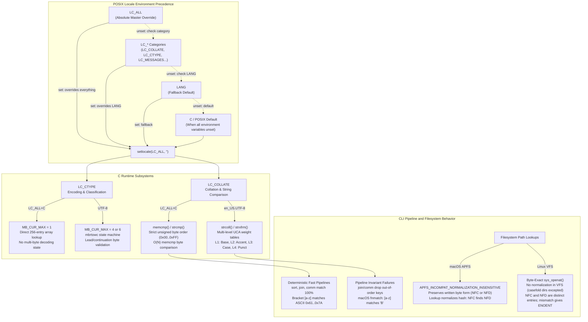
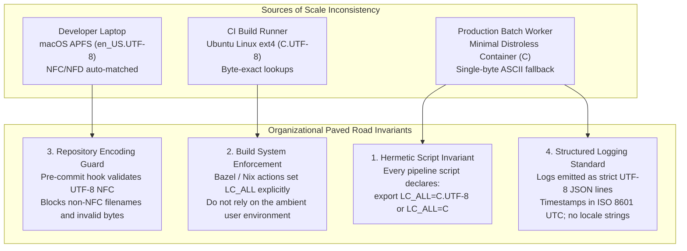

# Locale, Collation, and Unicode in CLI Tools

> [!summary] Claim:
> POSIX environment variable precedence (LC_ALL overriding LC_* categories, which override LANG) configures the C runtime through setlocale(LC_ALL, "").
> LC_CTYPE governs single-byte versus multi-byte character boundary validation (MB_CUR_MAX=1 under C versus multi-byte decoding under UTF-8), while LC_COLLATE governs multi-level string comparison weights (strcoll and strxfrm) versus raw unsigned byte comparisons (strcmp and memcmp).
> In human language locales, multi-level collation interleaves uppercase and lowercase letters and ignores punctuation at primary weights, which lets bracket ranges like [a-z] match uppercase letters in some implementations (macOS libc fnmatch; not glibc 2.28+) and makes join and comm drop rows when inputs were sorted under a different locale, silently on macOS and with a late "input is not in sorted order" exit 1 on GNU.
> Filename normalization diverges across operating systems: macOS HFS+ forced decomposed NFD on disk, macOS APFS preserves raw bytes while matching normalization-insensitively via hashed directory keys, and Linux stores and matches opaque byte sequences (typically NFC) without normalization except in ext4 and f2fs casefold directories, creating cross-platform ENOENT defects.



## The Mechanism

Every standard command-line utility begins execution in the default single-byte `"C"` (or `"POSIX"`) locale.
Under the ISO C and POSIX.1-2024 specifications, a process does not inherit the ambient internationalization environment until its `main()` function explicitly invokes `setlocale(LC_ALL, "")`.
Until that call executes, the C runtime assumes 7-bit ASCII semantics where every byte represents an independent character and `MB_CUR_MAX` equals 1.
Once `setlocale(LC_ALL, "")` executes, libc parses the environment to bind category-specific localization tables into the process address space.

### 1. Environment Variable Precedence and the Locale Hierarchy

POSIX defines an exact three-tier precedence hierarchy for resolving the locale configuration of each category:

1. **`LC_ALL`**: If defined and non-empty, its value unconditionally overrides all other locale environment variables across every category.
   No individual category setting can supersede `LC_ALL`.
2. **`LC_*` Specific Categories**: If `LC_ALL` is unset or empty, libc inspects the specific category variable for the subsystem being queried:
   - `LC_CTYPE`: Character encoding, multi-byte character decoding, classification (`isalpha`, `isdigit`), and case mapping (`tolower`, `toupper`).
   - `LC_COLLATE`: Collation sequence, string ordering (`strcoll`, `strxfrm`, `wcscoll`), regular expression bracket ranges, and shell pattern matching.
   - `LC_MESSAGES`: Natural language translations for diagnostic output, errors, and interactive affirmative/negative responses.
   - `LC_NUMERIC`: Decimal radix separator and thousands grouping characters.
   - `LC_TIME`: Date and time formatting strings used by `strftime` and `date`.
   - `LC_MONETARY`: Currency formatting symbols and grouping.
3. **`LANG`**: If both `LC_ALL` and the category-specific variable are unset or empty, the value of `LANG` provides the default locale.
4. **System Default**: If `LC_ALL`, the specific category variable, and `LANG` are all unset or empty, "the implementation-defined default locale shall be used" (XBD 8.2); with an empty environment, `setlocale(LC_ALL, "")` returned `C` on both macOS 27.2 and glibc 2.39 (verified, as of 2026-11).

The difference between `C`, `POSIX`, and `C.UTF-8` is critical in modern toolchains:
- `C` and `POSIX`: Synonymous in POSIX.1-2024.
  Specifies 7-bit ASCII character handling.
  Byte values from 128 through 255 have unclassified, single-byte implementation-defined behavior.
  Collation follows ASCII order for the portable characters, with the remaining characters after them in ascending coded value (XBD Chapter 7, POSIX locale `LC_COLLATE`).
- `C.UTF-8`: Standardized upstream in glibc 2.35 (2022); it is not part of POSIX.1-2024, where Austin Group bug 1548 ("Addition of a POSIX.utf-8 locale") is still New and Open (as of 2026-11).
  In glibc it provides the unlocalized message behavior of the `C` locale with "full code-point sorting for all valid Unicode code points" and UTF-8 in `LC_CTYPE`, but `fnmatch`, `regcomp`, and `regexec` support only ASCII-based range expressions (glibc 2.35 NEWS, bug 28255).

### 2. `LC_CTYPE` Internals and Multi-Byte Character Parsing

The `LC_CTYPE` category controls how raw byte streams are partitioned into characters and how character classes are evaluated.
Under `LC_ALL=C`, character classification is implemented as an $O(1)$ direct array lookup:

```c
/* Conceptually in glibc and BSD libc ctype.h */
#define isalpha(c) (__ctype_b_loc()[(int)(c)] & _ISalpha)
```

Because `MB_CUR_MAX` equals 1 under `LC_ALL=C`, libc never performs multi-byte validation.
A stream of bytes is processed linearly without checking for UTF-8 boundary framing.

When `LC_CTYPE` is set to a UTF-8 locale (such as `en_US.UTF-8` or `C.UTF-8`), `MB_CUR_MAX` expands to 4 on macOS and to 6 in glibc (verified: macOS 27.2 lab recording, and glibc 2.39 in an Ubuntu 24.04 container for both `C.UTF-8` and `en_US.UTF-8`, as of 2026-11).
CLI tools that inspect individual characters must invoke POSIX restartable conversion functions such as `mbrtowc(3)` or internal state machine loops.
Each code point requires validating:
1. Leading byte prefixes: 1-byte (`0x00..0x7F`), 2-byte (`0xC2..0xDF`), 3-byte (`0xE0..0xEF`), or 4-byte (`0xF0..0xF4`).
2. Continuation bytes: exactly $N-1$ bytes matching the bitmask pattern `10xxxxxx` (`0x80..0xBF`).
3. Rejection of overlong encodings (e.g., encoding ASCII NUL as `0xC0 0x80`).
4. Rejection of UTF-16 surrogate halves (`U+D800..U+DFFF`) and values exceeding `U+10FFFF`.

This boundary validation introduces significant CPU overhead in stream processing tools like [[Ripgrep-Internals-and-Fast-Text-Search]], [[Sed-and-Awk-Stream-Processing]], and GNU `grep`.
When processing ASCII text inside a UTF-8 locale, `grep` must continuously verify that bytes are not trailing fragments of an incomplete multi-byte sequence, which adds per-byte work that a plain byte search does not need.

### 3. `LC_COLLATE` and Multi-Level Collation Weight Tables

String sorting in standard Unix tools is governed by `LC_COLLATE`.
Under `LC_ALL=C`, string comparison is identical to `strcmp()` or `memcmp()`:
Strings are scanned byte by byte as unsigned 8-bit integers (`uint8_t`).
The first byte position where $s1[i] \neq s2[i]$ establishes the total ordering based strictly on numeric value ($0 \dots 255$).
This is a strict total order, requires zero memory allocations, and compares bytes with a single memcmp-style loop.

Under a human language locale like `en_US.UTF-8`, string comparison is governed by `strcoll()` and `wcscoll()`, whose tables follow the multi-level model of ISO/IEC 14651 and its Unicode counterpart, the Unicode Collation Algorithm (UTS #10); glibc compiles its tables from `iso14651_t1_common`, while macOS libc ships its own compiled `LC_COLLATE` tables, so the two disagree in detail.
Collation tables compiled by `localedef` map characters to multi-level weight vectors:

$$\text{Weight}(s) = \left[ w_1, w_2, w_3, w_4 \right]$$

1. **Level 1 (Primary / Alphabetic):** Maps characters to their base alphabetic identity, ignoring case, diacritics, and accents.
   For example, `a`, `A`, `a-acute` (U+00E1), and `A-acute` (U+00C1) all share the identical Level 1 weight.
2. **Level 2 (Secondary / Diacritic):** Evaluates accents and diacritical marks (e.g., `a` vs `a-acute` U+00E1).
3. **Level 3 (Tertiary / Case):** Evaluates uppercase versus lowercase distinctions (`a` vs `A`).
4. **Level 4 (Quaternary / Punctuation):** Handles punctuation, spaces, and hyphens under "shifted" variable weighting rules.
5. **Tie-Breaker:** Evaluates raw binary code point representation if all weights are identical.

To perform sorting, libc provides `strxfrm(dest, src, n)`, which translates a string into an encoded collation key.
A collation key concatenates all Level 1 weights for the entire string, followed by a delimiter byte, followed by all Level 2 weights, a delimiter byte, and Level 3 weights.
In glibc the delimiter is `0x01` (verified by dumping the `"Apple"` key in glibc 2.39); the macOS key uses a different, printable-byte encoding.
Comparing two collation keys with `strcmp()` yields the exact ordering specified by `strcoll()`.

Because collation keys must encode multiple passes over the input string, `strxfrm()` introduces massive space expansion.
Transforming the 5-byte ASCII string `"Apple"` in `en_US.UTF-8` produces a 33-byte collation key on macOS (lab recording) and a 41-byte key on glibc 2.39 (lab run in an Ubuntu 24.04 container with `en_US.UTF-8` generated, as of 2026-11).
Furthermore, because primary weights are evaluated across the entire string before secondary or tertiary weights are considered, case differences are deferred until the end of the string.
Consequently, in `en_US.UTF-8`, `a` and `A` interleave:
Lowercase `apple` sorts before uppercase `Apple`, but `Apple 100` sorts before `apple 200` because the primary difference between `1` and `2` overrides the tertiary case difference between `A` and `a`.

### 4. Relational Pipeline Invariants: `sort`, `join`, and `comm`

The relational CLI tools [[Structured-Data-Wrangling-Jq-Yq-and-Coreutils]], specifically `join` and `comm`, require input streams to be ordered according to the comparison function the tool itself executes.
Both utilities implement a single-pass streaming merge:

```c
/* Conceptually in GNU coreutils join.c */
int cmp = keycmp(line1, line2);
if (cmp < 0) {
    get_line1();
} else if (cmp > 0) {
    get_line2();
} else {
    output_joined_record();
}
```

This streaming algorithm has linear $O(N + M)$ time complexity, but it relies on an unbroken mathematical invariant:
If line $A$ precedes line $B$ in file 1, and line $B$ precedes line $C$, then keycmp($A$, $C$) must be strictly negative.
When files are sorted under mismatched locales, this invariant collapses:

- If `file1` is sorted under `LC_ALL=en_US.UTF-8` and `file2` is sorted under `LC_ALL=C`, their keys follow completely different orderings.
- In `file1` (`en_US.UTF-8`, whole-line sort), `Apple 100` precedes `apple 300` (the primary weights of `1` and `3` decide before case is consulted), and both precede `Banana 200` and `banana 400` (verified with macOS `sort` 2.3-Apple and GNU `sort` 9.4).
- In `file2` (`C`), `Apple` (0x41) precedes `Banana` (0x42), which precedes `apple` (0x61).
- `LC_ALL=C join file1 file2` pairs `Apple`, then reads `apple` from `file1` and compares it with `Banana` in `file2`.
  Because `apple` > `Banana` in ASCII, `join` advances `file2` past `Banana` to `apple` and pairs it.
- When `file1` subsequently yields `Banana`, `file2` is already positioned at `banana`, and `Banana` < `banana`.
  `join` concludes that `Banana` does not exist in `file2`.
- Result: `Banana` is omitted from the joined output.
  BSD `join` on macOS exits 0 with no warning; GNU `join` (coreutils 9.4) still prints the same three rows, then reports `join: f1_en:3: is not sorted: Banana 200` and `join: input is not in sorted order` and exits 1 (both verified, as of 2026-11).

GNU Coreutils `sort` contains an internal optimization in `src/sort.c`:
It queries `hard_LC_COLLATE = hard_locale(LC_COLLATE)`.
When running under `LC_ALL=C`, `hard_LC_COLLATE` is false, and `sort` executes a direct `memcmp()` loop.
When `hard_LC_COLLATE` is true, `compare()` calls `xmemcoll0()` instead of `memcmp()`, which makes sorting slower by a factor that depends on the data, the locale, and the libc, so time your own input with `time` under both locales before quoting a number.

### 5. Regular Expression Bracket Range Semantics: `[a-z]` vs `[[:lower:]]`

A major trap in shell scripting [[Robust-Shell-Scripting-and-ShellCheck]] and pattern matching [[Shell-Parsing-Tokenization-and-Expansion-Order]] is the range expression inside bracket expressions (`[a-z]`).
Under POSIX.1-2024 (XBD Section 9.3.5 and XCU Section 2.14), range expressions in non-POSIX locales have unspecified behavior:

> "In other locales, a range expression has unspecified behavior: strictly conforming applications shall not rely on whether the range expression is valid ..."

In the POSIX/C locale, `[a-z]` represents the contiguous set of ASCII code points from 0x61 (`a`) through 0x7A (`z`).
Uppercase `B` (0x42) is numerically smaller than 0x61 and is never matched.

In an internationalized locale like `en_US.UTF-8`, POSIX historically defined a range expression `[a-z]` as matching any character that collates between `a` and `z` according to the current `LC_COLLATE` sequence.
Because dictionary collation interleaves characters (`a`, `A`, `b`, `B`, `c`, `C`, ... `y`, `Y`, `z`), the collation sequence places `B` between `a` and `z`:

$$\text{Collation Sequence: } a < A < b < B < c < C \dots < y < Y < z$$

As verified in the lab, libc `fnmatch("[a-z]", "B", 0)` on macOS under `en_US.UTF-8` returns 0 (MATCH).
This is implementation-specific: macOS `regcomp`/`regexec` with `^[a-z]$` and BSD `grep` 2.6.0 do not match `B`, and glibc 2.28 reordered Latin lowercase and uppercase so that "A is not matched by [a-z]" (glibc 2.28 NEWS); glibc 2.39 `fnmatch` and `regexec` and GNU `grep` all return NOMATCH for `B` in `en_US.UTF-8` (all verified, as of 2026-11).
To mitigate this portability hazard, Bash 4.3 (2014) introduced the shell option `shopt -s globasciiranges`.
It is off by default in Bash 4.3 and 4.4 and on by default since Bash 5.0 (verified in the `bash:4.3`, `bash:4.4`, and `bash:5.0` images); when set, bracket ranges in globbing, `case`, and `[[ ... == ... ]]` use code point order regardless of `LC_COLLATE`.
It does not govern `[[ ... =~ ... ]]`, which hands the pattern to libc `regcomp`.
If `shopt -u globasciiranges` is executed, `[[ B == [a-z] ]]` evaluates to true under macOS `en_US.UTF-8` (verified with Bash 5.3.15); `BASH_COMPAT=4.2` does not turn the option off (verified), and macOS `/bin/bash` 3.2.57 has no such option and matches `B` (verified).
In portable POSIX scripts, engineers must always use POSIX character classes: `[[:lower:]]`, `[[:upper:]]`, `[[:alpha:]]`, and `[[:digit:]]`.

### 6. Filesystem Unicode Normalization: macOS (HFS+ / APFS) vs Linux

When CLI tools create, search, and delete files [[File-Discovery-and-Batch-Execution-Find-Fd-Xargs-Parallel]], path strings are transmitted to the kernel via system calls such as `openat(2)`, `stat(2)`, and `getdents64(2)` / `getdirentries(2)`.
How the filesystem layer interprets Unicode code points is a primary source of cross-platform defects between macOS and Linux.

The Unicode Consortium specifies four standard normalization forms (UAX #15):
- **NFC (Normalization Form C):** Canonical Decomposition followed by Canonical Composition.
  Characters with accents are represented as single, precomposed code points wherever possible.
  For example, `e-acute` is represented as the single code point `U+00E9` (encoded in UTF-8 as the two bytes `0xC3 0xA9`).
- **NFD (Normalization Form D):** Canonical Decomposition.
  Characters are decomposed into base characters and separate combining marks.
  For example, `e-acute` is decomposed into ASCII base character `e` (`U+0065`, byte `0x65`) followed by the combining acute accent mark (`U+0301`, bytes `0xCC 0x81`), totaling three UTF-8 bytes.

The architectural differences between operating system kernels are sharp (the Linux casefold exception is described below):

```
Linux Kernel VFS (ext4, XFS, btrfs):
  App path bytes: [0x65, 0xCC, 0x81] (NFD) ---> sys_openat() ---> Exact Byte Match Only
  App path bytes: [0xC3, 0xA9]       (NFC) ---> sys_openat() ---> Exact Byte Match Only
  (NFC and NFD form two distinct directory entries and distinct inodes in the same directory)

macOS Kernel VFS (APFS):
  App path bytes: [0x65, 0xCC, 0x81] (NFD) ---\
                                               +--> Normalized Key Hash ---> Matches Single Inode
  App path bytes: [0xC3, 0xA9]       (NFC) ---/     (On-disk record preserves original bytes)

macOS Legacy Kernel VFS (HFS+):
  App path bytes: [0xC3, 0xA9] (NFC) ---> Decomposed on Write ---> Stored on disk as NFD only
```

- **Linux Kernel VFS (ext4, XFS, btrfs):**
  The Linux kernel treats filenames as arbitrary, opaque byte sequences terminated by a NUL byte (`\0`) and containing no slash (`/`).
  The VFS layer performs no Unicode normalization.
  The exception is a directory with the casefold attribute (`chattr +F`) on an ext4 or f2fs filesystem created with the `utf8` encoding feature (ext4 since Linux 5.2), where the filesystem's own hash and compare operations match names after Unicode normalization and case folding.
  If an application creates a file named with NFC bytes (`0xC3 0xA9`), Linux stores exactly `0xC3 0xA9`.
  If another application attempts to open that file using NFD bytes (`0x65 0xCC 0x81`), the lookup fails with `ENOENT` (verified: `os.path.exists` on the NFD name returned `False` in a Linux container, as of 2026-11).
  Both `file_NFC` and `file_NFD` can coexist simultaneously within the exact same Linux directory as two independent inodes.
- **macOS Legacy HFS+ (TN1150):**
  Apple HFS+ implemented an aggressive, destructive decomposition policy known as "HFS Plus decomposed form" (TN1150: Mac OS X 10.3 and later use decompositions based on Unicode 3.2; Mac OS 8.1 through 10.2.x used Unicode 2.1).
  Whenever a user space tool called `open(..., O_CREAT)` with an NFC filename, HFS+ intercepted the path and converted all composed characters into NFD on disk.
  Directory enumeration always returned NFD byte streams.
- **macOS APFS (Apple File System):**
  APFS revised this architecture.
  In the APFS volume format specification, volumes set the volume superblock incompatible-feature flag `APFS_INCOMPAT_NORMALIZATION_INSENSITIVE` (`0x00000008ULL`; value confirmed in linux-apfs-rw `apfs_raw.h`).
  APFS is **normalization-preserving**:
  When a file is created using NFC bytes, APFS stores the exact NFC bytes in the directory record.
  However, APFS is **normalization-insensitive**:
  Directory records (`j_drec_hashed_key_t`) index files using a hash computed over the normalized form of the filename.
  When an application queries `open("item_NFD")`, APFS computes the hash of the normalized string, matches the directory entry created with `item_NFC`, and successfully opens the file.
- **The Git Cross-Platform Collision:**
  To prevent repository corruption when sharing trees between macOS and Linux, Git provides the `core.precomposeunicode` configuration setting.
  Introduced in Git 1.7.12 (release notes), `core.precomposeunicode=true` instructs Git to convert decomposed filenames returned by `readdir(3)` and given on the command line to NFC, so that NFC paths are recorded in the index and trees.
  It has no built-in default: when the setting is absent, `git init` and `git clone` run `probe_utf8_pathname_composition()`, which writes `true` into the repository config if an NFC name is reachable through its NFD spelling (APFS and HFS+ volumes), and an unset value leaves names unconverted (`compat/precompose_utf8.c`).
  If an engineer disables this setting or uses third-party tooling that commits raw NFD paths, Linux CI environments checking out the tree create NFD files that break build scripts and compilers expecting standard NFC paths.

## Commands and Numbers to Know

| Item / Setting | Default / Value | Platform and Date | Operational Role & Mechanism |
| :--- | :--- | :--- | :--- |
| `LC_ALL` | Unset | Both (as of 2026-11) | Top-tier master override; supersedes all `LC_*` category settings and `LANG` |
| `LANG` | System-dependent | Both (as of 2026-11) | Fallback default when `LC_ALL` and specific `LC_*` variables are unset |
| `LC_COLLATE` | Unset / Inherited | Both (as of 2026-11) | Controls `strcoll`, `strxfrm`, regex ranges, and sort order across CLI tools |
| `LC_CTYPE` | Unset / Inherited | Both (as of 2026-11) | Controls character classification, multi-byte decoding state, and `MB_CUR_MAX` |
| `MB_CUR_MAX` (`LC_ALL=C`) | `1` byte | Both (as of 2026-11) | Maximum byte width per character in single-byte POSIX ASCII mode |
| `MB_CUR_MAX` (UTF-8) | `4` B (macOS) / `6` B (glibc) | Both (as of 2026-11) | Maximum multi-byte sequence width evaluated by libc conversion functions |
| `C.UTF-8` | Builtin locale | Linux / Both (as of 2026-11) | Upstream in glibc 2.35, not in POSIX.1-2024 (Austin bug 1548 open); code point collation with UTF-8 encoding, ASCII-only ranges |
| `shopt -s globasciiranges` | `on` (Bash 5.0+); `off` in 4.3-4.4 | Both (as of 2026-11) | Forces glob and `[[ == ]]` bracket ranges into C locale order, ignoring `LC_COLLATE`; absent in macOS `/bin/bash` 3.2 |
| `core.precomposeunicode` | No built-in default; `git init`/`clone` probe writes `true` on APFS/HFS+ | macOS (as of 2026-11) | Converts macOS decomposed NFD filenames to NFC before storing in Git index |
| `APFS_INCOMPAT_NORMALIZATION_INSENSITIVE` | `0x00000008ULL` | macOS (as of 2026-11) | APFS superblock flag establishing normalization-insensitive directory lookups |
| `sort --debug` | Flag | Both (as of 2026-11) | GNU `sort` annotates key spans; macOS `sort` 2.3-Apple also accepts it and prints the active collation locale (verified) |
| `sort -c` / `sort -C` | Flag | Both (as of 2026-11) | Validates that an input file is sorted under the current locale without outputting data |
| `PYTHONUTF8` | Unset; UTF-8 Mode auto-on in the C/POSIX locale (3.7+, PEP 540) and on by default from 3.15 (PEP 686) | Both (as of 2026-11) | `1` forces UTF-8 stdio and filesystem encoding; `0` disables UTF-8 Mode |
| `PYTHONCOERCECLOCALE` | Unset (coercion on, PEP 538) | Both (as of 2026-11) | Python 3.7+ coerces a legacy `C`/`POSIX` `LC_CTYPE` to `C.UTF-8`, `C.utf8`, or `UTF-8` unless `LC_ALL` is set; `0` disables, `warn` warns |
| `rg --no-unicode` | Flag | Both (as of 2026-11) | Disables Unicode mode in ripgrep regexes; `rg --help` (15.2.0) says Unicode mode "can sometimes have a negative impact on performance", notably heavy `\w` use; no general multiplier is documented |
| `strxfrm` expansion ratio | ~6.6x (macOS) to 8.2x (glibc) | Both (as of 2026-11) | Memory expansion ratio converting 5-byte ASCII string to multi-level collation key |

## Multi-Language Comparison: C++ / Python / Rust

| Language Concern | C++ (C++20 / glibc / libc++) | Python (Python 3.12+ / PEP 538 / PEP 540) | Rust (Rust 1.82+ / `std`) |
| :--- | :--- | :--- | :--- |
| String Encoding Guarantee | None; `std::string` is raw bytes; `std::u8string` (`char8_t`) added in C++20 | `str` is a sequence of code points (lone surrogates allowed, which `surrogateescape` relies on); invalid bytes rejected by a strict decode | `String` and `&str` are guaranteed valid UTF-8; `String::from_utf8` returns `Err` on invalid input |
| Ambient Locale Binding | Inherits `"C"` at boot; requires explicit `std::setlocale()` or `std::locale("")` | Bound at startup; PEP 538 coerces `C` to `C.UTF-8`; PEP 540 enables UTF-8 mode | Ignores libc locale entirely; runtime assumes UTF-8 for string operations |
| OS Path & Filename Handling | `std::filesystem::path` converts via native encoding or `u8path` | `os.PathLike` / `str` uses `surrogateescape` (PEP 383) to preserve undecodable bytes | `std::ffi::OsString` and `&OsStr`; Unix extension `OsStrExt` exposes raw bytes |
| Collation & Sorting Primitive | `std::collate<char>::compare` or `strcoll()`; `operator<` performs byte `memcmp` | `list.sort()` and `<` use Unicode code point order; `locale.strxfrm` for collation | `Ord` on `&str` uses lexicographical Unicode code point order; a collation crate such as ICU4X `icu_collator` for locale collation |
| Character Classification | `std::isalpha` in `<cctype>` uses locale; `std::iswalpha` for wide chars | `str.isalpha()` uses full Unicode Character Database (UCD), not libc locale | `char::is_alphabetic()` queries Unicode Character Database (UCD) tables |
| Environment Override Controls | Programmatic `std::locale::global()` or setting `LC_ALL` in environment | `PYTHONUTF8=1` (PEP 540) or `-X utf8`; `PYTHONCOERCECLOCALE=warn` | Pure application logic; `bstr` crate for byte-oriented text without Unicode checks |

## Worked Lab Example

The reproducible lab is located in `code/01-Command-Line/locale_collation_bench/`.
It contains an inspection utility written in C (`locale_bench.c`), a pipeline verification script in Python (`pipeline_test.py`), and a master execution runner (`run.sh`).

`locale_bench.c` compiles via `"${CC:-cc}" -O2 -Wall -Wextra` and executes four programmatic checks:
1. It validates the environment variable resolution hierarchy by defining `LANG=en_US.UTF-8` and `LC_COLLATE=en_US.UTF-8` while pinning `LC_ALL=C`, proving via `setlocale(LC_ALL, "")` that `LC_ALL` overrides lower tiers and resets `MB_CUR_MAX` to 1.
2. It executes `strcmp("a", "A")` versus `strcoll("a", "A")` in `en_US.UTF-8`, proving that binary ASCII ordering (`'a'` 97 > `'A'` 65) is inverted under human collation rules where lowercase collates before uppercase.
3. It passes `"[a-z]"` and `"B"` to `fnmatch(3)` under `C` and `en_US.UTF-8`, demonstrating that POSIX bracket range matching in non-C locales matches uppercase characters due to collation sequence interleaving.
4. It calls `strxfrm(3)` on `"Apple"` in `C` versus `en_US.UTF-8`, measuring the exact byte expansion of multi-level collation keys.

The lab declares `# requires: macos` because it needs the `en_US.UTF-8` locale and an APFS volume; the Linux numbers quoted in this note were run separately in an Ubuntu 24.04 container (glibc 2.39, coreutils 9.4) and are not recorded by the lab.
Every section also asserts its own mechanism and exits non-zero when it is absent (a flipped locale, a swapped argument, or a wrong input file fails the lab).

`pipeline_test.py` then executes the downstream command-line pipeline verifications:
5. It sorts eight test keys (`Apple`, `apple`, `Banana`, `banana`, `a-1`, `a1`, `b-1`, `b1`) under `LC_ALL=C sort` versus `LC_ALL=en_US.UTF-8 sort`, recording the divergence between ASCII block sorting and dictionary interleaving.
6. It runs `join` on two relational files: when both are sorted in `LC_ALL=C`, all 4 rows join cleanly; when file 1 is sorted in `en_US.UTF-8` and file 2 is sorted in `C`, `join` silently drops the `Banana` record because the keys are out of order; the lab computes the dropped key by set difference and prints the `join` exit status (0 for BSD `join`).
7. It runs `comm -12` on the `en_US.UTF-8`-sorted and `C`-sorted copies of file 1, showing that the intersection omits `Banana 200` (computed by set difference) and printing the exit status (0 for BSD `comm`); GNU `comm` exits 1 with "input is not in sorted order" (verified in the Linux container, outside the lab).
8. It writes a file named with precomposed NFC bytes (`item_\u00e9.txt`), verifies that macOS APFS allows opening it via decomposed NFD bytes (`item_e\u0301.txt`), verifies via `os.listdir` that APFS preserved the raw NFC bytes on disk, and prints the raw hex representations of both spellings; it does not itself exercise Linux, where the same lookup fails with `FAILURE` (verified in a Linux container, outside the lab).

Execute the lab directly:

```bash
cd code/01-Command-Line/locale_collation_bench
bash run.sh
```

### Verified output

Recorded on `darwin-arm64` on 2026-11-07 via `python3 -m _harness.verify --record 01-Command-Line/locale_collation_bench/` and validated with `python3 -m _harness.verify`:

```text
=== 1. Environment Precedence and Multibyte Character Width ===
Precedence test (LC_ALL=C overriding LC_COLLATE and LANG):
  Resolved locale: C
  MB_CUR_MAX: 1
UTF-8 locale test (LC_ALL=en_US.UTF-8):
  Resolved locale: en_US.UTF-8
  MB_CUR_MAX: 4

=== 2. Collation Sequence vs Binary Byte Order ===
Binary strcmp("a", "A") in ASCII order: a > A (ASCII 'a'=97 > 'A'=65)
Locale strcoll("a", "A") in en_US.UTF-8: a < A (lowercase before uppercase)

=== 3. POSIX Bracket Range Pattern Matching (fnmatch) ===
fnmatch("[a-z]", "B") in C locale: NOMATCH
fnmatch("[a-z]", "B") in en_US.UTF-8 locale: MATCH

=== 4. Collation Key Transformation Overhead (strxfrm) ===
strxfrm("Apple") in C locale: transformed_len=5, raw_len=5 (ratio=1.0x)
strxfrm("Apple") in en_US.UTF-8: transformed_len=33, raw_len=5 (multi-level expansion)

=== 5. CLI Tool Collation Order (sort) ===
LC_ALL=C sort order:
  Apple
  Banana
  a-1
  a1
  apple
  b-1
  b1
  banana
LC_ALL=en_US.UTF-8 sort order:
  a-1
  a1
  apple
  Apple
  b-1
  b1
  banana
  Banana

=== 6. Relational Join Integrity Across Sort Locales (join) ===
Matching LC_ALL=C sort and join: 4/4 rows matched
  Apple 100 fruit
  Banana 200 fruit
  apple 300 fruit
  banana 400 fruit
Mismatched sort locales in join: 3/4 rows matched (silent data loss)
  Apple 100 fruit
  apple 300 fruit
  banana 400 fruit
Dropped record keys (computed): Banana
join exit status with out-of-order input (BSD join on macOS): 0

=== 7. Set Intersection Integrity (comm) ===
Mismatched sort locales in comm -12: 3/4 common rows detected
  Apple 100
  apple 300
  banana 400
Dropped common records (computed): Banana 200
comm exit status with out-of-order input (BSD comm on macOS): 0

=== 8. Filesystem Unicode Normalization (macOS APFS) ===
APFS lookup via decomposed NFD path: SUCCESS
APFS on-disk directory record preserved form: NFC (raw bytes intact)
In-memory raw byte equality: False
  NFC UTF-8 bytes: 6974656d5fc3a92e747874 (11 bytes)
  NFD UTF-8 bytes: 6974656d5f65cc812e747874 (12 bytes)
```

### Reading the result

- In Section 1, `LC_ALL=C` completely suppresses the active `LC_COLLATE=en_US.UTF-8` and `LANG=en_US.UTF-8` settings, forcing `MB_CUR_MAX` down to 1 byte per character.
  When switched to `en_US.UTF-8`, `MB_CUR_MAX` expands to 4 bytes on macOS (and 6 on Linux glibc).
- In Section 2, `strcmp("a", "A")` produces a positive value because ASCII 97 exceeds 65.
  Under `strcoll()`, the ordering inverts: `a` collates before `A`, proving that human language collation sequence diverges from binary ASCII code point order.
- In Section 3, `fnmatch("[a-z]", "B", 0)` returns `NOMATCH` in the `C` locale but returns `MATCH` (0) under macOS `en_US.UTF-8`.
  Because uppercase `B` collates between lowercase `a` and lowercase `z` in the macOS table, macOS `fnmatch` bracket ranges capture uppercase characters; the same lab on glibc 2.39 prints `NOMATCH` here, because glibc 2.28 reordered its table so ranges do not interleave.
- In Section 4, `strxfrm()` on the 5-byte word `"Apple"` in the `C` locale produces a 5-byte key (an exact 1.0x copy).
  In `en_US.UTF-8`, the same 5-byte string expands into a 33-byte multi-level collation key (and 41 bytes on Linux glibc).
  This 6.6x to 8.2x memory expansion explains why locale-aware sorting consumes substantial CPU memory bandwidth.
- In Section 5, `sort` in `LC_ALL=C` groups all uppercase letters (`Apple`, `Banana`) at the top of the file before any lowercase letters.
  In `LC_ALL=en_US.UTF-8`, keys are grouped alphabetically by base letter, interleaving lowercase `apple` directly ahead of uppercase `Apple` (glibc 2.39 produces the identical order).
- In Section 6 and Section 7, the silent pipeline corruption is laid bare:
  When both files are sorted in `C`, `join` matches all 4 records.
  When file 1 is sorted in `en_US.UTF-8` and file 2 is sorted in `C`, `join` emits only 3 rows and silently drops `Banana 200 fruit`.
  Similarly, `comm -12` fails to detect `Banana 200` in the set intersection.
  Both utilities return exit code 0 on macOS without error messages, creating undetected data corruption in data pipelines (the lab prints both exit statuses).
  GNU `join` and `comm` emit the same rows but warn and exit 1, which only helps if the pipeline checks the status.
- In Section 8, the macOS APFS normalization engine is demonstrated:
  Opening the file via decomposed NFD bytes (`item_e\u0301.txt`) succeeds against the file created with precomposed NFC bytes (`item_\u00e9.txt`).
  Directory reading confirms that APFS stored the original NFC bytes (`69 74 65 6d 5f c3 a9 2e 74 78 74`, 11 bytes) rather than converting to NFD as HFS+ did.
  However, in memory, the raw bytes do not match the 12-byte NFD sequence (`69 74 65 6d 5f 65 cc 81 2e 74 78 74`), which is why a byte-exact Linux host fails to locate the file (the Linux container run prints `FAILURE` for the NFD lookup).

## Pitfalls

> [!warning] Pitfall: Assuming sort, join, and comm share default collation in automation
> Shell scripts that execute `sort file.txt | uniq` or feed sorted streams to `join` or `comm` frequently inherit the user's ambient workstation locale.
> If one file was generated by a backend batch job running in a container under `LC_ALL=C`, while another was sorted on an engineer's laptop under `en_US.UTF-8`, relational commands drop records; BSD `join` and `comm` on macOS exit 0 silently, and GNU `join` and `comm` warn and exit 1 only after emitting the incomplete output.
> Every script performing relational data wrangling [[Structured-Data-Wrangling-Jq-Yq-and-Coreutils]] must explicitly export `LC_ALL=C` at the script header.

> [!warning] Pitfall: Using bracket ranges [a-z] to validate lowercase inputs
> Writing glob patterns such as `case $input in [a-z])` or `[[ $input == [a-z] ]]` under human language locales can let uppercase characters like `B` through `Y` pass validation where the matcher follows an interleaved collation table: macOS libc `fnmatch`, macOS `/bin/bash` 3.2, and Bash with `globasciiranges` off (all verified on macOS 27.2).
> Regex engines differ: GNU `grep`, BSD `grep` 2.6.0, macOS `regcomp`, and glibc 2.28+ `regcomp` did not match `B` with `[a-z]` in `en_US.UTF-8` (verified), but POSIX leaves the result unspecified, so do not rely on it.
> In POSIX shell scripts, always use standard character classes `[[:lower:]]` or enforce `LC_COLLATE=C`.
> In Bash 4.3+ scripts, ensure `shopt -s globasciiranges` remains active for globs; it does not cover `[[ =~ ]]`.

> [!warning] Pitfall: Multi-level collation key inversion in whole-line sorting
> When sorting multi-column tabular data without specifying a restricted key definition (e.g., running `sort file.tsv` instead of `sort -k1,1 file.tsv`), `LC_COLLATE=en_US.UTF-8` evaluates Level 1 weights across the entire line before evaluating Level 3 case differences in column 1.
> A line starting with `Apple 100` will sort ahead of `apple 200` because the primary difference between `1` and `2` in column 2 overrides the case difference in column 1.
> Always restrict sorting keys explicitly with `-k` and pin `LC_ALL=C`.

> [!warning] Pitfall: Filename encoding divergence between macOS and Linux in CI/CD
> A developer on macOS creates a file containing accented characters (e.g., `cafe.py` with an accented `e`).
> If Git is configured with `core.precomposeunicode=false` and the name reaches Git in decomposed form (HFS+ `readdir`, or a tool that created the file as NFD), Git records decomposed NFD byte sequences (`e` + `\xcc\x81`) in the tree.
> When a Linux CI runner checks out the repository on an ext4 filesystem, it creates files using those raw NFD bytes.
> Python scripts or build tools referencing the file using standard NFC UTF-8 (`\xc3\xa9`) fail with `ENOENT` because the Linux VFS requires exact byte matches.
> Monorepos must enforce `core.precomposeunicode=true` and execute pre-commit linters rejecting decomposed Unicode paths.

> [!warning] Pitfall: Silent Python UnicodeEncodeError in containerized log parsing
> Running Python scripts in bare Docker containers where no locale is defined leaves the process in the `C` locale.
> Python 3.7+ normally rescues this with PEP 538 coercion and PEP 540 UTF-8 Mode (and 3.15 enables UTF-8 Mode by default, PEP 686), but before 3.7, or when `PYTHONUTF8=0` is set and coercion is skipped (`LC_ALL=C` exported or `PYTHONCOERCECLOCALE=0`), printing non-ASCII characters to `sys.stdout` raises `UnicodeEncodeError: 'ascii' codec can't encode character` (verified with `LC_ALL=C PYTHONUTF8=0 PYTHONCOERCECLOCALE=0` on Python 3.15.2).
> Dockerfiles must install and configure `C.UTF-8` or export `PYTHONUTF8=1` in their environment stanzas.

> [!warning] Pitfall: throughput loss in multi-gigabyte log triage
> Running text filters like `grep`, `awk`, or `sed` over multi-gigabyte log files under `LC_ALL=en_US.UTF-8` forces the regex and libc engines to execute multi-byte UTF-8 character boundary validation on every line.
> Pinning `LC_ALL=C` instructs the tool to operate on raw bytes, bypassing multibyte decoding such as `mbrtowc`, which can speed up log scanning substantially (the gain depends on the tool version and the pattern, so measure on your data) as mastered in [[Analyze-Gigabyte-Terminal-Logs]].

## At Scale

At the scale of 1,000 to 50,000 engineers operating thousands of microservices across heterogeneous development machines (macOS APFS laptops, Windows WSL2 workstations, and Linux Kubernetes clusters), ambient locale drift is a primary cause of non-deterministic builds and silent data corruption.



### Monorepo and CI/CD Decision Rules

1. **Hermetic Environment Stripping:**
   Build systems (such as Bazel or Nix [[Nix-Store-Derivations-and-Flakes-Internals]]) should not let ambient `LANG`, `LC_*`, and `LC_ALL` from developer shells reach build actions.
   Bazel's `--incompatible_strict_action_env` (default true as of 2026-11) gives actions a static `PATH` and no `LD_LIBRARY_PATH`, and `--action_env=NAME` inherits a chosen variable from the client (Bazel command-line reference).
   Nix passes derivation attributes to the builder as environment variables (Nix manual, derivations), so set the locale as an explicit attribute.
   Neither tool injects a locale for you: the repository rule is to set `LC_ALL=C.UTF-8` or `LC_ALL=C` explicitly in the build action, which is a configuration choice and not a built-in default.
   This guarantees that code generation tools, dictionary compilers, and bundle packagers produce byte-for-byte identical output regardless of the host machine's configuration.
2. **Repository Path Normalization Enforcement:**
   Monorepo pre-receive hooks must inspect all incoming file paths in Git tree objects.
   The hook must reject any commit containing filenames that:
   - Are not valid UTF-8.
   - Are not in Unicode Normalization Form C (NFC).
   - Differ from another existing path only by Unicode normalization form or case.
   This prevents developers on macOS APFS from accidentally committing NFD filenames that break Linux CI containers.
3. **Data Pipeline Collation Standard:**
   For all batch analytics, data lakes, and ETL pipelines involving relational file operations (`sort`, `join`, `comm`, `awk`):
   - **Internal Processing Standard:** All intermediate files and pipeline stages must execute strictly under `LC_ALL=C`.
     This ensures deterministic sorting, avoids multi-level collation overhead, eliminates key-inversion bugs, and maximizes throughput.
   - **Presentation Layer Exception:** Collation according to human language locales (`LC_COLLATE=en_US.UTF-8`, `de_DE.UTF-8`) must be deferred exclusively to the final presentation or reporting tier where human UI ordering is explicitly required.
4. **Structured Logging and Metric Telemetry:**
   Applications must never emit locale-dependent timestamps (e.g., using localized month names like "Maerz") or locale-dependent decimal numbers (e.g., using commas `12,5` instead of periods `12.5`).
   All logging frameworks must emit structured JSON formatted strictly with ISO 8601 UTC timestamps (`YYYY-MM-DDTHH:MM:SSZ`) and standard decimal points.

## Practice Drill

> [!tip] Practice Drill: Reproduce Relational Pipeline Data Loss and Diagnose Collation Keys
>
> Construct a reproduction script that demonstrates silent record omission in `join` and inspect the underlying collation keys with `hexdump` and GNU `sort --debug`.
>
> 1. In a temporary directory, create two relational data files with mixed-case keys:
>    `file1.txt`: `Apple 100`, `Banana 200`, `apple 300`, `banana 400`.
>    `file2.txt`: `Apple fruit`, `Banana fruit`, `apple fruit`, `banana fruit`.
> 2. Sort `file1.txt` using `LC_ALL=en_US.UTF-8 sort` and save to `f1_en.txt`.
> 3. Sort `file2.txt` using `LC_ALL=C sort` and save to `f2_c.txt`.
> 4. Execute `LC_ALL=C join f1_en.txt f2_c.txt` and observe that `Banana` is omitted; the exit status is 0 with macOS BSD `join`, while GNU `join` warns `input is not in sorted order` and exits 1.
> 5. Run GNU `sort --debug` (or inspect via `strxfrm`) on both files to observe how `en_US.UTF-8` defers case resolution, inverting the order of `apple` and `Banana`.
> 6. Remediate the pipeline by prepending `export LC_ALL=C` across all sort and join steps, confirming that all 4 rows join cleanly.
> 7. Create a file with NFC bytes `test_\xc3\xa9.txt` and execute `python3 -c 'import os; print(os.path.exists("test_e\u0301.txt"))'` (in a Python `str` literal, `"\xcc\x81"` would be two unrelated code points, not the combining accent).
>    Confirm that on macOS APFS this prints `True`, whereas in a Linux container it prints `False`.

```bash
#!/usr/bin/env bash
set -euo pipefail

WORK_DIR=$(mktemp -d)
trap 'rm -rf "${WORK_DIR}"' EXIT
cd "${WORK_DIR}"

cat << 'EOF' > file1.txt
Apple 100
Banana 200
apple 300
banana 400
EOF

cat << 'EOF' > file2.txt
Apple fruit
Banana fruit
apple fruit
banana fruit
EOF

# Sort under mismatched locales
LC_ALL=en_US.UTF-8 sort file1.txt -o f1_en.txt
LC_ALL=C sort file2.txt -o f2_c.txt

echo "=== Mismatched sort files ==="
echo "--- f1_en.txt (en_US.UTF-8) ---"
cat f1_en.txt
echo "--- f2_c.txt (C) ---"
cat f2_c.txt

echo "=== Silent Data Loss in join ==="
LC_ALL=C join f1_en.txt f2_c.txt || true

echo "=== Corrected Pipeline (LC_ALL=C throughout) ==="
LC_ALL=C sort file1.txt -o f1_c.txt
LC_ALL=C join f1_c.txt f2_c.txt
```

## Interview Questions

> [!question] L5: What is the exact precedence hierarchy of LC_ALL, LANG, and the LC_* category variables in a POSIX system?
>
> > [!success]- Answer
> > The POSIX locale resolution hierarchy follows a strict three-tier cascade:
> > 1. `LC_ALL` is the absolute master override; if defined and non-empty, it supersedes all category-specific variables and `LANG`.
> > 2. Category-specific variables (`LC_COLLATE`, `LC_CTYPE`, `LC_MESSAGES`, `LC_NUMERIC`, `LC_TIME`, `LC_MONETARY`) govern their respective subsystems if `LC_ALL` is unset or empty.
> > 3. `LANG` provides the fallback default for any category whose specific `LC_*` variable is unset, provided `LC_ALL` is also unset.
> > If all three tiers are unset or empty, the implementation-defined default locale is used (XBD 8.2), which is `"C"` on both macOS and glibc (verified with an empty environment).
> > A process does not inherit these environment settings until it explicitly calls `setlocale(LC_ALL, "")`.

> [!question] L5: Why does `LC_ALL=C sort` run significantly faster than sorting under `LC_ALL=en_US.UTF-8` on a large text file?
>
> > [!success]- Answer
> > In `LC_ALL=C`, string comparison is a simple, direct unsigned byte comparison equivalent to `memcmp()`.
> > Because `MB_CUR_MAX` equals 1, the engine does not perform multi-byte character boundary validation, and the comparison reduces to a plain byte comparison.
> > Under `LC_ALL=en_US.UTF-8`, `sort` must implement multi-level collation weighting (UTS #10 / ISO 14651).
> > Every string must either be transformed into a collation key via `strxfrm()` or compared across multiple passes (Level 1 base characters, Level 2 accents, Level 3 case, Level 4 punctuation).
> > Generating and comparing multi-level collation keys expands key sizes by 6x to 8x (33 and 41 bytes for the 5-byte `"Apple"` on macOS and glibc 2.39) and introduces heavy memory allocation and cache misses, making human locale sorting slower than the byte-order path (the factor depends on data and libc, and is not claimed here; measure on the target data).

> [!question] L6: Predict the output: What happens when `file1` is sorted with `LC_ALL=en_US.UTF-8` and `file2` is sorted with `LC_ALL=C`, and they are merged using `LC_ALL=C join file1 file2`?
>
> > [!success]- Answer
> > `join` relies on a single-pass streaming merge with $O(N + M)$ complexity, assuming both input files are strictly ordered by the comparison predicate `join` executes.
> > With the drill data, `file1` (`en_US.UTF-8`, whole-line sort) orders `Apple 100`, `apple 300`, `Banana 200`, `banana 400`: the digits decide at the primary level before case is consulted, so lowercase `apple` lands before uppercase `Banana`.
> > In `file2` (`C`), uppercase `Apple` (0x41) and `Banana` (0x42) sort before lowercase `apple` (0x61).
> > `LC_ALL=C join` pairs `Apple`, then reads `apple` from `file1` and compares it with `Banana` in `file2`.
> > In ASCII, `apple` > `Banana`, so `join` scans `file2` forward past `Banana` to find `apple`.
> > When `file1` subsequently emits `Banana`, `file2` is at `banana`, so `file2` has already passed `Banana`.
> > `join` assumes `Banana` is absent from `file2` and drops the record.
> > The output contains `Apple`, `apple`, and `banana`, but `Banana` is omitted; macOS BSD `join` exits 0 silently, while GNU `join` 9.4 reports `input is not in sorted order` and exits 1 after printing the same three rows (both verified).

> [!question] L6: Why can the regex bracket expression `[a-z]` match the uppercase letter `B` in some Unix environments, and how do modern systems prevent this?
>
> > [!success]- Answer
> > Under POSIX.1-2024, range expressions in non-POSIX locales have unspecified behavior because they are evaluated using the collation sequence defined by `LC_COLLATE`.
> > In human language locales like `en_US.UTF-8`, collation interleaves lowercase and uppercase letters (`a < A < b < B < c < C ... < z`).
> > Because `B` collates after `a` and before `z` in such a table, a matcher that evaluates ranges by collation treats `B` as falling inside the inclusive range `[a-z]`; macOS libc `fnmatch` does this in `en_US.UTF-8` (verified), while glibc 2.39 does not.
> > Modern systems prevent this in several ways:
> > 1. Bash 4.3 introduced `shopt -s globasciiranges` (off by default in 4.3 and 4.4, on by default since 5.0), forcing bracket ranges in globs, `case`, and `[[ == ]]` into C locale order; it does not affect `[[ =~ ]]`.
> > 2. Standardized POSIX scripts use character classes `[[:lower:]]`, which query `LC_CTYPE` rather than collation ranges.
> > 3. glibc 2.28 adjusted the Latin lowercase and uppercase ordering so that "A is not matched by [a-z]", and glibc 2.35 `C.UTF-8` supports only ASCII-based range expressions in `fnmatch`, `regcomp`, and `regexec` (glibc NEWS).

> [!question] L7: Debug this: An engineer reports that a Python application imports an accented module `caf\u00e9.py` successfully on macOS developer laptops, but fails in a Linux Docker container with `ModuleNotFoundError: No module named 'caf\u00e9'`.
> What is the root cause and how do you resolve it?
>
> > [!success]- Answer
> > The defect is caused by Unicode normalization divergence between macOS APFS and Linux filesystems:
> > The Git tree records the path in decomposed NFD bytes (`cafe` + combining acute accent `\xcc\x81`), for example because it was added from an HFS+ volume or an NFD-producing tool while `core.precomposeunicode` was `false` or unset, while the developer's macOS working copy holds the NFC name.
> > Because macOS APFS is normalization-insensitive (`APFS_INCOMPAT_NORMALIZATION_INSENSITIVE`), an `lstat` of the NFD index path finds the NFC file, so the mismatch is invisible locally.
> > Python's import system is stricter than `open()`: `importlib`'s `FileFinder` checks module names against an `os.listdir` cache, so an NFD-named `cafe\u0301.py` on APFS raises `ModuleNotFoundError` for `import caf\u00e9` even on macOS (verified on macOS 27.2 with Python 3.15.2); the import works on macOS only because the on-disk name there is NFC.
> > In the Linux Docker container, the ext4 filesystem stores the file using the exact NFD bytes.
> > The Linux VFS does not normalize filenames; it performs strict byte-exact matching.
> > When the Python interpreter on Linux requests `caf\u00e9.py` (encoded as NFC `\xc3\xa9`), `openat()` fails with `ENOENT`, raising `ModuleNotFoundError`.
> > Fix:
> > 1. Enable `git config core.precomposeunicode true` on macOS workstations.
> > 2. Run a repository normalization script: `convmv -f utf-8 -t utf-8 --nfc --notest filename.py` or use a Python script with `unicodedata.normalize('NFC', name)` to rename the file to NFC in the Git index.
> > 3. Install a pre-commit hook in CI that validates that all filenames conform strictly to Unicode NFC.

> [!question] L7: How does multi-level collation weighting in ISO 14651 cause whole-line sorting to violate primary key sorting, and how does `sort -k` fix it?
>
> > [!success]- Answer
> > Collation engines evaluate multi-level weights sequentially across the entire comparison string: Level 1 (base alphabetic) is evaluated first across all characters, followed by Level 2 (diacritics), Level 3 (case), and Level 4 (punctuation).
> > When `sort file.tsv` runs without key definitions, the entire line is treated as a single comparison string.
> > If line 1 is `Apple 100` and line 2 is `apple 200`:
> > At Level 1, `Apple` and `apple` have identical weights (`a-p-p-l-e`).
> > The engine continues scanning the rest of the line at Level 1, comparing `100` against `200`.
> > Because `1` < `2` at Level 1, `Apple 100` is determined to sort before `apple 200` before the Level 3 case difference in column 1 is ever evaluated.
> > This inverts the primary key sort order: column 2 has overridden column 1.
> > Running `sort -k1,1 file.tsv` restricts the comparison string strictly to field 1.
> > The engine completes Level 1 through Level 3 evaluations exclusively on field 1, ordering `apple` before `Apple`, and preventing subsequent columns from corrupting key order.

> [!question] L8+: Design an organizational paved road for a 30,000-engineer engineering fleet that prevents locale, collation, and Unicode normalization bugs across macOS and Linux development environments.
>
> > [!success]- Answer
> > An enterprise paved road requires enforcement across four architectural boundaries:
> > 1. **Hermetic Build Toolchains:**
> >    Configure the build system (Bazel / Nix) to strip all ambient user environment variables (`LANG`, `LC_*`, `LC_ALL`) from test and build actions.
> >    Inject `LC_ALL=C.UTF-8` into every build and test sandbox, ensuring that code generators and bundle packagers run identically on macOS and Linux.
> > 2. **Repository Integrity Gateways:**
> >    Implement a pre-receive hook in the central Git forge that inspects every updated tree object.
> >    The hook must reject any commit containing:
> >    - Filenames that are not valid UTF-8.
> >    - Filenames containing non-NFC Unicode (decomposed NFD or compatibility forms).
> >    - Case-insensitive collisions (two files whose lowercase names collide), preventing checkouts on macOS APFS.
> >    Enforce `git config --system core.precomposeunicode true` via mobile device management (MDM) on all macOS developer laptops.
> > 3. **Scripting and Pipeline Standards:**
> >    Enforce via an internal linter that all bash automation scripts declare `export LC_ALL=C` or `export LC_ALL=C.UTF-8` in their preamble; ShellCheck has no rule for this (`SC2034` flags unused variables and `SC2154` flags referenced but unassigned ones), so run it alongside ShellCheck rather than through it.
> >    All batch sorting and relational pipelines must default to `LC_ALL=C`, reserving human locale collation strictly for reporting UI layers.
> > 4. **Runtime Container Baseline:**
> >    Standardize base container images to include the `C.UTF-8` locale by default, eliminating legacy `C` locale ASCII crashes in Python (`PYTHONUTF8=1`) and Node.js.
> >    Mandate ISO 8601 UTC timestamps and period decimal formatting in all logging and metric SDKs.

> [!question] L8+: Contrast the internal mechanisms of the Linux VFS and macOS APFS when resolving path lookups containing decomposed Unicode characters.
>
> > [!success]- Answer
> > In the Linux kernel VFS (`fs/namei.c`):
> > Paths passed to `sys_openat()` are treated as opaque, null-terminated byte strings (`char *`).
> > The path walk hashes each component's raw bytes with `hash_name()` in `fs/namei.c`, which is designed to match `full_name_hash()` (`fs/namei.c`, `include/linux/stringhash.h`), and the dcache (`d_lookup` in `fs/dcache.c`) indexes dentries by that hash.
> > Filesystem implementations (ext4, XFS, btrfs) store directory entries (`struct ext4_dir_entry_2`) containing raw byte names.
> > Unless the filesystem installs its own `d_hash`/`d_compare` dentry operations, a lookup succeeds if and only if the name bytes compare equal (length plus `memcmp`).
> > The generic path resolution has no Unicode awareness; NFC and NFD strings have different lengths and different byte sequences, resulting in different hash buckets and independent dentries and directory entries.
> > The exception is ext4 and f2fs casefold directories (`chattr +F` on a filesystem with the `utf8` encoding feature), whose dentry operations hash and compare names after Unicode normalization and case folding.
> > In macOS APFS:
> > APFS volume superblocks define the feature flag `APFS_INCOMPAT_NORMALIZATION_INSENSITIVE` (`0x00000008ULL`).
> > When storing directory records (`j_drec_hashed_key_t`), APFS retains the exact byte representation provided by user space in the directory record name field (normalization-preserving).
> > However, the B-tree search key hash is computed over the normalized Unicode form of the string (normalization-insensitive).
> > When a lookup occurs, the VFS / APFS layer computes the normalized hash of the lookup string, traverses the directory B-tree, and matches any record whose normalized representation matches, allowing an NFD path lookup to resolve an NFC on-disk record transparently.

## Further Reading

- The Open Group and IEEE, "Locale (XBD Chapter 7)", IEEE Std 1003.1-2024: The authoritative normative standard for POSIX locale categories, environment precedence, and C.UTF-8 standardization.
- Mark Davis and Ken Whistler, "Unicode Standard Annex #15: Unicode Normalization Forms": The formal specification defining NFC, NFD, NFKC, NFKD, and canonical equivalence algorithms.
- Mark Davis and Ken Whistler, "Unicode Technical Standard #10: Unicode Collation Algorithm": The definitive specification for multi-level collation weighting, variable weighting (shifted punctuation), and collation key generation.
- Apple Inc., "Apple File System Reference": Details the APFS volume format, `APFS_INCOMPAT_NORMALIZATION_INSENSITIVE` flag, and normalized directory record hashing.
- Apple Computer Inc., "HFS Plus Volume Format (Technical Note TN1150)": Documents the legacy HFS Plus decomposed Unicode filesystem implementation.
- Chet Ramey, "Bash Reference Manual (Edition 5.2): The Shopt Builtin": Normative documentation for `globasciiranges` and POSIX pattern matching behavior.
- Jim Meyering et al., "GNU Coreutils Manual: sort invocation": Explains GNU `sort` keys, `--debug` key diagnostics, and stability invariants; the `hard_LC_COLLATE` fast path itself lives in `src/sort.c`.
- Andrew Gallant, "ripgrep User Guide and Architecture: Unicode and Performance": Practical deep-dive into the performance costs of Unicode regex matching versus raw byte scanning in CLI search tools.

## Related

- Prerequisites: [[Shell-Parsing-Tokenization-and-Expansion-Order]], [[Structured-Data-Wrangling-Jq-Yq-and-Coreutils]]
- Next: [[Analyze-Gigabyte-Terminal-Logs]]
- See also: [[19-Shell-and-Unix-Engineering/07-Regex-and-Text-Processing/Locale-and-LC_ALL|Locale and LC_ALL]], [[19-Shell-and-Unix-Engineering/07-Regex-and-Text-Processing/Unicode-and-UTF-8-in-Text-Tools|Unicode and UTF 8 in Text Tools]], [[19-Shell-and-Unix-Engineering/08-Coreutils-and-the-Userland/Userland-Portability-Traps|Userland Portability Traps]], [[19-Shell-and-Unix-Engineering/08-Coreutils-and-the-Userland/sort-Keys-and-Stability|sort Keys and Stability]]
- Lab: `code/01-Command-Line/locale_collation_bench/` (requires: macos)
