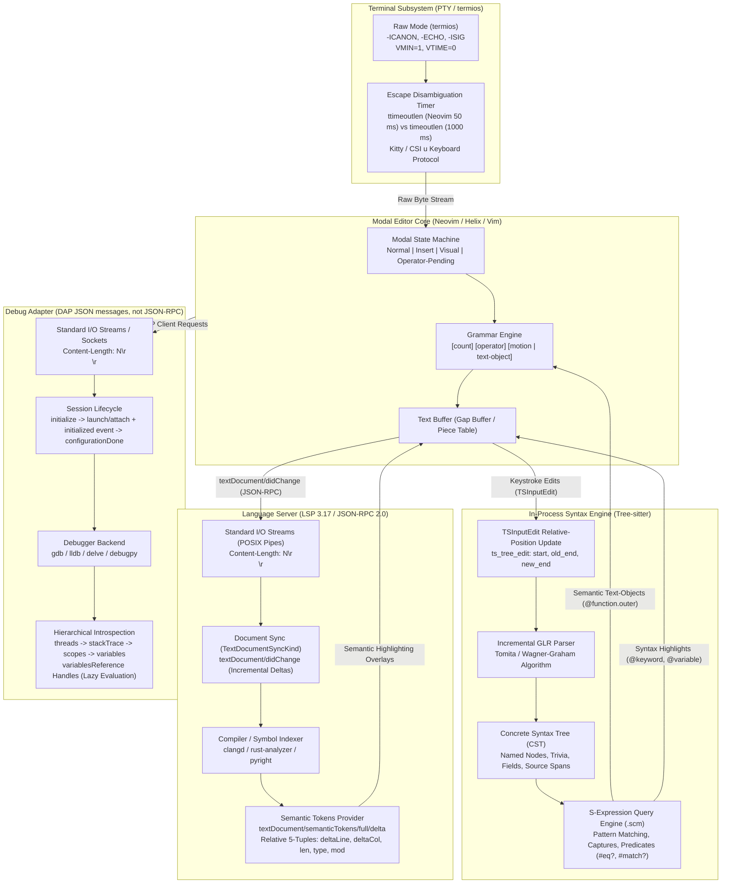

# Modal Editing, LSP, Tree-Sitter, and DAP

> [!summary] Claim:
> Terminal modal editing composes an operator-pending grammar over raw-mode PTY character streams, decoupling motion from mutation.
> Modern terminal editors elevate this text buffer into a structured IDE by combining three decoupled components: Tree-sitter parses concrete syntax trees (CST) via incremental GLR so that a localized edit re-parses in well under a frame on typical file sizes, enabling highlighting and syntactic text-objects; Language Server Protocol (LSP 3.17, current 3.18) standardizes out-of-process semantic analysis over JSON-RPC 2.0 via incremental document synchronization and relative integer 5-tuple token arrays; and Debug Adapter Protocol (DAP, its own JSON message protocol rather than JSON-RPC) coordinates process execution and hierarchical variable introspection via object handles valid only while the debuggee is suspended.
> Together, these protocols replace monolithic editor internals with a composable, language-agnostic architecture executing over standard POSIX pipes.



## The Mechanism

Modern developer workstations rely on terminal-based editors such as Neovim and Helix that achieve IDE-grade code comprehension without monolithic compilation engines embedded in the editor process.
This separation is made possible by four interacting layers: the terminal PTY interface and modal grammar, in-process Tree-sitter incremental parsing, Language Server Protocol (LSP) semantic indexing, and Debug Adapter Protocol (DAP) runtime orchestration.
Every protocol and data structure described below is documented against its authoritative standard, including POSIX.1-2024, LSP 3.17, DAP, and the Tree-sitter C API.

### 1. Terminal PTY Mechanics, Raw Mode, and Modal Grammar

Terminal applications communicate with the kernel terminal driver through a pseudo-terminal (PTY) pair, which POSIX.1-2024 calls the manager and subsidiary devices (formerly master and slave; `posix_openpt`); the subsidiary appears as `/dev/pts/N` on Linux and `/dev/ttysNNN` on macOS.
By default, the subsidiary PTY operates in canonical mode: the kernel line discipline buffers input bytes until the user transmits a newline, handles line-editing characters like backspace locally, and echoes typed glyphs back to the display.
A modal editor cannot function in canonical mode because it must intercept individual keypresses instantaneously to drive its finite state machine.

```
+-------------------------------------------------------------------------------+
|                        Kernel PTY Line Discipline                             |
|                                                                               |
|   Canonical Mode (Default Shell):                                             |
|   Input Bytes -> [Kernel Buffer: "git commti\b\bit\n"] -> Read returns line   |
|                                                                               |
|   Non-Canonical / Raw Mode (Editor):                                          |
|   termios.c_lflag &= ~(ICANON | ECHO | ISIG | IEXTEN);                        |
|   termios.c_iflag &= ~(IXON | ICRNL | BRKINT | INPCK | ISTRIP);              |
|   termios.c_cc[VMIN] = 1; termios.c_cc[VTIME] = 0;                            |
|   Input Byte  -> Kernel passes byte immediately -> read(stdin, buf, 1) returns|
+-------------------------------------------------------------------------------+
```

To enter raw mode, the editor executes `tcgetattr(STDIN_FILENO, &orig_termios)` and applies `tcsetattr(STDIN_FILENO, TCSAFLUSH, &raw_termios)`.
The raw configuration clears specific bitmasks across terminal flag fields defined in POSIX.1-2024:
- `c_lflag &= ~(ICANON | ECHO | ISIG | IEXTEN)` disables line buffering (`ICANON`), character echo (`ECHO`), kernel signal generation on control characters (`ISIG`, which intercepts `Ctrl-C` as `SIGINT` and `Ctrl-Z` as `SIGTSTP`), and extended input processing (`IEXTEN`).
- `c_iflag &= ~(IXON | ICRNL | BRKINT | INPCK | ISTRIP)` disables software flow control (`IXON`, which halts output on `Ctrl-S`), carriage return translation to newline (`ICRNL`), break condition signaling (`BRKINT`), parity checking (`INPCK`), and eight-bit stripping (`ISTRIP`).
- `c_oflag &= ~(OPOST)` disables post-processing of output characters, preventing the kernel from automatically translating `\n` into `\r\n`.
- `c_cc[VMIN] = 1` and `c_cc[VTIME] = 0` configure blocking single-character reads: `read(STDIN_FILENO, buf, 1)` yields as soon as one byte enters the PTY buffer.

#### Escape Sequence Ambiguity and Timers

In raw mode, pressing the physical `Escape` key transmits ASCII byte `0x1B` (`\x1b`).
However, ANSI control sequences generated by arrow keys, function keys, and mouse events also begin with `0x1B`, followed by a Control Sequence Introducer (CSI, `[`).
For example, the up arrow key emits `\x1b[A` in normal cursor-key mode and `\x1bOA` in application cursor-key mode, which full-screen editors usually enable (Vim `:help vt100-cursor-keys`).
Because standard POSIX standard streams provide no framing metadata to distinguish an intentional press of the `Escape` key from the leading byte of a multi-byte escape sequence, editors implement two cooperating timers:
- `timeoutlen` (default 1000 ms in both Vim and Neovim, as of 2026-11): The maximum time allowed between consecutive keystrokes in a multi-key mapped sequence or leader chord (e.g. `<space>` followed by `f`).
- `ttimeoutlen` (Neovim default 50 ms; Vim default -1, meaning "use `timeoutlen`", set to 100 ms by `defaults.vim`, as of 2026-11): The maximum delay the editor will wait after receiving ASCII `0x1B` before deciding whether the following bytes represent an incoming terminal key code or an isolated exit from Insert mode.
If subsequent bytes arrive before `ttimeoutlen` expires, the stream decoder processes the bytes as a terminal escape sequence; if the timer expires, the editor executes an immediate mode switch to Normal mode.

Legacy ASCII encoding carries another severe limitation: `Ctrl-I` transmits ASCII 9 (`\t`), `Ctrl-M` transmits ASCII 13 (`\r`), and `Ctrl-[` transmits ASCII 27 (`\x1b`).
A legacy terminal cannot differentiate a tab keypress from `Ctrl-I`, preventing independent keybindings.
Modern terminal protocols, including the Kitty Keyboard Protocol and the CSI u specification, resolve this by transmitting full modifier bitmasks and raw keycodes (e.g., `CSI 105 ; 5 u` explicitly encodes `Ctrl-i` without colliding with `\t`).
With the Kitty "disambiguate escape codes" flag enabled, the Escape key itself is reported as `CSI 27 u`, so a lone `0x1B` no longer needs a timer to be distinguished from a sequence prefix; Tab, Enter, and Backspace keep their legacy bytes.

#### The Modal Grammar State Machine

Modal editing treats text modification as a formal grammar rather than an unconstrained stream of character insertions.
The modal grammar is driven by five modes (Vim's `:help vim-modes` lists seven basic modes, including Select, Ex, and Terminal-Job, and treats Operator-pending as an additional mode):
- **Normal Mode:** Navigation and command dispatch.
  Keystrokes are interpreted as verbs and nouns.
- **Insert Mode:** Raw text entry.
  Keystrokes insert glyphs directly into the buffer gap or piece table.
- **Visual Mode:** Range selection across character (`v`), line (`V`), or rectangular block (`<C-v>`) boundaries.
- **Operator-Pending Mode:** A transient state entered immediately after an operator verb is executed, awaiting a motion or text-object noun to establish the target range.
- **Command-line Mode:** Ex commands executed from the bottom prompt (`:`).

```
                      +-------------------+
                      |    Insert Mode    |
                      +-------------------+
                        ^               |
            i, a, o, s  |               | <Esc> (ttimeoutlen timer)
                        |               v
+------------------+  <Esc>   +-------------------+  v, V, <C-v>   +-------------------+
|  Command-line    | <======> |    Normal Mode    | <============> |    Visual Mode    |
|  Mode (:)        |    :     +-------------------+     <Esc>      +-------------------+
+------------------+            |               ^                    |
                                | d, c, y, g~   | <Esc> / completion | d, c, y
                                v               |                    v
                              +-------------------+                [Mutate Selected
                              | Operator-Pending  |                Range & Return]
                              +-------------------+
                                        |
                                        | [count] [motion | text-object]
                                        v
                               [Apply Operation to
                                 Calculated Range]
```

The grammar is structured as:

$$\text{Command} = [\text{count}] \times \text{Operator} \times ([\text{count}] \times (\text{Motion} \mid \text{Text-Object}))$$

Operators represent actions: `d` (delete), `c` (change), `y` (yank), `>` (shift right), `<` (shift left), `=` (re-indent through `equalprg` or the indent rules; `gq` is the format operator), and `g~` (toggle case).
Motions represent directional offsets over the buffer: `w` (next word start), `e` (current word end), `b` (previous word start), `$` (line end), `0` (line start), `f{char}` (find character forward), and `%` (matching delimiter).
Text-objects represent semantic regions and are preceded by a modifier: `i` (inner, excluding delimiters) or `a` (around, including delimiters).
Traditional text-objects operate on lexical delimiters: `iw` (inner word), `i"` (string literal interior), `a(` (parenthesized block including parentheses).
Tree-sitter extends this grammar by binding CST query captures to operator-pending text-objects, allowing commands like `vaf` (visual around function) and `cia` (change inner argument); in Neovim these are user mappings onto the `nvim-treesitter-textobjects` plugin's `@function.outer` and `@parameter.inner` captures, while Helix ships them as `maf` and `mia`.

---

### 2. Language Server Protocol (LSP 3.17 / 3.18)

The Language Server Protocol standardizes the interface between text editors and programming language analysis tools.
Before LSP, integrating $M$ editors with $N$ languages required $M \times N$ custom plugins.
LSP reduces this complexity to $M + N$ by introducing a standard out-of-process JSON-RPC 2.0 communication protocol over standard input/output streams or TCP sockets.
Communication is coordinated through [[Pipelines-Subshells-Redirection-and-Process-Substitution]] and monitored for stdio buffering stalls with [[Pipe-Buffering-and-Stdbuf]].

```
+-----------------------------------------------------------------------------------+
|                       LSP Base Protocol Wire Framing                              |
|                                                                                   |
|  Content-Length: 142\r\n                                                          |
|  Content-Type: application/vscode-jsonrpc; charset=utf-8\r\n                      |
|  \r\n                                                                             |
|  {"jsonrpc":"2.0","id":1,"method":"textDocument/completion","params":{...}}      |
+-----------------------------------------------------------------------------------+
```

The protocol mandates HTTP-style header framing terminated by `\r\n\r\n`.
The `Content-Length` header specifies the exact byte size of the subsequent JSON payload encoded in UTF-8.

#### Protocol Lifecycle Handshake

An LSP session executes through three distinct lifecycle phases:

```
Editor (Client)                                          Language Server
      |                                                         |
      | ------------- 1. initialize request (id: 1) ----------> |
      | <------------ 2. InitializeResult (id: 1) ------------- |
      |                                                         |
      | ============= 3. initialized notification =============> |  (Server active)
      |                                                         |
      |                     Session Operation                   |
      |        (didOpen, didChange, completion, semanticTokens) |
      |                                                         |
      | ------------- 4. shutdown request (id: 42) -----------> |
      | <------------ 5. null response (id: 42) --------------- |
      |                                                         |
      | ============= 6. exit notification ===================> |  (Process exits 0)
```

1. **Initialization:** The client issues an `initialize` request transmitting client capabilities (e.g. dynamic registration, workspace folders, supported semantic token formats, and character offset encodings like UTF-8 or UTF-16).
   The server computes its response and returns `InitializeResult` detailing `ServerCapabilities` (such as `textDocumentSync`, `completionProvider`, and `semanticTokensProvider`).
   The client confirms receipt by transmitting an `initialized` notification.
   No editing or analysis requests may be transmitted before `initialized` is sent.
2. **Operation:** Bi-directional exchange of requests, responses, and notifications.
   Requests demand a response with matching `id`.
   Notifications (which lack an `id`) are fire-and-forget.
   If a user types a new character before an expensive compilation completes, the client transmits a `$/cancelRequest` notification carrying the stale request's `id`.
3. **Shutdown and Teardown:** The client transmits a `shutdown` request.
   The spec asks the server to shut down but not exit; it stops accepting new work and returns `null`.
   Finally, the client sends an `exit` notification.
   Per LSP 3.17, "the server should exit with success code 0 if the shutdown request has been received before; otherwise with error code 1."

#### Document Synchronization (`TextDocumentSyncKind`)

When a file is loaded, the client transmits a `textDocument/didOpen` notification containing the full file contents, a URI identifier, and a client-chosen initial integer `version` (the spec mandates no starting value, only that it "will increase after each change").
Subsequent edits are reported via `textDocument/didChange`.
The synchronization strategy is governed by the server's advertised `TextDocumentSyncKind`:
- **`None` (0):** The server maintains no document state.
- **`Full` (1):** The editor sends the entire file contents in a single string on every keystroke.
  On large source files (e.g., 50,000 lines), this incurs massive JSON serialization and deserialization overhead, creating significant keystroke latency.
- **`Incremental` (2):** The editor transmits only the modified textual deltas.

In incremental synchronization, `DidChangeTextDocumentParams` transmits an array of `TextDocumentContentChangeEvent` structures accompanied by an increasing integer `version` (the `rangeLength` field below is `@deprecated use range instead` in LSP 3.17):

```json
{
  "textDocument": {
    "uri": "file:///workspace/engine/core.c",
    "version": 42
  },
  "contentChanges": [
    {
      "range": {
        "start": { "line": 142, "character": 4 },
        "end": { "line": 142, "character": 18 }
      },
      "rangeLength": 14,
      "text": "process_event"
    }
  ]
}
```

The `range` field specifies zero-indexed `start` and `end` positions using `line` and `character` coordinates.
Per the LSP 3.17 specification, `character` represents a UTF-16 code unit offset by default, unless the client and server explicitly negotiate `PositionEncodingKind.UTF8` during the `initialize` handshake.
The spec only requires that the version "will increase after each change, including undo/redo" and states "the number doesn't need to be consecutive", so a gap is not an error; the changes in one notification are applied in array order.
The protocol has no server-to-client request for a full resynchronization: correctness rests on the in-order, reliable stdio or socket transport, and a server that detects a decreasing or repeated version can only log it and keep its last good state, or the client can close and reopen the document.

#### Semantic Tokens Provider and Relative 5-Tuples

Standard syntax highlighters operate on static regex patterns, failing to distinguish between local variables, struct members, template parameters, or macro expansions.
LSP semantic tokens deliver compiler-grade type information directly to the editor buffer.
Transmitting thousands of AST nodes with character coordinates and type strings over JSON-RPC would saturate IPC bandwidth.
LSP optimizes this by flattening tokens into a contiguous `uinteger[]` array (LSP `uinteger` spans 0 to 2^31 - 1), where each token is encoded as a relative 5-tuple:

```
[ deltaLine, deltaStartChar, length, tokenType, tokenModifiers ]
```

1. **`deltaLine`:** Line number offset relative to the *previous* token.
   For the first token in the file, this represents the absolute zero-indexed line number.
2. **`deltaStartChar`:** Starting character offset.
   If `deltaLine == 0` (token is on the same line as the previous token), this offset is relative to the start character of the *previous* token.
   If `deltaLine > 0` (token is on a new line), this offset is relative to column 0 of that new line.
3. **`length`:** Character length of the token.
4. **`tokenType`:** Integer index referencing the `tokenTypes` legend advertised in `InitializeResult.capabilities.semanticTokensProvider.legend` (`ServerCapabilities`, not `serverInfo`).
5. **`tokenModifiers`:** Bitmask where each active bit represents an index in the server-defined `tokenModifiers` legend (e.g. with a legend of `["declaration", "readonly", "static"]`, `1 << 0` is `declaration`, `1 << 1` is `readonly`, `1 << 2` is `static`).

To minimize wire transfer after edits, `textDocument/semanticTokens/full/delta` allows the server to transmit only delta edits against the `previousResultId` the client sends back, replacing spans of integers via `start`, `deleteCount`, and `data` arrays.

---

### 3. Tree-sitter: Incremental GLR Parsing and S-Expression Queries

While LSP provides deep semantic analysis, its out-of-process JSON-RPC round trip plus server-side analysis is asynchronous and has no latency bound in the specification, which makes it a poor fit for keystroke-level syntax highlighting, code indentation, and structural bracket matching.
Tree-sitter solves this by embedding an incremental parser directly into the editor process address space as a C library.
Tree-sitter's documentation cites Tim Wagner's incremental work as its basis: his thesis, Wagner and Graham's "Efficient and Flexible Incremental Parsing" (ACM TOPLAS 20(5):980-1013, 1998), and "Incremental Analysis of Real Programming Languages", which applies incremental parsing to Generalized LR (GLR).

```
+-----------------------------------------------------------------------------------+
|                        Concrete Syntax Tree (CST) Node Layout                     |
|                                                                                   |
|  struct TSNode {                                                                  |
|      uint32_t context[4];                                                         |
|      const void *id;           // Pointer to internal Subtree struct              |
|      const TSTree *tree;       // Owning syntax tree instance                     |
|  };                                                                               |
|                                                                                   |
|  Internal SubtreeHeapData (lib/src/subtree.h, abridged):                          |
|  +-----------------------------------------------------------------------------+  |
|  | uint32_t ref_count     | Length padding         | Length size               |  |
|  |   (Length = { uint32_t bytes; TSPoint extent; }; sizes, not absolute offsets)|  |
|  | uint32_t lookahead_bytes | uint32_t child_count | TSSymbol symbol           |  |
|  | bool named : 1         | bool has_changes : 1   | bool is_missing : 1       |  |
|  | union { child counts / external scanner state / error lookahead char }      |  |
|  +-----------------------------------------------------------------------------+  |
|  Small leaves are stored inline in the Subtree union (SubtreeInlineData).       |
+-----------------------------------------------------------------------------------+
```

#### CST vs AST and Error Recovery

Compilers construct Abstract Syntax Trees (ASTs) by stripping out whitespace, comments, parentheses, and punctuation to optimize code generation.
In contrast, an editor requires a Concrete Syntax Tree (CST):
- **Full Fidelity:** Every byte of the source buffer is preserved, including comments, preprocessor directives, and formatting trivia.
- **Named vs. Anonymous Nodes:** Syntactic structures (e.g. `function_definition`, `identifier`, `binary_expression`) are *named* nodes.
  Punctuation and operators (e.g. `{`, `}`, `;`, `==`, `+`) are *anonymous* nodes.
- **Error Tolerance:** Compilers reject invalid syntax with fatal diagnostics.
  Tree-sitter is designed to parse incomplete or malformed code during active typing.
  When a syntax error occurs, the GLR parser forks parse stacks, inserts simulated `ERROR` or `MISSING` nodes, isolates the broken statement, and resumes parsing subsequent functions cleanly.

#### Incremental Re-Parsing and `TSInputEdit`

When a user modifies a file, re-parsing a 100,000-line document from scratch takes about 190 ms (measured: py-tree-sitter 0.26.0 with tree-sitter-c 0.24.2 on an Apple M3 Pro, 1.56 MB of generated C, median of 9 runs, as of 2026-11, macOS), dropping many terminal frames.
Re-parsing after a one-byte edit by reusing untouched subtrees from the previous syntax tree took about 35 us on a 1,000-line file, 0.35 ms on 10,000 lines, and 5-8 ms on 100,000 lines in the same measurement, so the incremental cost is far below a full parse but still grows with file size.
The process follows two steps:

1. **Coordinate Shifting via `ts_tree_edit`:** Before invoking the parser, the editor informs the existing syntax tree of the edit by passing a `TSInputEdit` descriptor:
   ```c
   typedef struct {
       uint32_t start_byte;
       uint32_t old_end_byte;
       uint32_t new_end_byte;
       TSPoint  start_point;
       TSPoint  old_end_point;
       TSPoint  new_end_point;
   } TSInputEdit;

   void ts_tree_edit(TSTree *tree, const TSInputEdit *edit);
   ```
   `ts_tree_edit` (implemented by `ts_subtree_edit` in `lib/src/subtree.c`) descends only the path of nodes that contain the edit or whose lookahead bytes reach it, marks them dirty (`has_changes = true`), and resizes their `padding` and `size`.
   Because each subtree stores lengths rather than absolute offsets, the loop stops at the first child that starts after `old_end_byte`; later subtrees are not visited at all, and their new absolute positions fall out of the changed lengths when a `TSNode` is computed during traversal.
2. **Subtree Reuse in GLR Parser:** When `ts_parser_parse(parser, old_tree, new_input)` executes, the LR parser pushes states onto its parse stack.
   At each position, before invoking the lexer to read raw tokens, it checks whether the current node in `old_tree` is clean, non-overlapping with the edit range, and valid in the current parser state.
   If so, the parser pushes the entire pre-parsed subtree onto its stack in $O(1)$ time, skipping lexing and parsing for thousands of lines of unaffected code.

#### S-Expression Syntax Queries (`.scm`)

Tree-sitter includes a declarative pattern-matching language based on S-expressions.
Queries navigate the CST, match specific node hierarchies, bind variables via `@captures`, and filter results using predicates:

```scheme
;; Extract C function definitions and identify their core components (tree-sitter-c 0.24.2)
(function_definition
  type: (primitive_type) @return.type
  declarator: (function_declarator
    declarator: (identifier) @function.name
    parameters: (parameter_list
      (parameter_declaration
        type: (primitive_type) @param.type
        declarator: (identifier) @param.name)) @function.parameters)
  body: (compound_statement) @function.body
  (#match? @function.name "^[a-z_]+$")
  (#not-eq? @return.type "void"))
```

Run with py-tree-sitter 0.26.0 against the lab's `example.c`, this query returns 4 matches (one per parameter: `validate_input`, `process_transaction` twice, `log_audit`).
In tree-sitter-c, `function_definition` has only the fields `type`, `declarator`, and `body`; the name and parameters hang off a nested `function_declarator`, so a query using `name:` and `parameters:` directly on `function_definition` compiles but matches nothing (measured: 0 matches).

- **Field Matching:** Patterns match named fields defined in the grammar (e.g. `declarator:`, `parameters:`, `body:`), eliminating brittle positional child indexing.
- **Captures (`@name`):** Associate matched CST nodes with semantic categories.
  Highlight queries map captures like `@keyword`, `@function`, and `@variable` to terminal ANSI color schemes.
  Text-object queries map captures like `@function.outer` and `@function.inner` to modal editing verbs.
- **Predicates:** Enclosed in parentheses starting with `#`.
  Documented predicates include `#eq?`, `#not-eq?`, `#any-eq?`, `#any-not-eq?`, `#match?`, `#not-match?`, `#any-match?`, `#any-not-match?`, and `#any-of?`.
  Per the Tree-sitter docs, "predicates and directives are not handled directly by the Tree-sitter C library"; the C API exposes them in structured form and the bindings or host editor evaluate them.
- **Quantification:** Patterns support standard regular expression quantifiers: `?` (optional), `*` (zero or more), and `+` (one or more).

---

### 4. Debug Adapter Protocol (DAP)

Interactive debugging historically suffered from the same $M \times N$ integration bottleneck as language analysis.
Frontends had to write custom UI drivers for GDB machine interface (GDB/MI), LLDB Python bindings, Delve JSON-RPC, and V8 inspector protocols.
The Debug Adapter Protocol standardizes this interaction over a base protocol that shares LSP's `Content-Length: ...\r\n\r\n` framing but is not JSON-RPC: each JSON message carries a `seq` number and a `type` of `request`, `response`, or `event`, with `command` or `event` naming the operation and `request_seq` linking a response to its request.
DAP handles session orchestration, thread discovery, call stack traversal, and variable inspection, delegating actual machine code execution and hardware breakpoint management to external debug engines.

```
+-----------------------------------------------------------------------------------+
|                        DAP Session Coordination Architecture                      |
|                                                                                   |
|  [ Modal Editor (Client) ]                                                        |
|         |  Content-Length: N\r\n\r\n {"type":"request","command":"stackTrace",...}|
|         v                                                                         |
|  [ DAP Server / Adapter (e.g. lldb-dap, debugpy) ]                                |
|         |  C++ / Python Native API Calls (SBProcess, PTRACE_CONT)                 |
|         v                                                                         |
|  [ Native Debugger Engine (LLDB / GDB / Delve) ]                                  |
|         |  ptrace(2), /proc/<pid>/mem, Hardware Debug Registers (DR0-DR7)         |
|         v                                                                         |
|  [ Target Debugee Process ]                                                       |
+-----------------------------------------------------------------------------------+
```

#### DAP Lifecycle and Breakpoint Configuration

DAP distinguishes between the adapter initialization and the configuration of the debuggee process.
The sequence below is the ordering a client may use; the DAP overview also allows the client to send `launch` or `attach` "at any point after the client receives the capabilities", in which case the adapter delays the `launch`/`attach` response until after it has answered `configurationDone`:

```
Editor (Client)                                          Debug Adapter
      |                                                         |
      | ------------- 1. initialize request (id: 1) ----------> |
      | <------------ 2. InitializeResponse (id: 1) ----------- |
      |                                                         |
      | <============ 3. initialized event ==================== | (Adapter ready for config)
      |                                                         |
      | ------------- 4. setBreakpoints (file, lines) --------> |
      | <------------ 5. setBreakpoints response -------------- |
      | ------------- 6. setExceptionBreakpoints -------------> |
      | <------------ 7. setExceptionBreakpoints response ----- |
      |                                                         |
      | ------------- 8. launch / attach request -------------> |
      | <------------ 9. launch / attach response ------------- |
      |                                                         |
      | ------------- 10. configurationDone request ----------> |
      | <------------ 11. configurationDone response ---------- |
      |                                                         |
      |                 Target Execution Begins                 |
      |                                                         |
      | <============ 12. stopped event (reason: "breakpoint") = |
      |                                                         |
      | ------------- 13. threads request --------------------> |
      | <------------ 14. threads response (threadId: 1) ------ |
      | ------------- 15. stackTrace request (threadId: 1) ---> |
      | <------------ 16. stackFrames [frameId: 100] ---------- |
      | ------------- 17. scopes request (frameId: 100) ------> |
      | <------------ 18. scopes (variablesReference: 1001) --- |
      | ------------- 19. variables (variablesReference: 1001)->|
      | <------------ 20. variables list (name, value, ref) --- |
```

1. **Initialization:** The client issues an `initialize` request specifying client ID, display formatting, and capabilities.
   The adapter replies with `InitializeResponse` detailing its supported feature set (such as `supportsConditionalBreakpoints`, `supportsConfigurationDoneRequest`, and `supportsFunctionBreakpoints`).
2. **Configuration Phase:** The adapter transmits an `initialized` event, signaling that it is ready to receive configuration state.
   The client transmits all user breakpoints via `setBreakpoints` (supplying source paths, line numbers, conditions, and hit conditions), followed by `setFunctionBreakpoints` and `setExceptionBreakpoints`.
3. **Launch and ConfigurationDone:** The client issues a `launch` request (to spawn the debuggee process with specific environment variables and arguments) or an `attach` request (to bind to an existing PID).
   Crucially, if the adapter advertised `supportsConfigurationDoneRequest: true`, the debuggee process remains suspended until the client transmits a `configurationDone` request.
   This prevents a critical race condition where the debuggee executes past an entry breakpoint before the editor finishes transmitting its breakpoint table.
4. **Execution and Stopped State:** When the target process hits a breakpoint or traps a signal, the adapter emits a `stopped` event carrying a `reason` (spec values: `"step"`, `"breakpoint"`, `"exception"`, `"pause"`, `"entry"`, `"goto"`, `"function breakpoint"`, `"data breakpoint"`, `"instruction breakpoint"`, or an adapter-defined string), usually a `threadId`, and optionally `allThreadsStopped: true` when the adapter stopped every thread.

#### Hierarchical Variable Inspection and `variablesReference`

When a debuggee halts inside a large enterprise program, the local scope may contain thousands of objects, nested maps, and cyclic structures.
If the adapter attempted to serialize the entire variable tree inside the `stopped` or `stackTrace` response, the process would exhaust memory or freeze the editor for seconds.
DAP solves this through lazy evaluation using opaque `variablesReference` handles:

```
[scopes Request (frameId: 100)]
  |
  +---> Returns: [ { "name": "Locals", "variablesReference": 1001 } ]
                     |
[variables Request (variablesReference: 1001)]
  |
  +---> Returns:
        - "int status"   : value = "0",  variablesReference = 0     (Primitive leaf)
        - "struct Config": value = "{...}", variablesReference = 1002 (Compound container)
                                            |
[variables Request (variablesReference: 1002)]
  |
  +---> Returns:
        - "char *hostname": value = "\"prod.db\"", variablesReference = 0
```

- When the client requests `scopes(frameId)`, the adapter returns high-level scope descriptors (e.g. `Locals`, `Globals`, `Registers`), assigning each an integer `variablesReference > 0`.
- The client fetches the visible variables by issuing `variables(variablesReference: 1001)`.
- If a variable is a primitive type (such as an integer, float, or boolean), the adapter returns its string `value` and sets `variablesReference = 0`, terminating the branch.
- If a variable is a compound object, struct, array, or pointer, the adapter sets `variablesReference > 0`.
  The editor displays an expandable tree node in the UI and only transmits a child `variables` query if the user explicitly expands that node.
  This bounds data transfer to $O(k)$ where $k$ is the number of currently visible rows in the editor's UI window.
- Per the DAP overview, these object references are valid only while execution is suspended: "Once execution resumes, object references become invalid and DAP clients must not use them", which lets an adapter free its handle table on every resume.

---

## Commands and Numbers to Know

The operational parameters, flag defaults, protocol numbers, and performance limits governing terminal modal editing, LSP 3.17, Tree-sitter, and DAP environments are compiled below (as of 2026-11).

| Subsystem / Protocol | Parameter / Flag / Variable | Default / Reference Value | Target Platform | Architectural Significance |
| :--- | :--- | :--- | :--- | :--- |
| Terminal / PTY | `termios.c_cc[VMIN]` | `1` | Both | Minimum characters required to satisfy non-canonical read; set to 1 for unbuffered event dispatch. |
| Terminal / PTY | `termios.c_cc[VTIME]` | `0` | Both | Inter-byte timeout in deciseconds; set to 0 for blocking single-byte read without polling overhead. |
| Modal Editor | `ttimeoutlen` | Neovim `50 ms`; Vim `-1` (use `timeoutlen`), `100 ms` via `defaults.vim` (as of 2026-11) | Both | Escape key sequence disambiguation timer; bounds delay when exiting Insert mode to Normal mode. |
| Modal Editor | `timeoutlen` | `1000 ms` in Vim and Neovim (as of 2026-11) | Both | Timeout for multi-key mapped sequences, operator-pending chords, and custom leader bindings. |
| tmux | `escape-time` | `10 ms` since tmux 3.5, `500 ms` before (as of 2026-11) | Both | Delay tmux adds before forwarding a lone `0x1B` to the pane. |
| LSP 3.17 | `TextDocumentSyncKind.None` | `0` | Both | Server does not synchronize document changes. |
| LSP 3.17 | `TextDocumentSyncKind.Full` | `1` | Both | Full document text re-sent over JSON-RPC on every edit; causes high CPU overhead on large buffers. |
| LSP 3.17 | `TextDocumentSyncKind.Incremental`| `2` | Both | Only range deltas transmitted; required for low-latency editing in large codebases. |
| LSP 3.17 | `PositionEncodingKind` | `UTF-16` (default), `UTF-8`, `UTF-32` | Both | Wire offset unit; mismatch causes text range corruption on multibyte characters. |
| LSP 3.17 | Semantic Token Tuple | `5 integers` | Both | `[deltaLine, deltaStartChar, length, tokenType, tokenModifiers]` array layout. |
| Tree-sitter | Parse Time (Clean File) | about `190 ms` for 100,000 lines (1.56 MB), `19 ms` for 10,000, `1.8 ms` for 1,000 (as of 2026-11, macOS, Apple M3 Pro) | macOS | Measured full parse with py-tree-sitter 0.26.0 and tree-sitter-c 0.24.2, median of 9 runs. |
| Tree-sitter | Parse Time (Incremental) | about `35 us` (1,000 lines), `0.35 ms` (10,000), `5-8 ms` (100,000) (as of 2026-11, macOS, Apple M3 Pro) | macOS | Measured re-parse after a one-byte edit mid-file with the old tree passed in; grows with file size. |
| Tree-sitter | Grammar Binary Size | `681,136` bytes for the tree-sitter-c 0.24.2 `_binding.abi3.so` (as of 2026-11, macOS arm64) | macOS | Compiled parse tables plus the binding; per-language footprint varies with grammar size. |
| DAP | `supportsConfigurationDoneRequest` | `boolean` (capability flag) | Both | Tells the client to send `configurationDone` once breakpoints and other configuration are set. |
| DAP | `variablesReference` Leaf | `0` | Both | Identifies a primitive variable leaf node; values greater than 0 indicate nested expandable objects. |
| DAP | `stopped` Reason Codes | `"step"`, `"breakpoint"`, `"exception"`, `"pause"`, `"entry"`, `"goto"`, and three breakpoint kinds | Both | Standard execution interruption reasons emitted by debug adapters to frontend clients. |

---

## Multi-Language Comparison

The architectural implementation of Language Server Protocol engines, Tree-sitter grammar parsers, and Debug Adapter Protocol backends diverges across systems programming, scripting, and compiled languages.

| Evaluation Dimension | C / C++ Toolchain | Python Toolchain | Rust Toolchain |
| :--- | :--- | :--- | :--- |
| Standard LSP Server | `clangd` (based on LLVM LibTooling) | `pyright` / `basedpyright` / `pyrefly` (as of 2026-11) | `rust-analyzer` (salsa; switched from Chalk to the next-generation trait solver in October 2025) |
| AST / CST Subsystem | Clang AST (lossy, non-trivia) | CPython AST / LibCST / Ruff AST | `rowan` syntax trees plus salsa incremental queries (rust-analyzer architecture doc, as of 2026-11) |
| Incremental Sync Support | Supports `Incremental` (2); updates TU | Supports `Incremental` (2); re-parses module | Supports `Incremental` (2); memoized queries |
| Background Indexing Model | Background index stored project-locally in `.cache/clangd/index/` next to `compile_commands.json`, with a per-user global cache for files outside a compilation database (clangd indexing design doc, as of 2026-11, Both) | No persistent project index documented; `stubPath` (default `./typings`) holds user-supplied type stubs, not an index (Pyright configuration doc, as of 2026-11, Both) | Salsa demand-driven query computation |
| Tree-sitter Parser Source | `tree-sitter-c`, `tree-sitter-cpp` | `tree-sitter-python` | `tree-sitter-rust` |
| Primary DAP Adapter | `lldb-dap` (formerly `lldb-vscode`); GDB 14+ has a built-in DAP interpreter | `debugpy` (based on `pydevd`) | `codelldb` / `lldb-dap` |
| Debugger Engine | LLDB through its SB API (`lldb-dap`); GDB natively or via GDB/MI | `sys.settrace()` hook, plus a `sys.monitoring` (PEP 669) backend in the vendored pydevd for Python 3.12+ | LLDB / GDB inspecting DWARF debug sections |
| Primary Performance Bottleneck | Header include explosion and macro expansion | GIL contention and large virtualenv walks | Monomorphization compilation and memory usage |

---

## Worked Lab Example

The companion lab in `code/01-Command-Line/treesitter_query_cli/` is a dependency-free, pure-Python model of Tree-sitter's concepts, not the Tree-sitter library: a hand-written recursive-descent parser builds a CST for a C subset, a small matcher runs S-expression queries with captures and predicates, and a demo applies `TSInputEdit` arithmetic, carries the untouched top-level subtrees over as the same objects, lexes and parses only the dirty byte range, and checks the result against a from-scratch parse.
Its tree shape is simplified relative to tree-sitter-c 0.24.2: real tree-sitter-c nests the function name and parameters under `function_declarator` and the initializer under `init_declarator`, and its root spans to `15:0` (281 bytes, including the trailing newline) where the lab reports `14:1` (280 bytes).
The tool is executed directly using the test runner script:

```bash
bash code/01-Command-Line/treesitter_query_cli/run.sh
```

The lab operates on a C source file containing three top-level functions: `validate_input`, `process_transaction`, and `log_audit`.
The test script runs eight commands (one tree dump, five queries, one query that must be rejected, and the incremental demo) and the harness compares their deterministic output (macOS, darwin-arm64) against `expected/darwin-arm64.txt`.

### 1. Concrete Syntax Tree Inspection

The lab first dumps the full Concrete Syntax Tree in S-expression format, showing named nodes, anonymous delimiter tokens, and field bindings (real Tree-sitter's S-expression printer omits anonymous nodes such as `"("` and `";"`):

```text
=== Concrete Syntax Tree (S-expression) ===
(translation_unit (comment) (function_definition type: (primitive_type) name: (identifier) parameters: (parameter_list "(" (parameter_declaration type: (primitive_type) name: (identifier)) ")") body: (compound_statement "{" (declaration type: (primitive_type) declarator: (identifier) "=" value: (number_literal) ";") (return_statement "return" argument: (identifier) ";") "}")) (function_definition type: (primitive_type) name: (identifier) parameters: (parameter_list "(" (parameter_declaration type: (primitive_type) name: (identifier)) "," (parameter_declaration type: (primitive_type) name: (identifier)) ")") body: (compound_statement "{" (declaration type: (primitive_type) declarator: (identifier) "=" value: (number_literal) ";") (return_statement "return" argument: (identifier) ";") "}")) (function_definition type: (primitive_type) name: (identifier) parameters: (parameter_list "(" (parameter_declaration type: (primitive_type) name: (identifier)) ")") body: (compound_statement "{" (declaration type: (primitive_type) declarator: (identifier) "=" value: (number_literal) ";") (return_statement "return" argument: (identifier) ";") "}")))

=== Syntax Tree Node Summary ===
Root: translation_unit [0:0 - 14:1] (280 bytes)
  Child 0: comment [0:0 - 0:44]
  Child 1: function_definition name='validate_input' [1:0 - 4:1]
  Child 2: function_definition name='process_transaction' [6:0 - 9:1]
  Child 3: function_definition name='log_audit' [11:0 - 14:1]
```

### 2. S-Expression Query Execution and Predicates

The lab executes queries that extract function names, parameter types, and filtered variables using `#eq?` and `#match?` predicates.
The `#match?` query uses the valid grouped form `((identifier) @tx_var (#match? @tx_var "^tx_"))`.
The older form `(identifier @tx_var (#match? @tx_var "^tx_"))` puts the capture inside the parentheses, and real Tree-sitter rejects it (py-tree-sitter 0.26.0 raises `QueryError: Invalid syntax at row 0, column 12`); the lab now rejects it too, and the last block below shows the lab's own error and exit status 2.

```text
=== Query Execution: 1 pattern(s) ===
Match #1 (pattern 0):
  @fn.name            [1:4 - 1:18] (identifier): "validate_input"
Match #2 (pattern 0):
  @fn.name            [6:4 - 6:23] (identifier): "process_transaction"
Match #3 (pattern 0):
  @fn.name            [11:4 - 11:13] (identifier): "log_audit"
Total matches: 3

=== Query Execution: 1 pattern(s) ===
Match #1 (pattern 0):
  @param.type         [1:19 - 1:22] (primitive_type): "int"
  @param.name         [1:23 - 1:25] (identifier): "id"
Match #2 (pattern 0):
  @param.type         [6:24 - 6:27] (primitive_type): "int"
  @param.name         [6:28 - 6:33] (identifier): "tx_id"
Match #3 (pattern 0):
  @param.type         [6:35 - 6:38] (primitive_type): "int"
  @param.name         [6:39 - 6:48] (identifier): "tx_amount"
Match #4 (pattern 0):
  @param.type         [11:14 - 11:17] (primitive_type): "int"
  @param.name         [11:18 - 11:28] (identifier): "event_code"
Total matches: 4

=== Query Execution: 1 pattern(s) ===
Match #1 (pattern 0):
  @fn.name            [6:4 - 6:23] (identifier): "process_transaction"
Total matches: 1

=== Query Execution: 1 pattern(s) ===
Match #1 (pattern 0):
  @tx_var             [6:28 - 6:33] (identifier): "tx_id"
Match #2 (pattern 0):
  @tx_var             [6:39 - 6:48] (identifier): "tx_amount"
Total matches: 2

QueryError: Invalid syntax: capture @tx_var inside '(identifier' must follow the closing parenthesis
exit status: 2
```

### 3. Modal Text-Object Extraction

The query `(function_definition body: (compound_statement) @function.inner) @function.outer` isolates the complete function range versus its interior block:

```text
=== Query Execution: 1 pattern(s) ===
Match #1 (pattern 0):
  @function.outer     [1:0 - 4:1] (function_definition): "int validate_input(int id) ..."
  @function.inner     [1:27 - 4:1] (compound_statement): "{     int valid = 1;     re..."
Match #2 (pattern 0):
  @function.outer     [6:0 - 9:1] (function_definition): "int process_transaction(int..."
  @function.inner     [6:50 - 9:1] (compound_statement): "{     int status = 0;     r..."
Match #3 (pattern 0):
  @function.outer     [11:0 - 14:1] (function_definition): "int log_audit(int event_cod..."
  @function.inner     [11:30 - 14:1] (compound_statement): "{     int logged = 1;     r..."
Total matches: 3
```

With the cursor inside `process_transaction`, a `vaf` mapping selects `@function.outer` from line 6 column 0 to line 9 column 1.
The lab's `@function.inner` is the whole `compound_statement`, braces included, so a `cif` built on it would delete the braces too; the `nvim-treesitter-textobjects` C query instead captures `_+ @function.inner` between the anchored `"{"` and `"}"`, so `cif` preserves the signature and braces and enters Insert mode between them.

### 4. Incremental Re-Parsing and Subtree Reuse

The lab applies an in-place text mutation inside `process_transaction`, constructs a `TSInputEdit` structure, shifts the old tree's offsets, and re-parses.
`incremental_reparse` keeps every top-level subtree that ends before the edit or starts after its new end as the same Python object, lexes and parses only the bytes between them, and finally compares the result with a from-scratch parse of the edited source.
Each function is labeled REUSED only when the node in the new tree is the same object as in the old tree:

```text
=== Initial Parse (Tree v1) ===
Source size: 281 bytes
  function: validate_input         bytes: [ 45..112] span: [1:0 - 4:1]
  function: process_transaction    bytes: [114..206] span: [6:0 - 9:1]
  function: log_audit              bytes: [208..280] span: [11:0 - 14:1]

=== Applied TSInputEdit ===
  start_byte:    170 (start_point: 7:4)
  old_end_byte:  185 (old_end_point: 7:19)
  new_end_byte:  204 (new_end_point: 7:38)
  byte delta:    +19 bytes

=== Incremental Re-parse (Tree v2) ===
New source size: 300 bytes
Dirty range re-lexed: bytes [112..227) -> 24 of 57 tokens
  function: validate_input         bytes: [ 45..112] span: [1:0 - 4:1] -> REUSED (same object as v1)
  function: process_transaction    bytes: [114..225] span: [6:0 - 9:1] -> REPARSED (new object)
  function: log_audit              bytes: [227..299] span: [11:0 - 14:1] -> REUSED (same object as v1)

=== Subtree Reuse Statistics ===
Total top-level functions: 3
Reused subtrees:           2 ['validate_input', 'log_audit']
Re-parsed subtrees:        1 ['process_transaction']
Subtree reuse ratio:       66.7%
Tree v2 equals a from-scratch parse: yes
```

The `TSInputEdit` numbers and the $+19$-byte shift of `log_audit` (208..280 to 227..299) are exact for this edit.
The re-lexed range `[112..227)` is the gap between the end of `validate_input` and the start of the shifted `log_audit`, so 24 of the 57 tokens are processed again.
The last line is a hard check: if the incremental tree differed from the full parse in any node type, byte range, point, or field name, the lab would exit with an error instead of printing `yes`.
The lab reuses whole top-level items only, keeps a one-byte gap around the edit, and stores absolute offsets, so it must walk every node to shift them.
Real Tree-sitter reuses subtrees at every depth, tracks lookahead, and stores relative lengths, so `ts_subtree_edit` stops at the first child after the edit and never visits the nodes beyond it.
The 2-of-3 (66.7%) figure describes the lab's per-function model only.

---

> [!warning] Pitfalls:
> 1. **Full Buffer Bloat on Large Files (`TextDocumentSyncKind.Full`):** When an editor client or server defaults to full document synchronization instead of incremental deltas, every keystroke serializes the entire file across a local pipe.
>    On a multi-megabyte file, typing a single comment character transfers the whole file as JSON text, forcing the server to re-tokenize and re-parse the entire AST.
>    This burns IPC bandwidth and CPU on every keystroke and makes per-keystroke cost grow with file size instead of edit size; measure it with the server trace before trusting any particular lag figure.
> 2. **UTF-16 vs. UTF-8 Character Offset Drift:** The LSP specification defaults to UTF-16 code units for character coordinates within a line.
>    If a Rust or C++ client measures column offsets in UTF-8 bytes while the language server interprets offsets as UTF-16 code units, any line containing multibyte UTF-8 characters (such as emojis, smart quotes, or CJK glyphs) will corrupt edit locations.
>    Applying an incremental delta or code action to column 15 when a 4-byte supplementary-plane character such as U+1F389 precedes it causes the language server to apply the edit two UTF-16 code units off-target (4 UTF-8 bytes versus a 2-unit surrogate pair), corrupting the shadow buffer.
> 3. **Terminal Raw Mode Escape Deadlocks (`ttimeoutlen` vs `timeoutlen`):** Setting `timeoutlen` or `ttimeoutlen` incorrectly in terminal multiplexers like tmux results in severe interface lag or corrupted keystrokes.
>    If `ttimeoutlen` is set too high (e.g. 1000 ms), pressing `Escape` to exit Insert mode will delay for a full second before the mode switches.
>    Conversely, if `ttimeoutlen` is set too low (e.g. under 10 ms) over a high-latency SSH connection, an arrow key's sequence can have its trailing bytes split across network packets; the editor processes `\x1b` as an immediate `Escape`, and with the application-mode sequence `\x1bOA` Vim's `:help vt100-cursor-keys` describes the result: "Stop insert, Open a new line above the new one, start inserting 'A'", leaving a stray `A` on a new line.
> 4. **Tree-sitter Query Match Explosions on Recursive Grammar Nodes:** S-expression queries containing unconstrained wildcards `(_)` or nested repetition operators (such as `(binary_expression (binary_expression)*)*`) can keep many partial matches alive at once when evaluated over deeply nested syntax trees.
>    `api.h` documents that a query cursor stores in-progress matches, allows any number of them by default, and that setting a match limit makes the cursor silently drop the earliest-starting match when the limit is exceeded; `ts_query_cursor_exec_with_options` also accepts a progress callback that can halt a long query (Tree-sitter `lib/include/tree_sitter/api.h`, as of 2026-11).
>    The source does not document a complexity class, so treat the cost as unbounded rather than as a specific growth rate.
>    In files with deeply chained expressions (such as auto-generated protobuf code or SQL query builders), executing an unconstrained query during scroll rendering can lock the UI thread for multiple seconds.
> 5. **DAP `variablesReference` Memory Leaks and Cyclic Reference Traversal:** The DAP overview makes object references invalid once execution resumes, so debug adapters that keep assigning monotonically increasing `variablesReference` handles without freeing the table on each resume will leak memory during stepping loops.
>    Furthermore, if an automated inspection script attempts to recursively traverse all variables whose `variablesReference > 0` without tracking visited pointers, cyclic data structures (such as doubly linked lists or graph nodes) will cause an infinite recursion crash, freezing the debugging session.

---

## At Scale

At enterprise scale (1,000 to 50,000 engineers operating in multi-gigabyte monorepos), running independent Language Server Protocol instances, full file watchers, and local compilation daemons on individual developer laptops breaks down.
Engineering organizations transition to a layered developer architecture governed by distinct decision boundaries:

```
+-----------------------------------------------------------------------------------+
|                        Enterprise Developer Architecture at Scale                 |
|                                                                                   |
|  [ Developer Laptop (Neovim / Helix / VS Code) ]                                  |
|         |                                                                         |
|         +---> In-Process Tree-Sitter (Local CST, 50 us latency, Syntax/TextObjs)  |
|         |                                                                         |
|         +---> Local LSP Client (Incremental Sync, Diagnostics, Local Formatting)  |
|         |        |                                                                |
|         |        | JSON-RPC over SSH / gRPC Tunnel                                |
|         |        v                                                                |
|  [ Remote Development Server / Cloud Workstation Container ]                      |
|         |                                                                         |
|         +---> Centralized Headless Language Server (clangd / rust-analyzer)       |
|         |        |                                                                |
|         |        +---> Distributed Index Service (Pre-warmed Monorepo AST Cache)  |
|         |        +---> Watchman / Inotify Daemon (Aggregated File Event Filter)   |
|         |                                                                         |
|         +---> Remote DAP Debug Server (gdbserver / lldb-server / delve headless)  |
|                  |                                                                |
|                  v                                                                |
|           [ Instrumented Linux Target Process in Production-Mirror Sandbox ]       |
+-----------------------------------------------------------------------------------+
```

### 1. Centralized Indexing vs. Local Analysis

In a 50-million-line monorepo, initializing a language server like `clangd` or `rust-analyzer` locally can consume large amounts of RAM and long stretches of CPU-bound indexing; measure both on your own repository with the server's own logging before sizing machines.
Distinguished toolchain teams split language intelligence into two tiers:
- **Local Tier:** Editors run in-process Tree-sitter for immediate syntax highlighting, folding, and structural text-objects.
  Tree-sitter operates entirely on open file buffers with zero global project dependencies, so its latency depends on the open file's size, not the repository's (measured incremental re-parse: about 35 us for a 1,000-line C file and 0.35 ms for 10,000 lines, as of 2026-11, macOS, Apple M3 Pro).
- **Remote Tier:** The language server executes on high-memory cloud development instances.
  A shared indexing pipeline continuously builds pre-warmed symbol indexes (such as clangd `.idx` files or rust-analyzer salsa databases) as part of CI.
  When an engineer checks out a commit, the pre-built index is mounted into the language server cache in seconds via shared read-only storage, eliminating local compile cycles.

### 2. File Watcher Invalidation Storms (`workspace/didChangeWatchedFiles`)

When a developer switches branches or pulls changes from remote trunk (`git checkout main`), tens of thousands of files are touched simultaneously.
Standard LSP implementations ask the client to watch files by dynamically registering `workspace/didChangeWatchedFiles`.
The notification already batches (`DidChangeWatchedFilesParams.changes` is a `FileEvent[]`), but a client that emits one notification per file, or a server that re-analyzes per event, turns 50,000 changes into a flood that swamps the editor's event loop and saturates the language server's analysis queue.
At scale, toolchain teams:
- Disable client-side glob watchers in editor configurations.
- Deploy native file-watching daemons (such as Facebook Watchman) on the remote host, which aggregate file modification events, deduplicate git commit churn, and deliver debounced batch notifications directly to the language server.

### 3. Semantic Token Throttling and CPU Budgets

While Tree-sitter provides instantaneous lexical coloring, LSP semantic tokens provide precise semantic overlays (e.g. highlighting mutable variables in red or deprecated symbols with strikethrough).
However, computing `textDocument/semanticTokens/full` on rapid keystrokes burns server CPU.
Organizations standardize editor configurations to decouple semantic highlighting:
- Editors render syntax highlights exclusively using local Tree-sitter queries on the hot keystroke path.
- Semantic token requests are debounced (250 ms to 500 ms is a design choice, not a protocol value), ensuring semantic highlighting updates only when the developer pauses typing.
- For files exceeding 10,000 lines, semantic tokens are restricted to the visible viewport using `textDocument/semanticTokens/range`.

### 4. Architectural Decision Rules

When designing developer environment paved roads, enforce the following boundary decisions:
- **Use Tree-sitter for:** Keystroke-level syntax highlighting, code indentation, structural text-objects (`vaf`, `cib`), code folding, and lightweight syntactic linting.
  Tree-sitter must never attempt cross-file symbol resolution or type deduction.
- **Use LSP for:** Cross-file navigation (Go to Definition, Find References), type hover documentation, compiler error diagnostics, semantic code completion, workspace symbol search, and automated refactoring (Rename).
- **Use DAP for:** Interactive execution control, breakpoint management, stack frame inspection, variable evaluation, and watch expressions.
  DAP must hand actual core dump reconstruction and low-level disassembly to native debuggers as taught in [[System-Inspection-and-Syscall-Tracing-From-the-Shell]].
- **Decouple Shell Environments:** Manage language server binaries, toolchain versions, and runtime shims through reproducible environment managers as codified in [[Dotfiles-Nix-Direnv-Mise-and-Devcontainers]].

---

> [!tip] Practice Drill:
> Verify your terminal's PTY configuration, inspect active LSP JSON-RPC message framing, and measure raw Tree-sitter query performance locally.
>
> 1. Open a terminal and check your current canonical settings with `stty -a`.
>    Note the values of `icanon`, `echo`, and `isig`.
> 2. Create a temporary directory and test raw mode behavior using Python's `termios` module:
>    ```bash
>    python3 -c '
>    import sys, tty, termios
>    fd = sys.stdin.fileno()
>    old = termios.tcgetattr(fd)
>    try:
>        tty.setraw(fd)
>        print("Raw mode active. Press any key (Ctrl-C will not exit): ", end="", flush=True)
>        ch = sys.stdin.read(1)
>        print(f"\r\nReceived byte: {ord(ch)} ({repr(ch)})")
>    finally:
>        termios.tcsetattr(fd, termios.TCSADRAIN, old)
>    '
>    ```
>    Observe that pressing `Ctrl-C` prints `Received byte: 3 ('\x03')` rather than terminating the process with `SIGINT`, proving that raw mode disables kernel signal generation.
> 3. Trace an active language server session: in Neovim or Helix, enable LSP message logging.
>    For Neovim, execute `:lua vim.lsp.log.set_level("trace")` (`vim.lsp.set_log_level()` is deprecated since Neovim 0.12) and inspect `~/.local/state/nvim/lsp.log`.
>    Search for `Content-Length` headers, inspect `textDocument/didChange` incremental deltas, and verify that `version` increases with each edit (the spec does not require consecutive values).
> 4. Run the companion lab to verify Tree-sitter S-expression query execution:
>    ```bash
>    bash code/01-Command-Line/treesitter_query_cli/run.sh
>    ```

---

## Interview Questions

> [!question] L5: Predict the output: Given an LSP 3.17 server response containing the semantic token array `[2, 4, 6, 1, 0, 0, 8, 3, 2, 1]`, decode both tokens, their exact line and column coordinates, lengths, token types, and active modifiers.
>
> > [!success]- Answer
> > The array consists of two consecutive 5-tuples: `[2, 4, 6, 1, 0]` and `[0, 8, 3, 2, 1]`.
> >
> > **Token 1 (`[2, 4, 6, 1, 0]`):**
> > - `deltaLine = 2`: Located on line 2 (zero-indexed, so the 3rd line of the file).
> > - `deltaStartChar = 4`: Starts at column index 4 (the 5th character).
> > - `length = 6`: Spans 6 characters (columns 4 through 9).
> > - `tokenType = 1`: Index 1 in the negotiated `tokenTypes` legend (e.g. `class` or `type`).
> > - `tokenModifiers = 0`: Bitmask 0; no modifiers active.
> >
> > **Token 2 (`[0, 8, 3, 2, 1]`):**
> > - `deltaLine = 0`: Same line as Token 1 (line 2).
> > - `deltaStartChar = 8`: Relative to Token 1's start column ($4 + 8 = 12$).
> >   Starts at column index 12.
> > - `length = 3`: Spans 3 characters (columns 12 through 14).
> > - `tokenType = 2`: Index 2 in the `tokenTypes` legend (e.g. `function`).
> > - `tokenModifiers = 1`: Bitmask $1$ (`1 << 0`); modifier 0 in the `tokenModifiers` legend (e.g. `declaration`) is active.

> [!question] L5: How does Tree-sitter's Concrete Syntax Tree (CST) differ from an Abstract Syntax Tree (AST), and why is this distinction critical for a text editor?
>
> > [!success]- Answer
> > An Abstract Syntax Tree (AST) is generated by a compiler for code optimization and target emission; it discards formatting trivia, whitespace, comments, and explicit punctuation delimiters like parentheses, commas, and semicolons.
> > A Concrete Syntax Tree (CST) preserves 100% of the source text, maintaining exact byte ranges and (row, column) coordinates for every character, including anonymous delimiter tokens and comments.
> > This is critical for an editor because:
> > 1. Syntax highlighting requires coloring comments, punctuation, and keywords, which do not exist in a compiler AST.
> > 2. Structural text-objects (e.g. `da(` or `vaf`) must accurately include or exclude opening and closing delimiter tokens.
> > 3. Code formatting and refactoring tools must reconstruct the exact original file without unintentionally stripping comments or changing indentation.

> [!question] L6: Debug this: An engineer using Neovim inside tmux over SSH reports that pressing `Escape` in Insert mode causes a 1-second delay before the mode changes to Normal mode.
> However, pressing arrow keys immediately after entering Insert mode occasionally prints stray characters like `[A` or `[B` into the buffer.
> Diagnose the root cause and provide the exact fix.
>
> > [!success]- Answer
> > The root cause is a misconfigured escape sequence disambiguation timer in tmux and the editor, compounded by SSH network packet fragmentation.
> > Terminal escape sequences (like up arrow `\x1b[A`) begin with the ASCII `0x1B` (`Escape`) byte.
> > tmux's `escape-time` defaulted to 500 ms before tmux 3.5 (10 ms since 3.5), and Vim and Neovim default `timeoutlen` to 1000 ms; Vim without `defaults.vim` has `ttimeoutlen=-1`, which falls back to `timeoutlen` for key codes.
> > When the user presses physical `Escape`, the terminal emits `\x1b`.
> > Because the effective key-code timeout is 1000 ms, or tmux delays forwarding `\x1b`, the editor waits up to 1 second to see if more bytes arrive before deciding that the key was an isolated `Escape`.
> > Conversely, if the SSH network connection splits the packet between `\x1b` and `[A`, and the editor's `ttimeoutlen` is set too aggressively (e.g. 10 ms), the editor processes `\x1b` as an exit from Insert mode, and the subsequent bytes `[A` are executed in Normal mode as unintended commands (with application-mode `\x1bOA`, `O` opens a line and `A` is inserted).
> >
> > **Fix:**
> > 1. In `~/.tmux.conf`, eliminate tmux's internal escape delay:
> >    ```tmux
> >    set -s escape-time 10
> >    ```
> > 2. In Neovim configuration (`init.lua`), configure decoupled sequence timers:
> >    ```lua
> >    vim.opt.timeout = true
> >    vim.opt.timeoutlen = 500   -- Time for multi-key leader chords
> >    vim.opt.ttimeout = true
> >    vim.opt.ttimeoutlen = 20   -- 20ms for terminal escape sequences
> >    ```
> > 3. Enable Kitty or CSI u keyboard protocol support if supported by the terminal emulator (and passed through by tmux): with the "disambiguate escape codes" flag the Escape key arrives as `CSI 27 u`, so no timer is needed to tell it from a sequence prefix.

> [!question] L6: Walk through the Language Server Protocol incremental document synchronization handshake during a single keystroke, explaining what the increasing `version` in `TextDocumentSyncKind.Incremental` does and does not guarantee.
>
> > [!success]- Answer
> > 1. The user types a character at line 10, column 5 in an open buffer with current version 3.
> > 2. The editor client constructs a `textDocument/didChange` notification:
> >    - `textDocument.uri = "file:///path/to/file.c"`
> >    - `textDocument.version = 4` (any value greater than 3; the spec says it "doesn't need to be consecutive")
> >    - `contentChanges = [ { "range": { "start": {"line": 10, "character": 5}, "end": {"line": 10, "character": 5} }, "text": "x" } ]` (`rangeLength` is deprecated in 3.17)
> > 3. The client transmits the notification over standard input to the server process framed with `Content-Length`.
> > 4. The server receives the payload, applies the replacement string `"x"` to the specified range of its shadow buffer, and records version $4$ as the document's current version.
> >
> > **What versioning does and does not guarantee:**
> > Incremental edits are order-dependent state transitions: each range is computed against the document state after the previous change.
> > LSP does not detect lost deltas: there is no sequence check and no server-to-client request for a full resynchronization, so correctness relies on the client sending every change in order over a reliable, ordered transport (stdio pipe or TCP).
> > The version's job is different: `PublishDiagnosticsParams` may carry it, and the `TextDocumentEdit` entries inside a `workspace/applyEdit` carry an `OptionalVersionedTextDocumentIdentifier`, so a stale edit computed against an older version can be rejected instead of mutating the wrong characters.

> [!question] L6: How does Tree-sitter keep re-parse latency far below a full parse on a 50,000-line file when a single character is inserted?
> Walk through `TSInputEdit` and subtree reuse.
>
> > [!success]- Answer
> > Tree-sitter utilizes Wagner-style incremental parsing:
> > 1. **Edit Notification:** Before parsing, the editor calls `ts_tree_edit(tree, &edit)`, providing a `TSInputEdit` struct containing `start_byte`, `old_end_byte`, `new_end_byte`, and their corresponding `TSPoint` coordinates.
> > 2. **Coordinate Shifting:** `ts_tree_edit` (`ts_subtree_edit` in `lib/src/subtree.c`) walks only the path to the edit.
> >    Nodes ending before `start_byte` (including their lookahead bytes) are untouched.
> >    Nodes containing the edit are flagged with `has_changes = true` and have their `padding` and `size` lengths adjusted.
> >    Nodes entirely after `old_end_byte` are not visited: subtrees store lengths, not absolute offsets, so their positions shift by `new_end_byte - old_end_byte` automatically once their ancestors' sizes change.
> > 3. **GLR Parser Execution:** The parser initiates parsing from the beginning of the modified scope.
> >    At each step, the parser inspects the old syntax tree.
> >    If an old node is encountered that is not dirty, does not overlap the edited byte range, and represents a valid grammatical reduction in the current LR parser state, the parser reuses the entire subtree in $O(1)$ time by pushing its pointer directly onto the parse stack.
> > 4. Because typical source code modifications are localized to a single statement inside a single function, nearly all top-level function subtrees remain clean and are reused without executing the lexer or re-allocating nodes.
> >    Measured on an Apple M3 Pro with py-tree-sitter 0.26.0 and tree-sitter-c 0.24.2 (as of 2026-11, macOS), a one-byte edit in a 10,000-line file re-parses in about 0.35 ms against a 19 ms full parse, and in a 100,000-line file in 5-8 ms against about 190 ms.

> [!question] L7: In DAP, why does the protocol use `variablesReference` handles instead of returning the entire local variable tree in the `stackTrace` or `scopes` response?
> How does a client prevent memory exhaustion when inspecting cyclic data structures?
>
> > [!success]- Answer
> > Returning the entire variable hierarchy eagerly in the `stackTrace` response would cause catastrophic performance failures:
> > 1. In production C++ or Java programs, a local stack frame may reference graph data structures, hash maps with millions of buckets, or lazy streams.
> >    Serializing this entire tree to JSON on every step would take seconds, exhaust memory, and freeze the editor.
> > 2. DAP solves this via lazy evaluation: `scopes` returns top-level scopes, assigning each a non-zero integer `variablesReference`.
> >    The client requests child variables on demand only when the user expands a tree node in the UI.
> > 3. **Cyclic Reference Handling:**
> >    A primitive leaf node is assigned `variablesReference = 0`.
> >    A compound object (e.g. a struct or pointer) is assigned a unique integer `variablesReference > 0`.
> >    If struct A points to struct B, and struct B points back to struct A, the adapter emits distinct `variablesReference` values for each object instance.
> >    A client prevents memory exhaustion and infinite loops by:
> >    - Only issuing a `variables` request for nodes explicitly expanded by the user in the UI.
> >    - Maintaining a `Set<int>` of active `variablesReference` IDs currently expanded along the current visual path; if an expansion encounters an ID already present in the ancestor chain, the client displays a recursion marker (e.g. `<cyclic reference>`) rather than issuing another child query.

> [!question] L7: A language server client written in Rust measures string offsets in UTF-8 bytes and transmits them in `TextDocumentContentChangeEvent.range`, but the language server expects UTF-16 code units per the default LSP 3.17 specification.
> What failure mode occurs when editing non-ASCII text, and how does LSP resolve this?
>
> > [!success]- Answer
> > **Failure Mode:**
> > In UTF-8, an ASCII character is 1 byte, a Cyrillic or Greek character is 2 bytes, a CJK character is 3 bytes, and a supplementary plane character (e.g. U+1F389) is 4 bytes.
> > In UTF-16, ASCII, Cyrillic, and CJK characters within the Basic Multilingual Plane (BMP) are represented as 1 code unit (2 bytes), while a supplementary character requires 2 code units (a surrogate pair).
> > If a line holds a string literal containing the character U+1F389 itself (UTF-8 bytes `F0 9F 8E 89`, not the escaped text `"\xf0\x9f\x8e\x89"`, which is 16 ASCII bytes) and the user modifies an identifier later on that line:
> > - The Rust client calculates the column offset by counting raw UTF-8 bytes (where the 4-byte sequence adds 4 bytes).
> > - The server interprets the offset by counting UTF-16 code units (where the surrogate pair adds 2 code units).
> > - The client's range offset will be 2 units larger than the server's expected coordinate.
> > The server applies the edit 2 UTF-16 code units to the right of the intended position, corrupting the shadow buffer.
> > Subsequent diagnostics and completions will report errors on the wrong tokens.
> >
> > **Resolution:**
> > LSP 3.17 introduced explicit position encoding negotiation.
> > During the `initialize` request, the client advertises:
> > ```json
> > "general": {
> >   "positionEncodings": ["utf-8", "utf-16", "utf-32"]
> > }
> > ```
> > If the server supports UTF-8, it responds in `InitializeResult` with:
> > ```json
> > "capabilities": {
> >   "positionEncoding": "utf-8"
> > }
> > ```
> > Both parties then standardize on raw byte offsets, eliminating conversion overhead.
> > If the server only supports UTF-16, the client must translate offsets using an in-memory index or conversion function prior to serialization.

> [!question] L8+: Design the developer toolchain architecture for a 20-million-line monorepo across 10,000 engineers.
> Where do Tree-sitter, local LSP clients, remote indexing daemons, and DAP containers sit, and how do you prevent file-watcher CPU exhaustion?
>
> > [!success]- Answer
> > **Architectural Design:**
> > 1. **Client Tier (Engineer Workstations):**
> >    - Workstations run a standardized terminal modal editor (Neovim/Helix) or GUI IDE.
> >    - **Tree-sitter executes strictly in-process on the client:** It handles syntax highlighting, code folding, indentation, and modal text-objects (`vaf`, `cib`).
> >      Because Tree-sitter requires no global project knowledge and re-parses incrementally in well under a millisecond for files up to about 10,000 lines (measured 0.35 ms on an Apple M3 Pro, as of 2026-11, macOS), its typing latency depends on the open file, not the monorepo size.
> > 2. **Analysis Tier (Remote Cloud Workstations):**
> >    - The repository is hosted on remote cloud development instances running near the build farm.
> >    - Editors communicate with a remote headless language server (`clangd` or `rust-analyzer`) tunneled over SSH standard streams or mutual TLS gRPC pipes.
> >    - **Pre-computed Central Index:** Individual developer instances do not index the 20-million-line codebase.
> >      A central CI service continuously indexes trunk commits and publishes serialized symbol index shards (`.idx` / salsa caches) to shared NVMe storage.
> >      When an engineer switches branches, the language server mounts the pre-warmed index shard instead of re-indexing, and the mount time is a design target to measure, not a published figure.
> > 3. **Debugging Tier (Isolated DAP Containers):**
> >    - Debugging executes inside isolated Linux containers mirroring production Kubernetes pods.
> >    - The editor connects via DAP to a headless debug adapter daemon (`lldb-dap`, `gdb -i=dap` on GDB 14+, or Delve's DAP server).
> >    - The debug adapter uses `variablesReference` lazy loading, with container memory limits enforced via cgroups to prevent runaway heap expansion during variable inspection.
> > 4. **Mitigating File-Watcher CPU Exhaustion:**
> >    - Disable client-side LSP glob file watching (`workspace/didChangeWatchedFiles`) entirely in editor configurations.
> >    - Deploy Facebook Watchman on the remote workstation root.
> >      Watchman uses Linux `inotify` and, on macOS 10.7 and later, `FSEvents` (Watchman install doc, as of 2026-11); configure it to ignore build outputs (`target/`, `build/`, `.git/objects/`).
> >    - One shared watcher per workspace root replaces a recursive watch in every editor and server process; LSP `workspace/didChangeWatchedFiles` already carries a batch (`FileEvent[]`), so a debounced feed from the shared watcher maps onto it directly.

---

## Further Reading

- Microsoft Corporation, *Language Server Protocol Specification 3.17* (2022): The definitive specification for JSON-RPC message types, document synchronization kinds, and semantic token layouts.
- Microsoft Corporation, *Debug Adapter Protocol Specification* (2026): Normative reference for session coordination, breakpoint negotiation, and hierarchical variable evaluation.
- Tim A. Wagner and Susan L. Graham, "Efficient and Flexible Incremental Parsing", *ACM TOPLAS* (1998): Seminal paper establishing the coordinate shifting and subtree reuse algorithms implemented by Tree-sitter.
- Max Brunsfeld et al., *Tree-sitter Documentation* (2026): Technical reference for grammar authoring, the C runtime API (`ts_tree_edit`), and the S-expression query engine.
- Bram Moolenaar et al., *Vim Reference Manual* (2024): Authoritative documentation on modal grammar composition, operator-pending modes, and terminal escape sequence timers (`ttimeoutlen`).
- Kovid Goyal, *The Kitty Keyboard Protocol* (2024): Modern terminal specification resolving legacy ASCII escape collisions and modifier ambiguity.
- IEEE Std 1003.1-2024, *POSIX.1-2024 General Terminal Interface*: Normative Unix standard governing PTY devices, `termios` flags, and canonical versus raw mode operation.

---

## Related

- Prerequisites: none
- Next: [[Dotfiles-Nix-Direnv-Mise-and-Devcontainers]]
- See also: [[15-Technical-Whitepapers/08-Developer-Tooling-and-Foundations/Developer-Tooling-and-SysAdmin|Developer Tooling and SysAdmin]], [[Pipelines-Subshells-Redirection-and-Process-Substitution]], [[Pipe-Buffering-and-Stdbuf]], [[Tmux-Architecture-and-Session-Persistence]], [[CLI-Design-and-Agent-Friendly-Interfaces-AXI]], [[System-Inspection-and-Syscall-Tracing-From-the-Shell]]
- Lab: `code/01-Command-Line/treesitter_query_cli/`
