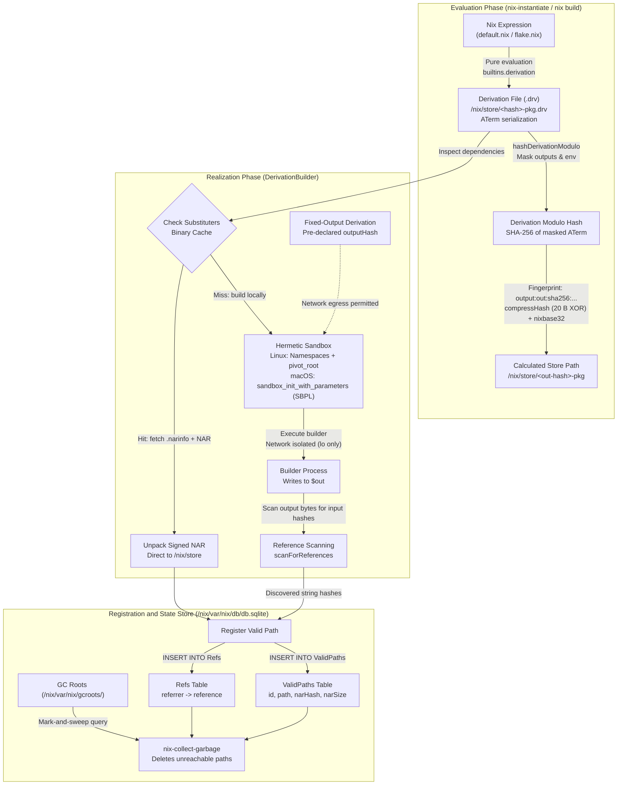

# Nix Store, Derivations, and Flakes Internals

> [!summary] Claim:
> Nix treats software deployment as a purely functional evaluation where packages are immutable values in `/nix/store` indexed by cryptographic hashes of their complete input graph.
> Build recipes are serialized into Annotated Term (ATerm) derivation files (`.drv`), which evaluate into input-addressed or content-addressed store paths via SHA-256 fingerprinting, 20-byte XOR folding, and a custom 32-character base32 encoding.
> Realization executes inside isolated kernel namespaces or sandbox profiles that deny network access to all processes except Fixed-Output Derivations (FODs) with pre-declared output digests.
> Runtime dependencies are discovered automatically by scanning output bytes for store path hashes and recorded in SQLite, while Flakes enforce pure evaluation by locking input Git trees and content hashes into `flake.lock`.



## The Mechanism

The architecture of Nix was formalized by Eelco Dolstra in his 2006 doctoral dissertation, *The Purely Functional Software Deployment Model*, and the LISA 2004 paper *Nix: A Safe and Policy-Free System for Software Deployment*.
Traditional package managers mutate shared global directories like `/usr/lib` and `/usr/bin`, creating nondeterministic environments prone to version collisions, broken upgrades, and undeclared runtime dependencies.
Nix eliminates global mutation by modeling package deployment as mathematical function evaluation: given identical inputs, a build must produce an immutable filesystem closure stored at an isolated, cryptographically unique path.
Understanding Nix requires tracing ten interlocking mechanisms from language evaluation down to filesystem serialization and kernel isolation.

### 1. The Purely Functional Deployment Model and `/nix/store`

The Nix store is an append-only directory located at `/nix/store` (as of 2026-11, Both).
Every component in the store resides at an immutable path structured as:

$$\text{/nix/store/}\langle\text{digest}\rangle\text{-}\langle\text{name}\rangle$$

Here, `digest` is a 32-character string encoded in Nix's custom base32 alphabet, and `name` is a human-readable package identifier.
Store entries are made read-only when they are registered: files get `0444`, while executables and directories get `0555`, and modification timestamps are normalized to `1`, one second after the epoch (`1970-01-01 00:00:01 UTC`; `mtimeStore = 1` in `src/libstore/posix-fs-canonicalise.cc`, confirmed with `stat` on Nix 2.34.7, macOS, as of 2026-11).
Because every version, compiler variant, and dependency combination produces a distinct cryptographic digest, multiple mutually incompatible versions of a library (such as OpenSSL 1.1 and OpenSSL 3.0) safely co-exist simultaneously in `/nix/store` without collision.
Atomic software upgrades and rollbacks operate by atomically switching symlinks pointing to specific profile closures in `/nix/store`, leaving older generations intact until garbage collection runs.

### 2. Derivation Representation: The `.drv` ATerm Intermediate Language

Nix separates packaging into two distinct phases: evaluation and realization.
During evaluation (`nix-instantiate` or the evaluation stage of `nix build`), the Nix language interpreter executes Nix expressions, resolves laziness, and outputs low-level build actions termed **derivations**.
A derivation is serialized to disk as an Annotated Term (ATerm) file with the extension `.drv` inside `/nix/store`.
The ATerm format is a formal specification containing exactly seven positional fields wrapped in a `Derive` constructor:

```aterm
Derive(
  [("out", "/nix/store/z47bp6az8rj78ngb0g3q43fcmq4qqcvp-test", "", "")],
  [("/nix/store/abc...-dep.drv", ["out"])],
  ["/nix/store/xyz...-source.patch"],
  "aarch64-darwin",
  "/bin/sh",
  ["-e", "./builder.sh"],
  [
    ("builder", "/bin/sh"),
    ("name", "test"),
    ("out", "/nix/store/z47bp6az8rj78ngb0g3q43fcmq4qqcvp-test"),
    ("system", "aarch64-darwin")
  ]
)
```

The seven fields represent:
1. `outputs`: A list of output tuples `(name, store_path, hash_algo, hash)`.
   For regular derivations, `hash_algo` and `hash` are empty strings.
2. `inputDrvs`: A list of tuples pairing upstream `.drv` store paths with the specific output names required for this build.
3. `inputSrcs`: A sorted list of plain store paths (source files, patches, build scripts) added directly to the store.
4. `platform`: The required target architecture and OS string (e.g., `x86_64-linux` or `aarch64-darwin`).
5. `builder`: The absolute store or sandbox path to the executable responsible for driving the build.
6. `args`: The argument vector passed to the builder executable.
7. `env`: A list of environment variable key-value pairs passed to the builder process, sorted lexicographically by variable name.

The `.drv` file acts as the build system's intermediate representation (IR), decoupling language evaluation from physical compilation.
Tools can inspect, transfer, or distribute `.drv` files across remote worker fleets without needing access to the original Nix source expressions.

### 3. Cryptographic Hashing: Input-Addressed vs Content-Addressed Paths

Nix supports two fundamentally different addressing models for computing store paths:

#### Input-Addressed Store Paths (Default)
In the input-addressed model, the store path digest is computed prior to build execution by hashing the derivation recipe and its full recursive dependency graph.
The primary advantage is that store paths are known statically during evaluation, allowing build schedules, dependency closures, and binary cache lookups to occur before compiling a single line of code.
The primary disadvantage is the **rebuild cascade**: modifying an insignificant upstream detail (such as fixing a typo in a comment inside `glibc` or re-ordering flags) alters the derivation hash.
This forces a rebuild of the entire downstream dependency tree even if the compiled machine code is bit-for-bit identical.

#### Content-Addressed Store Paths (RFC 62 / CA Derivations)
Floating content-addressed derivations are still gated behind the experimental feature `ca-derivations` (Nix 2.34 manual, Both, as of 2026-11).
Content-addressed store paths index the output directory by the cryptographic hash of its actual realized filesystem contents (its NAR hash).
This introduces the concept of **early cutoff**: if rebuilding a package yields an output identical to an existing store path, all downstream derivations can reuse their cached outputs, terminating the rebuild cascade immediately.
Because the final output hash is unknown until the build completes, content-addressed derivations use temporary store placeholders during compilation and rewrite references upon realization.

### 4. Derivation Modulo Hashing (`hashDerivationModulo`) and Store Path Fingerprints

Calculating an input-addressed output store path presents a circular dependency: the derivation file contains the output path, but the output path depends on the derivation contents.
Nix resolves this chicken-and-egg dilemma through **derivation modulo hashing**, implemented in `src/libstore/derivations.cc` via `hashDerivationModulo` (Nix 2.34.7).
For a freshly evaluated derivation, the masking of outputs happens in `derivationStrict` (`src/libexpr/primops.cc`), which sets each output's `env` entry to `""` and marks the output `Deferred` before calling `hashDerivationModulo`.

#### Step A: Masking the Derivation
Nix creates an in-memory clone of the derivation where:
- In the `outputs` list, the `store_path` field of every output is replaced by the empty string `""`.
- In the `env` list, the value of every environment variable matching an output name (e.g., `out`, `dev`) is set to `""`.
- For entries in `inputDrvs`, the path of each input derivation is replaced by the base16 form of its own modulo hash.
  That input hash is computed with the input's own output paths left in place (`pathDerivationModulo` calls `hashDerivationModulo` with `maskOutputs` false), so only the derivation being built is masked; for an input with no inputs of its own it equals the SHA-256 of its `.drv` file contents (Nix 2.34.7, checked by the lab's Phase 2 input-derivation case).
  For a fixed-output input, that hash is not recursive: it is the SHA-256 of `fixed:out:<method><algo>:<hex hash>:<output path>`, which is why an FOD's recipe changes do not propagate downstream.

This masked derivation is serialized into canonical ATerm text and hashed with SHA-256 to produce the derivation modulo hash $H_{\text{drv}}$.

#### Step B: Constructing the Fingerprint String
Nix formats a colon-delimited metadata string termed the store path fingerprint according to the Store Path v1 protocol:

$$\text{fingerprint} = \text{type} + \text{":sha256:"} + H_{\text{drv}} + \text{":"} + \text{storeDir} + \text{":"} + \text{name}$$

For the standard output `out` of a package named `test` in `/nix/store`, the fingerprint string is:
`output:out:sha256:<H_drv_hex>:/nix/store:test`

#### Step C: Hash Compression (`compressHash`)
Nix computes the SHA-256 digest of the fingerprint string (yielding 32 bytes).
To keep the hash part at 32 characters (a full SHA-256 in base32 is 52 characters, which with the name exceeds some file systems' name limits, and some builders hard-code 32; Dolstra thesis, Chapter 5), Nix compresses the 32-byte digest into a 20-byte (160-bit) array using byte-wise XOR folding:

```cpp
Hash compressHash(const Hash & hash, unsigned int newSize) {
    Hash h(hash.algo);
    h.hashSize = newSize;
    for (unsigned int i = 0; i < hash.hashSize; ++i)
        h.hash[i % newSize] ^= hash.hash[i];
    return h;
}
```

Every byte $i$ from index 20 through 31 is XORed into position $i \pmod{20}$.

#### Step D: Nix Base32 Encoding
The resulting 20-byte array (160 bits) is encoded into a 32-character string using Nix's specialized base32 alphabet:

$$\text{NIX\_BASE32} = \text{"0123456789abcdfghijklmnpqrsvwxyz"}$$

Nix deliberately omits the characters `e`, `o`, `u`, and `t` "to reduce the possibility that hash representations contain character sequences that are potentially offensive" (Dolstra thesis, Section 5.1; the source comment in `base-nix-32.hh` reads `omitted: E O U T`).
It is not about optical confusion: `l` and `1` are both in the alphabet.
Unlike standard RFC 4648 base32, Nix treats the 20-byte array as a single little-endian unsigned integer $N$:

$$N = \sum_{j=0}^{19} c[j] \times 256^j$$

Digits are extracted from the most significant 5-bit slice down to zero:

$$\text{digit}_k = \left( \lfloor N / 32^k \rfloor \right) \pmod{32} \quad \text{for } k = 31, 30, \dots, 0$$

The resulting 32-character string forms the final store path prefix: `/nix/store/<b32_digest>-test`.

### 5. Fixed-Output Derivations (FODs) and Network Decoupling

A fundamental rule of Nix's purely functional model is that builds must be hermetic and cannot access the external network.
However, bootstrapping requires downloading source code, tarballs, and Git repositories from remote servers.
Nix resolves this tension through **Fixed-Output Derivations (FODs)**.

An FOD declares its expected output cryptographic hash upfront via the attributes `outputHash` and `outputHashAlgo` (with optional `outputHashMode = "recursive"` or `"flat"`).
The output path calculation for an FOD bypasses the derivation modulo hash entirely.
Only the recursive (NAR) mode with SHA-256 uses the `source` type directly:

$$\text{fingerprint}_{\text{FOD,NAR+sha256}} = \text{source:sha256:} + \text{outputHash}_{\text{hex}} + \text{:/nix/store:} + \text{name}$$

Every other combination (flat mode, which `fetchurl` uses for a plain file, or a non-SHA-256 algorithm) uses `output:out` with an inner digest $\text{SHA-256}(\text{"fixed:out:"} + \text{rec} + \text{algo} + \text{":"} + \text{hash}_{\text{hex}} + \text{":"})$, where `rec` is `""` for flat and `r:` for NAR (Store Path Specification, Nix 2.34 manual).
Verified locally with Nix 2.34.7: a flat SHA-256 FOD of all-zero hash named `fixed-test` lands at `/nix/store/v96xy7krc03131l1gl7rbb197pp6gcpn-fixed-test`, which matches the `fixed:out:` formula and not `source:`.

Because the output store path is cryptographically bound to the content hash of the expected payload rather than the builder instructions, the output path is completely invariant to changes in the builder script, download mirror URLs, or host platform.
Because the build coordinator verifies the final realized content hash against `outputHash` before registering the path in the store, the sandbox is safely granted full external network egress: on Linux, `CLONE_NEWNET` is added only when `derivationType.isSandboxed()` is true, which it is not for an FOD (`linux-derivation-builder.cc`, Nix 2.34.7).
If an attacker compromises a download mirror or a network connection injects malicious bytes, realization aborts immediately with a hash mismatch error before any downstream build can execute.

### 6. The Nix Archive (NAR) Serialization Format

Standard archive formats like `tar` and `zip` are nondeterministic: they encode filesystem timestamps, file ordering, user/group IDs, and extended attributes that vary across runs and host filesystems.
Nix introduces the **Nix Archive (NAR)** format, specified in Eelco Dolstra's thesis and the Nix Reference Manual.
A NAR file is a deterministic, byte-aligned serialization of a filesystem tree.

Every element in a NAR stream is serialized using the length-prefixed string primitive `str(s)`:
1. An 8-byte little-endian unsigned integer encoding the length $|s|$ in bytes.
2. The raw bytes of $s$.
3. Null padding bytes (`\0`) extending the payload to a multiple of 8 bytes:

$$\text{pad\_len} = (8 - (|s| \pmod 8)) \pmod 8$$

The NAR grammar structures filesystem objects unambiguously:

```ebnf
serialise(fso)      = str("nix-archive-1") + serialise1(fso)
serialise1(fso)     = str("(") + serialise2(fso) + str(")")

serialise2(Regular) = str("type") + str("regular")
                    + ( str("executable") + str("") if exec else "" )
                    + str("contents") + str(file_bytes)

serialise2(Symlink) = str("type") + str("symlink")
                    + str("target") + str(symlink_target)

serialise2(Dir)     = str("type") + str("directory")
                    + concatMap(serialiseEntry, sortEntries(entries))

serialiseEntry((name, fso)) = 
                      str("entry") + str("(")
                    + str("name") + str(name)
                    + str("node") + serialise1(fso)
                    + str(")")
```

Directory entries are strictly sorted lexicographically by ASCII byte order (`sortEntries`).
All timestamps, ownership metadata, and non-executable permission bits are discarded.
The cryptographic hash of this byte stream (the NAR hash) serves as the canonical content digest for store paths, binary cache indexation, and Flake lockfile tracking.

### 7. Sandbox Execution: Linux Namespaces vs macOS `sandbox-exec`

When realizing a derivation locally, Nix executes the builder inside an isolated sandbox to prevent undeclared dependencies from leaking into the build environment.

#### Linux Sandbox Architecture
On Linux, the Nix daemon (`src/libstore/unix/build/linux-derivation-builder.cc` in Nix 2.34.7; the older `local-derivation-goal.cc` no longer exists) isolates the builder process using kernel namespaces and filesystem containment, plus cgroups only when `use-cgroups` is enabled (default `false`, Linux, as of 2026-11):
- **Mount Namespace (`CLONE_NEWNS`):** Constructs a pristine virtual filesystem.
  Only the closure of the declared inputs is bind-mounted into the sandbox's `/nix/store`.
  The per-build temporary directory appears at `sandbox-build-dir` (default `/build`), and a fresh `tmpfs` is mounted on `/dev/shm`.
- **Pivot Root (`pivot_root`):** Nix invokes `pivot_root(2)` inside the mount namespace to atomically swap the root filesystem to a private chroot, unmounting the host root and preventing traversal escapes.
- **Network Namespace (`CLONE_NEWNET`):** Disables external networking for all regular derivations.
  Only the loopback interface (`lo`) is configured, preventing builders from accessing external sockets or local host services.
  Only Fixed-Output Derivations retain network connectivity.
- **PID Namespace (`CLONE_NEWPID`):** The builder process executes as PID 1, preventing it from inspecting or signaling host processes.
- **IPC and UTS Namespaces (`CLONE_NEWIPC`, `CLONE_NEWUTS`):** Isolates POSIX shared memory, message queues, and resets the system hostname to `localhost`.
- **User Namespace (`CLONE_NEWUSER`) or `nixbld` Users:** Builds run under unprivileged user IDs from the `nixbld` group to prevent privilege escalation; the upstream multi-user installer creates 32 build users starting at UID 30001 on Linux and at UID 351 (`_nixbld1`) on macOS (installer scripts at tag 2.34.7; 32 users from UID 351 confirmed on this macOS host, as of 2026-11).

#### macOS Sandbox Architecture
Because Darwin lacks Linux namespaces, Nix on macOS isolates builds with an Apple Sandbox Profile Language (SBPL) profile, which Nix 2.34.7 applies by calling `sandbox_init_with_parameters` from libsandbox directly rather than running the `sandbox-exec` binary (`src/libstore/unix/build/darwin-derivation-builder.cc`).
The `sandbox` setting defaults to `false` on macOS and `true` on Linux (Nix 2.34 manual, as of 2026-11), so this applies only when a user turns it on.
Nix generates a Scheme profile that allows system paths, adds one `subpath` or `literal` rule per path in the input closure, and denies network egress for regular derivations.
A major operational bottleneck on macOS is Apple's sandbox profile compiler: when the input closure holds thousands of store paths, the compiled profile exceeds a 65,535-byte limit and the build fails with `pattern serialization length N exceeds maximum (65535)` ([NixOS/nix#4119](https://github.com/NixOS/nix/issues/4119)).
The limit lives in Apple's userspace profile compiler, not in Nix; Nix master (after 2.34.7) buckets store-path rules by the first hash character, which its source comment says fits about 10k store paths (as of 2026-11).

### 8. Output Reference Scanning and SQLite Dependency Tracking

When a builder process completes, how does Nix determine what runtime dependencies the compiled package actually requires?
Instead of relying on developer declarations, Nix uses **string reference scanning** implemented in `scanForReferences`.

During realization, the Nix daemon tracks the 32-character base32 hash parts of every path in the closure of the inputs plus the derivation's own outputs (`referenceablePaths` in `src/libstore/build/derivation-builder-impl.cc`; `scanForReferences` lives in `src/libstore/path-references.cc`, Nix master as of 2026-11).
Once the builder exits successfully, the daemon streams the NAR serialization of each output (file contents, symlink targets, and entry names) through a scanner looking for these 32-character ASCII strings.
- If an input's 32-character hash appears anywhere inside an executable binary, shared library, script shebang, or text configuration, Nix marks that input as a **runtime reference**.
- If an input (such as GCC, headers, or a build-time code generator) does not have its store hash embedded in the output bytes, it is pruned from the package's runtime closure.

All validated paths and their discovered reference edges are stored atomically in a local SQLite database at `/nix/var/nix/db/db.sqlite` across three primary tables (schema read with `sqlite3 -readonly ... .schema` on Nix 2.34.7, macOS, as of 2026-11; a fourth table, `SchemaMigrations`, tracks migrations):
1. `ValidPaths`: Records each valid store path, its base16 NAR hash, registration timestamp, deriver `.drv` path, NAR size in bytes, `ultimate` flag, space-separated signatures, and an optional `ca` content-address assertion.
2. `Refs`: A normalized relational table recording directed edges `(referrer, reference)` where both columns reference `ValidPaths(id)`.
3. `DerivationOutputs`: Maps derivation IDs to their symbolic output names (`out`, `dev`) and realized store paths.

When `nix-collect-garbage` executes, it performs a mark-and-sweep graph traversal starting from active symlinks in `/nix/var/nix/gcroots/` (user profiles, pinned shells, and system generations).
It walks the `Refs` graph recursively, deleting any unreferenced store path from `/nix/store` and the SQLite database.

### 9. Substituters, Binary Caches, and the `.narinfo` Protocol

Nix avoids compiling packages from source whenever a pre-built binary is available on a configured binary cache (a substituter, such as `https://cache.nixos.org`).
The substituter protocol is a purely static HTTP/S3 interface.

When Nix determines that a store path `/nix/store/<hash>-<name>` is required, it performs an HTTP `GET` request to:

$$\text{https://cache.nixos.org/}\langle\text{hash}\rangle\text{.narinfo}$$

The `.narinfo` file is a plain-text metadata manifest:

```text
StorePath: /nix/store/z47bp6az8rj78ngb0g3q43fcmq4qqcvp-test
URL: nar/1w1fff338fvdw53sqgamddn1b2xgds473pv6y13gizdbqjv4i5p3.nar.xz
Compression: xz
FileHash: sha256:1w1fff338fvdw53sqgamddn1b2xgds473pv6y13gizdbqjv4i5p3
FileSize: 4029176
NarHash: sha256:011b65...
NarSize: 14285200
References: a4b8gp9mw70sn9s8igmjfwmnfi62jsxy-glibc-2.39
Deriver: v6jb8ivyqx4jwja6x1w2yk5js3074vn6-test.drv
Sig: cache.nixos.org-1:<base64 Ed25519 signature>
```

The values above are illustrative, not a real cache entry; note that `cache.nixos.org-1:6NCHdD59X431o0gWypbMrAURkbJ16ZPMQFGspcDShjY=` is the cache's public key (the value placed in `trusted-public-keys`), not a signature.
The client verifies the cryptographic signature (`Sig`) using an Ed25519 public key configured in `trusted-public-keys`; `require-sigs` defaults to `true` (Nix 2.34 manual, Both, as of 2026-11).
If the signature is valid, the client downloads the compressed NAR archive from `URL`, decompresses the stream, validates the unpacked stream against `NarHash`, and writes the files directly into `/nix/store`.
In Nix 2.34.7 the client parses `FileHash` from the `.narinfo`, but `BinaryCacheStore::narFromPath` streams the download straight into a decompressor and never compares it with `FileHash`; only the cache writer computes it, while `NarHash` is the integrity guarantee (`src/libstore/binary-cache-store.cc`, `src/libstore/nar-info.cc`, Both, as of 2026-11).
It then populates `ValidPaths` and `Refs` in the local SQLite database without running any local build steps.

### 10. Nix Flakes: Pure Evaluation, `flake.nix`, and `flake.lock` Pinning

Legacy Nix workflows relied on channels, `<nixpkgs>` lookups, and the `NIX_PATH` environment variable.
Because `NIX_PATH` points to mutable system paths that drift across machines, two developers evaluating the same `default.nix` file frequently produced different derivation hashes.

Nix Flakes, designed by Eelco Dolstra (RFC 49, withdrawn in July 2020 and shipped instead as an experimental feature), resolve evaluation drift through strict hermetic constraints.
Status: `flakes` is still listed as an experimental feature in upstream Nix 2.34, while Determinate Nix treats flakes as stable (Both, as of 2026-11).
1. **Pure Evaluation Mode:** Flake evaluation prohibits access to undeclared environment variables, network sockets, and arbitrary filesystem paths.
   If a flake resides inside a Git repository, Nix evaluates exclusively against files tracked in Git (`git add`).
   Untracked files are hidden from the Nix evaluator, while tracked files with uncommitted edits are visible and only trigger a `Git tree ... has uncommitted changes` warning (verified with Determinate Nix 3.21.1 / Nix 2.34.7, macOS, as of 2026-11).
2. **Standardized Interfaces (`flake.nix`):** A flake exposes standardized attribute sets including `packages.<system>.<name>`, `devShells.<system>.<name>`, and `nixosConfigurations.<name>`.
3. **Lockfile Pinning (`flake.lock`):** Flake dependencies (inputs) are locked in a JSON graph file named `flake.lock` (schema version 7).
   A Git or GitHub node is pinned by its commit object ID (`rev`), timestamp (`lastModified`), and exact NAR content hash in SRI format (`narHash = "sha256-..."`); a freshly locked `github:` input carries exactly `lastModified`, `narHash`, `owner`, `repo`, `rev`, and `type` under `version: 7` (verified with `nix flake lock`, Nix 2.34.7, as of 2026-11).
   The lockfile ensures that every developer and CI runner evaluates against an identical input graph down to the single bit.

## Commands and Numbers to Know

The following reference table captures key configuration limits, default values, and operational flags across Nix implementations (as of 2026-11):

| Parameter or Concept | Default or Pinned Value | Scope / Platform | Engineering Significance |
| :--- | :--- | :--- | :--- |
| Store Path Hash Length | 32 characters (base32) | Both | Encodes 160 bits (20 bytes) derived from SHA-256 via `compressHash`. |
| Nix Base32 Alphabet | `0123456789abcdfghijklmnpqrsvwxyz` | Both | Excludes letters `e`, `o`, `u`, and `t` to prevent accidental English words. |
| Store Path Location | `/nix/store` | Both | Immutable directory tree; files set to read-only `0444`, executables and directories `0555`. |
| Normalized Timestamp | `1` (1970-01-01 00:00:01 UTC, `mtimeStore`) | Both | Discards volatile filesystem timestamps; NAR itself stores no timestamps. |
| SQLite State Database | `/nix/var/nix/db/db.sqlite` | Both | Tracks `ValidPaths`, `Refs` dependency graph, and `DerivationOutputs`. |
| Garbage Collection Roots | `/nix/var/nix/gcroots/` | Both | Directory holding active symlinks that protect store closures from GC sweeps. |
| Build Users | `nixbld` group, 32 users from UID 30001 (Linux) or 351 (macOS) | Both | Upstream multi-user installer defaults; dedicated unprivileged build users. |
| Sandbox Isolation Mode (`sandbox`) | `true` on Linux, `false` elsewhere | Both | On Linux enforces `CLONE_NEWNS`, `CLONE_NEWPID`, `CLONE_NEWIPC`, `CLONE_NEWUTS`, `CLONE_NEWNET` (non-FOD), and `pivot_root`; cgroups only with `use-cgroups`. |
| macOS Sandbox Engine | `sandbox_init_with_parameters` (SBPL) | macOS | Applies a dynamically generated SBPL profile in-process; subject to the 65,535-byte limit. |
| SBPL Profile Size Limit | 65,535 bytes | macOS | Apple sandbox profile compiler limit; fails builds with large input closures. |
| Default Substituter | `https://cache.nixos.org` | Both | Default public binary cache for pre-compiled NAR packages. |
| Cache Signature Scheme | Ed25519 | Both | Cryptographic signature format verifying `.narinfo` authenticity. |
| Flake Lock Schema Version | `7` | Both | Schema version governing `flake.lock` dependency node graphs. |
| Max Build Jobs (`max-jobs`) | `1` upstream; Determinate Nix's `/etc/nix/nix.conf` sets `auto` | Both | Maximum number of derivations built locally in parallel. |
| Builder Cores (`cores`) | `0` (Nix detects the core count) | Both | Number of CPU cores exported as `NIX_BUILD_CORES` inside each builder. |
| Derivation Show Command | `nix derivation show <path>` | Both | Prints text ATerm `.drv` files as JSON; needs the experimental `nix-command` feature upstream. |
| Realize Command | `nix-store -r <path.drv>` | Both | Realizes a derivation file, building or substituting its declared outputs. |
| Closure Query Command | `nix-store -qR <path>` | Both | Prints the complete transitive runtime dependency closure for a store path. |

## Multi-Language Comparison: Hermetic Packaging and Build Systems

Nix operates at a different architectural layer than conventional language package managers and container builders.
The following comparison illustrates how Nix contrasts with [[Dotfiles-Nix-Direnv-Mise-and-Devcontainers\|Devcontainers]], Docker, Bazel, and language-specific tools like Cargo and Python Wheels:

| Dimension | Nix (Derivations & Flakes) | Bazel | Docker / OCI Containers | Cargo (Rust) / Wheels (Python) |
| :--- | :--- | :--- | :--- | :--- |
| Addressing Model | Input-addressed (default) or Content-addressed (RFC 62) | Content-based action cache (CAS) | Layer-based content hashing | Semantic versioning + registry hashes |
| Isolation Mechanism | Linux namespaces (`pivot_root`) or macOS `sandbox-exec` | Sandboxed worker processes (`linux-sandbox`) | OCI runtime namespaces, cgroups, rootfs pivot | Host process execution; uncontained by default |
| Network Access | Denied by default; allowed only for FODs with declared hashes | Denied in sandboxed actions; remote repositories fetched via rules | Full network access during `RUN` instructions unless `--network=none` | Full unrestricted network access during package resolution and build |
| Output Serialization | Nix Archive (NAR); deterministic byte padding and sorted entries | Direct tree artifacts or CAS blobs | OCI image layers (tarballs with file timestamps) | Compressed zip (wheels) or tar.gz crates |
| Dependency Discovery | Automatic string reference scanning of output binaries | Explicitly declared action input/output attributes | Undetected; all files written into image layer persist | Language manifest (`Cargo.lock`, `requirements.txt`) |
| Store Structure | Single global `/nix/store`; hardlink deduplication optional (`auto-optimise-store = false` by default) | User-level cache (`~/.cache/bazel`) + remote action cache | Local daemon graph driver (`/var/lib/docker/overlay2`) | Project-local (`target/`, `.venv/`) or global caches |
| Scope of System | Whole system (compiler, libc, kernel headers, runtime configs) | Multilanguage source monorepo builds | Operating system userspace layer | Language-specific dependencies and libraries |

## Worked Lab Example

The companion lab `code/01-Command-Line/nix_drv_inspector/` implements an independent Nix store engine in Python.
It verifies ATerm `.drv` parsing, computes input-addressed (with and without input derivations) and fixed-output derivation paths using Nix's exact 20-byte XOR folding algorithm and base32 alphabet, checks NAR archive serialization against `nix-store --dump`, simulates binary reference scanning, and audits a `flake.lock`.

### Running the Lab Harness

To execute the verification suite, navigate to the `code/` directory and execute the test harness:

```bash
cd code
python3 -m _harness.verify 01-Command-Line/nix_drv_inspector/
```

The lab executes natively without external network access or container dependencies.
Below is the verbatim output recorded on `darwin-arm64`:

```text
=== [PHASE 1] ATerm Derivation Parsing and Modulo Hashing ===
Parsed Derivation System:       aarch64-darwin
Parsed Derivation Builder:      /bin/sh
Declared Outputs Count:         1
Declared Input Drvs Count:      0
Declared Input Srcs Count:      0
Masked Derivation SHA-256:      1512949690c51abf4d28775bbb911a48eef3163d08ed16e1861fdb51d7bd3db1

=== [PHASE 2] Store Path Hashing and Nix Base32 Encoding ===
Computed Output Path:           /nix/store/z47bp6az8rj78ngb0g3q43fcmq4qqcvp-test
Expected Output Path:           /nix/store/z47bp6az8rj78ngb0g3q43fcmq4qqcvp-test
Output Path Derivation Check:   EXACT MATCH
Computed .drv Store Path:       /nix/store/v6jb8ivyqx4jwja6x1w2yk5js3074vn6-test.drv
Expected .drv Store Path:       /nix/store/v6jb8ivyqx4jwja6x1w2yk5js3074vn6-test.drv
.drv Store Path Check:          EXACT MATCH
Input-Drv Output Path:          /nix/store/lfpmvd3syq3cxjxhlyi272brmp0gn1kk-app
Input-Drv .drv Store Path:      /nix/store/ai7s1x13997sd2hn6ap7ia97qkflszcj-app.drv
Input-Drv Path Checks:          EXACT MATCH

=== [PHASE 3] Fixed-Output Derivation (FOD) Decoupling ===
Is Fixed Output Derivation:     True
Computed FOD Output Path:       /nix/store/svgymjq6pwxrc6ajihgxr6lya62wwkgv-fixed-test
Expected FOD Output Path:       /nix/store/svgymjq6pwxrc6ajihgxr6lya62wwkgv-fixed-test
FOD Output Path Check:          EXACT MATCH
Altered FOD Output Path:        /nix/store/svgymjq6pwxrc6ajihgxr6lya62wwkgv-fixed-test
FOD Platform & Builder Invariance: CONFIRMED
Control (regular drv, builder changed): path changes: True
Computed Flat FOD Output Path:  /nix/store/v96xy7krc03131l1gl7rbb197pp6gcpn-fixed-test
Expected Flat FOD Output Path:  /nix/store/v96xy7krc03131l1gl7rbb197pp6gcpn-fixed-test
Flat FOD Path Check:            EXACT MATCH (differs from recursive)
Different outputHash:           path changes: True

=== [PHASE 4] Nix Archive (NAR) Serialization and Determinism ===
Regular File NAR Size:          168 bytes
Executable File NAR Size:       200 bytes
Symlink NAR Size:               128 bytes
All NAR Lengths Multiple of 8:  True
Directory NAR Digest (SHA-256): 36fa233b9c286a39a7d996133c8de5fd8e9cf4997700a505b84831b8aaa19985
Entry Order Independent:        True

=== [PHASE 5] Reference Scanning and Runtime Closure Pruning ===
Build-Time Inputs (inputDrvs):  3
Runtime References Found:       2
  Retained Runtime Ref:         /nix/store/a4b8gp9mw70sn9s8igmjfwmnfi62jsxy-glibc-2.39
  Retained Runtime Ref:         /nix/store/z47bp6az8rj78ngb0g3q43fcmq4qqcvp-openssl-3.0.13
Truncated Hash Not Matched:     True
Compiler Pruning Verification:  PASS (gcc pruned from runtime closure)

=== [PHASE 6] Flake Lock Graph and Input Pinning Audit ===
Flake Lock Schema Version:      7
Flake Root Direct Inputs:       flake-utils, nixpkgs
Node [flake-utils]: rev=b1d9ab7cd6ff type=github
Node [nixpkgs]: rev=77850a98f5b9 type=github
Flake Lock Problems Found:      0
narHash of Directory NAR:       sha256-NvojO5woajmn2ZYTPI3l/Y6c9Jl3AKUFuEgxuKqhmYU=
Corrupted Lock Problems Found:  4
Flake Lock Audit:               PASS
```

### Analysis of the Six Verification Phases

Every expected value below that is not derived by the lab itself was taken from Nix 2.34.7 (Determinate Nix 3.21.1) on the recording machine; the lab asserts each one and fails on any mismatch.

1. **Phase 1: ATerm Parsing and Modulo Hashing:**
   The parser deserializes the seven-field ATerm structure.
   To compute the derivation modulo hash, it blanks out the output store paths and the environment variables named after outputs.
   The resulting canonical text is hashed with SHA-256, yielding `1512949690c51abf4d28775bbb911a48eef3163d08ed16e1861fdb51d7bd3db1`.
2. **Phase 2: Store Path Calculation:**
   The fingerprint string `output:out:sha256:15129496...:/nix/store:test` is constructed.
   Hashing this string with SHA-256, folding the digest via 20-byte XOR, and encoding in Nix base32 produces the exact output digest `z47bp6az8rj78ngb0g3q43fcmq4qqcvp`.
   Similarly, serializing the final `.drv` file as a text object matches the derivation store path `v6jb8ivyqx4jwja6x1w2yk5js3074vn6-test.drv`.
   Both constants were confirmed independently: `nix-instantiate -E 'derivation { name = "test"; builder = "/bin/sh"; system = "aarch64-darwin"; }'` on Nix 2.34.7 prints this `.drv` path, and its ATerm is byte-identical to the lab's sample.
   A second case has an input derivation: for an `app` derivation that depends on a `dep` derivation, the lab replaces the input `.drv` path by the SHA-256 of `dep`'s ATerm (its outputs are not masked, because only the derivation being built is masked) and reproduces Nix's output path `lfpmvd3s...-app` and `.drv` path `ai7s1x13...-app.drv`.
   This follows `hashDerivationModulo` and `pathDerivationModulo` in `src/libstore/derivations.cc` at 2.34.7.
3. **Phase 3: FOD Decoupling:**
   A recursive (NAR) SHA-256 fixed-output derivation uses `source:sha256:<hex_hash>:/nix/store:fixed-test`.
   A flat one, which is what `fetchurl` produces, first hashes `fixed:out:sha256:<hex_hash>:` and uses that digest in an `output:out` fingerprint; the lab reproduces Nix's flat path `v96xy7kr...-fixed-test` and shows it differs from the recursive path `svgymjq6...-fixed-test`.
   Changing the builder from `/bin/sh` to `/usr/bin/curl` and the platform from `aarch64-darwin` to `x86_64-linux` leaves the recursive FOD path unchanged, while the same change moves a regular derivation's path, so the invariance is not vacuous.
   The lab's FOD code never reads the builder or platform by construction; real Nix 2.34.7 confirms the property, because both variants instantiate to different `.drv` files (`kwqrxf4w...` and `8cdhcym8...`) with the same output path `svgymjq6...-fixed-test`.
   Changing `outputHash` changes the path.
   This shows why changes to download tooling do not invalidate downstream cached builds.
4. **Phase 4: NAR Serialization:**
   Strings and records are padded to 8-byte boundaries.
   An executable flag adds the `executable` and empty-string records (32 bytes), expanding the archive from 168 bytes to 200 bytes.
   The lab asserts the size and SHA-256 of the regular-file NAR, the executable NAR, and a symlink NAR (128 bytes), and the digest `36fa233b...` of a directory NAR, all equal to `nix-store --dump` on Nix 2.34.7.
   It also asserts that directory entry order in the input does not change the digest.
5. **Phase 5: Reference Scanning:**
   A hand-built byte string standing in for a compiled binary, containing embedded path strings for `glibc` and `openssl`, is scanned; this is a simulation of the scanning rule, not a scan of real build output.
   Even though `gcc` was present in the build-time input set, the absence of its 32-character hash in the bytes prunes it from the runtime closure.
   A truncated 31-character hash, an altered hash, and empty input are asserted not to match.
6. **Phase 6: Flake Lock Audit:**
   The audit checks the lock schema version (7), that each root input names an existing node, that each locked `rev` is a 40-digit hex commit, and that each `narHash` is a valid SRI SHA-256 string.
   The sample lock is hand-written, but its `narHash` values are computed from the NARs built in Phase 4, and the lab asserts that the directory NAR's value `sha256-NvojO5woajmn2ZYTPI3l/Y6c9Jl3AKUFuEgxuKqhmYU=` equals the output of `nix hash path` on the same directory.
   A deliberately corrupted lock (wrong version, dangling root input, missing `rev`, short `narHash`) must report exactly four problems.

## Pitfalls

> [!warning] Pitfalls:
> 1. **The Rebuild Cascade (Input-Addressed Invalidation):**
>    In input-addressed derivations, modifying an upstream build attribute (such as adding a debugging flag or comment to `glibc` or `stdenv`) alters the derivation modulo hash.
>    Because all downstream derivations embed upstream `.drv` modulo hashes inside their own recipes, the entire dependency graph is invalidated, forcing a compilation of thousands of packages from source.
>    *Remediation:* Isolate volatile changes to leaf derivations, leverage `overrideAttrs` sparingly, or adopt experimental content-addressed derivations (`ca-derivations`).
> 2. **Accidental Runtime Closure Inflation via Compiler Leaks:**
>    Nix's reference scanner detects dependencies purely by string scanning.
>    If a compiler embeds the absolute path of a build tool (such as GCC, CMake, or a temporary build directory) inside binary debug sections (`.debug_str`), static assertion strings, or `__FILE__` macros, that build tool becomes a permanent runtime dependency.
>    A 10 MB CLI utility can inadvertently drag a 500 MB compiler toolchain into its production runtime closure.
>    *Remediation:* Use `strip`, configure `-fdebug-prefix-map`, invoke `pkgs.removeReferencesTo`, and audit closures in CI using `nix-store -qR`.
> 3. **macOS `sandbox-exec` 64 KB SBPL Serialization Limit:**
>    On macOS, with `sandbox = true`, Nix generates an SBPL profile with one rule per path in the input closure and applies it through libsandbox.
>    If a composite derivation (such as a large TeX Live distribution, deep Haskell environment, or `home-manager-path`) has thousands of store paths in its input closure, the profile exceeds Apple's 65,535-byte limit, failing the build with `pattern serialization length N exceeds maximum (65535)` ([NixOS/nix#4119](https://github.com/NixOS/nix/issues/4119)).
>    *Remediation:* Wrapping inputs in `buildEnv` or `symlinkJoin` does not help, because the joined path still references, and so brings in, every original path.
>    Mark the large derivation `__noChroot = true` (honoured with `sandbox = relaxed`), as nixpkgs does for large `buildEnv` derivations per that issue, shrink the input closure, or move to a Nix release with the bucketed profile from Nix master.
> 4. **Dirty Working Tree and Untracked File Traps in Flakes:**
>    Nix Flakes enforce pure evaluation against the local Git tree.
>    If a developer authors a new source file or module but neglects to run `git add`, Nix hides the file from the evaluation sandbox.
>    The build fails locally with `error: Path 'extra.nix' in the repository "..." is not tracked by Git.`, followed by a suggested `git -C ... add` command (Nix 2.34.7, as of 2026-11; older releases reported `error: getting status of '/nix/store/...': No such file or directory`), even though the file exists on the developer's physical disk.
>    *Remediation:* Always stage newly created files with `git add -N` before invoking `nix build` or `nix develop` (intent-to-add was verified to make the file visible, Nix 2.34.7).
> 5. **Fixed-Output Derivation Hash Poisoning:**
>    If a developer specifies an incorrect `outputHash` in a `fetchurl` or `fetchFromGitHub` expression, Nix aborts with a hash mismatch.
>    If the developer copies the actual hash printed in the error message into their expression without verifying the downloaded payload, they risk locking a corrupted archive or upstream man-in-the-middle compromise into their binary cache permanently.
>    *Remediation:* Always compute hashes using `nix-prefetch-url` or `nix flake prefetch` directly from trusted, verified upstream signatures.
> 6. **SQLite Database Lock Contention (`db.sqlite`):**
>    The local Nix store relies on SQLite at `/nix/var/nix/db/db.sqlite` for transaction coordination.
>    Spawning multiple independent build processes (such as concurrent CI jobs bypassing the central Nix daemon) causes SQLite busy timeout errors (`database is locked`).
>    *Remediation:* Always route local builds through the centralized multi-user Nix daemon (`nix-daemon`) rather than running single-user store commands concurrently.

## At Scale

Scaling Nix across an engineering organization of 1,000 to 50,000 engineers shifts the architectural bottleneck from language ergonomics to evaluation performance, cache topology, and storage economics.

### 1. Binary Cache Topology and Tiering
At enterprise scale, engineers must never compile foundational packages locally.
Organizational selection criteria between Nix, Devcontainers, and lightweight language version managers are formalized in [[Command-Line-Decision-Records]].
Organizations deploy a multi-tiered substituter architecture:
- **Edge Substituters (Pull-Through Caches):** Regional S3 buckets or local cache instances (using high-performance servers like Harmonia or Attic) deployed close to developer clusters.
- **Continuous Integration Builders (Hydra / Hercules CI):** Dedicated build farms that listen to Git repository webhooks, evaluate derivation graphs, compile missing store paths in parallel, and sign resulting `.narinfo` files using an organizational Ed25519 private key.
- **Cache Compression:** A binary cache store's `compression` setting defaults to `xz` and accepts `zstd` and `bzip2` among others; `compression-level` selects the method's preset (`-1` means its default), and `parallel-compression` applies only to `xz` and `zstd` (Nix 2.34.7 `binary-cache-store.hh`, Both, as of 2026-11).
  Choose the method by measuring compressed size and decompression time on your own NARs; no universal percentage saving is claimed here.

### 2. Monorepo Evaluation Time and Flake Architecture
In large monorepos containing tens of thousands of derivations, evaluating `flake.nix` costs evaluation time and memory that grow with the number of values the evaluator forces.
Measure them with `NIX_SHOW_STATS=1 nix eval ...`, which prints `cpuTime` and allocation counters as JSON (checked on Nix 2.34.7, Both, as of 2026-11), before deciding how to split a flake.
The upstream Nix language interpreter is single-threaded and garbage-collected; Determinate Nix has shipped parallel evaluation for `nix search`, `nix flake check`, `nix flake show`, and `nix eval --json` since 3.11.0 (2025-09-03), described as a developer preview (as of 2026-11).
To prevent evaluation gridlock:
- **Modular Flakes:** Decompose massive monolithic flake expressions into domain-specific sub-flakes connected via strict input pins.
- **Avoid Recursive Directory Traversal:** Never use `builtins.readDir` or `lib.filesystem.listFilesRecursive` across multi-gigabyte source trees; declare explicit file lists or use `.gitignore` filtering via tools like `nix-gitignore`.
- **Evaluation Caching:** Rely on Nix's built-in flake evaluation cache (`eval-cache = true` by default, Both, as of 2026-11; there is no separate `nix-eval-cache` tool) to memoize evaluation results when the locked flake inputs are unchanged.

### 3. Garbage Collection Coordination and Disk Management
Developer workstations and CI runners accumulate hundreds of gigabytes of unreferenced store paths weekly.
Running indiscriminate `nix-collect-garbage -d` commands causes severe cache churn: developers delete store paths in the morning only to re-download them in the afternoon when switching Git branches.
- **Predictive GC Roots:** Automated tooling (like `direnv` integration via `nix-direnv`) creates persistent GC roots in `/nix/var/nix/gcroots/` for all active workspace branches, ensuring active project closures remain pinned.
- **Quota-Driven GC:** Nix already provides this through `min-free` (default `0`, disabled) and `max-free`: when free space in the store drops below `min-free` during a build, Nix collects garbage until `max-free` bytes are free (Nix 2.34 manual, Both, as of 2026-11); external daemons that keep, say, 20% free and evict the oldest unreferenced paths first are an alternative.

## Practice Drill

> [!tip] Practice Drill:
> 1. Initialize a clean temporary directory and create a minimal derivation using `nix-instantiate`:
>    ```bash
>    DRV=$(nix-instantiate -E 'derivation { name = "drill-pkg"; builder = "/bin/sh"; args = ["-c", "echo distinguished > $out"]; system = builtins.currentSystem; }')
>    echo "Derivation path: ${DRV}"
>    ```
> 2. Convert the derivation ATerm file to JSON and inspect the exact environment and output fields:
>    ```bash
>    nix derivation show "${DRV}"
>    ```
> 3. Realize the derivation and verify the output path:
>    ```bash
>    OUT=$(nix-store -r "${DRV}")
>    cat "${OUT}"
>    ```
> 4. Query the SQLite database to confirm the registered path and its references:
>    ```bash
>    sqlite3 /nix/var/nix/db/db.sqlite "SELECT id, path, narSize FROM ValidPaths WHERE path = '${OUT}';"
>    sqlite3 /nix/var/nix/db/db.sqlite "SELECT * FROM Refs WHERE referrer = (SELECT id FROM ValidPaths WHERE path = '${OUT}');"
>    ```
> 5. Create an artificial runtime reference by writing another package that embeds `${OUT}` into its output file, realize it, and query `nix-store -qR` to trace the live closure graph.

## Interview Questions

### Level 5 (L5): Core Mechanics and Daily Operation

#### Question 1: Input-Addressed vs Content-Addressed Paths
What is the fundamental difference between an input-addressed store path and a content-addressed store path in Nix, and what practical problem does RFC 62 solve?

> [!success]- Answer
> An input-addressed store path is computed strictly from the cryptographic hash of the derivation's inputs (its builder, arguments, environment, and the modulo hashes of its input derivations) before any compilation occurs.
> A content-addressed store path (RFC 62) is computed from the cryptographic hash of the realized output filesystem archive (its NAR hash) after the build completes.
> RFC 62 resolves the "rebuild cascade": under the input-addressed model, changing an insignificant detail in an upstream package (such as updating a comment in `glibc`) changes the derivation hash, forcing every dependent package in the entire dependency graph to recompile.
> Under content-addressability, if the recompiled upstream package produces the exact same binary output, its content-addressed store path remains identical, allowing the build coordinator to perform an early cutoff and skip all downstream rebuilds.

#### Question 2: Comment Sensitivity in Derivations vs Fixed-Output Derivations
Why does adding a comment to a standard derivation builder script force a rebuild of the package, whereas modifying download mirrors or adding comments to a `fetchurl` expression does not?

> [!success]- Answer
> In a standard derivation, the builder script is an input to the derivation.
> Adding a comment alters the text of the script or the derivation's environment variables, changing the SHA-256 digest of the masked ATerm representation in `hashDerivationModulo`.
> Because the output store path is derived directly from this modulo hash, the store path changes, requiring a fresh compilation.
> In contrast, `fetchurl` is a Fixed-Output Derivation (FOD) that declares an explicit `outputHash` and `outputHashAlgo`.
> The output store path of an FOD is calculated exclusively from the declared content hash, hashing mode, and package name.
> A plain-file `fetchurl` uses flat mode, so its fingerprint is `output:out:sha256:<SHA-256 of "fixed:out:sha256:<outputHash hex>:">:/nix/store:<name>`; only a recursive (NAR) SHA-256 FOD uses `source:sha256:<outputHash hex>:/nix/store:<name>` (Store Path Specification, Nix 2.34 manual).
> Modifying mirror URLs, curl flags, or comments inside the FOD builder alters the `.drv` file but leaves the declared output path completely unchanged.
> If the output path already exists in `/nix/store` or on a binary cache, Nix considers the derivation realized and skips execution entirely.

#### Question 3: Predict-the-Output (Reference Closure Pruning)
Suppose a derivation compiles a C program using the following build script:
```bash
$CC -O2 main.c -I$OPENSSL/include -L$OPENSSL/lib -lssl -Wl,-rpath,$OPENSSL/lib -o $out/bin/app
strip -s $out/bin/app
```
During the build, the input set includes `gcc`, `glibc`, `openssl`, and `linux-headers`.
Predict which store paths appear in the `Refs` table of `/nix/var/nix/db/db.sqlite` for `$out`, and explain the mechanism that determined this list.

> [!success]- Answer
> The `Refs` table will contain records referencing `glibc` and `openssl`, but will omit `gcc` and `linux-headers`.
> Mechanism:
> When the build finishes, Nix's derivation builder (`DerivationBuilder`, formerly `LocalDerivationGoal`) invokes `scanForReferences`.
> It scans the binary bytes of `$out/bin/app` looking for the 32-character base32 hash prefixes of all build-time inputs.
> Because the binary links against `libssl.so` and embeds an ELF `DT_RPATH`/`DT_RUNPATH` pointing to the OpenSSL store directory, the OpenSSL store hash is present in the binary bytes.
> Because `glibc` is dynamically linked as the C runtime interpreter (`/nix/store/<hash>-glibc/lib/ld-linux-x86-64.so.2`), its store hash is also embedded.
> However, because the binary was stripped (`strip -s`), all DWARF debug symbols (which might have embedded header paths or compiler strings) were discarded.
> Because the 32-character hashes for `gcc` and `linux-headers` do not appear anywhere in the binary's byte stream, Nix prunes them from the runtime closure and does not insert them into SQLite's `Refs` table.

### Level 6 (L6): Systems Architecture and Diagnostics

#### Question 4: Derivation Modulo Hashing Algorithm
Walk through the exact mathematical sequence Nix uses to calculate the store path digest `/nix/store/<digest>-<name>` for a regular derivation output.

> [!success]- Answer
> The calculation proceeds through four phases:
> 1. **Masking:** Nix creates an in-memory clone of the derivation.
>    It blanks out all output paths in the `outputs` list to `""`, clears the matching output environment variables in `env` to `""`, and replaces every upstream derivation path in `inputDrvs` with its own recursive `hashDerivationModulo` hash.
> 2. **Derivation Modulo Hash:** The masked derivation is serialized into canonical ATerm format and hashed using SHA-256, yielding a 32-byte digest written as the 64-character hexadecimal string $H_{\text{drv}}$.
> 3. **Fingerprinting:** Nix constructs the Store Path v1 fingerprint string:
>    `fingerprint = output:out:sha256:<H_drv>:/nix/store:<name>`
>    It computes the SHA-256 digest of this ASCII string, producing a 32-byte hash.
> 4. **Compression and Encoding:** Nix folds the 32-byte hash into a 20-byte array using `compressHash` (byte $i$ from 20 to 31 is XORed into position $i \pmod{20}$).
>    The resulting 20 bytes (160 bits) are treated as a little-endian unsigned integer and encoded into a 32-character string using the Nix base32 alphabet `0123456789abcdfghijklmnpqrsvwxyz`.

#### Question 5: Build Hermeticity and Kernel Isolation
Compare the sandboxing mechanisms employed by Nix on Linux versus macOS.
Why does Nix allow Fixed-Output Derivations to access the network while denying it to regular derivations?

> [!success]- Answer
> On Linux, Nix utilizes kernel namespaces:
> - `CLONE_NEWNS` with `pivot_root` to create an isolated filesystem view containing only declared inputs.
> - `CLONE_NEWNET` (for every derivation except FODs) bringing up only the loopback interface (`lo`), so sockets have no external connectivity.
> - `CLONE_NEWPID` and `CLONE_NEWUSER` to isolate process trees and run as unprivileged build users (`nixbld`).
> On macOS, Darwin lacks Linux namespaces; Nix generates Apple Sandbox Profile Language (SBPL) profiles and applies them with libsandbox's `sandbox_init_with_parameters` (Nix 2.34.7), and the sandbox is off by default there.
> The profile explicitly whitelists system libraries and declared store paths while denying socket operations.
> Regular derivations are denied network access because arbitrary downloads introduce nondeterminism: remote servers can update files, fail, or return different assets based on geography or time, violating referential transparency.
> Fixed-Output Derivations are granted network access because they declare their expected output cryptographic hash (`outputHash`) upfront.
> The Nix daemon intercepts the realized output and hashes it with the declared method (flat file hash or NAR hash) and algorithm, comparing the result with the pre-declared digest before registering it into the store.
> If the network payload is tampered with or corrupted, the build aborts immediately, preserving store integrity.

#### Question 6: Debug-This (macOS SBPL Buffer Overflow)
A developer on macOS runs `nix build` for a complex package containing extensive LaTeX and Haskell dependencies.
The build immediately fails with the error:
`sandbox-exec: pattern serialization length 71710 exceeds maximum (65535)`
Explain the root cause at the operating system level, and provide two distinct architectural solutions to resolve the failure.

> [!success]- Answer
> **Root Cause:**
> On macOS, Nix constructs a Scheme sandbox profile containing a `subpath` or `literal` allow rule for every transitive store path in the derivation's input closure.
> Apple's sandbox profile compiler in libsandbox (userspace, invoked by Nix through `sandbox_init_with_parameters`, or by the `sandbox-exec` tool in older Nix releases and in the message text) enforces a hard limit of 65,535 bytes on a serialized pattern in the compiled profile ([NixOS/nix#4119](https://github.com/NixOS/nix/issues/4119); [Lix #756](https://git.lix.systems/lix-project/lix/issues/756)).
> When a derivation depends on thousands of individual packages, the compiled profile exceeds this boundary and the profile is rejected before the builder runs.
> **Solutions:**
> 1. *Exempt or shrink the offending derivation:* Mark it `__noChroot = true` (the nixpkgs workaround for large `buildEnv` derivations cited in #4119), or reduce its input closure.
>    Wrapping the inputs in `symlinkJoin` or `buildEnv` does not help on its own, because the joined path references every original path, so the closure, and the profile, stay the same size.
> 2. *Relaxed Sandboxing Configuration:* Set `sandbox = relaxed`, which honours `__noChroot`, or `sandbox = false` (the macOS default) in `nix.conf`.
>    Nix master (after 2.34.7) also buckets store-path rules by the first hash character to fit about 10k store paths, so upgrading removes the failure for many closures (as of 2026-11).

#### Question 7: Binary Reference Scanning Edge Cases
Explain how reference scanning can lead to false positives and unwanted dependencies.
What tools and techniques do packagers use to prevent compiler artifacts from contaminating the runtime closure?

> [!success]- Answer
> Because reference scanning searches for raw 32-character Nix base32 hash strings in output files, any file that accidentally contains that string sequence creates a runtime dependency edge in SQLite's `Refs` table.
> Common causes include:
> - DWARF debug information in unstripped binaries containing build-time paths to source files and compilers.
> - Macros like `__FILE__` and `assert` messages baking full store paths into string literals.
> - Build system artifacts like CMake cache files, pkg-config files, or `.la` libtool archives left inside `$out`.
> Techniques to prevent closure contamination:
> 1. Stripping binaries: Invoking `strip` removes `.comment`, `.debug_info`, and symbol tables.
> 2. Compiler flags: Passing `-fdebug-prefix-map=/nix/store/...=/` to GCC/Clang normalizes embedded debug paths.
> 3. Disallowing references: Setting `disallowedReferences = [ stdenv.cc ]` in the derivation causes Nix to assert that the compiler's store path does not appear in the realized output, failing the build in CI if a leak occurs.
> 4. Reference scrubbing: Adding `removeReferencesTo` to `nativeBuildInputs` and running `remove-references-to -t ${stdenv.cc} $out/bin/app` replaces the hash in the binary bytes with a dummy string (e.g., `eeeeeeeeeeeeeeeeeeeeeeeeeeeeeeee`).

### Level 7+ (L7+): Principal & Distinguished Architecture at Scale

#### Question 8: Distributed Enterprise Binary Cache Architecture
Design a high-availability, tamper-proof binary cache infrastructure for an engineering organization of 5,000 developers working across Linux and macOS.
Address cache poisoning prevention, signature verification, storage tiering, and build distribution.

> [!success]- Answer
> An enterprise-grade Nix cache architecture incorporates four core tiers:
> 1. **Central Signing and Build Cluster:**
>    Developers and CI runners do not write directly to the public cache.
>    Only dedicated, hardened CI runners (Hydra or Hercules CI) possess access to the organization's Ed25519 private signing keys stored in a Hardware Security Module (HSM) or KMS.
>    When a build finishes, the coordinator serializes the output into a NAR archive, writes the `.narinfo` manifest, signs it with the private key, and uploads both to object storage.
> 2. **Multi-Region Object Storage and CDN:**
>    Store NAR and `.narinfo` files in an S3-compatible bucket backed by a global CDN (e.g., Cloudflare or CloudFront).
>    Configure aggressive caching headers for immutable paths: because store path hashes are immutable, NAR files can be cached permanently at CDN edge locations (`Cache-Control: public, max-age=31536000, immutable`).
> 3. **High-Performance Pull-Through Proxy (Harmonia / Attic):**
>    Deploy regional read-through cache daemons written in Rust (such as Harmonia) inside developer offices and Kubernetes clusters.
>    Harmonia serves the local `/nix/store` as a binary cache over HTTP, is written in Rust, and compresses content transparently with zstd (Harmonia README, as of 2026-11); no throughput figure is claimed.
> 4. **Client-Side Verification and Poisoning Prevention:**
>    Developer machines configure `trusted-public-keys` in `/etc/nix/nix.conf`.
>    Even if an attacker compromises the S3 bucket or CDN, the local Nix daemon verifies the Ed25519 signature of the `.narinfo` manifest and validates the SHA-256 NAR hash upon unpacking.
>    Any tampered payload is rejected before it can be added to `/nix/store`.

#### Question 9: Nix Flakes vs OCI Devcontainers Trade-Off Analysis
Evaluate the architectural trade-offs between deploying Nix Flakes versus OCI Devcontainers as the organizational standard for developer workstation environments.
Under what operational constraints does Flake adoption fail, and how do you design a hybrid strategy?

> [!success]- Answer
> **Comparative Trade-offs:**
> - *Hermeticity and Reproducibility:* Flakes pin every input, so the toolchain closure down to the C library and dynamic linker is identical per platform across Linux and macOS machines; bit-for-bit identical build outputs are a property of each package, not something Nix guarantees.
>   Devcontainers rely on Docker/OCI images where package installations (`apt-get update`) during container builds drift over time unless rigorously pinned via base image digests.
> - *Cross-Platform Performance:* On macOS, Nix runs native Mach-O ARM64 binaries directly on the host kernel, achieving full filesystem and CPU performance.
>   Devcontainers on macOS must execute inside a Linux hypervisor VM, suffering substantial bind-mount filesystem I/O latency (even with VirtioFS), as analyzed in [[Containers-and-VMs-for-macOS-Development]].
> - *Learning Curve and Ecosystem:* Devcontainers use standard shell commands and Dockerfiles familiar to all software engineers.
>   Nix requires learning a pure functional DSL, understanding derivation mechanics, and navigating complex packaging overrides in `nixpkgs`.
>
> **Where Flake Adoption Fails:**
> - Non-standard proprietary binary blobs with hardcoded dynamic linkers (`/lib64/ld-linux-x86-64.so.2`) fail immediately on Nix without `patchelf` or `buildFHSEnv`.
> - Organizations with high developer turnover where onboarding friction to the Nix DSL exceeds productivity gains.
>
> **Hybrid Paved Road Architecture:**
> 1. Use Nix Flakes to define the canonical, pinned toolchain closure (`flake.nix`).
> 2. Expose the environment locally on macOS and Linux workstations via `direnv` and `nix develop` for native speed.
> 3. Generate the enterprise Devcontainer image directly from the Flake closure using `pkgs.dockerTools.buildLayeredImage`.
>    This guarantees that developers who prefer VS Code Devcontainers execute within the same pinned Linux closure that Linux hosts get from the same `flake.lock`; macOS hosts get the corresponding `aarch64-darwin` closure, pinned to the same inputs but not the same store paths.

## Further Reading

- Eelco Dolstra, *The Purely Functional Software Deployment Model*, PhD dissertation, Utrecht University, 2006: The seminal academic foundation establishing cryptographic store paths, NAR serialization, and functional deployment.
- Eelco Dolstra, Merijn de Jonge, and Eelco Visser, *Nix: A Safe and Policy-Free System for Software Deployment*, USENIX LISA 2004: The original conference paper introducing the mechanics of Nix and isolated package closures.
- Theophane Hufschmitt, *RFC 0062: Simple Content-Addressed Store Paths*, NixOS RFCs, 2019 (https://github.com/NixOS/rfcs/blob/master/rfcs/0062-content-addressed-paths.md): The architectural specification for content-addressed derivations and early-cutoff rebuild optimization.
- NixOS Foundation, *Nix Reference Manual (Protocols and Formats)*, 2026: Authoritative technical specifications for the ATerm `.drv` format, NAR archive byte stream, and store path fingerprinting.
- Eelco Dolstra, *RFC 0049: Flakes*, NixOS RFCs pull request 49, withdrawn 2020 (https://github.com/NixOS/rfcs/pull/49), with the feature still experimental in upstream Nix 2.34 (as of 2026-11): The architectural blueprint for pure evaluation, flake inputs, and deterministic `flake.lock` graphs.

## Related

- Prerequisites: [[Dotfiles-Nix-Direnv-Mise-and-Devcontainers]]
- Next: [[System-Inspection-and-Syscall-Tracing-From-the-Shell]]
- See also: [[13-Agentic-AI/Agentic-Harness/components/dotfiles-nix|dotfiles nix]]
- Lab: `code/01-Command-Line/nix_drv_inspector/`
