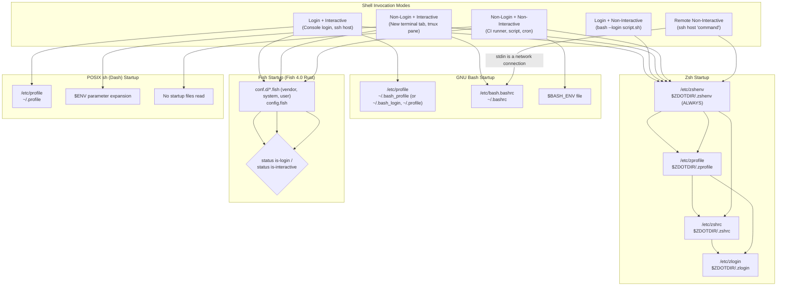
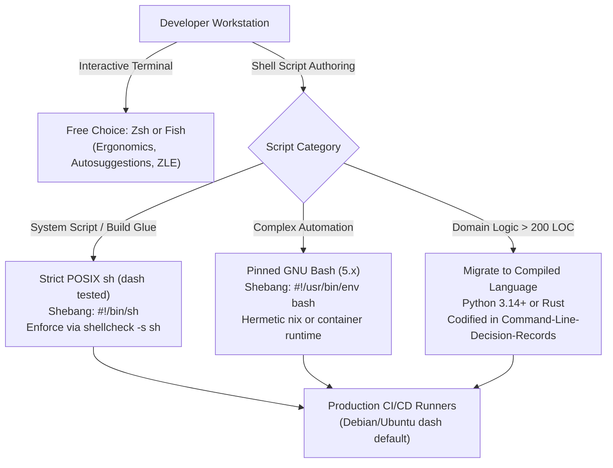

# POSIX sh, Bash, Zsh, and Fish Compared

> [!summary] Claim:
> The Unix shell family splits along two orthogonal design axes: execution environment bootstrapping (startup cascades across login, interactive, and remote non-interactive states) and grammar semantics (array indexing, word splitting, expansion stages, and globbing).
> POSIX sh (standardized in IEEE Std 1003.1; dash is the common minimal implementation, not a reference implementation) provides minimal execution overhead without arrays, splitting words on `$IFS` and leaving unmatched globs literal.
> GNU Bash maintains Bourne compatibility with 0-indexed arrays and procedural completion, but defaults to word splitting on parameter expansion and reads `~/.bashrc` when it detects it was started non-interactively by `sshd`.
> Zsh defaults to 1-indexed arrays, suppresses word splitting and pathname expansion on unquoted parameter expansions, and provides spec-driven completion via `compsys` and inode metadata filtering via glob qualifiers.
> Fish abandons Bourne heritage for a structured list-oriented language, ported from C++ to Rust for Fish 4.0, reading the same snippet-based startup files in every mode while eliminating implicit word splitting.



## The Mechanism

The command-line shell functions simultaneously as an interactive command interpreter and as a macro-expanding procedural programming language.
Understanding the architectural divergence between POSIX sh, Bash, Zsh, and Fish requires isolating how each shell initializes its execution environment, tokenizes and expands input words, manages structured data, and coordinates programmable completion.

### 1. Historical Evolution and Architectural Divergence

The modern Unix shell lineage traces back to Stephen Bourne's Version 7 Unix shell (`/bin/sh`, 1979).
The Bourne shell established the fundamental pipeline syntax, I/O redirection, and control structures, but lacked array data structures, job control, and command-line editing.

The IEEE POSIX standard (standardized in IEEE Std 1003.2-1992 and maintained through IEEE Std 1003.1-2024 / Issue 8) codified the portable shell grammar in Section 2 (Shell Command Language).
The standard specifies strict rules for word expansion, parameter manipulation, and shell execution environments, deliberately omitting interactive niceties such as arrays, syntax highlighting, and programmable completion.

The Almquist Shell (`ash`), authored by Kenneth Almquist, provided a lightweight, BSD-licensed implementation of the POSIX specification.
Herbert Xu ported NetBSD `ash` to Debian, where the port became `dash` (Debian Almquist Shell); the Debian Wiki "Shell" page lists `ash` as superseded by `dash` since Debian 3.1 sarge.
Ubuntu made `dash` its default `/bin/sh` in the 6.10 Edgy cycle (2006): the Ubuntu `dash` changelog entry 0.5.3-3ubuntu3 of 2006-07-05 resets the unanswered `dash/sh` debconf question to the new default of true (Launchpad changelog for `dash`), and Debian followed with Debian 6.0 squeeze, released 2011-02-06 (Debian Wiki "Shell"; Debian squeeze release page).
Dash keeps few non-POSIX builtins; dash(1) documents `fc` history and vi-mode line editing, so it does not eliminate them outright.
Measured on macOS arm64 (as of 2026-11), Homebrew dash 0.5.13.5 is 151 KiB on disk and `dash -c true` takes 1.8 ms versus 4.7 ms for Bash 5.3 (`hyperfine -N`, 200 runs), about 2.6 times faster, not three to four times.

GNU Bash (Bourne Again SHell) was originally written by Brian Fox of the Free Software Foundation, and its current developer and maintainer is Chet Ramey of Case Western Reserve University (Bash FAQ, A1).
Bash was engineered to be largely compatible with the Bourne shell and the POSIX specification (with `--posix` closing remaining gaps) while incorporating KornShell (`ksh88`/`ksh93`) language features.
Bash added 0-indexed indexed arrays, associative arrays (`declare -A`, Bash 4.0), process substitution (`<()`), and the GNU Readline library for in-terminal editing; arrays and process substitution originated in ksh.

Zsh was created by Paul Falstad in 1990 at Princeton University and has been maintained by Peter Stephenson and the Zsh Development Group.
Zsh abandoned strict Bourne defaults for interactive usability: it defaults to 1-indexed arrays, suppresses word splitting and globbing on unquoted parameter expansions, integrates the Zsh Line Editor (ZLE), and provides the `compsys` completion framework.
In 2019 with macOS Catalina (10.15), Apple replaced Bash 3.2 with Zsh as the default login and interactive shell (Apple Support 102360).
Apple Support 102360 states no reason for the change; the commonly repeated licensing explanation (GPLv3 in Bash 4.0 and later) is inference, not Apple's statement.

Fish (Friendly Interactive Shell) was released by Axel Liljencrantz in 2005.
Fish made an intentional, clean break from Bourne grammar, rejecting POSIX compatibility in favor of syntax highlighting, autosuggestions as you type, and a language where every variable is a list.
Fish 4.0.0, released 2025-02-27, shipped the port begun in PR #9512 ("Rewrite it in Rust", opened 2023-01-28), described in the blog post "Fish 4.0: The Fish Of Theseus" (2024-12-28).
The result contains no C++ and is almost entirely Rust; about 400 lines of C remain for libc gaps, feature detection, and a test helper.
The stated motivation was concurrency: Rust's `Send` and `Sync` statically enforce threading rules, while a C++ multithreading prototype "just didn't work out" because it was too easy to share objects across threads; poor C++ tooling and a small contributor pool were also cited.

### 2. Startup File Execution Cascades

Shell startup behavior is determined by two binary state variables: whether the shell is a **login shell** and whether the shell is **interactive**.

A login shell is invoked when the user first authenticates to the system, either locally via `login(1)`, over the network via `sshd(8)`, or when explicitly spawned with the `--login` or `-l` flag.
The launching program (`login`, `sshd`, a terminal emulator) denotes a login shell by prefixing a dash character to byte 0 of `argv[0]` (for example, `-bash` or `-zsh`).
An interactive shell is one started without non-option arguments (unless `-s` is given) and without `-c`, whose standard input and standard error are both connected to a terminal (as determined by `isatty(3)`), or one invoked with the `-i` option (bash(1), INVOCATION).

#### GNU Bash Startup Cascade

When invoked as GNU Bash:
1. **Interactive Login Shell:**
   Bash first reads and executes `/etc/profile` if it exists.
   It then searches for `~/.bash_profile`, `~/.bash_login`, and `~/.profile`, in that exact order, and reads and executes commands from the **first readable file found**.
   It does not read any subsequent profile files in that list.
   When an interactive login shell exits, or a non-interactive login shell runs `exit`, Bash executes `~/.bash_logout`; a build that defines `SYS_BASH_LOGOUT` in `config-top.h` (commented out by default, with `/etc/bash.bash_logout` as the sample value) runs that system file after `~/.bash_logout` (Bash 5.3 `builtins/exit.def`, function `bash_logout`).
2. **Interactive Non-Login Shell:**
   Bash reads and executes `/etc/bash.bashrc` (if enabled at build time) and then `~/.bashrc`.
   It does not read profile files.
   To ensure login shells inherit interactive configuration, canonical `~/.bash_profile` files explicitly source `~/.bashrc`.
3. **Non-Interactive Script Execution:**
   When running a script (`bash script.sh`), Bash does not read `/etc/profile`, `~/.bash_profile`, or `~/.bashrc`.
   Instead, it inspects the environment variable `BASH_ENV`.
   If `BASH_ENV` is non-empty, Bash expands its value and sources the resulting file path before executing the script, without searching `PATH` for it.
4. **Remote Non-Interactive Shell (The SSH Exception):**
   Bash attempts to determine whether its standard input is connected to a network connection, as when executed by `rshd` or `sshd` for `ssh user@host "command"`.
   If Bash determines it is running non-interactively in this fashion, it reads and executes `~/.bashrc`; it does not do so when invoked as `sh`, and `--norc` inhibits it (bash(1), INVOCATION).
   In Bash 5.3 `shell.c`, `run_startup_files` makes this check only for a non-login, non-interactive shell with `-c` that is not acting as `sh` and has `shell_level < 2`, and the stdin test (`isnetconn`) is always compiled in.
   An extra `SSH_CLIENT` / `SSH2_CLIENT` environment test exists only when `SSH_SOURCE_BASHRC` is defined, and it is commented out by default in `config-top.h`.
   Whether a given distribution defines it was not checked.
5. **Invoked as `sh` or with `--posix`:**
   When invoked via the name `sh`, Bash mimics historical `sh` startup: login shells read `/etc/profile` followed by `~/.profile`, interactive shells read the file named by `$ENV`, and non-interactive shells read nothing; it enters POSIX mode after reading the startup files.
   With `--posix`, interactive shells read only the `$ENV` file and no other startup files are read (bash(1), INVOCATION).
   It never reads `~/.bashrc` when named `sh`.

#### Zsh Startup Cascade

Zsh follows a rigid, non-short-circuiting cascade governed by the environment variable `$ZDOTDIR` (which defaults to `$HOME` if unset).
Zsh evaluates startup files in this sequence; `/etc/zshenv` is always read ("this cannot be overridden"), and `-f` (`NO_RCS`) or `NO_GLOBAL_RCS` suppresses only the files after it (Zsh Manual, Startup/Shutdown Files):
1. `/etc/zshenv` followed by `$ZDOTDIR/.zshenv`:
   Executed on **every new Zsh process**, including non-interactive automation and background scripts; forked subshells inside a running zsh do not re-read it.
2. `/etc/zprofile` followed by `$ZDOTDIR/.zprofile`:
   Executed **only if the shell is a login shell**.
   Runs before `.zshrc`.
3. `/etc/zshrc` followed by `$ZDOTDIR/.zshrc`:
   Executed **only if the shell is interactive**.
4. `/etc/zlogin` followed by `$ZDOTDIR/.zlogin`:
   Executed **only if the shell is a login shell**.
   Runs after `.zshrc`.
5. On exit of a login shell:
   `$ZDOTDIR/.zlogout` followed by `/etc/zlogout`; these are skipped when the shell ends by `exec`ing another process.

The execution of `$ZDOTDIR/.zshenv` on every non-interactive script invocation makes it a persistent source of performance degradation and unintended environment contamination across build pipelines.

#### Fish Startup Cascade

Fish rejects the split between login and non-login static files.
On every invocation, Fish reads configuration in this order (fish documentation, Configuration files):
1. Configuration snippets (`*.fish`) gathered from `$__fish_config_dir/conf.d` (default `~/.config/fish/conf.d`), `$__fish_sysconf_dir/conf.d` (default `/etc/fish/conf.d`), and the vendor directories (`fish/vendor_conf.d` under each `$XDG_DATA_DIRS` entry, among others).
   They run in order of filename, natural sort ("01" before "2"), across all directories; when several directories hold a file with the same name, only the first (the user's) runs.
2. System-wide configuration file `$__fish_sysconf_dir/config.fish` (usually `/etc/fish/config.fish`).
3. User configuration file `$__fish_config_dir/config.fish` (default: `~/.config/fish/config.fish`).

Rather than relying on separate files for login and interactive states, Fish scripts inspect runtime status using built-in predicates:
```fish
if status is-login
    # Login initialization: environment variables, global path exports
end

if status is-interactive
    # Interactive initialization: key bindings, prompts, completions
end
```
Fish functions are not parsed at startup.
Fish implements autoloading: when an unrecognized command `my_command` is entered, Fish searches `$fish_function_path` for a file named `my_command.fish`, parses it on demand, and executes the function.

#### POSIX sh (Dash) Startup Cascade

The POSIX standard specifies only `$ENV`; the profile files are traditional Bourne behavior that dash(1) documents, not POSIX requirements (the POSIX.1-2024 `sh` page mentions neither `/etc/profile`, `~/.profile`, login shells, nor a `-l` option):
1. **Login Shell (dash, traditional):**
   Reads `/etc/profile` followed by `~/.profile`.
2. **Interactive Shell, login or not (POSIX):**
   "When and only when an interactive shell is invoked", `$ENV` is subjected to parameter expansion and the result is used as the pathname of a file to execute (POSIX.1-2024 `sh`, ENV).
   A dash login shell reads `$ENV` after its profile files.
3. **Non-Interactive Script:**
   Reads no configuration files whatsoever.
   `$ENV` is ignored during non-interactive script execution.

### 3. Linguistic and Grammar Divergences

#### Array Indexing and Data Types

The four shells treat arrays and collections with incompatible indexing conventions and data layouts:

```text
Bash:   0-indexed   arr=(a b c)   ${arr[0]} == 'a'   ${arr[@]:1:2} == 'b c'
Zsh:    1-indexed   arr=(a b c)   $arr[1]   == 'a'   $arr[1,2]     == 'a b'
Fish:   1-indexed   set arr a b c $arr[1]   == 'a'   $arr[1..2]    == 'a' 'b'
POSIX:  No arrays   set -- a b c  $1        == 'a'   shift
```

In GNU Bash:
- Arrays are 0-indexed indexed arrays (`arr=(elem0 elem1)`).
- Subscript `${arr[0]}` references the first element.
- Slicing uses `${arr[@]:offset:length}` where `offset` is 0-based.
- Associative arrays require explicit typing via `declare -A assoc`.
- The bare variable reference `$arr` evaluates strictly to the first element `${arr[0]}`, ignoring remaining elements.

In Zsh:
- Arrays are 1-indexed by default (`arr=(elem1 elem2)`).
- Subscript `$arr[1]` references the first element; `$arr[0]` is empty.
- Slicing uses `$arr[start,end]` where both bounds are inclusive and 1-based.
- Negative indices count backwards from the end (`$arr[-1]` is the last element).
- The bare variable reference `$arr` evaluates to all elements of the array.
- If `setopt KSH_ARRAYS` is set, Zsh switches to 0-based indexing and causes `$arr` to evaluate only to `${arr[0]}`.

In Fish:
- Every variable is internally an array (list) of strings.
- Lists are 1-indexed (`set arr elem1 elem2`).
- Subscript `$arr[1]` references the first element.
- Slicing uses `$arr[start..end]`, supporting negative indices and reversed ranges (`$arr[-1..1]` lists the elements last to first); there is no step syntax, and `$arr[1..5..2]` fails with `Invalid index value` (fish 4.9.3, macOS arm64, as of 2026-11).
- Single scalar variables are lists of length 1; `count $var` returns 1.
- Expanding an empty list `$empty` produces zero command arguments rather than an empty string argument.

In POSIX sh (Dash):
- There is no array data type and no array syntax.
- Attempting `arr=(1 2 3)` fails with `Syntax error: "(" unexpected`.
- The only mechanism for holding an ordered list of strings is the positional parameter list (`$1`, `$2`, `$@`), manipulated via `set -- val1 val2` and `shift`.

#### Word Splitting and Pathname Expansion

The expansion order defined in [[Shell-Parsing-Tokenization-and-Expansion-Order]] reveals a critical divergence in word splitting:

```text
Input: var="hello world"; pat="*.txt"

Shell       Command           Resulting Arguments
POSIX/Bash  inspect $var      2 arguments: 'hello', 'world' (split by IFS)
POSIX/Bash  inspect $pat      N arguments: 'file1.txt', 'file2.txt' (globbed)
Zsh         inspect $var      1 argument:  'hello world' (no splitting)
Zsh         inspect $pat      1 argument:  '*.txt' (no globbing)
Fish        inspect $var      1 argument:  'hello world' (no splitting)
Fish        inspect $pat      1 argument:  '*.txt' (no globbing)
```

In POSIX sh and Bash:
- Unquoted parameter expansion (`$var`) is subjected to Field Splitting (XCU Section 2.6.5) based on the characters in `$IFS` (default: space, tab, newline).
- After field splitting, every resulting field undergoes Pathname Expansion (globbing).
- A variable containing spaces or wildcards expands into multiple arguments or matching filesystem paths unless double-quoted (`"$var"`).

In Zsh:
- Unquoted parameter expansion (`$var`) does **not** undergo word splitting or pathname expansion by default.
- Whitespace and wildcard characters inside `$var` are preserved as literal characters within a single word.
- Word splitting requires explicit syntax: `$=var` splits on `$IFS`, while `$~var` enables globbing.
- Setting `setopt SH_WORD_SPLIT` forces Zsh to adopt POSIX and Bash field-splitting semantics.

In Fish:
- Word splitting on variable expansion does not exist.
- If a list element contains spaces, those spaces remain intact when the variable expands.
- Lists expand element-by-element: if `set arr "a b" "c d"`, then `cmd $arr` passes exactly two arguments: `"a b"` and `"c d"`.
- Unquoted command substitutions (`(cmd)`, or `$(cmd)`) split strictly on newlines, never on spaces within a line, and ignore `$IFS` (fish documentation, Command substitution; `count (printf "a b\nc d\n")` prints 2).
  The `$(cmd)` spelling was added in fish 3.4.0, released 2022-03-12 (fish 3.4 release notes: "`$(cmd)` now has the same meaning as `(cmd)` but it can be used inside double quotes"); on fish 4.9.3 `echo $(echo hi)` prints `hi` (executed, macOS arm64, as of 2026-11).

#### Glob Qualifiers and Path Traversal

File discovery mechanisms diverge between shell-internal metadata inspection and external utility invocation:

POSIX sh provides basic wildcards (`*`, `?`, `[...]`).
If a glob matches no files, POSIX specifies that the pattern is passed to the command as an unchanged literal string.

GNU Bash supports basic globs and provides optional shell options:
- `shopt -s extglob`: enables composite patterns `?(pattern)`, `*(pattern)`, `+(pattern)`, `@(pattern)`, and `!(pattern)`.
- `shopt -s globstar`: enables recursive directory traversal using `**`.
- `shopt -s nullglob`: unmatched patterns expand to zero words instead of remaining literal.
- `shopt -s failglob`: unmatched patterns produce an expansion error and prevent command execution.

Zsh implements native Extended Globbing (`setopt EXTENDED_GLOB`) and **Glob Qualifiers**.
Glob qualifiers are trailing parentheses that filter matching paths directly against file inode metadata (`stat(2)`), eliminating subprocess calls to `find(1)`:
- `*(.)`: matches regular files only.
- `*(/)`: matches directories only.
- `*(@)`: matches symbolic links only.
- `*(x)`: matches owner-executable files (`*(X)` for others-executable).
- `*(L0)`: matches zero-length files (`*(Lm+10)` for files larger than 10 megabytes).
- `*(mh-1)`: matches files modified within the last hour.
- `*(om)`: sorts results by modification time, newest first (`*(Om)` oldest first).
- `*(oL)`: sorts results by file size.
- `*([1,5])`: selects the first five matches after sorting.
- `*(N)`: enables nullglob behavior for this specific pattern.

Fish supports `*` and recursive `**` by default without configuration options; `?` stopped being a wildcard by default in fish 4.0.0, when the `qmark-noglob` feature (introduced in 3.0) was turned on (fish release notes; `echo ?.txt` prints `?.txt` on fish 4.9.3).
If a glob matches no files, Fish does not run the command and prints `No matches for wildcard`, behaving like Bash's `failglob`.
The exceptions are `set`, `path`, variable overrides, `count`, and `for`, where an unmatched glob expands to zero arguments, like Bash's `nullglob` (fish documentation, Wildcards).

### 4. Programmable Completion Frameworks

The mechanics of shell completion determine interactive latency and terminal user experience:

#### GNU Bash: Procedural Completion via `complete`

GNU Bash delegates completion to the Readline library via the `complete` and `compgen` builtins.
The completion mechanism is procedural:
1. When the user presses Tab, Readline tokenizes the current line and invokes the shell function registered with `complete -F <function> <command>`.
2. Bash populates global variables including `COMP_WORDS` (an array of all words on the command line), `COMP_CWORD` (the index of the word containing the cursor), and `COMP_LINE` (the full command line string), plus `COMP_POINT`, `COMP_KEY`, and `COMP_TYPE` (bash(1), Programmable Completion).
3. The completion function inspects `COMP_WORDS[COMP_CWORD]` and calls `compgen` to generate candidate strings matching the current prefix.
4. The function assigns the candidates to the global indexed array `COMPREPLY`.
5. Readline reads `COMPREPLY` and renders the candidates.

Because Bash completion relies on procedural shell script execution and global array mutation, every command substitution or pipeline inside a completion function forks a subshell on each Tab press, so a completion suite's latency is the sum of its forks and external commands; no fork count or latency for a specific suite was measured here.

#### Zsh: Declarative Completion via `compsys`

Zsh implements the `compsys` completion architecture, initialized with `autoload -Uz compinit && compinit`.
`compsys` is a library of shell functions built on the `zsh/complete` module's builtins (`compadd`, `compset`); rather than mutating one global reply array, completion functions declare the command's syntax as specs (it builds no abstract syntax tree):
1. Functions use `_arguments` to declare flags, options, mutually exclusive arguments, and parameter types declaratively.
2. Example specification:
   ```zsh
   _mytool() {
       _arguments -s \
           '-v[Enable verbose output]' \
           '--config=[Path to configuration file]:file:_files' \
           '1:subcommand:(build test deploy)' \
           '*:arguments:_files'
   }
   compdef _mytool mytool
   ```
3. `_arguments` parses the current line against the specs and dispatches to action functions (`_files`), which add candidates through the C builtin `compadd`.
4. Formatting, matching criteria (case-insensitive, substring, typo correction), and menu selection are decoupled from the completion script and configured centrally using `zstyle`:
   ```zsh
   zstyle ':completion:*' matcher-list 'm:{a-zA-Z}={A-Za-z}'
   zstyle ':completion:*:*:*:*:*' menu select
   ```

#### Fish: Declarative First-Class Completion

Fish implements programmable completion through its built-in `complete` command, implemented in Rust:
1. Completions specify flags, subcommands, descriptions, and dynamic availability predicates in a single command:
   ```fish
   complete -c mytool -s v -l verbose -d "Enable verbose logging"
   complete -c mytool -l config -r -F -d "Configuration file"
   complete -c mytool -n "__fish_use_subcommand" -a "build test deploy"
   ```
2. Completion descriptions are displayed in a two-column interactive pager alongside candidates.
3. Autosuggestions are generated asynchronously on every keystroke by querying the completion engine and history database in background threads, rendering matching arguments in muted text before Tab is pressed.

## Commands and Numbers to Know

| Metric / Parameter | POSIX sh (dash) | GNU Bash (5.3) | Zsh (5.9) | Fish (4.9 Rust) | Platform | Notes |
| :--- | :--- | :--- | :--- | :--- | :--- | :--- |
| Binary size on disk | 151 KiB | 986 KiB | 751 KiB | 9.1 MiB | macOS (as of 2026-11) | Homebrew dash 0.5.13.5, Nix bash 5.3p15, Nix zsh 5.9.2, Homebrew fish 4.9.3 on arm64 (`stat -f %z`); Apple's universal `/bin/bash` 3.2 is 1.9 MiB; Linux sizes were not measured and are not claimed |
| Process startup latency | 1.8 ms | 4.7 ms | 4.6 ms | 4.2 ms | macOS (as of 2026-11) | `hyperfine -N`, 200 runs, mean wall time of `dash -c true`, `bash --noprofile --norc -c true`, `zsh -f -c true`, `fish --no-config -c true` on arm64 |
| Array indexing base | N/A (no arrays) | 0-indexed | 1-indexed | 1-indexed | Both (as of 2026-11) | Zsh uses 0 with `KSH_ARRAYS` |
| Slicing syntax | N/A | `${a[@]:off:len}` | `$a[start,end]` | `$a[start..end]` | Both (as of 2026-11) | Bash offset 0-based; Zsh/Fish inclusive 1-based |
| Word splitting on `$var` | Yes (by `$IFS`) | Yes (by `$IFS`) | No (unless `$=var`) | No (lists preserved) | Both (as of 2026-11) | Zsh enables via `SH_WORD_SPLIT` |
| Unmatched glob behavior | Remains literal | Remains literal | Expansion error | Expansion error | Both (as of 2026-11) | Bash `nullglob`/`failglob` adjust behavior; zsh `NOMATCH` prints `no matches found`; fish exempts `set`, `for`, `count` |
| Script startup file read | None (`$ENV` ignored) | `$BASH_ENV` (if set) | `/etc/zshenv`, `$ZDOTDIR/.zshenv` | `conf.d/*.fish`, `config.fish` | Both (as of 2026-11) | Zsh reads `.zshenv` unless `-f` passed; `/etc/zshenv` is always read |
| Remote SSH script startup | None | Reads `~/.bashrc` | Reads `.zshenv` | `conf.d/*.fish`, `config.fish` | Both (as of 2026-11) | Bash checks whether stdin is a network connection |
| Line editor engine | None | GNU Readline | Zsh Line Editor (ZLE) | Native Rust line editor | Both (as of 2026-11) | Fish line editor supports multiline syntax |
| Background autosuggestions | Unsupported | Unsupported | Plugin (`zsh-autosuggestions`) | Built-in (asynchronous) | Both (as of 2026-11) | Fish uses background threads in Rust |

## Multi-Language Comparison: Shell Process Execution across C, Python, and Rust

Application runtimes routinely spawn shell environments to evaluate commands, redirect streams, and resolve environment variables.
The mechanisms and security hazards of shell execution vary across compiled and managed languages:

| Concern | C (POSIX.1-2024 / glibc / musl) | Python (`subprocess`, CPython 3.14+) | Rust (`std::process::Command`) |
| :--- | :--- | :--- | :--- |
| Default shell binary | `/bin/sh` via `system(3)` or `popen(3)` | `/bin/sh` when `shell=True` (Unix default) | None (`Command::new` requires explicit binary) |
| System call pathway | `posix_spawn(3)` or `fork(2)` + `execve(2)` | `posix_spawn` only when its conditions hold; since 3.13 also with the default `close_fds=True` where libc has `posix_spawn_file_actions_addclosefrom_np` (recent Linux, FreeBSD, Solaris), else the `fork_exec` path (`vfork` on Linux) | `posix_spawnp` when no `pre_exec` or other blocker applies, else `fork` + `execvp` (Rust std `sys/process/unix/unix.rs`: `spawn_fn = libc::posix_spawnp`; fork fallback when uid, gid, groups, chroot, or `pre_exec` closures are set, or the environment sets `PATH` and the program is a bare name) |
| Shell invocation arguments | `execl("/bin/sh", "sh", "-c", cmd, (char *)0)` | `['/bin/sh', '-c', cmd]` | `Command::new("sh").arg("-c").arg(cmd)` |
| Quoting / Injection risk | Extreme; command string parsed by shell | Extreme with `shell=True`; safe with `shell=False` | Safe by default; strings passed as distinct `argv` pointers |
| Word splitting behavior | Subject to `/bin/sh` (`dash` vs `bash`) `$IFS` rules | Subject to `/bin/sh` rules with `shell=True` | No word splitting when using `.args([...])` |
| Signal propagation | Parent blocks `SIGCHLD`, ignores `SIGINT`/`SIGQUIT` | Shell receives signals; subshell traps dictate behavior | Direct child receives signals; no intermediate shell |
| Memory footprint during exec | `posix_spawn` avoids page table cloning | `posix_spawn` prevents copying Python heap | `posix_spawn` avoids memory duplication |

In C:
Building a command with `snprintf(cmd, sizeof cmd, "ls -la %s", user_input)` and calling `system(cmd)` passes the raw string to `/bin/sh -c`.
On Ubuntu, `/bin/sh` is `dash`, which performs immediate word splitting and pathname expansion on unquoted variables.
If `user_input` contains `; rm -rf /`, the shell executes the injected command.

In Python:
```python
import subprocess

# Insecure: spawns /bin/sh -c, subjects input to shell parsing and word splitting
subprocess.run(f"echo {user_input}", shell=True)

# Secure: direct exec of echo (posix_spawn or fork_exec), no shell parsing or word splitting
subprocess.run(["echo", user_input], shell=False)
```

In Rust:
```rust
use std::process::Command;

// Safe: arguments are passed directly as distinct null-terminated strings via execve
let status = Command::new("mytool")
    .arg("--flag")
    .arg(user_input)
    .status()
    .expect("Failed to execute process");

// Explicit shell execution when pipeline or glob expansion is required:
let shell_status = Command::new("sh")
    .arg("-c")
    .arg("cat file.txt | sort | uniq")
    .status()
    .expect("Failed to execute shell pipeline");
```

## Worked Lab Example

The companion lab lives at `code/01-Command-Line/shell_startup_matrix/`.
The harness has no tag for extra shells, so the lab declares no `# requires:` line and instead exits with status 2 and a message on stderr when `bash`, `zsh`, `dash`, `fish`, or `python3` is missing from `PATH`, or when a shell is below the major version it needs (Bash 5, Zsh 5, Fish 4); it never skips silently.
Only a `darwin-arm64` golden file is recorded, so Linux output is unverified.
The lab proves the startup cascades, the Bash rule that sources `~/.bashrc` for a non-interactive `bash -c` whose stdin is a socket (and not for a pipe, with `--norc`, or when invoked as `sh`), the array, splitting, glob-qualifier, completion, and bashism behavior; it does not measure startup time or binary size, which the note's tables take from separate `hyperfine` and `stat` runs.

The test harness provisions isolated filesystem sandboxes for Dash, GNU Bash, Zsh, and Fish.
It points `HOME`, `ZDOTDIR`, `XDG_CONFIG_HOME`, `BASH_ENV`, and `ENV` at temporary configuration directories, executes each shell across its primary invocation modes, evaluates array and word-splitting semantics, tests Zsh glob qualifiers, queries programmable completion engines, and validates Dash's rejection of non-POSIX bashisms.

Execute the verification harness:

```bash
cd code && python3 -m _harness.verify 01-Command-Line/shell_startup_matrix/
```

### Verified Lab Output (`darwin-arm64`)

The following output was copied byte for byte from `expected/darwin-arm64.txt` (platform `darwin-arm64`; recorded with Bash 5.3.15, Zsh 5.9.2, Fish 4.9.3, and Dash 0.5.13.5, as of 2026-11).
The golden file pins only major-version floors, so a minor upgrade of any shell leaves it valid:

```text
=== SHELL PLATFORM IDENTIFICATION ===
Host OS: Darwin
Host Arch: arm64
bash major version >= 5: yes
zsh major version >= 5: yes
fish major version >= 4: yes

=== PART 1: STARTUP FILE EXECUTION CASCADES ===
--- 1.1 Bash Execution Modes ---
Mode A: Interactive with explicit --rcfile (--noprofile)
  [bash] sourced the --rcfile file (not ~/.bashrc)
Mode B: Login (via HOME .bash_profile)
  [bash] sourced ~/.bash_profile (login)
Mode C: Non-login Interactive
  [bash] sourced ~/.bashrc (interactive)
Mode D: Non-login Non-interactive (with BASH_ENV)
  [bash] sourced BASH_ENV file (non-interactive)
Mode E: Non-login Non-interactive (default: no startup files)
--- 1.1b Bash Remote Shell Rule (stdin kind) ---
Mode F: stdin is a socket (like sshd)
  [bash] sourced ~/.bashrc (remote non-interactive rule)
Mode G: stdin is a socket, with --norc
Mode H: stdin is a pipe (no network connection)
Mode I: stdin is a socket, invoked as sh

--- 1.2 Zsh Execution Modes ---
Mode A: Login + Interactive
  [zsh] sourced ~/.zshenv (all invocations)
  [zsh] sourced ~/.zprofile (login before zshrc)
  [zsh] sourced ~/.zshrc (interactive)
  [zsh] sourced ~/.zlogin (login after zshrc)
Mode B: Login + Non-interactive
  [zsh] sourced ~/.zshenv (all invocations)
  [zsh] sourced ~/.zprofile (login before zshrc)
  [zsh] sourced ~/.zlogin (login after zshrc)
Mode C: Non-login Interactive
  [zsh] sourced ~/.zshenv (all invocations)
  [zsh] sourced ~/.zshrc (interactive)
Mode D: Non-login Non-interactive (script execution)
  [zsh] sourced ~/.zshenv (all invocations)
Mode E: Explicit Bypass (-f / NO_RCS)

--- 1.3 Fish Execution Modes ---
Mode A: Interactive Non-login
  [fish] sourced conf.d/01_snippet.fish
  [fish] sourced config.fish
  [fish] branch evaluated: status is-interactive
Mode B: Non-interactive Non-login (script)
  [fish] sourced conf.d/01_snippet.fish
  [fish] sourced config.fish
Mode C: Login Non-interactive
  [fish] sourced conf.d/01_snippet.fish
  [fish] sourced config.fish
  [fish] branch evaluated: status is-login

--- 1.4 POSIX sh / Dash Execution Modes ---
Mode A: Login Shell
  [dash/posix] sourced ~/.profile (login)
Mode B: Interactive Non-login with ENV
  [dash/posix] sourced $ENV (interactive)
Mode C: Non-interactive Script (ignores ENV and .profile)

=== PART 2: ARRAY INDEXING AND SLICING DIVERGENCE ===
Bash base index 0       : elem0
Bash index 1            : elem1
Bash array length       : 4
Bash slice offset:len   : elem1 elem2
Zsh default base index 1: elem1
Zsh index 0 (empty)     : 
Zsh array length        : 4
Zsh slice [start,end]   : elem1 elem2
Zsh with KSH_ARRAYS [0] : elem1
Zsh with KSH_ARRAYS bare: elem1
Fish base index 1       : elem1
Fish index 2            : elem2
Fish array count        : 4
Fish slice [start..end] : elem2 elem3
Dash positional param $1: elem1
Dash positional param $2: elem2
Dash positional count $#: 4

=== PART 3: WORD SPLITTING AND GLOB EXPANSION ===
  bash arguments received: 3
  bash arguments received: 2
  zsh default arguments received: 1
  zsh default arguments received: 1
  zsh SH_WORD_SPLIT arguments received: 3
  fish arguments received: 1
  fish arguments received: 1
  dash arguments received: 3
  dash arguments received: 2

=== PART 4: ZSH GLOB QUALIFIERS ===
Zsh plain files *(.)    :  empty_file.txt regular_file.txt
Zsh directories *(/)    :  sub_dir
Zsh symlinks *(@)       :  symlink.txt
Zsh zero-length *(L0)   :  empty_file.txt

=== PART 5: PROGRAMMABLE COMPLETION PARADIGMS ===
Bash compgen matching:
build
bench
bundle
Fish complete query matching:
bench	Execute benchmarks
build	Compile binary target

=== PART 6: BASHISM REJECTION IN DASH ===
Test 1: Array syntax in Dash -> dash: 1: Syntax error: "(" unexpected 
Test 2: Double brackets [[ in Dash -> dash: 1: [[: not found 
Test 3: Process substitution <() in Dash -> dash: 1: Syntax error: "(" unexpected 
```

### Analysis of the Experimental Results

1. **Startup Cascades:**
   The output confirms the strict four-file cascade of Zsh: `~/.zshenv` -> `~/.zprofile` -> `~/.zshrc` -> `~/.zlogin`.
   Notice that in Mode B (Zsh Login Non-Interactive), `~/.zshrc` is omitted, while `~/.zprofile` and `~/.zlogin` both execute.
   In Mode D (Zsh Non-Interactive script execution), `~/.zshenv` executes, proving that any expensive logic in `~/.zshenv` penalizes every build script.
   In Fish, `conf.d/01_snippet.fish` and `config.fish` execute unconditionally; the `status is-login` and `status is-interactive` branches selectively execute based on runtime state.
   Dash confirms that standard script execution reads zero initialization files.
   Bash Mode A runs `bash --noprofile --rcfile custom_rcfile -i`, an interactive non-login shell, and sources the `--rcfile` file instead of `~/.bashrc`; Mode B (`--login -c`) is the run that proves `~/.bash_profile` is read for login shells.
   Modes F to I exercise the remote shell rule: `bash -c` with stdin a connected socket sources `~/.bashrc` (Mode F), while `--norc` (Mode G), a pipe on stdin (Mode H), and invocation as `sh` (Mode I) each read nothing.
   The lab starts those runs with `SHLVL=0` because Bash applies the rule only at shell level below 2, and it uses a local socket pair instead of a real `sshd`, since Bash tests only whether `getpeername(2)` succeeds on stdin.

2. **Array Semantics:**
   In Bash, `${arr[0]}` returns `elem0`.
   In Zsh, `$arr[1]` returns `elem1`, while `$arr[0]` produces an empty string.
   Setting `KSH_ARRAYS` in Zsh shifts indexing to 0-based and alters bare `$arr` from evaluating all elements to evaluating only the first element.
   Fish demonstrates 1-based indexing (`$arr[1] == elem1`) and 1-based range slicing (`$arr[2..3] == elem2 elem3`).

3. **Word Splitting:**
   Passing an unquoted string containing three space-separated words (`"first second third"`) results in three distinct arguments in Bash and Dash, but exactly one argument in default Zsh and Fish.
   Enabling `SH_WORD_SPLIT` in Zsh restores POSIX/Bash behavior, splitting the string into three arguments.
   Expanding unquoted `*.txt` expands to matching files in Bash and Dash, but remains an unexpanded literal in Zsh and Fish.

4. **Zsh Glob Qualifiers:**
   `*(.)` matches regular files, `*(/)` matches directories, and `*(@)` matches symbolic links without spawning subprocesses.
   `*(L0)` filters by size, matching only the 0-byte file `empty_file.txt`.

5. **Bashism Failures in Dash:**
   Dash rejects array declarations (`arr=(1 2 3)`), conditional double brackets (`[[`), and process substitutions (`<()`), verifying why scripts authored with bashisms fail when executed under `/bin/sh` on Debian and Ubuntu.

## Pitfalls

> [!warning] Pitfall: Putting PATH mutations or heavy commands in `~/.zshenv`
> Unlike Bash, Zsh evaluates `$ZDOTDIR/.zshenv` on every new zsh process, including non-interactive scripts (`zsh script.sh`) and `zsh -c` calls; forked subshells inside a running zsh do not re-read it.
> Placing version managers (`nvm`, `pyenv`, `rvm`), command substitutions (`eval "$(brew shellenv)"`), or output commands in `~/.zshenv` adds their full cost to every zsh script invocation: a `.zshenv` containing only `sleep 0.05` raised `zsh -c true` from 6.7 ms to 62.1 ms (`hyperfine -N`, 20 runs, zsh 5.9.2, macOS arm64, as of 2026-11).
> The cost is linear: every 100 ms in `.zshenv` adds 100 s per 1,000 zsh invocations, which matters only where tooling actually launches zsh (most build tools launch `/bin/sh`).
> Restrict `~/.zshenv` strictly to exporting environment variables that do not require subprocess evaluation, or guard expensive code with `if [[ -o interactive ]]; then ... fi`.
> A `[[ -o rcs ]]` guard does nothing there: `RCS` is necessarily set whenever `.zshenv` runs (zsh 5.9.2 prints `rcs-on` from `.zshenv` in both `zsh -c` and `zsh -i`, macOS arm64, as of 2026-11).

> [!warning] Pitfall: Emitting stdout from `~/.bashrc` breaking SSH, SCP, and Git
> When an SSH connection executes a non-interactive remote command (for example, `ssh user@host "uptime"` or `git push`), GNU Bash checks whether stdin is a network connection and, if so, sources `~/.bashrc`.
> If `~/.bashrc` contains an unguarded `echo`, `fortune`, `neofetch`, or terminal setup utility, it writes bytes to `stdout`.
> Automated protocols including `scp`, `sftp`, and `git` expect binary framing or clean protocol handshakes; unexpected text on `stdout` breaks them, and the transfer or handshake fails or hangs; the exact error string depends on the client and was not reproduced here.
> Guard interactive output in `~/.bashrc` with an early-return check:
> ```bash
> case $- in
>     *i*) ;;
>       *) return;;
> esac
> ```

> [!warning] Pitfall: Authoring scripts with `#!/bin/sh` that rely on Bashisms
> On macOS, `/bin/sh` is a small launcher that runs the shell named by the `/private/var/select/sh` symlink, which points to `/bin/bash` (Bash 3.2.57) by default, so it runs Bash 3.2 in POSIX mode (macOS arm64, as of 2026-11); on Red Hat and CentOS, `/bin/sh` is a symlink to `bash`.
> On Debian, Ubuntu, and Alpine, `/bin/sh` is `dash` or BusyBox `ash`.
> A script developed on macOS using `arr=(a b c)`, `[[ $x == $y ]]`, or `source ./file` will run successfully locally, but crash with `Syntax error: "(" unexpected` or `[[: not found` when deployed to a Linux CI/CD runner or container.
> Always use `#!/usr/bin/env bash` when utilizing Bash features, or validate portability against `dash` using `shellcheck -s sh` as codified in [[Robust-Shell-Scripting-and-ShellCheck]].

> [!warning] Pitfall: Off-by-one errors when porting array logic between Bash and Zsh
> Bash arrays are 0-indexed; Zsh and Fish arrays are 1-indexed.
> Porting a loop or array slice directly from Bash to Zsh causes the first element to be skipped if starting at index 1, or returns an empty element if querying index 0.
> Furthermore, in Bash, the bare variable reference `$arr` evaluates to `${arr[0]}` (the first element only).
> In Zsh, `$arr` evaluates to the entire array.
> Code that relies on `$arr` returning a single scalar will pass multiple arguments in Zsh unless `setopt KSH_ARRAYS` is set.

> [!warning] Pitfall: Relying on unquoted parameter expansion for word splitting in Zsh
> In POSIX sh and Bash, passing an unquoted variable containing space-separated flags (for example, `FLAGS="-a -b -c"; cmd $FLAGS`) splits the variable into three arguments via `$IFS`.
> In Zsh, unquoted `$FLAGS` is preserved as a single argument containing embedded spaces, passing `"-a -b -c"` as a single word to `cmd`.
> To split a variable in Zsh, use explicit parameter expansion flags (`cmd $=FLAGS`) or store flags in an array: `flags=(-a -b -c); cmd "${flags[@]}"`.

> [!warning] Pitfall: CI pipeline cache poisoning via `$BASH_ENV`
> In non-interactive Bash script invocations, Bash expands and sources the file path specified in `$BASH_ENV`.
> If an untrusted upstream step in a CI/CD pipeline or a compromised build script exports `BASH_ENV=/tmp/malicious.sh`, every subsequent Bash script executed in that build job will execute `/tmp/malicious.sh` with the runner's full privileges.
> Ensure CI runner templates explicitly sanitize or unset `BASH_ENV` before executing third-party build targets.

## At Scale

At the scale of an individual engineer, choice of shell is an ergonomic preference.
Developers frequently select Zsh or Fish for syntax highlighting, autosuggestions, and programmable completions.

At enterprise scale (1,000 to 50,000 engineers and tens of thousands of automated build agents), shell heterogeneity introduces severe operational risks: build non-determinism, CI/CD pipeline failures, and latency bottlenecks.
Scaling organizations resolve this by establishing an architectural **Paved Road**:



### Architectural Decision Rules

1. **Strict Separation of Interactive Shells and Automation Shells:**
   Engineers may run Zsh or Fish interactively on workstations.
   No production script, CI/CD pipeline step, Dockerfile `RUN` instruction, or Makefile recipe may ever depend on Zsh or Fish features.
   Production automation must target either strict POSIX sh (`#!/bin/sh`) or pinned GNU Bash (`#!/usr/bin/env bash`).

2. **The `#!/bin/sh` Contract:**
   Any script specifying `#!/bin/sh` must run cleanly under `dash` and BusyBox `ash`.
   It must pass `shellcheck -s sh` in pre-commit hooks and CI gates.
   Arrays, `[[`, process substitution `<()`, `local` keyword (non-POSIX, though supported by dash), and `function` keyword are forbidden.

3. **The GNU Bash Tier:**
   When an automation task requires indexed arrays, associative arrays, or process substitution, it must explicitly specify `#!/usr/bin/env bash`.
   Because macOS ships ancient Bash 3.2 (`3.2.57(1)-release`, whose binary carries a 2007 FSF copyright line) while Linux hosts run Bash 5.x, cross-platform enterprise toolchains must provide a pinned, modern Bash binary via Nix, Homebrew, or Devcontainers as established in [[Dotfiles-Nix-Direnv-Mise-and-Devcontainers]].

4. **The 200-Line Migration Boundary:**
   When a shell script exceeds 200 lines, requires nested data structures, processes complex JSON/YAML payloads, or handles security-sensitive credentials, it must be rewritten in Python or Rust.
   Shell scripts lack structured error handling, static typing, and memory safety.
   This boundary is codified in [[Command-Line-Decision-Records]].

5. **Workstation Dotfile Management:**
   Enterprise workstations must decouple environment exports from interactive configurations.
   Standardize `PATH` exports and toolchain activations into `~/.profile` or direct `mise`/`direnv` environment configurations.
   Audit `~/.zshenv` across managed developer laptops to ensure no dynamic subprocesses or slow evaluations degrade shell spawn latency.

## Practice Drill

> [!tip] Practice Drill:
> 1. In an empty directory, author a test script `test_portability.sh` containing:
>    ```bash
>    #!/bin/sh
>    data="alpha beta gamma"
>    set -- $data
>    echo "Words: $#"
>    arr=(1 2 3)
>    echo "Array: ${arr[0]}"
>    ```
> 2. Execute the script with `bash test_portability.sh`, `zsh test_portability.sh`, and `dash test_portability.sh`.
> 3. Observe that Bash prints `Words: 3` and `Array: 1`, Zsh prints `Words: 1` and an empty `Array: ` (index 0 is empty unless `KSH_ARRAYS`), and Dash prints `Words: 3` then fails with `test_portability.sh: 5: Syntax error: "(" unexpected` (bash 5.3.15, zsh 5.9.2, dash 0.5.13.5, macOS arm64, as of 2026-11).
> 4. Run `shellcheck -s sh test_portability.sh` and note each violation identified by the linter.
> 5. Rewrite the script to be strictly POSIX-compliant using positional parameters (`set -- 1 2 3`) and verify that it passes under `dash`.
> 6. Approximate the SSH non-interactive bug locally (this uses the `BASH_ENV` path, not the `sshd` detection; Modes F to I of the lab exercise the real socket-on-stdin rule): create a temporary directory, create a mock `.bashrc` containing `echo "DEBUG: bashrc loaded"`, invoke `BASH_ENV=mock.bashrc bash -c "true"`, and verify that the output pollutes the stream.

## Interview Questions

> [!question] L5: Predict the output of the following command sequence when run in GNU Bash versus default Zsh:
> ```bash
> arr=(apple banana cherry)
> str="foo bar"
> func() { echo "$1"; }
> func $str
> echo "${arr[1]}"
> ```
>
> > [!success]- Answer
> > **In GNU Bash:**
> > - `func $str`: Bash performs field splitting on the unquoted parameter `$str` using `$IFS`, expanding it into two arguments (`"foo"` and `"bar"`).
> >   The function prints `$1`, which is `foo`.
> > - `echo "${arr[1]}"`: Bash uses 0-based array indexing, so index 1 references the second element, printing `banana`.
> >
> > **In default Zsh:**
> > - `func $str`: Zsh does not perform word splitting on unquoted parameters by default.
> >   `$str` is passed as a single argument (`"foo bar"`).
> >   The function prints `$1`, which is `foo bar`.
> > - `echo "${arr[1]}"`: Zsh uses 1-based array indexing by default, so index 1 references the first element, printing `apple`.

> [!question] L5: A developer tests a script on macOS with `#!/bin/sh` and it succeeds.
> When executed in an Ubuntu Docker container, it crashes with `dash: 1: Syntax error: "(" unexpected`.
> What is the root cause?
>
> > [!success]- Answer
> > On macOS, `/bin/sh` re-execs the shell named by the `/private/var/select/sh` symlink, which defaults to `/bin/bash`, so it is GNU Bash 3.2 running in POSIX compatibility mode (macOS sh(1)).
> > While Bash enables POSIX mode, it still parses certain Bash syntax extensions (such as array declarations `arr=(...)`).
> > On Ubuntu, `/bin/sh` is symlinked to `dash` (Debian Almquist Shell), which is a strict, lightweight POSIX shell implementation containing zero support for arrays.
> > When Dash encounters the opening parenthesis in `arr=(...)`, it encounters an invalid token in command position and terminates with a syntax error.
> > The fix is to change the shebang to `#!/usr/bin/env bash` or rewrite the script to use POSIX positional parameters (`set -- ...`).

> [!question] L6: An engineer reports that automated `scp` file transfers to a remote Linux server fail with `protocol error: unexpected <newline>` or `Received message too long`, but interactive SSH login works normally.
> How do you diagnose and fix this?
>
> > [!success]- Answer
> > The root cause is that the user's `~/.bashrc` on the remote server contains an unconstrained command that prints text to standard output (such as `echo`, `neofetch`, `date`, or a welcome banner).
> > When `scp` or `sftp` connects, the SSH daemon executes a non-interactive remote shell (e.g., `bash -c scp ...`).
> > GNU Bash attempts to detect that its standard input is a network connection from `sshd` and, when it does, reads `~/.bashrc` (bash(1), INVOCATION).
> > The text printed by `~/.bashrc` is written to `stdout`, corrupting the binary protocol stream expected by the local `scp` client.
> > To fix this, wrap all interactive output and terminal configuration in `~/.bashrc` with an early-return guard: `[[ $- == *i* ]] || return` (or the portable POSIX construct `case $- in *i*) ;; *) return;; esac`).

> [!question] L6: Walk through the exact file execution cascade when a user executes `ssh server "uptime"` versus `ssh server` on a host where their default shell is Zsh.
>
> > [!success]- Answer
> > **Interactive Login (`ssh server`):**
> > 1. Zsh is spawned as an interactive login shell (`argv[0]` starts with `-zsh`).
> > 2. It executes `/etc/zshenv` followed by `$ZDOTDIR/.zshenv`.
> > 3. Because it is a login shell, it executes `/etc/zprofile` followed by `$ZDOTDIR/.zprofile`.
> > 4. Because it is an interactive shell, it executes `/etc/zshrc` followed by `$ZDOTDIR/.zshrc`.
> > 5. Because it is a login shell, it finishes initialization by executing `/etc/zlogin` followed by `$ZDOTDIR/.zlogin`.
> > 6. On logout, it executes `$ZDOTDIR/.zlogout` and `/etc/zlogout`.
> >
> > **Remote Command Execution (`ssh server "uptime"`):**
> > 1. Zsh is spawned as a non-login, non-interactive shell (`zsh -c "uptime"`).
> > 2. It executes `/etc/zshenv` followed by `$ZDOTDIR/.zshenv`.
> > 3. It skips `.zprofile`, `.zshrc`, and `.zlogin` entirely.
> > 4. It executes the command `uptime` and terminates immediately without reading `.zlogout`.

> [!question] L7: Compare the software architecture of Zsh's `compsys` completion framework with GNU Bash's programmable completion (`complete -F`).
> Why is `compsys` fundamentally more composable?
>
> > [!success]- Answer
> > Bash's `complete -F` mechanism is procedural and imperative:
> > - The shell dispatches to a shell function that inspects raw token arrays (`COMP_WORDS`, `COMP_CWORD`) and imperatively mutates a single global output array (`COMPREPLY`) by running string matching via `compgen`.
> > - It lacks separation between grammar parsing, candidate generation, candidate formatting, and user interaction.
> >   If multiple completion scripts need to handle the same command or options, they overwrite each other's global state.
> >
> > Zsh's `compsys` is declarative, model-driven, and decoupled:
> > - Commands are described via a declarative grammar using `_arguments`, specifying options, argument counts, actions, and mutual exclusions.
> > - `_arguments` matches the command line against those specs and dispatches to typed completion functions (`_files`, `_hosts`, `_users`), which add candidates through `compadd`.
> > - Candidate generation is completely separated from candidate display and filtering.
> >   The display format, case-folding, substring matching, grouping, and interactive menu selection are configured externally via `zstyle` tags without altering the command's completion definition.

> [!question] L7: In Fish 4.0, the codebase was ported from C++ to Rust (no C++ remains; about 400 lines of C do).
> What concurrency and system-level reliability problems did this solve in the interactive terminal event loop?
>
> > [!success]- Answer
> > Interactive shells execute a complex asynchronous event loop: they must read terminal input character-by-character, handle POSIX signals (`SIGCHLD`, `SIGWINCH`, `SIGINT`, `SIGTSTP`), manage job control and process groups via `tcsetpgrp`, and update terminal syntax highlighting and autosuggestions in real time.
> > In C++, Fish already ran syntax highlighting and autosuggestions in background threads, but its builtins and functions ran serially on the main thread and "can't be backgrounded".
> > The team prototyped broader multithreading in C++ and abandoned it because it was too easy to accidentally share objects across threads (Fish 4.0: The Fish Of Theseus).
> > The Rust port, shipped in Fish 4.0.0 (2025-02-27), addresses this through:
> > 1. Thread safety enforced at compile time via `Send` and `Sync`, which the blog calls the killer feature of Rust for fish: a type that is not safe to share cannot cross a thread boundary.
> > 2. Memory safety in safe Rust, removing use-after-free and dangling-reference bugs as a class outside `unsafe` blocks.
> > 3. A foundation for later concurrency work (running fish code off the main thread) rather than a claimed fix of specific shipped data races or signal-safety bugs: the blog enumerates none, and says only that `Send` and `Sync` are "the key to unlocking fully multithreaded execution" and that Rust does not remove all signal and `fork` hazards (Fish 4.0: The Fish Of Theseus).

> [!question] L8+: Design an enterprise developer platform dotfile architecture for 20,000 engineers using heterogeneous shells (macOS Zsh, Linux Bash, Fish) that guarantees deterministic environments and prevents CI/CD drift.
>
> > [!success]- Answer
> > A distinguished engineer approaches this through architectural layering and strict boundary enforcement:
> > 1. **Paved Road Shell Separation:**
> >    - Permit engineer autonomy for interactive workstation shells (Zsh or Fish).
> >    - Mandate that all repository automation, task runners (`make`, `just`), and CI/CD pipelines execute exclusively via strict POSIX sh (`#!/bin/sh`) or hermetic GNU Bash (`#!/usr/bin/env bash`).
> >    - Enforce pre-commit validation: run `shellcheck -s sh` on all `*.sh` files and forbid bashisms.
> > 2. **Environment Variable Decoupling via Toolchain Shims:**
> >    - Prohibit managing toolchain versions (`node`, `python`, `go`) via shell-specific startup files (`~/.zshrc`, `~/.bashrc`).
> >    - Standardize on an out-of-process environment manager (`mise` or `direnv` with Nix flakes) as detailed in [[Dotfiles-Nix-Direnv-Mise-and-Devcontainers]].
> >      The toolchain sets environment variables via process hooking rather than shell RC scripts.
> > 3. **Hardened Dotfile Templates:**
> >    - Enforce a corporate `~/.zshenv` policy: zero subprocess executions (`eval`, backticks), zero `PATH` mutations, only static variable exports.
> >    - Enforce a corporate `~/.bashrc` policy: immediate early-return guard `[[ $- == *i* ]] || return` as line 1 to prevent SSH/SCP protocol corruption.
> >    - Standardize `$ZDOTDIR` to `$HOME/.config/zsh` to clean the `$HOME` root.
> > 4. **Automated CI Drift Verification:**
> >    - In CI pipelines, run test suites under both Debian `dash` and GNU `bash` containers to immediately catch unportable syntax.

> [!question] L8+: Analyze the kernel-level performance economics (fork vs posix_spawn, page table allocation, RSS footprint) of executing 50,000 subshell scripts per minute in a massive monorepo build system using `dash` versus `bash` versus `zsh`.
>
> > [!success]- Answer
> > In high-throughput build systems (executing tens of thousands of subshells per minute):
> > 1. **Binary Size and Executable Page Faults:**
> >    - `dash` is about 151 KiB on disk (Homebrew 0.5.13.5, macOS arm64, as of 2026-11), about 38 4-KiB pages (or 10 16-KiB pages on Apple silicon).
> >      Under steady load its file pages stay resident in the kernel page cache (RAM), which is distinct from the CPU's L1/L2 caches.
> >    - GNU Bash 5.3 is about 986 KiB and Zsh 5.9.2 about 751 KiB plus dynamically loaded modules (`zsh/zle`, `zsh/complete`) (Nix builds, macOS arm64, as of 2026-11).
> >      For `-c true`, `/usr/bin/time -l` reports about 300 page reclaims and 2.0 MB peak RSS for dash, about 404 and 3.2 MB for Zsh, and about 621 and 6.4 MB for Bash (macOS arm64, as of 2026-11).
> > 2. **Process Spawning Mechanics (`fork` vs `posix_spawn` / `vfork`):**
> >    - When a build tool spawns a shell, calling `fork(2)` duplicates the parent's page tables (copy-on-write).
> >      For a large build runner holding 20 GB of resident heap, `fork` incurs substantial page table allocation latency.
> >    - Modern runtimes use `posix_spawn(3)`, which maps internally to `clone(2)` with `CLONE_VM | CLONE_VFORK` on Linux, eliminating page table duplication.
> > 3. **Startup Initialization Overhead:**
> >    - Dash executes zero startup configuration files and initializes minimal internal hash tables (no line editing, no keymaps, no locale collation tables).
> >      `dash -c true` completes in 1.8 ms mean wall time versus 4.7 ms for Bash and 4.6 ms for Zsh (`hyperfine -N`, macOS arm64, as of 2026-11).
> >    - Zsh and Bash allocate signal tables, readline/ZLE data structures, and history buffers.
> >      Zsh additionally stats and executes `/etc/zshenv` and `~/.zshenv`.
> > 4. **Economic Conclusion:**
> >    - On those measurements dash cuts startup wall time by about 61% versus Bash and Zsh (1.8 ms against 4.6-4.7 ms); at 50,000 invocations per minute, startup costs about 235 s of wall time per minute with Bash (about 3.9 cores busy) versus 90 s with dash (1.5 cores), saving about 2.4 cores of steady load; this is wall time on macOS arm64 only, CPU time was not measured separately, and Linux was not measured.

## Further Reading

- IEEE Std 1003.1-2024 (POSIX.1-2024) Shell Command Language: the normative international standard defining portable shell grammar, parameter expansions, and execution environments.
- Chet Ramey, GNU Bash Reference Manual (Bash 5.3): authoritative documentation covering Bash startup files, arrays, word splitting, and programmable completion.
- Peter Stephenson et al., Zsh Manual: comprehensive reference covering the Zsh Line Editor, glob qualifiers, parameter expansion flags, and the `compsys` framework.
- Fish Shell Contributors, "Fish 4.0: The Fish Of Theseus" (2024-12-28, https://fishshell.com/blog/rustport/): technical architecture and rationale behind rewriting the shell from C++ to Rust.
- Herbert Xu, dash source code and documentation: the lightweight Almquist Shell used as `/bin/sh` in Debian and Ubuntu.
- Stephen Bourne, "The UNIX Shell" (Bell System Technical Journal, 1978): the seminal paper establishing the Bourne shell execution model.

## Related

- Prerequisites: [[Shell-Parsing-Tokenization-and-Expansion-Order]]
- Next: [[Robust-Shell-Scripting-and-ShellCheck]]
- See also: [[19-Shell-and-Unix-Engineering/27-Reference/Shell-Feature-Portability-Map|Shell Feature Portability Map]], [[19-Shell-and-Unix-Engineering/06-Zsh-Ksh-Dash-and-Other-Shells/Zsh-Startup-Files|Zsh Startup Files]], [[Pipelines-Subshells-Redirection-and-Process-Substitution]], [[Dotfiles-Nix-Direnv-Mise-and-Devcontainers]], [[Command-Line-Decision-Records]], [[CLI-Design-and-Agent-Friendly-Interfaces-AXI]]
- Lab: `code/01-Command-Line/shell_startup_matrix/`
