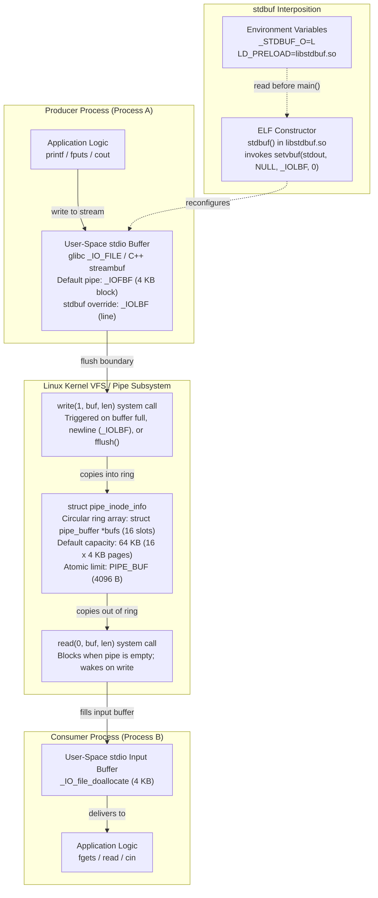
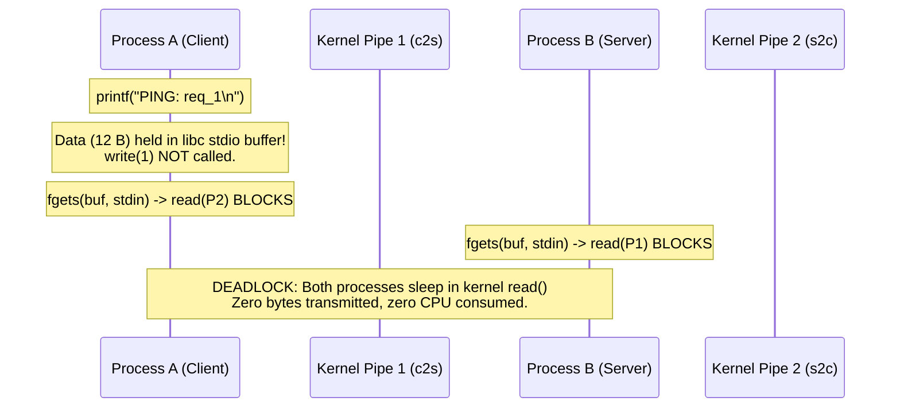
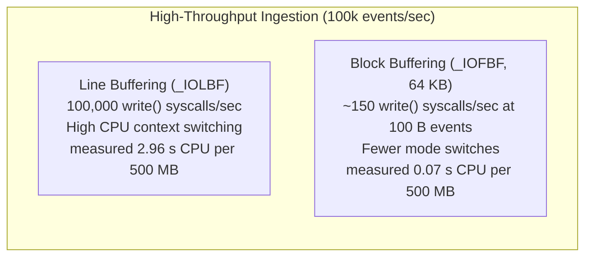

# Pipe Buffering and Stdbuf

> [!summary] Claim:
> Pipeline data flows through two decoupled buffering layers: a user-space C stdio buffer (`struct _IO_FILE`, sized from `st_blksize`: 4 KB on glibc Linux, 16 KB on macOS, measured (as of 2026-11)) and a kernel ring buffer (`struct pipe_inode_info`, default 16 pages / 64 KB on Linux, sized by `PIPE_DEF_BUFFERS`).
> Standard C libraries automatically downgrade stdout from line-buffered to fully block-buffered when `isatty(1)` returns false, trapping intermediate output in process memory and causing interactive stream stalls or bidirectional deadlock cycles.
> GNU `stdbuf` overrides this initialization by injecting `libstdbuf.so` via `LD_PRELOAD`, executing an ELF shared-library constructor before `main()` to configure stream buffer modes with `setvbuf()`; macOS libc instead reads the same `_STDBUF_*` variables itself.
> Dynamic library interposition silently fails on statically linked binaries, setuid executables, and non-C runtimes (Go, Rust, Python `_io`), requiring explicit runtime unbuffering flags or pseudo-terminal (PTY) allocation.



## The Mechanism

Pipes connect processes via standard streams, but user code never writes directly to a pipe file descriptor on every byte.
Instead, execution passes through two independent buffering subsystems operating in distinct protection rings: user-space stdio buffering inside libc and kernel-space pipe buffer pages inside the Virtual File System (VFS).
Understanding pipeline latency lag and deadlocks requires tracing the exact control flow across both layers.

### 1. The User-Space Stdio Buffering Layer

The C standard (ISO/IEC 9899:2018 section 7.21.3) defines three stream buffering modes:
- `_IONBF` (unbuffered): Characters are transmitted to the host environment immediately upon output.
- `_IOLBF` (line-buffered): Characters are accumulated until a newline character (`\n`) is written, the buffer fills, or input is requested on any unbuffered or line-buffered stream.
- `_IOFBF` (fully buffered / block-buffered): Characters are accumulated as a block and transmitted only when the internal memory buffer fills completely, the stream is explicitly flushed via `fflush()`, or the process exits normally via `exit()`.

Standard error (`stderr`) defaults to unbuffered (`_IONBF`) or at most line-buffered (`_IOLBF`).
Standard input (`stdin`) and standard output (`stdout`) determine their buffering mode dynamically at runtime by inspecting the underlying file descriptor.
In the GNU C Library (glibc 2.39), stream buffer allocation is deferred until the first I/O operation.
When a process writes to `stdout`, glibc executes `_IO_file_doallocate()` inside `libio/filedoalloc.c`.
This function invokes `fstat(fp->_fileno, &st)` to inspect file descriptor 1:

```c
/* glibc 2.39 libio/filedoalloc.c, _IO_file_doallocate() */
size = BUFSIZ;
if (fp->_fileno >= 0 && __builtin_expect (_IO_SYSSTAT (fp, &st), 0) >= 0)
  {
    if (S_ISCHR (st.st_mode))
      {
        /* Possibly a tty.  */
        if (
#ifdef DEV_TTY_P
            DEV_TTY_P (&st) ||
#endif
            local_isatty (fp->_fileno))
          fp->_flags |= _IO_LINE_BUF;
      }
#if defined _STATBUF_ST_BLKSIZE
    if (st.st_blksize > 0 && st.st_blksize < BUFSIZ)
      size = st.st_blksize;
#endif
  }
```

When `stdout` points to an interactive terminal, `st.st_mode` evaluates to a character device (`S_ISCHR`) and `isatty(1)` returns 1.
glibc sets the `_IO_LINE_BUF` flag, providing responsive interactive terminal output.
However, when a shell pipeline (`cmd1 | cmd2`) connects `cmd1`'s `stdout` to a pipe, `st.st_mode` evaluates to a FIFO (`S_IFIFO`), not a character device.
`isatty(1)` returns 0 with `errno = ENOTTY`.
Because the character device check fails, `_IO_LINE_BUF` is never set.
The stream silently falls back to fully block-buffered mode (`_IOFBF`).

glibc starts from `BUFSIZ` (8192) and uses `st.st_blksize` instead only when it is positive and smaller than `BUFSIZ`.
On Linux, the VFS assigns `st_blksize = 4096` bytes (4 KB) to pipes.
glibc therefore allocates a 4096-byte heap buffer via `malloc()`; `__fbufsize(stdout)` reports 4096 on a pipe (measured, glibc on Ubuntu 24.04, linux-aarch64, as of 2026-11).
On macOS (Apple Libc `stdio/FreeBSD/makebuf.c`, `__swhatbuf()`), the buffer is `st_blksize` capped at `MAXBUFSIZE`, falling back to `BUFSIZ` (1024 on macOS) only when `st_blksize` is not positive; a pipe reports `st_blksize = 16384` and a C writer held 16,000 bytes but flushed at 16,384 (measured, macOS 27.2, as of 2026-11).
Consequently, a C program piped to another command will buffer up to 4 KB (Linux) or 16 KB (macOS) of text in process memory before making its first `write()` system call.

### 2. The Kernel Pipe Ring Buffer Layer

Once user space flushes its stdio buffer, the data enters the kernel via the `write(fd, buf, count)` system call.
In the Linux kernel (`fs/pipe.c`), an inter-process pipe is implemented as an in-memory circular ring buffer of pages managed by `struct pipe_inode_info`.
Linus Torvalds rewrote Linux pipes in version 2.6.11 (2005) from a single-page structure to a circular array of `struct pipe_buffer` descriptors (LWN "Circular pipes"; pipe(7) dates the 16-page capacity to Linux 2.6.11).

The default pipe ring capacity is governed by the macro `PIPE_DEF_BUFFERS`, defined as 16 in `include/linux/pipe_fs_i.h`.
On architectures with 4 KB page sizes (such as x86_64 and standard ARM64), $16 \times 4096 = 65,536$ bytes (64 KB).
Each slot in the `pipe->bufs` array points to a `struct page`.
The kernel tracks buffer indices with `pipe->head` (where the producer writes) and `pipe->tail` (where the consumer reads).
The number of populated buffers is calculated as `pipe->head - pipe->tail`.

In Linux 2.6.35 (2010), Jens Axboe introduced the `F_SETPIPE_SZ` and `F_GETPIPE_SZ` `fcntl` operations.
`fcntl(fd, F_GETPIPE_SZ)` returns the current pipe capacity in bytes.
`fcntl(fd, F_SETPIPE_SZ, size)` expands or shrinks the pipe ring buffer.
The kernel rounds the requested size up to the nearest power-of-two multiple of `PAGE_SIZE`.
The minimum allowed pipe size is one page (4096 bytes).
An unprivileged user can expand a pipe up to `/proc/sys/fs/pipe-max-size` (default 1,048,576 bytes = 1 MiB).
Exceeding this value requires the `CAP_SYS_RESOURCE` capability; otherwise, the call returns `EPERM` (F_SETPIPE_SZ(2const)).
Furthermore, Linux 4.5 added `/proc/sys/fs/pipe-user-pages-soft` (default 16,384 pages = 64 MiB at 4 KiB pages) and `/proc/sys/fs/pipe-user-pages-hard` (default 0, unconstrained) to prevent single-user denial-of-service memory exhaustion through pipe allocation (pipe(7)).
Once a user is at the soft limit, new pipes get two pages (one before Linux 5.14) and growth is denied; at the hard limit, new pipes and growth are both denied.

POSIX.1-2024 defines `PIPE_BUF` as the atomic write threshold.
In Linux (`linux/limits.h`), `PIPE_BUF` is 4096 bytes.
On macOS and FreeBSD (`sys/syslimits.h`), `PIPE_BUF` is 512 bytes (the POSIX minimum).
When a write to a pipe is less than or equal to `PIPE_BUF`:
- The write is guaranteed to be atomic.
- If sufficient contiguous space exists in the current ring buffer page, the kernel writes the bytes immediately.
- If insufficient space exists, the kernel blocks the writing thread until enough space opens to satisfy the entire write atomically without interleaving with concurrent writers.
- Writes larger than `PIPE_BUF` are non-atomic and may be split and interleaved across pages with other writers.

### 3. The Pipeline Lag and Inter-Process Deadlock Problem

The intersection of stdio block-buffering and kernel pipe buffering causes two severe production defects: streaming latency lag and inter-process deadlocks.

The classic streaming lag defect appears in log monitoring pipelines:

```bash
tail -f /var/log/nginx/access.log | grep "HTTP/1.1 500" | awk '{print $7}'
```

`tail -f` outputs lines incrementally as log entries arrive, flushing each record.
However, `grep`'s `stdout` is connected to a pipe leading into `awk`.
Because `isatty(1)` returns 0 for `grep`, its standard I/O library switches to 4 KB block-buffering.
`grep` matches incoming error lines but stores them in its user-space heap buffer without issuing a `write()` system call.
If 500 errors occur intermittently (such as one 100-byte line every ten seconds), `grep` holds the records for over six minutes until 4096 bytes accumulate.
Similarly, `awk`'s `stdout` is connected to another pipe (or terminal), adding another buffering stage.
The human operator observes zero output and concludes the pipeline is wedged or no errors are occurring.
Downstream tools like `awk` and `sed` maintain their own internal record cycle buffers; see [[Sed-and-Awk-Stream-Processing]] for awk `fflush()` patterns and [[Ripgrep-Internals-and-Fast-Text-Search]] for ripgrep line-buffered stream scanning.

The deadlock defect occurs in bidirectional communication architectures, such as shell coprocesses or parent-child IPC channels:



In this cycle, Process A writes a short request (`"PING: req_1\n"`, 12 bytes) using `printf()`, then immediately calls `fgets()` on its input pipe to read the reply.
Because Process A's stdout is a pipe, libc holds the 12 bytes in user-space memory waiting for 4096 bytes to accumulate.
Process A blocks in the `read()` system call on Pipe 2.
Process B is concurrently blocked in the `read()` system call on Pipe 1 waiting for the request.
Neither process can proceed, neither crashes, and no CPU is consumed.
The pipeline deadlocks indefinitely until killed by a timeout or external signal.

### 4. Dynamic Library Interposition: `stdbuf` and `libstdbuf.so`

GNU `stdbuf`, written by Padraig Brady and merged into GNU Coreutils 7.5 (August 2009), solves this problem without source code modifications or recompilation.
`stdbuf` works by dynamically interposing `setvbuf()` calls at process initialization before the program's `main()` function executes.

The `stdbuf` CLI is an ELF binary wrapper.
When invoked as `stdbuf -oL cmd`, the executable performs four actions:
1. It validates the requested buffering modes for standard input (`-i`), standard output (`-o`), and standard error (`-e`).
   GNU `stdbuf` accepts `0` (unbuffered), `L` (line-buffered, rejected for `-i` with "line buffering stdin is meaningless"), or a size such as `64K` or `1M`; it rejects `B` with "invalid mode 'B'" (measured, coreutils 9.4, as of 2026-11).
   The FreeBSD-derived `/usr/bin/stdbuf` that macOS 27.2 ships (shell_cmds-336.40.1) additionally accepts `B` (fully buffered with the default size).
2. It sets corresponding environment variables: `_STDBUF_I`, `_STDBUF_O`, and `_STDBUF_E`.
3. It locates the helper shared object `libstdbuf.so` (`/usr/libexec/coreutils/libstdbuf.so` on Ubuntu 24.04, per `dpkg -S`; Homebrew installs it under `$(brew --prefix coreutils)/libexec/coreutils/`).
   It configures the dynamic linker preloading variable (`set_LD_PRELOAD()` in `src/stdbuf.c`):
   - On Linux (ELF): `LD_PRELOAD=/usr/libexec/coreutils/libstdbuf.so`
   - On macOS (Mach-O, `__APPLE__`): `DYLD_INSERT_LIBRARIES=<prefix>/libexec/coreutils/libstdbuf.so`, plus `DYLD_FORCE_FLAT_NAMESPACE=y`
4. It calls `execvp()` to execute the target program within this modified environment.

Inside `libstdbuf.so` (`src/libstdbuf.c` in GNU Coreutils 9.4), a dedicated constructor function is declared with GCC's constructor attribute:

```c
static void __attribute ((constructor))
stdbuf (void)
{
  char *e_mode = getenv ("_STDBUF_E");
  char *i_mode = getenv ("_STDBUF_I");
  char *o_mode = getenv ("_STDBUF_O");
  if (e_mode) /* Do first so can write errors to stderr  */
    apply_mode (stderr, e_mode);
  if (i_mode)
    apply_mode (stdin, i_mode);
  if (o_mode)
    apply_mode (stdout, o_mode);
}
```

When the kernel's ELF loader executes the dynamic linker (`/lib/ld-linux-*.so`), the linker maps all dependencies and preloaded libraries into the process address space.
Before transferring control to the application entry point (`main()`), the dynamic linker traverses the `.init_array` section and executes library constructors.
The `stdbuf()` constructor runs.
For each defined environment variable, `apply_mode()` translates the configuration into standard C library parameters:
- `'0'` maps to `setvbuf_mode = _IONBF` with size 0.
- `'L'` maps to `setvbuf_mode = _IOLBF` with size 0.
- A numeric size maps to `setvbuf_mode = _IOFBF`, allocating a buffer of the requested byte count via `malloc()`.

`apply_mode()` then immediately invokes:

```c
setvbuf (stream, buf, setvbuf_mode, size);
```

Because `setvbuf()` executes during dynamic linker initialization before `main()`, it satisfies the ISO C requirement that `setvbuf()` must be called before any I/O operation occurs on the stream.
When `main()` later calls `printf()`, glibc discovers that buffering is already established and honors the line-buffered mode, issuing a `write()` system call on every newline character.

### 5. Pseudo-Terminal (PTY) Wrapping as an Alternative

An alternative mechanism for forcing line buffering is pseudo-terminal (PTY) wrapping, used by utilities such as `unbuffer` (an example script shipped with Don Libes' Expect, which was first described in 1990) and `script -q /dev/null`.
Instead of modifying process memory, a PTY wrapper creates a bidirectional kernel pseudo-terminal master/slave pair (`/dev/pts/*`).
The wrapper forks the child process with its stdout connected to the PTY slave.

When the child process initializes stdio, `fstat(1, &st)` inspects the PTY slave.
A PTY slave is a character device (`S_ISCHR(st.st_mode)` evaluates to true) and `isatty(1)` returns 1.
The C runtime naturally selects `_IOLBF` (line-buffered) mode without requiring `LD_PRELOAD` or environment modifications.

However, PTY wrapping carries significant architectural penalties:
- Line discipline translation: By default, the terminal driver converts newline bytes (`\n`, `0x0A`) into carriage-return newline pairs (`\r\n`, `0x0D 0x0A`) via the `ONLCR` flag, corrupting raw binary streams.
- Terminal control signals: Control characters in data the wrapper feeds into the child's input side (such as `0x03` for `SIGINT` or `0x1A` for `SIGTSTP` under `ISIG`) can trigger kernel signals that terminate or stop pipeline processes.
- Flow control: Character codes `0x11` (`XON`) and `0x13` (`XOFF`) on the input side can inadvertently pause transmission when `IXON` is set.
- Performance overhead: PTYs run every byte through the line-discipline state machine, imposing higher CPU cost than raw kernel pipes.
  Moving 512 MiB with `dd bs=64k` into a reader took 0.06 s of CPU through a pipe and 1.15 s through a PTY (median of 5, Ubuntu 24.04 container on Linux 7.2.12 aarch64, as of 2026-11).

PTY kernel mechanics and line discipline configuration are owned by [[TTYs-PTYs-and-Line-Discipline|TTYs, PTYs, and Line Discipline]].

## Commands and Numbers to Know

| Item | Value | Platform and date | What it controls |
| :--- | :--- | :--- | :--- |
| `PIPE_DEF_BUFFERS` | `16` pages (64 KiB at 4 KiB pages) | Linux (as of 2026-11) | Default kernel pipe ring-buffer page allocation in `include/linux/pipe_fs_i.h` |
| `PIPE_BUF` | `4096` bytes | Linux (as of 2026-11) | POSIX maximum write size guaranteed to be atomic across concurrent writers |
| `PIPE_BUF` | `512` bytes | macOS (as of 2026-11) | Darwin / BSD maximum atomic write size (`_POSIX_PIPE_BUF` minimum) |
| Pipe `st_blksize` | `4096` bytes | Linux (as of 2026-11) | Filesystem block size reported by `fstat()` for pipes; sizes glibc stdio buffers |
| Pipe `st_blksize` | `16384` bytes | macOS (as of 2026-11) | Block size reported by `fstat()` for pipes; sizes Darwin libc stdio buffers |
| `BUFSIZ` | `8192` bytes | Linux glibc (as of 2026-11) | Starting buffer size in `_IO_file_doallocate()`; replaced by `st_blksize` only when smaller |
| `BUFSIZ` | `1024` bytes | macOS SDK `_stdio.h` (as of 2026-11) | Fallback only when `st_blksize` is not positive; pipes use 16384 |
| `/proc/sys/fs/pipe-max-size` | `1048576` bytes (1 MiB) | Linux (as of 2026-11) | System-wide maximum pipe capacity an unprivileged user can set with `F_SETPIPE_SZ` |
| `/proc/sys/fs/pipe-user-pages-soft` | `16384` pages (64 MiB) | Linux (as of 2026-11) | Per-user soft limit; at it, new pipes get two pages and growth is denied |
| `/proc/sys/fs/pipe-user-pages-hard` | `0` (unlimited) | Linux (as of 2026-11) | Per-user hard ceiling; at it, new pipes and `F_SETPIPE_SZ` growth are denied (`EPERM`) |
| `stdbuf -i MODE` | GNU: `0`, `<size>`; macOS man page also lists `L`, `B` | Both (as of 2026-11) | Adjusts standard input buffering; writes to `_STDBUF_I` (GNU rejects `-iL`) |
| `stdbuf -o MODE` | GNU: `0`, `L`, `<size>`; macOS: also `B` | Both (as of 2026-11) | Adjusts standard output buffering; writes to `_STDBUF_O` |
| `stdbuf -e MODE` | GNU: `0`, `L`, `<size>`; macOS: also `B` | Both (as of 2026-11) | Adjusts standard error buffering; writes to `_STDBUF_E` |
| `F_GETPIPE_SZ` | `fcntl` op `1032` | Linux (as of 2026-11) | Returns current capacity of a pipe file descriptor in bytes |
| `F_SETPIPE_SZ` | `fcntl` op `1031` | Linux (as of 2026-11) | Resizes pipe capacity, rounding up to page size multiples |
| `grep --line-buffered` | CLI flag | Both (as of 2026-11) | Flushes output after every line in GNU/BSD grep, bypassing default pipe block buffering |
| `sed -u` / `--unbuffered` | CLI flag | Both (as of 2026-11) | Flushes output promptly in GNU sed and macOS `/usr/bin/sed` (`-u`; macOS also has `-l`), measured on macOS 27.2 |
| `awk '{print; fflush()}'` | awk function | Both (as of 2026-11) | Flushes standard output on every record; with no argument POSIX.1-2024 also flushes every open file and pipe, but mawk 1.3.4 flushes stdout only (`fflush("")` flushes all); measured with gawk 5.4.1, macOS awk 20200816, and mawk 1.3.4 |
| `PYTHONUNBUFFERED=1` | Environment variable | Both (as of 2026-11) | Forces Python 3 `sys.stdout` binary layer to operate without a `BufferedWriter` |
| `python3 -u` | CLI flag | Both (as of 2026-11) | Command-line equivalent to `PYTHONUNBUFFERED=1` in Python |

## Multi-Language Comparison: C / C++ / Python / Rust / Go

Application runtimes handle stream buffering differently when piped, impacting whether `stdbuf` functions or native alternatives are required.

| Concern | C (glibc 2.39) | C++ (`std::cout`) | Python 3 (`sys.stdout`) | Rust (`std::io::stdout`) | Go (`os.Stdout`) |
| :--- | :--- | :--- | :--- | :--- | :--- |
| Default stdout mode on pipe | `_IOFBF` (block-buffered) | Block-buffered (delegated to glibc `stdout`) | Block-buffered (`TextIOWrapper` over `BufferedWriter`) | Line-buffered (internal `LineWriter`, measured with rustc 1.99.0) | Unbuffered (raw system calls) |
| Default buffer size on pipe | 4096 B (`st_blksize`) | 4096 B (via glibc) | About 8 KiB effective: 5000 B held, 8200 of 9000 B released (measured, Python 3.12.3 on linux-aarch64, as of 2026-11) | 1024 B `LineWriter` capacity (`LineWriter::new` passes 1024 in Rust 1.90.0 `linewriter.rs`; 1025 one-byte unterminated writes released 1024 B, measured rustc 1.99.0, macOS 27.2, as of 2026-11) | 0 B (no user-space buffer) |
| Flush trigger on pipe | Buffer full (4 KB), `fflush()`, or `exit()` | Buffer full, `std::endl`, `std::flush`, or `exit()` | Buffer full (about 8 KB), `flush=True`, or `exit()` | Newline character (`\n`), buffer full, or `flush()` | Every single `Write()` invocation |
| `stdbuf` compatibility | Full support via `setvbuf()` | Supported unless `sync_with_stdio(false)` is set (measured, g++ on Ubuntu 24.04, as of 2026-11) | Ineffective (bypasses libc `FILE*`) | Ineffective (bypasses libc `FILE*`) | Ineffective (bypasses libc `FILE*`) |
| Native unbuffering mechanism | `setvbuf(stdout, NULL, _IOLBF, 0)` | `std::endl` or manual `std::cout.flush()` | `python3 -u`, `PYTHONUNBUFFERED=1`, `reconfigure()` | Default is line-buffered; use `BufWriter` for block | Default is unbuffered; use `bufio.Writer` for block |
| Statically linked behavior | Statically linked libc ignores `LD_PRELOAD` | Statically linked libc ignores `LD_PRELOAD` | Not the cause for Python: the dynamically linked interpreter already ignores `stdbuf` (lab section 4) | Native static binaries ignore `LD_PRELOAD` | Native static Go binaries ignore `LD_PRELOAD` |

## Worked Lab Example

The reproducible lab is located in `code/01-Command-Line/pipe_buffering_stdbuf/`.
It compiles deterministic C probing utilities and executes a Python verification driver to measure buffer geometries, demonstrate block-buffering flush thresholds, reproduce bidirectional pipeline deadlocks, and verify the boundaries of dynamic library interposition.

```bash
cd code/01-Command-Line/pipe_buffering_stdbuf
bash run.sh
```

### Verified output

Recorded directly inside the pinned Linux container on `linux-aarch64` (as of 2026-11) and verified by `code/_harness/verify.py`:

```text
1. Kernel pipe and libc buffer geometry:
   pipe st_blksize:                    4096 B
   libc stdio buffer (__fbufsize):     4096 B
   POSIX atomic write limit (PIPE_BUF): 4096 B
   kernel pipe default capacity:       65536 B (16 pages)
   kernel pipe expanded capacity:      1048576 B (256 pages)

2. Stdio flush threshold on pipes (30 lines = 1770 B, total 70 lines = 4130 B):
   default block buffering: phase 1 received    0 B / total 4130 B (held in stdio)
   stdbuf -oL line mode:   phase 1 received 1770 B / total 4130 B (immediate flush)

   Buffer-size boundary (all 70 lines = 4130 B written before the pause):
   default (4096 B buffer): phase 1 received 4096 B / total 4130 B (full buffer flushed)
   stdbuf -o8192 buffer:    phase 1 received    0 B / total 4130 B (4130 B fits, nothing flushed)

3. Inter-process bidirectional deadlock resolution:
   unassisted client:      status=DEADLOCK (blocked waiting for mutual stdio flush)
   stdbuf -oL client:      status=SUCCESS (CLIENT_GOT: PONG: ack_1)

4. Interposition boundaries (LD_PRELOAD vs static binaries and language runtimes):
   static ELF under stdbuf:      status=DEADLOCK (kernel bypasses dynamic linker)
   Python under stdbuf -oL:      status=DEADLOCK (Python runtime bypasses libc FILE*)
   Python with PYTHONUNBUFFERED: status=SUCCESS (CLIENT_GOT: PONG: ack_1)
```

### Reading the result

1. **Buffer Geometry:**
   The C probe verifies that `fstat()` on a pipe reports `st_blksize = 4096` bytes, which glibc uses because it is smaller than `BUFSIZ`.
   It also writes one byte through a `FILE *` on the pipe and prints `__fbufsize()`, the stdio buffer glibc actually allocated: 4096 bytes.
   POSIX atomic write limit `PIPE_BUF` is 4096 bytes.
   The initial kernel pipe capacity queries `fcntl(p[1], F_GETPIPE_SZ)` as 65,536 bytes (16 pages of 4096 bytes).
   Expanding the pipe via `fcntl(p[1], F_SETPIPE_SZ, 1048576)` succeeds as the unprivileged `lab` user, scaling kernel ring capacity to 256 pages (1 MiB), the `pipe-max-size` default.

2. **Stdio Flush Threshold:**
   `writer.c` writes 30 lines (1770 bytes) in Phase 1, pauses waiting for an acknowledgement, and writes 40 lines in Phase 2 (total 4130 bytes).
   Under default block-buffering, the consumer receives exactly `0 B` in Phase 1 because 1770 bytes is below the 4096-byte buffer.
   When run with `stdbuf -oL`, Phase 1 receives all `1770 B` immediately because every newline character triggers a `write()` system call.
   A second pair of runs writes all 70 lines (4130 bytes) before the pause, which pins the buffer size itself.
   The default run releases exactly `4096 B`, the moment the buffer fills, while `stdbuf -o8192` enlarges the buffer so that the same 4130 bytes stay trapped and Phase 1 receives `0 B`.

3. **Deadlock Resolution:**
   The peer client sends `"PING: req_1\n"` and blocks on input.
   Without assistance, the client's output is trapped in its 4096-byte stdio buffer, resulting in a mutually blocked deadlock.
   Wrapped with `stdbuf -oL`, the client flushes its query immediately, the server answers with `"PONG: ack_1"`, and the transaction completes.
   The driver waits up to 10 s for a reply that is expected, so a slow host cannot turn SUCCESS into a false DEADLOCK.
   When no reply is expected it waits 1 s and reports DEADLOCK only after observing both peers asleep (`S` in `/proc/<pid>/stat`); anything else prints INDETERMINATE and fails the comparison.

4. **Interposition Boundaries:**
   Compiling `peer_client` as a static ELF binary (`gcc -static`) bypasses `/lib/ld-linux-*.so`.
   The kernel executes the binary directly, ignoring `LD_PRELOAD`.
   `stdbuf` fails to prevent deadlock on the static binary.
   Similarly, running a Python peer client under `stdbuf -oL` results in deadlock because Python's `_io` module bypasses libc `FILE*` stdout.
   Setting `PYTHONUNBUFFERED=1` removes Python's internal `BufferedWriter`, flushing immediately and resolving the exchange cleanly.

## Pitfalls

> [!warning] Pitfall: Relying on `stdbuf` for statically linked binaries or Go/Rust executables
> `stdbuf` functions strictly by setting `LD_PRELOAD` to load `libstdbuf.so` via the dynamic linker.
> Statically linked executables (including binaries compiled with `gcc -static`, musl-static distributions, and standard Go binaries) contain no `PT_INTERP` program header.
> The Linux kernel loads static binaries directly into memory and executes `_start` without invoking the dynamic linker.
> `LD_PRELOAD` is completely ignored.
> Furthermore, runtimes like Go and Rust implement native I/O primitives rather than delegating standard output to libc's `FILE *`.
> `libstdbuf.so`'s constructor calls `setvbuf()`, which has no effect on Go's `os.Stdout` or Rust's `std::io::stdout()`.

> [!warning] Pitfall: Assuming macOS `stdbuf` works by library injection (and that SIP breaks it)
> GNU `stdbuf` (Homebrew `gstdbuf`) sets `DYLD_INSERT_LIBRARIES` instead of `LD_PRELOAD`, and System Integrity Protection purges dyld environment variables when it launches protected processes (Apple, System Integrity Protection Guide, Runtime Protections).
> On macOS 27.2, `DYLD_FOO=1 /usr/bin/env` prints no `DYLD_FOO`, while an ad-hoc-signed copy of `env` outside the protected paths prints it (measured, as of 2026-11).
> That does not make `stdbuf` fail there: Apple Libc's `stdio/FreeBSD/makebuf.c` reads `_STDBUF_I`, `_STDBUF_O`, and `_STDBUF_E` (and `STDBUF`, `STDBUF0`-`STDBUF2`) itself when it first allocates a stream buffer.
> On macOS 27.2 with SIP enabled, `gstdbuf -oL /usr/bin/grep`, `/usr/bin/stdbuf -oL /usr/bin/grep`, and plain `_STDBUF_O=L /usr/bin/grep` all forwarded each line at once, while bare `/usr/bin/grep` held them (measured, as of 2026-11).
> The real macOS traps are the ones shared with Linux: programs that do not use libc `FILE *`, programs that call `setvbuf()` themselves, and statically linked or non-Apple-libc runtimes, which never read the variables.
> `/usr/bin/grep --line-buffered` and `/usr/bin/sed -u` remain the most explicit fixes on macOS.

> [!warning] Pitfall: Programmatic `setvbuf()` calls inside `main()` overriding `stdbuf`
> `libstdbuf.so` applies its buffering modes inside an ELF constructor executed before `main()` begins.
> If the target application explicitly invokes `setvbuf(stdout, NULL, _IOFBF, 8192)` inside its own initialization logic in `main()`, it overrides the configuration applied by `stdbuf`.
> Applications with internal buffer management can only be unbuffered if they provide explicit CLI switches (such as `grep --line-buffered` or `sed -u`).

> [!warning] Pitfall: Assuming `stdbuf` alters Python stream buffering
> Python 3 constructs its own stream wrapper hierarchy: `io.TextIOWrapper` wrapping `io.BufferedWriter` wrapping `io.FileIO`.
> Python always buffers `sys.stdout` internally; it queries `isatty()` on file descriptor 1 at startup only to choose line buffering for a terminal, so a pipe gets block buffering.
> Because Python bypasses libc `FILE*` stdout, `stdbuf -oL python3 script.py` has zero effect.
> You must pass `python3 -u` or export `PYTHONUNBUFFERED=1` to strip the `BufferedWriter` layer.

> [!warning] Pitfall: Corrupting binary streams through pseudo-terminal (PTY) wrapping
> Engineers often reach for `unbuffer` or `script` when `stdbuf` fails on static or non-C binaries.
> However, PTY devices activate the kernel terminal line discipline.
> By default, the output post-processing flag `ONLCR` is enabled, translating every newline byte (`0x0A`) into carriage return plus newline (`0x0D 0x0A`).
> If the pipeline processes binary data, tar archives, or compressed files, PTY wrapping introduces byte corruption that breaks downstream checksums and unpackers.

> [!warning] Pitfall: Confusing `PIPE_BUF` with kernel pipe capacity
> `PIPE_BUF` (4096 bytes on Linux) represents the limit for atomic write operations, not total pipe buffer capacity.
> The pipe capacity is 65,536 bytes (16 pages) by default and can be expanded up to 1 MiB via `F_SETPIPE_SZ`.
> A producer can write more than 4096 bytes without blocking, provided the total unread data in the pipe does not exceed the ring capacity.
> Conversely, a write of 4097 bytes is not atomic and can be interleaved with concurrent writers even if the pipe currently has 60 KiB of free space.

## At Scale

In small scripts and development workstations, buffering choices rarely impact resource usage.
However, at large enterprise scale (1,000 to 50,000 servers streaming millions of log events and metrics per second), the trade-off between buffering latency and system call overhead directly determines cluster efficiency.

### System Call Economics: Throughput vs. Latency

The fundamental trade-off in stream processing is CPU efficiency versus message delivery latency:
- **Block Buffering (`_IOFBF`, 64 KB blocks):**
  Maximizes throughput.
  Writing a 100 MB (100,000,000 B) data stream using 64 KiB blocks requires about 1,500 `write()` system calls.
  User/kernel mode switches, cache thrashing, and context switches are minimized.
- **Line Buffering (`_IOLBF`):**
  Minimizes delivery latency for stream consumers.
  However, for an average line length of 100 bytes, writing the same 100 MB stream invokes $1{,}000{,}000$ `write()` system calls, about $650\times$ as many.
  Measured cost: 5,000,000 lines of 100 bytes (500 MB) through a pipe into `wc -c` took 0.07 s of CPU (writer plus `wc`) with a 64 KiB block buffer and 2.96 s with line buffering, about 40 times as much, two thirds of it system time (median of 5, Ubuntu 24.04 container on Linux 7.2.12 aarch64, as of 2026-11).



### Operational Decision Rules at Scale

1. **Interactive Monitoring and Alerting Pipelines:**
   Always enforce line buffering.
   In log-tailing pipelines feeding real-time metric counters or alert extractors (`tail -f | grep | awk`), block buffering introduces unacceptable multi-minute alert lag.
   Use tool-specific flags (`grep --line-buffered`, `jq --unbuffered`) or wrap with `stdbuf -oL -eL`.
2. **High-Volume Data Pipelines and Batch ETL:**
   Strictly preserve block buffering.
   Never insert `stdbuf -oL` into high-throughput batch pipelines (such as database exports, log shipping daemons, or large file conversions).
   For pipelines transferring gigabytes of data, tune pipe capacity using `fcntl(fd, F_SETPIPE_SZ, 1048576)` or the standalone `buffer` utility (not part of coreutils) / `pv -B 1M` to increase chunk sizes and reduce CPU utilization.
3. **Containerized Production Microservices:**
   Standardize runtime environment variables in base container images.
   Set `ENV PYTHONUNBUFFERED=1` in production Dockerfiles for Python logging daemons to prevent container logs from being trapped in memory before writing to `/dev/stdout`.
   For Go and Rust microservices, maintain the default unbuffered or line-buffered log configurations.
4. **Bidirectional Coprocess and Agent Tooling Architectures:**
   When designing command execution harnesses for AI agents or automated orchestrators that interact with child CLI tools via stdin/stdout pipes, never assume default line buffering.
   Either wrap spawned dynamic commands with `stdbuf -i0 -oL`, use dedicated PTY wrappers with `raw` termios settings, or invoke interactive tool flags (`--interactive`) to prevent agent task timeouts caused by silent stdio buffering deadlocks.
   For end-to-end production pipeline triage and gigabyte log processing, connect these buffering rules to [[Analyze-Gigabyte-Terminal-Logs]] and live syscall inspection in [[System-Inspection-and-Syscall-Tracing-From-the-Shell]].

## Practice Drill

> [!tip] Practice Drill:
> Write a shell pipeline that stalls on standard I/O buffering, diagnose the trapped bytes using `/proc`, and rescue it in real time using `stdbuf`.
> First, execute a slow producer piped into `grep` without line buffering:
>
> ```bash
> python3 -c '
> import time, sys
> for i in range(100):
>     sys.stdout.write(f"event {i:04d} payload data\n")
>     sys.stdout.flush()
>     time.sleep(0.1)
> ' | grep "event" | cat
> ```
>
> Observe that nothing appears for about 10 seconds: the 100 lines total 2,400 bytes, under glibc's 4,096-byte pipe buffer, so `grep` releases them all at once when its input ends.
> Identify the PID of `grep` via `pgrep grep` and inspect its pipe file descriptors in `/proc/<pid>/fd/`.
> Open `/proc/<pid>/fd/1` and query `ioctl(fd, FIONREAD, &bytes)`: it reports 0, because the trapped bytes sit in `grep`'s user-space stdio buffer, not the kernel pipe (`/proc/<pid>/fdinfo/<fd>` shows position and flags, not unread bytes).
> Next, resolve the stall by prepending `stdbuf -oL` to `grep`:
>
> ```bash
> python3 -c '
> import time, sys
> for i in range(100):
>     sys.stdout.write(f"event {i:04d} payload data\n")
>     sys.stdout.flush()
>     time.sleep(0.1)
> ' | stdbuf -oL grep "event" | cat
> ```
>
> Confirm that every record appears on the terminal immediately with 100 ms spacing.
> Finally, remove `sys.stdout.flush()` from the producer and prepend `stdbuf -oL` to `python3`: output stalls again, confirming that Python ignores `stdbuf`, while `python3 -u` fixes it.
> For an advanced scenario debugging stream stalls caused by regex backtracking paired with buffering delays, practice [[Drill-Command-Line-Catastrophic-Backtracking-and-Stream-Bottleneck]].

## Interview Questions

> [!question] L5: Why does `tail -f access.log | grep error` display matched lines immediately in your terminal, but `tail -f access.log | grep error | awk '{print $1}'` appears to freeze?
>
> > [!success]- Answer
> > In the first pipeline, `grep`'s standard output is connected directly to the terminal (a character device).
> > glibc executes `isatty(1)`, which returns 1, causing libc to configure `stdout` in line-buffered (`_IOLBF`) mode.
> > Each matched line ending in `\n` flushes immediately to the display.
> > In the second pipeline, `grep`'s stdout is connected to a pipe leading into `awk`.
> > `isatty(1)` returns 0 (`ENOTTY`), so `grep`'s C standard library automatically switches to fully block-buffered (`_IOFBF`) mode with a buffer size equal to `st_blksize` (4096 bytes on Linux).
> > `grep` buffers matched lines in process memory until 4 KB of data accumulates before issuing a `write()` system call.
> > In a low-volume log stream, filling 4 KB can take minutes or hours, making the pipeline appear completely hung.

> [!question] L5: What are the three standard buffering modes defined in ISO C, and how do their defaults differ between terminal devices and pipes?
>
> > [!success]- Answer
> > The three modes defined in ISO C (section 7.21.3) and POSIX are:
> > 1. `_IONBF` (unbuffered): Output is transmitted immediately to the destination without user-space buffering.
> > 2. `_IOLBF` (line-buffered): Output is held in a user-space buffer until a newline character (`\n`) is encountered, the buffer fills, or input is requested.
> > 3. `_IOFBF` (fully buffered / block-buffered): Output is held in user space until the buffer fills completely (typically 4 KB or 8 KB), explicit `fflush()` is called, or the process terminates.
> > Standard error (`stderr`) is always unbuffered (`_IONBF`) or line-buffered by default.
> > Standard input (`stdin`) and standard output (`stdout`) default to line-buffered (`_IOLBF`) when connected to an interactive terminal (`isatty() == 1`), but default to fully buffered (`_IOFBF`) when connected to a regular file, pipe, or socket (`isatty() == 0`).

> [!question] L6: Explain the exact mechanism by which `stdbuf -oL cmd` modifies standard stream buffering without recompiling `cmd`.
>
> > [!success]- Answer
> > `stdbuf` relies on dynamic library interposition via the runtime linker (`ld.so`):
> > 1. The `stdbuf` CLI sets the environment variable `_STDBUF_O=L` and injects `libstdbuf.so` into the target environment via `LD_PRELOAD` (or `DYLD_INSERT_LIBRARIES` on macOS).
> > 2. It executes the target command using `execvp()`.
> > 3. When the kernel maps the process and runs the dynamic linker, the linker loads `libstdbuf.so` and executes its initialization functions before transferring control to the application's `main()`.
> > 4. `libstdbuf.so` contains a constructor function declared with `__attribute__((constructor))`.
> > 5. This constructor parses `_STDBUF_O` and calls `setvbuf(stdout, NULL, _IOLBF, 0)` on the open `stdout` stream.
> > 6. Because this runs before `main()` performs its first I/O operation, it satisfies ISO C constraints and configures the stream to flush on every newline character.

> [!question] L6: Walk through the data path of a 6-byte string written via `printf("hello\n")` in a piped C program, contrasting user-space vs kernel-space buffering.
>
> > [!success]- Answer
> > The data path traverses two distinct layers:
> > 1. **User Space (Process Memory):**
> >    `printf()` formats the string into the application's `stdout` stream (`struct _IO_FILE`).
> >    If `stdout` is connected to a pipe and unassisted, glibc allocates a 4096-byte heap buffer (`st_blksize`).
> >    Because the stream is block-buffered (`_IOFBF`), the 6 bytes remain in the user-space buffer; no system call is issued.
> >    If line-buffering was forced via `stdbuf -oL`, the `\n` character triggers an immediate flush, invoking `write(1, "hello\n", 6)`.
> > 2. **Kernel Space (VFS Pipe Ring):**
> >    The kernel enters `pipe_write()` in `fs/pipe.c`.
> >    It copies the 6 bytes from user space into a kernel memory page referenced by `pipe->bufs[pipe->head]`.
> >    The write is well under `PIPE_BUF` (4096 bytes), so it completes atomically.
> >    The kernel increments the write counter, updates the ring buffer state, and wakes any reader thread blocked in `read()` on the opposite end of the pipe via its wait queue (`pipe->rd_wait`).

> [!question] L7: Predict the output of a C program executing `printf("step 1\n"); usleep(200000); printf("step 2\n");` piped into a timestamping consumer under default buffering, with `stdbuf -oL`, and with `std::ios_base::sync_with_stdio(false)`.
>
> > [!success]- Answer
> > **Without `stdbuf`:**
> > Both "step 1" and "step 2" are held in glibc's 4096-byte user-space stdio buffer during the 200 ms sleep.
> > Neither line reaches the pipe until the process terminates, at which point glibc flushes all open streams during `exit()`.
> > The consumer receives both lines simultaneously at timestamp +0.20s.
> > **With `stdbuf -oL`:**
> > "step 1" contains `\n` and flushes immediately at timestamp +0.00s via `write()`.
> > The program sleeps 200 ms.
> > "step 2" flushes at timestamp +0.20s.
> > The consumer receives the lines 200 ms apart.
> > **With `sync_with_stdio(false)`:**
> > In C++, `sync_with_stdio(false)` detaches `std::cout` from C stdio, replacing it with an internal `std::streambuf`.
> > `stdbuf`'s preloaded constructor modifies C `stdout` via `setvbuf()`, but `std::cout` no longer routes through C `stdout`.
> > The program reverts to block buffering inside the C++ runtime, and both lines arrive together at +0.20s despite `stdbuf -oL`.

> [!question] L7: Debug this: Why does a continuous log analysis pipeline `python3 producer.py | stdbuf -oL python3 consumer.py` deadlock, and how do you resolve the failure?
>
> > [!success]- Answer
> > The primary failure mode is that `stdbuf` has zero effect on standard Python 3 interpreters:
> > 1. Python 3's `sys.stdout` does not use libc's `FILE*` streams.
> >    It implements its own I/O stack (`TextIOWrapper` -> `BufferedWriter` -> `FileIO` with OS file descriptor 1).
> > 2. When piped, Python detects that `isatty(1)` is false and enables an internal 8192-byte `BufferedWriter`.
> > 3. `stdbuf` preloads `libstdbuf.so` and calls `setvbuf()`, which modifies unused libc descriptors while Python's `BufferedWriter` continues to trap output in user space.
> > 4. If `consumer.py` performs buffered input or waits for a complete block, both processes stall.
> > **Resolution:**
> > Bypass Python's user-space buffer by passing the `-u` flag or exporting `PYTHONUNBUFFERED=1`:
> > `python3 -u producer.py | python3 -u consumer.py`.
> > Alternatively, add `flush=True` to `print()` calls or execute `sys.stdout.reconfigure(line_buffering=True)` inside Python code.

> [!question] L8+: What is the architectural difference between `PIPE_BUF` and pipe buffer capacity, and how do concurrent writers behave when writing 4000 bytes vs 5000 bytes?
>
> > [!success]- Answer
> > `PIPE_BUF` is the POSIX write atomicity limit (4096 bytes on Linux, 512 bytes on macOS).
> > Pipe buffer capacity is the total unconsumed volume a pipe ring buffer can store (default 65,536 bytes / 16 pages on Linux, tunable up to `pipe-max-size` via `F_SETPIPE_SZ`).
> > When multiple concurrent processes write to the same pipe (e.g., parallel workers writing to a shared log pipe):
> > - **4000-byte write ($\le \text{PIPE\_BUF}$):**
> >   The write is guaranteed to be atomic.
> >   If 4000 bytes of contiguous room exist in the pipe ring, the kernel writes the block as an unbroken sequence.
> >   If insufficient space exists, the writer blocks until room is available.
> >   No other writer's data will ever interleave with these 4000 bytes.
> > - **5000-byte write ($> \text{PIPE\_BUF}$):**
> >   The write is non-atomic.
> >   The kernel may split the payload across multiple pages or chunks (e.g., writing 4096 bytes to fill a page, then waiting).
> >   If another process writes concurrently, its bytes can be interleaved between the chunks of the 5000-byte payload, corrupting record integrity downstream.

> [!question] L8+: Evaluate the system-level consequences and design a production alternative when a junior engineer proposes running `stdbuf -oL` on all intermediate transformations in a 100,000 record-per-second telemetry pipeline.
>
> > [!success]- Answer
> > **Consequences of `stdbuf -oL` at scale:**
> > Forcing line buffering on 100,000 records/sec converts the workload into 100,000 `write()` system calls and 100,000 `read()` system calls per second per pipeline stage.
> > Each system call incurs user/kernel mode transitions, CPU register saving, TLB pollution, and scheduler overhead.
> > In a 3-stage pipeline, this generates 600,000 syscalls/sec, thrashing CPU caches; in the measurement above, line buffering cost about 40 times the CPU of 64 KiB block buffering, most of it system time (Linux, as of 2026-11).
> > **Production Architecture:**
> > 1. Reject blanket line buffering for high-throughput batch/streaming ingest.
> > 2. Maintain block-buffered I/O with enlarged buffer sizes using `fcntl(F_SETPIPE_SZ, 1048576)` or userspace circular ring buffers to maximize throughput ($< 2{,}000$ syscalls/sec).
> > 3. For low-latency metrics, use a dual-path architecture: write high-volume raw logs using asynchronous block-buffered streams, and emit low-volume metric counters over UDP or lockless memory-mapped ring buffers.
> > 4. Alternatively, use time-based flushing: configure processing stages to flush either when a 64 KB block fills or when a 250 ms timer expires, bounding latency without line-by-line syscall penalties.

## Further Reading

- GNU Coreutils Manual, *stdbuf invocation*: Authoritative specification of `stdbuf` flags, mode syntax, and environment variables.
- Linux `pipe(7)` manual page: Detailed coverage of kernel pipe capacities, `PIPE_BUF` POSIX guarantees, and `/proc/sys/fs/` sysctl boundaries.
- Linux `fcntl(2)` manual page: Reference documentation for `F_GETPIPE_SZ` and `F_SETPIPE_SZ` pipe resizing semantics.
- Jonathan Corbet, *Circular pipes* (LWN.net, 2005-01-11): Linus Torvalds' 2.6.11 change from single-page pipes to circular page ring arrays.
- POSIX.1-2024 / IEEE Std 1003.1-2024, *setvbuf* specification: Normative rules governing stream buffering modes and initialization requirements.
- GNU C Library, `libio/filedoalloc.c`: Source code implementing glibc's dynamic buffer sizing and TTY line-buffering detection.
- Don Libes, *expect: Curing Those Uncontrollable Fits of Interaction* (Summer 1990 USENIX Conference): The paper introducing Expect, whose pseudo-terminal control later underpins `unbuffer`.

## Related

- Prerequisites: [[Pipelines-Subshells-Redirection-and-Process-Substitution]]
- Next: [[POSIX-sh-Bash-Zsh-and-Fish-Compared]]
- See also: [[19-Shell-and-Unix-Engineering/01-Unix-Process-Model/PIPE_BUF-and-Write-Atomicity|PIPE_BUF and Write Atomicity]], [[19-Shell-and-Unix-Engineering/08-Coreutils-and-the-Userland/stdio-Buffering-and-stdbuf|stdio Buffering and stdbuf]]
- Lab: `code/01-Command-Line/pipe_buffering_stdbuf/` (requires: linux)
