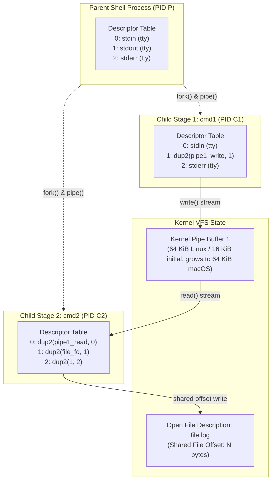

# Pipelines, Subshells, Redirection, and Process Substitution

> [!summary] Claim:
> A shell pipeline connects processes via anonymous unidirectional kernel pipes where the write descriptor of each upstream stage is duplicated to standard output and the read descriptor of each downstream stage is duplicated to standard input.
> File descriptor redirections evaluate strictly left to right, mutating per-process descriptor tables using `dup2` to share underlying open file descriptions and offsets.
> Subshells clone the execution environment via copy-on-write virtual memory, isolating variable mutations and directory modifications from the parent shell.
> Process substitution exposes streaming FIFOs or `/dev/fd` endpoints concurrently without buffering entire streams into memory, while `set -o pipefail` and `PIPESTATUS` preserve pipeline exit statuses that POSIX otherwise discards.



## The Mechanism

[[Shell-Parsing-Tokenization-and-Expansion-Order]] owns the tokenization grammar and the five-phase word expansion order that precedes execution.
Once command words and redirection operators are parsed, the shell transitions from language interpretation to POSIX process orchestration.
Every pipeline, subshell, redirection, and process substitution relies on three kernel abstractions: the process file descriptor table, the system-wide open file table, and the virtual file system (VFS) pipe subsystem.

### 1. Kernel Pipeline Assembly (`pipe`, `fork`, `dup2`, `close`)

A pipeline is a sequence of one or more commands separated by the control operator `|` (POSIX) or `|&` (a Bash extension equivalent to `2>&1 |`).
To execute an $N$-stage pipeline ($C_1 \mid C_2 \mid \dots \mid C_N$), the parent shell constructs $N - 1$ unidirectional pipes before or during process creation.
In POSIX systems, `pipe(int pipefd[2])` allocates two new file descriptors backed by an anonymous pipe inode:
- `pipefd[0]` is opened read-only for draining bytes.
- `pipefd[1]` is opened write-only for pushing bytes.

In the Linux kernel (`fs/pipe.c`), the pipe is represented by `struct pipe_inode_info`, which manages a circular ring of memory pages (`struct pipe_buffer`).
On Linux (since kernel 2.6.11), the default capacity is 16 pages (64 KiB on systems with 4 KiB pages), dynamically adjustable via `fcntl(fd, F_SETPIPE_SZ, size)` up to the administrative limit in `/proc/sys/fs/pipe-max-size` (defaulting to 1 MiB).
On macOS / XNU (`bsd/kern/sys_pipe.c`), a pipe starts with a 16 KiB buffer (`PIPE_SIZE = 16384` in `bsd/sys/pipe.h`) and `expand_pipespace()` grows it on write up to `PIPE_SIZE * 4` (64 KiB, `BIG_PIPE_SIZE`), so the measured capacity of a fresh pipe filled with non-blocking writes is 65536 bytes (macOS, as of 2026-11).

The standard pipeline assembly loop proceeds through strict system call ordering:

1. Pipe creation: The shell calls `pipe()` to obtain `pipefd[2]`.
2. Process instantiation: The shell calls `fork()` to create the child process.
3. Stream binding: The child invokes `dup2(int oldfd, int newfd)` to bind pipe endpoints to standard descriptors:
   - For an upstream command $C_k$, `dup2(pipefd[1], STDOUT_FILENO)` binds write output to standard output (FD 1).
   - For a downstream command $C_{k+1}$, `dup2(pipefd[0], STDIN_FILENO)` binds read input to standard input (FD 0).
4. Unused descriptor closure: Both the child and the parent shell must explicitly call `close()` on all unused pipe descriptors.
5. Program replacement: The child executes `execve()` to load the target binary image.

```text
Parent:  pipe(p1) -> fork() -> child 1
                  -> fork() -> child 2
                  -> close(p1[0]), close(p1[1])  <-- CRITICAL: close in parent
Child 1: dup2(p1[1], 1), close(p1[0]), close(p1[1]), execve(cmd1)
Child 2: dup2(p1[0], 0), close(p1[0]), close(p1[1]), execve(cmd2)
```

The requirement to close unused write descriptors is absolute.
When a reader calls `read()` on a pipe, the kernel returns 0 (signaling end-of-file, or EOF) only when two conditions are met:
1. The pipe buffer is completely empty.
2. Every file descriptor referring to the write end of that pipe across every process in the operating system has been closed.

If the parent shell or a child process fails to close its inherited write descriptor (`pipefd[1]`), the kernel reference count on the pipe write end remains greater than zero.
When upstream command $C_1$ finishes and terminates, downstream command $C_2$ drains the remaining bytes in the buffer and calls `read()` again.
Instead of returning EOF, `read()` blocks indefinitely, waiting for data that can never arrive.
This descriptor leak is the root cause of hangs in ad hoc pipeline implementations.

Conversely, if all read descriptors for a pipe are closed while an upstream process attempts to `write()`, the kernel raises the `SIGPIPE` signal (signal 13) against the writer.
If the writer ignores or blocks `SIGPIPE`, `write()` returns -1 with `errno` set to `EPIPE`.
[[Pipe-Buffering-and-Stdbuf]] owns the interaction between kernel pipe buffer thresholds and userspace stdio block buffering.

#### Process Groups and Job Control

In interactive shells with job control enabled (`set -m`), pipelines form discrete process groups.
The first child of the pipeline becomes the process group leader: its PGID is set equal to its own PID with `setpgid(pid1, pid1)`.
Each subsequent child $C_k$ joins that group with `setpgid(pid_k, pid1)`.
To prevent a race where a child runs before the parent assigns its PGID, both the parent and each child call `setpgid()` after `fork()`, and it does not matter which call wins (POSIX.1-2024 `setpgid` RATIONALE).
Bash 5.3 `make_child()` in `jobs.c` follows this: the child runs `setpgid(mypid, pipeline_pgrp)` and the parent runs `setpgid(pid, pipeline_pgrp)`.
Terminal ownership is handed over with `tcsetpgrp()` on the controlling terminal descriptor, after the process group exists, because POSIX makes it an error to give the terminal to an unused PGID.
In Bash 5.3 the first child of a foreground pipeline calls `give_terminal_to(pipeline_pgrp)` itself, the parent deliberately does not call it there, and `start_job()` also gives the terminal to the job's group when it starts a foreground job.
In non-interactive scripts (`set +m`), job control is disabled by default, and child processes execute inside the parent shell's process group.

### 2. File Descriptor Duplication and Redirection Semantics

POSIX redirection operators associate files, sockets, devices, and pipes with arbitrary file descriptors.
A file descriptor is an index into the process descriptor table located in kernel task memory (in Linux v6.12, `task_struct.files` points to a `struct files_struct` whose `fdt` member points to the `struct fdtable`).
Each descriptor table entry contains:
- A pointer to an open file description (`struct file` in Linux).
- A bitmask of descriptor-specific flags, specifically `FD_CLOEXEC` (close-on-exec).

The system-wide open file description holds the runtime state of the open file:
- The current byte offset (`f_pos` in `struct file`, Linux v6.12).
- The file status access modes (`O_RDONLY`, `O_WRONLY`, `O_RDWR`, `O_APPEND`, `O_NONBLOCK`).
- The reference count of descriptors referencing this description.
- A pointer to the underlying VFS inode.

```text
Process A Descriptor Table          Kernel Open File Table           VFS Inodes
+---------------+                  +--------------------------+     +------------+
| FD 1 (stdout) | -------------->  | struct file              | --> | file.log   |
+---------------+       |          | - offset: 1024           |     | (inode 42) |
| FD 2 (stderr) | -------          | - status: O_WRONLY       |     +------------+
+---------------+ (dup2 shares OFD)| - refcount: 2            |
                                   +--------------------------+
Process B Descriptor Table
+---------------+                  +--------------------------+
| FD 1 (stdout) | -------------->  | struct file              |
+---------------+                  | - offset: 0              |
                                   | - status: O_WRONLY       |
                                   +--------------------------+
```

#### Left-to-Right Redirection Evaluation

Redirections evaluate strictly in lexical order from left to right.
This sequential evaluation governs descriptor manipulation and dictates the outcome of compound redirections.

Consider standard output and standard error redirection:

```bash
cmd > file.log 2>&1
```

1. `> file.log`: The shell opens `file.log` with flags `O_WRONLY | O_CREAT | O_TRUNC` on a temporary descriptor, then executes `dup2(temp_fd, 1)` and closes `temp_fd`.
   Descriptor 1 now points to the open file description for `file.log` at offset 0.
2. `2>&1`: The shell parses `2>&1` as "duplicate descriptor 1 onto descriptor 2".
   The shell invokes `dup2(1, 2)`.
   Descriptor 2 is reassigned to point to the exact same open file description as descriptor 1.
   Both stdout and stderr write into `file.log`, sharing a single kernel offset pointer.

Contrast this with the inverted ordering:

```bash
cmd 2>&1 > file.log
```

1. `2>&1`: The shell invokes `dup2(1, 2)`.
   Descriptor 2 is duplicated from descriptor 1, which currently points to standard output (typically the controlling terminal `/dev/tty`).
   Descriptor 2 now points to the terminal.
2. `> file.log`: The shell opens `file.log` and invokes `dup2(temp_fd, 1)`.
   Descriptor 1 now points to `file.log`.
   The result is that standard output writes to `file.log`, while standard error continues writing to the terminal.

#### The Double-Open Clobbering Defect

A destructive anti-pattern occurs when an engineer writes:

```bash
cmd > file.log 2> file.log
```

Unlike `2>&1`, this construct issues two independent `open()` system calls against the same file path without the `O_APPEND` flag.
The kernel creates two distinct open file descriptions, each initialized with its own private file offset set to 0.
When `cmd` writes 100 bytes to stdout (FD 1), the offset in description 1 advances to 100.
When `cmd` subsequently writes 20 bytes to stderr (FD 2), the kernel writes those 20 bytes starting at description 2's offset, which is still 0.
Stderr overwrites the first 20 bytes of stdout data, leaving a corrupted, interleaved file.
Using `dup2` via `2>&1` or opening with `>> file.log 2>> file.log` (which forces `O_APPEND` so the kernel updates the offset to EOF before every individual write) prevents this clobbering.

#### `dup2` Mechanics and `FD_CLOEXEC`

The POSIX specification for `dup2(int oldfd, int newfd)` defines strict semantics:
- If `newfd` is already open, `dup2` closes it first; the close and the reuse happen as one call, so no other thread can grab `newfd` in between.
- If `oldfd == newfd`, `dup2` returns `newfd` without closing it and without changing its flags.
- The new descriptor `newfd` refers to the identical open file description as `oldfd`, sharing file offsets and locks.
- **When `oldfd != newfd`, the `FD_CLOEXEC` (and, in POSIX.1-2024, `FD_CLOFORK`) flag on `newfd` is cleared.**

Even if `oldfd` had `FD_CLOEXEC` set to prevent descriptor leakage into child processes, `dup2(oldfd, newfd)` produces a `newfd` that survives subsequent `execve()` calls.
In multithreaded programs or advanced shells, `dup3(int oldfd, int newfd, int flags)` sets `O_CLOEXEC` (or `O_CLOFORK`) atomically on `newfd`; it is a Linux and FreeBSD call that POSIX.1-2024 standardized, and macOS does not provide it (as of 2026-11).

### 3. Subshell Execution Environments and Memory Isolation

A subshell is a separate execution environment initialized as a duplicate of the parent shell environment.
Subshells are created explicitly via grouping parentheses `( ... )`, during background asynchronous jobs `cmd &`, inside command substitutions `$( ... )` and `` `...` ``, within process substitutions `<( ... )`, and across pipeline stages.

In Bash, subshell instantiation relies on the kernel `fork()` primitive.
The operating system clones the parent shell's process address space using Copy-On-Write (COW) page table entries.
The child receives an exact duplicate of:
- All shell parameters and environment variables.
- Working directory (`getcwd()`) and file creation mask (`umask`).
- Shell options (`set` flags) and shell functions.
- Open file descriptors and redirection state.

Because the child operates in an independent virtual address space, state modifications never propagate back to the parent:

```bash
x=10
( x=20; cd /tmp; umask 077; exit 0 )
echo "x=${x}, pwd=${PWD}"  # Outputs: x=10, pwd=<original_directory>
```

#### Pipeline Subshell Execution: POSIX vs Bash vs Zsh

POSIX.1-2024 Section 2.13 (Shell Execution Environment) states:
> "Each command of a multi-command pipeline is in a subshell environment; as an extension, however, any or all commands in a pipeline may be executed in the current environment."

This specification latitude creates behavioral discrepancies across shells:

- **GNU Bash (default):** Every command in a pipeline, including the final stage, executes in an independent subshell.
- **Zsh and Ksh:** The final stage of a pipeline executes inside the parent shell process by default (run locally with Zsh 5.9.2 and ksh93u+ 2012-08-01 on macOS, as of 2026-11: the loop below prints `count=3`).

This difference surfaces when mutating variables inside a loop consuming a pipeline:

```bash
count=0
printf "a\nb\nc\n" | while read -r line; do
    count=$((count + 1))
done
echo "count=${count}"
```

In default Bash, `while read` executes in a subshell.
When the loop terminates, the subshell exits, discarding the mutated `count`.
The parent shell prints `count=0`.
In Zsh, the loop runs in the main shell, printing `count=3`.

To resolve this in Bash scripts, engineers enable the `lastpipe` shell option (`shopt -s lastpipe`, added in Bash 4.2).
When active, Bash runs the last pipeline command in the parent shell process.
However, `lastpipe` operates only when job control is inactive (`set +m` or within non-interactive scripts).
If job control were active, running the final command in the parent shell would prevent suspending the foreground pipeline via `SIGTSTP` (`Ctrl+Z`), because the shell itself cannot suspend its own process while maintaining an interactive terminal loop.
Alternatively, scripts avoid the pipeline entirely by redirecting the loop's input; process substitution is not POSIX, so POSIX-portable scripts use a here-document or a temporary file instead:

```bash
count=0
while read -r line; do
    count=$((count + 1))
done < <(printf "a\nb\nc\n")
echo "count=${count}"  # Prints count=3 in Bash, Zsh, and ksh93; POSIX sh has no <(...)
```

### 4. Exit Status Propagation, Signal Encoding, and `set -o pipefail`

In POSIX shell grammar, the exit status of a pipeline is defined as the exit status of the *last* command in the sequence.
The exit statuses of all upstream commands are discarded.

This default behavior introduces severe reliability vulnerabilities in automated data pipelines:

```bash
curl --fail https://api.internal/data.tar.gz | tar -xzf -
```

If `curl --fail` gets an HTTP status of 400 or above it exits with status 22, and on a timeout it exits with 28 (curl(1), EXIT CODES).
However, `tar` receives an empty stream, encounters unexpected EOF, or fails to unpack, exiting with its own status.
Worse, in pipelines like `dump_database | gzip > backup.sql.gz`, if `dump_database` crashes with an authorization error (exit 1), `gzip` compresses the empty stream and exits with 0.
The pipeline exit status `$?` evaluates to 0, and the automated orchestration runner marks a completely corrupted backup job as successful.

#### The `set -o pipefail` Semantics

The `pipefail` shell option (standardized in POSIX.1-2024 Section 2.9.2, present in Bash since 3.0, and in Zsh and Ksh; `set -o pipefail` was accepted and gave status 1 for `false | true` in Zsh 5.9.2 and ksh93u+ on macOS, as of 2026-11) alters status calculation:
When `set -o pipefail` is active, the exit status of a pipeline is:
- The exit status of the rightmost command to exit with a non-zero status.
- Zero if, and only if, all commands in the pipeline exit with status 0.

If multiple commands fail:

```bash
set -o pipefail
bash -c "exit 7" | bash -c "exit 9" | true
echo "Exit: $?"  # Outputs: 9 (the rightmost non-zero exit status)
```

#### The `PIPESTATUS` and `pipestatus` Arrays

When fine-grained diagnostic logging is required, shells expose internal arrays capturing every pipeline exit code:
- GNU Bash provides `PIPESTATUS`, an indexed array where `${PIPESTATUS[0]}` corresponds to the first stage and `${PIPESTATUS[N-1]}` corresponds to the $N$-th stage.
- Zsh provides `pipestatus` (lowercase).

A critical operational trap is the ephemeral lifecycle of `PIPESTATUS`:
The shell overwrites `PIPESTATUS` immediately upon the completion of *any* subsequent command, including builtins.

```bash
cmd1 | cmd2 | cmd3
echo "Checking pipeline status..."  # WRONG: echo overwrites PIPESTATUS with (0)
if [ "${PIPESTATUS[0]}" -ne 0 ]; then
    echo "cmd1 failed"             # This branch is never reached
fi
```

To inspect pipeline components, engineers must capture the array into a local variable immediately:

```bash
cmd1 | cmd2 | cmd3
pipeline_status=( "${PIPESTATUS[@]}" )
overall_status=${pipeline_status[-1]}  # not $?, which now holds the assignment's status (0)

if [ "${pipeline_status[0]}" -ne 0 ]; then
    echo "cmd1 failed with code ${pipeline_status[0]}"
fi
```

#### Signal Exit Status Encoding

When a pipeline process terminates due to an unhandled signal, POSIX (Section 2.8.2) only requires an exit status greater than 128; Bash and Zsh (verified locally, as of 2026-11) use the convention:

$$\text{status} = 128 + N$$

where $N$ is the numeric signal value.
Common pipeline signal exit codes include:
- `141`: Process terminated by `SIGPIPE` ($128 + 13$).
- `130`: Process terminated by `SIGINT` ($128 + 2$, `Ctrl+C`).
- `143`: Process terminated by `SIGTERM` ($128 + 15$).
- `137`: Process killed by `SIGKILL` ($128 + 9$, e.g. Linux OOM Killer).

An upstream utility like `head -n 10` drains 10 lines from a pipeline and terminates immediately.
When the upstream generator attempts its next `write()`, the kernel raises `SIGPIPE`.
Under `set -o pipefail`, an upstream failure on `SIGPIPE` yields exit status 141, which can fail continuous integration scripts unless explicitly handled.
[[Robust-Shell-Scripting-and-ShellCheck]] details defensive patterns for managing `SIGPIPE` and strict mode error traps.

### 5. Here-Documents (`<<`, `<<-`) and Here-Strings (`<<<`)

Here-documents provide inline stream redirection.
The syntax `<<[-]delimiter` directs the shell to read lines from the current input source until a line matching `delimiter` exactly is encountered.

#### Quoted vs Unquoted Delimiters

The quoting status of the delimiter dictates token expansion during document parsing:
- **Unquoted delimiter (`<<EOF`):** The shell performs parameter expansion (`$VAR`), command substitution (`$(cmd)`), and arithmetic expansion (`$((expr))`).
  The backslash `\` behaves as inside double quotes: it escapes `$`, `` ` ``, `\`, and newline.
- **Quoted delimiter (`<<'EOF'`, `<<"EOF"`, `<<\EOF`):** If any character of the delimiter word is quoted, the lines of the here-document are treated as raw literals.
  No expansions occur.

In automated code generation, configuration writing, or remote SSH execution, delimiters must be quoted to prevent premature variable expansion in the local shell.

#### Leading Tab Stripping (`<<-`)

The `<<-` operator strips leading ASCII horizontal tab characters (`0x09`) from every line of the here-document body and from the closing delimiter line.
This permits indentation within shell functions and conditional blocks.
Crucially, **the stripping applies exclusively to tab characters (`\t`), never spaces (`0x20`)**.
If an editor automatically converts tabs to spaces, the delimiter line `    EOF` will not match `EOF`, causing the shell to consume the remainder of the script until EOF.
At top level Bash only warns (`here-document at line N delimited by end-of-file (wanted 'EOF')`) and silently swallows the rest of the script as data; inside a function or other compound command it then fails with `syntax error: unexpected end of file` (Bash 5.3, verified locally).

#### The 64 KiB Kernel Threshold: Pipes vs Temporary Files

The underlying kernel mechanism for here-documents underwent a major architectural redesign in GNU Bash 5.1 (as of 2026-11).

Historically (and still in Zsh 5.9 and in Bash 3.2, the macOS `/bin/bash`; both verified locally to give a regular-file stdin), here-documents were implemented using unlinked temporary disk files.
Bash's `here_document_to_fd()` in `redir.c` does this:
1. The shell creates a uniquely named file with `sh_mktmpfd("sh-thd", ...)` in `$TMPDIR` (or `/tmp`).
2. It writes the document text into that descriptor.
3. It reopens the same path read-only (`open(filename, O_RDONLY)`), so the new descriptor starts at offset 0.
4. It closes the write descriptor and calls `unlink()`, so the directory entry vanishes while the inode stays alive through the read descriptor.
5. The redirection code then duplicates that descriptor onto standard input.

Starting with Bash 5.1 (NEWS: "Here documents and here strings now use pipes for the expanded document if it's smaller than the pipe buffer size"), the shell compares the expanded document length with `HEREDOC_PIPESIZE`, which defaults to the pipe capacity computed at build time (`PIPESIZE`; FreeBSD builds use 4096):
- **Small documents (`document_len <= HEREDOC_PIPESIZE`):** Bash creates an anonymous kernel pipe via `pipe()`, writes the document bytes directly into `pipefd[1]`, closes the write end, and duplicates `pipefd[0]` to standard input.
  This avoids disk I/O, inode allocation, and temporary file cleanup.
  On Linux it also checks `fcntl(F_GETPIPE_SZ)` at run time and falls back to a temporary file if the actual pipe is smaller than the document.
- **Large documents (larger than `HEREDOC_PIPESIZE`):** Bash falls back to the unlinked temporary file method, because it writes the whole document before the command runs and a full pipe would block the shell.
- With `BASH_COMPAT=50` or lower, Bash always uses the temporary file.

On both measured hosts (Bash 5.3.15 on macOS and Bash 5.2.21 on Linux, as of 2026-11) a 65,536-byte document is still a pipe and a 65,537-byte document is a regular file, so the effective threshold is "at most 65,536 bytes uses a pipe".

This optimization creates an observable behavioral divergence in stream seekability:
When reading standard input from a small here-document in Bash 5.1+, `lseek(STDIN_FILENO, 0, SEEK_CUR)` fails with `errno = ESPIPE` (Illegal seek) because the descriptor is an anonymous pipe (`S_IFIFO`).
When reading from a large here-document (more than 65,536 bytes on these hosts), `lseek()` succeeds with offset 0 because the descriptor is a regular file (`S_IFREG`).
Programs expecting seekable standard input (such as database import tools or multi-pass parsers) will fail unpredictably if fed small here-documents in modern Bash.

Here-strings (`<<< word`) expand `word` and feed it to standard input followed by a trailing newline, utilizing the exact same pipe/file selection threshold.

### 6. Process Substitution (`<(...)` and `>(...)`)

Process substitution is a non-POSIX shell extension supported by Bash, Zsh, and Ksh.
It permits process input or output to be referenced as a filesystem path argument:
- `<(command)`: Connects the standard output of `command` to a pipe or FIFO, substituting the operator with the file path.
- `>(command)`: Connects standard input of `command` to a pipe or FIFO, substituting the operator with the file path.

#### `/dev/fd` Architecture vs Named FIFOs

Process substitution requires an operating system mechanism to expose open file descriptors as filesystem paths.
Shells implement this using one of two strategies:

1. **`/dev/fd/N` file descriptor pseudo-filesystem:**
   On Linux, `/dev/fd` is a symbolic link to `/proc/self/fd`.
   When the shell evaluates `<(cmd)`, it creates an anonymous pipe `p[2]`.
   It forks a subshell to run `cmd`, duplicating `p[1]` to stdout and closing `p[0]`.
   In the parent shell, the write end `p[1]` is closed, and the read end `p[0]` is assigned an internal high-numbered descriptor (FD 63 for the first substitution in Bash, then 62, verified on macOS and Linux; Zsh 5.9 used `/dev/fd/11` locally).
   The shell replaces `<(cmd)` in the command argument vector with the string `/dev/fd/63`.
   When the target program opens `/dev/fd/63` on Linux, the `/proc/self/fd/63` magic link resolves to the pipe inode and the kernel opens that pipe again, producing a new open file description on the same pipe.
   On macOS, `/dev/fd` is implemented via `fdescfs`, and fd(4) documents that opening `/dev/fd/N` is equivalent to `fcntl(N, F_DUPFD, 0)`, so it shares the existing open file description.

2. **Temporary Named Pipes (FIFOs):**
   If the host operating system lacks `/dev/fd` support, the shell calls `mkfifo()` to generate a named FIFO inside `/tmp` (e.g. `/tmp/sh-np-XXXXXX`).
   The subshell opens the FIFO for writing, and the shell passes the FIFO filesystem path to the command, removing the FIFO path from disk once execution completes.

```text
Shell evaluates: diff <(sort file1.txt) <(sort file2.txt)

                +--------------------+
                | Parent: diff       |
                | argv[1]: /dev/fd/63|
                | argv[2]: /dev/fd/62|
                +--------------------+
                   /               \
       read(/dev/fd/63)         read(/dev/fd/62)
                 /                   \
+----------------------+       +----------------------+
| Pipe 1 (Kernel Ring) |       | Pipe 2 (Kernel Ring) |
+----------------------+       +----------------------+
          ^                              ^
     write(stdout)                  write(stdout)
          |                              |
+----------------------+       +----------------------+
| Subshell 1: sort f1  |       | Subshell 2: sort f2  |
+----------------------+       +----------------------+
```

#### Streaming vs Memory Buffering

A frequent misconception conflates process substitution `<(cmd)` with command substitution `$(cmd)`.
The differences in memory allocation and execution parallelism are fundamental:

| Dimension | Command Substitution `$(cmd)` | Process Substitution `<(cmd)` |
| :--- | :--- | :--- |
| Execution Timing | Synchronous: Parent blocks until child exits | Asynchronous: Child runs concurrently with parent |
| Data Transport | Captured into process heap memory as a string | Streamed through kernel pipe ring buffer |
| Memory Overhead | $O(N)$ where $N$ is total output byte size | $O(1)$ bounded by kernel pipe capacity (64 KiB on current Linux and macOS) |
| Word Splitting | Subject to field splitting (`$IFS`) unless quoted | Passes single filename string; no field splitting |
| Backpressure | Ineffective: the shell drains the pipe into memory as fast as the child writes | Automatic: Child blocks if kernel pipe buffer fills |

To compare two gigabyte log files, `diff $(sort large1.log) $(sort large2.log)` crashes the shell with an out-of-memory error or command-line length limit (`E2BIG` / `ARG_MAX`).
In contrast, `diff <(sort large1.log) <(sort large2.log)` streams gigabytes through kernel pipes with bounded 64 KiB memory footprints and natural flow-control backpressure.

#### Non-Seekable Streams and Asynchronous Lifetime Races

Two architectural hazards govern process substitution:

1. **`ESPIPE` on Non-Seekable Descriptors:**
   Because `/dev/fd/N` points to an underlying pipe or FIFO, system calls requiring random access fail.
   If an application calls `lseek()` or `pread()`, the kernel returns `ESPIPE` (Illegal seek); `mmap()` also fails (`ENODEV` on Linux, `EINVAL` on macOS, verified locally), and `fstat()` succeeds but reports `S_IFIFO` with no usable file size.
   Tools like `sqlite3`, `tar -u` (update archive), and video transcoders requiring two-pass index positioning cannot consume process substitution paths.

2. **Asynchronous Lifetime Races:**
   Process substitutions execute asynchronously in the background.
   When the invoking command finishes, **the parent shell does not wait for process substitutions to terminate before advancing to the next command**.

Consider fan-out log distribution:

```bash
tar -czf - /var/log | tee >(gzip -d | analyzer_service) >(backup_uploader)
echo "Backup complete"
```

The shell executes `tee`.
When `tee` writes its final block and exits, the shell immediately prints `"Backup complete"` and proceeds to the next line or script termination.
However, `backup_uploader` inside the output process substitution may still have megabytes of data buffered in its pipeline.
Bash does not kill process substitutions when the script exits; they become orphans and keep running.
The loss happens when a container runner or CI step tears down the environment right after the script exits and kills the orphan (typically `SIGTERM` then `SIGKILL`), resulting in truncated uploads and silent data loss.

Bash 4.4 sets `$!` to the most recent process substitution so `wait "$!"` can wait for it and return its status, and since Bash 5.0 a bare `wait` also waits for the last-executed process substitution if its PID equals `$!`.
Bash 5.3 NEWS records "Changed the `wait` builtin behavior regarding process substitutions to match the documentation", and the lab shows the difference with `tee >(a) >(b)`: Bash 5.3.15 (macOS) returns from a bare `wait` once `b` is done while `a` is still running, whereas Bash 5.2.21 (Linux container) kept waiting for `a` as well (as of 2026-11).
So a bare `wait` is version-dependent for several substitutions, and a substitution expanded inside a pipeline stage or in the redirection of an external command is a child of that subprocess, so the parent shell cannot wait for it in any version tested.
Opening the substitution with `exec` in the parent shell avoids both:

```bash
exec 3> >(backup_uploader)
uploader_pid=$!
tar -czf - /var/log >&3
exec 3>&-               # Close write descriptor to trigger EOF in consumer
wait "${uploader_pid}"  # Wait for this substitution and collect its exit status
```

## Commands and Numbers to Know

| Item | Value | Platform and date | What it controls |
| :--- | :--- | :--- | :--- |
| Linux default pipe buffer | `65536` bytes (64 KiB) | Linux (as of 2026-11) | Capacity of anonymous kernel pipe (`16 * PAGE_SIZE`) |
| macOS pipe buffer | `16384` bytes initial, grows to `65536` | macOS (as of 2026-11) | Initial allocation (`PIPE_SIZE` in XNU) and measured capacity after `expand_pipespace()` |
| Linux `PIPE_BUF` | `4096` bytes | Linux (as of 2026-11) | Maximum byte count guaranteed atomic across concurrent writes |
| macOS `PIPE_BUF` | `512` bytes | macOS (as of 2026-11) | Maximum byte count guaranteed atomic across concurrent writes |
| `/proc/sys/fs/pipe-max-size` | `1048576` bytes (1 MiB) | Linux (as of 2026-11) | Unprivileged ceiling for `fcntl(fd, F_SETPIPE_SZ)` |
| Bash here-doc pipe threshold | `65536` bytes (build-time `PIPESIZE`) | Both, Bash 5.1+ (as of 2026-11) | At most: kernel pipe (`ESPIPE`); above: temp file (`S_IFREG`) |
| Bash process substitution top FD | `63` | Both (as of 2026-11) | Descriptor of the first `/dev/fd/N` in Bash; the next is 62 |
| `set -o pipefail` | Disabled by default | Both (as of 2026-11) | Pipeline status inherits rightmost non-zero exit code |
| `shopt -s lastpipe` | Disabled by default | Both (as of 2026-11) | Runs last pipeline stage in current shell when `set +m` |
| `PIPESTATUS` | Indexed array | Both (as of 2026-11) | Bash array capturing all exit codes of preceding pipeline |
| `pipestatus` | Indexed array | Both (as of 2026-11) | Zsh array capturing all exit codes of preceding pipeline |
| `SIGPIPE` exit code | `141` (`128 + 13`) | Both (as of 2026-11) | Exit status when process writes to broken pipe without handler |
| `SIGINT` exit code | `130` (`128 + 2`) | Both (as of 2026-11) | Exit status when process interrupted by `Ctrl+C` |
| `SIGTERM` exit code | `143` (`128 + 15`) | Both (as of 2026-11) | Exit status when process terminated by default kill signal |
| Standard Streams FD 0, 1, 2 | `stdin`, `stdout`, `stderr` | Both (as of 2026-11) | Standard POSIX stream descriptor indices |

## Multi-Language Comparison: C++ / Python / Rust

Pipeline assembly, descriptor duplication, subshell cloning, and stream redirection span all systems programming environments.
The table below compares how C++ (POSIX), Python (`subprocess`), and Rust (`std::process`) construct these mechanisms.

| Concern | C++ (POSIX.1-2024 / C++26) | Python (`subprocess` stdlib) | Rust (`std::process` stdlib) |
| :--- | :--- | :--- | :--- |
| Pipeline Linking | `pipe(p); fork(); dup2(p[1], 1); dup2(p[0], 0)` | `p1 = Popen(cmd1, stdout=PIPE)`<br/>`p2 = Popen(cmd2, stdin=p1.stdout)` | `let p1 = Command::new("c1").stdout(Stdio::piped()).spawn()?;`<br/>`let p2 = Command::new("c2").stdin(p1.stdout.take().unwrap()).spawn()?;` |
| Stray Pipe End Safety | Manual: developer must explicitly invoke `close(p[0])` and `close(p[1])` in the parent and in each child | `Popen` closes the child's write end in the parent automatically (`close_fds=True` by default); the developer must still call `p1.stdout.close()` so `p1` gets `SIGPIPE` if `p2` exits early | RAII: `child1.stdout.take()` moves the read end into `p2`'s `Command`; the parent's copy closes when that `Command` is dropped |
| Redirection Duplication | `dup2(src_fd, dst_fd)` or `posix_spawn_file_actions_adddup2` | `Popen(cmd, stdout=open("out", "w"), stderr=subprocess.STDOUT)` | `Command::new(cmd).stdout(file).stderr(Stdio::from(file.try_clone()?))` |
| Subshell / Process Forking | `fork()` clones virtual memory via copy-on-write page tables | `os.fork()` exists but raises a `DeprecationWarning` in a multi-threaded process (Python 3.12+); `subprocess` does not expose fork | No raw `fork()` in `std`; uses `posix_spawnp` where possible (glibc implements it with `clone(CLONE_VM \| CLONE_VFORK)`), else `fork` plus `exec` |
| Exit Status Aggregation | Sequential `waitpid(pid, &status, 0)` with `WEXITSTATUS` macro | List comprehension: `[p.wait() for p in pipeline]`; inspect `returncode` | Iterate over handles: `children.into_iter().map(\|mut c\| c.wait()).collect()` |
| Stream Random Access Check | `lseek(fd, 0, SEEK_CUR) == -1 && errno == ESPIPE` | `f.seekable()` returns `False` on pipe/FIFO streams | `Seek::stream_position` on a `File` backed by a pipe returns `Err` with `ErrorKind::NotSeekable` (stable since Rust 1.83) |

The Rust standard library enforces much of pipeline hygiene through ownership:
Both Python and Rust close the child-side pipe ends in the parent after `spawn`, so the parent never holds a stray write end; the remaining hazard is the parent's copy of the read end.
When piping `p1.stdout` to `p2.stdin`, calling `.take()` moves ownership of the `ChildStdout` (read end) handle out of `p1` into `p2`'s `Command`.
Once that `Command` is dropped (at the end of the statement in the one-expression form), the parent's descriptor is closed automatically, which is the step Python requires by hand with `p1.stdout.close()`; keeping the `Command` in a long-lived variable keeps the descriptor open.

## Worked Lab Example

The reproducible lab is located in `code/01-Command-Line/pipeline_redirection/`.
It contains:
- `pipeline_engine.c`: A low-level C harness compiled with `"${CC:-cc}" -Wall -Wextra -O2`.
  It exercises `dup2` flag clearing, open file description offset sharing, unclosed pipe write descriptor timeouts, and stream seekability.
- `pipeline_test.sh`: A comprehensive test runner exercising subshell isolation, `shopt -s lastpipe`, redirection ordering, `pipefail`, `${PIPESTATUS[@]}`, here-document tab stripping, the here-document and here-string pipe-versus-file boundary at 65,536 and 65,537 bytes, and the lifetime and `wait` behavior of process substitutions.
- `run.sh`: The test execution driver.
  Both scripts exit with an error message when the first `bash` on `PATH` is older than 5.1, because the harness has no requirement token for a Bash version.

To execute the lab:

```bash
cd code/01-Command-Line/pipeline_redirection
bash run.sh
```

### Verified output

Recorded directly on darwin-arm64 (macOS, Bash 5.3.15) on 2026-11-07 and verified via `python3 -m _harness.verify 01-Command-Line/pipeline_redirection/`:

```text
kernel_dup2_cloexec: old_fd_cloexec=1 target_fd_cloexec=0
kernel_offset_sharing: dup_shared="AAAAABBBBB" independent_open="BBBBB"
kernel_pipe_eof: with_leaked_writer=TIMEOUT closed_writer=EOF
subshell_isolation: default_count=0
subshell_lastpipe: lastpipe_count=1
redir_order_correct: STDOUT STDERR
redir_order_inverted_file: STDOUT
redir_order_inverted_err: STDERR
status_default: exit=0
status_pipefail: exit=3
pipestatus_array: 11 22 0
heredoc_tab_stripped: "indented_with_tab"
heredoc_space_preserved: "    indented_with_space"
heredoc_small: seekable=0 errno=ESPIPE
heredoc_65536_bytes: seekable=0 errno=ESPIPE
heredoc_65537_bytes: seekable=1 offset=0
herestring_65536_bytes: seekable=0 errno=ESPIPE
herestring_65537_bytes: seekable=1 offset=0
procsub: seekable=0 errno=ESPIPE
procsub_sync_with_wait: before_gate=absent after_wait=done
bare_wait_two_substitutions: last=done first=absent
bare_wait_pipeline_stage: substitution=absent
exec_fd_wait_pid_status: 7
```

This is the content of `expected/darwin-arm64.txt`.
A Linux recording exists only for aarch64 (`expected/linux-aarch64.txt`), and no amd64 recording exists.

### Reading the result

- `kernel_dup2_cloexec`: Line 1 confirms that `dup2()` clears `FD_CLOEXEC` on the target descriptor when the two descriptors differ.
  Even though the source descriptor had `FD_CLOEXEC=1`, descriptor 10 was created with `FD_CLOEXEC=0`, ensuring inheritance across `execve()`.
- `kernel_offset_sharing`: Line 2 proves that `dup()` shares the open file description offset in kernel memory.
  Writing 5 bytes to `fd1` and 5 bytes to `fd2` produces `"AAAAABBBBB"`.
  In contrast, calling `open()` twice independently creates two separate file descriptions at offset 0; writing 5 bytes to each results in `"BBBBB"`, clobbering the initial write.
- `kernel_pipe_eof`: Line 3 demonstrates that when the parent leaks `pipefd[1]`, a `poll()` call on `pipefd[0]` times out (`TIMEOUT`) because the kernel refuses to signal EOF while any write descriptor remains open.
  Once the parent closes `pipefd[1]`, `poll()` wakes immediately and `read()` returns 0 (`EOF`).
- `subshell_isolation` vs `subshell_lastpipe`: Lines 4 and 5 illustrate subshell variable scoping.
  In a default pipeline, the subshell variable mutation is lost (`default_count=0`).
  With `shopt -s lastpipe` and job control disabled (`set +m`), the last stage executes in the parent shell process (`lastpipe_count=1`).
- `redir_order_correct` vs `redir_order_inverted`: Lines 6 through 8 confirm left-to-right evaluation.
  `> file 2>&1` directs both standard output and standard error into the file.
  `2>&1 > file` captures standard error to the original terminal stream, leaving only standard output in the file.
- `status_default` vs `status_pipefail` vs `pipestatus_array`: Lines 9 through 11 prove that default pipelines discard failures in upstream stages (`exit=0`).
  Enabling `set -o pipefail` preserves the upstream failure (`exit=3`), while `${PIPESTATUS[@]}` exposes the full vector of exit codes (`11 22 0`).
- `heredoc_tab_stripped` vs `heredoc_space_preserved`: Lines 12 and 13 show that `<<-` strips leading tab characters while strictly preserving leading spaces.
- `heredoc_small` and the `heredoc_*_bytes` and `herestring_*_bytes` lines: Lines 14 through 18 pin the pipe versus temporary file split in Bash 5.1+.
  A 22-byte here-document uses an anonymous pipe where `lseek()` fails with `errno=ESPIPE`.
  A document of exactly 65,536 bytes (a 65,535-byte payload plus the trailing newline) is still a pipe (`ESPIPE`), and one of 65,537 bytes is an unlinked temporary file where `lseek()` succeeds at `offset=0`.
  The here-string lines show the same boundary, which backs the statement that here-strings use the same selection threshold.
  The lab needs Bash 5.1 or later first on `PATH` and exits with a message otherwise; the macOS `/bin/bash` (3.2) has no `lastpipe` option (added in 4.2), so the script would abort there, and its here-documents are always seekable temporary files.
- `procsub`: Line 19 verifies that a process substitution is non-seekable (`errno=ESPIPE`).
- `procsub_sync_with_wait`: Line 20 uses a consumer that finishes only after the lab creates a gate file, so "still running" is decided by the lab and not by a sleep.
  Before the gate opens the consumer's state is `absent`, and after a bare `wait` it is `done`, so a bare `wait` waits for a single output process substitution created by a builtin (`echo`) in the parent shell.
- `bare_wait_two_substitutions`: Line 21 shows that with `tee >(a) >(b)` on Bash 5.3.15 a bare `wait` returns once the last substitution (`$!`) is done (`last=done`) while the first, still gated, has not finished (`first=absent`).
  The recording `expected/linux-aarch64.txt` (Ubuntu 24.04 container, Bash 5.2.21, aarch64) differs from this block in this one line, `bare_wait_two_substitutions: last=done first=gave_up`, because Bash 5.2.21 kept waiting for the gated first substitution until it gave up.
- `bare_wait_pipeline_stage`: Line 22 shows that a substitution expanded inside a pipeline stage is invisible to a bare `wait`, which returned while it was still gated (`substitution=absent`).
- `exec_fd_wait_pid_status`: Line 23 shows the documented fix: a substitution held on descriptor 3, its PID saved from `$!`, the descriptor closed, then `wait "${fix_pid}"` returns the substitution's own exit status (7).
  A gate-based consumer gives up after about 5 s and the lab polls for stragglers, so no process outlives the run.

## Pitfalls

> [!warning] Pitfall: Leaking pipe write descriptors in multi-stage pipelines
> If a parent shell or intermediary process fails to close the write end of a pipe, downstream readers never receive EOF.
> The downstream process hangs indefinitely in `read()`, deadlocking batch jobs and production ETL pipelines without emitting an error.

> [!warning] Pitfall: Inverting redirection order (`2>&1 > file.log`)
> Redirection operators are evaluated strictly from left to right.
> Writing `2>&1 > file.log` duplicates stderr to the current destination of stdout (the terminal) before stdout is redirected to the file.
> As a result, stderr continues printing to the terminal while stdout is written to disk.
> The intended construct is always `> file.log 2>&1` or `&> file.log`.

> [!warning] Pitfall: Double-open clobbering (`> file.log 2> file.log`)
> Opening the same file twice without `O_APPEND` creates two independent kernel file descriptions with separate offset pointers.
> As stdout and stderr write data, their file offsets advance independently, silently overwriting each other's output blocks.
> Always use `2>&1` to share a single open file description and offset pointer across both streams.

> [!warning] Pitfall: Subshell variable loss in loops consuming pipelines
> Piping data into a loop (`cat data.txt | while read -r line; do count=$((count+1)); done`) executes the loop inside a subshell in POSIX sh and default Bash.
> Variable mutations, array appends, and `cd` commands made inside the loop are lost when the subshell terminates.
> Use process substitution (`while read -r line; do ...; done < <(cat data.txt)`) or `shopt -s lastpipe` to retain variable state.

> [!warning] Pitfall: Discarding failures without `set -o pipefail`
> By default, the exit code of a pipeline is determined exclusively by the last command.
> Upstream crashes in critical utilities (e.g. `pg_dump | gzip > backup.sql.gz`) are masked if the final command succeeds.
> Production scripts must set `set -o pipefail` in strict preamble blocks.

> [!warning] Pitfall: Overwriting `PIPESTATUS` with intermediary commands
> The `PIPESTATUS` array is ephemeral and is cleared or overwritten by *every* command executed by the shell, including `echo`, `test`, and variable assignments.
> Attempting to inspect `${PIPESTATUS[0]}` after running a diagnostic logging statement inspects the status of the logger, not the pipeline.
> Immediately capture `status=( "${PIPESTATUS[@]}" )` on the line following the pipeline.

> [!warning] Pitfall: Asynchronous races in output process substitution (`>(cmd)`)
> The shell does not wait for processes spawned via `>(cmd)` to complete before advancing to the next command.
> In scripts that terminate or push artifacts immediately following a command, asynchronous consumers are killed mid-execution.
> Open the substitution with `exec 3> >(cmd)`, save `$!`, close the descriptor (`exec 3>&-`), and `wait` on that PID before proceeding; a bare `wait` covers at most the last substitution in Bash 5.3, more in 5.2, and none created inside a pipeline stage.

> [!warning] Pitfall: Passing process substitution to utilities requiring random access
> Process substitutions `<(cmd)` present pipes or FIFOs via `/dev/fd/N`.
> Tools requiring seekable descriptors (e.g. `sqlite3`, `tar -u`, audio/video encoders) fail with `ESPIPE`.
> Use temporary files created via `mktemp` when random access or multiple read passes are required.

> [!warning] Pitfall: Indenting here-document delimiters with spaces under `<<-`
> The `<<-` operator strips only ASCII horizontal tabs (`\t`), never spaces.
> If an editor converts tabs to spaces, the closing delimiter `    EOF` is not recognized, and the shell consumes the entire rest of the file before throwing a fatal syntax error.

## At Scale

At enterprise scale (1,000 to 50,000 engineers), shell pipelines and redirection patterns form the foundation of build systems, CI/CD runners, container entrypoints, and autonomous agent toolchains.
Ad hoc conventions that function on developer laptops break under large-scale automation.

### Fleet-Wide Shell Strict Mode Standard

Unchecked pipeline failures represent one of the leading causes of silent data corruption in production deployments.
Organizations must enforce a standardized shell preamble across all repository scripts and CI actions:

```bash
#!/usr/bin/env bash
set -euo pipefail
IFS=$'\n\t'
```

- `set -e`: Abort immediately if any simple command exits with a non-zero status.
- `set -u`: Abort immediately upon encountering an unbound variable, preventing catastrophic commands like `rm -rf "${UNDEFINED_VAR}/*"`.
- `set -o pipefail`: Propagate failures across all pipeline stages, ensuring build and test failures in upstream tools fail the pipeline.
- `IFS=$'\n\t'`: Prevent word-splitting on whitespace in for-loops and unquoted variable expansions.

Automated repository linters (such as [[Robust-Shell-Scripting-and-ShellCheck]]) must enforce ShellCheck rules across all pull requests:
- `SC2030` and `SC2031`: Flagging variables modified inside subshells that are accessed outside.
- `SC2094`: Flagging a pipeline that reads and writes the same file (`cat f | grep x > f`); it does not flag `> f.log 2> f.log` (ShellCheck 0.11.0, verified locally).
- `SC3001`: Flagging process substitution in scripts declaring `#!/bin/sh` ("In POSIX sh, process substitution is undefined").

### Memory Economics of Streaming vs Buffering

In data-intensive toolchains, processing multi-gigabyte logs or datasets using command substitution (`output=$(cmd)`) forces the entire payload into the shell's heap memory.
For a 10 GiB input, this triggers memory allocation spikes, garbage collection pauses in runtime environments, and out-of-memory (OOM) process termination on containerized runners.

Decision rules for streaming architectures:
1. If data size exceeds 10 MiB, **never** capture output into shell variables or command substitutions.
2. Chain transformations using kernel pipelines (`cmd1 | cmd2`) or process substitutions (`diff <(cmd1) <(cmd2)`).
   Kernel ring buffers cap resident memory consumption to 64 KiB while applying automatic kernel backpressure.
3. If random access, seeking, or multiple passes are required, stream the data to a local SSD scratch directory using `mktemp -p "${TMPDIR:-/tmp}"` and clean up via an `EXIT` signal trap.

### AI Coding Agent Toolchain Integration

Autonomous coding agents execute shell commands in headless non-interactive subshells.
Because agents rely on stdout and stderr streams to diagnose compilation errors and test failures, redirection discipline is critical.
According to the principles in [[CLI-Design-and-Agent-Friendly-Interfaces-AXI]], toolchains designed for agents must:
- Avoid intermixing stdout and stderr into a single stream unless specifically requested.
  Tools should keep structured machine-readable output on FD 1 and human diagnostics or logs on FD 2.
- Avoid hanging interactive prompts when stdin is redirected from `/dev/null`.
- Explicitly synchronize background processes and process substitutions, preventing race conditions where the agent inspects log files before background flush operations complete.

## Practice Drill

> [!tip] Practice Drill:
> Execute the following hands-on exercise to observe pipeline failure masking, unclosed write descriptor deadlocks, and process substitution non-seekability in real time.
>
> 1. Create a three-stage pipeline where the second stage fails: `echo "data" | (exit 42) | cat`.
>    Observe that `$?` returns 0.
>    Enable `set -o pipefail` and re-run; verify that `$?` now returns 42.
> 2. Write a minimal C program that creates a pipe, forks a writer, and reads in the parent without closing `pipefd[1]`.
>    Observe the reader hanging indefinitely on EOF.
>    Close `pipefd[1]` in the parent and observe immediate EOF delivery.
> 3. Verify process substitution stream seekability using Python:
>    `python3 -c "import os, sys; os.lseek(0, 0, os.SEEK_CUR)" < <(echo "test")`
>    Observe the resulting `OSError: [Errno 29] Illegal seek` (`ESPIPE`).

```bash
# Hands-on replication script
set +o pipefail
echo "payload" | bash -c "exit 99" | cat > /dev/null
echo "Masked status (default): $?"

set -o pipefail
echo "payload" | bash -c "exit 99" | cat > /dev/null
echo "Propagated status (pipefail): $?"

# Process substitution seek check
python3 -c "
import os, sys
try:
    os.lseek(0, 0, os.SEEK_CUR)
    print('Seek succeeded')
except OSError as e:
    print('Seek failed as expected:', e)
" < <(printf "stream\n")
```

## Interview Questions

> [!question] L5: Predict the output:
> What does the following script print, and why?
> ```bash
> count=0
> printf "one\ntwo\nthree\n" | while read -r line; do
>     count=$((count + 1))
> done
> echo "Count: ${count}"
> ```
>
> > [!success]- Answer
> > In standard POSIX shells and default GNU Bash, the script prints:
> > `Count: 0`
> > Because the `while read` loop is the right-hand element of a pipeline, Bash executes it inside a separate child subshell created via `fork()`.
> > The subshell receives a copy of the parent environment with `count=0`.
> > While the loop increments `count` to 3 inside the subshell's virtual address space, those modifications are discarded when the subshell terminates.
> > The parent shell's `count` variable remains 0.
> > To make this print 3 in Bash, the script must disable job control (`set +m`) and enable `shopt -s lastpipe`, or rewrite the loop using process substitution: `while read -r line; do ...; done < <(printf "one\ntwo\nthree\n")`.

> [!question] L5: In the command `cmd > file.txt 2>&1`, why does stderr go to `file.txt`, whereas in `cmd 2>&1 > file.txt`, stderr goes to the terminal?
>
> > [!success]- Answer
> > Redirections are evaluated strictly from left to right:
> > 1. In `cmd > file.txt 2>&1`, `> file.txt` runs first, opening `file.txt` and pointing FD 1 (stdout) to it via `dup2`.
> >    Next, `2>&1` duplicates FD 1 onto FD 2 (stderr).
> >    Because FD 1 already points to `file.txt`, FD 2 is pointed to `file.txt` as well, sharing the same open file description and offset.
> > 2. In `cmd 2>&1 > file.txt`, `2>&1` runs first, duplicating FD 1 onto FD 2.
> >    At this moment, FD 1 still points to the terminal (`/dev/tty`), so FD 2 is pointed to the terminal.
> >    Next, `> file.txt` redirects FD 1 to `file.txt`.
> >    FD 2 remains connected to the terminal, while only FD 1 writes to `file.txt`.

> [!question] L6: Walk through the exact kernel system call sequence required to execute `cmd1 | cmd2` in a custom shell, and explain what happens if the parent forgets to close the write end of the pipe.
>
> > [!success]- Answer
> > The sequence requires:
> > 1. `pipe(p)`: Creates an anonymous kernel pipe returning `p[0]` (read) and `p[1]` (write).
> > 2. `fork()` for `cmd1`:
> >    - Child 1 calls `dup2(p[1], STDOUT_FILENO)` to bind stdout to the pipe write end.
> >    - Child 1 closes `p[0]` and `p[1]`.
> >    - Child 1 calls `execve()` to execute `cmd1`.
> > 3. `fork()` for `cmd2`:
> >    - Child 2 calls `dup2(p[0], STDIN_FILENO)` to bind stdin to the pipe read end.
> >    - Child 2 closes `p[0]` and `p[1]`.
> >    - Child 2 calls `execve()` to execute `cmd2`.
> > 4. In the parent shell:
> >    - The parent **must** call `close(p[0])` and `close(p[1])`.
> >    - The parent calls `waitpid()` to collect child statuses.
> >
> > If the parent forgets to call `close(p[1])`, `p[1]` remains open in the parent's file descriptor table.
> > When `cmd1` finishes and exits, the kernel checks whether all write descriptors for the pipe are closed.
> > Because the parent process still holds an open write descriptor, the kernel does not deliver EOF (`read() == 0`) to `cmd2`.
> > After `cmd2` finishes reading all data produced by `cmd1`, its next `read()` call blocks indefinitely, causing the pipeline to hang forever.

> [!question] L6: What is the architectural difference between command substitution `$(cmd)` and process substitution `<(cmd)` regarding memory usage and kernel scheduling?
>
> > [!success]- Answer
> > Command substitution `$(cmd)` is synchronous and memory-buffered:
> > The parent shell blocks while `cmd` executes to completion.
> > The shell captures the entire standard output stream of `cmd` into process heap memory as a string, strips trailing newlines, and performs word splitting and quote removal (unless quoted).
> > Memory consumption is $O(N)$ where $N$ is total output size.
> > For large streams, this risks process OOM.
> >
> > Process substitution `<(cmd)` is asynchronous and streaming:
> > The shell creates an anonymous pipe or FIFO and spawns `cmd` in a background subshell.
> > The operator evaluates to a filesystem path string (such as `/dev/fd/63`), which is passed directly as an argument to the invoking utility.
> > The parent and child execute concurrently in parallel across CPU cores.
> > Data transfers through the kernel pipe buffer (64 KiB on current Linux and macOS), maintaining an $O(1)$ memory footprint with automatic backpressure (the producer blocks if the buffer is full; the consumer blocks if the buffer is empty).

> [!question] L7: Debug this:
> A production deployment script writes `cmd > file.log 2> file.log`.
> Log output appears corrupted, with missing text and interleaved lines.
> What is the root cause at the kernel VFS level, and how does `2>&1` fix it?
>
> > [!success]- Answer
> > The root cause is independent open file descriptions with unshared file offsets.
> > In `cmd > file.log 2> file.log`, the shell invokes `open("file.log", O_WRONLY|O_CREAT|O_TRUNC)` twice independently: once for FD 1 and once for FD 2.
> > The kernel creates two distinct `struct file` objects in the open file table, each with its own independent file offset (`f_pos`) initialized to 0.
> > When the program writes to FD 1, offset 1 advances.
> > When the program subsequently writes to FD 2, offset 2 starts from its current position (which was not advanced by FD 1's writes), directly overwriting bytes previously written by FD 1.
> >
> > Using `cmd > file.log 2>&1` fixes this:
> > `> file.log` opens the file once, creating a single `struct file` description at offset 0 on FD 1.
> > `2>&1` executes `dup2(1, 2)`.
> > This duplicates the pointer in the process descriptor table so that FD 2 points to the exact same `struct file` description as FD 1.
> > Both descriptors share a single kernel offset pointer.
> > Any write to FD 1 or FD 2 advances the shared offset, guaranteeing serialized, non-clobbering writes.
> > Alternatively, opening both with `>> file.log 2>> file.log` sets `O_APPEND`, causing the kernel to reposition the offset to the file's current end before every individual write.

> [!question] L7: Under what conditions does `dup2` alter the `FD_CLOEXEC` flag, and why does this matter for security in multi-threaded programs?
>
> > [!success]- Answer
> > POSIX mandates that `dup2(oldfd, newfd)` clears the `FD_CLOEXEC` flag on `newfd` whenever `oldfd != newfd`, even if `oldfd` had `FD_CLOEXEC` set.
> > In multi-threaded programs, this introduces a race condition:
> > If thread A calls `dup2()` to duplicate a file descriptor, there is a time window between `dup2()` and a subsequent `fcntl(newfd, F_SETFD, FD_CLOEXEC)` call where `newfd` exists without the close-on-exec flag.
> > If thread B calls `fork()` and `execve()` during this window, `newfd` is inadvertently leaked into the child process, potentially exposing sensitive database connections, cryptographic keys, or privileged sockets.
> >
> > To eliminate this vulnerability, modern operating systems introduce atomic duplication primitives:
> > `dup3(oldfd, newfd, O_CLOEXEC)` (Linux, FreeBSD, and POSIX.1-2024; not macOS) atomically sets `FD_CLOEXEC` on `newfd` during descriptor creation.
> > Note that `dup2(fd, fd)` with equal arguments is a no-op that leaves the flags unchanged, so the flag is cleared only when the descriptors differ.

> [!question] L8+:
> You are diagnosing an automated CI/CD pipeline where `tar -czf - /data | tee >(upload_to_s3) | sha256sum > checksum.txt` runs.
> The pipeline reports success, but artifacts in S3 are intermittently truncated or missing.
> Explain the failure mechanism and design a robust fix.
>
> > [!success]- Answer
> > The failure mechanism is the asynchronous, unmonitored lifetime of output process substitution `>(upload_to_s3)`:
> > 1. When `tar` and `tee` finish streaming data to `sha256sum`, `tee` closes its descriptors and exits.
> > 2. The pipeline's foreground stages (`tar`, `tee`, `sha256sum`) terminate.
> > 3. The parent shell considers the pipeline finished and advances to the next script command or exits the CI runner container.
> > 4. However, `upload_to_s3` inside `>(upload_to_s3)` is an asynchronous background subshell.
> >    It may still be buffering, computing checksums, or uploading network chunks.
> > 5. If the CI job container exits or the script finishes before `upload_to_s3` flushes its buffers, the container runtime sends `SIGTERM`/`SIGKILL` to all processes, killing the upload mid-stream.
> > 6. Furthermore, if `upload_to_s3` crashes with an authentication or network error, its non-zero exit code is never captured by the main pipeline's exit status (`$?` or `PIPESTATUS`), resulting in false-positive success.
> >
> > Robust architectural fix:
> > Avoid naked process substitution for critical background sinks.
> > Allocate a dedicated descriptor, redirect into it, close it explicitly to signal EOF, and invoke `wait`:
> > ```bash
> > set -euo pipefail
> > # Open dedicated descriptor connected to output process substitution
> > exec 3> >(upload_to_s3)
> > s3_pid=$!
> >
> > # Run pipeline: tee copies to descriptor 3 and to stdout for sha256sum
> > # (tee >&3 would redirect tee's stdout and leave sha256sum an empty stream)
> > tar -czf - /data | tee /dev/fd/3 | sha256sum > checksum.txt
> >
> > # Explicitly close descriptor to deliver EOF to consumer
> > exec 3>&-
> >
> > # Wait specifically for the upload process to finish and check its exit status
> > wait "${s3_pid}"
> > ```

> [!question] L8+: Explain how Bash 5.1 redesigned here-document implementation, what kernel mechanism governs the threshold, and what subtle failure modes occur in client programs expecting seekable input.
>
> > [!success]- Answer
> > Prior to Bash 5.1, here-documents (`<<EOF`) and here-strings (`<<<`) were unconditionally implemented using unlinked temporary files on disk:
> > The shell created a uniquely named `sh-thd` file, wrote the payload, reopened the path read-only (so the new descriptor starts at offset 0), closed the write descriptor, called `unlink()` so the directory entry disappeared, and duplicated the read descriptor to FD 0.
> > The standard input was therefore a regular file (`S_IFREG`) and was fully seekable.
> >
> > In Bash 5.1, Bash introduced a performance optimization:
> > If the expanded document is no larger than `HEREDOC_PIPESIZE` (the pipe capacity measured at build time, 65,536 bytes on current Linux and macOS builds, as of 2026-11), Bash creates an anonymous kernel pipe via `pipe()`, writes the whole document into it, closes the write end, and binds the read end to FD 0.
> > Only a larger document falls back to an unlinked temporary file on disk, because the shell writes the entire document before the command runs and a full pipe would block it.
> >
> > Failure mode:
> > An anonymous pipe is a FIFO (`S_IFIFO`), which is non-seekable.
> > Any system call to `lseek(STDIN_FILENO, offset, whence)` fails immediately with `errno = ESPIPE` (Illegal seek).
> > If an engineer tests a script with a small here-document (at most 64 KiB) feeding a tool that seeks on standard input (for example one that reads a header, then seeks back to rewind), the tool fails with `ESPIPE`.
> > Paradoxically, if tested with a larger document (above 64 KiB), the tool succeeds because Bash switches to an unlinked temporary file; the failure is also invisible on the macOS `/bin/bash` 3.2, which always uses a temporary file.
> > Defensive scripts must avoid here-documents when feeding tools that require random access, writing instead to explicit temporary files via `mktemp`.

## Further Reading

- IEEE Std 1003.1-2024 (POSIX.1-2024) Shell Command Language Chapter 2: The authoritative international standard governing shell grammar, redirection ordering, and subshell environments.
- GNU Bash Reference Manual (Edition 5.3): Sections 3.2, 3.5.6, and 3.6 detailing GNU pipeline assembly, `lastpipe`, `PIPESTATUS`, and process substitution mechanics.
- Linux Kernel Source (`fs/pipe.c` at v6.12): Normative implementation of `pipe_inode_info`, `pipe_buffer` ring structures, and the VFS read/write blocking logic.
- Apple XNU Kernel Source (`bsd/kern/sys_pipe.c`): Source implementation of BSD pipes, `PIPE_SIZE` buffer limits, and descriptor lifecycle in macOS.
- Michael Kerrisk, *The Linux Programming Interface* (Chapters 24, 27, 44): Foundational reference for process creation, file descriptor duplication, and interprocess communication mechanics.
- W. Richard Stevens and Stephen A. Rago, *Advanced Programming in the UNIX Environment* (3rd Edition): Classic canonical text analyzing file sharing, descriptor tables, and pipeline shell architecture.

## Related

- Prerequisites: [[Shell-Parsing-Tokenization-and-Expansion-Order]]
- Next: [[Pipe-Buffering-and-Stdbuf]]
- See also: [[19-Shell-and-Unix-Engineering/01-Unix-Process-Model/Pipes-and-FIFOs|Pipes and FIFOs]], [[19-Shell-and-Unix-Engineering/03-POSIX-Shell-Language/Pipelines-and-And-Or-Lists|Pipelines and And Or Lists]], [[19-Shell-and-Unix-Engineering/04-Bash/Process-Substitution|Process Substitution]], [[19-Shell-and-Unix-Engineering/03-POSIX-Shell-Language/Here-Documents|Here Documents]], [[19-Shell-and-Unix-Engineering/03-POSIX-Shell-Language/Subshells-and-the-Execution-Environment|Subshells and the Execution Environment]]
- Lab: `code/01-Command-Line/pipeline_redirection/`
