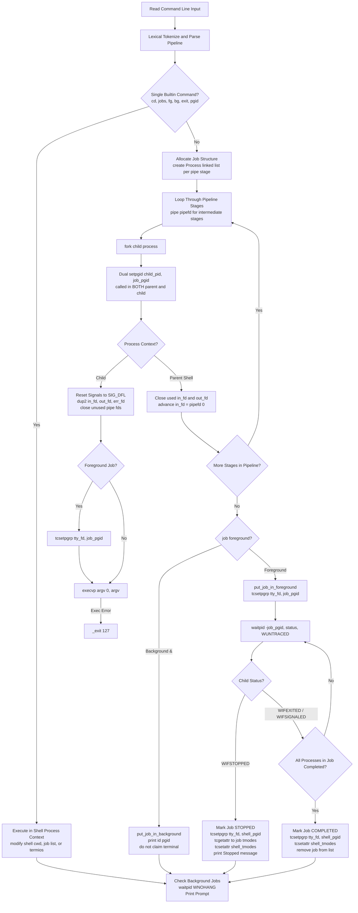
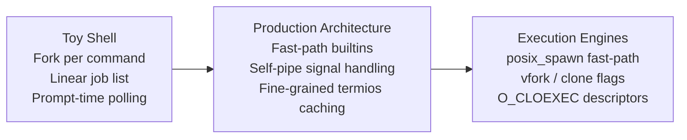

# Rebuild a Minimal Shell With Job Control

> [!summary] Scope
> Owns the architecture, implementation milestones, and verification tests for rebuilding a functional POSIX-style command shell in C++ or Rust.
> Guides implementation of lexical tokenization, multi-stage pipelines with pipe and dup2, file descriptor redirections, child process fork-exec execution, process group assignment, terminal control acquisition via tcsetpgrp, and SIGCHLD/SIGTSTP job control.
> Reaches Rebuild, putting process and pipeline concepts into code.

Lexical tokenization, quotation rules, and expansion order are owned by [[Shell-Parsing-Tokenization-and-Expansion-Order]].
Subshell environments, compound execution, and process substitution are owned by [[Pipelines-Subshells-Redirection-and-Process-Substitution]].
Terminal line discipline algorithms and pseudo-terminal master-replica pairs are owned by [[TTYs-PTYs-and-Line-Discipline]].
Stdio buffering boundaries and pipe capacity tuning are owned by [[Pipe-Buffering-and-Stdbuf]].
This playbook owns the end-to-end implementation runbook for constructing a POSIX job-controlling shell from raw system calls.

## Trigger and Symptoms

Activate this implementation playbook when building an embedded shell, sandboxed runner runtime, or container entrypoint, or when debugging kernel-level terminal deadlocks and signal anomalies in existing systems.

- A custom command runner or supervisor hangs indefinitely when launching a pipeline such as `cmd1 | cmd2` because the parent process failed to close the write end of an intermediate pipe descriptor.
- A terminal-attached child process suspends the supervising process with `SIGTTOU` when calling `tcsetpgrp()`, freezing user input and requiring an external `kill -CONT` to recover.
- Pressing `Ctrl+Z` (`SIGTSTP`) suspends the entire shell session rather than isolating and pausing the active foreground job pipeline.
- Spawning a child process results in an intermittent race condition where `setpgid()` fails with `EACCES` because the child completed `execve()` before the parent assigned the process group.
- Background jobs attempt to read from standard input and terminate unexpectedly with `EIO` because their process group was orphaned after the controlling session leader terminated.
- Resuming a suspended interactive terminal application like `vi` or `less` via `fg` leaves the terminal line discipline in cooked canonical mode instead of restoring raw mode attributes.

## Decision Tree



## Prerequisites

Rebuilding a job-controlling POSIX shell requires a C99 or C11 compilation environment, standard POSIX headers, and direct access to a controlling terminal (PTY or TTY).

```bash
command -v "${CC:-cc}" make python3
```

On Linux systems, build requirements are provided by `gcc` or `clang`, `libc6-dev`, and `make`.
On macOS systems, build tools are provided by the Xcode Command Line Tools (`xcode-select --install`).

System Interface Conformance:
- The implementation must define `#define _POSIX_C_SOURCE 200809L` before including any system header to expose POSIX.1-2008 system call prototypes, including `sigaction`, `tcsetpgrp`, `tcgetpgrp`, `setpgid`, `strtok_r`, and `getline`.
- Required system headers:
  - `<termios.h>`: Terminal I/O interfaces (`tcgetattr`, `tcsetattr`, `tcsetpgrp`, `tcgetpgrp`).
  - `<unistd.h>`: Process creation and descriptor manipulation (`fork`, `execvp`, `pipe`, `dup2`, `close`, `setpgid`, `getpgrp`, `isatty`).
  - `<sys/wait.h>`: Process status management (`waitpid`, status inspection macros).
  - `<signal.h>`: Signal actions and process group signaling (`signal`, `sigaction`, `kill`, `raise`).
  - `<fcntl.h>`: File control flags for redirection (`open`, `O_RDONLY`, `O_WRONLY`, `O_CREAT`, `O_TRUNC`, `O_APPEND`).

**Verification:**

```bash
printf '#define _POSIX_C_SOURCE 200809L\n#include <termios.h>\n#include <unistd.h>\nint main(void){return !isatty(0);}\n' | "${CC:-cc}" -x c - -o /tmp/posix_check && /tmp/posix_check || echo "Not a direct terminal"
```

The check compiles clean without warnings; when executed inside an interactive terminal session it exits with status 0.

## Commands and Numbers to Know

| Symbol / Item | Platform | Value `(as of 2026-11)` | Why it matters |
| :--- | :--- | :--- | :--- |
| `_POSIX_C_SOURCE` | Both | `200809L` | Enables POSIX.1-2008 prototypes in glibc, musl, and Apple libSystem. |
| `SIGINT` | Both | `2` | Interrupt signal generated by terminal line discipline on `Ctrl+C`. |
| `SIGQUIT` | Both | `3` | Quit signal generated by terminal line discipline on `Ctrl+\` (dumps core). |
| `SIGTSTP` | Linux / macOS | `20` / `18` | Terminal stop signal generated by line discipline on `Ctrl+Z`; every Linux value in this table was checked against glibc headers on linux-aarch64 and every macOS value against the macOS SDK, and MIPS, Alpha, and SPARC Linux use different signal numbers. |
| `SIGTTIN` | Both | `21` | Sent to background process group attempting to `read()` from controlling terminal. |
| `SIGTTOU` | Both | `22` | Sent to background process group calling `tcsetpgrp()`, `tcsetattr()`, or writing with `TOSTOP`; an orphaned group gets `EIO` instead (POSIX `tcsetpgrp()` ERRORS, XBD 11.1.4). |
| `SIGCONT` | Linux / macOS | `18` / `19` | Resumes a stopped process group; discards pending stop signals. |
| `SIGCHLD` | Linux / macOS | `17` / `20` | Sent to parent process when a child terminates, stops, or continues. |
| `WUNTRACED` | Both | `2` | Flag for `waitpid()` to report children that have stopped via a signal. |
| `WNOHANG` | Both | `1` | Flag for `waitpid()` to return immediately without blocking if no status changed. |
| `WCONTINUED` | Linux / macOS | `8` / `16` | Flag for `waitpid()` to report children resumed by `SIGCONT`. |
| `TCSADRAIN` | Both | `1` | `tcsetattr()` action: change terminal parameters after all queued output is transmitted. |
| `TIOCSCTTY` ioctl | Linux | `0x540E` | Ioctl to make the open file descriptor the controlling terminal of the calling session. |
| Exit code 127 | Both | `127` | Standard POSIX shell exit status when an executable cannot be found in `PATH`. |
| Exit code 126 | Both | `126` | Standard POSIX shell exit status when an executable is found but cannot be invoked. |
| Exit code 128 + N | Both | `128 + N` | Shell convention representing process termination by signal `N` (for example 130 for `SIGINT`). |

## Step-by-Step Implementation

Constructing a fully functional, job-controlling shell involves seven progressive milestones.
Each milestone builds upon previous kernel invariants and ends with a verification check.

### Step 1: Initialize the Shell and Shield Interactive Signals

An interactive shell must ensure it owns the controlling terminal before executing user commands.
When launched from an existing job-controlling shell, the new shell might start as a background job.
It must verify its foreground status using `tcgetpgrp()`, suspend itself via `SIGTTIN` if backgrounded, place itself in its own unique process group via `setpgid()`, acquire terminal ownership via `tcsetpgrp()`, and shield itself from interactive signals.

```c
static struct termios shell_tmodes;
static int shell_terminal = STDIN_FILENO;
static pid_t shell_pgid = 0;
static bool shell_is_interactive = false;

void init_shell(void) {
    shell_is_interactive = isatty(shell_terminal);

    if (shell_is_interactive) {
        // Loop until the shell process group is in the terminal foreground
        while (tcgetpgrp(shell_terminal) != (shell_pgid = getpgrp())) {
            kill(-shell_pgid, SIGTTIN);
        }

        // Ignore interactive job-control signals so terminal keystrokes do not terminate the shell
        signal(SIGINT, SIG_IGN);
        signal(SIGQUIT, SIG_IGN);
        signal(SIGTSTP, SIG_IGN);
        signal(SIGTTIN, SIG_IGN);
        signal(SIGTTOU, SIG_IGN);

        // Put the shell into its own process group
        shell_pgid = getpid();
        if (setpgid(shell_pgid, shell_pgid) < 0) {
            if (errno != EPERM || getsid(0) != shell_pgid) {
                perror("Couldn't put the shell in its own process group");
                exit(1);
            }
        }

        // Take controlling terminal foreground ownership
        tcsetpgrp(shell_terminal, shell_pgid);

        // Save original terminal attributes for restoration
        tcgetattr(shell_terminal, &shell_tmodes);
    }
}
```

The call to `setpgid(shell_pgid, shell_pgid)` fails with `EPERM` if the shell is already a session leader (for example, when spawned directly by an SSH daemon or login process).
POSIX mandates that a session leader cannot change its process group ID.
Checking `getsid(0) == shell_pgid` confirms the shell is the session leader, in which case its process group ID is already identical to its process ID.
Ignoring `SIGTTOU` is mandatory: without it, the subsequent call to `tcsetpgrp()` will generate `SIGTTOU` and immediately suspend the shell if it is not already in the foreground.
If the shell's own process group is orphaned (for example a session leader whose parent sits outside the session, as in the lab harness), POSIX `tcsetpgrp()` and Linux `__tty_check_change()` in `drivers/tty/tty_jobctrl.c` specify `EIO` instead of stopping it.
In the lab harness without the `SIGTTOU` shield the failing reclaim reported `Inappropriate ioctl for device` (`ENOTTY`) on the container kernel `7.2.12-orbstack` (observed 2026-11-07), so treat the exact errno of a failed terminal call as kernel-dependent and the stop-versus-fail split as the portable fact.

**Verification:**
Execute a test program compiled with this initialization function inside a pseudo-terminal.
Confirm that `getpgrp() == getpid()` and `tcgetpgrp(STDIN_FILENO) == getpid()`.

### Step 2: Implement Dual setpgid to Prevent Fork-Exec Races

When a shell forks a child process to execute an external command or pipeline stage, both the child and parent must coordinate process group assignment.
A severe race condition exists if only one side calls `setpgid()`:
- If only the child calls `setpgid()`, the parent shell might attempt to call `tcsetpgrp(shell_terminal, job->pgid)` or `waitpid(-job->pgid, ...)` before the child is scheduled.
  Because the process group has not yet been established in kernel data structures, `tcsetpgrp()` fails with `EPERM`.
- If only the parent calls `setpgid()`, the child might execute `execvp()` before the parent is scheduled.
  Under POSIX, calling `setpgid()` on a child process after that child has successfully executed an `exec` system call fails with `EACCES`.
  The child would execute in the shell's process group, receiving terminal signals intended exclusively for the shell.

The robust solution is dual `setpgid()`: both parent and child invoke `setpgid(pid, pgid)` immediately following `fork()`.

```c
pid_t pid = fork();
if (pid < 0) {
    perror("fork");
    return;
}

if (pid == 0) {
    // Child process execution path
    pid_t child_pid = getpid();
    if (job->pgid == 0) {
        job->pgid = child_pid;
    }
    setpgid(child_pid, job->pgid);

    if (job->foreground && shell_is_interactive) {
        tcsetpgrp(shell_terminal, job->pgid);
    }

    // Reset signal dispositions to default so user commands respond to signals
    signal(SIGINT, SIG_DFL);
    signal(SIGQUIT, SIG_DFL);
    signal(SIGTSTP, SIG_DFL);
    signal(SIGTTIN, SIG_DFL);
    signal(SIGTTOU, SIG_DFL);
    signal(SIGCHLD, SIG_DFL);

    // Continue with redirection and execvp...
} else {
    // Parent shell process execution path
    p->pid = pid;
    if (job->pgid == 0) {
        job->pgid = pid;
    }
    setpgid(pid, job->pgid);

    // Manage pipeline descriptors...
}
```

Whichever process executes first establishes the process group.
The second invocation becomes an idempotent no-op (or returns `EACCES` harmlessly in the parent if the child has already exec'd, because the child already completed its own `setpgid()`).
Signals ignored in the parent shell remain ignored across `execve()` unless explicitly reset; therefore, the child must restore `SIGINT`, `SIGQUIT`, `SIGTSTP`, `SIGTTIN`, and `SIGTTOU` to `SIG_DFL` before executing the target binary.

**Verification:**
Launch an external diagnostic binary like `./job_probe` from the shell.
Inspect `/proc/PID/stat` on Linux or query `getpgrp()` in the child.
Verify that the child's process group ID equals the child's PID and differs strictly from the shell's process group ID.

### Step 3: Wire Multi-Stage Pipelines and Enforce Write-End Closure

A pipeline executes two or more commands concurrently, connecting the standard output of each upstream process to the standard input of the downstream process using anonymous pipes (`pipe()`) and file descriptor duplication (`dup2()`).

Every pipeline stage requires careful descriptor life-cycle management:
1. An intermediate pipe is created via `pipe(pipefd)` before forking the upstream child.
2. The upstream child duplicates `pipefd[1]` to `STDOUT_FILENO` and closes `pipefd[1]`.
   It closes the unused read end `pipefd[0]`.
3. The upstream child duplicates the previous stage's read descriptor to `STDIN_FILENO` and closes it.
4. The downstream child receives the previous stage's read end as its input descriptor.
5. In the parent shell process, the write end `pipefd[1]` MUST be closed immediately after forking the upstream child.

```c
int pipefd[2] = {-1, -1};
int in_fd = STDIN_FILENO;
int out_fd = STDOUT_FILENO;

for (Process *p = job->first_process; p; p = p->next) {
    if (p->next) {
        if (pipe(pipefd) < 0) {
            perror("pipe");
            return;
        }
        out_fd = pipefd[1];
    } else {
        out_fd = STDOUT_FILENO;
    }

    pid_t pid = fork();
    if (pid == 0) {
        // Child context: wire input and output descriptors
        if (in_fd != STDIN_FILENO) {
            dup2(in_fd, STDIN_FILENO);
            close(in_fd);
        }
        if (out_fd != STDOUT_FILENO) {
            dup2(out_fd, STDOUT_FILENO);
            close(out_fd);
        }
        if (pipefd[0] != -1) {
            close(pipefd[0]);
        }

        execvp(p->argv[0], p->argv);
        _exit(127);
    }

    // Parent context: close descriptors that the parent shell no longer needs
    if (in_fd != STDIN_FILENO) {
        close(in_fd);
    }
    if (out_fd != STDOUT_FILENO) {
        close(out_fd);
    }
    // The read end of the current pipe becomes the input for the next stage
    in_fd = pipefd[0];
    pipefd[0] = -1;
    pipefd[1] = -1;
}
```

The pipe write-end closure rule is critical: the operating system delivers an end-of-file (`EOF`) condition to a pipe reader only when ALL file descriptors referencing the write end of that pipe have been closed across all processes on the system.
If the parent shell forgets to close `out_fd` (`pipefd[1]`), the shell retains an open write reference to the pipe.
When the upstream child terminates, the downstream child remains blocked indefinitely inside `read()`, waiting for input that will never arrive.

**Verification:**
Execute a multi-stage pipeline command: `echo alpha bravo charlie | tr ' ' '\n' | sort -r`.
Verify that all processes terminate promptly without hanging and print the sorted output.

### Step 4: Implement I/O Redirection and Descriptor Merging

File redirection modifies standard streams before command execution, directing input from files or routing output to files.
Redirection operators must be evaluated prior to `execvp()`:
- Input redirection (`< file`): Open file with `O_RDONLY`, duplicate to `STDIN_FILENO`.
- Output truncation (`> file`): Open file with `O_WRONLY | O_CREAT | O_TRUNC, 0666`, duplicate to `STDOUT_FILENO`.
- Output append (`>> file`): Open file with `O_WRONLY | O_CREAT | O_APPEND, 0666`, duplicate to `STDOUT_FILENO`.
- Standard error redirection (`2> file`): Open file with `O_WRONLY | O_CREAT | O_TRUNC, 0666`, duplicate to `STDERR_FILENO`.
- Descriptor merging (`2>&1`): Duplicate `STDOUT_FILENO` to `STDERR_FILENO` using `dup2(STDOUT_FILENO, STDERR_FILENO)`.

```c
if (job->infile) {
    int in_fd = open(job->infile, O_RDONLY);
    if (in_fd < 0) {
        perror("open (infile)");
        _exit(1);
    }
    dup2(in_fd, STDIN_FILENO);
    close(in_fd);
}

if (job->outfile) {
    int flags = O_WRONLY | O_CREAT | (job->append_out ? O_APPEND : O_TRUNC);
    int out_fd = open(job->outfile, flags, 0666);
    if (out_fd < 0) {
        perror("open (outfile)");
        _exit(1);
    }
    dup2(out_fd, STDOUT_FILENO);
    close(out_fd);
}

if (job->errfile) {
    int err_fd = open(job->errfile, O_WRONLY | O_CREAT | O_TRUNC, 0666);
    if (err_fd < 0) {
        perror("open (errfile)");
        _exit(1);
    }
    dup2(err_fd, STDERR_FILENO);
    close(err_fd);
} else if (job->merge_err) {
    dup2(STDOUT_FILENO, STDERR_FILENO);
}
```

The `dup2()` onto the standard descriptors must occur in the child process after `fork()` but before `execvp()`; the `open()` may happen in either process, and the lab's `mini_shell.c` opens the files in the parent before forking and closes its own copies after the last fork.
Descriptors opened with `open()` should be closed immediately after `dup2()` to prevent descriptor leaks into the executed program image.

**Verification:**
Execute `echo line1 > /tmp/out.txt && echo line2 >> /tmp/out.txt && cat < /tmp/out.txt`.
Confirm that the file contains both lines in sequence.
Execute a command that prints to standard error with `2>&1 | cat` and confirm the error text passes through the pipeline.

### Step 5: Implement Foreground Waiting and Terminal Handoff

When running a foreground job, the shell transfers terminal control to the job's process group and executes a synchronous wait loop.
When the job terminates or is suspended by a signal like `SIGTSTP`, the shell reclaims the terminal, captures any modified terminal modes, and restores the shell's canonical modes.

```c
void put_job_in_foreground(Job *j, bool continue_job) {
    j->foreground = true;

    // Transfer terminal control to the child process group
    if (shell_is_interactive) {
        tcsetpgrp(shell_terminal, j->pgid);
    }

    // If resuming a stopped job, restore its saved terminal modes and send SIGCONT
    if (continue_job) {
        if (shell_is_interactive) {
            tcsetattr(shell_terminal, TCSADRAIN, &j->tmodes);
        }
        if (kill(-j->pgid, SIGCONT) < 0) {
            perror("kill (SIGCONT)");
        }
        for (Process *p = j->first_process; p; p = p->next) {
            if (p->state == STATUS_STOPPED) {
                p->state = STATUS_RUNNING;
            }
        }
        // A resumed job must be reported again the next time it stops
        j->notified = false;
    }

    // Synchronous wait loop: block until all processes complete or stop
    int status;
    pid_t pid;
    while (!job_is_stopped(j) && !job_is_completed(j)) {
        pid = waitpid(-j->pgid, &status, WUNTRACED);
        if (pid <= 0) {
            break;
        }
        mark_process_status(pid, status);
    }

    // Reclaim controlling terminal foreground ownership for the shell
    if (shell_is_interactive) {
        tcsetpgrp(shell_terminal, shell_pgid);
        tcgetattr(shell_terminal, &j->tmodes);
        tcsetattr(shell_terminal, TCSADRAIN, &shell_tmodes);
    }

    if (job_is_stopped(j)) {
        printf("\n[%d]+ Stopped %s\n", j->id, j->command_line);
        fflush(stdout);
        j->notified = true;
    } else if (job_is_completed(j)) {
        remove_job(j);
    }
}
```

The call to `waitpid(-j->pgid, &status, WUNTRACED)` specifies a negative process group ID (`-j->pgid`), instructing the kernel to wait for any child process belonging to that specific process group.
Passing `WUNTRACED` ensures `waitpid()` returns if a child process is suspended by `SIGTSTP`, `SIGSTOP`, `SIGTTIN`, or `SIGTTOU`.
When the loop exits, `tcsetpgrp(shell_terminal, shell_pgid)` reclaims foreground status.
Because the shell ignored `SIGTTOU` during initialization in Step 1, this call succeeds immediately without kernel suspension.

**Verification:**
Run a long-running process in the foreground and send `Ctrl+Z`.
Verify that the process suspends, the shell prints `[1]+ Stopped`, and the shell prompt returns with the terminal fully responsive.

### Step 6: Asynchronous Background Reaping and Status Reporting

Background jobs execute asynchronously while the shell continues accepting commands.
Before displaying each interactive prompt, the shell must poll for child status changes using `waitpid()` with `WNOHANG` to reap zombie processes and detect stopped background tasks without blocking.

```c
void check_jobs(void) {
    int status;
    pid_t pid;

    // Non-blocking status reaping across all children
    while ((pid = waitpid(-1, &status, WNOHANG | WUNTRACED | WCONTINUED)) > 0) {
        mark_process_status(pid, status);
    }

    // Walk active jobs and notify user of state transitions
    Job *j = job_list_head;
    while (j) {
        Job *next = j->next;
        if (job_is_completed(j)) {
            if (!j->foreground) {
                printf("[%d]+ Done %s\n", j->id, j->command_line);
                fflush(stdout);
            }
            remove_job(j);
        } else if (job_is_stopped(j) && !j->notified) {
            printf("[%d]+ Stopped %s\n", j->id, j->command_line);
            fflush(stdout);
            j->notified = true;
        }
        j = next;
    }
}
```

Calling `waitpid(-1, &status, WNOHANG | WUNTRACED | WCONTINUED)` checks all child processes.
Passing `WCONTINUED` enables detection of processes resumed by `SIGCONT`.
If a completed job was running in the background (`!j->foreground`), the shell prints a completion banner (`[1]+ Done cmd`) and frees its job structure.
Without this polling mechanism, terminated background processes remain zombies in the operating system process table indefinitely.

**Verification:**
Launch a background command: `sleep 1 &`.
Press Enter after one second.
Verify that the shell reaps the child process and prints `[1]+ Done sleep 1`.

### Step 7: Builtin Job Control Operations (jobs, fg, bg)

The shell provides builtin commands to inspect and manipulate active jobs:
- `jobs`: Formats and lists all active jobs with job ID, status (`Running` or `Stopped`), and original command string.
- `bg [%id]`: Resumes a stopped job in the background by sending `SIGCONT` to its process group, marking it running without handing over terminal ownership.
- `fg [%id]`: Transfers controlling terminal ownership to the job via `tcsetpgrp()`, restores its terminal modes, sends `SIGCONT` if stopped, and enters the synchronous foreground wait loop.

```c
int builtin_jobs(void) {
    check_jobs();
    for (Job *j = job_list_head; j; j = j->next) {
        const char *state_str = job_is_stopped(j) ? "Stopped" : "Running";
        printf("[%d]+ %-10s %s\n", j->id, state_str, j->command_line);
    }
    fflush(stdout);
    return 0;
}

int builtin_bg(char **argv) {
    int id = parse_job_id(argv[1]);
    Job *j = find_job_by_id(id);
    if (!j) {
        fprintf(stderr, "bg: no such job\n");
        return 1;
    }
    put_job_in_background(j, true);
    return 0;
}

int builtin_fg(char **argv) {
    int id = parse_job_id(argv[1]);
    Job *j = find_job_by_id(id);
    if (!j) {
        fprintf(stderr, "fg: no such job\n");
        return 1;
    }
    printf("%s\n", j->command_line);
    fflush(stdout);
    put_job_in_foreground(j, true);
    return 0;
}
```

When targeting process groups with `kill()`, the signal must be sent to the negative process group ID (`kill(-j->pgid, SIGCONT)`).
This broadcasts `SIGCONT` to every process in the pipeline simultaneously.
Sending `SIGCONT` to an individual process PID would resume only that specific process, leaving upstream or downstream pipeline stages suspended.
`put_job_in_background(j, true)` resumes the job exactly as the foreground path in Step 5 does: it sends `SIGCONT`, marks every stopped process running, and clears `j->notified`.
`mark_process_status()` clears it too when `waitpid()` reports `WIFCONTINUED`, which covers a `kill -CONT` sent from outside the shell.
Without that reset, a job stopped once, resumed with `bg`, and stopped again (for example by `SIGTTIN` when it reads the terminal) would never be reported, because `check_jobs()` prints `Stopped` only while `notified` is false.

**Verification:**
Suspend a job with `Ctrl+Z`.
Run `jobs` and confirm it reports `Stopped`.
Run `bg` and verify the job status transitions to `Running`.
Run `fg` and confirm the job claims the foreground and runs to completion.

## Complete Verification and Golden Output

The complete implementation is verified by the automated test suite in `code/01-Command-Line/rebuild_mini_shell/`.
The harness spawns `mini_shell` as a session leader on a dedicated pseudo-terminal master-replica pair and drives every milestone by writing command lines to the master; no control characters are sent, and the stops in Milestones 6 and 8 come from `job_probe --stop` calling `raise(SIGTSTP)` on itself rather than from a `Ctrl+Z` keystroke.
Every check compares whole output lines, because the PTY echoes each typed line back and a substring test would pass on the echo alone.
The shell and the probe are built with `-Wall -Wextra -pedantic -Werror`.
Two hooks make races and terminal modes observable: `MINI_SHELL_RACE_DELAY=parent|child` delays one side of the dual `setpgid()` by 150 ms, and `job_probe --raw` clears `ECHO` on the terminal.
The shell reports any failed `tcsetpgrp()` or unexpected `setpgid()` error on standard error as a `mini_sh:` line, and the last check of the suite fails if one appeared.

Run the test suite through the project harness:

```bash
cd code && python3 -m _harness.verify 01-Command-Line/rebuild_mini_shell/
```

Recorded by `make record` on `linux-aarch64` inside the pinned Ubuntu 24.04 container on 2026-11-07; the golden output file is `code/01-Command-Line/rebuild_mini_shell/expected/linux-aarch64.txt`:

```text
=== Milestone 1: Basic Execution and Builtins ===
external command output (echo): yes
cd persists in the shell process (pwd): yes
shell is its own process group leader: yes
shell holds the terminal foreground: yes

=== Milestone 2: Pipelines and Write-End Closure ===
pipe 3 stages: CHARLIE BRAVO ALPHA
prompt returned and no job left behind: yes

=== Milestone 3: I/O Redirection ===
output truncation (>): yes
output append (>>): yes
input redirection (<): yes
stderr merge (2>&1): yes

=== Milestone 4: Dual setpgid and Process Isolation ===
child in distinct process group: yes
child has terminal foreground during execution: yes
shell reclaims terminal foreground after child exit: yes
child setpgid alone suffices when the parent is delayed: yes
parent setpgid alone suffices when the child is delayed: yes

=== Milestone 5: Pipeline Process Group Unification ===
pipeline stages share one pgid: yes
pipeline pgid is a stage pid and differs from shell pgid: yes

=== Milestone 6: Job Suspension via SIGTSTP ===
job stopped notification: received
jobs list status: Stopped
shell owns terminal foreground while job is stopped: yes
shell restores its own terminal modes on stop: yes

=== Milestone 7: Background Continuation via bg ===
bg reports the job's process group: yes
bg returned the prompt while the job kept running: yes
jobs list status after bg: Running
every pipeline stage resumed and finished: yes
asynchronous job done notification: received
a bg job that stops again is reported again: yes
re-stopped job finished under fg: yes

=== Milestone 8: Foreground Resumption via fg ===
job suspended again: yes
fg echoes the command line: yes
every pipeline stage resumed with the job's terminal modes: yes
job completed in the foreground: yes
shell reclaimed terminal foreground: yes
shell terminal modes restored after fg: yes

=== Session hygiene ===
shell exits with status 0 on exit: yes
shell diagnostics on stderr: none
```

What each milestone proves, checked on 2026-11-07 by applying 35 single-point mutations to a scratch copy of the lab and re-running the suite in the pinned container; 34 made the suite fail and one survived, as listed below:
- Milestone 1 proves that external commands run (replacing `execvp()` with another program fails it), that `cd` runs in the shell process (making it a forked command fails it), and that the shell leads its own process group and holds the terminal foreground (a wrong `pgid` report fails it).
- Milestone 2 proves multi-stage descriptor plumbing and write-end closure: removing the parent's `close()` of the write end makes `pipe 3 stages:` print nothing, and removing the `dup2()` onto standard output breaks the pipeline output.
- Milestone 3 proves each redirection against a file the test controls: removing `O_TRUNC` leaves stale bytes after the second write, turning `>>` into truncation loses the first line, removing the standard input `dup2()` fails the input check, and removing the `2>&1` merge puts `err_test` on the terminal instead of in the file.
- Milestone 4 proves that the child runs in its own process group and holds the terminal foreground, and that the shell takes the terminal back.
  The two delayed runs prove the dual `setpgid()`: with the parent delayed, removing the child's `setpgid()` fails only `child setpgid alone suffices when the parent is delayed`; with the child delayed, removing the parent's `setpgid()` fails the other delayed run and the main run as well.
  Removing the child's own `tcsetpgrp()` fails the suite, but removing only the shell's handoff `tcsetpgrp()` does not, because the child's call covers it, so the lab does not prove the shell-side handoff.
- Milestone 5 proves that both pipeline stages share one process group whose ID is a stage pid and differs from the shell's; giving each stage its own group fails it.
- Milestone 6 proves `WUNTRACED` stop detection (without it the suite fails), the job-table state, terminal reclamation, and that the shell reapplies its own terminal modes when a job stops (removing that `tcsetattr()` leaves `ECHO` off on the terminal).
- Milestone 7 proves `bg` on a two-stage pipeline: signalling one pid instead of the group leaves the second stage stopped, so neither it nor the `Done` notice arrives; a wrong reported group, `bg` waiting in the foreground, a job whose `foreground` flag is not cleared, a reaper without `WNOHANG`, and no reaping at all each fail a check.
  A job that stops, is resumed with `bg`, and stops again must be reported a second time; leaving `notified` set across the resume fails `a bg job that stops again is reported again`.
- Milestone 8 proves `fg` on a two-stage pipeline: signalling one pid fails it, and the job's own terminal modes must come back on resume with `ECHO` off and `ICANON` on in both stages, so skipping the save at stop time (which leaves an all-zero `termios`) or the restore at `fg` fails it.
- The suite does not check that the child resets `SIGINT`, `SIGQUIT`, `SIGTSTP`, `SIGTTIN`, and `SIGTTOU` to `SIG_DFL` before `execvp()`; that is practice drill 3.

## Rollback and Terminal Discipline Recovery

If an error occurs during interactive execution or if the shell terminates abnormally, terminal parameters and child processes must be restored to a clean state.

1. **Restore Terminal Line Discipline Attributes:**
   If a child process altered terminal attributes (e.g. disabling `ECHO` or `ICANON` for raw mode) and crashed or was killed, the terminal may appear broken, failing to display typed characters or process Enter keys.
   Save the original terminal modes upon shell startup and restore them on exit:
   ```c
   void cleanup_terminal(void) {
       if (shell_is_interactive) {
           tcsetattr(shell_terminal, TCSANOW, &shell_tmodes);
       }
   }
   ```
   From the command line, recovery is executed via `stty sane` or the terminal reset sequence:
   ```bash
   stty sane
   ```
2. **Terminate Orphaned Child Processes:**
   Before the shell exits, it must notify all active background and stopped jobs.
   POSIX does not require this; Bash does it when it receives `SIGHUP` (and, with `shopt -s huponexit`, when an interactive login shell exits): it resends `SIGHUP` to all jobs and sends `SIGCONT` to stopped ones (bash(1), SIGNALS):
   ```c
   for (Job *j = job_list_head; j; j = j->next) {
       kill(-j->pgid, SIGHUP);
       kill(-j->pgid, SIGCONT);
   }
   ```
   `SIGHUP` informs processes that the controlling terminal is disconnected; `SIGCONT` ensures stopped processes wake up to process the hangup signal.
3. **Restore Signal Dispositions:**
   Reset all ignored signals back to `SIG_DFL` before invoking `exit()`:
   ```c
   signal(SIGINT, SIG_DFL);
   signal(SIGQUIT, SIG_DFL);
   signal(SIGTSTP, SIG_DFL);
   signal(SIGTTIN, SIG_DFL);
   signal(SIGTTOU, SIG_DFL);
   signal(SIGCHLD, SIG_DFL);
   ```

## Failure Modes of the Architecture

| Failure | Mechanism Root Cause | Observable Symptom | Prevention / Recovery |
| :--- | :--- | :--- | :--- |
| Pipeline hangs indefinitely | Parent shell fails to close intermediate write descriptors (`pipefd[1]`). | Downstream command blocks forever inside `read()` waiting for `EOF`. | Close `pipefd[1]` in the parent shell process immediately after forking the upstream child. |
| Shell suspends on `tcsetpgrp()` | Shell attempts to reclaim terminal without ignoring `SIGTTOU`. | Shell stops completely; terminal becomes unresponsive to keyboard input. | Set `signal(SIGTTOU, SIG_IGN)` during shell initialization before calling `tcsetpgrp()`. |
| `setpgid()` fails with `EACCES` | Parent calls `setpgid(child, pgid)` after the child has already executed `execve()`. | Child remains in the shell's process group; terminal signals hit both shell and child. | Implement dual `setpgid()` in both child and parent immediately following `fork()`. |
| `setpgid()` fails with `EPERM` | Calling process is a session leader or target process group does not exist. | Terminal control fails; child cannot establish new process group. | Guard `setpgid(pid, pid)` with a check for `getsid(0) == pid`; ensure leader forks first. |
| Background job killed by `EIO` | Background job in an orphaned process group attempts to read from terminal. | Process crashes with `Input/output error` instead of suspending on `SIGTTIN`. | POSIX discards stop signals for orphaned groups; redirect input from `/dev/null` for background jobs. |
| Zombie processes accumulate | Shell only reaps children synchronously in `fg` and ignores background completions. | Process table fills with `<defunct>` processes until PID space is exhausted. | Call `waitpid(-1, &status, WNOHANG \| WUNTRACED \| WCONTINUED)` in a non-blocking loop before each prompt. |
| Foreground signals killed by subshell | Subshell fails to restore default signal dispositions before `execvp()`. | Program fails to terminate when user presses `Ctrl+C` or suspend on `Ctrl+Z`. | Explicitly reset `SIGINT`, `SIGQUIT`, `SIGTSTP`, `SIGTTIN`, `SIGTTOU` to `SIG_DFL` in child before exec. |
| Broken terminal after `fg` | Shell fails to save and restore per-job `termios` structures across transitions. | Text editor display becomes corrupted; raw keys print escape sequences on screen. | Save job `tmodes` via `tcgetattr()` upon stop; restore job `tmodes` via `tcsetattr()` upon `fg`. |

## Pitfalls

> [!warning] Dual `setpgid()` is mandatory, not optional
> Relying on the child alone to set its process group creates a race condition against parent calls to `tcsetpgrp()`.
> Relying on the parent alone creates a race condition against child calls to `execve()`.
> Both parent and child must invoke `setpgid(pid, pgid)` immediately following `fork()`.
> Whichever executes first establishes the group; the second call is either a no-op or, in the parent after the child has exec'd, fails harmlessly with `EACCES` (POSIX `setpgid()` ERRORS).

> [!warning] The `SIGTTOU` trap when reclaiming terminal control
> When a foreground job is active, the shell belongs to a background process group.
> Calling `tcsetpgrp()` from a background process group causes the kernel terminal driver to deliver `SIGTTOU` to the caller's whole process group (POSIX `tcsetpgrp()`).
> Because the default action for `SIGTTOU` is to stop the process, an unshielded shell immediately suspends itself.
> The shell must explicitly ignore or block `SIGTTOU` prior to manipulating terminal process group ownership.

> [!warning] Unclosed pipe write ends deadlock pipelines
> The kernel delivers `EOF` on an anonymous pipe only when the reference count across all system file descriptor tables reaches zero.
> If a parent shell retains an open file descriptor pointing to `pipefd[1]`, the downstream reader will never receive `EOF` even after the upstream writer exits.
> The parent shell must close the write end of every intermediate pipe immediately after spawning the corresponding writer process.

> [!warning] Orphaned process groups and terminal I/O
> A process group is orphaned when no process in the group has a parent in the same session but a different process group.
> If a process in an orphaned process group would stop on `SIGTSTP`, `SIGTTIN`, or `SIGTTOU`, the signal is discarded because no job-controlling shell remains to wake it up (POSIX XSH 2.4.3); `SIGSTOP` still stops it.
> If a process in an orphaned group attempts to `read()` from the terminal, the read immediately fails with `EIO` (POSIX XBD 11.1.4).

> [!warning] Signal safety violations in asynchronous notification
> If `SIGCHLD` handlers are used instead of prompt polling, executing non-async-signal-safe functions like `printf()`, `malloc()`, or `free()` inside the signal handler can deadlock the process.
> The standard pattern for production shells is either to write a single byte to a self-pipe or poll `waitpid(..., WNOHANG)` synchronously in the main event loop before printing the command prompt.

## At Scale

Production shells like GNU Bash, Zsh, and Dash handle job control across millions of daily invocations, evolving beyond toy architectures to optimize performance and resource isolation.



### Fast-Path Builtin Execution and Fork Avoidance

- A minimal shell forks a separate process for every command.
  Production shells classify commands into special builtins (POSIX.1-2024 XCU 2.15: `break`, `:`, `continue`, `.`, `eval`, `exec`, `exit`, `export`, `readonly`, `return`, `set`, `shift`, `times`, `trap`, `unset`), intrinsic utilities that are never looked up in `PATH` (XCU 1.7, including `cd`, `jobs`, `fg`, `bg`, `alias`, `umask`), and external executables.
- Builtins executed outside pipelines are invoked directly within the parent shell process context, completely eliminating `fork()` and `execve()` system call overhead.
- Where subshells are spawned repeatedly, a shell can avoid copying the parent's page tables: glibc `posix_spawn()` starts with `clone(2)` using `CLONE_VM | CLONE_VFORK` since glibc 2.24, and glibc `vfork()` uses `CLONE_VM | CLONE_VFORK | SIGCHLD` (posix_spawn(3), vfork(2); Linux, as of 2026-11).
  The saving depends on the size of the parent's address space and was not measured here, so measure a given shell before relying on it.

### Asynchronous Notification: Polling vs Self-Pipe

- Minimal shells check child status synchronously by calling `waitpid(-1, &status, WNOHANG)` immediately before printing the prompt.
  This means background jobs that complete during user command input are not reported until the user presses Enter.
- Bash behaves the same way by default: it learns of the change at once but waits until it is about to print a prompt before reporting it, and reports immediately only with `set -b` (bash(1), JOB CONTROL).
- A shell that reports immediately can install a minimal, async-signal-safe `SIGCHLD` handler that writes a single token byte to a self-pipe (`pipe2(..., O_NONBLOCK | O_CLOEXEC)`).
- Its line editor then monitors standard input and the self-pipe read descriptor simultaneously using `pselect()`, `poll()`, or `epoll_wait()`.
- When a background child terminates, the self-pipe awakens the line editor immediately, allowing the shell to display asynchronous completion banners dynamically without corrupting current line buffer editing.

### Descriptors and O_CLOEXEC Hygiene

- Minimal implementations rely on manual `close()` calls in child processes before `execvp()`.
  If a child forgets to close an internal descriptor, that descriptor leaks into executed third-party binaries, creating security risks and pipe deadlocks.
- A production shell should mark all internal shell descriptors (script file handles, pipe fds, history file handles) with `FD_CLOEXEC` using `fcntl(fd, F_SETFD, FD_CLOEXEC)` or open them directly with `open(..., O_CLOEXEC)` and `pipe2(..., O_CLOEXEC)`.
- The kernel automatically closes all `O_CLOEXEC` descriptors upon successful execution of `execve()`, guaranteeing hermetic child descriptor namespaces.

## Practice Drill

> [!tip] Practice Drill: Rebuild and Break Job Control Mechanisms
> Navigate to `code/01-Command-Line/rebuild_mini_shell/` and run `cd code && python3 -m _harness.verify 01-Command-Line/rebuild_mini_shell/` to confirm the test suite passes on the containerized Linux platform.
> Next, introduce one defect at a time into `mini_shell.c`, predict the exact failure mode, and run the same command: a failing run lists every failed check and any `mini_sh:` diagnostic the shell printed.
> 1. **Delete parent pipe closure:** In `launch_job()`, disable the parent's `if (out_fd != STDOUT_FILENO && out_fd != job_out_fd) { close(out_fd); }` block.
>    Predict that Milestone 2 hangs on `sort -r` waiting for `EOF`.
>    Observed on 2026-11-08: `pipe 3 stages:` prints nothing once the 3-second read times out, and 26 checks fail, every later check in the main session (the two delayed-`setpgid()` runs use their own shells and pass).
> 2. **Delete `SIGTTOU` shielding:** In `init_shell()`, comment out `signal(SIGTTOU, SIG_IGN);`.
>    In an ordinary terminal the shell would stop on its first reclaiming `tcsetpgrp()`.
>    In the harness the shell is a session leader whose parent is outside the session, so its group is orphaned and the reclaim fails instead of stopping the shell.
>    Observed on 2026-11-08: after the first `echo` the shell printed `mini_sh: tcsetpgrp (reclaim): Inappropriate ioctl for device`, its next terminal read ended, and it exited with status 0; 33 checks fail, starting with the first one because the diagnostic lands in the `echo` output.
> 3. **Delete child signal reset:** Comment out the child's `signal(SIGINT, SIG_DFL)` calls before `execvp()`.
>    Predict that child processes become completely immune to terminal `Ctrl+C` keystrokes, because a signal ignored by the shell stays ignored across `execve()`.
>    The suite does not check this, so verify it by hand in a real terminal.
> 4. **Delete parent `setpgid()`:** Comment out the `setpgid(pid, job->pgid)` line in the parent execution path, leaving only the child invocation.
>    Predict that the child is no longer reliably in its group when the shell hands over the terminal.
>    Observed on 2026-11-08: the first `echo` printed nothing, the shell's next terminal read failed and it exited, and 31 checks fail; the order of events depends on which process runs first after `fork()`, so rely on the symptom rather than the order.
>    The suite widens the window itself: `MINI_SHELL_RACE_DELAY=child` makes the child wait 150 ms before its own `setpgid()`, and deleting the parent's `setpgid()` fails `parent setpgid alone suffices when the child is delayed`.
>    Deleting the child's `setpgid()` instead fails exactly one check, `child setpgid alone suffices when the parent is delayed`, which runs with `MINI_SHELL_RACE_DELAY=parent`.
> 5. **Delete background mode flag update:** In `put_job_in_background()`, comment out `j->foreground = false;`.
>    Predict that a job resumed with `bg` is never reported as `Done`, because `check_jobs()` prints `Done` only for jobs whose `foreground` flag is false; jobs started with `&` are still reported, because the parser clears the flag for them.
>    Observed on 2026-11-08: exactly one check fails, `asynchronous job done notification`.
> Target time: complete all five failure diagnoses in under 20 minutes.

## Interview Questions

> [!question] L5
> Why must an interactive command shell call `tcsetpgrp()` when running a foreground job?
>
> > [!success]- Answer
> > The controlling terminal driver directs keyboard-generated signals (`Ctrl+C` for `SIGINT`, `Ctrl+\` for `SIGQUIT`, and `Ctrl+Z` for `SIGTSTP`) exclusively to the process group currently designated as the terminal foreground process group.
> > If the shell does not invoke `tcsetpgrp(shell_terminal, child_pgid)`, the shell's own process group remains in the terminal foreground.
> > When the user presses `Ctrl+C`, the terminal line discipline broadcasts `SIGINT` to the shell rather than the executing child, terminating or disrupting the shell while leaving the child running disconnected.
> > Calling `tcsetpgrp()` gives the child process group exclusive ownership of keyboard input and terminal signals.

> [!question] L5
> Predict the output: A background process launched with `cmd &` invokes `read(STDIN_FILENO, buf, sizeof(buf))`.
> What signal is generated by the operating system, what is the default action, and what system call error occurs if that signal is ignored?
>
> > [!success]- Answer
> > When a member of a background process group attempts to read from its controlling terminal, the kernel terminal driver generates a `SIGTTIN` signal directed to that background process group.
> > The default action for `SIGTTIN` is to stop (suspend) the process group.
> > If the background process has set `SIGTTIN` to `SIG_IGN` or is blocking `SIGTTIN`, the kernel cannot stop the process; instead, the `read()` system call immediately fails, returning `-1` with `errno` set to `EIO` (Input/output error).

> [!question] L6
> Debug this failure: A developer implements a custom shell that runs single commands cleanly, but running `cat largefile.txt | grep target` causes `grep` to hang indefinitely even after `cat` finishes reading the entire file.
> What is the root cause at the system call level, and how is it resolved?
>
> > [!success]- Answer
> > The root cause is a file descriptor leak in the parent shell process.
> > When the shell created the pipe between `cat` and `grep` via `pipe(pipefd)`, the write descriptor `pipefd[1]` was duplicated to standard output in `cat`, but the parent shell process forgot to call `close(pipefd[1])`.
> > In POSIX operating systems, a pipe reader only receives an end-of-file (`EOF`) condition (a `read()` returning 0 bytes) when every open descriptor referencing the write end across the entire system is closed.
> > Even though `cat` terminated and closed its file descriptors, the parent shell still held an open descriptor referencing the write end.
> > Consequently, the kernel kept the pipe open, and `grep` remained blocked inside `read()` waiting for additional data.
> > The fix is for the parent shell to invoke `close(pipefd[1])` immediately after forking the upstream child.

> [!question] L6
> Why must BOTH the parent shell process and the child process invoke `setpgid(pid, pgid)` immediately following `fork()`?
> What exact `errno` is returned if only the parent calls `setpgid()` but the child executes too quickly?
>
> > [!success]- Answer
> > Dual `setpgid()` prevents a scheduling race condition between parent and child.
> > If only the child calls `setpgid()`, the parent shell may execute first and attempt to assign terminal ownership via `tcsetpgrp(tty, pgid)` or wait via `waitpid(-pgid, ...)`.
> > Because the child has not yet executed `setpgid()`, the process group `pgid` does not yet exist in the kernel session, causing `tcsetpgrp()` to fail with `EPERM`.
> > If only the parent calls `setpgid()`, the child may execute first and invoke `execvp()`.
> > POSIX mandates that `setpgid()` cannot modify the process group of a child process after that child has successfully executed an `exec` function.
> > In that scenario, the parent's `setpgid()` system call fails with `errno` set to `EACCES` (Permission denied).
> > Calling `setpgid()` in both processes guarantees that the process group is established before either `tcsetpgrp()` in the parent or `execvp()` in the child can proceed.

> [!question] L6
> Explain why an interactive shell must set the disposition of `SIGTTOU` to `SIG_IGN` during initialization before manipulating terminal foreground ownership.
>
> > [!success]- Answer
> > When a foreground job is running, the shell belongs to a background process group relative to the controlling terminal.
> > When the foreground job exits or suspends, the shell must call `tcsetpgrp(shell_terminal, shell_pgid)` to reclaim terminal foreground ownership.
> > POSIX specifies that if a process belonging to a background process group attempts to call `tcsetpgrp()` or `tcsetattr()`, the kernel terminal subsystem generates a `SIGTTOU` signal directed to the caller's process group.
> > The default action for `SIGTTOU` is to stop the receiving process.
> > If the shell does not ignore or block `SIGTTOU`, the kernel suspends the shell immediately upon its attempt to reclaim the terminal, freezing the session.
> > Setting `SIGTTOU` to `SIG_IGN` permits the background shell process to execute `tcsetpgrp()` without receiving the signal.

> [!question] L7
> Define an orphaned process group in POSIX.
> Why does the kernel refuse to stop processes in an orphaned group with `SIGTSTP`, and what cascade of signals is generated when a group becomes orphaned while containing stopped processes?
>
> > [!success]- Answer
> > Under POSIX.1-2024 (XBD Section 3.247), a process group is defined as orphaned if the parent of every member process is either itself a member of that process group or is not a member of the process group's session.
> > In practical terms, a process group becomes orphaned when its parent shell (the session leader) terminates or abandons it, reparenting the children to `init` (PID 1), which resides in a separate session.
> > If processes in an orphaned group were allowed to stop in response to terminal signals like `SIGTSTP` or `SIGTTIN`, they would remain stopped permanently, because their controlling parent shell is gone and no job-control mechanism remains in the session to send them `SIGCONT`.
> > Therefore, POSIX (XSH 2.4.3) mandates that `SIGTSTP`, `SIGTTIN`, and `SIGTTOU` are discarded when they would stop a process in an orphaned process group, and terminal reads fail with `EIO` (XBD 11.1.4); `SIGSTOP` is not covered and still stops the process, as the comment in Linux `get_signal()` in `kernel/signal.c` also states.
> > Furthermore, when a process group becomes orphaned and contains one or more processes that are already in a stopped state, the kernel sends `SIGHUP` followed immediately by `SIGCONT` to every process in the newly orphaned group.
> > `SIGCONT` awakens the stopped processes, allowing them to terminate upon receiving the pending `SIGHUP` rather than remaining frozen in memory forever.

> [!question] L7
> Design an async-signal-safe job notification mechanism for an interactive production shell that avoids blocking terminal line editing.
>
> > [!success]- Answer
> > Standard prompt-time polling (`waitpid` with `WNOHANG` before displaying the prompt) fails to report background completions while the user is actively typing a command.
> > Conversely, executing `printf()` or modifying a heap-allocated job list inside a `SIGCHLD` handler violates POSIX async-signal safety, risking deadlock if interrupted while the main thread holds `malloc` or stdio locks.
> > The robust architecture uses the self-pipe trick or Linux `signalfd`:
> > 1. Create a non-blocking pipe with `pipe2(fds, O_NONBLOCK | O_CLOEXEC)`.
> > 2. Register a minimal `SIGCHLD` handler that executes only `write(fds[1], "\0", 1)`.
> >    Because `write()` is an async-signal-safe system call, it cannot deadlock.
> > 3. The interactive line editor uses `pselect()` or `ppoll()` to monitor both standard input (`STDIN_FILENO`) and the self-pipe read descriptor `fds[0]`.
> > 4. When a child terminates, the kernel invokes the signal handler, which writes a byte to the pipe, awakening `pselect()`.
> > 5. In the main event loop context (outside signal handling), the shell reads the byte, invokes `waitpid(-1, &status, WNOHANG | WUNTRACED | WCONTINUED)`, updates the job data structures, redraws the line editor buffer cleanly, and prints the job completion notice above the current prompt line.

> [!question] L8+
> Compare POSIX terminal-based process groups and sessions with Linux cgroups v2 and systemd user sessions as abstractions for managing process lifecycles in modern operating systems.
>
> > [!success]- Answer
> > POSIX process groups and sessions were designed in the early Unix era (1970s-1980s) to bind processes to physical or virtual teletype terminals (`/dev/tty`).
> > Their primary mechanisms (`pgid`, `sid`, `tcsetpgrp`, terminal signals) provide fine-grained, interactive keyboard routing and job suspension for human operators.
> > However, POSIX process groups fail as a reliable containment and isolation boundary: any unprivileged child process can invoke `setpgid()` or `setsid()` to detach itself from its parent's process group, escaping job control and daemonizing to leak background workloads.
> > Linux cgroups v2 and systemd user sessions replace terminal-centric grouping with hierarchical kernel-enforced containment.
> > In cgroups v2, moving a process requires write access to the destination's `cgroup.procs` and to the `cgroup.procs` of the common ancestor of source and destination, so an unprivileged process cannot move itself out of its delegated subtree.
> > Systemd maps each login session, service, or scope to a dedicated cgroup.
> > When a service stops, the default `KillMode=control-group` sends `SIGTERM` (followed by `SIGCONT`) to every process in the unit's cgroup and `SIGKILL` to any left after `TimeoutStopSec=` (systemd.kill(5)); on logout, logind kills the session scope when `KillUserProcesses=` is enabled (upstream default `yes`, overridable per user and at build time; logind.conf(5)).
> > Writing `1` to `cgroup.kill` kills a cgroup and all descendant cgroups, and `cgroup.freeze` freezes them (Linux cgroup-v2 documentation), so escaped background processes are no longer reachable only through a process group.
> > Modern container runtimes and IDE terminals rely on cgroups v2 for resource accounting, memory limits, and process lifecycle enforcement, utilizing POSIX process groups only inside pseudo-terminals for terminal line discipline and interactive signal routing.

## Further Reading

- IEEE Std 1003.1-2024 (POSIX.1-2024) Shell and Utilities (XCU), https://pubs.opengroup.org/onlinepubs/9799919799/utilities/V3_chap02.html.
  The authoritative standard defining shell execution environments, word tokenization, redirection, and job control requirements.
- IEEE Std 1003.1-2024 (POSIX.1-2024) System Interfaces (XSH), tcsetpgrp(3p), https://pubs.opengroup.org/onlinepubs/9799919799/functions/tcsetpgrp.html.
  The formal specification for controlling terminal foreground process group assignment and `SIGTTOU` signal generation.
- Free Software Foundation, The GNU C Library Reference Manual, chapter Job Control, https://www.gnu.org/software/libc/manual/html_node/Job-Control.html.
  The definitive practical guide and reference implementation for writing a job-controlling Unix shell in C.
- Michael Kerrisk, The Linux Programming Interface, No Starch Press, 2010.
  Chapter 34 provides in-depth derivations of process groups, sessions, controlling terminals, and kernel signal routing rules.
- W. Richard Stevens and Stephen A. Rago, Advanced Programming in the UNIX Environment, Third Edition, Addison-Wesley, 2013.
  Chapter 9 details process relationships, terminal process groups, and the historical evolution of job control signals.
- Chet Ramey and Brian Fox, GNU Bash Reference Manual, Free Software Foundation, 2026, https://www.gnu.org/software/bash/manual/.
  Covers the production architecture, builtins, and job table mechanics of the GNU project's Bourne Again SHell.

## Related

- Prerequisites: [[Processes-Fork-Exec-and-File-Descriptors]], [[Signals-Process-Groups-Sessions-and-Job-Control]], [[TTYs-PTYs-and-Line-Discipline]], [[Pipelines-Subshells-Redirection-and-Process-Substitution]]
- Next: [[Drill-Command-Line-Quoting-and-Signal-Trap-Race]]
- See also: [[19-Shell-and-Unix-Engineering/02-Terminals-and-Job-Control/fg-bg-jobs-and-the-Foreground-Process-Group|fg bg jobs and the Foreground Process Group]], [[19-Shell-and-Unix-Engineering/02-Terminals-and-Job-Control/Job-Control-Signals|Job Control Signals]]
- Lab: `code/01-Command-Line/rebuild_mini_shell/` (requires: linux)
