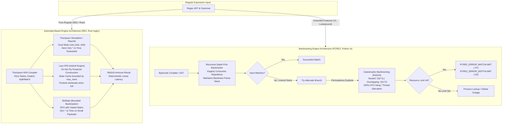
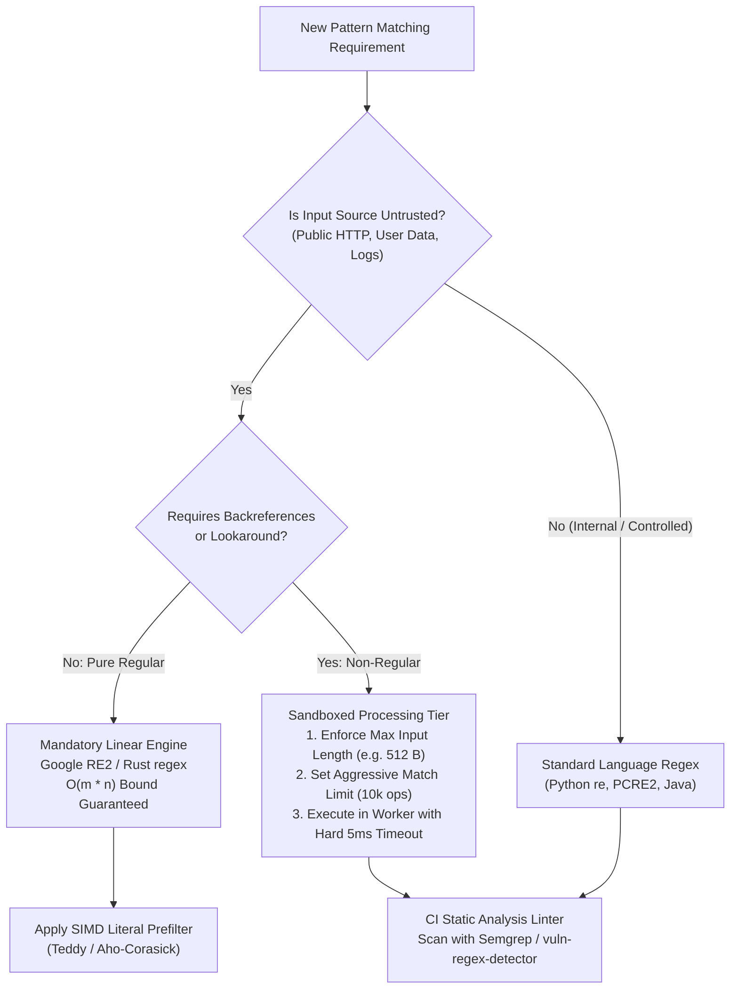

# Regex Engines: Automata, Backtracking, and ReDoS

> [!summary] Claim:
> Regular expression engines diverge into two mutually exclusive architectural paradigms: non-backtracking finite automata (Thompson NFA, PikeVM, Lazy DFA) and recursive depth-first backtrackers (PCRE2, Python re, Perl, .NET).
> Automata engines guarantee strict linear-time execution $O(m \cdot n)$ and bounded memory $O(m)$ by simulating all active NFA states simultaneously across text streams, mathematically immunizing infrastructure against Regular Expression Denial of Service (ReDoS).
> Backtracking engines provide non-regular grammars (backreferences, arbitrary lookaround) through exponential trial-and-error search, exposing production services to catastrophic backtracking ($O(2^n)$ or $O(n^k)$ steps) when evaluating nested or overlapping quantifiers against non-matching payloads.
> Production-grade text processing requires isolating untrusted inputs behind linear-time automata, bounding backtracking budgets, and accelerating search through SIMD literal prefiltering.



## The Mechanism

[[Sed-and-Awk-Stream-Processing]] and [[Ripgrep-Internals-and-Fast-Text-Search]] rely fundamentally on pattern matching engines to filter high-throughput text streams.
The execution behavior of a regular expression depends directly on whether its underlying engine is structured as a finite state automaton or a recursive backtracking virtual machine.

### 1. Finite Automata: The Thompson NFA Construction

In 1968, Ken Thompson published the foundational algorithm compiling regular expressions into non-deterministic finite automata (NFA) executed in time linearly proportional to the product of pattern length and input length.
A Thompson NFA decomposes any regular expression into a directed graph of states connected by two types of transitions:
- Character transitions: consume exactly one byte matching a literal or character class.
- Epsilon ($\epsilon$) transitions (`Split` states): branch immediately into two target states without consuming input bytes.

```text
Literal 'a':         (s0) -- 'a' --> (s1)

Concatenation 'ab':  (s0) -- 'a' --> (s1) -- 'b' --> (s2)

Alternation 'a|b':          +-- e --> (s1) -- 'a' --> (s2) -- e --+
                     (s0) --+                                     +--> (s5)
                            +-- e --> (s3) -- 'b' --> (s4) -- e --+

Kleene Star 'a*':           +----------- e -----------+
                            |                         v
                     (s0) --+-- e --> (s1) -- 'a' --> (s2) -- e --> (s3)
                                        ^               |
                                        +------- e -----+
```

A Thompson NFA representing a pattern of length $m$ contains $\mathcal{O}(m)$ states (Cox's construction creates at most one state per regex character, "at most equal to the length of the original regular expression"; the textbook construction with explicit entry and exit states creates at most $2m$), and each state has at most two outgoing transitions.
Rather than guessing which branch of a `Split` state to follow, Thompson's algorithm executes the NFA by simulating all valid paths in parallel across a single pass over the input string.
The simulation maintains two arrays of state pointers:
- `clist` (current list): the complete set of states the automaton occupies at character position $i$.
- `nlist` (next list): the set of states reachable after consuming the byte at position $i$.

The core loop iterates through each state in `clist`.
If the state matches the input byte, its target state is passed to `addstate()`, which computes the $\epsilon$-closure (following all reachable `Split` states) and appends unvisited non-split states to `nlist`.
Once `clist` is exhausted, the engine swaps pointer references (`clist = nlist`) and advances to the next character.

Russ Cox's 2007 reference implementation uses a list generation number to eliminate the overhead of clearing memory between steps.
Each state structure contains an integer field `lastlist`.
A global generation counter `listid` increments before populating `nlist`.
When `addstate(l, s)` visits state `s`, it checks:

```c
void addstate(List *l, State *s) {
    if (s == NULL || s->lastlist == listid)
        return;
    s->lastlist = listid;
    if (s->c == Split) {
        addstate(l, s->out);
        addstate(l, s->out1);
        return;
    }
    l->s[l->n++] = s;
}
```

If `s->lastlist == listid`, the state is already present in `l`, terminating exploration immediately.
Because `s->lastlist` is checked in $O(1)$ without scanning the list, each state is processed at most once per byte consumed.
For an NFA with $m$ states and an input string of length $n$, the simulation is mathematically bounded by:

$$\text{Time Complexity} = \mathcal{O}(m \cdot n)$$

$$\text{Space Complexity} = \mathcal{O}(m)$$

No combination of nested repetitions, wildcards, or pathological inputs can cause an automata simulation to deviate from this linear bound.

### 2. Capturing Groups: The Pike Virtual Machine

A pure Thompson NFA determines only whether a string matches; it does not record where submatches (parenthesized capturing groups) start and end.
While writing the text editor sam in the early 1980s (code dating to about 1985), Rob Pike built an NFA simulation that tracks submatches.
Russ Cox's 2009 article gave what he believes is the first written explanation of the technique and framed it as a virtual machine running a bytecode program, now called the PikeVM.

In the PikeVM, an active execution path is represented as a thread.
Each thread maintains:
- An instruction pointer `pc` indicating the current bytecode instruction (`Byte`, `Split`, `Save`, `Match`).
- A fixed array of capture registers `saved[2 * k]`, where $k$ is the number of capturing groups.

When a thread encounters a `Save(2 * i)` instruction (entering capture group $i$), it writes the current input pointer into `saved[2 * i]`.
When encountering `Save(2 * i + 1)` (exiting capture group $i$), it writes the input pointer into `saved[2 * i + 1]`.
When multiple threads collide on the same bytecode instruction at the same input position, the engine compares their priority.
Under leftmost-first matching rules (Perl semantics), the thread originating from the higher-priority branch of an alternation or an earlier repetition is preserved, while the lower-priority thread is discarded.

Because each active thread must copy its `saved` array when branching across a `Split` instruction, the worst-case time complexity of the PikeVM scales with the number of capture groups:

$$\text{PikeVM Time Complexity} = \mathcal{O}(m \cdot k \cdot n)$$

The PikeVM retains the strict linear time guarantee with respect to input length $n$, but the memory footprint and constant factors increase proportionally with $k$.

### 3. The Lazy DFA (Hybrid Engine)

While a Thompson NFA simulation processes text in linear time, it executes dozens of CPU instructions per input byte, managing state lists and pointer indirections.
A Deterministic Finite Automaton (DFA) achieves peak execution speed (one or two instructions per byte) because each DFA state represents a unique combination of NFA states, and every byte transition points directly to a single next state.

However, pre-compiling an NFA into a full DFA using the powerset construction (Rabin-Scott) presents an existential scaling hazard: an NFA with $m$ states can yield a DFA with up to $2^m$ states.
The blowup comes from patterns that must remember a window of past input, such as an unanchored search for `1[01]{k-1}` ("a 1 exactly k positions from the end"): its DFA needs $2^k$ states, which is 1,048,576 states for $k = 20$ (counted by subset construction while verifying this note), and full transition tables of that size exhaust memory before search begins.
A fixed-width pattern such as `[0-9a-fA-F]{16}` is harmless by comparison: its unanchored search DFA has only 17 reachable states.

Modern engines (Google RE2 and Rust `regex-automata`) resolve this dilemma using a Lazy DFA (also known as a Hybrid engine).
The Lazy DFA starts with an empty transition table.
As input bytes are scanned, it computes DFA states on the fly:
1. The engine checks if the transition from the current DFA state on input byte $b$ is cached in a table.
2. If cached, the engine follows the pointer directly ($O(1)$ memory lookup).
3. If uncached (a cache miss), the engine invokes the Thompson NFA `step()` function across the subset of NFA states composing the current DFA state to compute the target set.
4. It allocates a new DFA state, records the transition, and stores it in a state cache bounded by a memory budget (RE2 carves it out of `max_mem`, default 8 MiB for the whole `RE2` object; `regex-automata` defaults `cache_capacity` to 2 MiB).
5. If the cache fills completely, the engine does not evict selectively: RE2's `dfa.cc` says "we discard all the states in the cache and start over", and `regex-automata` likewise clears its cache.
   If clearing keeps recurring with little progress (RE2 bails unless it averages about 10 bytes per state computation), RE2 fails the DFA search and falls back to the NFA, and a `regex-automata` lazy DFA configured with `minimum_cache_clear_count` gives up with an error so the caller can switch engines.

This hybrid approach lets most searches run at DFA speed once the states they need are cached, while memory consumption never exceeds a pre-allocated bound.

### 4. Bounded Backtracker (BitState)

For small patterns and short input strings where submatches are required, Google RE2 and Rust `regex-automata` employ a specialized engine known as BitState (or `BoundedBacktracker`).
Traditional backtracking is exponential because it re-explores the same NFA state at the same input position across thousands of failed branches.

BitState performs a depth-first search, but allocates a visited bitmap matrix of dimensions:

$$\text{Bitmap Size} = \text{num\_states} \times (\text{input\_length} + 1) \text{ bits}$$

Before exploring transition $(s, \text{pos})$, BitState checks bit `visited[s * stride + pos]`.
If the bit is set, the engine prunes the branch immediately without recursion.
If the bit is unset, the engine sets the bit and continues.
Because every $(s, \text{pos})$ tuple is visited at most once, BitState achieves guaranteed linear time $\mathcal{O}(m \cdot n)$ with negligible memory allocation overhead, provided the entire bitmap fits within a small static budget (RE2: `kBitStateBitmapMaxSize = 256*1024` bits, 32 KiB, in `re2/prog.cc`; `regex-automata`: default `visited_capacity` of 256 KiB of heap).
If the input exceeds this budget, the engine safely hands execution over to the PikeVM.

### 5. Recursive Backtracking and ReDoS Mechanics

Engines used in general-purpose programming runtimes (PCRE2, Python `re`, Perl, Java `java.util.regex`, .NET `System.Text.RegularExpressions`, Ruby Onigmo) use recursive depth-first backtracking.
Two runtimes now ship mitigations (as of 2026-11): .NET offers an opt-in linear-time `RegexOptions.NonBacktracking` mode, and Ruby 3.2 added memoization that makes most matches linear, with `Regexp.timeout` for patterns it cannot memoize (backreferences, lookaround).
A backtracking engine interprets the regular expression as an imperative search program:
- When encountering an alternation `A|B`, it evaluates `A`.
  It pushes a backtrack frame containing the current string position onto an execution stack.
- When encountering a greedy quantifier `A*` or `A+`, it consumes as many characters as possible.
  It records a backtrack frame for every character consumed.
- If a downstream token fails to match, the engine pops the most recent backtrack frame from the stack, resets the input pointer, and tries the next alternative or a shorter repetition.

#### Exponential Catastrophic Backtracking ($O(2^n)$)

Catastrophic backtracking (Regular Expression Denial of Service, or ReDoS) occurs when a regular expression contains nested quantifiers or overlapping alternations that can match identical input sequences in multiple permutations.
Consider the canonical pattern:

$$\text{Pattern: } \text{\textasciicircum}(a+)+\$ \quad \text{against input: } \underbrace{aaaa\dots a}_{n} !$$

The engine must match $n$ occurrences of character `a` followed by the anchor `$`.
The character `!` guarantees the string cannot match.
The inner quantifier `a+` can match 1 to $n$ characters.
The outer quantifier `(a+)+` can partition $n$ identical characters into any sequence of positive integers summing to $n$.
Mathematically, the number of integer compositions of $n$ is:

$$\text{Total Backtracking Branches} = 2^{n - 1}$$

| Input Length $n$ | Combinatorial Partitions | Backtracking Operations (C Engine) | Lab C engine time (darwin-arm64, -O2, as of 2026-11) |
| :--- | :--- | :--- | :--- |
| 10 | 512 | 5,116 | ~7 us (extrapolated) |
| 20 | 524,288 | 5,242,876 | 7.7 ms (measured) |
| 25 | 16,777,216 | 167,772,156 | 0.24 s (measured) |
| 30 | 536,870,912 | 5,368,709,116 | ~7.8 s (extrapolated) |
| 40 | 549,755,813,888 | $5.5 \times 10^{12}$ | ~2.2 hours (extrapolated) |

The operation count is exactly $5 \cdot 2^n - 4$ for the lab's C backtracker, which ran at about 690 million operations per second on an Apple Silicon host (1.92 s measured at $n = 28$); the extrapolated rows assume that rate.
CPython `re` is slower: it measured 2.06 s at $n = 26$ and 8.16 s at $n = 28$ (Python 3.15.2, darwin-arm64), doubling per character, which projects to about nine hours at $n = 40$.
When $n=40$, a single HTTP request evaluating this expression against 41 bytes pegs a CPU core at 100% utilization for hours.
In a multi-threaded web service or reverse proxy, sending four such requests saturates an entire four-core server, causing thread pool starvation, dropping health-check heartbeats, and causing cascading network failure.

#### Polynomial Catastrophic Backtracking ($O(n^2)$, $O(n^3)$)

ReDoS vulnerabilities do not require nested quantifiers.
Overlapping repetitions produce polynomial catastrophic backtracking.
Consider:

$$\text{Pattern: } a*a*x \quad \text{against input: } \underbrace{aaaa\dots a}_{n} !$$

When matching against $n$ `a`'s, the first `a*` greedily consumes all $n$ characters.
The second `a*` matches 0 characters.
The literal `x` fails against `!`.
The engine backtracks: the first `a*` yields one character, matching $n-1$ `a`'s; the second `a*` matches the remaining 1 `a`; `x` fails again.
The engine tests all possible splits of $n$ identical characters across the two loops, so the number of splits tried is:

$$\text{Splits} = \sum_{i=0}^{n} (n - i + 1) = \frac{(n + 1)(n + 2)}{2} = \mathcal{O}(n^2)$$

Against an input of 100,000 characters, an $O(n^2)$ polynomial backtracker tries approximately 5 billion splits, freezing a production server for seconds.
Measured with CPython 3.15.2 on darwin-arm64, anchored `re.match(r"a*a*x", "a" * n + "!")` took 0.4 ms, 1.5 ms, and 5.8 ms for $n$ = 1,000, 2,000, and 4,000 (quadratic), while unanchored `re.search` retries every start offset and took 0.13 s, 1.0 s, and 7.8 s (cubic).

### 6. The Non-Regular Trap: Why Backtrackers Exist

If finite automata engines are demonstrably immune to ReDoS and execute in linear time, why does any production system continue using backtracking engines?
The answer lies in formal language theory: practical backtracking engines do not merely match regular languages; they support non-regular constructs that cannot be compiled into finite automata.

#### Backreferences

Backreferences (`\1`, `\2`) allow a regular expression to match the exact substring previously captured by a parenthesized group.
Consider the language:

$$L = \{ w w \mid w \in \{a, b\}^* \}$$

Matched by the expression `^([ab]+)\1$`.
By the Pumping Lemma for Regular Languages, $L$ is not a regular language; it is not even a context-free language (it is context-sensitive).
A finite automaton with a fixed set of states cannot remember an arbitrarily long string $w$ to verify that it repeats.

In 1990, Alfred Aho showed that the matching problem for regular expressions with backreferences is NP-complete (*Algorithms for Finding Patterns in Strings*; the result is cited this way by Nogami and Terauchi, arXiv 2504.18247).
The proof's details are in Aho's Handbook chapter and are not reproduced here; encodings of 3-Satisfiability (3-SAT) are the easiest way to see why the problem is hard.
Because the problem is NP-complete, any engine that supports backreferences must either execute an exponential-time search algorithm in the worst case or prove $\text{P} = \text{NP}$.
Consequently, libraries like Google RE2 and Rust `regex` explicitly reject backreferences in their syntax parsers.

#### Lookaround Assertions

Lookahead (`(?=...)`, `(?!...)`) and lookbehind (`(?<=...)`, `(?<!...)`) assertions verify conditions on adjacent text without consuming input bytes.
Arbitrary lookaround assertions require evaluating independent sub-expressions at variable positions, introducing recursive matching dependencies that defy traditional single-pass NFA state tracking.

### 7. Prefiltering: Accelerating Search Before the Automaton

Modern search utilities such as `ripgrep` do not run the full regex automaton across every byte of input.
As documented in [[Ripgrep-Internals-and-Fast-Text-Search]], real-world search is dominated by literal prefiltering.
The engine parses the regex Abstract Syntax Tree (AST) to extract mandatory literal prefixes, suffixes, or infixes:
- For `^ERROR [0-9]+: connection reset`, the mandatory prefix literal is `ERROR `.
- For `[a-z]+@company\.com`, the mandatory suffix literal is `@company.com`.
- For `.*foo.*bar`, the mandatory infixes are `foo` and `bar`.

The engine scans the raw byte buffer using vectorized SIMD algorithms (the `memchr` crate uses SSE2 or AVX2 on x86-64 and NEON on aarch64, and `aho-corasick` provides the Teddy multi-pattern algorithm).
If the extracted literal does not exist in the haystack, the entire buffer is rejected immediately without allocating a state list, constructing a DFA state, or invoking the regex engine.
The expensive automaton runs only on candidate spans where the mandatory literal is already confirmed to exist.

## Commands and Numbers to Know

Reference configuration values, flag defaults, and operational thresholds across regex engines (as of 2026-11):

| Parameter / Constant | Value | Target platform | What it controls |
| :--- | :--- | :--- | :--- |
| `PCRE2_CONFIG_MATCH_LIMIT` | `10000000` (10M) | Both (as of 2026-11) | Max matching operations allowed before aborting with `PCRE2_ERROR_MATCHLIMIT` |
| `PCRE2_CONFIG_DEPTH_LIMIT` | `10000000` (10M) | Both (as of 2026-11) | Max backtracking stack depth allowed before returning `PCRE2_ERROR_DEPTHLIMIT` |
| `PCRE2_CONFIG_HEAP_LIMIT` | `20000000` KiB | Both (as of 2026-11) | Max heap memory allocatable by `pcre2_match()` for backtrack frames |
| `pcre2_match()` error `-47` | `PCRE2_ERROR_MATCHLIMIT` | Both (as of 2026-11) | Return code when operation count exceeds configured match limit |
| `pcre2_match()` error `-53` | `PCRE2_ERROR_DEPTHLIMIT` | Both (as of 2026-11) | Return code when backtracking depth exceeds configured depth limit |
| `pcre2_match()` error `-63` | `PCRE2_ERROR_HEAPLIMIT` | Both (as of 2026-11) | Return code when heap consumption exceeds configured heap limit |
| `pcre2grep --match-limit` | integer flag | Both (as of 2026-11) | CLI option overriding PCRE2 match limit during stream searches |
| `pcre2grep --depth-limit` | integer flag | Both (as of 2026-11) | CLI option overriding PCRE2 depth limit during stream searches |
| `re2::RE2::Options::max_mem()` | `8 << 20` (8 MiB) | Both (as of 2026-11) | Default memory budget shared between compiled program and DFA state cache |
| `regex_automata::hybrid::Config::cache_capacity()` | `2 * (1 << 20)` (2 MiB) | Both (as of 2026-11) | Default cache size for Rust lazy DFA transitions and states (cleared wholesale when full) |
| `regex_automata::nfa::thompson::backtrack::Config::visited_capacity()` | `256 * (1 << 10)` bytes (256 KiB) | Both (as of 2026-11) | Default visited-set budget; longer haystacks go to the PikeVM (RE2's BitState limit is 256 Kbit, 32 KiB) |
| Python `sys.getrecursionlimit()` | `1000` frames | Both (as of 2026-11) | Call stack ceiling; Python `re` uses heap stack in C to avoid stack overflow |
| Thompson NFA worst-case time | $\mathcal{O}(m \cdot n)$ | Both (as of 2026-11) | Strict linear upper bound for pattern length $m$ and text length $n$ |
| Backtracking worst-case time | $2^{\mathcal{O}(n)}$ (exponential) | Both (as of 2026-11) | Pathological upper bound under nested quantifiers |

## Multi-Language Comparison: C++ / Python / Rust

Architectural divergence across major programming language ecosystems:

| Architectural Concern | C++ (Google RE2 2025-11-05 / PCRE2 10.49, as of 2026-11) | Python 3.15 (`re` module / SRE) | Rust (`regex` 1.13 / `regex-automata` 0.4, as of 2026-11) |
| :--- | :--- | :--- | :--- |
| Primary Engine Design | RE2: Lazy DFA + OnePass + BitState + PikeVM; PCRE2: Recursive backtracker + JIT | SRE: Bytecode interpreter with heap-allocated backtrack frame stack | Meta Engine: SIMD prefilter + Lazy DFA + PikeVM + BoundedBacktracker |
| Worst-Case Time Guarantee | RE2: $\mathcal{O}(m \cdot n)$ linear guarantee; PCRE2: $\mathcal{O}(2^n)$ exponential | $\mathcal{O}(2^n)$ exponential catastrophic backtracking | $\mathcal{O}(m \cdot n)$ linear guarantee across all queries |
| Worst-Case Memory Allocation | RE2: Bounded by `max_mem` (default 8 MiB); PCRE2: Bounded by heap limit | Unbounded heap growth until exhaustion or OS OOM | Bounded by static cache capacities (default 2 MiB) |
| Backreferences (`\1`) | RE2: Explicitly rejected; PCRE2: Supported | Supported | Explicitly rejected |
| Arbitrary Lookaround | RE2: Rejected (word boundaries `\b` supported); PCRE2: Full support | Supported (fixed-length lookbehind only) | Rejected (only ASCII/Unicode word boundary lookaround supported) |
| Atomic Grouping `(?>...)` | RE2: Not needed (inherently linear); PCRE2: Supported | Supported (stable since Python 3.11) | Not needed (inherently linear) |
| Possessive Quantifiers `++` | RE2: Not needed; PCRE2: Supported | Supported (stable since Python 3.11) | Not needed (inherently linear) |
| JIT Compilation | PCRE2: SLJIT (Stack-less JIT) targeting x86/ARM; RE2: No JIT (uses DFA) | No JIT | No JIT (pure AOT state tables and lazy DFA caches) |
| Submatch Tracking Mechanism | RE2: OnePass DFA, BitState, or PikeVM thread copying | Depth-first backtrack stack unwinding | PikeVM thread tracking or BoundedBacktracker bitmap |

## Worked Lab Example

The companion lab is located at `code/01-Command-Line/redos_benchmark/`.
It contains an end-to-end implementation of Ken Thompson's NFA simulation, a recursive backtracker, and a BitState memoized matcher in C, plus a Python benchmark that runs a second small backtracker and Thompson simulation on polynomial backtracking and Cloudflare-style unanchored wildcards, and checks Python atomic group defenses and substring literal prefiltering.
Every table is asserted against its closed form, and either program exits nonzero when an assertion fails, which `make verify` reports as a failure.

The C benchmark (`nfa_engine.c`) compiles with:

```bash
cd code/01-Command-Line/redos_benchmark
WORK_DIR="$(mktemp -d)"
trap 'rm -rf "${WORK_DIR}"' EXIT
"${CC:-cc}" -O2 -Wall -Wextra -std=c99 nfa_engine.c -o "${WORK_DIR}/nfa_engine"
"${WORK_DIR}/nfa_engine"
python3 benchmark.py
```

### Verified Output

Recorded on darwin-arm64 and re-run unchanged on macOS 27.2 (Apple clang version 21.0.0, Python 3.15.2) and verified with `python3 -m _harness.verify 01-Command-Line/redos_benchmark/`:

```text
=== C Thompson NFA vs Recursive Backtracking Benchmark ===
Grammar: (a+)+ (nested repetitions) against non-matching payload a^N + '!'

N    | Thompson Steps | Backtrack Steps | BitState Steps
-----+----------------+-----------------+---------------
4    | 17             | 76              | 21            
6    | 25             | 316             | 31            
8    | 33             | 1276            | 41            
10   | 41             | 5116            | 51            
12   | 49             | 20476           | 61            

Resource limit enforcement check:
Backtracker on N=20 with match_limit=1000: steps=1001, status=-47 (PCRE2_ERROR_MATCHLIMIT)
Backtracker on N=4 with match_limit=1000: steps=76, status=0
=== Polynomial Backtracking Benchmark (Quadratic O(N^2)) ===
Grammar: a*a*x (overlapping repetitions) against non-matching payload a^N + '!'

N    | Thompson Steps | Backtrack Steps | Ratio
-----+----------------+-----------------+-------
10   | 55             | 220             | -
20   | 105            | 735             | 3.34x
40   | 205            | 2665            | 3.63x
80   | 405            | 10125           | 3.80x
Observation: Doubling N quadruples backtracking steps (approaching 4.00x), proving O(N^2).

=== Cloudflare Outage (July 2, 2019) Wildcard Cascade ===
Grammar: .*.*= (adjacent unanchored wildcards) against payload a^N (no '=')
Partitions = times the engine reaches '=' (measured), one per way to split a^N across the wildcards

N    | Thompson Steps | Backtrack Steps | Partitions .*.*= | Partitions .*.*.*=
-----+----------------+-----------------+------------------+-------------------
10   | 55             | 220             | 66               | 286               
20   | 105            | 735             | 231              | 1771              
30   | 155            | 1550            | 496              | 5456              
40   | 205            | 2665            | 861              | 12341             
Root Cause: Under PCRE backtracking, each added adjacent '.*' raises the partition count by one polynomial degree (O(N^2), O(N^3), ...).

=== Python 3 re Engine Modern Mitigation Suite ===
0. Controls on 'aaa': (a+)a matches; (?>a+)a and a++a do not
1. Atomic grouping ^(?>a+)+$ on 1000 chars: match = None (ReDoS prevented)
2. Possessive quantifier ^(a+)++$ on 1000 chars: match = None (ReDoS prevented)

=== Substring Literal Prefilter Acceleration ===
Pattern: POST /api/v1/checkout.*
Extracted mandatory literal prefix: 'POST /api/v1/checkout'
Haystack 'GET /index.html HTTP/1.1': prefilter found = False -> Bypassed (0 automaton steps)
Haystack 'POST /api/v1/checkout HTTP/1.1': prefilter found = True -> Dispatched to regex engine

ALL CHECKS PASSED: Regex engine automata guarantees verified.
```

### Reading the Result

1. **Linear Automata Scaling:** In the Thompson simulation, the count grows by exactly 4 operations per input character ($4 \cdot N + 1$, so 8 per row since $N$ steps by 2), demonstrating unwavering $\mathcal{O}(N)$ progression.
2. **Exponential Backtracking Explosion:** In the C recursive backtracker on `(a+)+`, the step count scales as $76 \to 316 \to 1276 \to 5116 \to 20476$.
   Each step roughly quadruples ($2^{\Delta N}$ with $\Delta N = 2$), confirming pure exponential $O(2^N)$ time.
3. **BitState Memoization Power:** The BitState engine visits each $(s, \text{pos})$ tuple at most once using its visited bitset.
   Its step count scales as $21 \to 31 \to 41 \to 51 \to 61$, matching linear time ($5 \cdot N + 1$); the lab's BitState answers match or no match only, while RE2 and `regex-automata` add capture slots on top of the same visited set.
4. **PCRE2 Match Limit Error:** When the match limit threshold of 1000 is applied on $N=20$, the lab's backtracker halts at step 1001 and returns `-47`, the value it borrows from `PCRE2_ERROR_MATCHLIMIT` in `pcre2.h`; the same limit on $N=4$ (76 steps) never fires and returns 0.
   The lab's backtracker is a toy, so the lab proves the limit mechanism (abort one step past the threshold) and not PCRE2's own behavior.
   Real PCRE2 10.49 behaves the same way: `pcre2test -t` on `/^(a+)+$/` against 91 `a` characters plus `!` reports `Failed: error -47: match limit exceeded` (as of 2026-11, darwin-arm64).
5. **Quadratic Scaling in Overlapping Repetitions:** In `benchmark.py`, a recursive backtracker counts its own steps on the NFA for `a*a*x`; doubling $N$ from 20 to 40 to 80 increases the counted steps from 735 to 2665 to 10125 (ratios 3.63x and 3.80x, converging toward $4.00\text{x} = 2^2$).
   The lab asserts the counts against the closed form $(3N + 10)(N + 1)/2$, and the Thompson simulation against $5(N + 1)$.
   The measured CPython timings in the polynomial section are the engine-level evidence for real `re`.
6. **Cloudflare Incident Archetype:** For `.*.*=` on $N \in \{10, 20, 30, 40\}$ characters the backtracker reaches the `=` state once per way to split $a^N$ across the wildcards, which the lab counts and asserts equal to $\frac{(N+1)(N+2)}{2}$ ($66 \to 231 \to 496 \to 861$).
   Adding a third wildcard (`.*.*.*=`) raises the measured count to $\binom{N+3}{3}$ ($286 \to 1771 \to 5456 \to 12341$), one polynomial degree higher, while the Thompson column stays linear ($5(N + 1)$).
7. **Syntax-Level Defense in Python:** The lab first proves the semantics on `aaa`: `(a+)a` matches because `a+` gives a character back, while `(?>a+)a` and `a++a` do not.
   It then applies atomic grouping `^(?>a+)+$` and possessive quantifiers `^(a+)++$` in Python 3.15 to 1,000 characters plus `!`, asserts `None` and a 5 second ceiling; without these constructs the same input would never finish, so the harness timeout would also fail the lab.
8. **Substring Prefilter Bypass:** The lab asserts the extracted prefix is `POST /api/v1/checkout`, that `in` agrees with `re.search` on both haystacks, and that the GET request is rejected by the substring test.
   The "0 automaton steps" wording is a print, not a measurement, and the lab demonstrates the control flow, not SIMD acceleration.

## Pitfalls

> [!warning] Pitfall: Relying on PCRE2 match limits as a primary ReDoS defense
> PCRE2's default `match_limit` is 10,000,000.
> Reaching that limit takes real CPU time: PCRE2 10.49's interpreter (no JIT) took about 106 ms to fail `/^(a+)+$/` with error -47 on 91 `a` characters plus `!` (`pcre2test -t`, darwin-arm64, as of 2026-11).
> If an attacker submits 20 concurrent requests matching this pathological pattern to an API gateway, all worker threads peg at 100% CPU for hundreds of milliseconds, starving legitimate traffic.
> A match limit prevents permanent process hangs, but it does not prevent denial of service; production gateways must enforce strict execution deadlines (e.g., 5 ms timeouts) or migrate to RE2.

> [!warning] Pitfall: Unanchored wildcards with overlapping separators
> Writing regular expressions like `.*.*=` or `.*@.*\.com` creates polynomial or exponential partition traps.
> When the trailing character fails to match, the backtracker tests every permutation of characters that could belong to the first `.*` versus the second `.*`.
> Always constrain wildcard repetition using negative character classes: `[^=]*=` or `[^@\s]+@[^.\s]+\.[a-z]{2,}`.

> [!warning] Pitfall: Confusing non-capturing groups with atomic groups
> Engineers often write `(?:a+)+` believing that `(?:...)` prevents backtracking.
> `(?:...)` is merely a non-capturing group: it suppresses creation of a capture register, but preserves identical recursive backtracking semantics.
> To suppress backtracking, you must use an atomic group `(?>a+)+` or a possessive quantifier `(a+)++`.
> Once an atomic group matches, the backtracker discards all internal choice points; if downstream matching fails, the engine will not reopen the atomic group to try smaller partitions.

> [!warning] Pitfall: Deploying untested regex patterns to global edge proxies without staged canaries
> The catastrophic Cloudflare outage of July 2, 2019 occurred because an updated Web Application Firewall (WAF) rule whose critical part was `.*(?:.*=.*)` was deployed globally, in "simulate" mode that still executes the rule, through the Quicksilver distribution system, which pushes a change to every machine in seconds.
> CPUs serving HTTP/HTTPS traffic spiked to nearly 100% across the network, Cloudflare reported having "lost 80% of our traffic", and the service was down for 27 minutes.
> WAF and routing regular expressions must undergo staged canary rollouts, automated ReDoS static analysis, and sandboxed CPU profiling before reaching global fleets.

> [!warning] Pitfall: Validating structured data (JSON, HTML, URLs) with backtracking regexes
> Attempting to parse nested or recursive structures using regular expressions leads to deeply nested alternation groups such as `^([^<]+|<(\w+)>.*<\/\2>)*$`.
> Any malformed payload lacking a closing tag causes catastrophic backtracking across the entire document length.
> Use dedicated streaming or recursive-descent parsers for structured grammars rather than regular expressions.

> [!warning] Pitfall: Assuming `re.match` anchors the end of a string
> In Python, `re.match(r"a+", text)` matches at the beginning of the string, but does not anchor the end.
> A trailing non-matching character allows the engine to succeed on a prefix while masking downstream validation failures.
> Use `re.fullmatch()` or the anchors `\A` and `\Z` when validating complete inputs.
> Do not rely on `$`: in Python it also matches just before a trailing newline, so `re.match(r"^a+$", "aaa\n")` succeeds while `re.fullmatch(r"a+", "aaa\n")` and `\Aa+\Z` fail.

## At Scale

Managing regular expressions across engineering organizations scaling from 10 to 50,000 engineers requires formalizing architecture, linting, and engine boundaries.

### Organizational Evolution and Decision Rules



1. **One to 50 Engineers (Startup Scale):**
   - Standardize on safe regex patterns in application code.
   - Run automated static analysis in CI using tools such as Semgrep or `vuln-regex-detector` to catch nested quantifiers (`(a+)+`, `(\d+)+`) before merging.
   - Set global timeouts on all regex evaluations in languages that support it (.NET `Regex(pattern, options, matchTimeout)`).

2. **1,000 to 5,000 Engineers (Platform Scale):**
   - Paved road policy: Establish Google RE2 or the Rust `regex` crate as the default, mandatory library for all perimeter services, API gateways, and log ingest processors.
   - Eliminate backreferences from API parameter validation schemas.
   - For services analyzing gigabyte terminal logs as covered in [[Analyze-Gigabyte-Terminal-Logs]], mandate prefiltering with literal extraction to avoid invoking the regex engine on 99% of scanned lines.

3. **10,000 to 50,000 Engineers (Fleet Infrastructure Scale):**
   - WAF and edge proxy rule changes must never deploy globally in a single transaction.
     Enforce automated progressive rollouts (canary 1%, 5%, 25%, 100%) with automated rollbacks triggered by CPU anomalies.
   - Multi-tenant regex execution: If users can submit custom regexes (such as log routing rules or alert filters), run queries exclusively inside a sandboxed worker pool using RE2 with strict `max_mem` caps.
   - If PCRE2 or Python `re` must be used for legacy compatibility, enforce an input length cap (e.g., maximum 512 bytes) before passing strings to the regex engine, capping maximum polynomial steps to negligible durations.

## Practice Drill

> [!tip] Practice Drill:
> Execute the following self-contained shell session to reproduce catastrophic backtracking in Python `re`, observe the exponential scaling knee, and verify the atomic grouping fix:

```bash
python3 -c "
import re, time

def test_pattern(name, pattern, max_n):
    print(f'=== Testing {name}: {pattern} ===')
    for n in range(16, max_n + 1, 2):
        payload = 'a' * n + '!'
        t0 = time.perf_counter()
        re.match(pattern, payload)
        dt = time.perf_counter() - t0
        print(f'N={n:2d}: time={dt:9.6f}s')

# 1. Pathological nested quantifier (exponential blowup)
test_pattern('Standard Backtracking', r'^(a+)+$', 26)

# 2. Modern atomic group mitigation (instant rejection)
test_pattern('Atomic Group Mitigation', r'^(?>a+)+$', 30)

# 3. Modern possessive quantifier mitigation (instant rejection)
test_pattern('Possessive Quantifier', r'^(a+)++$', 30)
"
```

Observe how `Standard Backtracking` quadruples its execution time with every increment of 2 in $N$, doubling per character (measured with Python 3.15.2 on darwin-arm64: $N=20 \to 0.032\text{s}$, $N=24 \to 0.51\text{s}$, $N=26 \to 2.06\text{s}$), whereas `Atomic Group` and `Possessive Quantifier` stay flat regardless of input length (about 0.1 ms on the first call, which pays pattern compilation, and under 1 microsecond afterwards).

For real-world catastrophic backtracking debugging, proceed directly to [[Drill-Command-Line-Catastrophic-Backtracking-and-Stream-Bottleneck]].

## Interview Questions

> [!question] L5: Explain why Ken Thompson's NFA simulation guarantees linear time execution while Python's `re` module can take hours on short strings.
>
> > [!success]- Answer
> > Ken Thompson's NFA simulation maintains a list of all active states simultaneously (`clist` and `nlist`).
> > When advancing past character $c$, the engine explores all transitions out of the current states in parallel.
> > Using a generation counter `listid` on each state (`s->lastlist == listid`), `addstate()` ensures that no state is added to `nlist` more than once per input character.
> > If the NFA has $m$ states and the text has length $n$, the simulation touches at most $m$ states per byte, guaranteeing an upper bound of $\mathcal{O}(m \cdot n)$ operations and $\mathcal{O}(m)$ memory.
> > In contrast, Python's `re` module uses a recursive depth-first backtracking engine.
> > When evaluating nested quantifiers like `(a+)+$` against non-matching text $a^n!$, the backtracker tries each path sequentially, greedily consuming characters and backtracking on failure.
> > Because there are $2^{n-1}$ distinct ways to partition $n$ characters among the nested loops, the backtracker executes $\mathcal{O}(2^n)$ operations, locking the CPU core in an exponential search loop.

> [!question] L5: Predict the output: What happens when evaluating `re.match(r"^(a+)+$", "a" * 28 + "!")` versus `re.match(r"^(a+)++$", "a" * 28 + "!")` in Python 3.11+?
>
> > [!success]- Answer
> > The first expression `re.match(r"^(a+)+$", "a" * 28 + "!")` triggers catastrophic backtracking.
> > The engine explores $2^{27}$ integer partitions of the 28 `a` characters.
> > On modern hardware, this single evaluation locks the thread for seconds of sustained 100% CPU utilization before finally returning `None` (8.16 s measured with Python 3.15.2 on darwin-arm64, as of 2026-11).
> > The second expression `re.match(r"^(a+)++$", "a" * 28 + "!")` uses a possessive quantifier (`++`).
> > The outer quantifier greedily consumes all 28 characters in a single pass.
> > Because possessive quantifiers discard all backtrack points, the engine refuses to yield characters back when the downstream anchor `$` fails against `!`.
> > It aborts immediately and returns `None` in less than 20 microseconds.

> [!question] L6: Walk through the PikeVM thread scheduling and capture state copying, and explain why tracking submatches with the PikeVM scales as $\mathcal{O}(m \cdot k \cdot n)$ rather than $\mathcal{O}(m \cdot n)$.
>
> > [!success]- Answer
> > A pure Thompson NFA tracks only boolean state reachability: a state is either in `clist` or it is not.
> > The PikeVM extends the NFA by attaching capture registers to active execution threads.
> > If a regular expression has $k$ capturing groups, each thread carries an array `saved[2 * k]` holding the string pointers for the opening and closing boundaries of every group.
> > When an active thread encounters a `Split` instruction branching into two paths, the engine cannot simply share a single pointer set; it must clone the thread state and copy the `saved` array.
> > When two threads reach the same bytecode instruction at the same input position, the engine evaluates priority (leftmost-first) and retains only the winner, preventing exponential thread explosion.
> > However, because up to $m$ threads can be active simultaneously, and each thread may perform $\mathcal{O}(k)$ register copies per character, the worst-case operational bound becomes $\mathcal{O}(m \cdot k \cdot n)$.

> [!question] L6: How does a Lazy DFA (Hybrid DFA) resolve the conflict between exponential state explosion and execution speed, and what occurs when `max_mem` is exceeded?
>
> > [!success]- Answer
> > A static DFA can suffer from state space explosion during compilation, requiring up to $2^m$ states for an NFA of size $m$.
> > A Lazy DFA avoids pre-compilation by constructing DFA states on demand at runtime.
> > It maintains a cache of computed DFA states bounded by a memory budget carved out of `max_mem` (default 8 MiB for the whole `RE2` object).
> > During string traversal, if a transition on the current byte is present in the cache, the engine executes a direct pointer dereference ($O(1)$ constant time, taking only 1-2 CPU instructions).
> > If the transition is absent (a cache miss), the engine invokes the Thompson NFA simulation across the NFA state subset composing the source DFA state, allocates a new DFA state node, and records the transition.
> > If the cache exceeds its budget, the engine discards every cached state and rebuilds on demand (no LRU eviction); if that keeps happening with little progress, RE2 fails the DFA search and reruns it with the NFA.
> > This guarantees raw DFA execution speed for common paths while enforcing a strict, hard ceiling on memory consumption.

> [!question] L6: Debug this: A production API route validator using `re.compile(r"^([a-zA-Z0-9]+_?)+$")` crashes under load when a client sends `admin_admin_admin_admin_admin_admin_admin_!`; diagnose the root cause and provide two distinct fixes.
>
> > [!success]- Answer
> > **Root Cause:** The pattern exhibits catastrophic backtracking due to overlapping quantifiers.
> > Because the underscore is optional, one outer iteration can end anywhere inside an alphanumeric run, so `[a-zA-Z0-9]+` nested in `(...)+` can split each word in many ways (`admin` as `admin`, `adm` + `in`, `a` + `d` + `min`, and so on: $2^4$ splits per five-letter word).
> > When the trailing `!` makes the match fail, the backtracker tries every combination of those splits across all words.
> > The 43-character input has seven five-letter words, about $2^{28}$ combinations; measured with Python 3.15.2 on darwin-arm64, two, three, and four words took 0.1 ms, 0.5 ms, and 8.5 ms, growing about 16x per word, which projects to tens of seconds for seven words and causes thread pool starvation.
> >
> > **Fix 1 (Syntax-Level):** Remove the ambiguity by making each repetition start with a mandatory underscore and eliminating nested quantifiers:
> > `^[a-zA-Z0-9]+(_[a-zA-Z0-9]+)*_?$`
> > Here, each underscore must be followed by at least one alphanumeric character, making word boundaries deterministic with zero overlapping partitions; the final `_?` keeps the original's acceptance of a trailing underscore such as `admin_`, which `^[a-zA-Z0-9]+(_[a-zA-Z0-9]+)*$` would wrongly reject.
> >
> > **Fix 2 (Engine-Level):** In Python 3.11+, convert the outer group to an atomic group:
> > `^(?>[a-zA-Z0-9]+_?)+$`
> > Alternatively, migrate perimeter input validation to Google RE2 (`import re2`), which guarantees linear time execution regardless of pattern ambiguity.

> [!question] L7: Prove why regular expression matching with backreferences is NP-complete, and explain why this mathematically prevents RE2 and Rust `regex` from supporting `\1`.
>
> > [!success]- Answer
> > Alfred Aho showed in 1990 that matching regular expressions with backreferences is NP-complete; the proof is in his Handbook chapter, and a reduction from 3-Satisfiability (3-SAT) is the easiest way to sketch why.
> > A backreference `([ab]+).*\1` enforces that two substrings at arbitrary positions must be identical.
> > By constructing capturing groups representing truth assignments for boolean variables and chaining backreferences across clauses, a regular expression can force the matcher to solve a system of 3-SAT boolean constraints.
> > The pattern matches the string if and only if there exists a satisfying truth assignment.
> > Because 3-SAT is NP-complete, deciding uniform regular expression matching with backreferences is also NP-complete.
> > A finite state automaton (NFA or DFA) computes in deterministic polynomial time ($O(m \cdot n)$).
> > If an engine based on finite automata supported backreferences while maintaining its linear time guarantee, it would imply $\text{P} = \text{NP}$.
> > Therefore, Google RE2 and Rust `regex` deliberately reject backreferences in their syntax parsers to preserve their fundamental architectural invariant: predictable, linear-time execution.

> [!question] L7: Explain the BitState (Bounded Backtracker) algorithm in RE2 and `regex-automata`, including when it is chosen over PikeVM or Lazy DFA and what memory limits it enforces.
>
> > [!success]- Answer
> > BitState is an optimized depth-first backtracking matcher that achieves linear time $\mathcal{O}(m \cdot n)$ by memoizing visited configurations.
> > Traditional backtracking is slow because it visits the same NFA state at the same string position repeatedly across different paths.
> > BitState allocates a flat bit vector of size $\text{num\_states} \times (\text{text\_len} + 1)$.
> > Before exploring state $s$ at string offset $\text{pos}$, it computes index $i = s \cdot (\text{text\_len} + 1) + \text{pos}$ and checks bit $i$.
> > If bit $i$ is set, the branch has already failed or been explored, and is pruned immediately in $O(1)$ time.
> > If unset, BitState sets the bit and recurses.
> > BitState is selected by the engine's meta-controller when:
> > 1. Submatch capturing positions are requested (which the Lazy DFA cannot track).
> > 2. The regex and input string are small enough that the visited bitmap fits within a static memory limit (RE2: 256 Kbit, so $\text{num\_states} \times (\text{text\_len} + 1) \le 262,144$ bits; `regex-automata`: a 256 KiB default `visited_capacity`, about 2,097,152 bits).
> > For small strings (e.g., parsing dates or HTTP headers), RE2's `bitstate.cc` describes BitState as "a fast replacement for the NFA code on small regexps and texts", because it avoids maintaining thread lists and copying capture arrays (RE2 publishes no speed ratio, and none is claimed here).

> [!question] L8+: You are architecting a multi-tenant security gateway inspecting 100,000 HTTP requests per second where customers author custom regular expressions to filter traffic; how do you design the matching pipeline to guarantee sub-millisecond latency and total ReDoS immunity?
>
> > [!success]- Answer
> > A distinguished-level architecture requires a multi-tiered pipeline combining static analysis, SIMD prefiltering, linear automata, and strict resource isolation:
> > 1. **Ingest & Compilation Barrier:** Customer-submitted regular expressions must be parsed by a strict compiler based on Google RE2 or Rust `regex-automata`.
> >    Any pattern using backreferences (`\1`), arbitrary lookaround, or unbounded recursion is rejected at registration time.
> > 2. **Multi-Pattern SIMD Prefiltering:** Extract mandatory literal strings from all customer patterns and compile them into an Aho-Corasick or Hyperscan / Vectorscan multi-substring database.
> >    Incoming HTTP payloads are scanned using AVX-512 or ARM NEON vector instructions.
> >    Requests lacking candidate literals bypass the regex engine entirely ($0$ automaton steps).
> > 3. **Automata Execution Tier:** Patterns whose literals are detected are executed against the payload using a Lazy DFA with a fixed memory cache (`max_mem = 8\text{ MiB}`).
> >    Execution is guaranteed $\mathcal{O}(m \cdot n)$, running at gigabytes per second.
> > 4. **Sandboxed Fallback for Legacy Grammars:** If business constraints demand non-regular PCRE features for a subset of rules:
> >    - Impose a strict input length cap (e.g., maximum 512 bytes).
> >    - Execute the search in an isolated, unprivileged worker process with a match limit of 10,000 set per match through `pcre2_set_match_limit()` on the match context (`PCRE2_CONFIG_MATCH_LIMIT` only reports the build default, 10,000,000).
> >    - Enforce a hard OS-level execution deadline using POSIX timers (`setitimer` or epoll event timeouts) set to 2 milliseconds.
> > 5. **Observability & Blast Radius Control:** Telemetry monitors per-tenant regex compilation sizes and evaluation latencies.
> >    Rule updates deploy through automated canary stages (1%, 10%, 100%) to catch performance anomalies before fleet-wide propagation.

## Further Reading

- Ken Thompson, "Regular Expression Search Algorithm" (1968): the original paper introducing NFA compilation and dual-list state simulation.
- Russ Cox, "Regular Expression Matching Can Be Simple And Fast" (2007): the definitive analysis contrasting Thompson automata with backtracking engines.
- Russ Cox, "Regular Expression Matching: the Virtual Machine Approach" (2009): formalizing the PikeVM for linear-time submatch extraction.
- Russ Cox, "Regular Expression Matching in the Wild" (2010): production engineering insights behind Google RE2 and the Lazy DFA.
- Alfred V. Aho, "Algorithms for Finding Patterns in Strings" (1990): formal proof that regular expressions with backreferences are NP-complete.
- John Graham-Cumming, "Details of the Cloudflare outage on July 2, 2019": postmortem detailing how a single backtracking WAF rule caused global infrastructure failure.
- Nick Craver, "Outage Post-Mortem - July 20, 2016": Stack Overflow postmortem of a 34-minute outage in which a trim-whitespace regex `^[\s\u200c]+|[\s\u200c]+$` met a post with about 20,000 consecutive whitespace characters (the stackstatus URL returns HTTP 403 to automated fetches; these details are as quoted by Trevor Lasn's write-up, which cites it).
- Philip Hazel, `pcre2api` (PCRE2 10.49): authoritative specification of match limits, depth limits, and heap bounds in PCRE2.

## Related

- Prerequisites: none
- Next: [[Ripgrep-Internals-and-Fast-Text-Search]]
- See also: [[01-CS-Foundations/Computer-Science-Canon/Automata-and-Computability|Automata and Computability]], [[19-Shell-and-Unix-Engineering/07-Regex-and-Text-Processing/Regex-Engines-NFA-DFA-and-Backtracking|Regex Engines NFA DFA and Backtracking]], [[19-Shell-and-Unix-Engineering/07-Regex-and-Text-Processing/ReDoS|ReDoS]], [[19-Shell-and-Unix-Engineering/07-Regex-and-Text-Processing/BRE-ERE-and-PCRE|BRE ERE and PCRE]]
- Lab: `code/01-Command-Line/redos_benchmark/`
