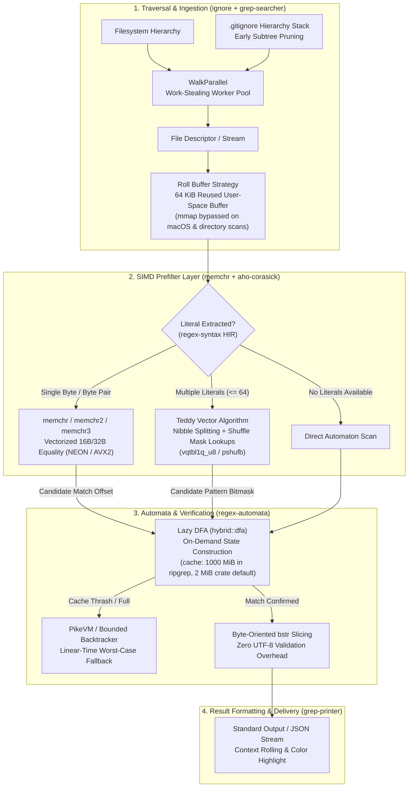

# Ripgrep Internals and Fast Text Search

> [!summary] Claim:
> Ripgrep achieves gigabytes-per-second search throughput by decoupling candidate rejection from full regular expression matching.
> It extracts literal prefixes and inner substrings from the regex abstract syntax tree, scanning raw byte buffers with SIMD vector prefilters (single-byte `memchr` and packed multi-pattern Teddy nibble-shuffle tables) that discard non-matching text at memory-bus speeds.
> Files are processed directly as byte slices without upfront UTF-8 validation overhead, feeding candidates into a lazy DFA that builds state transitions on demand inside a bounded cache (no machine-code JIT).
> Concurrently, a parallel work-stealing directory walker evaluates `.gitignore` inheritance stacks at directory boundaries to prune ignored subtrees before issuing file discovery system calls.



## The Mechanism

Fast text search across modern developer codebases is constrained by memory bandwidth, cache misses, system call overhead, and automaton state-transition latencies.
Traditional tools often bottlenecked on scalar byte-by-byte iteration, unbounded regular expression backtracking, redundant memory allocations, or decoding multi-gigabyte files into validated Unicode before inspection.
Ripgrep overcomes these physical limits by orchestrating a modular layered pipeline across specialized crates: `ignore`, `grep-searcher`, `grep-regex`, `regex-automata`, `bstr`, and `memchr`.

### 1. Literal Substring Extraction and Frequency Heuristics

Every search pattern passed to ripgrep is first parsed by `regex-syntax` into a High-Level Intermediate Representation (`Hir`).
Before constructing an automaton, the search engine invokes literal extraction (`regex_syntax::hir::literal`).
Literal extraction inspects the AST to identify mandatory byte sequences that must appear in any valid match:

- **Prefix literals:** Extracted when a pattern begins with fixed text (for example, `fn\s+[a-z_]+` yields the inexact prefix literal `fn`, because Unicode `\s` has more members than the extractor's class limit of 10 in `regex-syntax` 0.8.5 and is not expanded).
- **Suffix literals:** Extracted when a pattern ends with fixed text (for example, `[0-9]+\.json` yields the suffix literal `.json`).
- **Inner literals:** Extracted when wildcards precede a mandatory substring (for example, `.*ERROR_FATAL_[0-9]+` yields the inner literal `ERROR_FATAL_`).

When multiple candidate literals or byte choices exist (such as case-insensitive variations or character classes), the search stack applies a byte frequency heuristic.
In `memchr` 2.8.3 this is the 256-entry `RANK` table in `src/arch/all/packedpair/default_rank.rs`, where a higher rank means a more common byte.
Rare bytes such as `Q` (rank 112), `Z` (128), `q` (139), or `z` (152) are prioritized over common bytes like space (255), `e` (253), `t` (251), or `a` (249); `x` (240) and `_` (223) rank as common, not rare.
Selecting the rarest byte as the trigger index for SIMD scanning maximizes the rejection rate of non-matching blocks, minimizing expensive automaton invocations.

### 2. SIMD Vector Prefilters: memchr and the Teddy Algorithm

Once literals are extracted, ripgrep skips non-matching input at hardware wire speed using Single Instruction, Multiple Data (SIMD) vector registers.

#### Single-Byte Vectorization (`memchr`)

When a single literal byte is extracted, ripgrep executes `memchr`.
On modern 64-bit platforms, `memchr` loads 16-byte (ARM NEON or x86 SSE2) or 32-byte (x86 AVX2) chunks into vector registers; `memchr` 2.8.3 ships `sse2`, `avx2`, and `neon` backends and no AVX-512 backend.
The target byte $N$ is broadcast across all vector lanes:

$$\mathbf{v}_{\text{needle}} = [N, N, N, \dots, N]$$

The engine loads an aligned or unaligned vector chunk $\mathbf{v}_{\text{chunk}}$ from memory and executes a vector equality comparison:
On ARM NEON, `vceqq_u8(v_chunk, v_needle)` yields a vector where matching lanes have all bits set (`0xFF`) and non-matching lanes are zero (`0x00`).
The lab checks whether any lane matched with `vmaxvq_u8`; `memchr` itself uses `vpmaxq_u8` for the any-match test and a `vshrn_n_u16` narrowing trick to build a movemask (`src/vector.rs`).
If the maximum value is zero, the entire 16-byte block is discarded in a single operation.
On x86_64, `_mm_cmpeq_epi8` followed by `_mm_movemask_epi8` converts the vector mask into a 16-bit integer scalar mask.
If the mask is non-zero, the processor executes a Count Trailing Zeros intrinsic (`__builtin_ctz` or `_tzcnt_u32`) to jump directly to the exact matching byte index without testing intermediate bytes.

#### Packed Multi-Pattern Matching: The Teddy Algorithm

When a search query extracts multiple literal prefixes (for example, case-insensitive literals or an alternation of keywords; `aho-corasick` 1.1.3 skips Teddy above 64 patterns), standard scalar string search or classical Aho-Corasick causes severe CPU cache misses due to pointer-chasing across trie nodes.
To solve this, ripgrep (through the `aho-corasick` crate) implements a native Rust version of the Teddy algorithm, whose name and core ideas come from Intel's Hyperscan project (Hyperscan's design is described by Wang, Langdale, et al. at NSDI 2019).

Teddy treats multiple pattern matching as a packed parallel bitfield query using vector shuffle instructions:
`PSHUFB` on x86 (`_mm_shuffle_epi8`) and `vqtbl1q_u8` on ARM NEON.
Slim Teddy uses 8 buckets and Fat Teddy 16 buckets (`aho-corasick` `src/packed/teddy/builder.rs`); many patterns can share a bucket, and real Teddy fingerprints on the first 1 to 4 bytes.
The simplified model below (and the lab) puts one pattern $P_0, P_1, \dots, P_7$ in each of the 8 buckets and fingerprints only the first byte.
Each pattern $k \in \{0, \dots, 7\}$ is represented by bit $k$ ($1 \ll k$) in an 8-bit bitmask.

A 1-byte lookup table across all 256 byte values would require 256 bytes, which exceeds the 16-byte capacity of a 128-bit SIMD vector register.
Teddy solves this by decomposing each byte $B$ into its lower and upper 4-bit nibbles:

$$\text{lo}(B) = B \ \&\ \text{0x0F}, \quad \text{hi}(B) = (B \gg 4) \ \&\ \text{0x0F}$$

During compilation, two 16-byte lookup tables are populated:

$$\text{mask\_lo}[\text{lo}(P_k[0])] \;\vert=\; (1 \ll k)$$

$$\text{mask\_hi}[\text{hi}(P_k[0])] \;\vert=\; (1 \ll k)$$

During scanning, a 16-byte chunk of haystack is loaded into vector register $\mathbf{C}$.
The vector is split into parallel low nibbles $\mathbf{C}_{\text{lo}}$ and high nibbles $\mathbf{C}_{\text{hi}}$.
Vector table lookup instructions evaluate all 16 bytes simultaneously:

$$\mathbf{R}_{\text{lo}} = \text{Lookup}(\text{mask\_lo}, \mathbf{C}_{\text{lo}})$$

$$\mathbf{R}_{\text{hi}} = \text{Lookup}(\text{mask\_hi}, \mathbf{C}_{\text{hi}})$$

$$\mathbf{R}_{\text{cand}} = \mathbf{R}_{\text{lo}} \;\&\; \mathbf{R}_{\text{hi}}$$

If lane $j$ of $\mathbf{R}_{\text{cand}}$ has bit $k$ set, then byte $j$ in the chunk matches the initial byte of pattern $k$.
If $\mathbf{R}_{\text{cand}}$ contains all zeros across all 16 lanes, none of the 8 patterns can match anywhere in the 16-byte chunk.
The searcher advances 16 bytes immediately.
When a bit is set, a scalar verification routine inspects only the candidate patterns flagged by the bitmask at that exact offset.
Because background text rarely matches both nibble masks simultaneously, most vector chunks are rejected with zero scalar checks; the rate depends on the corpus and patterns (60 of 64 chunks in the lab).

### 3. The Lazy DFA (Hybrid NFA/DFA Engine)

When a candidate offset is identified by the SIMD prefilter, or when a regex contains complex operators without extractable literals, control passes to the regular expression automaton.
Standard regular expression engines face a fundamental trade-off:

- **Thompson NFA:** Avoids exponential state explosion ($O(m)$ memory for pattern length $m$), but requires tracking sets of active states per byte, yielding $O(m \cdot n)$ search time for haystack length $n$.
- **Full Ahead-of-Time DFA:** Guarantees $O(n)$ search time with exactly one state transition per byte, but suffers from catastrophic compile-time state explosion ($O(2^m)$ states), which can allocate gigabytes of memory or stall startup on complex patterns.

Ripgrep's `regex-automata` resolves this via the **Lazy DFA** (`regex_automata::hybrid::dfa::DFA`).
The lazy DFA constructs deterministic states on demand at runtime:

1. The engine starts with only an uncomputed start state.
2. When a byte is read, the engine checks whether the transition from the current state on that byte is already cached in a transition table.
3. If cached, execution is a single array lookup: `state = transitions[state][byte]`, achieving pure AOT DFA speed.
4. If missing, a cache miss occurs.
   The engine computes the powerset $\epsilon$-closure of corresponding Thompson NFA states, mints a new DFA state ID, and records the transition in a bounded cache (2 MiB by default in `regex-automata` 0.4.9; ripgrep 15.2.0 raises it to 1000 MiB through `--dfa-size-limit`'s default in `crates/regex/src/config.rs`).
5. If the cache saturates, the engine clears it and continues.
   The `meta` regex configures the lazy DFA with `minimum_cache_clear_count(Some(3))` and `minimum_bytes_per_state(Some(10))`: after at least 3 clears, if fewer than 10 bytes were searched per built state, the lazy DFA gives up and the meta engine re-runs the search with the linear-time PikeVM or bounded backtracker.

### 4. Byte-Oriented `bstr` Scanning vs. UTF-8 Validation Overhead

The Rust standard library requires that `&str` and `String` types are guaranteed valid UTF-8.
Validating UTF-8 requires scanning every byte of an input file ($O(n)$ work) checking code unit prefixes, continuation ranges (`0x80..0xBF`), overlong encodings, and surrogate bounds (`0xD800..0xDFFF`).
On a 10 GB file, upfront UTF-8 validation consumes gigabytes of memory bandwidth before a single match can be evaluated.
Furthermore, if an input file contains a single non-UTF-8 byte (such as a Latin-1 character or binary header), `from_utf8` aborts with an error.

Ripgrep eliminates this entire penalty by treating all inputs as raw byte slices (`&[u8]`) using the `bstr` crate.
Under UTF-8 encoding rules, ASCII characters (values `0x00..0x7F`) never appear as sub-components of multibyte sequences.
Multibyte UTF-8 code units always have their most significant bit set (`0x80..0xFF`).
Consequently, searching for ASCII literals or the newline byte `\n` (`0x0A`) on raw bytes is 100% collision-free with multibyte Unicode characters.
Even Unicode-aware classes (such as `\p{Greek}` or case folding across non-ASCII codepoints) do not require decoding: `regex-automata` compiles them into byte-level automata over UTF-8 sequences, so the search still runs on raw bytes.

### 5. Memory-Mapped Files vs. Buffered Rolling Reads

A widespread assumption is that memory-mapping files (`mmap`) is always faster than standard buffered I/O (`read`).
Ripgrep's architectural implementation in `grep-searcher` proves this assumption false in real-world environments.

```
Buffered Reading:
[ Open File ] -> [ read() 64 KiB into Reused User Buffer ] -> [ Scan & Search ] -> [ Roll Context ]
Advantages: Reuses single buffer; zero page table allocations; immune to SIGBUS on truncation.

Memory Mapping (mmap):
[ Open File ] -> [ mmap() Syscall ] -> [ Page Fault per 4 KiB Page ] -> [ Scan ] -> [ munmap() ]
Disadvantages: Syscall overhead per file; TLB shootdowns; high kernel VM lock contention on macOS.
```

In `crates/searcher/src/searcher/mmap.rs`, memory mapping is governed by `MmapChoice`:

- **Single File Scans:** Off macOS, ripgrep 15.2.0 tries `mmap` by default only when at most 10 paths are given and all are files (`crates/core/flags/hiargs.rs`), because the kernel then avoids copying pages into user-space buffers.
- **Recursive Directory Scans:** Ripgrep deliberately avoids `mmap` during directory traversal (any directory argument selects `MmapChoice::never()`).
  Mapping thousands of small files introduces massive kernel overhead: creating Virtual Memory Areas (VMAs), allocating page table entries, handling soft page faults on every 4 KiB boundary, and issuing `munmap` system calls.
- **The macOS Kernel Anomaly:** On macOS, memory mapping is always bypassed in `grep-searcher`, even with `--mmap`, inside `MmapChoice::open`:
  ```rust
  if cfg!(target_os = "macos") {
      return None;
  }
  ```
  The source comment says only "I guess memory maps on macOS aren't great" and points to ripgrep issue #36 and PR #3246; it names no kernel mechanism, and this note does not assert one.
- **The `SIGBUS` Hazard:** If a file is memory-mapped and another process concurrently truncates it, any subsequent memory read past the new truncation boundary raises a synchronous `SIGBUS` signal, terminating the process immediately.

Instead of `mmap`, ripgrep defaults to a **rolling buffer strategy**.
It allocates a reusable 64 KiB user-space buffer per worker thread (`DEFAULT_BUFFER_CAPACITY` in `crates/searcher/src/line_buffer.rs`).
Data is read into the buffer via streaming `read()` system calls.
When searching, the buffer scans up to the last newline byte.
Any trailing incomplete line or context bytes are rolled to the start of the buffer using `memmove`, and subsequent bytes are appended after it.
For ordinary line lengths this keeps memory to tens of kilobytes per thread; a line longer than the buffer grows it, with no cap by default (`heap_limit` is `None` in `grep-searcher`).

### 6. Work-Stealing Parallel Directory Traversal (`ignore`)

File discovery and directory traversal in ripgrep are managed by the `ignore` crate.
Searching millions of files across complex trees requires balancing CPU work against disk I/O.

Traditional shell pipelines decouple traversal and searching via tools like `find` and `xargs`:
`find . -type f | xargs grep`
This incurs heavy process spawning overhead and IPC pipe bottlenecks.
Ripgrep's `ignore::WalkParallel` integrates traversal directly with search workers:

1. **Parallel Worker Pool:** A thread pool sized to the host's available parallelism, capped at 12 by default in ripgrep 15.2.0, is initialized.
2. **Work-Stealing Queue:** Each worker owns a `crossbeam-deque` deque and holds stealers for the others' deques (`crates/ignore/src/walk.rs`).
   Workers pop work items, read directories with `readdir` / `getdents64`, and steal from peers when idle.
3. **Early Subtree Pruning:** When a directory contains a `.gitignore`, `.ignore`, or `.git/info/exclude` file, `WalkParallel` compiles ignore globs into a scoped matcher stack.
   If an entire directory matches an ignore rule (for example, `node_modules`, `target/`, or `.git`), the walker immediately prunes the directory.
   The entire subtree is never recursed into, eliminating millions of costly `stat()` and `getdents()` system calls.
4. **Locality of Search:** Every unignored entry, file or directory, is pushed as a `Work` item onto the discovering worker's own deque (`generate_work`); `run_one` calls the search callback directly for non-directory items.
   The owner usually pops its own items, so files tend to be searched on the thread that found them, but an idle peer may steal them.

## Commands and Numbers to Know

The operational parameters, flag defaults, and hardware reference numbers governing ripgrep execution are detailed below.
All volatile flags and defaults are verified against ripgrep 15.2.0.

| Metric / Parameter | Default Value | Target Platform | Operational Significance |
| :--- | :--- | :--- | :--- |
| Worker thread count | `min(available_parallelism, 12)` | Both (as of 2026-11) | Default `-j 0` heuristic in `crates/core/flags/hiargs.rs` for `WalkParallel` traversal and file search |
| Roll buffer capacity | 64 KiB (`65,536` B) | Both (as of 2026-11) | Reused user-space buffer for sequential streaming reads in `grep-searcher` (`DEFAULT_BUFFER_CAPACITY`) |
| Max buffer allocation | Unbounded (`heap_limit: None`) | Both (as of 2026-11) | The buffer grows to fit the longest line; the 100 MiB figure in ripgrep is the regex NFA size limit (`--regex-size-limit`), not a buffer cap |
| Lazy DFA cache limit | 1000 MiB in ripgrep (2 MiB `regex-automata` default) | Both (as of 2026-11) | ripgrep's `--dfa-size-limit` default, passed as `hybrid_cache_capacity` |
| Slim Teddy buckets | 8 buckets | Both (as of 2026-11) | Patterns are hashed into 8 buckets of one 16-byte nibble bitmask; Teddy accepts up to 64 patterns |
| Fat Teddy buckets | 16 buckets | x86_64 with AVX2 only (as of 2026-11) | 256-bit masks with 16 buckets; never used on NEON |
| Memory map strategy | Never for directories; tried for <= 10 file paths | Linux (as of 2026-11) | Streaming `read()` preferred over `mmap` to avoid page faults and VMA allocation overhead |
| macOS `mmap` bypass | Hardcoded fallback, even with `--mmap` | macOS (as of 2026-11) | `MmapChoice::open()` returns `None` under `cfg!(target_os = "macos")` |
| Binary detection trigger | NUL byte (`0x00`) | Both (as of 2026-11) | Walked files stop at the first NUL; explicit file arguments keep being searched with output suppressed after a warning; `-a` / `--text` disables detection |
| Literal scan throughput | About 9 GB/s measured: `rg -c` of a rare literal over a 512 MiB ASCII file, 59 ms best of 7, warm page cache | macOS, Apple M3 Pro, ripgrep 15.2.0 (as of 2026-11) | Rate of the vectorized literal prefilter on one file; your CPU and corpus will differ, so time your own tree |
| No-literal regex throughput | 0.9 to 1.4 GB/s measured: `\w{5}\s+\w{5}` 611 ms and `\w+` 395 ms over the same 512 MiB file, best of 7 | macOS, Apple M3 Pro, ripgrep 15.2.0 (as of 2026-11) | Rate when no required literal exists and every byte goes through the engine; roughly 7 to 10 times slower than the literal scan on this corpus |
| Ignore file precedence | `.rgignore` > `.ignore` > `.gitignore` | Both (as of 2026-11) | Per GUIDE.md, `.rgignore` overrides `.ignore`, which overrides all gitignore globs |

## Multi-Language Comparison: C++ / Python / Rust

High-performance text search architectures differ radically across languages based on memory layout, string immutability, and regular expression engines.

| Architecture Dimension | C++ (Modern C++20 / C++23) | Python (CPython 3.12 / 3.15) | Rust (ripgrep / regex-automata) |
| :--- | :--- | :--- | :--- |
| Core String Abstraction | `std::string_view` non-owning byte span | `PyUnicodeObject` (PEP 393 compact Latin-1 / UCS-2 / UCS-4 storage) | `bstr::ByteSlice` non-owning `&[u8]` byte slice |
| Upfront Validation Overhead | Zero (raw byte pointers or spans) | High ($O(n)$ validation and canonicalization on string creation) | Zero (raw byte slices without `&str` UTF-8 validation checks) |
| SIMD Prefilter Integration | Manual via AVX2 / NEON intrinsics or Intel Hyperscan library | Limited scalar `stringlib` fastsearch (Boyer-Moore-Horspool hybrid) | Native `memchr` and packed Teddy vector search in standard engine |
| Regular Expression Model | Backtracking (std::regex, PCRE2) or Automata (RE2) | Backtracking C-based SRE engine (vulnerable to catastrophic ReDoS) | Hybrid Lazy DFA with bounded state cache and linear PikeVM fallback |
| ReDoS Protection Guarantee | None in `std::regex`; PCRE2 has match and depth limits but no linear-time guarantee; strict $O(n)$ in Google RE2 | None (catastrophic polynomial or exponential backtracking possible) | Absolute linear-time worst-case guarantee ($O(m \cdot n)$ time limit) |
| Streaming Buffer Architecture | Custom circular buffers or `std::basic_streambuf` | `io.BufferedReader` with Python object wrapper overhead | Reused rolling slice buffer in `grep-searcher` (one copy from `read()` into the reused buffer) |
| Multi-threaded Traversal | `std::filesystem::recursive_directory_iterator` | `os.walk` or `concurrent.futures` (bottlenecked by GIL) | `ignore::WalkParallel` work-stealing thread pool over `crossbeam-deque` |

## Worked Lab Example

The companion lab located at `code/01-Command-Line/simd_literal_search/` implements the four foundational text search mechanics:
vectorized single-byte `memchr`, packed Slim Teddy 8-pattern vector lookup, rolling stream buffering across chunk boundaries, and raw `bstr` byte processing.

Execution output recorded directly on an Apple Silicon host running `darwin-arm64` (`expected/darwin-arm64.txt`; `expected/linux-aarch64.txt` is byte-identical, recorded in the pinned Ubuntu 24.04 container with gcc):

```text
=== Ripgrep Text Search Mechanics Test Suite ===

--- Phase 1: Vectorized memchr Prefilter ---
memchr SIMD path: NEON (vceqq_u8, vmaxvq_u8)
memchr total bytes: 512
memchr 16B vector chunks: 32
memchr scalar tail bytes: 0
memchr match count: 8

--- Phase 2: Slim Teddy 8-Pattern Vector Filter ---
Teddy SIMD path: NEON (vqtbl1q_u8)
Teddy pattern count: 8
Teddy mask_lo non-zero buckets: [1]=0x01 [2]=0x02 [3]=0x04 [4]=0x08 [5]=0x10 [6]=0x20 [7]=0x40 [8]=0x80
Teddy mask_hi non-zero buckets: [6]=0xff
Teddy total bytes: 1024
Teddy total chunks (16B): 64
Teddy chunks rejected early: 60
Teddy early rejection rate: 93%
Teddy candidates checked: 10
Teddy matches confirmed: 4

--- Phase 3: Rolling Buffer Stream Refill ---
Naive fixed-chunk matches: 0
Rolling buffer chunk capacity: 64 bytes
Rolling buffer total matches found: 1
Match 1: line 2, byte offset 60: "Line 02: needle_target straddles the 64-byte chunk boundary."

--- Phase 4: Byte-Oriented bstr Scanning ---
UTF-8 strict validation result: INVALID
Byte-oriented raw match found: YES at offset 20

Verification: ALL MECHANICS VERIFIED
```

### Explaining the Lab Metrics

1. **Phase 1 (Vectorized `memchr`):**
   The corpus of 512 bytes is partitioned into exactly 32 vectors of 16 bytes each.
   Using 128-bit NEON vector instructions (`vceqq_u8` and `vmaxvq_u8`), all 8 newline delimiters (`\n`) are identified without entering scalar inspection loops for non-matching bytes.
   Zero scalar tail bytes were required because the input length was a clean multiple of 16.
   The `memchr SIMD path` line names the instruction path that was compiled, so a build that silently fell back to the scalar loop prints a different line and fails the golden diff.

2. **Phase 2 (Slim Teddy 8-Pattern Filter):**
   Eight patterns beginning with letters `'a'` through `'h'` (`alpha`, `bravo`, `charlie`, `delta`, `echo`, `foxtrot`, `golf`, `hotel`) are compiled into nibble masks.
   Because letters `'a'` (`0x61`) through `'h'` (`0x68`) all share the high nibble `6` (`0x60`), `mask_hi[6]` contains `0xFF` (all 8 pattern bits set).
   The low nibbles (`0x1` through `0x8`) each map to a distinct pattern bit in `mask_lo`.
   Scanning a 1024-byte corpus containing 4 embedded targets, Teddy processed 64 vector chunks.
   60 of the 64 chunks (93%, integer-truncated from 93.75%) produced zero candidate bits across both masks and were rejected immediately in hardware.
   Only 4 chunks required candidate verification: they held 10 candidate lanes (the first byte of each target plus inner letters such as the `h` and `a` of `alpha` and the `e` of `charlie`), of which 4 were confirmed and 6 were false positives, with zero false negatives.

3. **Phase 3 (Rolling Buffer Stream Refill):**
   A test stream contains `needle_target` in line 2, starting at stream offset 60 and ending at offset 72, so the needle itself crosses the 64-byte chunk boundary at offset 64.
   A naive scanner that searches each fixed 64-byte chunk on its own, with no carry-over, sees only `need` in the first chunk and `le_target` in the second, and reports `Naive fixed-chunk matches: 0`.
   The rolling buffer searches only up to the last newline (offset 51), moves the 13 trailing bytes of line 2 to the front of the buffer, and refills it, so the next buffer holds stream bytes 51 to 114 and contains the whole needle.
   It reports the match on line 2 at global byte offset 60, which is the rolled prefix length (51) plus the offset inside the buffer (9).
   The printed snippet is truncated to 63 bytes by the lab's `line_snippet[64]` field.
   The lab also repeats the rolling search for every chunk capacity from 64 to 200 bytes and requires the same line and offset each time.
   Where a single line is longer than the buffer, this lab searches the partial line as is, whereas `grep-searcher` would grow the buffer; the stream here keeps every line shorter than 64 bytes so that path is not exercised.

4. **Phase 4 (Byte-Oriented `bstr` Scanning):**
   A byte stream containing invalid UTF-8 bytes (`0xFF`, `0xFE`, overlong `0xC0`) alongside an ASCII target token is scanned.
   A strict UTF-8 parser returns `INVALID` and aborts.
   The byte-oriented searcher ignores character validity and pinpoints `TARGET_TOKEN` at offset 20 without error.
   As a negative control, the same buffer with the three bad bytes replaced by `x` validates, and each bad byte alone, plus the overlong pair `0xC0 0x80`, is rejected.

### How the Lab Checks Itself

The final line `Verification: ALL MECHANICS VERIFIED` is printed only when every in-program check passes; otherwise the program writes the failed checks to stderr and exits with status 1, which `make verify` reports as a failure before it diffs any output.
Each check compares against a plain byte-loop or `memcmp` oracle that shares no code with the vector paths:
the `memchr` count and the vector/tail split for every length from 0 to 80, the Teddy candidate, match, and rejected-chunk counts against a first-byte scan, every pattern at every offset from 0 to 31, and the rolling match against the offset found by a direct search.
Platform coverage: `darwin-arm64` and `linux-aarch64` (NEON) are recorded.
The x86-64 path (SSE2 `memchr`, SSSE3 `_mm_shuffle_epi8` Teddy, which `run.sh` builds with `-mssse3` because baseline x86-64 lacks `pshufb`) was compiled and run once under Rosetta on the Apple Silicon host with all checks passing and only the two `SIMD path` lines differing; no `linux-amd64` recording exists yet.

## Pitfalls

> [!warning] Pitfalls:
> 
> **1. The Concurrent Truncation `SIGBUS` Trap:**
> Forcing `--mmap` on active server logs or mutating files introduces severe production failure risks.
> When a file is mapped via `mmap()` and another process truncates that file (such as log rotation or build artifact overwriting), subsequent page accesses past the new truncation offset cause the kernel to send a synchronous `SIGBUS` signal to ripgrep.
> Because `SIGBUS` cannot be recovered from transparently in user space without complex signal handlers, ripgrep aborts, as the `SAFETY` comment in `crates/core/flags/hiargs.rs` states.
> On fluctuating files or concurrent directories, always preserve ripgrep's default buffered streaming reads (`--no-mmap`); on macOS `--mmap` has no effect because `MmapChoice::open` always declines.
> 
> **2. Defeating SIMD Prefilters with Anchors and Wide Alternations:**
> Leading wildcards and broad alternations remove prefix literals, but they do not by themselves defeat acceleration.
> For example, `rg --trace` (ripgrep 15.2.0, macOS) reports both `.*foo` and `(a|b|c|d|e|f|g|h|i|j|k).*bar` as "existing regex is believed to already be accelerated", because inner and suffix literals (`foo`, `bar`) are still used.
> A pattern with no required literal at all, such as `.*` or `\w+`, is what defeats the prefilter: the trace prints "throwing away inner literals because they might be slow", and every byte goes through the Lazy DFA or PikeVM (measured on the 512 MiB file in the table above: 9.0 GB/s for `.*zqxjk`, 1.36 GB/s for `\w+`, and 0.88 GB/s for `\w{5}\s+\w{5}`; macOS, Apple M3 Pro, ripgrep 15.2.0).
> Structure regex patterns with fixed prefixes or anchor inner literals whenever possible.
> 
> **3. Pipe Buffer Deadlocks and Stalled Triage:**
> Piping ripgrep output into downstream streaming tools (like `sed`, `awk`, or `grep`) can create an apparent hang.
> Ripgrep (which does its own output buffering rather than using libc stdio) line-buffers when stdout is a tty and otherwise uses block buffering, per `rg --help` for `--line-buffered`.
> Downstream consumers receive nothing until ripgrep's output buffer fills or the search ends, stalling interactive debugging on slow or endless inputs during production incidents.
> Pass `--line-buffered` to ripgrep when chaining output into downstream pipe consumers as detailed in [[Pipe-Buffering-and-Stdbuf]].
> 
> **4. Pathological Files Without Newlines (Minified Bundles and Blobs):**
> Ripgrep's rolling line buffer expands dynamically when scanning lines that exceed the standard 64 KiB buffer.
> When searching large minified JavaScript bundles, binary database dumps, or vector embedding datasets containing zero newline characters, ripgrep's buffer repeatedly reallocates to hold the whole line; there is no default ceiling (`heap_limit` is `None` in `grep-searcher` 15.2.0).
> In multi-threaded mode (up to 12 threads by default), searching several large single-line files simultaneously can hold several such buffers at once, so peak memory scales with the largest lines in flight.
> `-M 500` (`--max-columns`) only omits long lines from the output and does not bound memory, and `--binary` makes ripgrep search binary files rather than skip them.
> To avoid the cost, exclude the payloads with globs (`-g '!*.min.js'`) or `--max-filesize`; walked files containing a NUL byte are already skipped at the first NUL by default.
> 
> **5. Negative Gitignore Override Invalidation:**
> In complex monorepos, engineers frequently attempt to un-ignore specific nested files inside ignored directories using negation:
> ```gitignore
> build/
> !build/reports/summary.json
> ```
> Git's gitignore documentation states that re-including a file is impossible if a parent directory of that file is excluded, and ripgrep follows the same rule.
> Because `build/` is pruned at the top level, `WalkParallel` never opens or reads the `build/` directory descriptor.
> The negation rule `!build/reports/summary.json` is never evaluated, silently dropping the target file from search results.
> Negation requires wildcard directory exclusions: `build/*` followed by `!build/reports/`.

## At Scale

Scaling fast text search from a single developer laptop to an enterprise engineering organization spanning 10,000 to 50,000 engineers alters the performance economics of disk I/O, network filesystems, and code search infrastructure.

### The Monorepo Boundary: Live Grep vs. Inverted Trigram Indexes

On a local workstation with a warm page cache, ripgrep scanned a 512 MiB single file in about 60 milliseconds (about 9 GB/s; macOS, Apple M3 Pro, ripgrep 15.2.0).
A repository adds directory traversal, ignore matching, and a per-file `open`, so time your own tree rather than extrapolating this figure.
However, enterprise monorepos (such as those at Google, Meta, or Microsoft) reach tens of millions of files spanning hundreds of gigabytes.
At this scale, two physical barriers prevent live disk search:

1. **Cold-Cache Storage Bottlenecks:**
   If repository pages are not resident in the OS unified page cache, cold reads are bound by storage random I/O latency ($IOPS$).
   Traversing 5,000,000 directory inodes and reading 50 GB of cold source files takes tens of seconds even on high-end NVMe drives.
2. **Network Filesystem Latency:**
   In cloud developer environments relying on remote NFS, AWS EFS, or virtualized mount layers (such as VirtioFS on macOS virtual machines), every `stat()`, `open()`, and `getdents()` call incurs remote network RPC round-trips.
   Parallel traversal threads serialize on filesystem lock contention and network latency.

```
Monorepo Search Decision Rule:

Repository Footprint < 5 GB + Local NVMe SSD:
  -> Use Live Ripgrep (Zero indexing cost; always fresh; instant query changes).

Repository Footprint >= 5 GB OR Network Mount OR Multi-Repository Fleet:
  -> Maintain In-Memory Inverted Trigram Index (e.g., Zoekt, Sourcegraph, Hound).
  -> Query time: bounded by postings-list intersection, not by repository size.
  -> Indexing cost: Amortized background worker service.
```

### Architectural Decision Matrix

Organizations must codify exact search boundaries across developer workflows:

- **Local Development and Pre-Commit Hooks:** Mandate `ripgrep` for local tree linting, pre-commit checks, and personal workspace searches.
  Ripgrep respects developer `.gitignore` rules out of the box and operates with zero infrastructure overhead.
- **Agentic AI Coding Workspaces:** Autonomous coding agents executing search tools require structured, token-efficient responses.
  Standard ripgrep emits ANSI escape codes and long context lines that exhaust agent context windows.
  Agentic toolchains should configure ripgrep with `--json` or `--vimgrep`, combining `-m 20` (`--max-count`) and `-M 200` (`--max-columns`) to enforce deterministic, token-efficient output payloads as defined in [[CLI-Design-and-Agent-Friendly-Interfaces-AXI]].
- **Centralized Code Search Services:** For fleet-wide multi-repository discovery across thousands of developers, deploy distributed indexers (such as Zoekt).
  Use ripgrep as the specialized leaf searcher inside developer cloud workspaces, reserving trigram index servers for organization-wide discovery.

## Practice Drill

> [!tip] Practice Drill: Tracing Prefilter Dispatches and Automaton Transitions
> 
> **Objective:** Mechanically verify ripgrep's internal search dispatch, observe when SIMD literal prefilters are engaged versus bypassed, and reproduce rolling buffer stream behavior.
> 
> **Step 1: Inspect Compiler Literal Extraction and SIMD Acceleration**
> Run ripgrep with `--trace` against a literal string to observe internal AST extraction and searcher selection:
> ```bash
> rg --trace "fn main" src/
> ```
> In the trace output, identify the following log lines:
> - `assembling HIR from 1 fixed string literals`
> - `skipping inner literal extraction, existing regex is believed to already be accelerated`
> - `generic reader: searching via roll buffer strategy`
> - `searcher core: will use fast line searcher`
> 
> **Step 2: Defeat the Literal Prefilter and Force Slow Automaton Execution**
> Execute a pattern engineered to eliminate extractable literals:
> ```bash
> rg --trace ".*" src/
> ```
> Observe that ripgrep reports `extracted inner literals:` with an infinite literal sequence (`Seq` printed with the infinity sign), followed by `throwing away inner literals because they might be slow` (verified with ripgrep 15.2.0 on macOS).
> Measure the elapsed time difference between the accelerated literal search and unaccelerated pattern search on a multi-gigabyte log file using `time rg`.
> 
> **Step 3: Test macOS Memory Map Fallback**
> On a macOS system, explicitly invoke ripgrep with memory mapping enabled:
> ```bash
> rg --trace --mmap "pattern" large_file.txt
> ```
> The `cfg!(target_os = "macos")` check in `MmapChoice::open` logs nothing; confirm the fallback from the trace lines `searching using generic reader` and `generic reader: searching via roll buffer strategy`, which appear instead of any memory map line (verified with ripgrep 15.2.0 on macOS).

## Interview Questions

> [!question] L5: Predict the output: A file `data.txt` contains five lines, each with the word `match`. What does `rg -m 2 -C 1 "match" data.txt` print?
>
> > [!success]- Answer
> > The output prints lines 1, 2, and 3; on a terminal (where line numbers are on by default) or with `-n` it is:
> > ```text
> > 1:match
> > 2:match
> > 3:match
> > ```
> > When stdout is a pipe and `-n` is not given, ripgrep omits line numbers and prints three bare `match` lines.
> > **Explanation:**
> > The `-m 2` (`--max-count 2`) flag limits ripgrep to stopping after finding 2 *matching* lines (lines 1 and 2).
> > The `-C 1` (`--context 1`) flag instructs ripgrep to print 1 line of context before and after each match.
> > For line 1, after-context is line 2 (which is itself a match).
> > For line 2, after-context is line 3.
> > Line 3 is emitted as the trailing context of line 2, but ripgrep 15.2.0 renders it with the `:` match separator because it contains a match (verified on macOS with `rg -n -m 2 -C 1 match data.txt`); it does not use the `-` context separator.
> > Lines 4 and 5 are never emitted.

> [!question] L5: Why does ripgrep search directory trees significantly faster than GNU grep (`grep -r`), even when searching for a simple literal string?
>
> > [!success]- Answer
> > GNU grep and ripgrep both utilize high-performance substring algorithms (`memchr` / Boyer-Moore).
> > Ripgrep wins primarily on directory traversal, filtering heuristics, and multi-threading:
> > 1. **Early Subtree Pruning:** Ripgrep parses `.gitignore` and `.ignore` files natively.
> >    It skips ignored directories (like `node_modules/`, `target/`, `.git/`) entirely, avoiding millions of `stat()` and `getdents()` system calls that GNU grep must execute unless manually excluded with `--exclude-dir`.
> > 2. **Multi-threading:** Ripgrep defaults to parallel directory traversal and parallel file searching using worker threads equal to the system's available parallelism, capped at 12.
> >    GNU grep is single-threaded.
> > 3. **Binary File Skipping:** Ripgrep detects binary files automatically using NUL-byte heuristics and skips them immediately.
> > 4. **No UTF-8 Validation Overhead:** Ripgrep operates directly on byte slices (`bstr`), whereas GNU grep in UTF-8 locales (`LC_ALL=en_US.UTF-8`) incurs character-boundary validation overhead.

> [!question] L6: Debug this: A production incident triage script executes `rg "ERROR" /var/log/app.log | head -n 5`.
> The command hangs indefinitely, even though lines containing "ERROR" exist in the file.
> Explain the root cause and provide the fix.
>
> > [!success]- Answer
> > **Root Cause:**
> > When stdout is connected to a pipe instead of a terminal PTY, ripgrep switches from line buffering to block buffering (per `rg --help` for `--line-buffered`).
> > On a finite regular file the command cannot hang indefinitely: ripgrep flushes when it finishes, so the symptom is delayed output on a very large file, and a true hang needs an input that never ends.
> > If `/var/log/app.log` is a large or slowly growing active log, and the first "ERROR" occurrences are followed by long stretches of non-matching text, ripgrep buffers matching output internally.
> > Until ripgrep fills its output block buffer, it does not flush bytes down the pipe to `head`.
> > `head -n 5` waits blocked on `read()`.
> > If ripgrep is concurrently reading a slow stream or FIFO, the entire pipeline appears wedged.
> > Furthermore, if ripgrep was reading from a live FIFO where writer processes flush sporadically, block buffering completely suppresses real-time output.
> > **Fix:**
> > Pass the `--line-buffered` flag to ripgrep:
> > ```bash
> > rg --line-buffered "ERROR" /var/log/app.log | head -n 5
> > ```
> > This forces ripgrep to flush its output buffer immediately after writing every matching line, allowing `head -n 5` to receive lines instantly and close the pipe with `SIGPIPE` upon reaching its count as covered in [[Pipe-Buffering-and-Stdbuf]].

> [!question] L6: How does the Teddy algorithm use SIMD vector shuffle instructions (`PSHUFB` on x86, `vqtbl1q_u8` on ARM) to match multiple literal patterns simultaneously?
>
> > [!success]- Answer
> > Teddy hashes up to 64 patterns into 8 buckets (Slim Teddy) or 16 buckets (Fat Teddy, AVX2 only) and compiles them into 16-byte lookup tables: `mask_lo` and `mask_hi` (one pair per fingerprint byte, 1 to 4 bytes in real Teddy).
> > In the one-pattern-per-bucket model, for each pattern $k \in \{0..7\}$, its first byte $B$ is split into a low 4-bit nibble ($B \ \&\ 0x0F$) and a high 4-bit nibble ($B \gg 4$).
> > Bit $k$ is set in `mask_lo[low_nibble]` and `mask_hi[high_nibble]`.
> > When scanning a 16-byte haystack chunk $\mathbf{C}$:
> > 1. Vector instructions extract low nibbles $\mathbf{C} \ \&\ 0x0F$ and high nibbles $\mathbf{C} \gg 4$.
> > 2. Vector shuffle instructions (`_mm_shuffle_epi8` or `vqtbl1q_u8`) use these nibbles as parallel indices into the 16-byte lookup tables:
> >    $$\mathbf{R}_{\text{lo}} = \text{Lookup}(\text{mask\_lo}, \mathbf{C}_{\text{lo}})$$
> >    $$\mathbf{R}_{\text{hi}} = \text{Lookup}(\text{mask\_hi}, \mathbf{C}_{\text{hi}})$$
> > 3. A bitwise AND combines the results: $\mathbf{R}_{\text{cand}} = \mathbf{R}_{\text{lo}} \ \&\ \mathbf{R}_{\text{hi}}$.
> > 4. If any bit $k$ is set in lane $j$, pattern (or bucket) $k$ is a candidate at byte offset $j$, and scalar verification confirms or rejects it.
> > 5. If all lanes in $\mathbf{R}_{\text{cand}}$ are zero, none of the 8 patterns match anywhere in the 16 bytes.
> > The entire 16-byte chunk is rejected in a handful of vector instructions.

> [!question] L6: Why does ripgrep explicitly avoid using `mmap` by default during recursive directory searches, preferring buffered `read()` calls?
>
> > [!success]- Answer
> > During recursive directory searches across thousands of files, memory mapping suffers from severe kernel overhead:
> > 1. **VMA and Page Table Thrashing:** Each `mmap` call creates a Virtual Memory Area (VMA) in the kernel process descriptor.
> >    Mapping and unmapping thousands of small files incurs thousands of `mmap()` and `munmap()` system calls, modifying memory maps and triggering TLB shootdowns across CPU cores.
> > 2. **Page Fault Latency:** An `mmap` call does not load file contents; pages are faulted in on demand.
> >    Reading a file via `mmap` incurs a page fault exception on every 4 KiB page boundary.
> >    Conversely, a single sequential `read()` syscall of 64 KiB loads 16 pages in a single kernel transition without user-space page faults.
> > 3. **macOS:** `grep-searcher` never memory-maps on macOS (`MmapChoice::open`); the source comment cites only poor performance and names no cause.
> >    Off macOS, ripgrep 15.2.0 still tries `mmap` by default when given at most 10 paths that are all files.
> > 4. **Crash Safety:** Concurrent file truncation by another process causes memory-mapped reads to raise an unrecoverable `SIGBUS` signal.
> > Ripgrep's rolling buffer reuses a single 64 KiB allocation per worker thread, eliminating syscall allocations and memory fragmentation.

> [!question] L7: Explain how `ignore::WalkParallel` couples directory traversal with file searching.
> Why does this design outperform a traditional producer-consumer queue with a dedicated directory discovery thread?
>
> > [!success]- Answer
> > In a traditional decoupled producer-consumer architecture, a single master thread walks directory trees and pushes file paths into an IPC channel or bounded queue, while worker threads pop paths and search file contents.
> > This decoupled architecture introduces three major bottlenecks:
> > 1. **Directory Traversal Serialization:** A single directory walker becomes an I/O and CPU bottleneck on large SSDs, unable to feed dozens of worker cores.
> > 2. **Channel Contention and Heap Overhead:** Thousands of path strings (`PathBuf`) must be allocated on the heap, synchronized across mutex locks or channel rings, and deallocated by workers.
> > 3. **Cache Coldness:** The thread discovering the file inode drops it from L1/L2 cache before the consumer thread opens it.
> > 
> > `WalkParallel` uses a work-stealing parallel traversal model:
> > - All worker threads participate in both directory traversal and file searching.
> > - Each worker owns a `crossbeam-deque` deque and can steal from the others when idle.
> > - When a worker thread reads directory entries via `readdir`, it immediately inspects `.gitignore` rules on its local stack.
> > - Every unignored entry, file or directory, is pushed as a `Work` item onto that worker's own deque (`generate_work` in `crates/ignore/src/walk.rs`).
> > - When a worker pops a non-directory item, `run_one` calls the search callback directly; because owners usually pop their own items, files tend to be searched by the thread that found them, but a peer may steal them.
> > This minimizes inter-thread coordination, keeps path buffers thread-local, and maximizes cache locality.

> [!question] L7: Under what conditions does ripgrep's Lazy DFA experience cache thrashing, and how does `regex-automata` handle cache exhaustion without unbounded memory growth?
>
> > [!success]- Answer
> > **Conditions for Cache Thrashing:**
> > The Lazy DFA compiles determinized DFA states on demand, storing them in a bounded transition table (2 MiB by default in `regex-automata`; 1000 MiB in ripgrep 15.2.0 via `--dfa-size-limit`).
> > Cache thrashing occurs when:
> > 1. The regular expression contains large counted repetitions or alternations over wide character classes without common prefixes (for example, `[a-zA-Z0-9]{20,50}` or complex Unicode property intersections).
> > 2. The input haystack contains highly varied byte distributions that continuously exercise new combinations of NFA states.
> > Because the number of possible DFA states is $O(2^m)$, the cache capacity can be exhausted.
> > 
> > **Engine Mitigation Mechanism:**
> > 1. When the cache is exhausted, the Lazy DFA clears all dynamically compiled states and transitions and continues from the current position.
> > 2. It tracks the number of cache clears and the bytes searched per state built.
> > 3. The `meta` regex sets `minimum_cache_clear_count(Some(3))` and `minimum_bytes_per_state(Some(10))`: after at least 3 clears, if fewer than 10 bytes were searched per built state, the lazy DFA returns a "gave up" error.
> > 4. The meta engine then re-runs the search with a Thompson NFA simulation: the **PikeVM** or **bounded backtracker**.
> > The PikeVM operates in guaranteed linear time $O(m \cdot n)$ using sparse state sets and slot tables sized to the NFA and held in a reusable `Cache`, so memory does not grow with the haystack, ensuring immunity to ReDoS.

> [!question] L8+: You are the principal architect for developer infrastructure at an enterprise with a 60-million-line monorepo and 20,000 engineers.
> Design the code search architecture, establishing clear boundaries between local workstation tools, remote development environments, and centralized indexing services.
>
> > [!success]- Answer
> > An enterprise code search architecture must balance freshness, indexing compute costs, network bandwidth, and query latency across three distinct tiers:
> > 
> > **Tier 1: Local Developer Workstations & Ephemeral Devcontainers**
> > - Engine: `ripgrep` (embedded via CLI or editor LSP plugins).
> > - Scope: Uncommitted dirty changes, active feature branch files, and local workspace trees.
> > - Strategy: Ripgrep scans local NVMe storage using multi-threaded `WalkParallel`.
> > - Policies: Monorepo root `.gitignore` files must rigorously exclude build targets (`target/`, `node_modules/`, `bazel-*`, `buck-out/`).
> > - Virtual Filesystem Rule: On macOS or Windows virtualized containers using VirtioFS or 9P mounts, live directory walks incur severe RPC overhead.
> >   Enforce that ripgrep runs natively inside the guest Linux VM filesystem rather than across host-guest shared mount boundaries as analyzed in [[Containers-and-VMs-for-macOS-Development]].
> > 
> > **Tier 2: Remote Developer Workspaces (Cloud IDEs / Coder / Gitpod)**
> > - Engine: Hybrid Ripgrep + Watchman file-watcher daemon.
> > - Scope: Persistent cloud dev environments housing full repository checkouts on EBS/network block storage.
> > - Strategy: Because network block storage has higher latency and lower IOPS than local NVMe drives, continuous cold ripgrep scans saturate IOPS quotas.
> >   Pair ripgrep with Watchman or `fsnotify` in-memory path lists, passing explicit candidate file paths to ripgrep as arguments (for example through `xargs rg PATTERN`) to bypass disk traversal; `-f` reads patterns, not paths, and `--files` only lists files.
> > 
> > **Tier 3: Enterprise Centralized Code Search Service**
> > - Engine: Distributed Inverted Trigram Index (e.g., Zoekt / Sourcegraph cluster).
> > - Scope: All committed code across `main`, release branches, and thousands of peripheral repositories.
> > - Strategy:
> >   - Live disk searching across tens of millions of lines is bound by cold storage reads, as the monorepo boundary section shows.
> >   - An inverted trigram index splits all 3-gram character combinations into postings lists stored in RAM or memory-mapped SSD index shards.
> >   - A query touches only the postings lists for its trigrams, so its cost tracks the number of candidate documents rather than total repository size.
> >   - Incremental indexing pipelines consume commit hooks and Kafka event streams, updating index shards within seconds of push.
> > 
> > **Paved Road Boundary Rule:**
> > Never expose centralized code search APIs to developer CI batch scripts; provide ripgrep as the standardized, offline-capable, deterministic search tool in all build runners and agentic workflows as directed in [[Command-Line-Decision-Records]].

## Further Reading

- Andrew Gallant, *ripgrep User Guide and Architecture* (2026): the authoritative architectural breakdown of ripgrep's design, flag contracts, and benchmarking methodology.
- Andrew Gallant, *aho-corasick: Packed Teddy multi-pattern substring search* (2026): normative design documentation detailing the vector nibble-split masks and shuffle lookup implementation.
- Andrew Gallant, *regex-automata: Architecture and Hybrid Lazy DFA* (2026): the definitive reference for the lazy hybrid DFA, PikeVM fallback triggers, and state cache boundaries.
- Andrew Gallant, *bstr: A byte string library for Rust* (2026): explains why UTF-8 validation overhead can be bypassed on byte-oriented streams.
- Xiang Wang, Geoff Langdale, et al., *Hyperscan: A Fast Multi-pattern Regex Matcher for Modern CPUs* (USENIX NSDI, 2019): the peer-reviewed description of Hyperscan, the project from which Teddy's SIMD nibble-shuffle multi-pattern search was learned.
- Ken Thompson, *Regular Expression Search Algorithm* (Communications of the ACM, 1968): the foundational paper introducing NFA state simulation without exponential backtracking.
- `crates/searcher/src/searcher/mmap.rs` and `crates/searcher/src/line_buffer.rs` in `ripgrep` source at 15.2.0: the production code for the macOS memory map exclusion and the 64 KiB rolling buffer strategy.
- IEEE Std 1003.1-2024 (POSIX.1-2024) *grep utility specification*: the formal POSIX standard defining standard grep flags, return codes, and regular expression requirements.

## Related

- Prerequisites: [[Regex-Engines-Automata-Backtracking-and-ReDoS]]
- Next: [[Sed-and-Awk-Stream-Processing]]
- See also: [[19-Shell-and-Unix-Engineering/07-Regex-and-Text-Processing/ripgrep-Internals|ripgrep Internals]]
- Lab: `code/01-Command-Line/simd_literal_search/`
