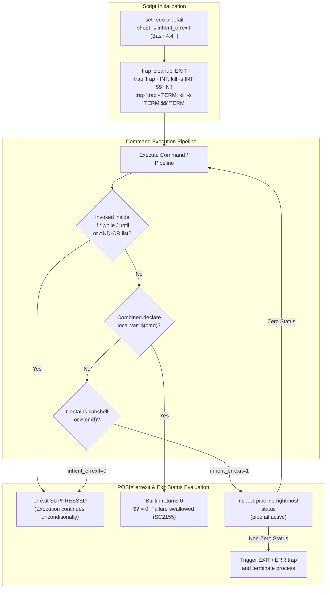
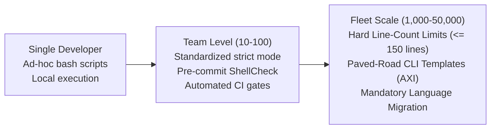

# Robust Shell Scripting and ShellCheck

> [!summary] Claim:
> Strict mode (`set -euo pipefail`) prevents silent errors but fails inside conditional tests, command substitutions without `inherit_errexit`, and compound declarations like `local var=$(cmd)` (SC2155).
> Reliable shell automation requires separating declaration from assignment, defending against signal loss via cooperative traps (`kill -s INT $$`), and isolating subshells.
> Atomic file mutations demand `mktemp` with `O_CREAT | O_EXCL` and directory-aware `rename(2)` semantics to eliminate symlink injection and partial-write corruption.
> Automated static analysis with ShellCheck converts runtime trapping bugs into deterministic build failures before deployment.



## The Mechanism

Production shell automation must be deterministic, fail-stop, and resilient against unexpected signals, corrupt inputs, and concurrent filesystem changes.
Understanding where standard defenses fail requires inspecting the POSIX execution environment, the kernel system call boundary, and the Abstract Syntax Tree (AST) constructed during static analysis.

### 1. Strict Mode Mechanics: set -euo pipefail

The canonical strict mode prologue establishes three foundational error-handling properties across POSIX and Bash shells:

1. `set -e` (`errexit`):
Instructs the shell to exit immediately if any pipeline, simple command, or list exits with a non-zero status.
Defined by the `set` special built-in in POSIX.1-2024 XCU Section 2.15 (Special Built-In Utilities).

2. `set -u` (`nounset`):
Instructs the shell to treat an attempt to expand an unset parameter (other than `@` and `*`) as an execution error and exit immediately.
This prevents catastrophic commands such as `rm -rf "${DIR}/"` from expanding to `rm -rf "/"` when `DIR` is unset.

3. `set -o pipefail`:
Historically a Ksh and Bash extension, `pipefail` was formally standardized in POSIX.1-2024 (IEEE Std 1003.1-2024) through Austin Group bug 0000789 "Add set -o pipefail" (Accepted As Marked, tagged issue8).
Without `pipefail`, the exit status of a pipeline `cmd1 | cmd2 | cmd3` is exclusively the exit status of `cmd3`.
If `cmd1` crashes or yields an error, but `cmd3` succeeds, the overall pipeline returns `0`, bypassing `set -e`.
With `pipefail` enabled, the pipeline exit status is the exit code of the last (rightmost) command that exited with a non-zero status, or `0` if all commands succeeded.

### 2. Failure Modes of errexit

Despite its intent, `errexit` provides false security if an engineer does not know where POSIX mandates that `set -e` must be disabled.

#### Conditionals and the Function Callee Trap

POSIX.1-2024 explicitly requires that `errexit` be ignored when executing the compound list following `if`, `while`, or `until`, any command preceding `&&` or `||` in an AND-OR list (except the final command), and any command inverted with `!`.
Crucially, this suppression applies transitively to any shell function called within that condition; the Bash manual states it outright: "If a compound command or shell function executes in a context where -e is being ignored, none of the commands executed within the compound command or function body will be affected by the -e setting" (Bash Reference Manual 5.3, The Set Builtin).
Consider a validation function:

```bash
validate_environment() {
    setup_temporary_mount
    detect_hardware_crypto   # Fails with status 1
    generate_audit_token     # Must never execute if crypto detection failed
    return 0
}

# The callee trap:
if validate_environment; then
    echo "Environment verified"
fi
```

When `validate_environment` is invoked directly inside the `if` condition, the shell suspends `set -e` across all commands executed inside that function scope.
When `detect_hardware_crypto` fails, execution does not stop.
The shell proceeds to `generate_audit_token` and returns `0`.
The caller takes the success branch, completely unaware that an internal step failed.
To maintain `set -e` semantics, functions must be executed outside the condition test, saving the return code explicitly:

```bash
set +e
validate_environment
status=$?
set -e
if [[ ${status} -eq 0 ]]; then
    echo "Environment verified"
fi
```

#### Command Substitutions and inherit_errexit

In GNU Bash outside POSIX mode, command substitutions (`$(...)` and backticks) run in a subshell where `errexit` is cleared; this is still the default in Bash 5.3, and before Bash 4.4 no option could change it (Bash Reference Manual 5.3, Bash POSIX Mode: "When the inherit_errexit option is not enabled, Bash clears the -e option in such subshells").
If a command inside `$(...)` failed, execution within the subshell continued, and the parent shell received whatever text was written to stdout before the subshell exited:

```bash
# Bash default without inherit_errexit:
output=$(false; echo "survived")
echo "Output: ${output}"  # Prints "survived"
```

Bash 4.4 introduced `shopt -s inherit_errexit` (Bash NEWS, bash-4.4 item ii) to enforce that command substitutions inherit the parent shell's `errexit` flag.
Under POSIX mode (`set -o posix`), Bash enables `inherit_errexit` automatically.
However, in standard Bash scripts (`#!/usr/bin/env bash`), `inherit_errexit` is disabled by default (as of 2026-11, Both).
Every robust Bash script must explicitly configure `shopt -s inherit_errexit`.

#### Return Code Masking with local, export, and readonly (SC2155)

The most prevalent bug in production shell scripts is the combined declaration and assignment:

```bash
deploy_artifact() {
    local token=$(generate_access_token)
    upload_bundle "${token}"
}
```

`export` and `readonly` are POSIX special built-ins (XCU 2.15), while `local` and `declare` are Bash built-ins that POSIX does not define; all four are ordinary commands whose own exit status replaces that of any command substitution in their arguments.
When the line executes, word expansion first evaluates `$(generate_access_token)`.
If `generate_access_token` fails with exit code `1`, its exit code is captured by the subshell, but the shell then invokes the `local` builtin with argument `token=`.
The `local` builtin successfully binds the variable in the local scope and returns status `0`.
The exit code of the simple command is `$? = 0`.
Because the simple command exited with `0`, `set -e` does not trigger, and `upload_bundle` executes with an empty token.
ShellCheck flags this pattern as `SC2155: Declare and assign separately to avoid masking return values`.
The correct pattern separates variable allocation from assignment:

```bash
deploy_artifact() {
    local token
    token=$(generate_access_token)
    upload_bundle "${token}"
}
```

In standard POSIX assignment statements without command prefixes (`token=$(cmd)`), the exit status of the assignment statement is the exit status of the command substitution (XCU 2.9.1.3: the command completes "with the exit status of the command substitution whose exit status was the last obtained").
If `generate_access_token` fails, the assignment statement returns `1`, immediately tripping `set -e`.

### 3. Reliable Signal Trapping Architecture

Scripts executing in automation, container orchestrators, or continuous integration environments receive asynchronous signals (`SIGINT`, `SIGTERM`, `SIGHUP`).
Handling these signals safely requires structured resource cleanup and cooperative exit notification.

```mermaid
stateDiagram-v2
    [*] --> Running
    Running --> Interrupted: SIGINT (Ctrl-C) / SIGTERM
    Running --> NormalExit: Script finishes / set -e error
    Interrupted --> TrapHandler: Dispatch trapped signal
    TrapHandler --> ReRaise: trap - INT; kill -s INT $$
    ReRaise --> Cleanup: Bash runs EXIT trap before dying
    NormalExit --> Cleanup: Execute EXIT trap handler
    Cleanup --> [*]: Terminated by SIGINT (WIFSIGNALED true, status 130)
```

#### Cooperative Signal Propagation (WIFSIGNALED)

A fatal flaw in basic signal trapping is catching `SIGINT` or `SIGTERM` and terminating with `exit 1`:

```bash
# Anti-pattern: Swallows signal
trap 'cleanup; exit 1' INT TERM
```

When a user interrupts a script with Ctrl-C, the terminal line discipline broadcasts `SIGINT` to the entire foreground process group.
If the child script exits via `exit 1`, its parent process (such as a `Makefile`, an outer orchestration loop, or an interactive shell) queries the exit status using `waitpid(2)`.
The parent's `WIFEXITED(status)` macro evaluates to true, and `WEXITSTATUS(status)` returns `1`.
The parent's `WIFSIGNALED(status)` macro evaluates to false!
Because the parent observes a standard program error rather than a signal termination, the parent shell continues executing subsequent loop iterations or build targets.
To cooperatively inform the parent that execution was aborted by a signal, the child must unregister its trap and re-raise the signal against its own PID:

```bash
cleanup() {
    rm -rf "${SCRATCH_DIR:-}"
}
trap cleanup EXIT
trap 'trap - INT; kill -s INT $$' INT
trap 'trap - TERM; kill -s TERM $$' TERM
```

When `SIGINT` arrives:
1. The `INT` trap handler executes.
2. `trap - INT` resets `SIGINT` to the shell's default handling (no trap).
3. `kill -s INT $$` delivers `SIGINT` directly to the script process.
4. Bash, finding no trap for a fatal signal, first runs the `EXIT` trap, safely running `cleanup`.
5. Bash then restores `SIG_DFL` and re-sends the signal to itself, so the kernel terminates the script via signal.
6. The parent's `waitpid(2)` observes `WIFSIGNALED(status) == true` with signal `SIGINT`, which a parent shell reports as `$? = 130` (`128 + 2`), prompting the parent to abort cleanly.
Running the `EXIT` trap on death by signal is Bash behavior, not a POSIX guarantee: dash killed the same way exits 130 without running its `EXIT` trap (measured 2026-11-07, macOS).
A Bash script with no `INT` trap at all also runs its `EXIT` trap and dies with 130 (measured, Bash 5.3.15); the re-raise matters as soon as an `INT` handler does work of its own, because ending that handler with `exit 1` turns the signal into a normal exit status of 1 (measured).

#### Signal Inheritance and the Ignored SIGINT Trap

A critical failure mode in automated environments arises from POSIX signal inheritance rules.
Under POSIX.1-2024 Section 2.12 (Signals and Error Handling), when job control is disabled and the shell executes an asynchronous AND-OR list (`&`, defined in Section 2.9.3.1), the commands in the list inherit a signal action of ignored (`SIG_IGN`) for `SIGINT` and `SIGQUIT`.
Furthermore, the `trap` special built-in (POSIX.1-2024 Section 2.15) states that "Signals that were ignored on entry to a non-interactive shell cannot be trapped or reset, although no error need be reported when attempting to do so."
If a script started in the background or under an automated runner with `SIGINT` ignored executes `trap 'trap - INT; kill -s INT $$' INT`, the shell silently ignores the trap definition.
When the script subsequently executes `kill -s INT $$`, the signal is delivered to a process whose disposition is `SIG_IGN`, causing the operating system kernel to discard the signal immediately without terminating the process.
Execution continues directly past the signal delivery statement; the `EXIT` trap still runs at the eventual normal exit, but the script reports an ordinary status (0 in a measured run with Bash 5.3.15) instead of dying by signal.
In test harnesses or child subshells, restoring default signal disposition via a lightweight runner (`signal(SIGINT, SIG_DFL)`) is required to verify signal trapping deterministically.
In production automation, scripts must always trap and re-raise `SIGTERM` (`trap 'trap - TERM; kill -s TERM $$' TERM`).
POSIX never automatically sets `SIGTERM` to `SIG_IGN` in asynchronous lists, ensuring that container orchestrators and process managers can reliably terminate tasks with exit status `143` (`128 + 15`).

#### Function Error Tracing with set -E

Bash scripts that rely on `trap '...' ERR` to log failures must recognize that `ERR` traps are not inherited by shell functions, command substitutions, or subshells by default.
Enabling `set -E` (`set -o errtrace`) makes shell functions, command substitutions, and subshell commands inherit the active `ERR` trap.
Similarly, `set -T` (`set -o functrace`) makes the same three contexts inherit `DEBUG` and `RETURN` traps (Bash Reference Manual 5.3, The Set Builtin; both options date from bash-3.0 per Bash NEWS).

### 4. Safe Temporary Files and Atomic Filesystem Operations

Ad-hoc temporary file patterns like `/tmp/script.$$` introduce severe security and correctness vulnerabilities.
Predictable filenames in shared directories allow local attackers to conduct symlink injection attacks, overwriting arbitrary files owned by the executing user.
Concurrently, non-atomic file writes leave corrupted or half-written configurations if a process terminates unexpectedly.

#### mktemp and File Descriptors

The `mktemp` utility is not specified by POSIX.1-2024; BSD/macOS `mktemp` builds on `mkstemp(3)` and `mkdtemp(3)` and creates files with mode `0600`, and GNU `mktemp` uses gnulib `gen_tempname`, which calls `open(2)` with `O_RDWR | O_CREAT | O_EXCL` and `S_IRUSR | S_IWUSR` (mode `0600`).
The `O_EXCL` flag guarantees atomic creation: if the path or a symlink exists at that location, `open` fails with `EEXIST`.
POSIX scripts must handle BSD (macOS) versus GNU (Linux) argument differences:
- macOS BSD `mktemp`: A template needs trailing `X` characters, `-t prefix` builds one under `$TMPDIR`, and with no arguments (or only `-d`) it behaves as if `-t tmp` was supplied (macOS mktemp(1)).
- GNU `mktemp`: With no template it uses `tmp.XXXXXXXXXX` under `$TMPDIR`; a given template needs at least three consecutive trailing `X` characters.
The portable specification across Both platforms uses an explicit path with at least six trailing `X` characters:

```bash
TMPDIR="${TMPDIR:-/tmp}"
SCRATCH_DIR=$(mktemp -d "${TMPDIR%/}/app.XXXXXXXXXX")
```

#### Atomic Updates via rename(2)

Updating a configuration file or deployment link in-place via redirection (`> config.json`) truncates the file before writing the new content.
Any process reading `config.json` while the write is underway observes an empty or corrupted file.
To achieve zero-downtime atomic updates, write to a sibling temporary file on the same filesystem and execute an atomic rename:

```bash
atomic_write() {
    local target="$1"
    local content="$2"
    local tmp_file
    tmp_file=$(mktemp "${target}.tmp.XXXXXXXXXX")
    printf '%s\n' "${content}" > "${tmp_file}"
    chmod 0644 "${tmp_file}"
    mv -f "${tmp_file}" "${target}"
}
```

The `mv` command invokes the `rename(2)` system call.
POSIX guarantees that `rename(2)` is atomic: "a directory entry named new shall remain visible to other threads throughout the renaming operation and refer either to the file referred to by new or old before the operation began" (POSIX.1-2024 rename()).
This atomicity holds only when the temporary file and the target reside on the exact same filesystem mount.
If the temporary file resides in `/tmp` while the target resides on `/var`, `rename(2)` fails with `EXDEV` and `mv` falls back to a non-atomic copy and delete (`read` + `write` + `unlink`), as the POSIX.1-2024 `mv` page describes.

#### The Directory Symlink Replacement Trap

Switching an active release symlink (`/opt/app/current -> /opt/app/releases/v2`) is vulnerable to directory resolution hazards.
If `/opt/app/current` already exists and points to an existing directory (`releases/v1`), executing:

```bash
ln -s "/opt/app/releases/v2" "/opt/app/current.tmp"
mv -f "/opt/app/current.tmp" "/opt/app/current"
```

causes `mv` to follow the symlink `/opt/app/current` and deposit `current.tmp` inside `/opt/app/releases/v1/current.tmp`!
The production symlink remains pinned to `v1` (measured 2026-11-07 with macOS `/bin/mv` and GNU coreutils 9.12 `mv`).
To force `mv` to treat the target as a symlink rather than following it to the target directory:
- On Linux (GNU Coreutils): Use `mv -T -f current.tmp current` (`-T` / `--no-target-directory`, added in coreutils 5.3.0).
- On macOS (BSD `mv`): Use `mv -h -f current.tmp current` (`-h`: "If the target operand is a symbolic link to a directory, do not follow it", macOS mv(1)).
- Portable link creation: `ln -sfn "/opt/app/releases/v2" "/opt/app/current"`.
Note that BSD/macOS `ln -sfn` performs an `unlink(2)` followed by a `symlink(2)` (macOS ln(1): "unlink it so that the link may occur"), creating a short window where `/opt/app/current` does not exist on disk.
GNU `ln -f` no longer removes the destination before creating the new link since coreutils 8.27 (coreutils NEWS), so that window exists only on BSD userlands and older GNU systems; `mv -T` / `mv -h` performs an atomic `rename(2)` on both.

### 5. Static Analysis Internals: ShellCheck

ShellCheck, written in Haskell by Vidar Holen, performs static analysis over shell source code without executing it.
Its architecture can be described as four stages:

1. Lexical Analysis:
Tokenizes shell grammar including variable expansions, quoting contexts (`"`, `'`, `$'...'`), and command structures; this happens inside the Parsec parser (`src/ShellCheck/Parser.hs` imports `Text.Parsec`), not in a separate lexer.

2. AST Parsing (Parsec):
Constructs a complete Abstract Syntax Tree representing commands, assignments, redirection lists, and subshell environments according to the selected dialect (`sh`, `bash`, `dash`, `ksh`).

3. Dataflow and Control Flow Graph (CFG) Analysis:
Traces variable lifetimes, assignment scopes, unreachable branches, and condition contexts.
Extended dataflow analysis (`--extended-analysis=true`, default true per `shellcheck --help` in 0.11.0) tracks variable state across branching control structures; the graph is built in `src/ShellCheck/CFG.hs`.

4. Rule Verification:
Executes hundreds of linting rules divided into three numeric families:
- `SC1xxx`: Syntactic errors and parser failures (e.g., `SC1090`: Can't follow non-constant source; `SC1072`: Syntax error).
- `SC2xxx`: Semantic defects, quoting vulnerabilities, and runtime traps (e.g., `SC2086`: Double quote to prevent globbing; `SC2155`: Declare and assign separately; `SC2064`: Use single quotes in trap; `SC2015`: Note that `A && B || C` is not if-then-else).
- `SC3xxx`: Portability warnings (e.g., `SC3010`: In POSIX sh, `[[ ]]` is undefined; `SC3043`: In POSIX sh, `local` is undefined).

## Commands and Numbers to Know

Reference directives, flags, exit codes, and operational limits across POSIX and Bash environments:

| Directive / Parameter | Scope / Subsystem | Default Behavior | Robust Production Form | Platform & Standard Pinned |
| :--- | :--- | :--- | :--- | :--- |
| `set -e` (`errexit`) | Error Handling | Disabled (`off`) | `set -e` at script entry | Both, POSIX.1-2024 `(as of 2026-11, Both)` |
| `set -u` (`nounset`) | Parameter Expansion | Disabled (`off`) | `set -u` at script entry | Both, POSIX.1-2024 `(as of 2026-11, Both)` |
| `set -o pipefail` | Pipeline Status | Last command status | `set -o pipefail` | Both, POSIX.1-2024 `(as of 2026-11, Both)` |
| `shopt -s inherit_errexit` | Subshell Inheritance | Disabled (`off`) | Explicitly enabled in Bash | Linux & macOS, Bash 4.4+ `(as of 2026-11, Both)` |
| `set -E` (`errtrace`) | Function Traps | Disabled (`off`) | Enabled when using ERR trap | Linux & macOS, Bash 3.0+ `(as of 2026-11, Both)` |
| `SIGINT` Exit Status | Signal Handling | N/A | Status `130` (`128 + 2`) | Both, Unix standard `(as of 2026-11, Both)` |
| `SIGTERM` Exit Status | Signal Handling | N/A | Status `143` (`128 + 15`) | Both, Unix standard `(as of 2026-11, Both)` |
| `SIGPIPE` Exit Status | Broken Pipe | Default action terminates the writer; shell reports `141` | Handled when piping to `head` | Both, Unix standard `(as of 2026-11, Both)` |
| `mktemp -d` Template | Temporary Directory | Template optional | `mktemp -d "${TMPDIR%/}/p.XXXXXX"` | Both, BSD / GNU (not a POSIX.1-2024 utility) `(as of 2026-11, Both)` |
| `mv -T` (GNU) / `mv -h` (BSD) | Symlink Replacement | Follows target symlink | `mv -T` (Linux) or `mv -h` (macOS) | GNU coreutils 5.3.0+ (checked on 9.12) / BSD `(as of 2026-11, Both)` |
| ShellCheck SC2155 | Static Analysis | Masked return status | `local var; var=$(cmd)` | ShellCheck 0.11.0 `(as of 2026-11, Both)` |
| ShellCheck SC2086 | Static Analysis | Unquoted expansion | `"${var}"` (double quoted) | ShellCheck 0.11.0 `(as of 2026-11, Both)` |
| ShellCheck SC2064 | Static Analysis | Premature expansion | `trap 'rm -f "${tmp}"' EXIT` | ShellCheck 0.11.0 `(as of 2026-11, Both)` |
| ShellCheck SC2015 | Static Analysis | `A && B \|\| C` fallacy | Explicit `if A; then B; else C; fi` | ShellCheck 0.11.0 `(as of 2026-11, Both)` |

## Multi-Language Comparison: Error Handling, Cleanup Traps, and Atomic Replacement

Cross-language comparison of failure containment, cleanup guarantees, and filesystem mutation:

| Concern | POSIX Shell / Bash | C++ (C++20 / C++23) | Python (Python 3.12+) | Rust (Rust 1.80+) |
| :--- | :--- | :--- | :--- | :--- |
| **Failure Propagation** | Opt-in via `set -e`; suppressed in conditionals and subshells | Explicit exception throwing or `std::expected<T, E>` monadic checks | Automatic exception propagation (`raise`); unhandled aborts process | Strict `Result<T, E>` with `?` operator; unused results trigger compiler warnings |
| **Resource Cleanup** | Asynchronous signal and `EXIT` traps via `trap 'fn' EXIT` | RAII stack unwinding via class destructors; `std::unique_ptr` | `try ... finally` blocks and context managers (`with` statements) | Deterministic destructor execution via the `Drop` trait on scope exit |
| **Subprocess Execution** | Native forks/execs; return status in `$?`; masked by builtins | `posix_spawn(2)` or `fork(2)`+`execve(2)` with `waitpid(2)` status inspection | `subprocess.run(..., check=True)` raising `CalledProcessError` on failure | `std::process::Command::status()` returning `ExitStatus` with signal inspection |
| **Atomic File Update** | `mktemp` sibling file + `mv -f` calling `rename(2)` | `std::filesystem::rename()` mapping directly to `rename(2)` | `os.replace(src, dst)` mapping directly to `rename(2)` | `std::fs::rename(src, dst)` mapping directly to `rename(2)` |
| **Static Verification** | External AST linter (`shellcheck`) requiring CI configuration | Compiler warnings (`-Wall -Wextra -Werror`), Clang-Tidy, and ASan/UBSan | Static type checkers (`mypy`, `pyright`) and linters (`ruff`) | Built-in borrow checker and compiler type system; `clippy` linter |

## Worked Lab Example

The companion lab `code/01-Command-Line/robust_scripting_traps/` exercises each mechanism in an executable test suite; every case shows the failure or the contrast next to the remediation.
`run.sh` refuses to run (exit 2, with a message on stderr) unless Bash 4.4 or newer is first on `PATH`, `python3` is present, and ShellCheck reports exactly `0.11.0` (as of 2026-11), whose message text the golden file pins.
The harness `requires:` vocabulary has no token for these tools, so the script gates itself.
The lab script executes six test cases and is recorded on darwin-arm64 only; Linux output is not recorded, and `mv -h` there falls through to `mv -T`.

```bash
#!/usr/bin/env bash
# Entry point: code/01-Command-Line/robust_scripting_traps/run.sh
set -euo pipefail

export LC_ALL=C

# Case 1: local var=$(cmd) return code masking (SC2155)
test_masking() {
    local masked_var=$(false)
    echo "Masked assignment: exit_code=$?, val='${masked_var}'"
}
test_masking

test_unmasked() {
    local unmasked_var
    if ! unmasked_var=$(false); then
        echo "Unmasked assignment: caught command failure explicitly"
    fi
}
test_unmasked
```

Case 2 demonstrates how `errexit` is silenced inside conditional callees, then calls the same function directly under `set -e` to show it stops at the failure:

```bash
conditional_callee() {
    echo "callee: step 1 (before failure)"
    false
    echo "callee: step 2 (errexit was suppressed by caller condition)"
    return 0
}

if conditional_callee; then
    echo "caller: condition branch taken despite callee failure"
fi

echo "Same callee called directly under set -e:"
set +e
"${BASH}" -c "set -e; $(declare -f conditional_callee); conditional_callee; echo 'callee: returned normally'"
direct_rc=$?
set -e
echo "Direct call aborted with exit code ${direct_rc}"
```

Case 3 inspects `inherit_errexit` inside command substitutions.
The child exits 99 if `shopt` rejects the option, and the lab then dies, so an old Bash cannot pass as the abort under test:

```bash
echo "Default subshell command substitution:"
"${BASH}" -c 'set -e; out=$(false; echo "survived_cmdsub"); echo "out=${out}"'

echo "With inherit_errexit enabled:"
set +e
"${BASH}" -c 'set -e; shopt -s inherit_errexit || exit 99; out=$(false; echo "survived_cmdsub"); echo "out=${out}"'
inherit_rc=$?
set -e
[ "${inherit_rc}" -ne 99 ] || die "shopt -s inherit_errexit was rejected"
echo "Command substitution aborted with exit code ${inherit_rc}"
```

Case 4 verifies cooperative signal termination.
A Python parent restores `SIG_DFL` for `SIGINT`, runs a Bash child that raises `SIGINT` against its own PID, and reports whether the child ended by signal (`WIFSIGNALED`) or by a normal exit (`WIFEXITED`).
The restore is needed because commands started as background jobs without job control inherit `SIGINT` as `SIG_IGN` (XCU 2.12), and the `trap` special built-in (XCU 2.15) forbids non-interactive shells from trapping or resetting a signal ignored on entry; with `SIGINT` ignored and the restore removed, the lab output changes and the check fails (mutation-tested).
Variant A is the re-raise handler, Variant B is the `exit 1` anti-pattern, and Variant C has no `INT` trap at all.
Variants A and C end identically under Bash 5.3.15, so the lab proves that `exit 1` loses the signal, not that the re-raise adds anything over Bash's own default; the re-raise matters once an `INT` handler does work of its own:

```bash
signal_probe=$(
    cat <<'PY_EOF'
import signal, subprocess, sys
signal.signal(signal.SIGINT, signal.SIG_DFL)
rc = subprocess.run([sys.argv[1], "-c", sys.argv[2]]).returncode
if rc < 0:
    print("child terminated by " + signal.Signals(-rc).name + " (WIFSIGNALED)")
else:
    print("child exited with status " + str(rc) + " (WIFEXITED)")
PY_EOF
)
signal_body=$(
    cat <<'SH_EOF'
tmp="allocated_resource"
cleanup() {
    echo "trap EXIT: cleaning up ${tmp}"
}
trap cleanup EXIT
__INT_TRAP__
kill -s INT $$
echo "unreachable"
SH_EOF
)
run_signal_variant() {
    local label="$1" int_trap="$2"
    echo "${label}"
    python3 -I -c "${signal_probe}" "${BASH}" "${signal_body/__INT_TRAP__/${int_trap}}"
}
run_signal_variant "Variant A, re-raise handler:" "trap 'trap - INT; kill -s INT \$\$' INT"
run_signal_variant "Variant B, anti-pattern exit 1 handler:" "trap 'exit 1' INT"
run_signal_variant "Variant C, no INT trap:" ":"
```

Case 5 exercises atomic file replacement and directory symlink swapping.
It first runs the naive `mv -f` and shows the new link deposited inside `release_a`, then the `mv -h` or `mv -T` form and shows that no link was deposited.
It checks final content and link targets only, so it does not prove the absence of a removal window:

```bash
SCRATCH_DIR=$(mktemp -d /tmp/robust_lab.XXXXXX)
trap 'rm -rf "${SCRATCH_DIR}"' EXIT

echo "initial_payload" > "${SCRATCH_DIR}/data.txt"
tmp_data=$(mktemp "${SCRATCH_DIR}/data.tmp.XXXXXX")
echo "updated_payload" > "${tmp_data}"
mv -f "${tmp_data}" "${SCRATCH_DIR}/data.txt"
echo "Atomic file content: $(cat "${SCRATCH_DIR}/data.txt")"

mkdir -p "${SCRATCH_DIR}/naive/release_a" "${SCRATCH_DIR}/naive/release_b"
ln -s "release_a" "${SCRATCH_DIR}/naive/current"
ln -s "release_b" "${SCRATCH_DIR}/naive/current.tmp"
mv -f "${SCRATCH_DIR}/naive/current.tmp" "${SCRATCH_DIR}/naive/current"
if [ -L "${SCRATCH_DIR}/naive/release_a/current.tmp" ]; then
    deposited=yes
else
    deposited=no
fi
echo "Naive mv: current -> $(readlink "${SCRATCH_DIR}/naive/current"), link deposited inside release_a: ${deposited}"

mkdir -p "${SCRATCH_DIR}/release_a" "${SCRATCH_DIR}/release_b"
ln -s "release_a" "${SCRATCH_DIR}/current"
ln -s "release_b" "${SCRATCH_DIR}/current.tmp"

if mv -h -f "${SCRATCH_DIR}/current.tmp" "${SCRATCH_DIR}/current" 2>/dev/null; then
    :
elif mv -T -f "${SCRATCH_DIR}/current.tmp" "${SCRATCH_DIR}/current" 2>/dev/null; then
    :
else
    die "neither mv -h nor mv -T replaced the symlink"
fi
echo "Symlink atomically updated to: $(readlink "${SCRATCH_DIR}/current")"
if [ -e "${SCRATCH_DIR}/release_a/current.tmp" ]; then
    deposited=yes
else
    deposited=no
fi
echo "Link deposited inside release_a: ${deposited}"
```

Case 6 validates that ShellCheck detects anti-patterns (SC2064, SC2155, SC2086) with non-zero exit status, while the remediated script passes with zero warnings:

```bash
echo "Running ShellCheck on anti-pattern script:"
set +e
shellcheck -f gcc "${SCRATCH_DIR}/anti_pattern.sh" | sed "s|${SCRATCH_DIR}/||" | cut -d: -f2-
bad_sc_rc=$?
set -e
echo "Anti-pattern exit code: ${bad_sc_rc}"

echo "Running ShellCheck on remediated script:"
set +e
shellcheck "${SCRATCH_DIR}/remediated.sh"
good_sc_rc=$?
set -e
echo "Remediated exit code: ${good_sc_rc}"
```

Running the lab through the test harness yields deterministic output (`python3 -m _harness.verify 01-Command-Line/robust_scripting_traps/`; every check was mutation-tested, so removing the mechanism it covers makes the harness fail):

```text
=== Case 1: local var=$(cmd) Return Code Masking (SC2155) ===
Masked assignment: exit_code=0, val=''
Unmasked assignment: caught command failure explicitly
=== Case 2: errexit Suppression in Conditionals ===
callee: step 1 (before failure)
callee: step 2 (errexit was suppressed by caller condition)
caller: condition branch taken despite callee failure
Same callee called directly under set -e:
callee: step 1 (before failure)
Direct call aborted with exit code 1
=== Case 3: inherit_errexit in Command Substitutions ===
Default subshell command substitution:
out=survived_cmdsub
With inherit_errexit enabled:
Command substitution aborted with exit code 1
=== Case 4: Signal Traps and Cooperative Re-raising ===
Variant A, re-raise handler:
trap EXIT: cleaning up allocated_resource
child terminated by SIGINT (WIFSIGNALED)
Variant B, anti-pattern exit 1 handler:
trap EXIT: cleaning up allocated_resource
child exited with status 1 (WIFEXITED)
Variant C, no INT trap:
trap EXIT: cleaning up allocated_resource
child terminated by SIGINT (WIFSIGNALED)
=== Case 5: Atomic File Replacement and Symlink Pitfall ===
Atomic file content: updated_payload
Naive mv: current -> release_a, link deposited inside release_a: yes
Symlink atomically updated to: release_b
Link deposited inside release_a: no
=== Case 6: ShellCheck Static Analysis ===
Running ShellCheck on anti-pattern script:
3:13: warning: Use single quotes, otherwise this expands now rather than when signalled. [SC2064]
5:11: warning: Declare and assign separately to avoid masking return values. [SC2155]
6:10: note: Double quote to prevent globbing and word splitting. [SC2086]
Anti-pattern exit code: 1
Running ShellCheck on remediated script:
Remediated exit code: 0
```
*(Recorded on darwin-arm64)*

## Pitfalls

> [!warning] Pitfalls:
> 1. Conditional Callee errexit Suppression:
> Never invoke multi-step shell functions directly in `if condition; then` blocks.
> In POSIX, `errexit` is silenced across the entire function call stack.
> Execute the function beforehand, capture `$?`, and evaluate the status explicitly.
>
> 2. Combined Declaration and Assignment (SC2155):
> Never write `local var=$(cmd)`, `export var=$(cmd)`, or `readonly var=$(cmd)`.
> The builtin declaration utility always returns `0`, silently discarding non-zero exits from `cmd`.
> Always allocate the variable name on one line and assign its value on the next.
>
> 3. The `A && B || C` False Ternary Fallacy (SC2015):
> Shell operators `&&` and `||` are left-associative and evaluated sequentially based on exit codes.
> In `[[ -f file ]] && cat file || log_missing`, if `cat file` fails (e.g., `EACCES` permission denied), `log_missing` executes despite the condition being true.
> Use standard `if ... then ... else ... fi` blocks for branching logic.
>
> 4. Double-Quoted Trap Definitions (SC2064):
> Defining traps with double quotes (`trap "rm -rf ${TMP}" EXIT`) expands `${TMP}` at trap registration time.
> If `${TMP}` has not yet been populated, the trap becomes a harmless `rm -rf` with no operand and the real directory leaks; if `${TMP}` is later re-assigned, the trap deletes the stale path; and if the value contains spaces, the unquoted text splits at trap time so `rm -rf` receives the wrong paths.
> Always enclose trap handlers in single quotes: `trap 'rm -rf "${TMP:-}"' EXIT`.
>
> 5. Unquoted Variable Expansions (SC2086):
> Expanding unquoted variables (`rm $file`) triggers word splitting and pathname expansion (globbing).
> If `$file` contains whitespace or asterisks (`*`), the command splits into unintended arguments.
> Quote all variable expansions: `rm "${file}"`.
>
> 6. Swallowing SIGPIPE Under pipefail (Exit Code 141):
> Under `set -o pipefail`, pipelines feeding early-exit utilities (such as `generate_stream | head -n 1`) fail with exit status 141 when the consumer terminates and closes the pipe.
> The writer receives `SIGPIPE` (`128 + 13 = 141`), aborting the script under `set -e`.
> Handle expected pipe closures explicitly: `generate_stream | head -n 1 || [ "${PIPESTATUS[0]}" -eq 141 ]`.
>
> 7. Non-Atomic Symlink Updates:
> Executing `mv -f new_symlink current` when `current` points to a directory moves `new_symlink` inside the target directory.
> Use `mv -T -f` on Linux or `mv -h -f` on macOS to treat the target as a raw symlink.
>
> 8. Relying Exclusively on SIGINT Trapping in Background Automation:
> When scripts execute asynchronously in the background (`&`) while job control is disabled, including under orchestrators that launch them that way, POSIX (XCU 2.12) mandates that `SIGINT` and `SIGQUIT` are inherited as `SIG_IGN`.
> POSIX further specifies that signals ignored upon entry to a non-interactive shell cannot be trapped or reset.
> In such environments, `trap ... INT` is silently ignored by the shell, and `kill -s INT $$` is discarded by the kernel, causing execution to fall through.
> Production scripts must always trap `SIGTERM` (`trap 'trap - TERM; kill -s TERM $$' TERM`) to guarantee cooperative termination under process supervisors.

## At Scale

As engineering organizations expand from a single author to tens of thousands of contributors, the operational trade-offs of shell automation shift dramatically:



### 1. The 150-Line Migration Threshold

Shell script complexity grows non-linearly.
Without native data structures, static type checking, or compile-time borrow semantics, scripts that exceed 100 to 150 lines become primary incident generators in production.
This is an organizational policy, not a measured threshold; the Google Shell Style Guide draws the line at 100 lines ("If you are writing a script that is more than 100 lines long, or that uses non-straightforward control flow logic, you should rewrite it in a more structured language now"), and the 150-line ceiling here is this note's recommendation.
Distinguished engineering leadership enforces a firm architectural rule:
- Scripts under 100 lines: Permitted in POSIX `sh` or `bash` for linear command orchestration, basic argument parsing, and tool chaining.
- Scripts requiring associative arrays, JSON/YAML parsing, complex regex, concurrency, or robust network error recovery: Must be migrated to Go, Rust, or Python.
This boundary is formalized in [[Command-Line-Decision-Records]].

### 2. CI Verification and Automated Linting

At enterprise scale, shell automation is protected by automated pre-commit and CI gates:
- ShellCheck Gate: Every shell script in source repositories must pass `shellcheck --severity=style --enable=all` with zero warnings.
Any intentional disablement requires an inline comment with explicit rationale: `# shellcheck disable=SC2086 # Deliberate word splitting for compiler flags`.
- Portability Check: Scripts declared as `#!/bin/sh` are strictly gated with `shellcheck --shell=sh` to reject bashisms (`[[ ]]`, `local`, arrays).
- Hermetic Runtime: Automated scripts execute within pinned containers or hermetic Nix environments to avoid subtle version divergences in Coreutils or Bash builtins.

### 3. Agent-Friendly Interfaces (AXI)

When shell scripts serve as entry points for autonomous AI coding agents, scripts must follow the 10 Agent eXperience Interface (AXI) principles outlined in [[CLI-Design-and-Agent-Friendly-Interfaces-AXI]].
Scripts must:
- Emit structured, token-efficient output (e.g., compact key-value pairs or TOON format rather than bloated logs).
- Provide explicit empty states (e.g., `0 items found`) rather than silence.
- Emit deterministic, non-interactive error messages to standard error with distinct non-zero exit codes.

## Practice Drill

> [!tip] Practice Drill:
> Complete the companion drill [[Drill-Command-Line-Quoting-and-Signal-Trap-Race]] to diagnose and resolve an asynchronous signal trap race condition under concurrent job execution.
> The drill exercises the exact sequence required to safeguard temporary scratch buffers against unexpected `SIGTERM` signals delivered by cloud container orchestrators.

## Interview Questions

### L5: Predict the Output and Explain the Failure

**Question:**
What does the following script print, and what is its final exit code?
Explain the mechanism.

```bash
#!/usr/bin/env bash
set -euo pipefail

worker() {
    local data=$(false)
    echo "Data: [${data}]"
}

worker
echo "Exit: $?"
```

> [!success]- Answer
> The script prints:
> ```text
> Data: []
> Exit: 0
> ```
> The script exits with status `0`.
> Although `set -e` is active and `false` returns non-zero status `1`, the command substitution `$(false)` occurs within a combined `local` declaration.
> The word expansion assigns the empty string to `data`, but the exit status of the overall statement is determined by the `local` builtin command itself.
> Because variable allocation in the local function scope succeeds, `local` returns `0`, overwriting `$?`.
> Because the statement returned `0`, `set -e` does not trigger, and execution continues.
> ShellCheck identifies this as `SC2155`.

---

### L5: Debug This Broken Signal Trap

**Question:**
A developer deployed this backup script to production.
When interrupted with Ctrl-C during a long transfer, it leaves orphaned temporary directories and causes the enclosing deployment loop to continue running.
Identify both bugs and provide the fix.

```bash
#!/usr/bin/env bash
set -euo pipefail

tmp_dir="/tmp/backup_$$"
mkdir -p "${tmp_dir}"
trap "rm -rf ${tmp_dir}; exit 1" INT

fetch_large_backup "${tmp_dir}"
process_backup "${tmp_dir}"
```

> [!success]- Answer
> **Bug 1: Predictable path and premature trap expansion (SC2064).**
> Using `/tmp/backup_$$` creates a predictable path vulnerable to symlink pre-creation attacks.
> Furthermore, the double quotes in `trap "rm -rf ${tmp_dir}; exit 1" INT` expand `${tmp_dir}` when the trap is registered.
> If the assignment failed or was re-ordered, the trap would run `rm -rf ""` or an unset path.
>
> **Bug 2: Swallowing SIGINT with `exit 1`.**
> By calling `exit 1`, the process terminates normally via `exit(3)` / `_exit(2)`.
> The parent process inspecting `$?` sees normal failure (`WIFSIGNALED` is false) and assumes the child failed normally, continuing the loop.
>
> **Remediated Implementation:**
> ```bash
> #!/usr/bin/env bash
> set -euo pipefail
>
> tmp_dir=""
> cleanup() {
>     if [ -n "${tmp_dir:-}" ] && [ -d "${tmp_dir}" ]; then
>         rm -rf "${tmp_dir}"
>     fi
> }
> trap cleanup EXIT
> trap 'trap - INT; kill -s INT $$' INT
> trap 'trap - TERM; kill -s TERM $$' TERM
>
> tmp_dir=$(mktemp -d "${TMPDIR:-/tmp}/backup.XXXXXXXXXX")
> fetch_large_backup "${tmp_dir}"
> process_backup "${tmp_dir}"
> ```

---

### L6: Why Does errexit Fail Inside Conditional Functions?

**Question:**
Under `set -e`, why does a function invoked inside `if my_func; then` not abort when an internal command fails?
How does this interact with subshells and pipelines?

> [!success]- Answer
> POSIX.1-2024 Section 2.15 mandates that `errexit` must be suppressed for the compound list following `if`, `while`, or `until`, any command in an AND-OR list other than the last, and commands inverted with `!`.
> Bash implements this by passing a flag down the command tree rather than by clearing a global option: `execute_if_command` in `execute_cmd.c` sets `CMD_IGNORE_RETURN` on the `if` test before running it, `execute_function` copies that flag onto the copied function body, and the errexit exit at the end of a command runs only when `ignore_return == 0` (Bash 5.3 source, `execute_cmd.c`).
> `exit_immediately_on_error` is the variable that holds the `-e` setting; `execute_cmd.c` zeroes it only for the `eval`, `command`, and `source` builtins run with the ignore flag, so the suppression inside an `if` test is the inherited flag, not a reset of `-e`.
> Shell functions execute in the same execution environment as the caller without creating a new process, so every command in the function body carries the ignore flag.
> All commands inside the function execute with `errexit` disabled.
> Even if a command fails inside the function, the shell does not abort.
> In contrast, subshells (`(cmd)`) create an isolated execution environment; in Bash, subshell command substitutions `$(...)` clear `errexit` unless `shopt -s inherit_errexit` is enabled.
> In pipelines, `set -o pipefail` ensures that intermediate command failures yield a non-zero exit status for the pipeline, but if that pipeline is executed within an `if` condition, `errexit` is still suppressed.

---

### L6: Atomic Directory Symlink Replacement

**Question:**
You need to switch a production service symlink `/etc/service/current` to point from `/etc/service/v1` to `/etc/service/v2` without downtime.
Why does `ln -sf /etc/service/v2 /etc/service/current` fail, why does `mv -f new current` fail, and how do you achieve true atomicity across Linux and macOS?

> [!success]- Answer
> **Failure of `ln -sf`:**
> On macOS/BSD, `ln -sf` is not atomic.
> It first calls `unlink("/etc/service/current")` and then calls `symlink("/etc/service/v2", "/etc/service/current")` (macOS ln(1): "unlink it so that the link may occur").
> During the window between `unlink` and `symlink`, the path does not exist, causing concurrent callers to receive `ENOENT`.
> GNU coreutils 8.27 and later no longer remove the destination before creating the new link, so on current Linux the window is gone, but the directory-following problem below remains.
> Furthermore, if `/etc/service/current` points to an existing directory, `ln -sf` without `-n` creates a symlink *inside* `/etc/service/v1/v2`.
>
> **Failure of naive `mv -f`:**
> When `/etc/service/current` points to an existing directory, standard `mv` resolves the symlink and moves the new symlink into `/etc/service/v1/new`.
>
> **Atomic Solution:**
> Create a temporary symlink on the same filesystem and execute an atomic `rename(2)` using flags that prevent following existing directory symlinks:
> ```bash
> ln -s "/etc/service/v2" "/etc/service/current.tmp.$$"
> # Linux (GNU Coreutils):
> mv -T -f "/etc/service/current.tmp.$$" "/etc/service/current"
> # macOS (BSD Coreutils):
> mv -h -f "/etc/service/current.tmp.$$" "/etc/service/current"
> ```
> `rename(2)` replaces the symlink inode atomically in the directory table without an `ENOENT` window.

---

### L7: SIGPIPE Handling Under pipefail

**Question:**
In a CI build, the pipeline `generate_large_log | head -n 1` intermittently crashes the entire script with exit code 141 when `set -euo pipefail` is active, but succeeds when `pipefail` is disabled.
What is the root cause at the system call level, and how should production scripts handle it?

> [!success]- Answer
> **System Call Mechanism:**
> `head -n 1` reads one line from standard input and terminates immediately, calling `exit(0)`.
> The kernel marks the read end of the anonymous pipe as closed.
> Meanwhile, `generate_large_log` continues writing to the pipe.
> When `generate_large_log` executes `write(2)` against a pipe with no active read descriptors, the Linux/macOS kernel generates a `SIGPIPE` signal and delivers it to the writing process.
> By default, `SIGPIPE` terminates the process.
> In Unix shells, when a process dies from signal `N`, its exit code is represented as `128 + N`.
> For `SIGPIPE` (signal 13), the exit status is `128 + 13 = 141`.
> Without `pipefail`, the pipeline's exit status is determined solely by the last command (`head`), which exited with `0`.
> With `pipefail`, the rightmost failing exit status (`141`) becomes the pipeline's exit code, tripping `set -e` and crashing the script.
>
> **Remediation:**
> 1. Ignore or handle status 141 in the pipeline:
> ```bash
> generate_large_log | head -n 1 || {
>     status=$?
>     if [ "${status}" -ne 141 ]; then
>         exit "${status}"
>     fi
> }
> ```
> 2. Alternatively, in Bash, copy `${PIPESTATUS[@]}` immediately after the pipeline, before any other command resets it (reading it after `|| true`, or in a second `[` test, sees the status of `true` or of the previous `[`; under `set -u` the naive form fails with `PIPESTATUS[1]: unbound variable`, measured with Bash 5.3.15):
> ```bash
> { generate_large_log | head -n 1; ps=("${PIPESTATUS[@]}"); } || true
> if [ "${ps[1]}" -ne 0 ] || { [ "${ps[0]}" -ne 0 ] && [ "${ps[0]}" -ne 141 ]; }; then
>     echo "Pipeline failed" >&2
>     exit 1
> fi
> ```

---

### L7: Static Analysis Engine Architecture

**Question:** How does ShellCheck's internal AST representation differ between POSIX `sh` and Bash dialects, and how does its CFG detect unreachable code caused by `exit` or subshell isolation?

> [!success]- Answer
> ShellCheck uses Haskell Parsec parsers configured with dialect flags (`sh`, `bash`, `dash`, `ksh`).
> The parser accepts constructs such as `function`, `[[ ]]`, `<<<`, and `declare` in every dialect; in POSIX `sh` mode the portability checks then report them as `SC3xxx` warnings while analysis continues (a `#!/bin/sh` file using double-bracket tests and `local` yields SC3010 and SC3043 alongside SC2xxx findings, measured with ShellCheck 0.11.0).
> These constructs are parsed into dedicated AST nodes (`src/ShellCheck/AST.hs`):
> - `T_Condition` represents both `[ ... ]` and `[[ ... ]]`, tagged `SingleBracket` or `DoubleBracket`, with binary operators such as `==` and `=~` as child nodes.
> - `T_DollarExpansion` represents `$( )`; `$(( ))` is `T_DollarArithmetic` and `${ }` is `T_DollarBraced`.
>
> For control flow graph (CFG) analysis, ShellCheck constructs directed graphs of statement execution.
> In `src/ShellCheck/CFG.hs`, the `exit` and `return` builtins end the active path by linking to an unreachable node, and later code is reported as SC2317 "Command appears to be unreachable".
> Any subsequent AST node in the same sequential compound list lacking an incoming transition edge is flagged as unreachable code.
> When analyzing subshells (`T_Subshell`), ShellCheck creates an isolated variable scope: mutations made to variables inside `T_Subshell` do not propagate back to the parent scope, allowing the dataflow analyzer to detect when a variable modification is discarded upon subshell exit (SC2030 "Modification of x is local" and SC2031 "x was modified in a subshell", measured with ShellCheck 0.11.0).

---

### L8+: Enterprise Scripting Architecture and Governance

**Question:**
As a Principal / Distinguished Engineer, you inherit an enterprise monorepo with 4,000 legacy shell scripts causing frequent build flakiness and security CVEs.
What governance framework, architectural paved roads, and technical migration path would you establish?

> [!success]- Answer
> An enterprise-grade strategy requires a four-pillar approach:
>
> 1. **Automated Enforcement (Shift-Left Gates):**
> - Implement repository-wide pre-commit and CI gates running `shellcheck --severity=warning`.
> - Forbid bare `set -e` scripts without `inherit_errexit`, `nounset`, and `pipefail`.
> - Mandate a standardized corporate template enforcing cooperative signal traps (`EXIT`, `INT`, `TERM`) and safe `mktemp` usage.
>
> 2. **Paved-Road CLI SDKs (AXI Compliance):**
> - Provide pre-built libraries or starter templates adhering to Agent eXperience Interface (AXI) standards, ensuring structured outputs, non-interactive execution, and standard exit codes as detailed in [[CLI-Design-and-Agent-Friendly-Interfaces-AXI]].
> - Provide standard wrappers for atomic file mutations and lockfile management.
>
> 3. **The 150-Line Architectural Hard Ceiling:**
> - Enforce an absolute rule in CI: any shell script exceeding 150 lines or containing complex data structures (associative arrays, multi-level maps, nested subshells) fails CI and must be migrated to Go or Rust.
> - Document migration standards in Architectural Decision Records as taught in [[Command-Line-Decision-Records]].
>
> 4. **Hermetic Sandboxing:**
> - Run all automation scripts in pinned, hermetic containers or Nix derivation closures to eliminate cross-platform divergences between GNU Coreutils and macOS/BSD userlands as detailed in [[Dotfiles-Nix-Direnv-Mise-and-Devcontainers]].

---

### L8+: Re-Entrant Trap Race Conditions Under High-Frequency Signals

**Question:**
In high-concurrency systems, what happens if `SIGTERM` arrives while an `EXIT` trap handler is already executing, or if a signal arrives before `mktemp` assigns its path to the tracking variable?
How do you engineer a zero-race cleanup protocol?

> [!success]- Answer
> **Race Mode 1: Signal arrival before variable assignment:**
> If `tmp_dir=$(mktemp -d)` executes, the kernel creates the directory on disk.
> If `SIGINT` or `SIGTERM` is delivered before the shell assigns the path string to `tmp_dir`, an `EXIT` trap reading `${tmp_dir}` observes an empty variable.
> The directory is orphaned on disk.
>
> **Race Mode 2: Trap Re-entrancy:**
> If `SIGTERM` arrives while the `EXIT` trap is midway through removing files, the shell may interrupt the handler to execute the `TERM` handler, causing partial cleanup, repeated deletion attempts, or hung processes.
>
> **Zero-Race Protocol:**
> 1. Initialize cleanup trackers prior to resource creation.
> 2. Use a dedicated cleanup registry pattern:
> ```bash
> CLEANUP_DIRS=()
> cleanup() {
>     # Temporarily ignore signals during cleanup execution
>     trap '' INT TERM EXIT
>     for d in "${CLEANUP_DIRS[@]}"; do
>         if [ -n "${d}" ] && [ -d "${d}" ]; then
>             rm -rf "${d}"
>         fi
>     done
> }
> trap cleanup EXIT
> trap 'trap - INT; kill -s INT $$' INT
> trap 'trap - TERM; kill -s TERM $$' TERM
>
> # Atomic registration
> new_dir=$(mktemp -d "${TMPDIR:-/tmp}/app.XXXXXXXXXX")
> CLEANUP_DIRS+=("${new_dir}")
> ```
> By ignoring signals inside `cleanup` (`trap '' INT TERM EXIT`), the cleanup routine runs to completion without interruption.
> By registering the path immediately after creation in an array, multiple scratch directories are cleaned up safely.
> This narrows Race Mode 1 to the gap between `mktemp` returning and the array append; shell offers no way to close it completely, so a signal in that gap can still orphan one directory.

## Further Reading

- IEEE Std 1003.1-2024 (POSIX.1-2024) Shell and Utilities (XCU) Chapter 2: The authoritative international standard defining POSIX shell grammar, word expansion, `errexit`, and the newly standardized `pipefail` option.
- GNU Bash Reference Manual (Chet Ramey, Free Software Foundation, 2026): The comprehensive specification for GNU Bash, detailing shell options (`shopt`), builtin utilities (`set`, `trap`), and subshell inheritance rules.
- ShellCheck: A Static Analysis Tool for Shell Scripts (Vidar Holen, 2026): The definitive linter for shell scripts, cataloging AST parsing, dataflow analysis, and hundreds of warning rules across `SC1xxx`, `SC2xxx`, and `SC3xxx`.
- The Austin Group Defect Tracker (Issue 789: pipefail option): Historical debate and formal consensus rationale for integrating `pipefail` into the POSIX.1-2024 standard.
- Secure Programming HOWTO (David A. Wheeler, version 3.72, 2015, Section 7.11.1.2 Temporary Files): Foundational guidance on Unix filesystem races, temporary file creation via `mkstemp`, and symlink security.
- GNU Coreutils Manual (Jim Meyering et al., Free Software Foundation, 2026): Reference documentation for core filesystem utilities, detailing atomic rename options in `mv` and unique file generation in `mktemp`.

## Related

- Prerequisites: [[Pipelines-Subshells-Redirection-and-Process-Substitution]], [[POSIX-sh-Bash-Zsh-and-Fish-Compared]]
- Next: [[Regex-Engines-Automata-Backtracking-and-ReDoS]]
- See also: [[19-Shell-and-Unix-Engineering/03-POSIX-Shell-Language/errexit-Semantics-and-Exceptions|errexit Semantics and Exceptions]], [[19-Shell-and-Unix-Engineering/14-Testing-and-Static-Analysis/ShellCheck-Warning-Families|ShellCheck Warning Families]]
- Lab: `code/01-Command-Line/robust_scripting_traps/`
