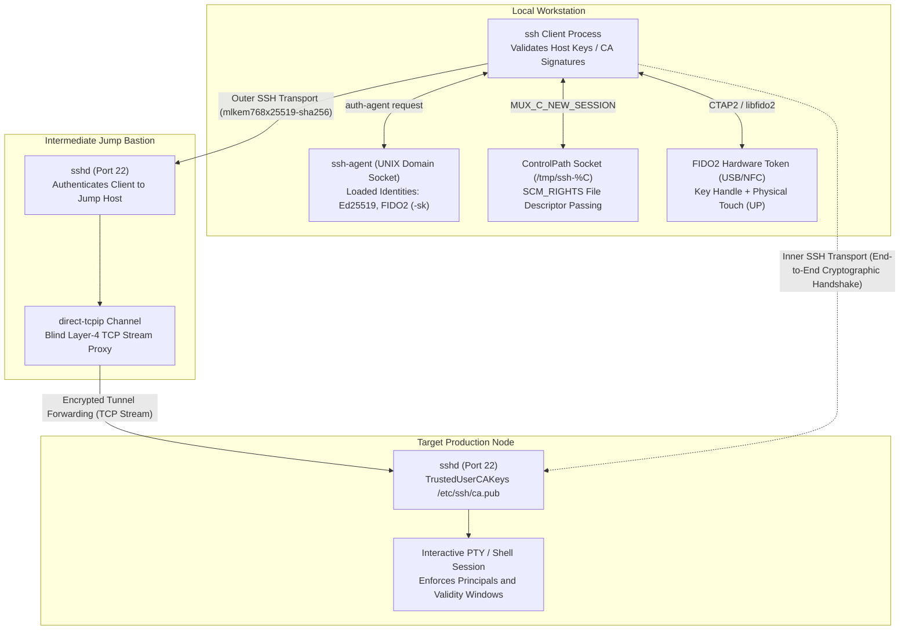
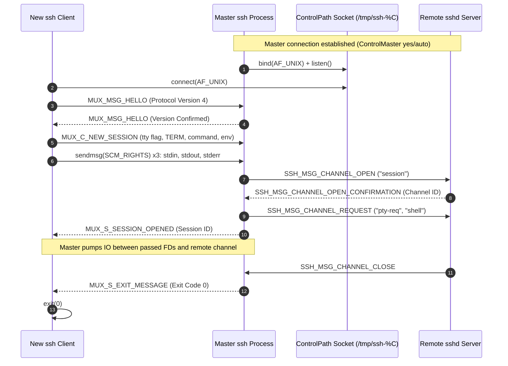
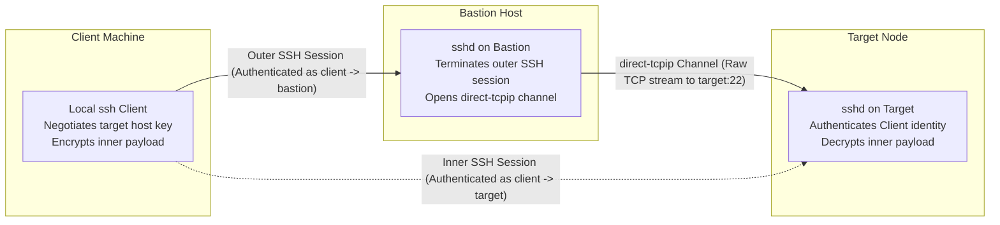

# SSH in Depth: Keys, Forwarding, Certificates, and FIDO2

> [!summary] Claim:
> OpenSSH establishes secure terminal and port-forwarding channels through a layered binary packet protocol running over negotiated asymmetric key exchanges and AEAD ciphers.
> Connection multiplexing eliminates repeat TCP setup, key exchange, and user authentication by passing the new client's stdio file descriptors to an existing master over a local UNIX domain socket via SCM_RIGHTS.
> ProxyJump (implemented as an implicit `ssh -W` ProxyCommand) tunnels an end-to-end encrypted SSH transport through a direct-tcpip channel on each bastion, leaving bastions blind to the inner payload and authentication credentials.
> Agent forwarding exposes client credentials to remote root hijacking, an attack mitigated by OpenSSH destination constraints, while certificate authorities and FIDO2 tokens eliminate trust-on-first-use sprawl and key exfiltration.



## The Mechanism

The Secure Shell protocol version 2 (SSH-2) is split across three normative layers defined in RFC 4251: the Transport Layer (RFC 4253), the Authentication Protocol (RFC 4252), and the Connection Protocol (RFC 4254).
Understanding how OpenSSH operates at distinguished engineering depth requires analyzing the binary wire layout, cryptographic state transitions, kernel socket interfaces, and authentication boundaries.

### 1. Binary Packet Protocol and Cryptographic Negotiation

Every SSH-2 packet transmitted over TCP follows the Binary Packet Protocol (BPP) defined in RFC 4253 section 6.
Before encryption is activated, the wire packet layout consists of:

- `uint32 packet_length`: The size of the packet in bytes, not including `packet_length` itself or the trailing MAC.
- `byte padding_length`: The size of the random padding in bytes (minimum 4 bytes, maximum 255 bytes).
- `byte[n1] payload`: The protocol message payload, where `n1 = packet_length - padding_length - 1`.
- `byte[n2] random_padding`: Random padding bytes ensuring the total length of `(packet_length || padding_length || payload || random_padding)`, that is `4 + 1 + n1 + n2` bytes, is a multiple of the cipher block size or 8, whichever is larger (RFC 4253 section 6; stream ciphers also use 8).
- `byte[m] mac`: Message Authentication Code covering the unencrypted packet sequence number concatenated with `(packet_length || padding_length || payload || random_padding)`.

```text
+-------------------+------------------+-----------------------+-------------------+------------------+
| packet_length(4B) | padding_len (1B) | payload (n1 bytes)    | padding (n2 bytes)| MAC / Tag (m B)  |
+-------------------+------------------+-----------------------+-------------------+------------------+
|<------------- Encrypted Payload (CBC / CTR) ---------------->|
|<------------------------ Authenticated by MAC ----------------------------------->|
```

Modern OpenSSH defaults to authenticated encryption with associated data (AEAD) ciphers, specifically `chacha20-poly1305@openssh.com` (introduced in OpenSSH 6.5) and `aes128-gcm@openssh.com`; the default order is `chacha20-poly1305@openssh.com,aes128-gcm@openssh.com,aes256-gcm@openssh.com,aes128-ctr,aes192-ctr,aes256-ctr` (as of 2026-11, `ssh -G` on OpenSSH 10.6p2, macOS).
Under `chacha20-poly1305@openssh.com`, traditional Encrypt-and-MAC is replaced by a two-key construction (`PROTOCOL.chacha20poly1305`, now specified in draft-ietf-sshm-chacha20-poly1305):

1. The 512 bits of derived key material are split into two 256-bit ChaCha20 keys: the first 256 bits become $K_2$ (payload encryption and Poly1305 key generation) and the second 256 bits become $K_1$ (packet length encryption only).
2. The 4-byte `packet_length` is encrypted with ChaCha20 using $K_1$, with the packet sequence number serving as the 64-bit nonce.
   This hides packet sizes from passive traffic analysis and prevents unauthenticated length manipulation.
3. The remaining packet bytes (`padding_length`, `payload`, and `random_padding`) are encrypted with ChaCha20 using $K_2$.
4. A Poly1305 one-time authenticator key is generated from the first 32 bytes of the $K_2$ keystream block.
   The 16-byte Poly1305 tag is computed over the encrypted length and encrypted payload, providing AEAD integrity without an independent MAC.

#### Key Exchange and Post-Quantum Hybrids

Key exchange (KEX) establishes a shared cryptographic secret over an unencrypted channel while authenticating the server's identity.
The client and server exchange `SSH_MSG_KEXINIT` packets advertising supported algorithms.
Once a mutually supported method is chosen, the parties compute an exchange hash $H$ defined as:

$$H = \text{hash}(V_C \;||\; V_S \;||\; I_C \;||\; I_S \;||\; K_S \;||\; e \;||\; f \;||\; K)$$

Where $V_C$ and $V_S$ are the client and server identification strings (`SSH-2.0-OpenSSH_...`), $I_C$ and $I_S$ are the raw `SSH_MSG_KEXINIT` payloads, $K_S$ is the server host public key, $e$ and $f$ are the ephemeral public key exchange values, and $K$ is the shared secret integer.
The server signs $H$ using its host private key, and the client verifies the signature against its known host key or trusted certificate authority.

From the shared secret $K$ and exchange hash $H$, both parties derive encryption keys, initialization vectors, and integrity keys via iterative hashing:

$$\text{Initial IV client to server} = \text{hash}(K \;||\; H \;||\; \text{"A"} \;||\; \text{session\_id})$$
$$\text{Encryption key client to server} = \text{hash}(K \;||\; H \;||\; \text{"C"} \;||\; \text{session\_id})$$

OpenSSH transitioned to hybrid post-quantum key agreement to protect sessions against "harvest now, decrypt later" attacks mounted by future quantum computers:
- OpenSSH 9.0 (April 2022) enabled `sntrup761x25519-sha512@openssh.com` by default, combining Streamlined NTRU Prime 761 with classic X25519.
- OpenSSH 9.9 (2024-09-19) introduced `mlkem768x25519-sha256`, combining the NIST-standardized ML-KEM-768 lattice algorithm (FIPS 203) with X25519.
- OpenSSH 10.0 (2025-04-09) promoted `mlkem768x25519-sha256` to the first-priority default key exchange algorithm; OpenSSH 10.6p2 still lists it first (as of 2026-11, `ssh -G`, macOS).
The hybrid is designed so that the shared secret stays confidential as long as either the classical or the post-quantum component remains unbroken.

### 2. Asymmetric Key Architectures: Ed25519 vs RSA

OpenSSH supports multiple asymmetric public key algorithms for host authentication, user authentication, and digital signatures.
The two dominant types in modern fleets are Ed25519 and RSA.

| Architectural Dimension | Ed25519 (RFC 8709 / RFC 8032) | RSA (RFC 4253 / RFC 8332) |
| :--- | :--- | :--- |
| Underlying Mathematical Problem | Elliptic Curve Discrete Logarithm on Edwards Curve 25519 | Integer Factorization of $N = pq$ |
| Public Key Size | 32 bytes (256 bits) | 256 to 512 bytes (2048 to 4096 bits) |
| Private Key Wire Size | 32-byte seed (64 bytes expanded) | ~1.8 KiB to 3.3 KiB OpenSSH-format file for 2048 to 4096 bits (1823 / 2602 / 3381 bytes measured for 2048 / 3072 / 4096, OpenSSH 10.6p2, macOS) |
| Signature Size | 64 bytes (512 bits) | Same size as modulus (e.g. 512 bytes for RSA-4096) |
| Cryptographic Security Level | ~128 bits symmetric equivalence (NIST SP 800-57 Part 1 Rev. 5 Table 2 lists 256-bit EdDSA keys at 128 bits) | 112 bits (2048-bit) and 128 bits (3072-bit) per NIST SP 800-57 Part 1 Rev. 5 Table 2; 4096-bit is not a tier in that table, so this note gives no figure for it |
| Signature Generation Speed | Fast (fixed-base scalar multiplication) | Slow (modular exponentiation $s = m^d \pmod N$) |
| Side-Channel Vulnerability | Designed for constant-time implementation (complete twisted Edwards addition law); actual resistance depends on the implementation | Vulnerable to timing attacks unless blinded; Bleichenbacher-style attacks target lax PKCS#1 v1.5 handling |
| Signature Randomness | Strictly deterministic: $r = \text{SHA-512}(\text{prefix} \;\|\; M)$, where prefix is the second half of $\text{SHA-512}(\text{seed})$ (RFC 8032 section 5.1.6) | Deterministic in SSH: RFC 8332 `rsa-sha2-*` uses RSASSA-PKCS1-v1_5; SSH does not use PSS |
| OpenSSH Default Status | Supported since OpenSSH 6.5 (2014); `ssh-keygen` default key type since OpenSSH 9.5 (2023) | Legacy `ssh-rsa` (SHA-1) disabled by default in OpenSSH 8.8 (2021) |

Ed25519 computes signatures over the twisted Edwards curve $-x^2 + y^2 = 1 - (121665/121666)x^2y^2$ modulo $2^{255} - 19$.
Its addition formulas have no exceptional points or division-by-zero traps, allowing constant-time execution without data-dependent branching or memory lookups.
Because the signature scalar $r$ is derived deterministically from the private key seed and the message payload, Ed25519 eliminates the catastrophic failure mode of DSA and ECDSA where a reused or biased random nonce reveals the private key.

RSA security depends on the difficulty of factoring the modulus $N$.
To maintain a 128-bit security margin, RSA requires at least 3072-bit keys, which produces 384-byte signatures and requires significant CPU cycles during key generation and signing.
Furthermore, legacy SSH implementations paired RSA with the SHA-1 cryptographic hash (`ssh-rsa`).
Chosen-prefix collision attacks against SHA-1 became computationally practical for adversaries with modest budgets, leading the OpenSSH project to disable `ssh-rsa` signatures by default in OpenSSH 8.8 (September 2021).
Modern RSA in OpenSSH requires RFC 8332 signature schemes: `rsa-sha2-256` or `rsa-sha2-512`.

### 3. Connection Multiplexing Mechanics: ControlMaster, ControlPath, and ControlPersist

Establishing an SSH connection requires TCP connection setup, KEX negotiation, host key verification, user authentication, and PTY allocation.
Each new connection pays several sequential network round trips (TCP handshake, key exchange, service request, authentication, channel open) before the remote command runs, so the setup cost scales with round-trip latency and is paid again for every `ssh` invocation.
Connection multiplexing enables subsequent SSH sessions to reuse an existing master connection's encrypted transport.



The multiplexing workflow implemented in `mux.c` of the OpenSSH source tree proceeds through precise system calls:

1. The initial client checks the path defined by `ControlPath`.
   If no socket exists and `ControlMaster yes` or `ControlMaster auto` is set, the process completes the standard SSH handshake with the remote host and creates a UNIX domain socket using `socket(AF_UNIX, SOCK_STREAM, 0)`, `bind()`, and `listen()` under `umask(0177)`, so the socket is mode `0600` (`mux.c` `muxserver_listen`).
2. A secondary client runs with `ControlMaster auto` or `ControlMaster no`.
   It calls `connect()` on the UNIX domain socket.
3. The client and master exchange version handshake packets using `MUX_MSG_HELLO` (protocol version 4, `SSHMUX_VER` in `clientloop.h`).
4. The secondary client sends a `MUX_C_NEW_SESSION` control message carrying the want-tty, want-X11, want-agent, and subsystem flags, the escape character, the terminal type (`$TERM`), the command, and optional environment strings (`PROTOCOL.mux` section 2).
5. The secondary client then transmits its standard input, output, and error descriptors (in that order) using `sendmsg()` with ancillary data at level `SOL_SOCKET`, type `SCM_RIGHTS`, one descriptor per control message.
   The kernel installs new descriptors in the master process that refer to the same open file descriptions.
6. The master process receives the descriptors via `recvmsg()`, assigns them to a new internal channel structure, and transmits an `SSH_MSG_CHANNEL_OPEN` packet with channel type `"session"` over the existing encrypted TCP connection to the remote `sshd`.
7. The remote `sshd` allocates a new channel number.
   The master process routes I/O between the passed file descriptors and the remote channel buffer.
   The secondary client process pauses, waiting on the control socket for the remote exit code (`MUX_S_EXIT_MESSAGE`).
8. If `ControlPersist` is configured (for example, `ControlPersist 10m`), the initial `ssh` forks right after authentication (`ssh.c` `control_persist_detach`): the child continues as the background master, and the foreground parent becomes an ordinary mux client of it.
   The master stays alive after the initial client connection closes, until the idle timeout expires with no clients attached.

#### Socket Path Limitations and Hash Tokens

UNIX domain sockets are constrained by kernel data structures.
The path buffer `sun_path` inside `struct sockaddr_un` is defined as:

```c
struct sockaddr_un {
    sa_family_t sun_family;              /* AF_UNIX */
    char        sun_path[108];           /* Linux: 108 bytes; macOS/BSD: 104 bytes */
};
```

If an engineer configures `ControlPath ~/.ssh/control-%r@%h:%p`, a long fully qualified domain name (such as `user@ip-10-200-45-12.us-west-2.compute.internal:22`) expands past 104 bytes.
OpenSSH checks the length itself before calling `connect()` or `bind()`: the mux client aborts with `ControlPath too long ('<path>' >= 104 bytes)` (measured on macOS, OpenSSH 10.6p2, as of 2026-11), and the listener path in `misc.c` `unix_listener` logs `path "<path>" too long for Unix domain socket`, so a raw `bind: File name too long` is not what OpenSSH prints.
To resolve this, OpenSSH 6.7 introduced the `%C` expansion token.
The `%C` token expands to a 40-hex-character hash of `%l%h%p%r%j` (local hostname, remote hostname, port, remote user, ProxyJump), per `ssh_config(5)` TOKENS (as of 2026-11, Both); the 6.7 release hashed only local host, remote user, hostname, and port.
`ControlPath /tmp/ssh-%C` therefore always expands to 49 bytes (measured), while `ControlPath ~/.ssh/cm-%C` expands to the home directory length plus 49 bytes, which fits unless the home path is unusually long.
For troubleshooting multiplexing socket teardown, see [[Drill-Command-Line-SSH-Multiplexing-and-Broken-PTY]].
For low-level socket and syscall tracing, see [[System-Inspection-and-Syscall-Tracing-From-the-Shell]].

### 4. Secure Jump Routing: ProxyJump vs Legacy ProxyCommand

Traversing network security boundaries (such as private VPC subnets or management enclaves) requires connecting through a bastion jump host.
Historically, engineers achieved indirection using `ProxyCommand`.
OpenSSH 7.3 (2016-08-01) introduced `ProxyJump` (and the `-J` command-line flag), which generates the jump command for you rather than replacing process spawning: `ssh.c` synthesizes an implicit `ProxyCommand` of the form `ssh -W '[%h]:%p' <jump>`, and `ssh -v` logs `Setting implicit ProxyCommand from ProxyJump: ssh -v -W '[%h]:%p' jump.invalid` followed by `Executing proxy command: exec ssh -v -W '[target.invalid]:22' jump.invalid` (measured, OpenSSH 10.6p2, macOS, as of 2026-11).



Under `ProxyCommand`:
The client executes an external subshell command defined in `~/.ssh/config`:

```text
Host target.internal
    ProxyCommand ssh -W %h:%p bastion.corp.com
```

The client invokes `fork()` and runs the command through the shell as `exec <command>`.
The parent process allocates two UNIX pipes to bridge standard input and standard output between the outer and inner processes.
A hand-written command incurs the same child-process cost as ProxyJump, but its quoting is the author's responsibility, which exposes arguments to shell tokenization hazards.
For a complete breakdown of shell tokenization and argument splitting hazards, consult [[Shell-Parsing-Tokenization-and-Expansion-Order]].

Under `ProxyJump`:
The client spawns the implicit `ssh -W` child, which establishes an SSH connection to `bastion.corp.com` and completes key exchange and user authentication.
Once the outer session is active, the child sends an `SSH_MSG_CHANNEL_OPEN` request with type `"direct-tcpip"`, supplying `target.internal` and port `22` as destination parameters.
The bastion's `sshd` initiates a local TCP socket connection to `target.internal:22`.
Once the connection succeeds, the bastion replies with `SSH_MSG_CHANNEL_OPEN_CONFIRMATION`.

The parent `ssh` then runs a second, nested SSH handshake with the target over the child's stdio, which the child carries in the data payload of the `"direct-tcpip"` channel.
The bastion functions purely as a Layer-4 stream forwarder: its `sshd` decrypts the outer layer and sees only the inner SSH packets, which are encrypted after the inner key exchange.
The bastion's root administrator cannot inspect the inner SSH plaintext, cannot impersonate the target (the inner host key signature is checked by the client), and cannot capture user authentication credentials; the inner key exchange messages, including the target's public host key, do pass through it unencrypted.
Multiple jump hops can be chained sequentially:

```bash
ssh -J jump1.corp.com,jump2.corp.com target.internal
```

OpenSSH automatically nests three SSH transports, each end-to-end from the client: Client -> Jump1, Client -> Jump2 (through Jump1), and Client -> Target (through Jump2).

### 5. SSH Agent Forwarding Hazards and Destination Constraints

The OpenSSH authentication agent (`ssh-agent`) is an out-of-process daemon that holds unencrypted private keys in memory.
Client programs communicate with the agent over a local UNIX domain socket exposed via the `SSH_AUTH_SOCK` environment variable.
When a server challenges a client to prove ownership of a public key, the client forwards the challenge to `ssh-agent` via an `SSH_AGENTC_SIGN_REQUEST` message.
The agent computes the digital signature using its held private key and returns `SSH_AGENT_SIGN_RESPONSE`.
The private key material never leaves the agent's memory space.

When an engineer connects to a remote server with agent forwarding enabled (`ssh -A` or `ForwardAgent yes`), the local client requests agent forwarding during connection setup.
The remote `sshd` creates a UNIX domain socket on the remote host and sets `SSH_AUTH_SOCK` in the user's remote shell session; before OpenSSH 10.1 the socket lived at `/tmp/ssh-XXXXXXXXXX/agent.<pid>`, and since 10.1 forwarded sockets live under `~/.ssh/agent` (OpenSSH 10.1 release notes).
Any request written to this remote socket is framed by the remote `sshd` into an `auth-agent@openssh.com` SSH connection channel and forwarded back to the client's local `ssh-agent`.

#### The Remote Compromise Hazard

Agent forwarding presents an asymmetric lateral movement risk.
While an attacker cannot extract raw private key bytes from `ssh-agent`, any user with superuser privileges (or read/write access to the remote socket inode) on the intermediate server can hijack the forwarded socket:

1. The attacker connects to the victim's forwarded `SSH_AUTH_SOCK` UNIX domain socket while the victim remains logged in.
2. The attacker issues `SSH_AGENTC_REQUEST_IDENTITIES` to enumerate all public keys loaded in the victim's local agent.
3. The attacker initiates an SSH connection from the intermediate host to any production server, database bastion, or code repository accessible by the victim's credentials.
4. When the destination server issues an authentication challenge, the attacker routes the challenge through the hijacked socket to the victim's local `ssh-agent`.
5. The victim's local agent signs the challenge and returns the signature.
   The attacker authenticates successfully to the secondary target without possessing the private key.

```text
Victim Workstation                  Compromised Bastion                  Production Database
+-------------------+              +-------------------+                +-------------------+
| local ssh-agent   |<=============| forwarded socket  |<...............| Attacker Session  |
| holds dev/prod key| (SSH Tunnel) | /tmp/ssh-XX/agent | Hijacked by    | authenticates as  |
+-------------------+              +-------------------+ Rogue Root     | victim to prod db |
                                                                        +-------------------+
```

#### Destination-Constrained Credentials (`ssh-add -h`)

To eliminate this vulnerability without sacrificing multi-hop authentication convenience, OpenSSH 8.9 (February 2022) introduced destination constraints to `ssh-agent` via the `restrict-destination-v00@openssh.com` protocol extension.
Keys loaded into the agent can be constrained to specific hosts and permitted forwarding hops using the `-h` flag of `ssh-add`:

```bash
# Permit key use only from localhost to bastion.corp.com
ssh-add -h bastion.corp.com ~/.ssh/id_ed25519

# Permit key use from localhost to bastion, and forward through bastion to target
ssh-add -h "bastion.corp.com" -h "bastion.corp.com>target.internal" ~/.ssh/id_ed25519
```

When destination constraints are attached to an identity:

1. Each `ssh` client on the path sends the agent a `session-bind@openssh.com` extension message carrying the server's host key, the session identifier (exchange hash), the server's signature over it from the key exchange, and an `is_forwarding` flag (`PROTOCOL.agent` section 1).
   The agent verifies the signature and records the binding for the life of that agent connection; a forwarded agent connection accumulates one binding per hop.
2. On the server side, the `publickey-hostbound-v00@openssh.com` authentication method makes the user's signature cover the server host key as well (`PROTOCOL`), so a signature cannot be replayed to a different host.
3. The agent checks every identity listing and signature request against the key's `restrict-destination-v00@openssh.com` constraints and the bindings recorded for the connection on which the request arrived.
   If rogue root on an intermediate bastion attempts to use the forwarded agent to connect to an unlisted host, `ssh-agent` refuses the signature request with `SSH_AGENT_FAILURE`.
4. The key remains functional along the authorized path while remaining completely inert against unauthorized lateral hops.

### 6. OpenSSH Certificate Authority Architecture

Traditional public-key authentication scales poorly in large organizations.
Distributing user public keys into every target machine's `~/.ssh/authorized_keys` file creates an $O(N \times M)$ operational synchronization problem across $N$ users and $M$ hosts.
Similarly, recording server host keys in client `known_hosts` files relies on Trust On First Use (TOFU), training engineers to blindly accept host key changes and leaving connections vulnerable to man-in-the-middle attacks during initial provisioning.

OpenSSH addresses this with an integrated Certificate Authority (CA) system defined in `PROTOCOL.certkeys`.
OpenSSH certificates do not use X.509, ASN.1, or complex PKIX validation paths.
Instead, an OpenSSH certificate is a compact, length-prefixed binary structure layered directly on top of a standard public key.

```text
+--------------------------------------------------------------------------------------------------+
| string   "ssh-ed25519-cert-v01@openssh.com"                                                      |
| string   nonce (CA random bytes, typically 16 or 32; ssh-keygen writes 32)                       |
| string   public_key (32 bytes raw Ed25519 point)                                                 |
| uint64   serial (optional CA-assigned number; 0 if the CA does not number certs)                 |
| uint32   type (1 = SSH2_CERT_TYPE_USER, 2 = SSH2_CERT_TYPE_HOST)                                 |
| string   key_id (human-readable identifier, e.g. "alice@corp.internal-session-42")               |
| string   valid_principals (packed list of authorized usernames or hostnames)                     |
| uint64   valid_after (Unix epoch seconds)                                                        |
| uint64   valid_before (Unix epoch seconds)                                                       |
| string   critical_options (packed key-value constraints, e.g. source-address)                    |
| string   extensions (packed capabilities, e.g. permit-pty, permit-user-rc)                       |
| string   reserved (empty string)                                                                 |
| string   signature_key (CA public key, e.g. "ssh-ed25519" || ca_pubkey)                          |
+--------------------------------------------------------------------------------------------------+
|<----------------- Signed by CA private key using Ed25519 --------------------------------------->|
+--------------------------------------------------------------------------------------------------+
| string   signature (algorithm name || raw 64-byte Ed25519 signature)                             |
+--------------------------------------------------------------------------------------------------+
```

The wire format components defined in `PROTOCOL.certkeys` enforce strict authorization semantics:

- **Type (`uint32`):** Distinguishes between User certificates (`SSH2_CERT_TYPE_USER = 1`) and Host certificates (`SSH2_CERT_TYPE_HOST = 2`).
  An SSH daemon refuses to authenticate a connecting user presenting a host certificate, and an SSH client refuses a server presenting a user certificate.
- **Key ID (`string`):** A logged identity string written to syslog/audit trails when authentication occurs, tying anonymous public keys back to human directory identities.
- **Valid Principals (`string`):** A packed list of strings specifying authorized usernames (for user certs) or DNS hostnames and IP addresses (for host certs).
  A user certificate containing principals `alice, dev-operator` can authenticate as `alice` or `dev-operator`, but is rejected by `sshd` if the user attempts to log in as `root`.
  The format specification says a zero-length principals field means the certificate is valid for any principal of its type, but current OpenSSH refuses such certificates outright with `Certificate lacks principal list` (`sshkey.c` `sshkey_cert_check_authority`, as of 2026-11).
- **Validity Window (`uint64 valid_after`, `uint64 valid_before`):** Precise 64-bit Unix timestamps bounding certificate lifetime.
  Short-lived certificates (valid for 8 to 16 hours) reduce, but do not remove, the need for revocation lists.
- **Critical Options (`string`):** Key-value constraints that must be understood and enforced by `sshd`.
  If an implementation does not recognize a critical option, the validating party should refuse the certificate.
  Critical options are defined only for user certificates: `force-command` (forcing execution of a specific command regardless of client input), `source-address` (comma-separated CIDR list), and `verify-required` (FIDO user verification).
  No critical options are defined for host certificates, and `ssh` rejects a host certificate carrying any with `Certificate contains unsupported critical options` (`sshkey.c` `sshkey_cert_check_host`).
- **Extensions (`string`):** Non-critical flags enabling capabilities.
  Unrecognized extensions are safely ignored.
  Standard user-certificate extensions are `no-touch-required`, `permit-X11-forwarding`, `permit-agent-forwarding`, `permit-port-forwarding`, `permit-pty`, and `permit-user-rc`; none are defined for host certificates.
- **Cryptographic Signature:** The CA private key signs the complete binary certificate from the initial certificate type string through the end of the `signature_key` field.
  Any modification to the public key, serial, principals, or validity timestamps breaks the digital signature.

Deploying OpenSSH certificates reduces fleet management to a few configuration directives:
On servers, `/etc/ssh/sshd_config` specifies the user CA and principals mapping, plus the host certificate the server presents:

```text
TrustedUserCAKeys /etc/ssh/user_ca.pub
AuthorizedPrincipalsFile /etc/ssh/auth_principals/%u
HostCertificate /etc/ssh/ssh_host_ed25519_key-cert.pub
```

On clients, `~/.ssh/known_hosts` specifies:

```text
@cert-authority *.corp.internal ssh-ed25519 AAAAC3NzaC1lZDI1NTE5... ca@corp.internal
```

The server trusts any user holding a valid certificate signed by `user_ca.pub` whose principals match `/etc/ssh/auth_principals/%u`.
The client automatically trusts any host in `*.corp.internal` presenting a host certificate signed by the CA, eliminating TOFU prompts and eliminating `authorized_keys` synchronization.
For production automated signing and Vault deployment, see [[Harden-SSH-Access-With-Certificates-and-Hardware-Keys]].

### 7. Hardware-Backed FIDO2 Security Keys: `ed25519-sk`

OpenSSH 8.2 (February 2020) added native support for hardware security keys implementing the FIDO2 / CTAP2 (Client to Authenticator Protocol) standards, introducing key types `ed25519-sk` and `ecdsa-sk`.
Hardware security keys isolate private cryptographic keys inside a tamper-resistant secure element.

```mermaid
sequenceDiagram
    autonumber
    participant SSH as ssh Client
    participant FIDO as Hardware Token (YubiKey)
    participant Server as Target sshd Server

    Note over SSH,FIDO: ssh-keygen -t ed25519-sk generates credential
    FIDO-->>SSH: Returns Public Key + Key Handle (opaque blob)
    Note over SSH: Private key is never exported from hardware token
    SSH->>Server: Query Public Key (sk-ssh-ed25519@openssh.com)
    Server-->>SSH: SSH_MSG_USERAUTH_PK_OK (key acceptable; no server nonce)
    SSH->>FIDO: CTAP2 authenticatorGetAssertion(SHA256(session id + userauth request), Key Handle, "ssh:")
    Note over FIDO: Token blinks; waits for capacitive touch (User Presence)
    FIDO-->>SSH: Returns Signature + Flags (UP=1, UV) + Counter
    SSH->>Server: SSH_MSG_USERAUTH_REQUEST (Signature Blob)
    Server->>Server: Verify Ed25519 signature over (SHA256("ssh:") || flags || counter || extensions || SHA256(message))
    Server-->>SSH: SSH_MSG_USERAUTH_SUCCESS
```

#### Key Handles vs Resident (Discoverable) Keys

When an `ed25519-sk` key is generated with `ssh-keygen -t ed25519-sk`:

1. OpenSSH communicates with the security key over USB HID or NFC via `libfido2`.
2. The hardware token generates a random keypair inside its secure element.
3. The token outputs an opaque `key handle` (credential ID) from which only that authenticator can recover the private key.
   The WebAuthn specification leaves the format to the authenticator and gives one example: an authenticator without on-board storage may create identifiers containing the credential private key wrapped with a symmetric key burned into the authenticator (W3C WebAuthn Level 3, the `identifier` internal slot of PublicKeyCredential).
   The exact construction is vendor-specific.
4. OpenSSH saves the public key in `id_ed25519_sk.pub` and the `key handle` in `id_ed25519_sk`.
   The file on disk contains no usable private key material.
   If an adversary steals `id_ed25519_sk` from an engineer's laptop, the file is useless without physical access to the corresponding hardware token.

If an engineer needs to roam across workstations without carrying key handle files, OpenSSH supports FIDO2 Discoverable Credentials (resident keys):

```bash
# Generate a resident key on the token (requires FIDO2 PIN setup)
ssh-keygen -t ed25519-sk -O resident -O application=ssh:corp

# On a new workstation, extract the key handle directly from the token
ssh-keygen -K
```

Resident keys store the key handle and credential metadata directly in non-volatile memory on the security key, allowing engineers to bootstrap fresh workstations instantly.

#### User Presence (UP) vs User Verification (UV)

FIDO2 authenticators enforce physical presence checks via a capacitive touch sensor:
- **User Presence (`UP`):** The authenticator requires a physical touch before signing an authentication challenge.
  This physical interlock ensures that background malware, root exploits, or compromised processes cannot silently issue signatures using an attached USB token.
- **User Verification (`UV`):** Requires the user to enter a hardware PIN or provide biometric verification directly to the authenticator before a signature is released (`ssh-keygen -O verify-required`, added in OpenSSH 8.4).
  This protects the key even if the hardware token is physically lost or stolen.

When the hardware token signs a challenge, it constructs an authenticator data blob containing:
- 32-byte SHA-256 hash of the application string (defaulting to `"ssh:"`).
- 1-byte `flags` field: bit 0 indicates User Presence (`UP`), bit 2 indicates User Verification (`UV`).
- 4-byte big-endian monotonic signature counter.
- Extensions (none defined for SSH use).
The token signs the concatenation of this authenticator data and the SHA-256 hash of the SSH message being signed (the session identifier plus the userauth request), per `PROTOCOL.u2f`.
The remote `sshd` verifies the signature and validates that the `UP` bit is set unless `no-touch-required` applies, guaranteeing that a human physically authorized the login.
`sshd` records the counter in the auth log (`signature count = %u`, `auth2-pubkey.c`) but does not store or compare it.

## Commands and Numbers to Know

| Parameter or Flag | Value / Syntax | Platform and Date | Operational Role |
| :--- | :--- | :--- | :--- |
| `KexAlgorithms` default | `mlkem768x25519-sha256` | Both (as of 2026-11) | First-priority hybrid post-quantum key agreement in OpenSSH 10.0+ |
| `KexAlgorithms` legacy hybrid | `sntrup761x25519-sha512@openssh.com` | Both (as of 2026-11) | Hybrid post-quantum default introduced in OpenSSH 9.0 |
| `Ciphers` default | `chacha20-poly1305@openssh.com` | Both (as of 2026-11) | AEAD cipher with length encryption; Poly1305 MAC |
| `PubkeyAcceptedAlgorithms` | `-ssh-rsa` (SHA-1 disabled) | Both (as of 2026-11) | Disables legacy SHA-1 RSA signatures; requires RFC 8332 |
| `sun_path` buffer limit | `108` bytes (Linux, `unix(7)`), `104` bytes (macOS, measured) | Both (as of 2026-11) | Maximum `ControlPath` length; OpenSSH refuses longer paths with `ControlPath too long` |
| `ControlPath` hash token | `%C` (40-hex-char hash of `%l%h%p%r%j`) | Both (as of 2026-11) | Prevents path overflow on deeply nested or long hostnames |
| `ControlPersist` syntax | `yes`, `no`, or duration (e.g. `10m`) | Both (as of 2026-11) | Keeps multiplex master alive in background after the initial client closes |
| `ProxyJump` flag | `-J [user@]host[:port]` | Both (as of 2026-11) | Implicit `ProxyCommand ssh -W '[%h]:%p' jump`; inner SSH over a direct-tcpip channel |
| `ForwardAgent` default | `no` | Both (as of 2026-11) | Default security posture preventing remote socket hijacking |
| Destination constraint flag | `ssh-add -h [src>]dst keyfile` | Both (as of 2026-11) | OpenSSH 8.9+ per-hop cryptographic agent restriction |
| Certificate user type code | `1` (`SSH2_CERT_TYPE_USER`) | Both (as of 2026-11) | Wire representation for user certificates in `PROTOCOL.certkeys` |
| Certificate host type code | `2` (`SSH2_CERT_TYPE_HOST`) | Both (as of 2026-11) | Wire representation for host certificates in `PROTOCOL.certkeys` |
| Certificate inspect flag | `ssh-keygen -L -f <cert-file>` | Both (as of 2026-11) | Decodes and prints OpenSSH binary certificate metadata |
| KRL query flag | `ssh-keygen -Q [-l] -f <krl> <key>` | Both (as of 2026-11) | Queries public key or certificate serial against revocation list |
| FIDO2 Ed25519 key type | `ed25519-sk` | Both (as of 2026-11) | Hardware-backed authenticator token with Edwards curve |
| FIDO2 resident key flag | `ssh-keygen -t ed25519-sk -O resident` | Both (as of 2026-11) | Stores credential handle in token NVRAM for roaming |
| FIDO2 user verify option | `-O verify-required` | Both (as of 2026-11) | Mandates on-token PIN or biometric check (UV flag) |

## Multi-Language Comparison: C / Python / Rust

Systems software and network automation frameworks interact with SSH transports, agent sockets, and certificates through diverse runtimes.

Latest releases (as of 2026-11, PyPI and crates.io): Paramiko 5.1.0, AsyncSSH 2.24.1, russh 0.65.1, ssh-key 0.6.7 (russh 0.65.1 itself depends on `ssh-key =0.7.0-rc.11`); the Python and Rust cells below were checked against the sdist or crate sources of exactly these releases, by grepping for the named features.

| Architectural Dimension | C (OpenSSH 10.6p2) | Python (Paramiko 5.1.0 / AsyncSSH 2.24.1) | Rust (russh 0.65.1 / ssh-key 0.6.7) |
| :--- | :--- | :--- | :--- |
| Core Implementation | Event-driven C with OpenSSL or LibreSSL crypto primitives | Paramiko: blocking threaded Python over `cryptography`, `bcrypt`, and `pynacl` (its declared dependencies); AsyncSSH: asyncio (`asyncio` imported in `connection.py`) | Async Rust on `tokio` with RustCrypto crates (`aes`, `sha2`, `ed25519-dalek`, `ml-kem`) and an optional, default-on `aws-lc-rs` backend (`Cargo.toml`) |
| Channel Multiplexing | Master daemon passes FDs over UNIX sockets via `SCM_RIGHTS` | Channels are multiplexed inside one in-process transport; neither source tree contains `ControlMaster` or `SCM_RIGHTS` code | Channels are multiplexed inside one in-process session; no `ControlMaster` or `SCM_RIGHTS` code in the `russh` source tree |
| Agent Forwarding Protocol | Implements `restrict-destination-v00@openssh.com` constraints | AsyncSSH forwards agents (`create_agent_listener`) and its agent client encodes only lifetime and confirm constraints plus `sk` extensions; Paramiko ships `AgentServerProxy` and `AgentRequestHandler` for forwarding; neither source contains `restrict-destination` | `russh` has an agent client (`keys/agent/client.rs`) that sends `session-bind@openssh.com` (needed for OpenSSH destination-constrained identities) and generic extension constraints, with no typed `restrict-destination` builder; `ssh-key` has none |
| Certificate Authority Wire Support | Native parser and signer for the OpenSSH certificate format (draft-miller-ssh-cert) | AsyncSSH parses certificates and mints them (`generate_user_certificate`, `generate_host_certificate` in `public_key.py`); Paramiko loads certificates for authentication (`PKey.load_certificate`) and has no signing API | `ssh-key` has a certificate `Builder` with `sign()`; `russh` re-exports `ssh_key::Certificate` |
| Post-Quantum KEX Support | `mlkem768x25519-sha256` and `sntrup761x25519-sha512` native | AsyncSSH: ML-KEM since 2.18.0 via liboqs, and since 2.24.0 via PyCA `cryptography` when available; SNTRUP still needs liboqs (AsyncSSH change log); Paramiko 5.1.0 implements `mlkem768x25519-sha256` (`kex_mlkem.py`, needs a `cryptography` build with ML-KEM) and no SNTRUP | `russh` 0.65.1 implements the ML-KEM hybrid (`kex/hybrid_mlkem.rs`, `ml-kem` crate) and no SNTRUP |
| Hardware Security Keys (FIDO2) | Native integration via `libfido2` middleware | AsyncSSH supports security keys (`sk.py`, Python `fido2` package) and loads resident keys; Paramiko 5.1.0 has no `sk-*` key code | `ssh-key` 0.6.7 parses and encodes `sk-ssh-ed25519@openssh.com` keys; neither `ssh-key` nor `russh` talks to a token |

## Worked Lab Example

The companion lab resides in `code/01-Command-Line/ssh_ca_minting/`.
It generates a throwaway Certificate Authority, host, and user key in a temporary directory on every run, so no private key is ever committed, and mints a user and a host certificate with pinned UTC validity windows.
Fresh keys give fresh fingerprints, so `run.sh` masks the CA's fingerprint as `SHA256:<ca-fingerprint>` and every other key's as `SHA256:<key-fingerprint>`; both certificates showing the same CA token proves one CA signed both.
A standalone Python tool parses the binary wire format and verifies the CA signature in pure Python.
Principal, validity-window, and certificate-type enforcement is done by OpenSSH itself through `ssh-keygen -Y verify` with a pinned `-Overify-time` clock, which runs the same `sshkey_cert_check_authority()` logic that `sshd` uses (not `sshd` itself; no daemon is started).
Key Revocation List (KRL) checks use `ssh-keygen -k` and `-Q`.

To execute the lab:

```bash
cd code/01-Command-Line/ssh_ca_minting
bash run.sh
```

### Verified Output

Recorded on `darwin-arm64` (macOS, OpenSSH 10.6p2) on 2026-11-08; the block below is byte-identical to `expected/darwin-arm64.txt`:

```text
=== 1. Minted User Certificate Metadata ===
        Type: ssh-ed25519-cert-v01@openssh.com user certificate
        Public key: ED25519-CERT SHA256:<key-fingerprint>
        Signing CA: ED25519 SHA256:<ca-fingerprint> (using ssh-ed25519)
        Key ID: "alice-corp-session-42"
        Serial: 42
        Valid: from 2026-11-01T00:00:00 to 2026-11-02T00:00:00
        Principals: 
                alice
                dev-operator
        Critical Options: (none)
        Extensions: 
                permit-X11-forwarding
                permit-agent-forwarding
                permit-port-forwarding
                permit-pty
                permit-user-rc

=== 2. Minted Host Certificate Metadata ===
        Type: ssh-ed25519-cert-v01@openssh.com host certificate
        Public key: ED25519-CERT SHA256:<key-fingerprint>
        Signing CA: ED25519 SHA256:<ca-fingerprint> (using ssh-ed25519)
        Key ID: "bastion-corp-host-101"
        Serial: 101
        Valid: from 2026-11-01T00:00:00 to 2027-11-01T00:00:00
        Principals: 
                bastion.corp.internal
                10.0.0.1
        Critical Options: (none)
        Extensions: (none)

=== 3. Binary Wire Format Verification ===
Wire protocol certificate type: ssh-ed25519-cert-v01@openssh.com
Nonce length: 32 bytes (present)
Public key bytes length: 32 bytes
Serial: 42
Role type: 1 (SSH2_CERT_TYPE_USER)
Key ID: alice-corp-session-42
Principals list: ['alice', 'dev-operator']
Validity window: 1793491200 to 1793577600 (duration: 86400s)
Critical options count: 0
Extensions count: 5
CA public key bytes length: 32 bytes
Signature algorithm: ssh-ed25519
Signature length: 64 bytes
Ed25519 cryptographic CA signature: VALID

=== 4. OpenSSH Certificate Enforcement (ssh-keygen -Y verify, pinned clock) ===
Check 1 (user cert, principal 'alice', inside window): ACCEPT
Check 2 (user cert, principal 'root' not on the cert): REJECT - Certificate invalid: name is not a listed principal
Check 3 (user cert, after valid_before): REJECT - Certificate invalid: expired
Check 4 (user cert, before valid_after): REJECT - Certificate invalid: not yet valid
Check 5 (host cert presented as a user cert): REJECT - Certificate invalid: not a user certificate

=== 5. Tampered Key ID Byte ===
Flipped bit 0 of byte 124 (first byte of Key ID 'alice-corp-session-42')
Pure-Python Ed25519 check of the tampered bytes: SIGNATURE_INVALID
ssh-keygen -L on the tampered certificate: invalid key: incorrect signature

=== 6. OpenSSH Key Revocation List (KRL) Enforcement ===
Query user certificate (serial 42): REVOKED (exit 1)
Query host certificate (serial 101): OK (exit 0)
```

### Reading the Result

- The user certificate metadata confirms `SSH2_CERT_TYPE_USER` (Type 1), signed by the run's Ed25519 CA key (`SHA256:<ca-fingerprint>`).
  The 24-hour validity window spans from epoch `1793491200` to `1793577600`.
- The host certificate has no critical options: critical options are defined only for user certificates, so the lab mints it without any.
- The wire format parser unpacks the exact binary fields defined in `PROTOCOL.certkeys` (now draft-miller-ssh-cert).
  The 32-byte nonce randomizes the signed data so that a CA that signs attacker-influenced content never signs the same bytes twice, and the pure-Python Ed25519 verification confirms the CA signature covers every byte up through the CA public key blob.
- Checks 1 to 5 are verdicts from OpenSSH, not from the Python tool, and each reject carries OpenSSH's own reason string.
  Check 1 shows `alice` accepted inside the window.
  Check 2 shows `root` refused with `name is not a listed principal` even though the trust file lists it, because the certificate does not.
  Checks 3 and 4 show the two edges of the window (`expired`, `not yet valid`), with the clock pinned by `-Overify-time`.
  Check 5 shows a host certificate refused where a user certificate is required (`not a user certificate`).
- Section 5 flips bit 0 of the first Key ID byte (offset 124 in the decoded blob, computed by the parser).
  The pure-Python check and `ssh-keygen -L` both report the signature as invalid, so the CA signature covers the Key ID and any edit to it is detected.
- The KRL test creates an OpenSSH Key Revocation List revoking serial `42`.
  Running `ssh-keygen -Q -f revoked.krl` flags the user certificate as `REVOKED` (exit code 1) while leaving host certificate `101` as `OK` (exit code 0).

## Pitfalls

> [!warning] Pitfall: Leaving `ForwardAgent yes` globally enabled in client configuration
> Enabling `ForwardAgent yes` across all hosts in `~/.ssh/config` exposes local private keys to lateral abuse whenever connecting through compromised bastions.
> Any user with superuser permissions on the remote bastion can access the forwarded `SSH_AUTH_SOCK` socket and request signatures to authenticate against internal services.
> Always set `ForwardAgent no` globally, use `ProxyJump` for multi-hop bastion access, and apply `ssh-add -h` destination constraints when agent forwarding is strictly mandatory.

> [!warning] Pitfall: Configuring `ControlPath` without `%C` hash tokens
> Setting `ControlPath ~/.ssh/sockets/%r@%h:%p` aborts with `ControlPath too long ('<path>' >= 104 bytes)` on macOS when connecting to long hostnames (measured, OpenSSH 10.6p2, as of 2026-11).
> UNIX domain socket paths in `struct sockaddr_un` are capped at 104 bytes on macOS and 108 bytes on Linux.
> Always use the `%C` expansion token (`ControlPath ~/.ssh/cm-%C` or `ControlPath /tmp/ssh-%C`), which expands to a deterministic, constant 40-character hash.

> [!warning] Pitfall: Assuming `ProxyJump` avoids the subprocess and the shell
> `ProxyJump` is not a separate in-process transport: OpenSSH converts it into an implicit `ProxyCommand ssh -W '[%h]:%p' <jump>`, which is executed through the shell like any other `ProxyCommand` (`ssh -v` shows `Executing proxy command: exec ssh ... -W ...`).
> Its real advantage is that OpenSSH generates and quotes the command itself, so there is no hand-written shell string to get wrong; a hand-written `ProxyCommand ssh -W %h:%p bastion` gives the same end-to-end isolation.
> The isolation difference that matters is against `ProxyCommand ssh bastion nc %h %p` style commands, which depend on extra binaries on the bastion, and against agent forwarding to the bastion, which ProxyJump does not need.

> [!warning] Pitfall: Trusting OpenSSH certificates without validating principals
> The certificate format says an empty `valid_principals` field means valid for *any* principal, which would include `root`.
> OpenSSH has refused user certificates with an empty principal list since certificates were introduced in 5.4: `sshkey_cert_check_authority()` takes `require_principal`, and the `sshd` user-certificate path and `ssh-keygen -Y verify` pass 1, giving `Certificate lacks principal list` (`sshkey.c`, `auth2-pubkey.c`, `sshsig.c`, tag V_10_0_P1; reproduced with `ssh-keygen -Y verify` on OpenSSH 10.6p2, macOS, 2026-11).
> The `ssh` client passes 0 when checking a host certificate (`sshkey_cert_check_host`), so an empty principal list on a host certificate is accepted there as matching any host.
> Behavior of other SSH implementations was not surveyed; do not rely on it.
> The live hazard is over-broad principals: a principal such as `root` or a shared role name that every engineer's certificate carries, mapped by a permissive `AuthorizedPrincipalsFile`.
> Certificate generation scripts must always explicitly set `-n <usernames>`, and servers must validate them using `AuthorizedPrincipalsFile /etc/ssh/auth_principals/%u`.

> [!warning] Pitfall: Using non-resident FIDO2 keys without backing up key handles
> An `ed25519-sk` key generated without the `-O resident` flag writes an opaque key handle into `~/.ssh/id_ed25519_sk`.
> If the engineer formats their laptop or deletes the `.ssh` directory, the physical hardware token alone cannot authenticate because the key handle is lost.
> Use `-O resident` for discoverable credentials, or store the public key and key handle in configuration management.

> [!warning] Pitfall: Clock skew exceeding certificate validity bounds
> Short-lived certificates (e.g. 1 hour) reduce reliance on revocation lists, but become brittle if the signing host's clock drifts relative to server NTP clocks.
> A signing host whose clock is 5 minutes ahead of the server will stamp a `valid_after` that the server still sees as in the future, so `sshd` rejects the certificate as `Certificate invalid: not yet valid`.
> Always mint certificates with a small backward buffer (e.g. `ssh-keygen -V -5m:+8h`) to tolerate minor clock skew.

## At Scale

Managing SSH infrastructure changes drastically as an engineering organization scales from 10 developers to 50,000 engineers.

```text
Team Size           Primary Architecture               Operational Bottleneck & Failure Mode
---------           --------------------               -------------------------------------
1 - 50 Engineers    Static Ed25519 keys,               authorized_keys sprawl, unrevoked keys on
                    ~/.ssh/authorized_keys             former employee laptops, TOFU prompts ignored

50 - 1,000 Eng      Bastion jump hosts,                Compromised bastions hijack forwarded agents,
                    ProxyJump, config automation       ControlPath socket collisions, KEX latency

1,000 - 50,000 Eng  Ephemeral SSH CA Certificates,     PKI issuance latency, NTP clock drift,
                    OIDC/SSO Minting, FIDO2 (-sk)      hardware key logistics, emergency access (break-glass)
```

At scale, the operational trade-offs dictate precise architectural rules:

1. **Eliminate Static `authorized_keys` at 100+ Engineers:**
   Distributing static public keys to thousands of production servers requires continuous configuration runs and creates orphaned access vectors when employees depart.
   Replace static authorized keys with an OpenSSH Certificate Authority.
   Target servers configure `TrustedUserCAKeys /etc/ssh/user_ca.pub` once during base image baking.
   Developers authenticate via an identity provider (OIDC/SAML) to mint short-lived certificates valid for 8 to 16 hours.
   When an employee leaves the company, revoking access in the identity provider automatically revokes SSH access within hours, eliminating the need to modify production nodes.
2. **Prohibit Agent Forwarding Fleetwide:**
   Enforce `AllowAgentForwarding no` on all bastion hosts and edge proxies.
   Engineers accessing target instances behind a bastion must use `ProxyJump` (`-J`).
   The bastion routes layer-4 bytes through `direct-tcpip` channels, ensuring that a compromised bastion cannot hijack developer credentials.
   For multi-hop container and VM environments, see [[Containers-and-VMs-for-macOS-Development]].
3. **Mandate FIDO2 Hardware Tokens for Production Privileges:**
   Pure software keys on developer laptops are vulnerable to exfiltration by infostealer malware and compromised development containers.
   Mandate `ed25519-sk` hardware security keys for any engineer with production access.
   Configure servers to require User Presence (`UP`), ensuring every SSH session requires physical human interaction on the hardware token.
4. **Deploy `@cert-authority` in Global `known_hosts`:**
   Configure workstations via MDM or dotfiles to trust the corporate Host CA key.
   When new servers or autoscaling groups launch, the provisioning automation mints a host certificate signed by the Host CA.
   Engineers connect to newly created servers without ever encountering a "Host key verification failed" or TOFU confirmation prompt.
5. **Architect Out-of-Band Break-Glass Access:**
   If the central CA or OIDC provider experiences an outage, engineers cannot mint certificates to debug infrastructure.
   Maintain an offline, air-gapped break-glass CA key stored in physical safes on hardware HSMs.
   Bake a secondary static emergency break-glass key or an alternate offline CA public key into `/etc/ssh/sshd_config` across all production images.

## Practice Drill

> [!tip] Practice Drill:
> Execute the drill below in an isolated temporary directory.
> You will generate an Ed25519 CA, sign a user certificate containing a forced command and an IP constraint, and inspect its binary wire structure.
> Then, construct a tampered copy by flipping a bit in the serial number, and verify that OpenSSH certificate verification catches the cryptographic corruption.

```bash
#!/usr/bin/env bash
set -euo pipefail
export LC_ALL=C
export TZ=UTC

DRILL_DIR=$(mktemp -d)
cd "$DRILL_DIR"
trap 'rm -rf "$DRILL_DIR"' EXIT

echo "=== Step 1: Generate CA and User Keys ==="
ssh-keygen -q -t ed25519 -f ca_key -N "" -C "drill-ca"
ssh-keygen -q -t ed25519 -f user_key -N "" -C "developer@drill"

echo "=== Step 2: Mint Restricted Certificate ==="
# Mint certificate with forced command and source address restriction
ssh-keygen -s ca_key \
    -I "developer-drill-session" \
    -n "devuser" \
    -V "-5m:+1h" \
    -z 9999 \
    -O force-command="/usr/bin/uptime" \
    -O source-address="127.0.0.1/32" \
    user_key.pub >/dev/null 2>&1

echo "Certificate minted successfully. Inspecting attributes:"
ssh-keygen -L -f user_key-cert.pub | grep -E '(Key ID|Serial|Principals|force-command|source-address)'

echo "=== Step 3: Tamper with Certificate Serial ==="
python3 -c "
import base64
raw = bytearray(base64.b64decode(open('user_key-cert.pub').read().split()[1]))
# Serial 9999 is 0x270f, stored as 8 big-endian bytes right after the public key
needle = bytes.fromhex('000000000000270f')
assert raw.count(needle) == 1, 'serial pattern not unique'
pos = raw.find(needle) + 7
raw[pos] ^= 0xFF
with open('user_tampered-cert.pub', 'w') as f:
    f.write('ssh-ed25519-cert-v01@openssh.com ' + base64.b64encode(raw).decode() + ' developer@drill\n')
print('Tampered certificate written. Low serial byte modified.')
"

echo "=== Step 4: Validate Tampered Certificate Detection ==="
# OpenSSH re-verifies the CA signature while loading the certificate
ssh-keygen -L -f user_tampered-cert.pub 2>&1 || true

python3 -c "
import base64, struct, hashlib

q = 2**255 - 19
l = 2**252 + 27742317777372353535851937790883648493
def inv(z): return pow(z, q - 2, q)
d = -121665 * inv(121666) % q
I = pow(2, (q - 1) // 4, q)
def xrecover(y):
    xx = (y * y - 1) * inv(d * y * y + 1)
    x = pow(xx, (q + 3) // 8, q)
    if (x * x - xx) % q != 0: x = (x * I) % q
    if x % 2 != 0: x = q - x
    return x
By = 4 * inv(5) % q; Bx = xrecover(By); B = [Bx, By]
def edwards(P, Q):
    x1, y1 = P; x2, y2 = Q
    return [(x1*y2 + x2*y1)*inv(1 + d*x1*x2*y1*y2)%q, (y1*y2 + x1*x2)*inv(1 - d*x1*x2*y1*y2)%q]
def scalarmult(P, e):
    if e == 0: return [0, 1]
    Q = scalarmult(P, e // 2); Q = edwards(Q, Q)
    return edwards(Q, P) if (e & 1) else Q
def decodepoint(s):
    y = int.from_bytes(s, 'little'); clamp_y = y & ((1 << 255) - 1)
    x = xrecover(clamp_y)
    if (x & 1) != (y >> 255): x = q - x
    return [x, clamp_y]

def check(path):
    raw = base64.b64decode(open(path).read().split()[1])
    pos = 0
    def gs():
        nonlocal pos; (slen,) = struct.unpack_from('>I', raw, pos); pos += 4; v = raw[pos:pos+slen]; pos += slen; return v
    gs(); gs(); gs(); pos += 12; gs(); gs(); pos += 16; gs(); gs(); gs()
    ca_blob = gs(); signed_len = pos; sig_blob = gs()
    ca_pk = ca_blob[19:]; raw_sig = sig_blob[19:]
    R = decodepoint(raw_sig[:32]); A = decodepoint(ca_pk); S = int.from_bytes(raw_sig[32:], 'little')
    h = int.from_bytes(hashlib.sha512(raw_sig[:32] + ca_pk + raw[:signed_len]).digest(), 'little')
    return scalarmult(B, S) == edwards(R, scalarmult(A, h))

print('Original Certificate Signature Check: ', check('user_key-cert.pub'))
print('Tampered Certificate Signature Check: ', check('user_tampered-cert.pub'))
"
```

## Interview Questions

> [!question] L5: Why does OpenSSH prefer Ed25519 over RSA keys for modern deployments, and how do their signature algorithms differ?
>
> > [!success]- Answer
> > Ed25519 operates over twisted Edwards Curve 25519 using 32-byte public keys and 64-byte signatures, whereas equivalent RSA keys require 3072 to 4096-bit moduli (384 to 512-byte keys and signatures).
> > Cryptographically, Ed25519 complete addition formulas have no exceptional cases, which makes constant-time implementation straightforward and removes the RSA padding attack surface entirely, though timing resistance still depends on the implementation.
> > Furthermore, Ed25519 signatures are completely deterministic: RFC 8032 derives the signature nonce via $r = \text{SHA-512}(\text{prefix} \;\|\; M)$, with prefix taken from the hashed private key, eliminating RNG bias and catastrophic private key exposure caused by duplicate nonces in DSA/ECDSA.
> > Finally, legacy RSA relied on SHA-1 (`ssh-rsa`), which is cryptographically broken and disabled by default in OpenSSH 8.8.

> [!question] L5: Predict the output: Given an OpenSSH user certificate minted with serial 42, principals `alice, dev`, and validity window `20261101000000Z:20261102000000Z`, what is the result of attempting authentication as `bob` on 2026-11-01, and as `alice` on 2026-11-03?
>
> > [!success]- Answer
> > Authenticating as `bob` on 2026-11-01 will fail immediately with publickey authentication failure.
> > The SSH daemon inspects the certificate's `valid_principals` field (`alice, dev`); because `bob` is not listed, `sshd` rejects the certificate and logs `Certificate invalid: name is not a listed principal` (or `Certificate does not contain an authorized principal` when an `AuthorizedPrincipalsFile` is in use; `sshkey.c`, `auth2-pubkey.c`).
> > Authenticating as `alice` on 2026-11-03 will also fail.
> > The daemon compares the current system timestamp against `valid_before` (epoch `1793577600`, corresponding to 2026-11-02T00:00:00Z).
> > Because the current time exceeds the expiration boundary, `sshd` rejects the credential and logs `Certificate invalid: expired` (`sshkey.c` `sshkey_cert_check_authority`).

> [!question] L6: Debug this: An engineer sets `ControlMaster auto` with `ControlPath ~/.ssh/sockets/%r@%h:%p.sock`.
> Connections to short hostnames work, but connecting to an AWS RDS endpoint fails with `ControlPath too long ('...' >= 104 bytes)`.
> What is the mechanism failure, and what is the fix?
>
> > [!success]- Answer
> > The failure occurs because UNIX domain sockets are constrained by the kernel's `sockaddr_un` structure.
> > In POSIX kernel headers, `sun_path` is fixed at 108 bytes on Linux and 104 bytes on macOS and BSD.
> > When the engineer connects to an AWS RDS hostname like `database-1.cluster-ro-cqx897.us-west-2.rds.amazonaws.com`, expanding `~/.ssh/sockets/user@database-...:22.sock` exceeds 104 characters, so OpenSSH's own length check refuses the path before any `connect()` or `bind()` would fail with `ENAMETOOLONG`.
> > The production fix is replacing the raw hostname tokens with the `%C` expansion token introduced in OpenSSH 6.7:
> > `ControlPath ~/.ssh/sockets/cm-%C`
> > The `%C` token expands to a fixed 40-character hash of `%l%h%p%r%j`, guaranteeing the path never exceeds kernel bounds regardless of hostname length.

> [!question] L6: Walk through the packet-level and process-level differences between `ProxyJump` and `ProxyCommand ssh -W %h:%p jump`.
>
> > [!success]- Answer
> > At the process level they are the same: `ProxyCommand` runs the command through the shell as `exec <command>`, connected to the client through two UNIX pipes, and `ProxyJump` (`-J`) is converted by `ssh.c` into an implicit `ProxyCommand ssh -W '[%h]:%p' <jump>` that runs the same way (`ssh -v` logs `Setting implicit ProxyCommand from ProxyJump`).
> > The differences are that OpenSSH generates and quotes the `-J` command itself, propagates `-l`, `-p`, `-F`, `-v`, and further `-J` hops to it (`ssh.c`), and removes hand-written shell strings from the configuration.
> > At the packet level, the `ssh -W` child establishes an SSH transport connection to the jump host and sends an `SSH_MSG_CHANNEL_OPEN` request with type `"direct-tcpip"`.
> > The jump host opens a direct TCP socket to the target host and bridges raw bytes across the channel.
> > The parent client then runs an end-to-end cryptographic SSH handshake through the child's stdio, which the child carries in the channel data payload.
> > The jump host acts as a transparent Layer-4 stream forwarder, unable to inspect inner plaintext or user authentication credentials.

> [!question] L7: Explain how an attacker with root privileges on an intermediate server exploits SSH agent forwarding (`ssh -A`), and how OpenSSH 8.9 destination constraints stop the attack.
>
> > [!success]- Answer
> > When agent forwarding is enabled, the remote `sshd` creates a UNIX domain socket exposed via `SSH_AUTH_SOCK` and tunnels requests over the SSH connection back to the client's local `ssh-agent`.
> > A root attacker on the intermediate host can connect to this socket file, issue `SSH_AGENTC_SIGN_REQUEST` messages, and authenticate to any other server accessible by the victim's loaded keys without ever extracting the raw private key.
> > OpenSSH 8.9 mitigates this via destination constraints (`ssh-add -h`).
> > When adding keys, the user specifies permitted destination hostkeys and hop routes.
> > Using the `session-bind@openssh.com` agent extension, each `ssh` client on the path sends the agent the server host key, the session ID, and the server's signature over it, and the agent records that binding for the agent connection.
> > When a sign request arrives, `ssh-agent` checks the recorded bindings for that connection against the key's constraint list, and `publickey-hostbound-v00@openssh.com` makes the signature itself cover the destination host key.
> > If an attacker on the intermediate host attempts to reuse the agent to authenticate against an unlisted production database, `ssh-agent` refuses the signature.

> [!question] L7: How does `chacha20-poly1305@openssh.com` differ from traditional AES-CTR plus HMAC, and why does OpenSSH use two distinct ChaCha20 keys?
>
> > [!success]- Answer
> > Traditional RFC 4253 suites use separate ciphers and MACs (such as AES-CTR with HMAC-SHA2-256) in an Encrypt-and-MAC construction, where the MAC covers the sequence number and the plaintext packet.
> > `chacha20-poly1305@openssh.com` is an authenticated cipher construction that integrates encryption and integrity into a single primitive.
> > It splits 512 bits of key material into two 256-bit ChaCha20 keys: $K_1$ for length encryption and $K_2$ for payload encryption and Poly1305 key generation.
> > In RFC 4253 Encrypt-and-MAC modes, the encrypted `packet_length` must be decrypted and acted on before the MAC can be checked, so an unauthenticated length drives how many bytes are read; in the `-etm@openssh.com` MAC modes the length is sent in the clear, exposing packet sizes to traffic analysis.
> > OpenSSH uses $K_1$ to encrypt the 4-byte `packet_length`.
> > The client reads the encrypted length, decrypts it with $K_1$, reads the remaining payload, decrypts it with $K_2$, and validates the 16-byte Poly1305 authenticator tag over both length and payload before processing.

> [!question] L8+: Design an enterprise SSH Certificate Authority architecture for 20,000 engineers.
> Why are certificates superior to `authorized_keys`, and how do you handle revocation?
>
> > [!success]- Answer
> > Static `authorized_keys` scales at $O(N \times M)$, requiring continuous background synchronization across thousands of instances and leaving orphaned keys when engineers depart.
> > An OpenSSH CA inverts this: servers configure `TrustedUserCAKeys /etc/ssh/user_ca.pub` once in the base OS image, and client workstations configure `@cert-authority *.corp.internal` in `known_hosts`.
> > Engineers authenticate via corporate SSO/OIDC (with WebAuthn hardware tokens) to an automated signing service (such as HashiCorp Vault or Step-CA), which mints an Ed25519 certificate valid for 8 to 16 hours containing the engineer's username in `valid_principals`.
> > Revocation is handled primarily by expiration: because certificates expire daily, departing employees lose access automatically as soon as their IdP account is suspended.
> > For emergency intra-day revocation of compromised keys, servers synchronize an OpenSSH Key Revocation List (`RevokedKeys /etc/ssh/revoked.krl`) distributed via configuration management or ephemeral S3/GCS bucket distribution.

> [!question] L8+: Compare non-resident FIDO2 keys with resident (discoverable) keys (`-O resident`) in `ed25519-sk`.
> What are the security and operational trade-offs, and what is the function of the monotonic counter?
>
> > [!success]- Answer
> > Non-resident `ed25519-sk` keys store the public key and an opaque `key handle` in local files (`id_ed25519_sk`).
> > The key handle is encrypted by the authenticator's internal master key; the token holds no state, but the user cannot authenticate on a new machine without copying the key handle file.
> > Resident keys (`-O resident`) store the key handle and user identity directly in the authenticator's internal NVRAM.
> > On a fresh workstation, running `ssh-keygen -K` extracts the handles directly from the token, enabling seamless roaming.
> > However, resident keys consume limited on-token storage whose capacity is set by the vendor, not by the protocol (for example, Yubico states that YubiKey firmware 5.7 stores up to 100 passkeys), and they expose credential metadata to anyone who learns the token's PIN.
> > The monotonic signature counter increments on every signature operation and is included in the signed authenticator data.
> > A relying party that stores the highest counter seen can detect a cloned token when a counter fails to increase, but OpenSSH `sshd` does not do this: it only logs the value (`signature count = %u`, `auth2-pubkey.c`), so clone detection needs external log analysis.

## Further Reading

- T. Ylonen and C. Lonvick, RFC 4251, 4252, 4253, and 4254: the foundational IETF standards defining SSH-2 transport, authentication, and connection protocol mechanics.
- S. Josefsson and I. Liusvaara, RFC 8032 (EdDSA): normative specification of Ed25519 twisted Edwards curve arithmetic and deterministic signature generation.
- D. Bider, RFC 8332: specification of `rsa-sha2-256` and `rsa-sha2-512` signature algorithms replacing deprecated SHA-1 `ssh-rsa`.
- OpenSSH Project, `PROTOCOL.certkeys` (tag V_10_0_P1) and its successor draft-miller-ssh-cert: the normative binary wire format for OpenSSH User and Host certificates.
- OpenSSH Project, `PROTOCOL.agent`: OpenSSH's extensions to the agent protocol (now RFC 9987), covering destination constraints (`restrict-destination-v00@openssh.com`) and session binding.
- OpenSSH Project, `PROTOCOL.u2f`: specification of FIDO/U2F security key integration, touch assertions (`UP`), and user verification (`UV`).
- OpenSSH Project, `PROTOCOL.krl`: binary specification of Key Revocation Lists implementing compact bit-per-certificate revocation.
- OpenSSH Portable Source Code (`mux.c`, `sshkey.c`, `channels.c`, `ssh.c`): reference implementations of SCM_RIGHTS descriptor passing, certificate serialization and authority checks, direct-tcpip channel pumping, and the implicit ProxyJump command.

## Related

- Prerequisites: none
- Next: [[Harden-SSH-Access-With-Certificates-and-Hardware-Keys]]
- See also: [[19-Shell-and-Unix-Engineering/11-Networking-and-SSH/SSH-Protocol-and-Keys|SSH Protocol and Keys]], [[19-Shell-and-Unix-Engineering/11-Networking-and-SSH/SSH-Config-and-ProxyJump|SSH Config and ProxyJump]], [[19-Shell-and-Unix-Engineering/11-Networking-and-SSH/SSH-Multiplexing-ControlMaster|SSH Multiplexing ControlMaster]], [[19-Shell-and-Unix-Engineering/11-Networking-and-SSH/SSH-Port-Forwarding-and-Tunnels|SSH Port Forwarding and Tunnels]], [[19-Shell-and-Unix-Engineering/11-Networking-and-SSH/ssh-agent-and-Forwarding|ssh agent and Forwarding]], [[19-Shell-and-Unix-Engineering/11-Networking-and-SSH/SSH-Certificates|SSH Certificates]]
- Lab: `code/01-Command-Line/ssh_ca_minting/`
