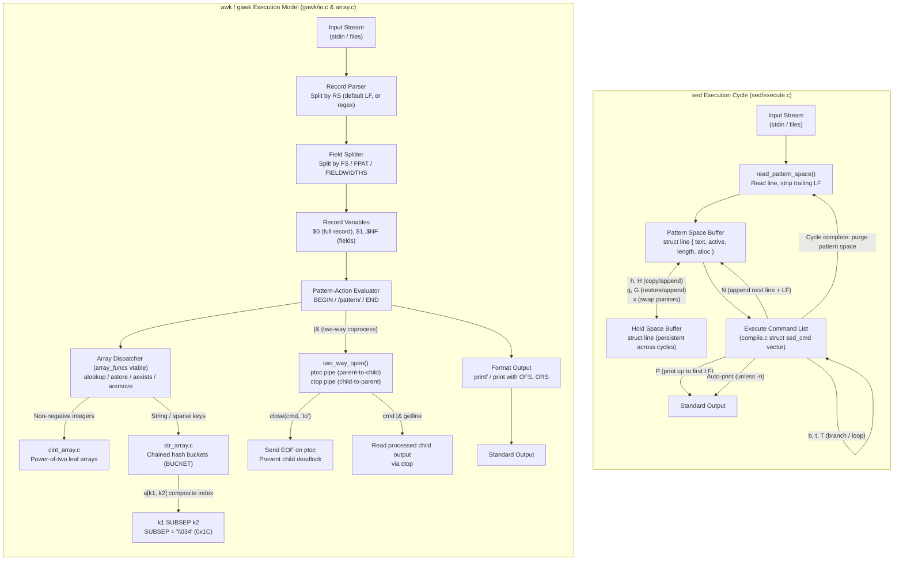
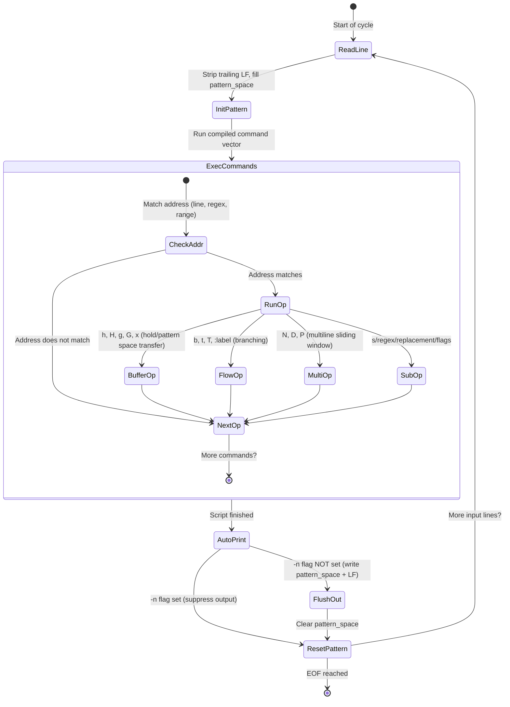
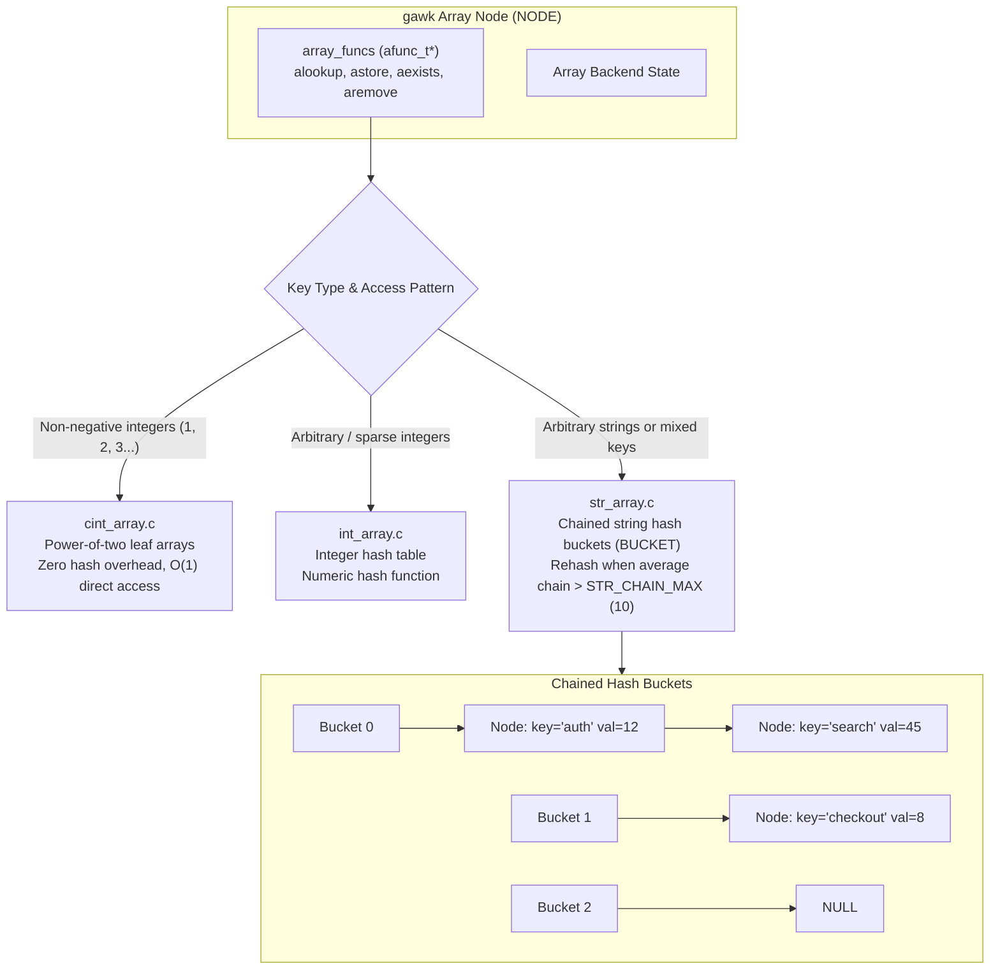
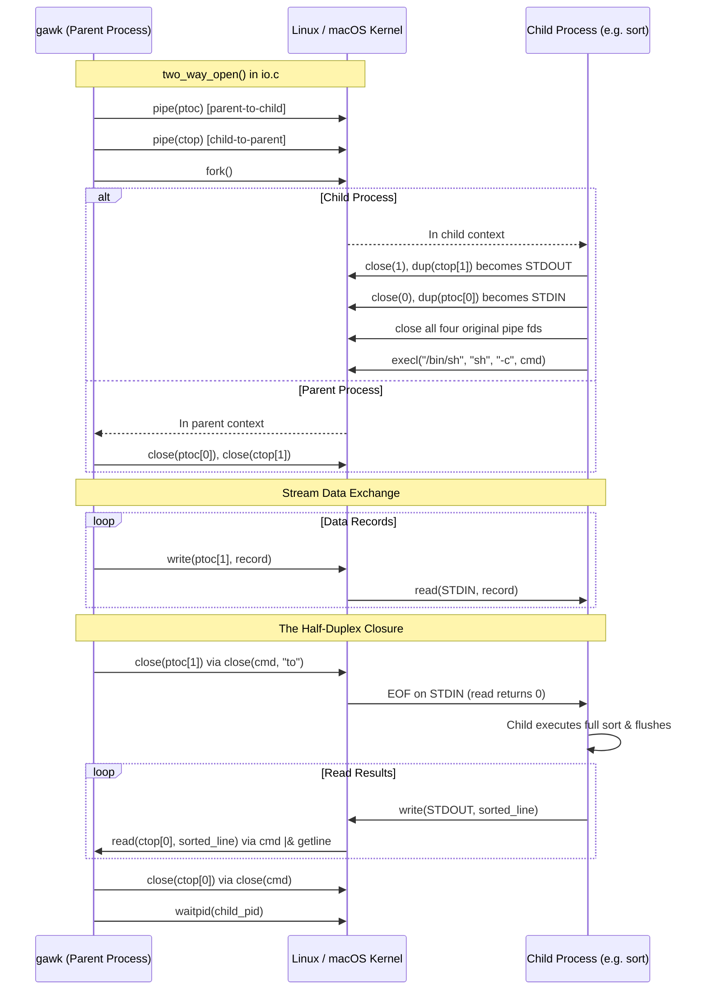
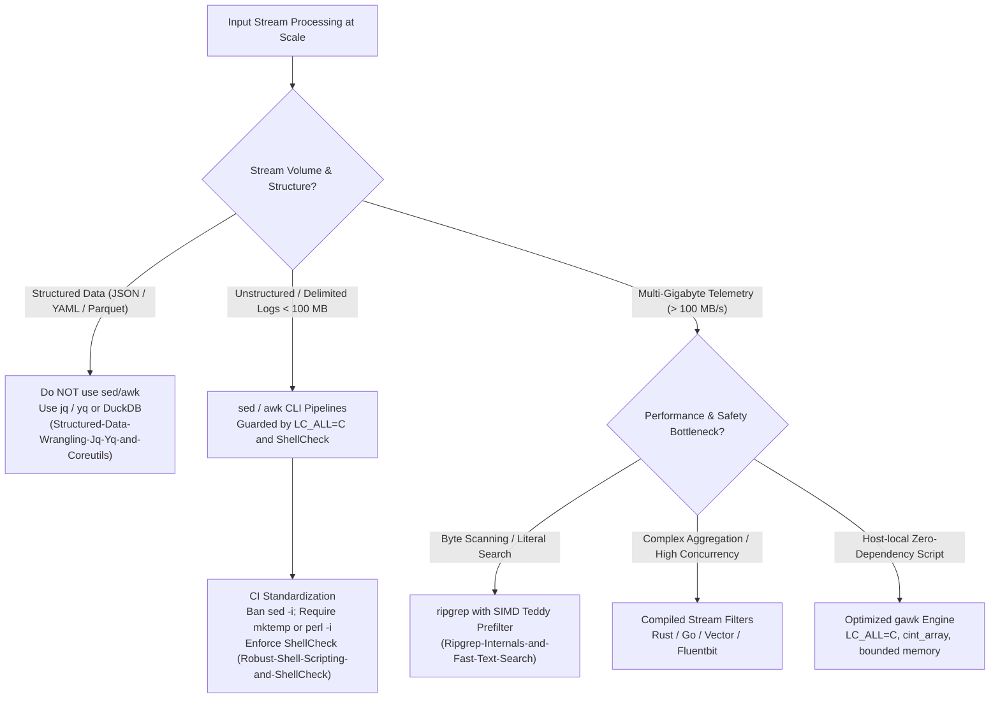

# Sed and Awk Stream Processing

> [!summary] Claim:
> Stream processing in Unix centers on two complementary execution models: the sed cyclic state machine operating over pattern and hold space byte buffers, and the awk record-scanning virtual machine operating over dynamic fields and associative hash tables.
> The stream editor sed executes a linear command sequence per input line, using hold-space exchanges (`h`, `H`, `g`, `G`, `x`), multiline window commands (`N`, `D`, `P`), and address branching (`b`, `t`, `T`) to transform unstructured byte streams in memory bounded by the current line plus whatever the script accumulates, without holding whole files in RAM.
> The awk language parses input streams into discrete records (`RS`) and fields (`FS`), updating internal scalar duals, evaluating pattern-action rules, and indexing associative hash tables with composite keys separated by `SUBSEP` (`\034`).
> Modern gawk extends this pipeline architecture with polymorphic array backends (`cint_array.c`, `str_array.c`), true multidimensional arrays, regex-driven record parsing, and two-way coprocess input/output (`|&`) utilizing paired unidirectional pipes with explicit half-duplex closure (`close(cmd, "to")`) to prevent pipeline deadlocks.



## The Mechanism

Stream processing in Unix operating systems delegates text transformation to dedicated stream engines designed for memory-bounded, line-by-line and record-by-record execution.
[[Shell-Parsing-Tokenization-and-Expansion-Order]] owns the outer shell lexing and word expansion pipeline that launches these utilities.
[[Pipelines-Subshells-Redirection-and-Process-Substitution]] owns the kernel pipes and file descriptors that connect them.
[[Pipe-Buffering-and-Stdbuf]] owns the stdio block-buffering latency characteristics that govern their throughput.
This note owns the internal state machines, buffer models, grammar parsers, associative hash tables, and two-way IPC mechanics of `sed` and `awk`.

### 1. The `sed` Stream Execution Model and Cycle Buffers

The stream editor `sed` was written by Lee E. McMahon at Bell Laboratories as a non-interactive, programmable filter based on the `ed` editor, and shipped with Seventh Edition Unix; McMahon's manual in the Version 7 documentation is dated August 15, 1978.
Rather than loading an entire file into memory, `sed` processes input as a continuous byte stream across two dynamic working buffers: the pattern space and the hold space.

#### Low-Level Buffer Structures

In GNU `sed` (`sed/execute.c` at v4.10), both buffers are instantiated as instances of `struct line`:

```c
/* sed/execute.c, GNU sed 4.10, lines 48-57 (comments abridged) */
struct line {
  char *text;           /* Pointer to line allocated by malloc. */
  char *active;         /* Pointer to non-consumed part of text. */
  idx_t length;         /* Length of text (or active, if used). */
  idx_t alloc;          /* Allocated space for active. */
  bool chomped;         /* Was a trailing newline dropped? */
  mbstate_t mbstate;
};
```

Both buffers start at `INITIAL_BUFFER_SIZE` (50 bytes), and `resize_line()` grows them through gnulib `xpalloc()`, which enlarges a buffer by about half its size each time rather than doubling it.

The execution loop follows a strict cyclic discipline:
1. `read_pattern_space()` fetches bytes from the input stream until an unescaped newline delimiter (`\n`) is encountered.
2. The trailing newline is stripped from the byte sequence (recorded in `chomped`), `pattern_space.length` is updated, and `pattern_space.active` points to the line beginning.
3. The script's compiled command vector (`struct sed_cmd` entries built by `compile.c`) executes sequentially against the pattern space.
4. When the end of the script is reached, if default printing is not suppressed (`-n` omitted), `pattern_space.active` is written to standard output followed by a newline when one was stripped (`output_line()` checks `chomped`).
5. `pattern_space.length` is reset to 0, and the cycle repeats for the next line until EOF.



#### Hold Space Mechanics and Memory Exchange

The hold space is a secondary `struct line` buffer that preserves its content across input line cycles.
Data movement between pattern space and hold space is governed by five atomic primitive commands:

- `h` (`hold`): Copies the contents of `pattern_space` to `hold_space`, overwriting any previous content.
- `H` (`Hold append`): Appends an embedded newline (`\n`) followed by `pattern_space.active` to `hold_space`.
- `g` (`get`): Copies the contents of `hold_space` to `pattern_space`, overwriting the active pattern space.
- `G` (`Get append`): Appends an embedded newline (`\n`) followed by `hold_space.active` to `pattern_space`.
- `x` (`exchange`): Swaps the `struct line` headers (`text`, `active`, `length`, `alloc`, `chomped`) of `pattern_space` and `hold_space` in $O(1)$ without copying text bytes; `line_exchange(&line, &hold, false)` copies only `SIZEOF_LINE`, defined as `offsetof(struct line, mbstate)`, so `mbstate` stays with each buffer.

This dual-buffer architecture enables stateful stream operations such as transaction block accumulation, multi-line record grouping, and line-order inversion in $O(M)$ memory where $M$ is the size of the active block, rather than $O(N)$ for the whole dataset.

#### Multiline Commands: `N`, `D`, and `P`

Standard `sed` commands operate on single lines without embedded newlines.
Complex stream parsing requires processing multi-line structures, which is governed by three multiline instructions:

- `N` (`Next`): Reads the next line of input and appends an embedded `\n` character followed by the new line to `pattern_space`.
  The line counter `line_number` increments by one.
- `P` (`Print multiline`): Writes bytes from `pattern_space.active` up to the first embedded newline character (`memchr(pattern_space.active, '\n', pattern_space.length)`) to standard output.
- `D` (`Delete multiline`): Deletes bytes from `pattern_space.active` up to and including the first embedded newline.
  Crucially, if an embedded newline was present, `D` restarts script execution at the very first command of the script with the remaining contents of `pattern_space`, without reading a new line from the input stream.
  If no embedded newline remains, `D` purges the pattern space and initiates a fresh cycle (reading the next line).

The combination of `N`, `P`, and `D` forms a sliding-window parser.
By maintaining a two-line or $K$-line window in pattern space, `sed` matches patterns spanning line boundaries, pairs asynchronous request and response events, and normalizes multiline stack traces with zero file-buffering overhead.

#### Address Ranges and Branching Logic

Every `sed` command accepts zero, one, or two addresses selecting when the command fires:
- Line numbers: `5` selects line 5; `$` selects the final line of the input stream.
- Regular expressions: `/pattern/` selects lines whose contents match the regular expression.
- Address ranges: `addr1,addr2` activates execution when `addr1` matches and keeps execution active for all subsequent lines until `addr2` matches (inclusive).
- Inversion: An exclamation mark `!` following an address inverts the selection (for example, `$!N` executes `N` on all lines except the last line).
- Branching: Labels are declared with `:label`.
  The `b label` instruction unconditionally jumps to `:label` (or the end of script if omitted).
  The `t label` instruction jumps to `:label` if and only if a substitution (`s///`) succeeded since the current line was read or the last `t` instruction was executed.
  GNU `sed` adds `T label`, which branches if no substitution succeeded.

### 2. The `awk` Record, Field, and Grammar Processing Model

The `awk` programming language was designed in 1977 by Alfred Aho, Peter Weinberger, and Brian Kernighan at Bell Laboratories, and overhauled in 1985 ("New AWK" or `nawk`, described in the classic 1988 book and its 2023 2nd edition).
`awk` is an interpreted, data-driven, Turing-complete pattern-action language structured around stream records and columnar fields.

#### Record Parsing and Separator Mechanics

Execution in `awk` processes a stream of records delimited by `RS` (Record Separator):
- Standard default: `RS = "\n"`.
  Input is consumed line by line.
- Paragraph mode: Setting `RS = ""` configures `awk` to treat records as separated by one or more blank lines (sequences of `\n\n+`).
  In paragraph mode, newline characters automatically act as field separators alongside spaces and tabs.
- Regex record separators (GNU `gawk` extension): `RS` can be set to an arbitrary extended regular expression, such as `RS = "\n(===+|---+)\n"`.
  When a regex `RS` is used, `gawk` populates the built-in variable `RT` (Record Terminator) with the exact text substring that satisfied the record delimiter regex.

#### Field Splitting and Dynamic Re-synthesis

Once a record is read into `$0`, the field splitting subsystem divides the record into numbered fields accessible as `$1`, `$2`, ..., `$NF`:
- Single-character / Regex `FS`: If `FS` is a single character (e.g. `FS = ","` or `FS = "\t"`), fields are split strictly on occurrences of that character.
  If `FS` is a regular expression (e.g. `FS = "[: \t]+"`), fields split on regex matches.
- Special Default (`FS = " "`): When `FS` is a single space character (the initial default), `awk` ignores leading and trailing whitespace (spaces, tabs, newlines) and splits fields on contiguous runs of whitespace characters.
- Fixed-width fields (GNU `gawk`): `FIELDWIDTHS = "4 2 2 8"` slices records at fixed character positions (bytes only under `LC_ALL=C`) without requiring delimiter characters.
- Content-matching fields (GNU `gawk`): `FPAT = "([^,]+)|(\"([^\"]|\"\")+\")"` specifies what constitutes a field rather than what separates them, enabling parsing of RFC 4180 CSV files containing commas enclosed in quotes.
- Dedicated CSV parsing: GNU `gawk` 5.3+ provides `--csv` built-in support intended to behave identically to Brian Kernighan's "One True Awk" (bwk awk) `--csv` (gawk `NEWS`, changes from 5.2.x to 5.3.0).

Field modification triggers dynamic internal re-synthesis:
- Assigning to `$0` forces the field parser to immediately invalidate all cached `$1..$NF` values and re-split the new record.
- Assigning to any field `$i` ($1 \le i \le NF$) forces `awk` to re-synthesize `$0` by concatenating fields `$1` through `$NF`, separated by `OFS` (Output Field Separator, default `" "`).
- Assigning to a field `$k` where $k > NF$ automatically expands the field table, sets `NF = k`, and initializes intermediate fields ($NF+1 \dots k-1$) to empty strings.

### 3. Associative Array Internals and Memory Complexity

Every array in `awk` is an associative array (hash map) mapping string keys to scalar values or nested arrays.
Unlike static arrays in C, array indices are strings even when written as integers (`arr[1]` indexes the string key `"1"`).

#### The `gawk` Array Dispatch Architecture

In GNU `gawk` (`awk.h`, `array.c`), arrays do not use a single rigid hash map.
Instead, `gawk` defines a polymorphic dispatch vtable (`array_funcs_t`, a struct of `afunc_t` function pointers) associated with each array node (`awk.h` at gawk-5.4.1, lines 356-369 and 600-617):

```c
typedef struct exp_node **(*afunc_t)(struct exp_node *, struct exp_node *);

typedef struct {
	const char *name;
	afunc_t init;
	afunc_t type_of;	/* avoid reserved word typeof */
	afunc_t lookup;
	afunc_t exists;
	afunc_t clear;
	afunc_t remove;
	afunc_t list;
	afunc_t copy;
	afunc_t dump;
	afunc_t store;
} array_funcs_t;

#define array_funcs	sub.nodep.l.lp	/* const array_funcs_t *lp */
#define ainit		array_funcs->init
#define atypeof		array_funcs->type_of
#define alookup 	array_funcs->lookup
#define aexists 	array_funcs->exists
#define aclear		array_funcs->clear
#define aremove		array_funcs->remove
#define astore		array_funcs->store
```

An empty array starts with `null_array_func`; on the first insertion, `null_lookup()` in `array.c` asks each registered backend's `type_of` hook whether it accepts the subscript and binds the array to the first taker, defaulting to `str_array_func`:
1. `cint_array.c`: Optimized for non-negative integer subscripts (e.g., `arr[1]`, `arr[2]`, `arr[3]`).
   It stores elements in leaf arrays of geometrically increasing power-of-two size (up to 2^`NHAT`, default `NHAT = 10`), so integer lookups need no hashing or string conversion.
   Subscripts it cannot take are stored in an auxiliary `xarray` hung off the same node, rather than converting the whole array.
2. `int_array.c` (Arbitrary Integer Arrays): Integer-keyed hash table for sparse or negative integer keys.
3. `str_array.c` (String Associative Arrays): The general-purpose hash table implementation.
   It maintains an array of hash buckets (`BUCKET`) resolving collisions through separate chaining (linked lists of nodes).
   `grow_table()` moves to the next entry of a fixed size table (13, 127, 1021, 8191, 16381, ...) when the average chain length `table_size / array_size` exceeds `STR_CHAIN_MAX`, which defaults to 10 and can be overridden through the `STR_CHAIN_MAX` environment variable, preserving $O(1)$ amortized lookup and insertion complexity.



#### Multidimensional Array Indexing and `SUBSEP`

Standard POSIX `awk` does not support true nested arrays.
When multiple subscripts are specified (e.g., `arr[i, j]`), `awk` simulates multidimensionality by concatenating the string representations of the subscripts, separated by the value of the built-in variable `SUBSEP` (Subscript Separator):

$$\text{Internal Key} = \text{string}(i) \mathbin{\Vert} \text{SUBSEP} \mathbin{\Vert} \text{string}(j)$$

POSIX.1-2024 leaves the default value of `SUBSEP` implementation-defined; gawk documents it as `"\034"` (ASCII character 28 / `0x1C`, the Information Separator Four, also called File Separator), and macOS `awk version 20200816` uses the same byte (checked with `od -c`).
Iterating over a simulated multidimensional array with `for (k in arr)` yields this composite string, which the programmer must split using `split(k, parts, SUBSEP)`.
If an input key contains the byte `\034`, an accidental hash key collision occurs.

GNU `gawk` solves this limitation by supporting true multidimensional arrays (arrays of arrays):
`arr[i][j] = value` allocates an independent array node inside `arr[i]`, where `isarray(arr[i])` evaluates to true.

### 4. Coprocess Two-Way I/O and System Call Boundaries

A prominent architectural capability of GNU `gawk` is two-way interprocess communication via the coprocess operator `|&` (`gawk/io.c`).
Unlike one-way shell pipes or standard `system()` calls, a coprocess allows an `awk` program to send data to an external tool and read back processed responses interactively during stream execution.

#### Low-Level Pipe Creation and Wiring

When `gawk` opens a coprocess (`two_way_open()` in `io.c` at gawk-5.4.1), it does not call `socketpair()`.
Unless `PROCINFO[cmd, "pty"]` requests a pseudo-terminal, it reaches the `use_pipes:` path and calls `pipe()` twice to create two unidirectional pipes:



1. Pipe 1 (`ptoc` - Parent-to-Child): Parent writes records to `ptoc[1]`; child reads from `ptoc[0]`.
2. Pipe 2 (`ctop` - Child-to-Parent): Child writes output to `ctop[1]`; parent reads from `ctop[0]`.
3. In the forked child process, `close(1)` followed by `dup(ctop[1])` wires `ctop[1]` to `STDOUT_FILENO`, and `close(0)` followed by `dup(ptoc[0])` wires `ptoc[0]` to `STDIN_FILENO`; stderr is not redirected.
   All four original pipe descriptors are closed, and `execl("/bin/sh", "sh", "-c", str, NULL)` runs the command string through the shell, so `cmd` may itself be a pipeline.

#### The Half-Duplex Closure Requirement

Many Unix filter utilities (such as `sort`, `wc`, `tac`, or hashing tools like `sha256sum`) cannot emit output line by line: they must consume all input until EOF before computing final results.
If an `awk` program sends data via `print data |& "sort"` and immediately executes `"sort" |& getline line`, the pipeline deadlocks:
- The child process `sort` blocks waiting for EOF on standard input (`ptoc[0]`).
- The parent process `gawk` blocks waiting for sorted lines on standard output (`ctop[0]`).

To break this circular wait, `gawk` implements a two-argument extension to the `close()` function:
`close(cmd, "to")`
Passing `"to"` instructs `gawk` to close exclusively `ptoc[1]` (the write end of the pipeline), sending an immediate EOF to the child's standard input.
The read end (`ctop[0]`) remains open, allowing `cmd |& getline` to read the child's final emitted stream without deadlock.

## Commands and Numbers to Know

Reference numbers, flag behaviors, and configuration variables across standard POSIX systems, GNU `sed`, and GNU `gawk`:

| Item | Value | Platform and date | What it controls |
| :--- | :--- | :--- | :--- |
| `sed -n` | boolean default false | Both (as of 2026-11) | Suppresses automatic output of pattern space at the end of each line cycle |
| `sed -E` | boolean flag | Both (as of 2026-11) | Interprets regexes as Extended Regular Expressions (ERE); standardized in POSIX.1-2024 |
| `sed -i` (GNU) | `-i[SUFFIX]` | Linux (as of 2026-11) | Edits files in place; optional backup suffix must be attached directly with no space (e.g. `-i.bak`) |
| `sed -i` (BSD/macOS) | `-i extension` | macOS (as of 2026-11) | Edits files in place; requires an explicit extension argument (e.g. `-i ""` for no backup) |
| `POSIXLY_CORRECT` | environment variable | Both (as of 2026-11) | Makes GNU `sed` exit without printing pattern space on `N` at EOF, matching strict POSIX (`--posix` does the same) |
| GNU sed line allocation | 50 bytes initially (`INITIAL_BUFFER_SIZE`) | Both (as of 2026-11) | Initial allocation for `struct line` in `sed/execute.c` 4.10; grows by about 1.5x through gnulib `xpalloc()` |
| `SUBSEP` | `"\034"` (ASCII 28 / `0x1C`) | Both (as of 2026-11) | Separator for composite array keys in gawk and macOS awk; POSIX leaves the default implementation-defined |
| `FS` | `" "` (single space) | Both (as of 2026-11) | Field separator; single space ignores leading whitespace and splits on runs of spaces/tabs |
| `RS` | `"\n"` (newline) | Both (as of 2026-11) | Record separator; set to `""` for paragraph mode (records separated by blank lines) |
| `OFS` | `" "` (single space) | Both (as of 2026-11) | Output field separator used when printing `$1, $2` or when `$0` is re-synthesized |
| `ORS` | `"\n"` (newline) | Both (as of 2026-11) | Output record separator printed after each `print` statement |
| `CONVFMT` | `"%.6g"` | Both (as of 2026-11) | Format specification used for internal implicit number-to-string conversions in `awk` |
| `OFMT` | `"%.6g"` | Both (as of 2026-11) | Format specification used by `print` to render floating-point numbers |
| `gawk --csv` | built-in option | Both (as of 2026-11) | Enables RFC 4180 compliant CSV record parsing; added in `gawk` 5.3 (2023) |
| `gawk MinRX` | default regex engine | Both (as of 2026-11) | Mike Haertel's MinRX matcher became the default regexp engine in `gawk` 5.4.0 (2026-02-22); the old regex and dfa engines remain available |
| `gawk` `STR_CHAIN_MAX` | `10` | Both (as of 2026-11) | Average chain length (entries / buckets) above which `str_array.c` grows its bucket table; overridable via the `STR_CHAIN_MAX` environment variable |
| `close(cmd, "to")` | gawk extension | Both (as of 2026-11) | Closes write end of two-way coprocess pipe, delivering EOF to child process without deadlock |
| GNU sed 4.10 | released 2026-04-21 | Both (as of 2026-11) | Patches TOCTOU symlink race in `sed --follow-symlinks -i` (CVE-2026-5958, per the sed 4.10 `ChangeLog`) |
| GNU gawk 5.4.1 | released 2026-07-08 | Both (as of 2026-11) | GNU Awk bug-fix release reporting `API 4.1`, with MinRX as the default matcher |

## Multi-Language Comparison: Stream Text Processing and Transformation

When moving stream processing logic out of ad-hoc shell pipelines into compiled systems languages, each runtime enforces different memory allocation, string slicing, and sub-process piping guarantees:

| Concern | `sed` & `awk` (CLI Standard) | C++ (C++20 / C++23) | Python (3.12+) | Rust (1.80+) |
| :--- | :--- | :--- | :--- | :--- |
| Line streaming | `sed` line cycle; `awk` `RS` loop in C | `std::getline` into reused `std::string` or `std::generator<std::string_view>` | `for line in sys.stdin:` generator yielding line strings | `std::io::BufRead::lines` or `read_until` into reusable buffer |
| Buffer reuse | Dynamic `struct line` realloc; $O(1)$ memory | In-place string mutation; `string.clear()` retains heap capacity | Immutable strings; new `str` allocated per slice unless `memoryview` | `String::clear` retains heap allocation; zero-copy `&str` slicing |
| Multiline window | `sed` `N`, `D`, `P` instructions on cycle buffer | Circular buffer (`std::deque` or custom ring buffer) | `collections.deque(maxlen=K)` sliding over stream | ArrayDeque or fixed slice buffer over `VecDeque` |
| Column splitting | `awk` `FS`/`FPAT` splitting into `$1..$NF` | `std::views::split` into `std::ranges::subrange` (`string_view`) | `line.split()` producing list of `str` or regex `finditer()` | `line.split()` iterator returning zero-allocation `&str` |
| Associative index | `awk` `str_array.c` chained hash buckets | `std::unordered_map` with `std::string` or custom heterogenous lookup | `dict` (compact dictionary backed by open addressing) | `std::collections::HashMap` (Swiss Table quadratic probing) |
| Subprocess pipe | `gawk` `|&` with dual `pipe()` and `close(cmd, "to")` | POSIX `pipe()`, `fork()`, `dup2()`, `execvp()` or `boost::process` | `subprocess.Popen(..., stdin=PIPE, stdout=PIPE)` | `std::process::Command` with `Stdio::piped()` |
| Regex engine | `sed` POSIX BRE/ERE; `gawk` MinRX | `std::regex` (NFA/backtracking, heavy compile latency) | `re` (backtracking engine in C); third-party `regex` | `regex` crate (linear-time PikeVM / Lazy DFA, ReDoS immune) |

## Worked Lab Example

The companion lab is `code/01-Command-Line/sed_awk_pipeline/`.
It runs on macOS and Linux systems equipped with standard shell utilities, `sed`, `awk`, `python3`, and GNU `gawk` for Stage 6.
Stock macOS does not ship `gawk` (the recording host used Homebrew `gawk` 5.4.1).
The harness `# requires:` vocabulary has no tag for an extra tool, so `run.sh` checks for `gawk` itself and, when it is missing, exits 3 with an `error: gawk is required for Stage 6` message instead of skipping, which makes `make verify` fail loudly.

### 1. Lab Execution and Architecture

The lab script `run.sh` drives a multi-stage data processing pipeline against synthetic server logs:
1. Stage 1 (`sed` hold space): Filters a high-volume transaction log (`input_transactions.log`).
   Transactions begin with `TX_START <id>` and conclude with `TX_END <id>`.
   Using `H`, `h`, and `g` under `sed -n`, `sed` accumulates each transaction block in the hold space and prints only transactions whose block contains `STATUS 5`, discarding successful requests without retaining the complete log file in memory.
2. Stage 2 (`sed` sliding window): Evaluates an asynchronous event stream (`input_events.log`).
   Using `$!N`, `P`, and `D`, it correlates adjacent matching `REQ id=<id>` and `RES id=<id>` lines into a unified `PAIR id=<id> ...` metric line, while emitting orphaned requests untouched.
3. Stage 3 (`sed` branching loop): Normalizes deeply nested bracket syntax (`input_nested.log`).
   Using `:loop`, `s/\[\([^][]*\)\]/<\1>/`, and `t loop`, it iteratively resolves and rewrites nested grouping tags until no brackets remain.
4. Stage 4 (`awk` multiline record parser): Ingests multiline key-value service records separated by `---\n` using `RS = "---\n"` and `FS = "\n"`.
   A multi-character `RS` is unspecified by POSIX.1-2024; gawk and macOS `awk version 20200816` both treat it as a regular expression, which the lab relies on.
   It parses `service`, `region`, `status`, and `latency_ms`, updating multidimensional counters `counts[svc, reg]`, `errors[svc, reg]`, and `total_lat[svc, reg]`.
5. Stage 5 (`awk` `SUBSEP` verification): Measures the byte value of `SUBSEP` by comparing it with `sprintf("%c", n)` for every `n` from 1 to 255, and records the key length, the `SUBSEP` length, and `index(k, SUBSEP)` for the key `"test" SUBSEP "subsep"`.
   The checker requires exactly `key_len=11 subsep_len=1 subsep_idx=5 subsep_hex=1c`, so a different `SUBSEP` (such as `":"` or `"\037"`) fails the stage.
6. Stage 6 (`gawk` coprocess sort): Streams aggregate metrics into an external `sort -t"|" -k4,4nr -k5,5nr` coprocess via `|&`, invokes `close(cmd, "to")` to deliver an explicit EOF to sort's standard input, and reads back the ranked error distribution via `cmd |& getline`.
   Stage 6b runs the same program with the `close(cmd, "to")` call disabled under a 3 second deadline and requires that it has not finished, so the hang is observed rather than assumed.
7. Stage 7 (Reference verification): Invokes `pipeline.py verify` to assert that every transformed byte stream matches the reference model.

### 2. Verified Execution Output

The following deterministic output was recorded by the test harness on `darwin-arm64` (macOS, Apple Silicon, as of 2026-11) and is copied byte for byte from `expected/darwin-arm64.txt`:

```text
--- Top error rates by service and region (gawk coprocess sort) ---
checkout|us-east: count=2 errors=1 avg_latency=277.5ms
auth|us-east: count=2 errors=1 avg_latency=67.0ms
auth|eu-west: count=1 errors=0 avg_latency=700.0ms
checkout|eu-west: count=1 errors=0 avg_latency=62.0ms
search api|eu-west: count=1 errors=0 avg_latency=30.0ms
search api|us-east: count=1 errors=0 avg_latency=25.0ms
Verification stages:
  Stage 1 (sed hold-space block filter): PASS (2 failed transactions isolated)
  Stage 2 (sed N;D;P sliding-window pair): PASS (3 pairs merged, 2 orphans kept)
  Stage 3 (sed :loop t branching unwrap): PASS (3 lines fully normalized)
  Stage 4 (awk RS/FS composite aggregation): PASS (6 composite keys aggregated)
  Stage 5 (awk SUBSEP byte layout): PASS (file separator 0x1C measured)
  Stage 6 (gawk |& coprocess two-way pipe): PASS (half-duplex close and sorted)
  Stage 6b (gawk without close(cmd, "to")): PASS (blocked until the 3 s deadline)
Stream processing pipeline verification: ALL CHECKS PASSED
```

### Reading the result

- Stage 1 isolated failed transactions `tx-102` (database deadlock) and `tx-104` (upstream timeout) from the stream, printing each as its complete 7 line block, while discarding `tx-101`, `tx-103`, and `tx-105` without storing the complete input in process memory.
- Stage 2 verified that `D` deletes up to the first newline and restarts the script cycle with the remaining buffer, successfully pairing IDs 101, 103, and 104, while preserving orphaned requests 102 and 105.
- Stage 3 confirmed that `:loop ... t loop` iteratively peeled 3 levels of nested brackets into `<k1=<k2=<k3=val1>>>`.
- Stage 4 aggregated 8 multiline record blocks across 6 composite `(service, region)` keys, verifying custom record splitting on `---\n`; the service name `search api` contains a blank, so the stage only passes when `FS = "\n"` keeps it in one field.
- Stage 5 measured `SUBSEP` as one byte with value `0x1C` (File Separator; the Unit Separator is `0x1F`) at index 5 of the 11-character key `test<SUBSEP>subsep`, using `sprintf("%c", n)` comparison rather than an assumed constant.
- Stage 6 demonstrated that with `close(cmd, "to")` the sort receives EOF, finishes, and returns `checkout|us-east` first (one error, tie broken by avg latency 277.5ms); the groups with no errors follow in descending average latency, led by `auth|eu-west` at 700.0ms, which is why swapping the two sort keys changes the output.
- Stage 6b ran the same program without `close(cmd, "to")` and found it still blocked at the 3 second deadline, because `sort` never sees EOF while `gawk` holds the write end open.

## Pitfalls

> [!warning] Pitfall: Incompatible in-place editing syntax with `sed -i`
> The `-i` flag is not part of POSIX.1-2024 and behaves differently across BSD and GNU `sed`.
> On macOS (BSD `sed`), `-i` requires an explicit argument for the backup extension; passing `sed -i 's/foo/bar/' file.txt` causes BSD `sed` to interpret `'s/foo/bar/'` as the backup file extension and `file.txt` as the script, failing with `sed: 1: "file.txt": invalid command code f` (exit 1, file unchanged, macOS 27.2); the edit silently never happens.
> To disable backups on macOS, one must write `sed -i '' 's/foo/bar/' file.txt`.
> However, executing `sed -i '' 's/foo/bar/' file.txt` on Linux (GNU `sed`) causes GNU `sed` to treat `''` as the script argument and `'s/foo/bar/'` as the input file, failing with `sed: can't read s/foo/bar/: No such file or directory` (exit 2 with GNU sed 4.10; the content of `file.txt` is unchanged).
> For cross-platform scripts, specify a temporary backup extension like `sed -i.bak 's/foo/bar/' file.txt && rm file.txt.bak`, or route in-place modifications through a temporary file via `mktemp` as codified in [[Robust-Shell-Scripting-and-ShellCheck]].

> [!warning] Pitfall: Silent final-line dropping with `sed N` at EOF
> In strict POSIX `sed` (and default macOS BSD `sed`), executing the `N` command on the final line of an input stream triggers an immediate exit without printing the pattern space.
> In a multi-line grouping script like `sed 'N; s/\n/ /'`, a file with an odd number of lines will silently discard its last line.
> GNU `sed` deviates from POSIX by preserving and printing the pattern space at EOF unless `POSIXLY_CORRECT=1` is set.
> Portable scripts must guard all `N` calls with `$!N` (for example, `sed '$!N; s/\n/ /'`) to prevent silent data loss across platforms.

> [!warning] Pitfall: Pipeline deadlock in two-way `gawk` coprocesses (`|&`)
> Downstream Unix utilities like `sort`, `wc`, `tac`, or `sha256sum` must consume the entirety of standard input before generating output.
> When an `awk` program writes records to a coprocess via `print $0 |& "sort"` and immediately executes `"sort" |& getline line`, the parent blocks reading the child's output while the child blocks reading its standard input waiting for an EOF that never comes, freezing the process tree indefinitely.
> Always invoke `close(cmd, "to")` immediately after writing the final input record.
> This sends an immediate EOF across the `ptoc` write pipe while preserving the `ctop` read pipe.

> [!warning] Pitfall: Subscript collision vulnerabilities with `awk` `SUBSEP`
> Simulating multi-dimensional arrays via `arr[x, y]` concatenates `x`, `\034` (File Separator in gawk and macOS awk), and `y`.
> If user-controlled input text contains the literal byte `\034` (or `\x1c`), key collisions occur where `arr["a\034b", "c"]` overwrites `arr["a", "b\034c"]`.
> In security-sensitive or binary-safe stream parsers, either sanitize fields to purge `\034`, or leverage GNU `gawk` true multidimensional arrays (`arr[x][y]`).

> [!warning] Pitfall: Accidental array element creation via existence probes
> Referencing an array element in `awk` inside an expression like `if (arr[key] != "")` or `if (arr[key])` automatically instantiates `arr[key]` with the uninitialized value (string `""`, numeric 0) if it did not previously exist (POSIX.1-2024 awk: "Any other reference to a nonexistent array element shall automatically create it").
> This pollutes the array, inflates process heap memory, and alters the output of subsequent `for (k in arr)` traversal loops.
> Always verify element existence using the membership operator: `if (key in arr)`.

> [!warning] Pitfall: Field mutation side-effects on `$0` and `$NF`
> In `awk`, modifying any individual field (e.g. `$1 = "val"`) marks the field vector dirty and forces an immediate re-synthesis of `$0` using `OFS`.
> If the original input record contained irregular spacing (e.g. multiple tabs and spaces between columns), assigning to `$1` collapses all inter-field whitespace into single instances of `OFS`.
> Conversely, modifying `$0` (e.g. via `sub()`) instantly invalidates `$1..$NF`, requiring a re-split on the next field access.

> [!warning] Pitfall: Non-portable regex backreferences in `sed -E`
> Under POSIX Basic Regular Expressions (BRE), backreferences like `\([0-9]*\) \1` are standard.
> Under POSIX Extended Regular Expressions (`sed -E` or `sed -r`), backreferences within the search pattern (e.g. `([0-9]+) \1`) are undefined by POSIX.
> GNU `sed` supports backreferences in ERE, but BSD `sed` (macOS) accepts them under `-E` and matches unreliably: on macOS 27.2, `echo 'ab ab' | sed -E 's/([a-z]+) \1/X/'` leaves the line unchanged and `echo '12 12' | sed -E 's/([0-9]+) \1/X/'` prints `X2`, while GNU `sed` 4.10 prints `X` for both.
> For regular expressions requiring backreferences in search patterns, use standard BRE without `-E`, or delegate the pipeline to `awk` or `perl`.

## At Scale

At personal developer scale, ad-hoc `sed` substitutions and `awk` column filters provide rapid, zero-overhead stream processing.
When scaling to engineering organizations of 1,000 to 50,000 engineers operating monorepos, automated deployment pipelines, and gigabyte-scale telemetry ingestion, stream processing architectures encounter strict maintainability, security, and performance constraints.



### Engineering Trade-offs and Decision Rules

| Operational Dimension | Developer Ad-Hoc (1 Engineer) | Team Pipeline (10-100 Engineers) | Enterprise Monorepo (1,000-50,000 Engineers) |
| :--- | :--- | :--- | :--- |
| In-place editing | `sed -i` executed directly in terminal | Temporary files via `mktemp` with cleanup traps | Dedicated AST refactoring tools or `perl -i -pe` |
| Locale configuration | Host default (UTF-8) | Explicit `LC_ALL=C` for predictable ASCII sorting | Hermetic containerized runners with pinned locales |
| Structured formats | Ad-hoc regex parsing of JSON/CSV | Validated CSV parsers (`gawk --csv`) | Strict schemas: `jq`, `yq`, or typed Rust/Go binaries |
| Performance bounds | Unmonitored single-thread execution | Pipeline latency checked via `stdbuf` | Bounded memory caps, SIMD prefiltering with `ripgrep` |
| Security review | Arbitrary shell expansions | Quoting audited via ShellCheck | Static analysis banning dynamic `system()` in awk |

### Organizational Paved Roads

1. Ban bare `sed -i` in shared CI/CD scripts:
   Because developer workstations span macOS (Darwin) and Linux (glibc), bare `sed -i` introduces intermittent build failures.
   Standardize either on a portable shell wrapper that detects BSD vs GNU `sed`, use `perl -i -pe`, or write to an atomic temporary file via `mktemp` as detailed in [[Robust-Shell-Scripting-and-ShellCheck]].
2. Accelerate throughput with `LC_ALL=C`:
   Defaulting to UTF-8 locales forces `sed` and `awk` to perform multibyte character decoding and Unicode collation checks for every byte consumed.
   Setting `export LC_ALL=C` switches internal string operations to raw byte mode, which also makes bracket expressions and collation byte-exact as analyzed in [[Locale-Collation-and-Unicode-in-CLI-Tools]].
   The speedup depends on the workload: on a 178 MB ASCII log (macOS 27.2, Apple Silicon, as of 2026-11), `gsed` 4.10 running one `s///p` took 2.30 s under `en_US.UTF-8` versus 1.83 s under `C` (about 1.25x), and `gawk` 5.4.1 running a regex filter with an array update took 1.27 s versus 1.18 s (about 1.08x).
   On a 100 MB log of 1,000,000 lines of mixed Latin, Cyrillic, and CJK text (same host, median of 3 runs), `gsed` 4.10 with the word-character substitution `s/\w*\(caf\)[^ ]* /\1 /gp` took 2.55 s under `en_US.UTF-8` versus 1.25 s under `C` (about 2.0x, identical output under both), a plain `s/\(error\) \(.*\)timeout/\2 \1/p` took 1.23 s versus 1.10 s (about 1.1x), and `gawk` 5.4.1 with `/\w+ (error|timeout) /{c[$3]++}` took 3.84 s versus 3.42 s (about 1.1x).
   The 3x to 8x figure sometimes quoted was not reproduced, so treat the gain as workload-specific and measure it.
3. Protect against Arbitrary Code Execution via untrusted input:
   Passing untrusted log data into `awk` programs that invoke `system()` or use `getline` from dynamic string variables creates shell injection vulnerabilities.
   Audit shared `awk` scripts with static linters to ensure filenames and shell commands are strictly parameterized.
4. Prefilter massive streams with SIMD search tools:
   `awk` and `sed` process streams using single-threaded bytecode or state-machine interpretation.
   When triaging gigabyte-scale logs, pre-filter candidate lines using `ripgrep` (`rg`) to leverage SIMD vector acceleration before routing matched lines into `awk` for aggregation, as codified in [[Analyze-Gigabyte-Terminal-Logs]] and [[Ripgrep-Internals-and-Fast-Text-Search]].

## Practice Drill

> [!tip] Practice Drill: Build a High-Throughput Incident Log Correlator
> Author an executable pipeline script `drill_correlator.sh` that demonstrates hold-space extraction, sliding-window pairing, and awk associative rate tracking.
> The script must execute cleanly on both macOS and Linux, verify EOF handling on `N`, and produce deterministic output.
> Run the following script in a temporary scratch workspace:

```bash
#!/usr/bin/env bash
set -euo pipefail

DRILL_DIR="$(mktemp -d)"
trap 'rm -rf "${DRILL_DIR}"' EXIT
cd "${DRILL_DIR}"

export LC_ALL=C

# 1. Synthesize an interleaved microservice incident stream
cat << 'EOF' > incident.log
EVENT id=101 type=AUTH_REQ user=alice ip=192.168.1.10
EVENT id=101 type=AUTH_FAIL reason=bad_password
EVENT id=102 type=AUTH_REQ user=bob ip=192.168.1.11
EVENT id=103 type=AUTH_REQ user=carol ip=192.168.1.12
EVENT id=103 type=AUTH_OK token=tok_abc
EVENT id=104 type=AUTH_REQ user=david ip=192.168.1.13
EVENT id=104 type=AUTH_FAIL reason=account_locked
EVENT id=105 type=AUTH_REQ user=eve ip=192.168.1.14
EOF

# 2. Correlate adjacent events using sed sliding window (N, P, D)
# Safe portable handling with $!N ensures no EOF line drop
sed -n \
    -e '$!N' \
    -e '/^EVENT id=\([0-9]*\) type=AUTH_REQ user=\([a-z]*\) ip=\([^ ]*\)\nEVENT id=\1 type=\(AUTH_[A-Z]*\) \(.*\)$/{' \
    -e 's//CORRELATED id=\1 user=\2 ip=\3 result=\4 \5/' \
    -e 'p' \
    -e 'd' \
    -e '}' \
    -e 'P' \
    -e 'D' \
    incident.log > correlated.log

echo "=== Correlated Authentication Events ==="
cat correlated.log

# 3. Aggregate failure metrics by IP using awk associative array
# The header stays outside the sort; sort on the numeric rate after the last "=".
echo "=== Failure Rate by IP ==="
awk '
$1 ~ /^CORRELATED$/ {
    ip = ""; result = ""
    for (i = 1; i <= NF; i++) {
        if ($i ~ /^ip=/) { split($i, f, "="); ip = f[2] }
        else if ($i ~ /^result=/) { split($i, f, "="); result = f[2] }
    }
    if (ip != "") {
        total[ip]++
        if (result == "AUTH_FAIL") {
            fails[ip]++
        }
    }
}
END {
    for (ip in total) {
        nfail = (ip in fails) ? fails[ip] : 0
        rate = (nfail / total[ip]) * 100
        printf "ip=%s total=%d fails=%d fail_rate=%.1f%%\n", ip, total[ip], nfail, rate
    }
}' correlated.log | sort -t'=' -k5,5nr -k2,2
```

## Interview Questions

> [!question] L5: How does sed's hold space differ from its pattern space, and how do `h`, `H`, `g`, `G`, and `x` transfer data between them?
> > [!success]- Answer
> > The pattern space is sed's primary working buffer.
> > For each cycle, sed reads one line into pattern space, strips the newline, executes the compiled script commands, optionally writes pattern space to standard output, and clears it before the next cycle.
> > The hold space is a secondary buffer that persists across line cycles without automatic clearing or printing.
> > The transfer commands manipulate them as follows:
> > - `h` overwrites hold space with pattern space.
> > - `H` appends a newline followed by pattern space into hold space.
> > - `g` overwrites pattern space with hold space.
> > - `G` appends a newline followed by hold space into pattern space.
> > - `x` exchanges pattern space and hold space pointers in $O(1)$ time without copying data.
> > This allows accumulating multiline transaction blocks, inverting line sequences, or filtering records based on downstream conditions.

> [!question] L5 (Predict-the-output): Predict the exact output of `printf "A\nB\nC\n" | sed 'N;s/\n/:/'` under POSIX sed versus default GNU sed.
> > [!success]- Answer
> > Under strict POSIX sed (and macOS BSD sed), the output is:
> > `A:B`
> > Explanation: Line `A` is read. `N` reads `B` and appends it (`A\nB`). `s/\n/:/` turns it into `A:B`, which prints at cycle end.
> > On line `C`, `N` attempts to read the next line, encounters EOF, and POSIX requires sed to immediately terminate without printing the pattern space, causing line `C` to be dropped.
> > Under default GNU sed, the output is:
> > `A:B`
> > `C`
> > Explanation: GNU sed intentionally deviates from POSIX by continuing execution and flushing the pattern space when `N` encounters EOF, unless `POSIXLY_CORRECT=1` is set.

> [!question] L6 (Debug-this): A coprocess pipeline `print line |& "sort" ; "sort" |& getline out` hangs indefinitely.
> Diagnose the root cause and provide the fix.
> > [!success]- Answer
> > The root cause is a pipeline deadlock caused by half-duplex stream expectations.
> > The external `sort` utility cannot output any sorted results until its standard input reaches EOF.
> > When `gawk` opens a coprocess with `|&`, it allocates two unidirectional pipes (`ptoc` and `ctop`).
> > Because `gawk` keeps its write pipe (`ptoc[1]`) open, `sort` sits blocked waiting for more input or EOF.
> > Meanwhile, `gawk` sits blocked waiting for `sort` to emit lines on `ctop[0]`.
> > The fix is to invoke `close("sort", "to")` immediately after writing all input lines.
> > The second argument `"to"` instructs `gawk` to close only the parent-to-child pipe, delivering EOF to `sort`'s standard input while keeping the read pipe open so `getline` successfully reads the sorted output.

> [!question] L6: In awk, what is the operational difference between `if (arr[k])` and `if (k in arr)`, and what does `delete arr` do in POSIX vs gawk?
> > [!success]- Answer
> > `if (k in arr)` tests whether the key `k` exists in the associative array without modifying the array.
> > In contrast, `if (arr[k])` evaluates the value of `arr[k]` in a boolean context; if `k` did not previously exist, `awk` automatically creates `arr[k]` initialized to the empty string `""` (evaluating to false).
> > This accidental element creation causes memory leaks and corrupts subsequent `for (k in arr)` traversals.
> > POSIX.1-2024 (Issue 8) standardizes both forms: `delete arr[subscript]` removes a specific element, and `delete arr` removes all elements of the array.
> > The POSIX rationale notes that `split("", arr)` has the same effect and efficiency; GNU `gawk` and BWK awk (including macOS `awk version 20200816`, checked locally) accept `delete arr`.

> [!question] L6: Walk through the execution sequence of `N`, `P`, and `D` in a sed sliding window, explaining why `D` does not read a new line from standard input.
> > [!success]- Answer
> > A sliding window script typically executes `N`, followed by pattern matching or substitutions, and terminates with `P` and `D`.
> > 1. `N` reads the next input line and appends it to pattern space separated by `\n`, creating a two-line buffer.
> > 2. `P` writes bytes from the start of pattern space up to the first embedded newline (`\n`), emitting line 1.
> > 3. `D` deletes all bytes up to and including the first newline from pattern space.
> > If an embedded newline was present, `D` explicitly branches to the top of the compiled script without reading from standard input.
> > In the subsequent cycle, pattern space already contains line 2; `N` reads line 3 and appends it (`line2\nline3`), advancing the window by exactly one line.
> > If no newline was present, `D` purges pattern space and reads the next line normally.

> [!question] L7: How does gawk implement associative arrays across `cint_array.c` and `str_array.c`, and why does this vtable design optimize performance?
> > [!success]- Answer
> > Rather than treating all arrays as general hash tables, `gawk` defines an array function pointer vtable (`array_funcs` in `awk.h`) with slots for `alookup`, `astore`, `aexists`, `aremove`, and `aclear`.
> > An empty array starts as `null_array_func`; on the first insertion `null_lookup()` in `array.c` binds it to the first backend whose `type_of` hook accepts the subscript, so an array whose first key is a non-negative integer (e.g. `arr[1] = x; arr[2] = y`) becomes a `cint_array.c` array.
> > `cint_array.c` stores elements in power-of-two leaf arrays of geometrically increasing size, enabling direct $O(1)$ indexing without string conversions, hashing, or bucket overhead.
> > Later non-integer keys do not rebind the array; `cint_array.c` stores them in an auxiliary `xarray` attached to the same node.
> > `str_array.c` implements separate chaining with hash buckets (`BUCKET`), moving to the next size in a fixed table (13, 127, 1021, 8191, ...) when the average chain length exceeds `STR_CHAIN_MAX` (default 10).
> > This polymorphic design avoids the overhead of converting numbers to strings and hashing them during high-throughput numeric streaming.

> [!question] L7: How does modifying `$0` versus `$i` impact field splitting performance in high-throughput log streams?
> > [!success]- Answer
> > When a record is read, `awk` lazily parses fields or splits `$0` on `FS`.
> > If a script modifies an individual field (e.g. `$3 = "REDACTED"`), `awk` marks the record dirty and re-synthesizes `$0` by concatenating `$1` through `$NF` using `OFS`.
> > If `$0` is subsequently inspected or printed, this re-synthesis consumes CPU time and normalizes all inter-field whitespace.
> > Conversely, if a script modifies `$0` directly (e.g. via `sub(/foo/, "bar")`), `awk` invalidates all parsed field structures.
> > The next time any field `$i` or `NF` is accessed, the field splitter must re-parse `$0` from scratch.
> > In gigabyte log processing, mutating both `$0` and individual fields inside the same loop incurs repeated $O(NF)$ re-split and re-synthesis penalties.

> [!question] L8+: Design a zero-dependency log parsing and aggregation architecture for a fleet of 20,000 edge nodes where external binaries cannot be deployed.
> > [!success]- Answer
> > Architecture:
> > 1. Engine & Runtime: Standardize on system `awk` with an explicit `LC_ALL=C` environment wrapper to enforce byte-oriented processing and eliminate UTF-8 decoding overhead.
> > 2. Memory Cap & Bounded Windows: Enforce strict $O(1)$ memory by prohibiting unbounded associative array growth.
> >    Flush metrics on fixed time or count boundaries using a sliding window: every $K$ records or when a minute bucket rolls over, emit aggregated counts and execute `delete metrics`.
> > 3. Stream Resilience & EOF Guards: Use `$!N` for all multi-line sed parsers to prevent line loss on odd line counts across POSIX platforms.
> > 4. Subscript Collision Defense: Replace comma-separated composite keys `arr[host, code]` with explicit delimiter concatenation using an unprintable control character (e.g. `\001` or `\034`), or audit input to guarantee delimiter absence.
> > 5. Process Isolation & Resource Limits: Execute the stream engine under `ulimit -v <MB>` (virtual memory limit) and wrap invocations with `timeout` to prevent hangs from infinite loops or wedged pipes.
> > 6. Paved Road Tooling: Provide a validated library of shell snippets checked by ShellCheck in CI, banning bare `sed -i` across deployment platforms.

## Further Reading

- IEEE Std 1003.1-2024 (POSIX.1-2024), Shell and Utilities: `sed` and `awk`: The normative specifications governing portable stream editor and pattern-scanning language implementations.
- Ken Pizzini and Paolo Bonzini, *GNU sed Manual*, Version 4.10 (2026): Authoritative reference for GNU sed extensions, cycle buffer mechanics, and address stepping.
- Arnold D. Robbins, *GAWK: Effective AWK Programming: A User's Guide for GNU Awk*, Edition 5.4 (2026): The comprehensive reference manual for gawk internals, array backends, CSV parsing, and two-way IPC.
- Alfred V. Aho, Brian W. Kernighan, and Peter J. Weinberger, *The AWK Programming Language*, 2nd Edition (2023): The definitive language specification and algorithmic patterns by the original authors.
- Lee E. McMahon, *SED -- A Non-interactive Text Editor*, Bell Laboratories, Seventh Edition UNIX Programmer's Manual Volume 2 (August 15, 1978): The seminal paper defining the pattern space and hold area architecture.
- GNU sed source repository (`sed/execute.c`): Source code illustrating `struct line` allocations, `read_pattern_space()`, and `D`/`N`/`P` cycle branching.
- GNU gawk source repository (`array.c`, `cint_array.c`, `str_array.c`, `io.c`): Implementation of the `array_funcs` vtable, hash table rehashing, and two-way coprocess pipes.

## Related

- Prerequisites: [[Shell-Parsing-Tokenization-and-Expansion-Order]]
- Next: [[Structured-Data-Wrangling-Jq-Yq-and-Coreutils]]
- See also: [[15-Technical-Whitepapers/08-Developer-Tooling-and-Foundations/Developer-Tooling-and-SysAdmin|Developer Tooling and SysAdmin]], [[19-Shell-and-Unix-Engineering/07-Regex-and-Text-Processing/sed-Pattern-and-Hold-Space|sed Pattern and Hold Space]], [[19-Shell-and-Unix-Engineering/07-Regex-and-Text-Processing/sed-Addresses-and-Branching|sed Addresses and Branching]], [[19-Shell-and-Unix-Engineering/07-Regex-and-Text-Processing/awk-Language|awk Language]], [[19-Shell-and-Unix-Engineering/07-Regex-and-Text-Processing/awk-Associative-Arrays-and-Idioms|awk Associative Arrays and Idioms]]
- Lab: `code/01-Command-Line/sed_awk_pipeline/`
