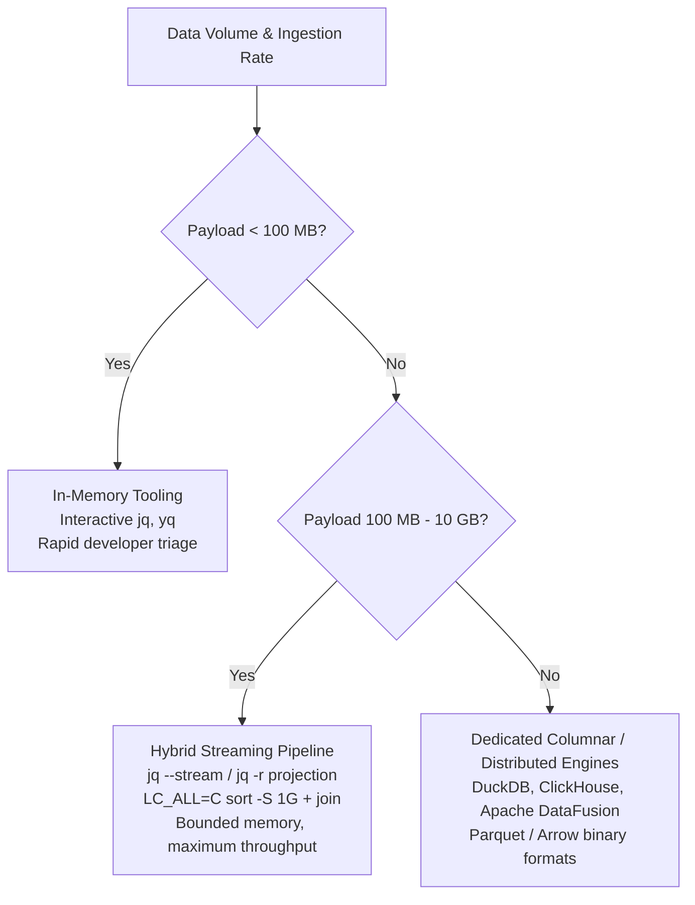

# Structured Data Wrangling: Jq, Yq, and Coreutils

> [!summary] Claim:
> In-memory tree processors like standard `jq` and `yq` convert JSON and YAML documents into reference-counted heap graphs (`jv` structures in C, `yaml.Node` in Go), causing a memory explosion (about 13x input size measured for `jq` 1.8.2 on an array of small objects) that exhausts system RAM on multi-gigabyte payloads unless streaming parser mode (`jq --stream`) is activated to bound memory complexity to O(depth).
> Unix relational streaming relies on external sorting (`sort`) and single-pass merge operators (`join`, `comm`) that guarantee O(N log N) runtime with a bounded main buffer (`-S`) by spilling sorted runs to temporary storage and completing relational joins in linear time.
> Strict collation semantics govern relational correctness: because `join` and `comm` assume monotonic key progression, running them on inputs sorted under a different collation (`en_US.UTF-8` versus `LC_ALL=C`) drops records - silently in BSD `join`, with a one-time warning and exit status 1 in GNU `join` - due to variable handling of punctuation and case folding.
> Production terminal wrangling combines these tools into hybrid pipelines: projecting hierarchical payloads to delimited TSV with `jq -r`, performing bounded external merge-joins with Coreutils, and rehydrating structured entities with `jq -R`, decoupling memory limits from data volume.

```mermaid
flowchart TD
    subgraph INMEM["In-Memory AST Pipeline (Unbounded Memory)"]
        J1["Input Document<br/>(2 GB JSON / YAML)"]
        J2["Lexer & Full Tree Parser<br/>(jv_parse.c / go.yaml.in/yaml/v4)"]
        J3["Heap AST Graph<br/>(about 13x measured: roughly 26 GB RSS)"]
        J4["In-Memory Hash Join / GroupBy<br/>(INDEX / group_by)"]
        J1 --> J2 --> J3 --> J4
        J3 -.->|"Exhausts System RAM"| OOM["OOM Killer Abort"]
    end

    subgraph STREAMING["Streaming Tokenization (Bounded Memory)"]
        S1["Input Document<br/>(Multi-Gigabyte Stream)"]
        S2["jv_parser in JV_PARSE_STREAMING<br/>(Path Stack: p->path)"]
        S3["Incremental [path, leaf] Pairs<br/>(Memory: O(depth) < 20 MB RSS)"]
        S4["Prefix Truncation & Reassembly<br/>(truncate_stream / fromstream)"]
        S1 --> S2 --> S3 --> S4
    end

    subgraph HYBRID["Hybrid Relational Pipeline (Distinguished Pattern)"]
        H1["Raw Log Stream / NDJSON"]
        H2["Projection to TSV<br/>(jq -r '[.key, .val] | @tsv')"]
        H3["External Merge Sort<br/>(LC_ALL=C sort -t$'\t' -k1,1 -S 512M)"]
        H4["Streaming Equi-Merge Join<br/>(LC_ALL=C join -t$'\t' -1 1 -2 1)"]
        H5["Entity Rehydration<br/>(jq -R 'split(\"\t\") | {...}')"]
        H1 --> H2 --> H3 --> H4 --> H5
    end
```

## The Mechanism

Data wrangling on Unix workstations bridges two computational paradigms: hierarchical, self-describing document trees (JSON, YAML) and flat, record-oriented relational streams (CSV, TSV).
Understanding the boundary between these models requires tracing their memory allocations, virtual machines, and collation dependencies.

### 1. jq Internals: Data Representation, Reference Counting, and the Backtracking VM

The `jq` processor is written in C and implemented around a lightweight object system (`jv`) and a stack-based virtual machine (`src/execute.c`).

#### Value Representation in `jv.h`

Every JSON value in `jq` is represented by the 16-byte `jv` struct on 64-bit systems.
The structure is an unboxed tagged union controlled by `jv_kind` and declared in `src/jv.h`:

```c
typedef enum {
  JV_KIND_INVALID,
  JV_KIND_NULL,
  JV_KIND_FALSE,
  JV_KIND_TRUE,
  JV_KIND_NUMBER,
  JV_KIND_STRING,
  JV_KIND_ARRAY,
  JV_KIND_OBJECT
} jv_kind;

typedef struct {
  unsigned char kind_flags;
  unsigned char pad_;
  unsigned short offset;
  int size;
  union {
    struct jv_refcnt* ptr;
    double number;
  } u;
} jv;
```

The memory layout of `jv` on 64-bit platforms totals exactly 16 bytes: `kind_flags` (1 byte), `pad_` (1 byte), `offset` (2 bytes for slicing arrays without allocation), `size` (4 bytes for string/array length), and the 8-byte payload union `u`.
Immediate types (`null`, `false`, `true`) encode their full identity within `kind_flags` and require no heap allocation.
Computed numbers are stored inline within `u.number` as IEEE 754 double-precision 64-bit binary floating-point values (`double`), providing 53 bits of significand precision.
Since `jq` 1.7, a number parsed from input is instead a heap-allocated `jvp_literal_number` (a decNumber plus its literal text) reached through `u.ptr` (`src/jv.c`).
Any integer exceeding $2^{53} - 1$ (9,007,199,254,740,991) undergoes silent loss of precision during arithmetic evaluation or comparison against a computed value.
Unmutated literals are printed exactly, and `jvp_number_cmp` compares two literals as decNumbers (`9007199254740993 == 9007199254740992` is `false` in `jq` 1.8.2), but any mathematical operation (`+ 0`) produces a `double`, and comparing that double with anything is done in `double`, collapsing distinct 64-bit database identifiers into identical float representations.

Heap-allocated types (`string`, `array`, `object`) carry a reference count header (`struct jv_refcnt`) pointed to by `u.ptr`.
The memory management contract across all `jq` internal functions is strict: functions consume their input arguments and return newly owned references.
To pass a value into a function while retaining access, the caller must invoke `jv_copy(val)`, which increments the reference counter without deep-copying payload buffers.
When modifying an array or object whose reference count exceeds 1, `jq` performs copy-on-write (COW) duplication, preventing shared mutable state.

```text
+-----------------------------------------------------------------------------+
|                                  jv Struct                                  |
| [kind_flags: 1B] [pad_: 1B] [offset: 2B] [size: 4B] [union u payload: 8B]   |
+-----------------------------------------------------------------------------+
                                                      |
                     +--------------------------------+-----------------------+
                     | (Immediate scalar)                                     | (Heap pointer)
                     v                                                        v
            NULL / FALSE / TRUE / DOUBLE                             struct jv_refcnt*
                                                                     +------------------+
                                                                     | refcnt: int      |
                                                                     +------------------+
                                                                     | payload buffer   |
                                                                     +------------------+
```

Because every string, object key, array pointer, and wrapper struct involves individual heap allocations and hash table buckets, parsing a dense JSON document produces a severe memory footprint expansion.
Measured with `/usr/bin/time -l` on darwin-arm64 (as of 2026-11), `jq 'length'` over a 141 MB array of 1.5 million small objects peaked at 1.85 GB maximum RSS (about 13x), so a 1 GB document of that shape needs on the order of 13 GB; the ratio depends on document shape, making whole-document parsing unviable on memory-constrained systems.

#### The Backtracking Generator Engine

In `jq`, every expression is a generator that accepts a single input value and yields a stream of zero, one, or many output values.
The bytecode virtual machine executes instructions such as `LOADK`, `DUP`, `POP`, `INDEX`, `FORK`, and `BACKTRACK`.

For the comma operator `,` the compiler emits a `FORK` opcode (`gen_both` in `src/parser.y`); `.[]` compiles to the separate `EACH` opcode, which is itself a backtracking point.
The `FORK` instruction calls `stack_save`, pushing a `struct forkpoint` that records the saved data stack, the current frame, path state, and the return address (`src/execute.c`).
The VM executes the primary branch.
When that branch finishes or encounters a failure condition, the VM does not terminate; it executes an internal backtrack step, restoring the saved frame state and executing the alternate branch.
This backtracking mechanism provides expressive filter composition (`map(select(.active))`) but requires in-memory state preservation that compounds memory usage during large relational iterations.

#### In-Memory Relational Joins

Relational equi-joins within `jq` are constructed using the `INDEX` builtin to construct an in-memory hash index:

```jq
(INDEX($depts[]; .dept_id)) as $dmap |
$emps[] | . + {dept_name: ($dmap[.dept_id].dept_name // "Unassigned")}
```

`INDEX(stream; path)` consumes the right-hand relation of size $M$, allocating an associative object where each key is the stringified evaluation of the path expression.
The left-hand stream of size $N$ then performs $O(1)$ lookups into the hash object.
The total runtime is optimal at $O(M + N)$, but space complexity is strictly $O(M)$.
If the right-hand relation contains tens of millions of records, the hash table exhausts system memory, leading to an immediate process abort via the kernel OOM killer.
Furthermore, `group_by(.key)` requires sorting the entire input array in memory, imposing an $O(N \log N)$ time and $O(N)$ space barrier.

### 2. Streaming Parser Architecture: `jq --stream` and Bounded Memory

To overcome whole-document memory limits, `jq` includes a low-level streaming parser implemented in `src/jv_parse.c`.
The streaming parser is engaged via the `--stream` command-line flag or the `JV_PARSE_STREAMING` flag passed to `jv_parser_new`.

#### The Path Stack Machine

Rather than constructing an abstract syntax tree in memory, the parser tracks the lexical path of keys and array indices within an internal array: `p->path`.
As the lexer encounters structural delimiters (`{`, `}`, `[`, `]`, `,`, `:`), it manipulates `p->path` and emits discrete path-value pairs:

1. **Leaf Values:** Whenever a scalar (string, number, boolean, null) finishes parsing, the parser emits a two-element array: `[path, leaf_value]`.
2. **Container Closures:** Whenever a non-empty array or object finishes parsing, the parser emits a single-element array holding the path of that container's last child: `[path]`.
3. **Empty Containers:** Empty objects `{}` and arrays `[]` emit only the leaf event `[path, {}]` or `[path, []]`, with no closing event of their own (`echo '[{}, [], 1]' | jq -c --stream .` prints `[[0],{}]`, `[[1],[]]`, `[[2],1]`, `[[2]]` in `jq` 1.8.2).

```text
Incoming JSON: {"users": [{"id": 1, "name": "alice"}]}

Streaming Token Output:
[["users", 0, "id"], 1]
[["users", 0, "name"], "alice"]
[["users", 0, "name"]]
[["users", 0]]
[["users"]]
```

Because `jq` discards each scalar token after emission and maintains only `p->path` on the heap, memory complexity is bounded strictly to $O(D)$, where $D$ is the maximum nesting depth of the document.
For production JSON payloads with typical depths under 32 levels, memory usage stays small and independent of file size: `jq -n --stream 'reduce inputs as $x (0; .+1)'` over the same 141 MB array peaked at 3.3 MB maximum RSS on darwin-arm64 (as of 2026-11); a single huge leaf string is still held whole.

#### Entity Reconstruction via `truncate_stream` and `fromstream`

Individual records nested deep within a massive outer container can be extracted and reconstituted into discrete JSON entities without loading the outer structure into memory.
This is achieved by combining `truncate_stream` and `fromstream`:

- `truncate_stream(k)`: Strips the first $k$ elements from the path array of each incoming stream token and drops tokens whose path has $k$ or fewer elements (`src/builtin.jq`).
- `fromstream(stream)`: Reads an incremental sequence of stream tokens and reconstructs the corresponding JSON document.

When `truncate_stream(k)` removes the outer path segments (for instance, stripping `["audit", "records", index]`), the remaining stream tokens describe independent top-level objects.
The `fromstream` function materializes each object sequentially, yielding it to the downstream pipeline and freeing its memory before processing the subsequent token.

### 3. YAML Semantics, yq Variants, and Specification Hazards

YAML is widely used for Kubernetes manifests, cloud-init configurations, and CI/CD pipelines, but its loose type coercion introduces operational vulnerabilities.

#### The Two Divergent `yq` Architectures

The developer ecosystem contains two fundamentally different CLI tools named `yq`:

1. **Mike Farah's `yq` (Go implementation, `github.com/mikefarah/yq`):**
   A native Go binary; v4.54.2 depends on `go.yaml.in/yaml/v4` v4.0.0-rc.7 (the YAML organization's successor to `gopkg.in/yaml.v3`) and `github.com/goccy/go-yaml` (`go.mod`, as of 2026-11).
   It parses YAML documents into a tree of `yaml.Node` structures that capture formatting, comment text, line numbers, and explicit tags.
   It implements an independent query language modeled after `jq` expressions.
   Because it parses comments into AST nodes, it supports in-place file mutation (`yq -i`) without stripping YAML comments.
2. **Andrey Kislyuk's `yq` (Python implementation, `github.com/kislyuk/yq`):**
   A wrapper around `PyYAML` and the native C `jq` binary.
   It converts incoming YAML to intermediate JSON, pipes the JSON into `jq` for filter evaluation, and serializes the result back to YAML.
   It loads YAML with a YAML 1.2 core-schema resolver by default (`set_yaml_grammar(..., grammar_version="1.2")` in `yq/loader.py`) and emits YAML with the 1.1 grammar by default (`--yaml-output-grammar-version`), so it quotes strings such as `NO` on output rather than coercing them on input.
   On the plain JSON path comments are lost; since v4.1.0 (2026-07-03) the `-Y` (`--yaml-roundtrip`) mode preserves YAML comments, tags, and styles (`Changes.rst`, as of 2026-11, latest v4.4.5).
   Because the filter itself runs in `jq`, it accepts the full `jq` language without syntax divergence.

#### Specification Hazards: The Norway Problem and Radix Coercion

The YAML 1.1 specification defines aggressive implicit type casting rules that were corrected in YAML 1.2:

- **The Norway Problem:** The YAML 1.1 boolean type lists these unquoted synonyms as booleans:
  `y|Y|yes|Yes|YES|n|N|no|No|NO|true|True|TRUE|false|False|FALSE|on|On|ON|off|Off|OFF`.
  `PyYAML`'s default resolver (`lib/yaml/resolver.py`) implements YAML 1.1 but omits the single letters `y|Y|n|N`.
  A country code map containing `country: NO` is silently coerced into `country: false` by such a loader.
  In the YAML 1.2 core schema (followed by Mike Farah's `yq`), boolean parsing is restricted to `true|True|TRUE|false|False|FALSE`.
  Unquoted `NO` correctly remains the string `"NO"`, and `yq` v4.54.2 also keeps `yes` as a string.
- **Octal Radix Coercion:** In YAML 1.1, integers with leading zeros (`port: 010` or `mode: 0755`) are coerced to base-8 octal values (`010` becomes decimal `8`).
  In YAML 1.2, octal numbers require an explicit `0o` prefix (`0o10`).
  Unprefixed leading zeros are parsed as decimal numbers: `yq` v4.54.2 reads `010` as `10`, `0755` as `755`, and `0o10` as `8`.
- **The Billion Laughs Expansion Bomb:** YAML supports anchors (`&`) and aliases (`*`).
  Exponentially nested aliases allow an attacker to construct a 1 KB YAML payload that expands into gigabytes of node objects upon traversal.
  `yaml.v3` guards decoding into Go values with an alias-ratio limit (`alias_ratio_range` in `decode.go`), but `yq` works on the node tree: a 342-byte, nine-level, nine-way alias bomb run through `yq -o=json '.i'` (v4.54.2, darwin-arm64, as of 2026-11) reached 6.8 GB maximum RSS and was still running when a 60 s `timeout` killed it, while YAML output (which keeps the aliases) returned at once.

### 4. GNU Coreutils Relational Engine: Merge Joins, Memory Bounds, and Collation

GNU Coreutils provides the foundational primitives for relational processing in the Unix userland: `sort`, `join`, `comm`, `uniq`, `cut`, and `paste`.

#### External Merge Sort Architecture (`sort`)

The GNU `sort` utility (`src/sort.c`) implements a two-phase external merge sort algorithm designed to process datasets that exceed physical RAM:

1. **Phase 1: In-Memory Block Sorting:**
   Lines are read into an in-memory line buffer sized by `-S` / `--buffer-size`.
   When the buffer fills, the lines are sorted using a multi-threaded recursive binary merge tree (`sortlines`), whose nodes are scheduled through a heap-based priority queue (`struct merge_node_queue` over `heap.h`).
   The sorted run is written to a temporary scratch file in `$TMPDIR` (defaulting to `/tmp`, `DEFAULT_TMPDIR`).
2. **Phase 2: Multi-Way Merge:**
   Once input is exhausted, `sort` opens up to `NMERGE` temporary run files at once (`--batch-size`, `NMERGE_DEFAULT 16`) and merges them in `mergefps`, which keeps an `ord` index table of the current line from each file in sorted order, reinserting the advanced file after each output line.
   Output streams directly to standard output.

The main line buffer during `sort` is bounded by the `-S` parameter.
The default buffer size in GNU `sort` is computed by `default_sort_size()` in `src/sort.c`: the larger of `physmem_available()` and one eighth of `physmem_total()`, capped at three quarters of total memory and at half of `RLIMIT_DATA` / `RLIMIT_AS`, and never below `MIN_SORT_SIZE` (Coreutils 9.12, as of 2026-11).
Adding `-s` (`--stable`) disables the default behavior where `sort` compares entire lines as a last-resort tie-breaker, guaranteeing that records with identical primary keys retain their original input order.
When defining join keys, passing `-k1,1` restricts key comparison strictly to field 1, whereas `-k1` spans from field 1 to the end of the line.

#### Streaming Equi-Join (`join`)

The `join` command (`src/join.c`) performs a relational natural join or equi-join on two files.
It requires both input files to be pre-sorted on the designated join fields.

Lines are read sequentially by `get_line` into `struct line` instances, and delimited fields are parsed via `xfields`.
To compute the Cartesian product of identical keys across relations, `src/join.c` utilizes a sequence buffer (`struct seq`) per file to hold blocks of consecutive lines sharing the current join key.
The algorithm is a classic two-pointer streaming merge:
- It maintains line buffers for File 1 and File 2.
- It compares the current join key of File 1 against File 2.
  - If $\text{Key}_1 < \text{Key}_2$: advance File 1.
    If `-a 1` (left outer join) is enabled, emit File 1 with padding.
  - If $\text{Key}_1 > \text{Key}_2$: advance File 2.
    If `-a 2` (right outer join) is enabled, emit File 2 with padding.
  - If $\text{Key}_1 == \text{Key}_2$: read ahead in File 1 and then in File 2 while lines keep matching (`advance_seq`), and emit the Cartesian product of the two runs.

Because `join` only buffers the current run of equal keys from each file, memory is $O(1)$ for distinct join keys and $O(r)$ for the longest duplicate-key run $r$, and runtime is $O(N_1 + N_2)$ plus the size of the emitted cross products.
Field separators are configured via `-t CHAR`.
Left outer joins use `-a 1`, right outer joins use `-a 2`, full outer joins use `-a 1 -a 2`, and anti-joins (records present in File 1 but absent in File 2) use `-v 1`.
Missing fields in outer joins are filled with string literals via `-e STRING`, and output column projection is controlled via `-o`.

Order verification in GNU `join` is opportunistic by default: `check_order` compares consecutive keys only after some unpairable line has been seen (`seen_unpairable`), prints `FILE:LINE: is not sorted: ...` at most once per file, keeps going, and finally exits 1 with `input is not in sorted order`.
Disordered input in which every line pairs produces no diagnostic and exit status 0 (GNU `join` 9.12, tested).
Passing `--check-order` forces strict monotonic validation on every line, terminating with an error if disorder occurs, while `--nocheck-order` suppresses verification entirely.
On macOS, BSD `join` lacks long options (`join --check-order` fails with `illegal option -- -`) and does not provide `--check-order` or `--header`, requiring external verification via `sort -c`.

#### Collation Semantics: The Primary Point of Relational Failure

Both `join` and `comm` assume that input streams advance in non-decreasing order; GNU `join` and GNU `comm` check it opportunistically, BSD `join` does not check.
If a record violates the expected collation sequence, `join` drops the records it walks past; GNU `join` warns and exits 1 (or aborts under `--check-order`), while BSD `join` skips them silently with exit status 0.

Collation order is governed by the `LC_COLLATE` and `LC_ALL` environment variables:

- **Byte Collation (`LC_ALL=C` or `POSIX`):** Lines are compared strictly byte-by-byte using standard ASCII numerical values (`memcmp`/`strcmp`).
  Character ordering is deterministic: `0x20` (space) < `0x2D` (`-`) < `0x30`-`0x39` (`0`-`9`) < `0x41`-`0x5A` (`A`-`Z`) < `0x5F` (`_`) < `0x61`-`0x7A` (`a`-`z`).
- **Locale-Aware Collation (`LC_ALL=en_US.UTF-8`):** Collation follows national language dictionaries via `strcoll`, and case folding groups `abb` and `Abb` together with the lowercase form first.
  Punctuation handling differs between libcs, so the same file sorts differently across platforms (tested with the keys below, as of 2026-11):
  - glibc 2.39 with GNU `sort` 9.4 (Ubuntu 24.04 container, Linux) ignores punctuation at the first comparison level, so `ab-c` sorts as `abc` and lands after `abb`.
  - macOS (Apple `sort` and GNU `sort` 9.12 give the same order) does not ignore punctuation: it sorts before digits and letters, in the order space, `_`, `-`, `.`.

```text
Input keys: abb, ab-c, ab_d, Abb

Under LC_ALL=C (byte order):
  Abb
  ab-c
  ab_d
  abb

Under LC_ALL=en_US.UTF-8 on Linux (glibc 2.39, punctuation ignored):
  abb
  Abb
  ab-c
  ab_d

Under LC_ALL=en_US.UTF-8 on macOS (punctuation first, then letters):
  ab_d
  ab-c
  abb
  Abb
```

If File 1 is sorted under `LC_ALL=C` while File 2 is sorted under `en_US.UTF-8`, or if `sort` was executed with numeric flags (`-n`) while `join` evaluates lexicographically, `join` encounters sequence disorder.
Upon reading a key that appears smaller than the previous key, `join` assumes it has reached the end of that key range.
It advances past records without matching them, discarding data from the final output.
BSD `join` does so without any warning, and GNU `join` reports only the first disorder per file, so the exit status must be checked.

Production pipelines must always enforce byte collation by explicitly setting `export LC_ALL=C` before executing `sort`, `join`, `comm`, and `uniq`.
Order verification can be enforced with `sort -c` (`--check`), which exits with status 1 and reports line disorder without writing to disk.

#### Set Difference via `comm`

The `comm` utility (`src/comm.c`) compares two sorted streams line-by-line and produces three tab-delimited columns:
- Column 1: Lines unique to File 1.
- Column 2: Lines unique to File 2.
- Column 3: Lines common to both files.

Individual columns are suppressed using numeric flags:
- `comm -12`: Emits only Column 3 (Set Intersection: $A \cap B$).
- `comm -23`: Emits only Column 1 (Relative Complement / Set Difference: $A \setminus B$).
- `comm -13`: Emits only Column 2 (Relative Complement: $B \setminus A$).
- `comm -3`: Emits Columns 1 and 2 (Symmetric Difference / XOR: $(A \setminus B) \cup (B \setminus A)$).

#### Statistical Aggregation via GNU `datamash`

While Coreutils provides projection and joining, it lacks native numerical aggregation.
GNU `datamash` bridges this gap by providing command-line grouping and summary statistics (`sum`, `mean`, `median`, `stdev`, `min`, `max`, `count`):

```bash
datamash -t ',' -g 1 sum 2 mean 3 < sorted_data.csv
```

When input data is pre-sorted on the grouping field (`-g` / `groupby`), `datamash` maintains running statistical accumulators for the active group only.
When the key changes, it emits the aggregated row and resets the accumulators.
This gives $O(1)$ memory for running operations such as `sum`, `mean`, `min`, `max`, and `count`; order statistics such as `median`, quantiles, and `mode` store every value of the current group (`op->values` in `src/field-ops.c`), so they need $O(\text{group size})$.
If unsorted data is provided, passing `-s` (`--sort`) makes `datamash` `popen` an external `LC_ALL=C sort -s -kN,N` on the group fields (`pipe_through_sort` in `src/datamash.c`), which the manual documents as equivalent to `sort -k1,1 | datamash -g 1`, so the sort spills to disk like any other `sort`.

### 5. The Hybrid Architecture: Relational Processing of Multi-Gigabyte JSON Streams

The optimal terminal data pipeline exploits each tool's architectural strengths while avoiding its structural weaknesses:

1. `jq` parses hierarchical JSON, navigates schema variations, extracts nested fields, and serializes clean TSV rows.
2. Coreutils `sort -S` buffers and spills records to disk, guaranteeing bounded memory external sorting.
3. Coreutils `join` executes streaming equi-joins across gigabyte-scale inputs in linear time, with memory bounded by the longest duplicate-key run.
4. `jq -R` consumes the joined TSV stream, validates types, and rehydrates clean JSON structures.

This pattern isolates memory usage to a fixed threshold (e.g., 512 MB) regardless of input size, enabling developers to execute database-grade joins on workstations without installing database engines.

## Commands and Numbers to Know

Reference numbers, memory thresholds, flag defaults, and environment variables across modern Linux and macOS environments.

| Item | Value | Platform and date | What it controls |
| :--- | :--- | :--- | :--- |
| `jq` memory amplification | About 13x input byte size (measured, 141 MB array of small objects, `jq` 1.8.2) | macOS (as of 2026-11) | Heap expansion ratio of raw JSON to `jv` AST structures; varies with document shape |
| IEEE 754 precision limit | 9,007,199,254,740,991 ($2^{53} - 1$) | Both (as of 2026-11) | Maximum safe integer in `jq` arithmetic before silent rounding occurs |
| `jq --stream` memory footprint | $O(D)$ depth; 3.3 MB max RSS measured on the same 141 MB file | macOS (as of 2026-11) | Bounded memory usage during streaming parser execution |
| GNU `sort` buffer size (`-S`) | Default: max(available, total/8), capped at 3/4 of total RAM and half of `RLIMIT_DATA`/`RLIMIT_AS` | Linux (as of 2026-11) | Main memory allocation before spilling temporary sorted runs to disk (`default_sort_size`, Coreutils 9.12) |
| macOS `sort` buffer size (`-S`) | Default: up to about 90% of available memory (`sort(1)`) | macOS (as of 2026-11) | In-memory buffer size in Apple `sort` 2.3-Apple (201) |
| `join` memory consumption | $O(1)$ for distinct keys; $O(r)$ for the longest duplicate-key run $r$ | Both (as of 2026-11) | Working memory for streaming merge of pre-sorted keys |
| `join` default delimiter | Whitespace (spaces and tabs) | Both (as of 2026-11) | Trailing/leading spaces ignored; multiple spaces collapsed unless `-t` set |
| `join` left outer join flag | `-a 1` | Both (as of 2026-11) | Emits unpairable records from File 1 |
| `join` anti-join flag | `-v 1` | Both (as of 2026-11) | Emits exclusively records from File 1 with no match in File 2 |
| `join` empty field replacement | `-e STRING` | Both (as of 2026-11) | Replaces missing fields in outer join projections |
| `comm` column suppression | `-1`, `-2`, `-3` | Both (as of 2026-11) | Suppresses Column 1 (unique F1), 2 (unique F2), or 3 (common) |
| `LC_ALL=C` collation | Raw byte order (`0x00`-`0xFF`) | Both (as of 2026-11) | Enforces deterministic ASCII sort order, preventing `join` sequence mismatch |
| GNU `datamash` memory model | $O(1)$ per group for running operations on pre-sorted input; $O(\text{group})$ for `median`, quantiles, `mode` | Linux (as of 2026-11) | Accumulator memory usage when grouping; `-s` pipes through external `sort` |
| `yq` (mikefarah) default parser | YAML 1.2 core schema (`go.yaml.in/yaml/v4`, v4.54.2) | Both (as of 2026-11) | Preserves `country: NO` as string; supports in-place comments (`-i`) |
| `yq` (kislyuk) default parser | YAML 1.2 on input, 1.1 grammar on YAML output (`PyYAML` + C `jq`, v4.4.5) | Both (as of 2026-11) | Keeps `country: NO` as a string; drops comments unless `-Y` (since v4.1.0) |

## Multi-Language Comparison: JSON and Tabular Wrangling

Processing structured data across production toolchains reveals distinct architectural trade-offs between dynamic convenience, memory safety, and external spilling.

| Concern | C / Coreutils (`jq`, `sort`, `join`) | Python (`json`, `csv`, `sqlite3`) | Rust (`serde_json`, `csv`, `polars`) |
| :--- | :--- | :--- | :--- |
| Parsing Model | Hybrid: Full DOM (`jv_parse`) or streaming SAX-like tokens (`--stream`) | DOM (`json.load`) expands to Python dicts; streaming via `ijson` | Typed DOM (`serde_json::Value`) or zero-copy streaming deserializer |
| Memory Amplification | About 13x in DOM mode (measured, `jq` 1.8.2); $O(D)$ depth in `--stream` mode | About 6.6x for `json.load` on the same 141 MB file (measured, CPython 3.15); high overhead per PyObject header | About 1.4x for a typed `Vec<struct>` with `String` fields and about 10.6x for `serde_json::Value` (measured, `serde_json` 1.0, Rust 1.99, a different 114 MB array of 1.5 million small objects on which `jq` took 11.6x and CPython 7.1x); borrowing `&str` avoids the per-string allocation |
| 64-bit Integer Precision | Truncates to IEEE 754 float ($2^{53}-1$) in math; preserves literal in string output | Arbitrary precision integers (`int` has no 64-bit overflow limit) | Full 64-bit unsigned/signed precision (`u64`, `i64`, `serde_json::Number`) |
| External Spilling | Built-in to `sort -S`: automatic disk spilling to `$TMPDIR` | Not supported in standard library; requires custom chunking or `sqlite3` | Not in `csv` crate; supported in streaming query engines (`polars`) |
| Relational Join Model | Single-pass streaming equi-merge (`join`, $O(1)$ memory on sorted streams with distinct keys) | In-memory dictionary lookup or nested iteration; external via SQLite | In-memory hash join (`hashbrown`) or sorted merge iterators |
| Collation Sensitivity | Strict: requires `LC_ALL=C`; mismatch drops records (silently in BSD `join`) | Python strings compare by Unicode codepoint order (`ord`), immune to locale collation | Rust strings compare by lexicographic UTF-8 byte order, immune to locale collation |

## Worked Lab Example

The reproducible lab is located at `code/01-Command-Line/jq_coreutils_relational/`.
It needs `bash`, `sort`, `join`, `comm`, and `cut` from the base system plus two tools that are not: `jq` 1.7 or later (the recorded output relies on literal preservation; recorded with `jq` 1.8.2) and Mike Farah's `yq` v4 (recorded with v4.54.2; the lab's `-o=json -I=0` flags are Farah's syntax).
`run.sh` checks both preconditions up front and exits 2 with a message if `jq` is older than 1.7 or `yq` is not Farah's v4, because the harness has no `requires` tag for them.
Only `darwin-arm64` output is recorded; the Linux output is not recorded, and stage 7 prints a skip line on a host without an `en_US.UTF-8` locale.

The lab script `run.sh` executes seven sequential stages demonstrating relational operations, streaming bounded memory parsing, external merge joins, hybrid pipelines, and failure modes:

1. **In-Memory Hash Join:** Loads department and employee JSON arrays into `jq`, building an in-memory hash map via `INDEX` to join employee records with department names.
2. **Streaming Parser Truncation:** Feeds a nested audit log payload into `jq --stream`, applying `3 | truncate_stream(inputs)` and `fromstream` to yield individual event objects without allocating the root document AST (the lab shows the reassembly).
   It then feeds a document that never closes (`{"a":[1,2,3`) to `jq -c --stream` and to `jq -c`: the streaming run has already printed the completed leaves `[["a",0],1]` and `[["a",1],2]` before the parse error (exit 5), while whole-document mode prints nothing, which shows incremental emission; the memory bound itself is shown by the RSS measurement in The Mechanism, not by the lab.
3. **Coreutils Relational Joins:** Sets `LC_ALL=C` and executes an inner join, a left outer join with NULL substitution (`-a 1 -e 'NULL'`), a full outer join (`-a 1 -a 2 -e 'NULL' -o 0,1.2,1.3,2.2,2.3`), and an anti-join (`-v 1`) across employee master and payroll CSV tables.
4. **Set Operations with `comm`:** Extracts key columns with `cut -d ',' -f 1` and executes set intersection (`comm -12`), File 1 difference (`comm -23`), and File 2 difference (`comm -13`).
5. **The Hybrid Pipeline:** Streams JSON lines (NDJSON) of users and orders, projects them to TSV with `jq -r`, sorts and joins them with Coreutils `sort` and `join`, and rehydrates the stream into typed JSON objects via `jq -R`.
6. **Failure Modes and Hazards:** Detects input disorder using `sort -c` and prints its exit status, exposes the IEEE 754 float mantissa precision cliff in `jq` arithmetic on $2^{53} + 1$, and verifies YAML 1.2 string preservation of `country: NO` in `yq`.
7. **Collation Mismatch:** Sorts one key file under the host's `en_US.UTF-8` locale and the other under `LC_ALL=C`, joins them under `LC_ALL=C`, and shows the join silently losing a row (2 of 3, exit 0 with BSD `join`) while `sort -c` exits 1; sorting both under `LC_ALL=C` restores 3 of 3.

```bash
cd code/01-Command-Line/jq_coreutils_relational
bash run.sh
```

### Verified Output

Recorded on `darwin-arm64` on 2026-11-07 and verified via `python3 -m _harness.verify 01-Command-Line/jq_coreutils_relational/`:

```text
=== 1. JQ In-Memory Hash Join ===
{"emp_id":"E101","name":"Alice","dept":"Engineering","salary":180000}
{"emp_id":"E102","name":"Bob","dept":"Engineering","salary":165000}
{"emp_id":"E103","name":"Carol","dept":"Product","salary":170000}
{"emp_id":"E104","name":"Dan","dept":"Unassigned","salary":150000}

=== 2. JQ Stream Truncation for Bounded Memory ===
{"event_id":"EV-01","action":"LOGIN","status":"ALLOW"}
{"event_id":"EV-02","action":"WRITE","status":"DENY"}
{"event_id":"EV-03","action":"LOGOUT","status":"ALLOW"}
--- Truncated input: --stream emits before the error, DOM mode emits nothing ---
[["a",0],1]
[["a",1],2]
stream exit=5
dom exit=5

=== 3. Coreutils Relational Joins (LC_ALL=C) ===
--- Inner Join ---
E101,Alice,Engineer,180000,US
E102,Bob,Manager,165000,US
E105,Eve,Architect,210000,US
--- Left Outer Join (Unmatched Replaced by NULL) ---
E101,Alice,Engineer,180000,US
E102,Bob,Manager,165000,US
E103,Carol,Designer,NULL,NULL
E105,Eve,Architect,210000,US
--- Full Outer Join ---
E101,Alice,Engineer,180000,US
E102,Bob,Manager,165000,US
E103,Carol,Designer,NULL,NULL
E104,NULL,NULL,150000,EU
E105,Eve,Architect,210000,US
--- Anti-Join (In Master but No Payroll) ---
E103,Carol,Designer

=== 4. Set Operations with comm ===
--- Common IDs (Intersection) ---
E101
E102
E105
--- Master Only (Difference) ---
E103
--- Payroll Only (Difference) ---
E104

=== 5. Hybrid Pipeline: JSON Stream -> TSV Coreutils -> JSON Output ===
{"user_id":"U1","order_id":"1001","amount":500,"name":"Alice","tier":"gold"}
{"user_id":"U1","order_id":"1002","amount":250,"name":"Alice","tier":"gold"}
{"user_id":"U2","order_id":"1003","amount":120,"name":"Bob","tier":"silver"}

=== 6. Failure Modes and Hazards ===
--- Unsorted Input Detection with sort -c ---
sort: -:2: disorder: E101,Alice
sort -c exit=1
--- IEEE 754 Precision Truncation in JQ ---
{"input":9007199254740993,"evaluated":9007199254740992,"equality_collapsed":true}
--- YAML 1.2 String Preservation in yq ---
{"country":"NO"}

=== 7. Collation Mismatch: the Headline Join Failure ===
--- Left sorted under en_US.UTF-8, right under C, join under C ---
left key order:  ab_d ab-c abb
right key order: ab-c ab_d abb
rows joined: 2 of 3 (exit=0)
sort -c on the locale-sorted file under C: exit=1
--- Both sorted under C ---
rows joined: 3 of 3 (exit=0)
```

### Reading the Result

- In Section 1, `INDEX` matched `E101`, `E102`, and `E103` against department definitions, while `E104` (department `D40`) correctly fell back to `"Unassigned"` via the `//` alternative operator.
- In Section 2, `fromstream(3 | truncate_stream(inputs))` cleanly extracted the three audit records from under `["audit", "records", i]` without materializing the outer document.
  On the unterminated document, `--stream` printed the two completed leaves before failing with exit 5, while whole-document mode printed nothing and also exited 5.
- In Section 3, `join -a 1` preserved unmatched employee `E103` (Designer) with `NULL` payroll fields, while full outer join (`-a 1 -a 2`) preserved both `E103` and unmatched payroll record `E104`.
  Field `0` in `-o 0,1.2,1.3,2.2,2.3` unified the join key across both left and right relations.
- In Section 4, `comm` performed set algebra on sorted ID keys: `comm -12` extracted IDs present in both sets (`E101`, `E102`, `E105`), while `comm -23` isolated the uncompensated employee (`E103`).
- In Section 5, the hybrid pipeline converted JSON to TSV, sorted and joined multi-record orders with user tiers via Coreutils streaming, and produced valid NDJSON objects with numbers parsed by `tonumber`.
- In Section 6, `sort -c` intercepted non-monotonic input, printing line 2 disorder and exiting 1 (the lab prints `sort -c exit=1`).
  The IEEE 754 precision test confirms that `.raw_id + 0` on $2^{53} + 1$ (`9007199254740993`) collapses it to $2^{53}$ (`9007199254740992`), while `input` still prints the preserved literal; `equality_collapsed: true` shows that comparing the computed double with the literal is done in `double`.
  Finally, `yq -o=json` confirms that modern YAML 1.2 parsers preserve `country: NO` as a string rather than coercing it to boolean `false`.
- In Section 7, the key files sorted under `en_US.UTF-8` on macOS order as `ab_d ab-c abb` while `LC_ALL=C` orders them `ab-c ab_d abb`; `join` under `LC_ALL=C` then pairs only 2 of 3 rows and exits 0, `sort -c` exits 1 on the locale-sorted file, and sorting both inputs under `LC_ALL=C` pairs all 3.

## Pitfalls

> [!warning] Pitfall: Omitting LC_ALL=C in Coreutils Relational Pipelines
> The most insidious failure mode in Unix data wrangling occurs when `sort`, `join`, and `comm` execute under system locales like `en_US.UTF-8`.
> Locale collation rules ignore or re-weight punctuation (hyphens, underscores, dots) and perform case folding.
> If two files are sorted under different collation sequences, or if `join` advances past keys because dictionary collation diverges from byte comparison, `join` skips rows without matching them (silently in BSD `join`; GNU `join` warns once per file and exits 1).
> Always export `LC_ALL=C` at the entry point of data wrangling scripts to enforce deterministic byte-level sorting.

> [!warning] Pitfall: Performing Arithmetic or Comparisons on 64-Bit IDs in JQ
> Database primary keys, Snowflake IDs, Twitter IDs, and distributed tracing IDs often exceed $2^{53} - 1$ (9,007,199,254,740,991).
> When `jq` performs math (`.id + 0`), or compares an ID with a computed number, it works in 64-bit IEEE 754 floating-point doubles; `jq` 1.6 and earlier convert every number on input.
> Two distinct IDs differing by 1 will evaluate as equal, causing database corruption or data leakage across tenants.
> Keep all 64-bit identifiers as strings: emit them as JSON strings at the source, or wrap with `tostring` before any arithmetic or comparison (on `jq` 1.7 and later, `tostring` and `-r` on an unmutated literal print all its digits).

> [!warning] Pitfall: Slurping Multi-Gigabyte Payloads into JQ Memory
> Running `jq '.' large_payload.json` or invoking `group_by` forces `jq` to parse the entire document into an in-memory `jv` AST graph.
> Due to heap metadata and hash table bucket overhead, a 4 GB JSON payload of small objects needs on the order of 50 GB (about 13x, measured on a 141 MB file with `jq` 1.8.2).
> For multi-gigabyte files, use `jq --stream` with `truncate_stream` to process records iteratively, or convert the stream to NDJSON/TSV for external processing.

> [!warning] Pitfall: Default Whitespace Separator Hazards in join
> Invoking `join file1.csv file2.csv` without specifying `-t ','` causes `join` to split on default whitespace.
> Under default whitespace splitting, leading spaces are stripped and multiple consecutive spaces or tabs are collapsed into a single delimiter.
> A CSV line without blanks becomes a single field, so the whole line is the join key and only identical lines pair.
> If a TSV file contains empty fields represented by consecutive tabs (`col1<TAB><TAB>col3`), the tabs collapse, `join` shifts field indices, and outputs misaligned data.
> Always pass an explicit delimiter: `-t ','` for CSV or `-t $'\t'` for TSV.

> [!warning] Pitfall: The YAML 1.1 Norway Hazard in Configuration Scripts
> When parsing YAML configurations using YAML 1.1 loaders such as `PyYAML`'s default `yaml.safe_load`, unquoted strings such as `NO`, `no`, `ON`, `off`, or `YES` are implicitly coerced to boolean values.
> A Kubernetes environment variable or country code defined as `COUNTRY: NO` becomes `COUNTRY: false`.
> Use YAML 1.2 processors (Mike Farah's `yq`, or Kislyuk's `yq`, which loads with a 1.2 resolver) or explicitly quote all string values in YAML source documents (`COUNTRY: "NO"`), since other consumers of the same file may still be YAML 1.1.

> [!warning] Pitfall: Unstable Sorting Disrupting Multi-Key Relational Order
> When sorting files on secondary keys (`sort -k2,2`), standard GNU `sort` uses the entire line as a last-resort tie-breaker unless stability is explicitly requested.
> This re-orders records that share the secondary key based on their primary key, breaking expected stream sequencing.
> Always pass `-s` (`--stable`) when sorting records incrementally across multiple passes.

## At Scale

At small scale (a single engineer working with megabyte-sized logs), interactive `jq` queries and ad-hoc pipes offer immediate feedback.
As organizations scale from 1,000 to 50,000 engineers, data volume and automation demands shift operational trade-offs dramatically.



### Operational Trade-Offs Across Scale

1. **Memory Economics and Worker Sizing:**
   In cloud CI/CD runners and Kubernetes cronjobs, memory allocation directly drives infrastructure cost.
   A container provisioned with 512 MB of RAM will crash if an engineer deploys a naive `jq 'group_by(.user_id)'` script on a 1 GB log file.
   Enforcing the hybrid pattern (`jq -r` -> `sort -S 256M` -> `join`) guarantees that memory usage remains strictly predictable, allowing platform teams to size worker containers tightly without risk of OOM failures.
2. **Deterministic Pipelines and CI Gates:**
   Across thousands of developer workstations running heterogeneous operating systems (macOS laptops, Linux development containers, Nix workstations), default locale settings diverge.
   If a script relies on system locale collation, it will pass in local testing on macOS and fail intermittently inside Linux CI environments.
   Standardize corporate shell scripts by linting with `shellcheck` as detailed in [[Robust-Shell-Scripting-and-ShellCheck]] and injecting `export LC_ALL=C` into shared pipeline headers.
3. **Paved Roads: When to Graduate Beyond Coreutils:**
   While `sort` and `join` handle multi-gigabyte streams reliably, they are row-oriented and CPU-bound on single threads during text parsing.
   When log analysis routines reach hundreds of gigabytes per hour, graduate from raw text pipelines to columnar binary tools such as DuckDB or ClickHouse-local.
   For incident investigation on production servers, combine `ripgrep` pre-filtering with streaming decompression as established in [[Analyze-Gigabyte-Terminal-Logs]].

## Practice Drill

> [!tip] Practice Drill:
> Construct a self-contained shell pipeline that joins two unsorted JSON-lines logs without exceeding 64 MB of resident RAM: an authentication log (`auth.jsonl` with `user_id`, `ip`, `timestamp`) and a geo-IP database (`geo.jsonl` with `ip`, `country`, `asn`).
> Your pipeline must extract records where users authenticated from country `"NO"`, resolving the YAML/JSON type hazard, and handle 64-bit integer user IDs exceeding $2^{53} - 1$ without numeric corruption.
> Verify the pipeline behavior by injecting disordered keys and confirming that `sort -c` halts execution, then verify that `join -t $'\t' -v 1` correctly reports authentication events whose IP address has no geo-IP mapping.

```bash
#!/usr/bin/env bash
set -euo pipefail
export LC_ALL=C

WORK_DIR=$(mktemp -d)
trap 'rm -rf "${WORK_DIR}"' EXIT
cd "${WORK_DIR}"

# Generate test datasets with 64-bit Snowflake IDs and unquoted "NO" strings
cat << 'EOF' > auth.jsonl
{"user_id":"9007199254740993","ip":"192.0.2.1","action":"login"}
{"user_id":"9007199254740994","ip":"198.51.100.2","action":"login"}
{"user_id":"9007199254740995","ip":"203.0.113.5","action":"login"}
EOF

cat << 'EOF' > geo.jsonl
{"ip":"192.0.2.1","country":"NO","asn":"AS100"}
{"ip":"198.51.100.2","country":"SE","asn":"AS200"}
EOF

# 1. Project to TSV with stringified keys, bounded memory sort
jq -r '[.ip, .user_id, .action] | @tsv' auth.jsonl | sort -t $'\t' -k1,1 -S 32M > auth_sorted.tsv
jq -r '[.ip, .country, .asn] | @tsv' geo.jsonl | sort -t $'\t' -k1,1 -S 32M > geo_sorted.tsv

# 2. Check sort order
sort -c -t $'\t' -k1,1 auth_sorted.tsv
sort -c -t $'\t' -k1,1 geo_sorted.tsv

# 3. Equi-join on IP (Field 1)
# Output: IP, user_id, action, country, asn
join -t $'\t' -1 1 -2 1 -o 1.1,1.2,1.3,2.2,2.3 auth_sorted.tsv geo_sorted.tsv > joined.tsv

# 4. Anti-join: Detect unmapped IPs
echo "Unmapped IPs:"
join -t $'\t' -v 1 -1 1 -2 1 auth_sorted.tsv geo_sorted.tsv

# 5. Filter for country == "NO" and rehydrate to JSON
echo "Rehydrated Flagged Events:"
awk -F '\t' '$4 == "NO"' joined.tsv | \
  jq -R -c 'split("\t") | {ip: .[0], user_id: .[1], action: .[2], country: .[3], asn: .[4]}'
```

## Interview Questions

> [!question] L5: Explain why `echo '9007199254740993' | jq '. + 0'` produces `9007199254740992`, and describe how to safely handle 64-bit integer identifiers in `jq`.
>
> > [!success]- Answer
> > The `jq` expression engine evaluates arithmetic on IEEE 754 64-bit double-precision floating-point numbers (`double`); since `jq` 1.7 the parsed literal is kept as a decNumber, so `jq .` alone prints `9007199254740993` unchanged, but `+ 0` returns a `double`.
> > A 64-bit float allocates 53 bits for its mantissa (significand), meaning it can represent integers exactly only up to $2^{53} - 1$ (9,007,199,254,740,991).
> > The integer 9,007,199,254,740,993 is $2^{53} + 1$, which cannot be represented without rounding.
> > When arithmetic (`+ 0`) forces floating-point evaluation, it rounds to the nearest representable double, which is $2^{53}$ (9,007,199,254,740,992).
> > To safely process 64-bit database identifiers, Snowflake IDs, or tracing IDs, they must be handled strictly as strings.
> > Avoid numeric filters, arithmetic, or numeric comparisons; use `tostring` or format strings (`"\(.id)"`) to preserve exact character representations.

> [!question] L5: How does `comm` determine set difference and intersection, and what strict prerequisite must the input files satisfy?
>
> > [!success]- Answer
> > The `comm` utility performs line-by-line comparison of two text streams, outputting three tab-delimited columns: Column 1 (lines unique to File 1), Column 2 (lines unique to File 2), and Column 3 (lines common to both files).
> > By suppressing columns, it implements relational set operations: `comm -12` computes set intersection ($A \cap B$), `comm -23` computes relative complement ($A \setminus B$), and `comm -13` computes ($B \setminus A$).
> > The strict prerequisite is that both input files must be pre-sorted according to the current locale's collating sequence.
> > If either file is unsorted, `comm` fails to identify matching lines as it advances monotonically, producing truncated or corrupt output; GNU `comm` prints `file 1 is not in sorted order` and exits 1 when it notices (Coreutils 9.12, tested).

> [!question] L6: Predict the output: A developer runs the following script to join two files.
> What is the output, and why did it occur?
> ```bash
> join -t ',' <(printf "10,Alpha\n2,Beta\n") <(printf "10,Active\n2,Pending\n")
> ```
>
> > [!success]- Answer
> > Both records join (BSD `join` on macOS and GNU `join` 9.12, tested, exit status 0):
> > ```text
> > 10,Alpha,Active
> > 2,Beta,Pending
> > ```
> > The trap is numeric intuition: `join` compares keys as strings, and under byte collation `'1'` precedes `'2'`, so `"10"` correctly sorts before `"2"` and both inputs are already in the order `join` requires.
> > The failure appears when File 1 is sorted numerically (`2` before `10`) and File 2 is not:
> > ```bash
> > join -t ',' <(printf "2,Beta\n10,Alpha\n") <(printf "10,Active\n2,Pending\n")
> > ```
> > `join` reads `2` from File 1 and `10` from File 2.
> > Because `"2" > "10"` in byte comparison, `join` discards `10,Active` as unpairable and advances File 2, where it finds and pairs `2`.
> > It then reads `10` from File 1, finds File 2 exhausted, and drops it, so only `2,Beta,Pending` is printed.
> > BSD `join` prints that single line and exits 0; GNU `join` additionally prints `/dev/fd/N:2: is not sorted: 10,Alpha` and `input is not in sorted order`, and exits 1.

> [!question] L6: Walk through the architectural mechanism of `jq --stream`.
> How does it avoid OOM failures on multi-gigabyte files compared to standard `jq`?
>
> > [!success]- Answer
> > Standard `jq` uses `jv_parse.c` to construct an entire abstract syntax tree in memory before executing filters.
> > Each object key, array element, and number expands into a 16-byte `jv` struct, hash table buckets, and reference-counted buffers (plus a heap decNumber per number literal since 1.7), causing about a 13x memory expansion over the raw file size on an array of small objects (1.85 GB RSS for 141 MB, `jq` 1.8.2).
> > With `--stream`, `jq` activates `JV_PARSE_STREAMING`.
> > The parser maintains only an array of current path segments (`p->path`).
> > When a scalar value is parsed, it immediately emits a two-element array: `[path, leaf_value]`.
> > When a non-empty container finishes, it emits `[path]` holding the path of its last child.
> > The scalar and path tokens are discarded immediately after emission.
> > Consequently, memory usage is proportional only to the maximum nesting depth of the JSON structure ($O(D)$) and the largest single leaf, independent of file size (3.3 MB RSS on the same 141 MB file).

> [!question] L7: Debug this: A production cron job executing `join -t $'\t' -1 1 -2 1 master.tsv updates.tsv` suddenly began dropping 15% of all matching records after a Linux distribution upgrade.
> Both files were sorted with `sort -k1,1`.
> What is the root cause and the fix?
>
> > [!success]- Answer
> > The root cause is a collation sequence mismatch between the sorting step and the joining step, or between glibc locale versions (glibc 2.28 replaced its collation data with ISO 14651 2016 data, per its NEWS, so files sorted before an upgrade can be out of order after it).
> > In modern Linux distributions, the default locale is typically `en_US.UTF-8` or `C.UTF-8`.
> > Under `en_US.UTF-8`, `sort` uses dictionary collation via `strcoll`, which ignores or re-weights punctuation (such as hyphens, periods, or underscores) and merges letter casing.
> > If the IDs in `master.tsv` contain punctuation (`USER-100`, `USER_100`) and the environment locale differed between the job generating the sort and the job running `join`, `join` encounters sequence disorder.
> > When `join` detects a key that appears smaller than the preceding key under its active collation rules, it assumes the matching window has closed and advances the stream, dropping matching records; GNU `join` prints one `is not sorted` warning per file and exits 1, which a cron job that ignores stderr and exit status never sees.
> > The fix is to enforce byte-value collation globally across all pipeline stages: add `export LC_ALL=C` at the start of all batch scripts and verify sorted files using `sort -c -t $'\t' -k1,1`.

> [!question] L7: How do Mike Farah's `yq` and Andrey Kislyuk's `yq` differ internally, and what are the operational implications for Kubernetes manifest automation?
>
> > [!success]- Answer
> > Mike Farah's `yq` is written in Go and parses YAML into an AST of `yaml.Node` objects using `go.yaml.in/yaml/v4` (the `yaml.v3` successor; v4.54.2 `go.mod`, as of 2026-11).
> > It preserves comments, whitespace styling, and explicit YAML tags, making it safe for in-place modifications (`yq -i`) of human-authored Kubernetes manifests.
> > It also follows the YAML 1.2 core schema, avoiding the coercion of `country: NO` to boolean `false`.
> > Andrey Kislyuk's `yq` is a Python wrapper that converts YAML to JSON via `PyYAML`, pipes it to native C `jq`, and converts JSON back to YAML.
> > On that JSON path comments are lost; since v4.1.0 (2026-07-03) the `-Y` (`--yaml-roundtrip`) mode keeps comments, tags, and styles.
> > It loads input with its own YAML 1.2 resolver (`yq/loader.py`), so `NO` stays a string, and by default emits YAML with the 1.1 grammar, quoting such strings so YAML 1.1 consumers downstream do not coerce them; plain `PyYAML` `safe_load`, by contrast, coerces unquoted `NO`, `yes`, `on`, and `off` into booleans, which can corrupt Kubernetes environment variables or label selectors.
> > Kislyuk's `yq` accepts the full `jq` filter language because `jq` runs the filter, whereas Farah's `yq` implements an independent, partially divergent expression parser.

> [!question] L8+: You are designing a terminal-based data pipeline to join a 50 GB user activity stream against a 10 GB user metadata table on an 8 GB RAM container.
> Design the architecture and defend your tool choices.
>
> > [!success]- Answer
> > A pure in-memory `jq` hash join will trigger an OOM abort because building an `INDEX` table on 10 GB of JSON requires on the order of 130 GB of RAM at the measured 13x expansion for small objects.
> > Pure Coreutils cannot natively navigate arbitrary nested JSON payloads.
> > The optimal architecture is a hybrid streaming pipeline:
> > 1. **Projection:** Use `jq -r` to project the required fields from both datasets into TSV format (`jq -r '[.user_id, .event, .timestamp] | @tsv'`).
> > This runs in constant memory.
> > 2. **External Merge Sort:** Pipe each TSV stream into GNU `sort -t $'\t' -k1,1 -S 2G --parallel=4`.
> > Set `LC_ALL=C` and configure `$TMPDIR` on a high-throughput NVMe mount.
> > GNU `sort` buffers up to 2 GB in RAM and spills intermediate runs to disk, sorting both datasets in $O(N \log N)$ time with guaranteed memory bounds.
> > 3. **Streaming Equi-Join:** Stream both sorted TSV files into `join -t $'\t' -1 1 -2 1 -o 1.1,1.2,2.2`.
> > This runs in $O(N_1 + N_2)$ linear time, with memory bounded by the longest run of one `user_id` in either file.
> > 4. **Entity Rehydration:** Stream the joined TSV output into `jq -R 'split("\t") | {user_id: .[0], event: .[1], name: .[2]}'`.
> > This emits normalized JSON.
> > Peak RAM is bounded by about 2 GB per concurrently running `sort` (the `-S` main buffer, so run the two sorts one after the other or give each 2G only if 4 GB fits), and total runtime is I/O-bound.

> [!question] L8+: What architectural vulnerability arises when mixing YAML anchors with untrusted inputs in automated CI/CD pipelines, and how do modern parsers prevent it?
>
> > [!success]- Answer
> > The vulnerability is the YAML entity expansion attack, commonly known as the "Billion Laughs" attack.
> > YAML specifications allow nodes to be labeled with anchors (`&anchor`) and referenced via aliases (`*anchor`).
> > An attacker crafts a small document where an anchor defines an array of aliases to a preceding anchor, repeated across multiple nesting levels:
> > ```yaml
> > a: &a ["lol","lol","lol","lol","lol"]
> > b: &b [*a,*a,*a,*a,*a]
> > c: &c [*b,*b,*b,*b,*b]
> > ```
> > When a naive parser parses this 500-byte document, each level expands exponentially ($5^k$).
> > By level 10, the parser attempts to allocate millions of nodes, exhausting memory and causing a denial of service (DoS) in automated deployment agents.
> > Modern parsers like `gopkg.in/yaml.v3` mitigate this when decoding into Go values by limiting the ratio of alias-driven decode operations to total operations (`alias_ratio_range_low` / `alias_ratio_range_high` in `decode.go`) and rejecting documents with excessive aliasing.
> > That guard does not cover every consumer: Mike Farah's `yq` v4.54.2 converting a 342-byte, nine-level alias bomb to JSON (`yq -o=json`) reached 6.8 GB RSS before a 60 s timeout killed it, so untrusted YAML still needs size, time, and memory limits around the tool.

## Further Reading

- `jqlang.org/manual` (jq Development Team, 2026): The normative specification for `jq` filter expressions, builtins, and the `--stream` token model.
- `src/jv.h`, `src/jv_parse.c`, and `src/execute.c` in `jqlang/jq` (GitHub, 2026): The C source implementation of the `jv` unboxed value union, streaming parser state machine, and backtracking bytecode engine.
- GNU Coreutils Manual: `sort`, `join`, `comm`, `cut`, `paste` (FSF, 2026): The definitive guide to external merge sort buffering, streaming merge equi-joins, and POSIX collation semantics.
- GNU Datamash Reference Manual (Assaf Gordon, FSF, 2026): Command-line numerical aggregation and grouping operations on sorted tabular text streams.
- YAML Ain't Markup Language (YAML) 1.2 Specification (Oren Ben-Kiki, Clark Evans, Ingy dot Net, 2021): Core specification defining type resolution, boolean scalars, and the elimination of YAML 1.1 type coercion hazards.
- Mike Farah, `yq` Documentation (GitHub, 2026): The architecture, AST representation, comment preservation, and query engine of native Go `yq`.

## Related

- Prerequisites: [[Pipelines-Subshells-Redirection-and-Process-Substitution]]
- Next: [[File-Discovery-and-Batch-Execution-Find-Fd-Xargs-Parallel]]
- See also: [[19-Shell-and-Unix-Engineering/08-Coreutils-and-the-Userland/sort-Keys-and-Stability|sort Keys and Stability]], [[19-Shell-and-Unix-Engineering/07-Regex-and-Text-Processing/join-and-comm|join and comm]], [[19-Shell-and-Unix-Engineering/09-Structured-Data-and-HTTP/jq-Language|jq Language]], [[19-Shell-and-Unix-Engineering/09-Structured-Data-and-HTTP/jq-Paths-and-Updates|jq Paths and Updates]], [[19-Shell-and-Unix-Engineering/09-Structured-Data-and-HTTP/jq-Streaming-Large-Inputs|jq Streaming Large Inputs]], [[19-Shell-and-Unix-Engineering/09-Structured-Data-and-HTTP/yq-Variants-and-YAML-Hazards|yq Variants and YAML Hazards]], [[Robust-Shell-Scripting-and-ShellCheck]], [[Analyze-Gigabyte-Terminal-Logs]], [[Locale-Collation-and-Unicode-in-CLI-Tools]]
- Lab: `code/01-Command-Line/jq_coreutils_relational/`
